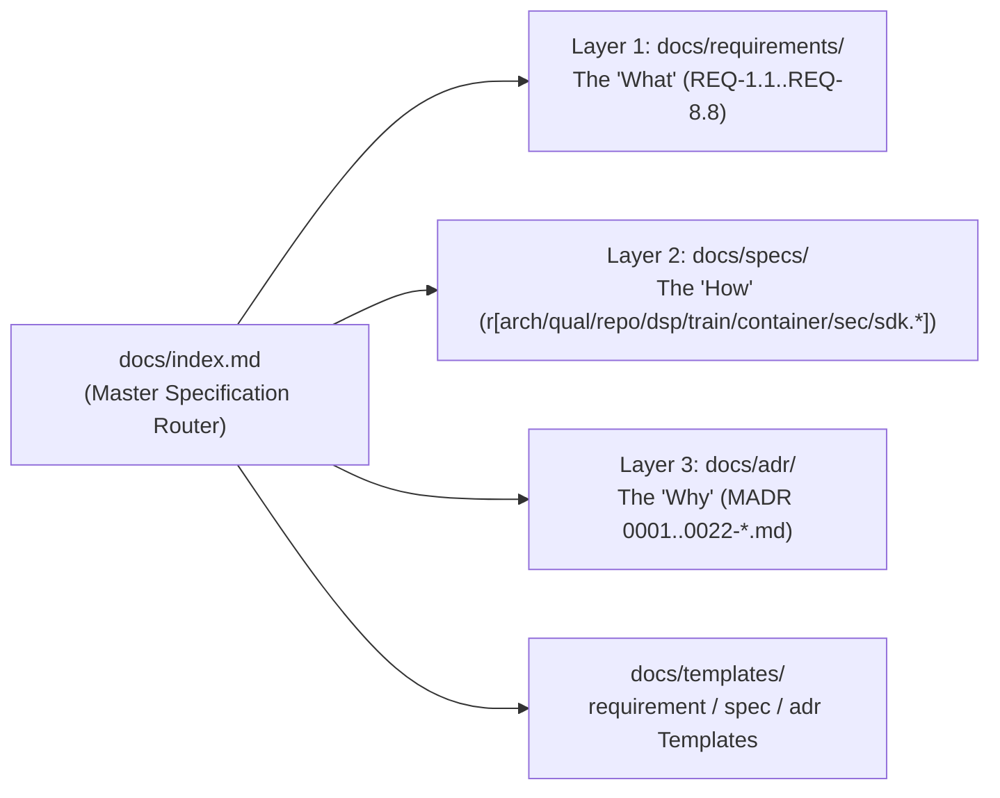

# Contributing to the DNAM Specification Manual (`docs/`)

This guide defines the authoring standards, three-layer directory architecture (`requirements/`, `specs/`, `adr/`), Rust Reference-style `r[...]`, `ref[...]`, and `verify[...]` specification rule identifiers, MADR conventions, and structured-prose formatting rules specified in [project_and_documentation_quality.md](specs/architecture/project_and_documentation_quality.md) (`ref[repo.docs.spec-rules-and-adrs]`) for the **Dynamic Neural Audio Modeler (DNAM)** manual under [docs/](index.md).

For monorepo-wide code, licensing, and `AGENTS.md` progressive-disclosure rules, see the [root contributing guide](../CONTRIBUTING.md) and [root AGENTS.md](../AGENTS.md).

---

## 1. Purpose, Core Principles & Specification Prose Style

Every document in [docs/](index.md) has a strict engineering role separating **What** (`requirements/`), **How** (`specs/`), and **Why** (`adr/`).

| Principle | Normative Authoring Requirement |
| :--- | :--- |
| **1. Strict Layer & Clean-Room Separation** | `docs/requirements/` (`REQ-1.1`–`REQ-8.8`) defines goals; within `docs/specs/` (18 specs total), 16 domain specs remain language-agnostic while 2 SDK specs under `docs/specs/sdks/` specify concrete Rust and TypeScript bindings; `docs/adr/` documents trade-offs. |
| **2. Rule Definitions & Citations** | Define each `r[<domain>.<subdomain>.<rule>]` once under `docs/specs/`; cross-reference via `ref[<id>]` in code and ADRs; cite verification via `verify[<id>]` in tests (`ref[repo.docs.spec-rules-and-adrs]`). |
| **3. Zero Spec-Text Parsing in Tests** | Unit, integration, and arithmetic reference tests must never parse Markdown prose from `docs/`; only the guardrail suites under `tests/` inspect `docs/` files directly. |
| **4. Zero Duplication in Routing Docs** | Never copy equations, clamp tables, or JSON schemas into `AGENTS.md` routing maps or package `README.md` files; link directly to the canonical section anchor or cite `r[...]`. |
| **5. Calm Engineering-Manual Prose** | Write focused 2–4 sentence prose paragraphs (`<= 650` characters) paired with crisp tables, Mermaid diagrams, and monospaced ASCII layouts—never 100–200 word bullet walls or backtick pill soup. |

---

## 2. 3-Layer Directory Architecture, Rule Prefixes & Authoring Templates



| Layer & Directory | Canonical Files | Rule / ID Prefix | Authoring Template |
| :--- | :--- | :---: | :--- |
| **Layer 1: Requirements (`docs/requirements/`)** | [system_goals_and_requirements.md](requirements/system_goals_and_requirements.md) | `REQ-1.1`–`REQ-8.8` | [requirement_template.md](templates/requirement_template.md) |
| **Layer 2A: Architecture, Perceptual & Repo Quality (`docs/specs/architecture/`)** | [sona_architecture.md](specs/architecture/sona_architecture.md), [psychoacoustic_quality_and_tiers.md](specs/architecture/psychoacoustic_quality_and_tiers.md), [project_and_documentation_quality.md](specs/architecture/project_and_documentation_quality.md) | `r[arch.*]`, `r[qual.*]`, `r[repo.*]` | [spec_template.md](templates/spec_template.md) |
| **Layer 2B: Real-Time DSP (`docs/specs/dsp/`)** | [op_t_transport.md](specs/dsp/op_t_transport.md), [op_m_modal_kautz.md](specs/dsp/op_m_modal_kautz.md), [op_n_paralru_and_polyadaa.md](specs/dsp/op_n_paralru_and_polyadaa.md), [router_and_crossbar_topology.md](specs/dsp/router_and_crossbar_topology.md), [parametric_control_bus.md](specs/dsp/parametric_control_bus.md) | `r[dsp.op-t.*]`, `r[dsp.op-m.*]`, `r[dsp.op-n.*]`, `r[dsp.router.*]`, `r[dsp.crossbar.*]`, `r[dsp.core.*]`, `r[dsp.cabinet.*]`, `r[dsp.tank.*]`, `r[dsp.head.*]`, `r[dsp.zoh.*]`, `r[dsp.ctrl.*]`, `r[dsp.tempo.*]` | [spec_template.md](templates/spec_template.md) |
| **Layer 2C: Capture, Training & Audit (`docs/specs/training/`)** | [capture_and_alignment.md](specs/training/capture_and_alignment.md), [webgpu_and_varpro_solver.md](specs/training/webgpu_and_varpro_solver.md), [iterative_resume_and_caching.md](specs/training/iterative_resume_and_caching.md), [control_space_audit.md](specs/training/control_space_audit.md) | `r[train.capture.*]`, `r[train.pipeline.*]`, `r[train.gram.*]`, `r[train.resume.*]`, `r[train.cache.*]`, `r[train.cloud.*]`, `r[train.audit.*]` | [spec_template.md](templates/spec_template.md) |
| **Layer 2D: Containers, Security & SDKs (`docs/specs/containers/`, `docs/specs/security/`, `docs/specs/sdks/`)** | [dnam_binary_format.md](specs/containers/dnam_binary_format.md), [project_container_format.md](specs/containers/project_container_format.md), [provenance_and_enclave_drm.md](specs/security/provenance_and_enclave_drm.md), [watermarking_and_marketplace.md](specs/security/watermarking_and_marketplace.md), [rust_sdk.md](specs/sdks/rust_sdk.md), [typescript_sdk.md](specs/sdks/typescript_sdk.md) | `r[container.dnam.*]`, `r[container.proj.*]`, `r[sec.*]`, `r[sdk.rust.*]`, `r[sdk.ts.*]` | [spec_template.md](templates/spec_template.md) |
| **Layer 3: ADRs (`docs/adr/`)** | [ADR-0001](adr/0001-superseded-tri-physics-prototype.md) .. [ADR-0022](adr/0022-sona-state-space-operator-and-webgpu-architecture.md) | `ADR-0001`–`ADR-0022` | [adr_template.md](templates/adr_template.md) |

---

## 3. Implementation-Agnostic Requirements vs. Normative Specs (`ref[repo.docs.requirements-layer]`, `ref[repo.docs.spec-rules-and-adrs]`)

The [system goals and requirements](requirements/system_goals_and_requirements.md) (`REQ-1.1`–`REQ-8.8`) must remain strictly implementation-agnostic. Normative requirement prose states functional capabilities, perceptual quality (bESR), slimmable tier scaling, hardware budgets, and security guarantees without referencing internal container extensions, JSON field names, or backend API names; [docs_registry_guardrails.test.ts](../tests/docs_registry_guardrails.test.ts) enforces this boundary automatically.

Normative specifications under `docs/specs/**/*.md` (18 canonical specifications total) obey a **One-Way Clean-Room Separation** rule (`ref[repo.docs.spec-rules-and-adrs]`):

- **16 Language-Agnostic Domain Specifications** (`architecture/`, `dsp/`, `training/`, `containers/`, `security/`) specify portable mathematics, signal flows, binary wire layouts, and cryptographic protocols without referencing repository directory paths (`packages/`, `tools/`, `tests/`, `.agents/`), crate/package names, language syntax, or SDK rules (`docs/specs/sdks/`, `ref[sdk.*]`).
- **2 SDK Implementation Specifications** (`docs/specs/sdks/rust_sdk.md` with `r[sdk.rust.*]` and `docs/specs/sdks/typescript_sdk.md` with `r[sdk.ts.*]`), together with Layer 3 ADRs and workspace packages, map those domain contracts onto concrete language types, memory layouts, SIMD traits, FFI bindings, and disassembly/tooling gates by referencing strictly downward into the 16 domain specifications.

Every normative specification under `docs/specs/**/*.md` annotates each section and sub-rule with a unique backtick-wrapped identifier `r[<domain>.<subdomain>.<rule>]` standing alone on its own line immediately under a `##`, `###`, or `####` heading (zero inline numbered-list definitions, zero skipped heading levels, and at least one rule per leaf section). Code and ADRs reference rules via `ref[<id>]`, and tests declare coverage via `verify[<id>]`.

Every file under `docs/requirements/`, `docs/specs/`, `docs/adr/`, and `docs/templates/` begins at line 1 with YAML frontmatter (`--- ... ---`). ADRs follow [adr_template.md](templates/adr_template.md) with `NNNN-kebab-case.md` filenames and `id: ADR-NNNN`; normative specs and requirements must never cite superseded ADRs (`status: superseded`) in frontmatter or body links.

---

## 4. Formatting, Structured Prose, Pill Discipline & GitHub MathJax Rules

All Markdown files are checked on every test run by [docs_formatting_guardrails.test.ts](../tests/docs_formatting_guardrails.test.ts).

### 4.1 Mermaid Diagrams (`ref[repo.docs.github-latex-and-mermaid]`)

Major sections describing signal chains, execution protocols, or state machines should open with a Mermaid diagram:

| Subject Matter | Preferred Mermaid Diagram Type | Canonical Example |
| :--- | :--- | :--- |
| **DSP signal flow, multi-block cascades, training pipelines, or container flows** | `flowchart TD` or `flowchart LR` with labeled `subgraph` blocks | [sona_architecture.md §1.2](specs/architecture/sona_architecture.md#12-the-sona-architectural-breakthrough), [dnam_binary_format.md §1](specs/containers/dnam_binary_format.md#1-hybrid-binary-container-wire-framing---50-ns-zero-json-hardware-fast-path) |
| **Dual-rate execution loops, calibration handshakes, or TrustZone unsealing** | `sequenceDiagram` with `autonumber`, `alt`/`else`, and `loop` blocks | [sona_architecture.md §1.2](specs/architecture/sona_architecture.md#dual-rate-48-khz-audio-vs-3-khz-control-sona-execution-lifecycle), [provenance_and_enclave_drm.md §3.2](specs/security/provenance_and_enclave_drm.md#32-end-to-end-dnam-seal-dnsl-sealing--hardware-trustzone-unsealing-flow) |
| **Bypass spillover (Trails) or lifecycle state machines** | `stateDiagram-v2` with explicit transition guards | [sona_architecture.md §3.4](specs/architecture/sona_architecture.md#34-spillover-trails-state-machine) |

Always wrap Mermaid node labels containing parentheses, brackets, colons, or operators in double quotes (e.g., `NodeA["Op-N: 1x B-Spline PolyADAA (48 kHz)"]`). Never place semicolons (`;`) inside a `sequenceDiagram` block, because Mermaid treats `;` as a statement terminator.

### 4.2 Zero Inline LaTeX Math in Markdown Tables (`ref[repo.docs.markdown-table-math]`)

> [!IMPORTANT]
> GitHub's MathJax renderer wraps inline math (`$...$`) inside Markdown table cells in scrollable containers that cause horizontal scrollbars and pipe (`|`) parsing collisions.

No line starting with `|` in any `.md` file may contain a raw `$` character outside backtick code spans. Use Unicode mathematical symbols (`≤`, `≥`, `×`, `÷`, `→`, `↔`, `⊂`, `∈`, `⊕`, `∞`, `Δ`, `σ`, `λ`, `τ`, `ψ`, `φ`, `₀`–`₉`, `⁰`–`⁹`) or code spans (`uplo = 'U'`, `O(log₂ L)`) inside table cells, and place full LaTeX equations in `$$...$$` display blocks outside tables.

### 4.3 GitHub CommonMark + MathJax LaTeX Compatibility (`ref[repo.docs.github-latex-and-mermaid]`)

CommonMark parses backslash escapes before passing text to MathJax, so inline `$...$` and display `$$...$$` math must obey GitHub compatibility constraints:

| Forbidden Pattern in Math | Why It Fails on GitHub | Required Replacement |
| :--- | :--- | :--- |
| Non-whitespace-flanked `$...$` delimiters (`($...$)`, `-$M$`, `$x$-norm`) | CommonMark fails to open or close math when `$` abuts punctuation or text | Flank inline `$...$` with whitespace (trailing sentence punctuation only) or use Unicode prose |
| Punctuation escapes (`\_`, `\;`, `\,`, `\!`, `\{`, `\}`, `\|`, `\%`, `\\`) | CommonMark strips the leading backslash before MathJax sees it | Use `\lbrace` and `\rbrace` for sets, `\Vert` for norms, and split multi-line equations into separate `$$...$$` blocks |
| Disallowed macros (`\operatorname`, `\multicolumn`, `\texttt`, `\text{--`) | Unsupported or mangled by GitHub's MathJax configuration | Use `\mathrm{...}` or `\text{...}` with standard ASCII hyphens `-` |
| Underscores inside `\text{...}` or `\mathrm{...}` | Treated as an unescaped subscript inside text mode | Use hyphens or spaces inside text macros (`\text{send-gain}`), or place subscripts outside (`g_{\text{send}}`) |
| Unbalanced `{` vs. `}` braces | Breaks the entire math block render | Match every `{` and `}` inside every `$...$` and `$$...$$` block |

### 4.4 Relative Markdown Links, Heading Anchors & Clean Link Labels (`ref[repo.docs.relative-links-and-anchors]`)

Every relative file link and `#section-anchor` fragment across workspace Markdown files is checked against the filesystem and GitHub's heading slug algorithm by `test_relative_markdown_links_resolve()`. Never start a Markdown link label `[label](target)` inside `docs/` with `../` or `./`; always use human-readable titles or basenames (e.g., `[binary container specification](specs/containers/dnam_binary_format.md)`). When renaming a heading in `docs/`, search the repository for `#old-heading-slug` and update all incoming links.

### 4.5 Preferring Monospaced ASCII Diagrams Over Markdown Tables & Prose

While Mermaid diagrams handle topological graphs and state flows, monospaced ASCII diagrams (`text` code blocks) should be preferred whenever fixed-width spatial alignment displays information more clearly:

| Use Case | Why ASCII (`text`) Beats Markdown Tables / Prose | Canonical Example |
| :--- | :--- | :--- |
| **Multi-arena parameter budget maps & binary directories** | Provides full-width banners, horizontal `+---+---+` dividers, and zero mid-token wrapping of tensor shapes or byte offsets | [dnam_binary_format.md §1](specs/containers/dnam_binary_format.md#1-hybrid-binary-container-wire-framing---50-ns-zero-json-hardware-fast-path), [sona_architecture.md §2](specs/architecture/sona_architecture.md#2-4-tier-slimmable-simd-hierarchy-lite--full--pro--ultra) |
| **64-byte cache-line & binary struct breakdowns** | Preserves multi-line indented field lists and byte ranges inside visually separated blocks without `<br/>` clutter | [dnam_binary_format.md §1](specs/containers/dnam_binary_format.md#1-hybrid-binary-container-wire-framing---50-ns-zero-json-hardware-fast-path), [provenance_and_enclave_drm.md §3.2](specs/security/provenance_and_enclave_drm.md#32-end-to-end-dnam-seal-dnsl-sealing--hardware-trustzone-unsealing-flow) |
| **Hierarchical MAC / compute accounting ledgers** | Aligns nested stage sub-items, dashed summation bars, and right-justified operation totals into a scannable ledger | [sona_architecture.md §2.2](specs/architecture/sona_architecture.md#22-hardware--dsp-benchmark-summary) |
| **SIMD vector lane grids & ring-buffer memory bars** | Directly visualizes 2-D register lanes (NEON 128-bit), contiguous memory partitions, and block-matrix quadrants | [op_m_modal_kautz.md §1](specs/dsp/op_m_modal_kautz.md#1-4-lane-simd-symplectic-complex-recurrence--algebraic-rotor) |

Use standard Markdown tables when presenting flat registries (`REQ-1.1`–`REQ-8.8`) or compact 3–6 column property comparisons with short cells.

### 4.6 Structured Prose Budgets & Inline Code Pill Discipline

Canonical specifications under `docs/specs/**/*.md` are enforced as readable technical manuals with strict structural and formatting ceilings:

| Formatting Rule | Automated Limit (`docs/specs/**/*.md`) | Authoring Guidance |
| :--- | :---: | :--- |
| **Focused Prose Paragraphs** | `<= 650` normalized chars, `<= 8` code spans, `>= 6` paragraphs/spec | Break dense walls into 2–4 sentence focused paragraphs; ensure `proseParagraphCount + tableDataRowCount > listItemCount`. |
| **Short Parallel List Items** | `<= 240` normalized chars, `<= 5` code spans | Use bullet or numbered lists strictly for short parallel items; move multi-sentence rules into prose paragraphs or tables. |
| **Zero Nested Parentheticals** | No `(outer (inner))` outside code, math, or URLs | Flatten nested asides into separate sentences or em-dashes. |
| **Strict Inline Code Pill Discipline** | Zero banned numeric or prose-word pills | Never wrap plain numbers, byte sizes ("64 B"), frequencies ("48 kHz"), multipliers ("2×"), versions ("v3.0"), bit widths ("32-bit"), or tier/domain words ("Lite", "Full", "Pro", "Ultra", "Arena 0", "Quad 0", "SONA", "VarPro", "WebGPU", "Kautz", "FIR", "ZOH", "SVD", "OMP", "LTAS", "BPTT", "SHA-256", "Ed25519") in backticks. Reserve backticks for concrete Rust, TypeScript, WGSL, JSON, FourCC, and rule/req tokens. |

---

## 5. Maintaining Requirements (`REQ-*`), Specifications (`r[...]`), Verification (`verify[...]`) & ADRs

Every requirement in [system_goals_and_requirements.md](requirements/system_goals_and_requirements.md) appears as a Markdown table row beginning with ``| **`REQ-X.Y`** |`` under its Goal (41 total requirements) following [requirement_template.md](templates/requirement_template.md). Every normative specification section under `docs/specs/` defines at least one unique `r[<domain>.<subdomain>.<rule>]` tracked for `verify[...]` coverage following [spec_template.md](templates/spec_template.md), and every architectural trade-off lives in an atomic MADR under `docs/adr/` following [adr_template.md](templates/adr_template.md).

---

## 6. Verification Commands

Run the project-scoped documentation and specification guardrail suite from the repository root after any documentation change:

```bash
# Run formatting, linting, typechecking, and all documentation/specification guardrails
moon check tests

# Or invoke the guardrail test task directly
moon run tests:test
```
