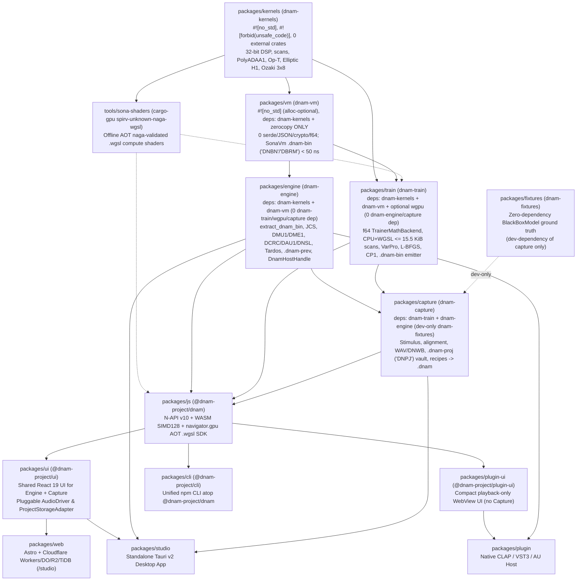

# ADR-0020: 13-Package Pure-IO Monorepo DAG, 3-Layer Container Stack & Cloud-Ready `.dnam-proj` (`DNPJ`) Container

## 1. Context & Problem Statement

Following [`ADR-0018`](0018-signal-chain-fixtures-crate-and-whitebox-distillation.md) and [`ADR-0022`](0022-sona-state-space-operator-and-webgpu-architecture.md), DNAM unified real-time `SONA` DSP execution and split-precision `WebGPU` + host-`f64` `VarPro` training in pure Rust. However, three architectural coupling hazards prevented seamless execution across `#![no_std]` `!alloc` embedded DSP hosts, WebAudio browsers, Cloudflare Workers / Durable Objects / R2 / TiDB cloud storage, DAW plugins (`CLAP`/`VST3`/`AU`), native desktop Studio, and npm CLI workflows (`REQ-1.7`, `REQ-3.1`–`REQ-3.3`, `REQ-4.1`, `REQ-5.3`, `REQ-8.8`):

1. **Filesystem-Coupled Workspace Artifacts (`dnam.toml`, `.dnam-ckpt`, `.dnam-cache/*.dnce`):** Splitting a capture session across a loose workspace directory (`dnam.toml` + `stems/*.wav`), a separate `.dnam-ckpt` (`DNCK`) checkpoint file, and a `.dnam-cache/*.dnce` (`DNCE`) sidecar directory broke single-file portability, prevented `HTTP Range` header inspection in object storage (`R2`/`S3`), and complicated non-destructive capture vault editing (adding, toggling, replacing, or deleting individual knob/switch stems).
2. **Mixed Host I/O & Core Capture Boundaries (`packages/trainer` + CLI inside `packages/studio`):** Embedding CLI binaries (`clap`), filesystem workspace scaffolding, and OS audio assumptions inside core libraries obstructed clean `WASM` / `N-API` SDK bindings and forced DAW plugin builds to pull in capture/training dependencies they do not use.
3. **Coupled VM Execution, Shell/DRM & Reusable Solver Machinery:** Coupling the `#![no_std]` `!alloc` real-time DSP virtual machine (`dnam-vm`) directly inside the `.dnam` shell/DRM/host crate (`dnam-engine`), and embedding reusable `f64`/`wgpu` training compute (`dnam-train`) inside `dnam-capture`, prevented `< 50 ns` zero-JSON `.dnam-bin` VM loading, risked pulling GPU/solver bloat into plugin hosts, and blocked specialized trainers from sharing the same `VarPro`, `.wgsl`, and 3-phase register clamping stack.

---

## 2. Considered Approaches

| Approach | Monorepo Package Topology | Project / Session Persistence | Cloud `HTTP Range` & Non-Destructive Vault Editing | Failure Mode / Trade-Off |
| :--- | :--- | :--- | :--- | :--- |
| **Multi-File Workspace Folders (`dnam.toml` + `.dnam-ckpt` + `.dnam-cache/*.dnce`)** | Coupled CLI/trainer crates (`trainer` + `studio` CLI) | Loose TOML manifests + WAV folders + `DNCK` checkpoint + `DNCE` sidecars | Requires downloading multi-file archives; deleting or toggling an old stem requires full folder bookkeeping | Breaks single-file browser drag-and-drop, R2/DO object-storage range reads, and pure IO-buffer WASM execution |
| **SQLite Application File Wrapper** | Pure-IO Rust crates + SQLite VFS | Single `.sqlite` database file | Page-table indirection breaks `64 B` cache-line alignment and zero-copy `WGHT` `.dnam` slicing | Adds C library / VFS complexity in `#![forbid(unsafe_code)]` Rust and WASM workers; cannot slice runtime `.dnam` in `< 0.2 ms` |
| **13-Package Pure-IO Monorepo DAG + 3-Layer Container Stack (Selected)** | **Pure IO-buffer 5-crate Rust diamond (`kernels` -> {`vm`, `train`}, `vm` -> {`engine`, `train`}, {`engine`, `train`} -> `capture`, dev-only `fixtures`) + AOT `tools/sona-shaders` -> `js` -> `ui` / `plugin-ui` -> `web`, `plugin`, `studio`, `cli`** | **3-Layer `64 B`-aligned `v3.0` stack: Layer 0 `.dnam-bin` (`DNBN`/`DBRM`), Layer 1 `.dnam` (`DNAM`, encapsulating `.dnam-bin`), Layer 2 `.dnam-proj` (`DNPJ`: `CALB`, `SPCM`, `INPC`, `STMC`, `STAT`, `WGHT`, `AUTH`)** | **`HTTP Range: bytes=0-65535` front-loaded directory + JCS manifest; `< 5–25 ms` Two-Path Vault editing; `< 0.2 ms` `.dnam` export; `< 50 ns` zero-copy `.dnam-bin` VM boot** | Zero identified failure modes; `#![forbid(unsafe_code)]` across `kernels`, `capture`, and `fixtures` (isolated SIMD in `vm`/`train`/`engine`), `0 KB` shader bloat in `dnam.wasm`, zero `v2`/`tora` legacy baggage, and unified local/cloud storage |

---

## 3. Decision Outcome

We adopt the **13-Package Pure-IO Monorepo DAG** and the **3-Layer Container Stack**, standardizing the **Single-File Cloud-Ready `.dnam-proj` (`DNPJ`, `v3.0`) Project & Capture Vault Container**:

1. **13-Package Pure-IO Monorepo DAG (+ `tools/sona-shaders`, `ref[repo.code.type-safety-and-imports]`, `ref[sdk.rust.safe-rust-and-boundaries]`):**
   *Workspace Rollout Status:* Currently materialized on disk are `packages/{kernels,vm,engine,capture,fixtures,js,ui,studio}`; subsequent-milestone rollout targets in the 13-package DAG are `packages/{train,plugin-ui,web,plugin,cli}` and `tools/sona-shaders` (with downstream `Cargo.toml` edges wiring `dnam-vm` and `dnam-train` as later crates integrate).
   - **`packages/kernels` (`dnam-kernels`):** `#![no_std]`, `#![forbid(unsafe_code)]`, `0` external crates — single-source `32-bit` DSP, prefix scans, `PolyADAA1`, orthogonal `Op-T`, Stereo 6-pair Elliptic `HilbertH1`, and `Ozaki` `3x8` primitives shared identically by `dnam-vm`, `dnam-train`, and offline AOT `.wgsl` compute shaders (`tools/sona-shaders`).
   - **`packages/vm` (`dnam-vm`):** `#![no_std]` (`alloc`-optional via `default = ["std"]`, `std = ["alloc"]`, `alloc = []`), depends strictly on `dnam-kernels` + `zerocopy` (`0` `serde`, `0` JSON, `0` crypto, `0` `f64`). Opens Layer 0 `.dnam-bin` (`DNBN`/`DBRM`) zero-copy in `< 50 ns` and executes `SonaVm` (`ControlBus[0..32]`, `TempoSync`, `f32` SIMD backends).
   - **`packages/engine` (`dnam-engine`):** Depends on `dnam-kernels` + `dnam-vm` (**zero dependency on `dnam-train`, `wgpu`, or `dnam-capture`** so `packages/plugin` pulls zero training/GPU bloat). Wraps `dnam-vm` over Layer 1 `.dnam` (`DNAM`) via zero-copy `extract_dnam_bin`, validates RFC 8785 JCS manifests, handles `DMU1`/`DME1` presets, `DCRC`/`DAU1`/`DNSL` authentication/encryption, `7,680-coord` Tardos watermarking (`5,807`-coord Role B), `.dnam-prev` sweep-guard containment, and SPSC host concurrency (`DnamHostHandle`) plus host-shell `HostShellPatchbay` routing.
   - **`packages/train` (`dnam-train`, sibling to `dnam-engine`):** Depends on `dnam-kernels` + `dnam-vm` + optional `wgpu` (**zero dependency on `dnam-engine` or `dnam-capture`**). Houses `f64` `TrainerMathBackend`, CPU + checked-in AOT `.wgsl` (`tools/sona-shaders`) `wgpu` forward/adjoint runners (`<= 15.5 KiB` `var<workgroup>`), `VarPro`, `L-BFGS`, losses (`bESR`, `MR-IIR`, `SpecOT`, Gabor, `IF+GD`), 3-phase register clamping, `CP1` spline fitter, and `.dnam-bin` emitter.
   - **`packages/fixtures` (`dnam-fixtures`):** Zero-dependency black-box ground-truth audio fixtures (`BlackBoxModel`), linked exclusively via `[dev-dependencies]` of `packages/capture` (`scope: "development"`).
   - **`packages/capture` (`dnam-capture`, replacing `packages/trainer`):** Depends on `dnam-train` + `dnam-engine` + dev-only `dnam-fixtures`. Orchestrates pure IO-buffer hardware calibration, excitation planning, multi-regime sub-sample alignment, 5-bit-depth WAV codec (`Int12`/`Int16`/`Int24`/`Int32`/`Float32`), `DNWB` white-box distillation, universal + specialized trainer recipes emitting `.dnam-bin` -> `.dnam`, and the Layer 2 `.dnam-proj` (`DNPJ`) vault — with **zero** CLI (`clap`), **zero** OS audio (`cpal`), and **zero** loose `dnam.toml` workspace files.
   - **Host, SDK & Downstream Rollout (`packages/js` -> `ui` / `plugin-ui` -> `web`, `plugin`, `studio`, `cli`):** `packages/js` (`@dnam-project/dnam`, linking `engine`, `train`, `capture`, plus checked-in `.wgsl` from `tools/sona-shaders` for browser `navigator.gpu` training with `0 KB` WASM shader bloat) and `packages/ui` (pluggable `AudioDriver` + `ProjectStorageAdapter`) power **`packages/web`** (`ui`), **`packages/plugin-ui` + `packages/plugin`** (playback-only DAW plugins linking `plugin-ui` + `engine` without `train`/`capture`), **`packages/studio`** (standalone Tauri v2 desktop app linking `ui` + `engine` + `capture`), and **`packages/cli`** (`@dnam-project/cli` atop `js`).
2. **3-Layer Container Stack & Single-File Cloud-Ready `.dnam-proj` (`DNPJ`, `v3.0`) Container (`ref[container.dnam.vm-binary]`, `ref[container.proj.preamble-and-directory]`, `ref[container.proj.jcs-manifest]`, `ref[container.proj.lifecycle-states]`):**
   - Retires legacy containers, `.dnam-ckpt` (`DNCK`), `.dnam-cache/*.dnce` (`DNCE`), and `dnam.toml`. Every binary artifact is strictly `v3.0` (`"architecture": "sona"`) across three composable layers:
     - **Layer 0 — `.dnam-bin` (`DNBN` / `DBRM`, `v3.0`):** Bare, `0`-JSON `64 B`-aligned VM register image (`64 B` `DnamBinHeaderWire` `"DNBN"` + `64 B` `DnamBinRuntimeMetaWire` `"DBRM"` + `shared_controls` + `"TSYN"` + optional `"CEXT"` + `Arena 0..3`). Loaded zero-copy by `dnam-vm` (`SonaVm`) in `< 50 ns`, with immutable `tier_end_offsets[4]` supporting `REQ-5.6` tier stripping by raw byte-slice truncation without mutating headers.
     - **Layer 1 — `.dnam` (`DNAM`, `v3.0`):** Marketplace, UI, and DRM container managed by `dnam-engine`. Encapsulates a verbatim `64 B`-aligned `.dnam-bin` prefix (`dbin_prefix`) at `dbin_offset` (`% 64 == 0`, positioned immediately after `auth_extent`), sets `Region 4` (`shared_extent`) to `0 B` (eliminating duplicate storage), authenticates `crc_dbin_prefix` inside `DCRC` (`DAU1` / `DNSL`), and exposes zero-copy `extract_dnam_bin(bytes)` alongside RFC 8785 JCS manifest, UI/knob metadata, `DMU1`/`DME1` presets, Tardos `7,680-coord` watermarks (`5,807`-coord Role B), and `.dnam-prev`.
     - **Layer 2 — `.dnam-proj` (`DNPJ`, `v3.0`):** Single-file cloud-ready project & capture vault managed by `dnam-capture`, storing the canonical Layer 1 `.dnam` model directly in `WGHT`.
   - **Front-Loaded Cloud Framing (`HTTP Range: bytes=0-65535`):** Byte `0..64` holds `DnamProjPreambleWire` (`magic = b"DNPJ"`, `version = 3.0`), followed immediately by `N * 64 B` content-addressed `ProjChunkDirEntryWire` records (`kind`, `chunk_id`, `flags`, `offset`, `length`, `crc32c`, `sha256`) and the `64 B`-padded RFC 8785 JCS `DnamProjManifest`. Cloud backends (`Cloudflare R2` + `Durable Objects` + `TiDB`) inspect project metadata, controls, stem registries, and per-chunk `SHA-256` digests in a single `64 KB` range read and upload/download only missing or mutated chunks.
   - **Lifecycle Chunks & `< 1 ms` Capsule Compaction (`ref[container.proj.inpc-capsule]`, `ref[container.proj.stmc-capsule]`, `ref[container.proj.stat-uplo-u]`, `ref[container.proj.wght-and-export]`, `ref[container.proj.auth-signature]`):**
     - `CALB` (`64 B` loopback latency, converter gain, noise floor) + optional raw `SPCM` stems during active recording;
     - `INPC` (`384,640–480,640 B` mono / `768,640–960,640 B` stereo: `640 B` header + `2.0–2.5 s` (`96,000–120,000` frames) unquantized `fp32` dry capsule) + per-stem `STMC` (`388,800–484,800 B` mono / `772,800–964,800 B` stereo: `128 B` header + `R <= 36` `16 B` `StmcTrajectoryWindow` records + `4,096 B` spectral summary + wet `fp32` capsule);
     - `STAT` (`17,664 B` Lite / `68,096 B` Full / `151,296 B` Pro / `267,264 B` Ultra: cached `StarCenter` `uplo='U'` `f64` Gram + cross-correlation anchor);
     - `WGHT` (complete canonical Layer 1 `v3.0` `.dnam` runtime model with embedded Layer 0 `.dnam-bin` and Zero-DC contraction enforced, exported in `< 0.2 ms` with zero solver work via `export_runtime_dnam`);
     - `AUTH` (`128 B` `Ed25519` creator signature over domain `"DNPJ-PROJECT-MANIFEST-V3"` + immutable manifest JCS `SHA-256` + ordered directory entries, with `DistributionPolicy` enforcement before export).
   - **Two-Path Non-Destructive Capture Vault (`ref[train.cache.proj-vault]`, `ref[train.resume.two-tier-execution]`):** Adding, removing, replacing, or toggling stems (`add_capture`, `remove_capture`, `replace_capture`, `set_capture_enabled`) takes the Fast-Path (`CP1` Newton/Lobatto + control-bus update over frozen SONA core, cached `STAT`, and static `W_ro,0`) when upstream poles remain unaltered, or automatically escalates to Deterministic Full Re-Pool over `INPC` + `STMC` capsules when `StarCenter` or pole-bearing stems change—never requiring original multi-megabyte WAV files once compacted via `compact_to_capsules`.

---

## 4. Consequences & Verification

- **Positive:** Isolates `#![no_std]` `!alloc` `< 50 ns` `.dnam-bin` VM execution in `dnam-vm` and keeps `packages/plugin` free of training/GPU bloat (`0` `dnam-train`/`wgpu` deps); enables shared `dnam-train` solvers across universal and specialized recipes; eliminates multi-file workspace fragility; and delivers zero-copy `< 0.2 ms` `.dnam` extraction, single-request `64 KB` cloud metadata inspection, content-addressed `SHA-256` chunk sync, and `< 25 ms` WAV-free capture vault editing across desktop, browser `WASM` + `navigator.gpu`, and Cloudflare Workers.
- **Canonical Specifications:** [dnam_binary_format.md](../specs/containers/dnam_binary_format.md), [project_container_format.md](../specs/containers/project_container_format.md), [capture_and_alignment.md](../specs/training/capture_and_alignment.md), [webgpu_and_varpro_solver.md](../specs/training/webgpu_and_varpro_solver.md), [iterative_resume_and_caching.md](../specs/training/iterative_resume_and_caching.md), [project_and_documentation_quality.md](../specs/architecture/project_and_documentation_quality.md), [rust_sdk.md](../specs/sdks/rust_sdk.md).

## Amendment Appendix

- **2026-11-20T02:07:00-05:00:** Amended to keep embedded and plugin runtimes free of JSON, crypto, and solver dependencies while allowing standalone reuse of low-level training primitives.
- **2026-11-20T23:02:00-05:00:** Amended to isolate multi-port studio patchbay routing inside `dnam-engine` so `dnam-vm` remains a pure stereo register machine (`ADR-0022`).
