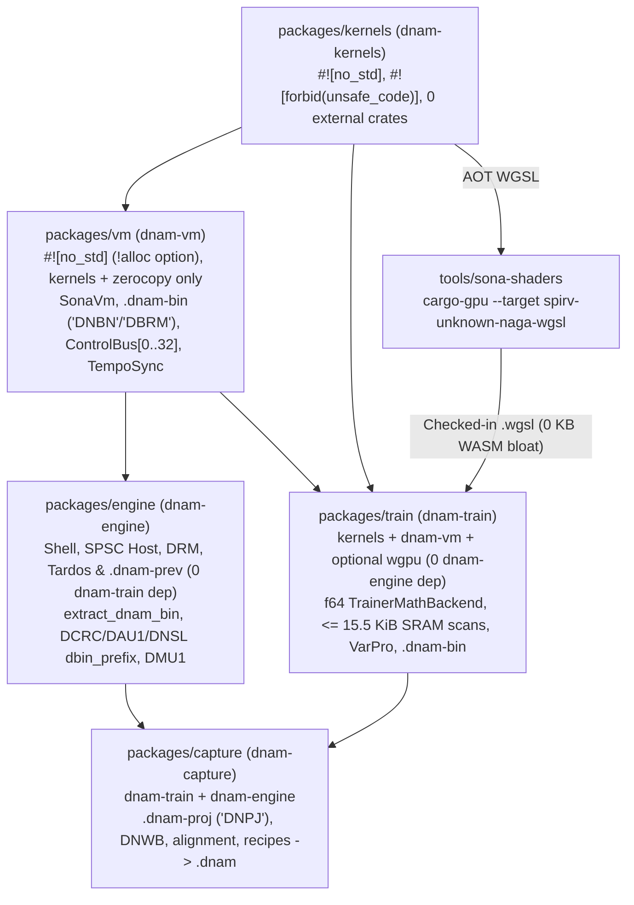

# ADR-0022: State-Space Operator Neural Architecture (`SONA`) `v3.0`, Compile-Time Tiers, Shared Kernels, `32-Bit` `WebGPU` & `zerocopy` Wire Format

This architectural decision record supersedes [`ADR-0001`](0001-superseded-tri-physics-prototype.md), [`ADR-0002`](0002-superseded-tri-operator-recurrent-architecture.md), [`ADR-0004`](0004-superseded-division-free-polyadaa-and-c2-wavefolder.md), [`ADR-0008`](0008-superseded-per-stem-kronecker-statistics-and-wide-gram.md), [`ADR-0011`](0011-superseded-end-to-end-stage-wiring-and-arena-slice-topology.md), [`ADR-0017`](0017-superseded-pure-rust-analytical-varpro-solver-and-planar-decoupling.md), and [`ADR-0021`](0021-superseded-unified-matryoshka-gru-and-direct-register-stages.md), establishing the **`SONA` (`State-Space Operator Neural Architecture`) `v3.0`** programmable DSP virtual machine, **5-crate Rust workspace diamond** (`dnam-kernels -> dnam-vm -> {dnam-engine, dnam-train} -> dnam-capture` plus `dnam-kernels -> tools/sona-shaders -> dnam-train` and `dnam-kernels -> dnam-train`), compile-time `const` `SonaTierSpec` capacity locking, shared `#![no_std]` `packages/kernels/` (`dnam-kernels`) + checked-in AOT `cargo-gpu` `.wgsl` shader pipeline, split-precision `32-bit` `WebGPU` + host-`f64` `VarPro` solver (`REQ-4.1`–`REQ-4.3`), and declarative 3-layer `zerocopy` `v3.0` wire containers (`.dnam-bin`, `.dnam`, `.dnam-proj`) across [`../specs/architecture/sona_architecture.md`](../specs/architecture/sona_architecture.md) and its companion subsystem specifications.

---

## 1. Context & Problem Statement: Bottlenecks Exposed in `TORA v3`

Empirical certification against the black-box signal-chain matrix (`Chain-01..15`), embedded ARM Cortex-A76 L1D/WCET budgets (`REQ-6.1`), and portable GPU/browser acceleration (`REQ-4.1`–`REQ-4.3`) exposed four structural bottlenecks in `TORA v3`:

| `TORA v3` Bottleneck | Root Cause Mechanism | Measurable Acoustic, Numerical, or Hardware Failure |
| :--- | :--- | :--- |
| **1. Coupled `GRU` Local-Minima Trap & White-Box Seed Leakage** | Coupled `GRU` (`h_{n-1}` inside `z, r, n`) under sequential CPU `L-BFGS` could not discover stiff crossovers, rectifiers, or dual-release time constants from random initializations. | Forced circuit-specific heuristics (`DIODE_WR = 48.0`, `ENV_BZ = [-6.65, -6.25, -5.85]`, hardcoded LR4 seeds) inside legacy specialty code (`731` LOC), violating `REQ-1.9` (`ref[arch.pillars.universal-black-box]`, `ref[repo.code.universal-black-box]`). |
| **2. Sequential `O(L)` Training & Broken `2x -> 1x` ZOH** | Coupled `GRU` gates block `O(log₂ L)` GPU prefix scans; additionally, omitting `z` on the input update (`h_new = (1 - z) h_old + r n`) broke continuous-time ZOH invariance. | Caused `+6 dB` LF gain and resonance shifts across sample rates, requiring `lane_w_r_max > 6.0` workarounds and restricting CPU training to `256 ms` (`12,288`-sample) subwindows. |
| **3. `1x` Aliasing, Post-Hoc ISS Clamping & `Lite`-Strip Control Loss** | `Lite` and `Full` ran Padé `tanh` at `1x` (`48 kHz`) with zero `ADAA`; ISS contraction relied on halving `w_rec *= 0.5` across `57,344` simulation steps; `ControlBus` params lived in `Arena 1`. | `1x` HF alias foldback on `Lite`/`Full`; non-structural post-hoc contraction loss; stripping containers to `Lite` reset controls to `identity()`, breaking `REQ-5.6`. |
| **4. L1D Working-Set Bloat & Unidirectional Sequential Ordering** | `sizeof(V3HotCore)` (`27,520 B`) + eager `255`-slot `ControlBus` bloated `14x` working sets; strict sequential ordering orphaned `H1`, `T1`, and delay/diffuser primitives. | Could not represent `Phaser/Chorus -> Drive`, `Reverb -> Fuzz`, `220 Hz` audio-rate Ring Mod (`Chain-10` `switch=1`), or nonlinear/LPF feedback delay loops (`Chain-08`) without bespoke bypass hacks. |

---

## 2. Five Architectural Decisions & Counterexample Analysis

### Decision 1 — `SONA` Programmable DSP `VM`, Orthogonal Crossbar + 4-Block Core & Coercive Feedback (`ref[arch.operators.tri-kernel]`, `ref[arch.topology.signal-flow]`)

| Subsystem | Canonical `SONA` `v3.0` Decision | Rejected Alternative & Failure Mode |
| :--- | :--- | :--- |
| **Top-of-Frame Causal Crossbar, `SensoryQuad` & Pure-Wet `Op-T` (`2×2` VM)** | Execute `4`-frame causal micro-chunks (`tau_min = 5.0` -> `i0 - 1 >= 4 > 3`, `0-ULP` `process(1) == process(16)` block invariance) inside a pure `2-in / 2-out` VM wrapped by outer host-shell `HostShellPatchbay` (8-Port `4CM`/`WDW`). Input `48 B` `SensoryQuad` drives `q3` + smooth VCA `g_in`; orthogonal 4-lane `Op-T` runs `128 B` `TransportQuadWire` (`scat_psi_fp16` at `[120..122)`, `flags` bit 0 reserved 0 with weight-driven `0 B` allocation when `allpass_delays == [0; 4]`) and `216 B` `align(8)` pure-wet `TransportQuadHotCompact` (`inv_sigma_23`, `TANK_MAX_SIGMA_SAT_FP16 = 0x3BE0`, 2-state DF-I DC blockers, continuous passive `freeze_mix` + stage `tank_dry_mix` slot 22, unconditional `!is_full_hold` fused `SO(4)` paraunitary scattering `R_odd * diag(A_k) * R_even` over lane-major SoA `PartitionedSchroederBank::step_chunk4`, zero per-quad VCA, zero `QUAD_FLAG_SCHROEDER_ENABLE`), paired with input-only stereo `HilbertH1StereoKernel` (`248 B`, `< 0.10°` @ `48 kHz`, `<= 0.34°` across `[44.1, 96]` & `[176.4, 384]` kHz, `<= 0.67°` @ `20 Hz` near `136.2 kHz`) + 2-stage `rsqrt_pos_nr3` `T1` (`28 B`), `28 B` `OpNPreHotState`, and uniformly micro-ramped slot `16` `freeze_mix` (+ host `QUAD_FLAG_HOST_WRITE_LOCK` bit 2 with zero Schmitt bit 0). | Discrete `M` modes, discrete Schroeder bypass flags (`schroeder_enable` / `QUAD_FLAG_SCHROEDER_ENABLE`), uncompensated negative ramp feedback, TDF-II RNE DC deadbands, zero-init `rho_zoh == 0` silence, hardcoded LR4/noise-gate heuristics, `1D`-only AoS Schroeder cascades (`4×` cache-line thrashing), and discrete Freeze APIs/flags violate `REQ-1.9` / `REQ-6.1` and break continuous black-box differentiation. |
| **Block 0 `PHS` & Passive `2x2` ZDF `TPT-SVF` Associative Scan** | Use `2x2` energy-preserving ZDF `TPT-SVF` modes (`g = tan(π f_c / f_s) > 0`, `k = 1/Q ≥ 0`, `‖A_tpt[n]‖₂ ≤ 1`), adding linearly-implicit Port-Hamiltonian diode-bandpass damping (`k_eff[n] = k + k_nl * min(s1^2, 64.0)`) strictly on Block 0 (`CoreQuad`s `{0, 4, 6, 8}`, `svf_k_nl_fp16` freed by bit-15 `rect_sign` packing in `wavefolder_mix_fp16`), keeping Blocks 1..3 linear (`O(log₂ L)` Blelloch forward scan) and preserving an `O(log₂ L)` reverse-time `TptAdjointElem` suffix scan across all 4 blocks with analytical bilinear ZOH frequency prewarping (`g_host = tan(pi * f_c / f_s_host)` on `3 kHz`/cold paths). | Coupled `GRU` states or unnormalized Cartesian pole interpolation overflow `f32` inside `O(log₂ L)` GPU prefix scans and suffer `+6 dB` gain/resonance shifts under `2x -> 1x` ZOH rate transfer; iterative Newton–Raphson nonlinear SVFs stall WCET and WebGPU backprop. |
| **Selective-Duhem Stereo-Linked `1D` `ParaLRU` (Joint 4-Thread L/R SRAM + `Slot 8` Backprop)** | Pair decoupled scalar `ParaLRU` with Selective-Duhem flux gating (`gamma_duhem`, `eta`), audio-rate `lru_stereo_link`, `C²` wavefolder, and bounded cross-lane `GLU` across lower-triangular `4x4` inter-block tiles; GPU forward executes joint 4-thread `(L, R)` in-SRAM stepping (`<= 15.0 KiB`) and GPU backward runs `adjoint_scan_256` (`<= 14.5 KiB`) reading `Slot 8` (`feature_outputs`) for zero-SRAM `GLU` pullback plus 2-level `O(log₂ 256)` suffix scans (`0` Newton kink stagnation, `0` BPTT truncation). | Coupled `GRU` (`h_{n-1}` in all 3 gates) prevents decoupled lane/adjoint scans and requires destructive post-hoc `w_rec *= 0.5` clamping, while time-parallel `K = 3` Newton `ParaLRU` forward scans stall across sharp convex `ε = 10^-3` kinks (`> 10.0` / `2.8M ULP` error) and grow `O(N)` piecewise pieces under `(max, +)` relaxation. |
| **Pure-`f32` `PolyADAA1` + Batched `rcp_pos_quad_nr2` & `C^2` Wavefolder** | Combine algebraic midpoint/half-difference `(m_n, d_n)` `PolyADAA1` (`eval_poly_adaa_algebraic` + branchless `C^2` wavefolder) with pure-`f32` branchless rail-crossing reciprocals (`SimdVec4::rcp_pos_nr2` / batched `rcp_pos_quad_nr2`, zero `FDIV`, analytical `0.000000` DC equilibrium, `0-ULP` sign-flip watermark). | `1x` Padé `tanh` without `ADAA` aliases severely on `Lite`/`Full`; legacy `6`-step `f64` Newton rail-crossing scalar loops fail to translate into pure `32-bit` WGSL compute shaders (`REQ-4.1`). |
| **100% Self-Contained `1x` `Arena 0`, `"CEXT"`, & `40 B` `"TSYN"`** | Store `1x`-calibrated `48 kHz` `Lite` weights, `ControlClampDescriptorWire`, `CP1`, `U_int`, `W_ctrl`, and `Lite` `fp16` `W_readout` inside `Arena 0` (`Arena0LiteWire`, `4,608 B`) + `.dnam-bin` (`"DNBN"`/`"DBRM"` + `shared_controls` + `40 B × tsyn_count` physical `PeriodMs`/`FrequencyHz` `TSYN` + optional unwatermarked `1,280 B` `"CEXT"` driving `stage_targets[16..32]` with unconditional `3 kHz` cadence even when `P == 0`), paired with `2x`-OS `Arena 1..3` deltas (`32/48/96/128` lag FIR + `8/12/24/32` `Kautz`). | Placing `ControlBus` params in `Arena 1` silently resets controls when stripping to `Lite` (`REQ-5.6`), while string-based tempo configs or JSON inside the VM break `#![no_std]` `!alloc` execution. |

### Decision 2 — Optimize-First Compile-Time `const` `SonaTierSpec` Locking vs. Capture-Time Resizing (`ref[arch.tiers.maximize-quality-within-budget]`, `ref[qual.tiers.floors-not-stopping-criteria]`)

1. **Why `const` Tier Shapes Are Locked at Compile Time (`~85–90%` Headroom Utilization):**
   - Microarchitectural optimizations (`4`-frame causal micro-chunks, `StereoVec8`, fast-path `PolyADAA1` + `rcp_pos_quad_nr2`, zero-spill `SonaHotSlab` with incremental lag-ordered early FIR `[x[t-1]..x[t-N]]`) run **first** at VM design time, and every freed cycle is reinvested into exact locked compile-time `const` `SonaTierSpec` capacities (`LITE_SPEC [1,1,1,1]` `4` `CoreQuads`/`3` tiles/`1` `TransportQuad` @ `1x`, `FULL_SPEC [2,2,1,1]` `6` `CoreQuads`/`13` tiles/`2` `TransportQuads` @ `2x`, `PRO_SPEC [3,2,2,1]` `8` `CoreQuads`/`23` tiles/`3` `TransportQuads` @ `2x`, `ULTRA_SPEC [4,3,2,1]` `10` `CoreQuads`/`35` tiles/`4` `TransportQuads` @ `2x` RT / `4x` bounce `FullBand64Tap` `43`-spl PDC) occupying `~85–90%` of each tier's `REQ-6.1` `1x Cortex-A76` WCET (`1,190 / 2,083 / 4,166 / 8,333 ns`, targeting `<= 1,000 / 1,800 / 3,600 / 7,200 ns` with `10–15%` `P99.9` margin) and exact `N x ActiveHot <= 64 KiB` L1D (`SonaLiteHotPrefix = 4,544 B <= 4,608 B`: `14 × 4,544 = 63,616 B`; `256 B` `SonaOs2xHot` in `Full+`; `Full = 7,552 B <= 7,936 B`: `8 × 7,552 = 60,416 B`; `Pro = 11,136 B <= 15,872 B`: `4 × 11,136 = 44,544 B`; `Ultra = 14,592 B <= 28,672 B`: `2 × 14,592 = 29,184 B`, backed by cumulative `4,608 / 7,936 / 15,872 / 30,720 B` = `72 / 124 / 248 / 480 CL` wire arenas).
   - **Rejected Alternative (Capture-Time Dynamic Tier Resizing):** Dynamically scaling block/lane/FIR/Kautz counts per model prevents full LLVM loop unrolling and SIMD register pinning (`~25–45%` throughput loss from dynamic loop bounds and L1D spills), causes L1I/branch divergence across `14x` serial instances, breaks constant-size `zerocopy` `Arena0LiteWire..Arena3UltraDeltaWire` structs and `uplo='U'` `STAT` indexing, and forces divergent dynamic bounds inside `workgroup_size(256)` `.wgsl` kernels.
   - **Only Valid Per-Model Variability:** Only cold `Op-T` `ext_lines` delay-ring capacity (`0 B` up to power-of-two DRAM rings wrapped via `& ext_mask`) and active `3 kHz` control count `P` (`0` extra `48 kHz` static MACs per `REQ-6.1`) vary per captured `.dnam` / `.dnam-bin` model.
2. **Quality-Maximization Flywheel (`§4` Floors Are Not Stopping Criteria):**
   - GPU/CPU solver speedups (`<= 15.5 KiB` SRAM fusion, optional `subgroups`, `i32` Ozaki reductions, `64–128` seeds, full `2.0–2.5 s` capsules, continuous Kautz pole & `Op-T` delay polish) never trigger `ThresholdStop` early exit once `-18 / -23 / -30 / -34 dB` `bESR` qualification floors pass; optimization runs inside fixed `const` shapes to asymptotic diminishing returns (`|Delta bESR| < 0.01 dB/epoch`).

#### Prior-Art Equivalent-Quality LV2 Instance Comparison on `1× RK3582 Cortex-A76` (`2.4 GHz`, `48 kHz` + LV2 @ `80%` RT Cap)

| Architecture & Equivalent Quality Tier | Native LV2 Topology | Per-Instance Compute, Cache & LV2 Overhead on `Cortex-A76` (`64 KB` L1D / `512 KB` L2) | Est. `1× A76` CPU / LV2 Instance | Est. Safe Mono LV2 Instances (`1× A76` @ 80% Cap) | Est. Safe Stereo LV2 Chains (`1× A76` @ 80% Cap) | Est. Complete Stereo Rigs (`Drive+Amp+Cab+FX` on `1× A76`) |
| :--- | :---: | :--- | :---: | :---: | :---: | :---: |
| **Factory "Grey-Box" Multi-FX Blocks** (C++ LUTs + `2×–8×` OS Newton–Raphson + FFT Cab + FDN) | Per-block mono/stereo (`4–7×` blocks per rig) | Decoupled sub-circuits (`1D`/`2D` LUTs, `1`-step NR, per-block oversampling filters, FFT/FIR cab, FDN tank) + `4–7×` host block dispatch & L1I/L1D eviction | `2.0% – 6.0%` per single block (`14.0% – 26.0%` per `5–7` block stereo rig) | `15 – 35×` single blocks | `12 – 25×` single stereo blocks | `3 – 5×` full rigs (`5–7` chained blocks each) |
| **`NAM A2 Standard / Full` (Studio Grade)** | Mono LV2 (`2×` LV2s for stereo) | `~12,146` MACs (23 dilated conv layers) + `203.1 KB` state (`> 3.1×` L1D; `2` instances spill `512 KB` L2 to L3/DRAM) + C++ `Eigen` & LV2 port/trim overhead | `16.0% – 22.0%` (mono) `32.0% – 44.0%` (stereo pair) | `3 – 5×` mono LV2s | `1 – 2×` stereo pairs (`2–4` LV2s) | `1 – 2×` full rigs (`4–6` chained LV2s each) |
| **`NAM A2 Lite / Feather` (Live Grade)** | Mono LV2 (`2×` LV2s for stereo) | `~1,871` MACs at `75%` NEON utilization (`C = 3` unaligned loops) + `76.2 KB` state (`> 64 KB` L1D) + LV2 port/trim wrapper overhead | `6.5% – 9.0%` (mono) `13.0% – 18.0%` (stereo pair) | `8 – 12×` mono LV2s | `4 – 6×` stereo pairs (`8–12` LV2s) | `3 – 4×` full rigs (`4–6` chained LV2s each) |
| **`GuitarML Proteus` (`LSTM-40`, 1–2 Knobs)** | Mono LV2 (`2×` LV2s for stereo) | `~6,560–7,040` serial recurrent MACs + `160×` `sigmoid`/`tanh` `libm` calls/sample + `48 kHz` LV2 knob port smoothing (`+40·P` MACs static) + LV2 dispatch | `12.0% – 17.0%` (mono) `24.0% – 34.0%` (stereo pair) | `4 – 6×` mono LV2s | `2 – 3×` stereo pairs (`4–6` LV2s) | `2 – 3×` full rigs (`4–6` chained LV2s each) |
| **`NAM ParametricOD` (3-Knob WaveNet/LSTM)** | Mono LV2 (`2×` LV2s for stereo) | Dilated conv / LSTM stack + `48 kHz` per-sample `FiLM` knob projections (`+2·C·P` MACs/layer when static) + `tanh` + LV2 control port smoothing | `18.0% – 25.0%` (mono) `36.0% – 50.0%` (stereo pair) | `3 – 4×` mono LV2s | `1 – 2×` stereo pairs (`2–4` LV2s) | `1 – 2×` full rigs (`4–6` chained LV2s each) |
| **`SONA Full` (`FULL_SPEC` @ `2×` OS)** | **True Stereo LV2 (`1×` unified LV2)** | **`[2,2,1,1]` `24`-lane `SONA` core @ `2×` OS (`6` `TPT-SVF` quads, `48` lag FIR, `12` Kautz, `2` `Op-T` quads), `7,552 B <= 7,936 B` `SonaHotSlab`, `0` static control MACs, `0` `FDIV`/`FSQRT`/`libm`** | **Target `≤ 8.6%` (`≤ 1,800 ns` A76, `≤ 10.0%` ceiling)** | **`≥ 8×` LV2s** | **`≥ 8×` true-stereo LV2s** | **`≥ 8×` complete stereo rigs (`1` LV2 each)** |
| **`SONA Lite` (`LITE_SPEC` @ `1×`)** | **True Stereo LV2 (`1×` unified LV2)** | **`[1,1,1,1]` `16`-lane / `4` `TPT-SVF` quads (`32` lag FIR, `8` Kautz, `1` `Op-T` quad), `4,544 B <= 4,608 B` `SonaHotSlab`, `0` static control MACs, `0` `FDIV`/`FSQRT`/`libm`** | **Target `≤ 4.8%` (`≤ 1,000 ns` A76, `≤ 5.7%` ceiling)** | **`≥ 14×` LV2s** | **`≥ 14×` true-stereo LV2s** | **`≥ 14×` complete stereo rigs (`1` LV2 each)** |

### Decision 3 — Shared `no_std` Kernels + Checked-In AOT WGSL Shader Pipeline (`dnam-kernels` + `tools/sona-shaders` `cargo-gpu` `.wgsl`) & `32-Bit` `WebGPU` + Host `f64` `VarPro` (`dnam-train`, `ref[sdk.rust.shared-nostd-kernels]`, `REQ-4.1`–`REQ-4.3`)

| Toolchain / Precision Decision | Portability & `CPU == GPU` Parity | Build & Browser Impact | Outcome |
| :--- | :--- | :--- | :--- |
| **Hand-Written Duplicate `.wgsl` Shaders** | High drift risk between Rust CPU reference and WGSL GPU kernels (`tanh`/`rcp`/`PolyADAA1` ULP divergence). | Breaks single-source maintainability across `TPT-SVF`, `ParaLRU`, and `Op-T`. | Rejected |
| **Runtime `naga` / Nightly Shader Compilation in Workspace** | Ties every build (`moon check --all`) and browser runtime to `rust-gpu` compiler internals or bloats `dnam.wasm`. | Violates `0 KB` WASM bloat and stable `Rust 1.100.0` workspace toolchain. | Rejected |
| **Shared `no_std` Kernels + Checked-In AOT WGSL Shader Pipeline (`dnam-kernels` + `tools/sona-shaders` `cargo-gpu`)** | **100% single-source `f32`/`i32`/`u32` math compiled identically to CPU SIMD (`dnam-vm`/`dnam-train`) and `naga`-validated `.wgsl` (`<= 1.5 ULP`/step operators, `<= 1e-4 * max(1, peak)` linear tree scans, `0-ULP` Ozaki slices).** | **Normal `moon check --all` stays on stable `Rust 1.100.0`; browser `navigator.gpu` submits checked-in `.wgsl` (`0 KB` added to `dnam.wasm`); CI verifies shader rebuild drift.** | **Selected** |

- **Universal `<= 15.5 KiB` SRAM + `256x` Checkpointing + `i32` Ozaki + Host `f64` `VarPro` (`dnam-train`):**
  - Startup WGSL probes (`< 1 ms`) verify `i32` Ozaki dot exactness, `pow2_ceil_fp32`, and adapter limits (`subgroups` optional alongside a strict `<= 15,872 B` (`15.5 KiB`) `var<workgroup>` cap reserving `>= 512 B` inside `16 KiB` workgroups for `naga`/Dawn/Metal/DX12 driver scratch; uniform `block_idx == 0` 2-thread sequential PHS `TPT-SVF` + Blocks `1..3` persistent-tile Blelloch `2×2` `TPT-SVF` + exact in-SRAM `step_paralru_vec4` forward (`25 × Vec4` `quad_params`) and 2-level cross-tile `LinearScanElem`/`TptAdjointElem` reverse-adjoint scans (`20 × Vec4` `tile_adj_boundaries` carrying independent `T_L`/`T_R`)), paired with late-stage line-search-free STE `fp16` QAT polish + Gram-domain `fp16` readout coordinate rounding.
  - `256x` activation checkpointing shrinks `16 stems x 2.5 s` (`1.92M` frames) from `~780 MiB` to `~3.1 MiB` (`<= 128 MiB` storage bindings, `< 256 MiB` browser worker cap, `< 64 MiB` `WasmSimd128TrainerBackend` CPU fallback, `<= 4–8 GiB` native 2-D `RESIDENT_BATCHED`/`STREAMED` ceiling).
  - `3 × 8-bit` mantissa Ozaki contractions accumulate strictly in `i32` (`d0 <= 1024 × 256² = 67,108,864 = 2^26`, `d2 <= 83,886,080 = 5 × 2^24 <= i32::MAX`, immune to driver fast-math without requiring SPIR-V `NoContraction`), reading back `~132 KiB`/epoch into `dnam-train` host `TrainerMathBackend` (`f64` NEON/AVX2/SVE2/SME + `Wide192Accum` + `MM-Cholesky` + `33`-band `LTAS` KKT + `Schur` tier re-balancing), followed by one `~25 ms` deterministic host CPU `SonaVm` + `Wide192Accum` pass (`0-ULP` CPU/GPU runtime parity).

### Decision 4 — Microarchitectural Optimization Suite (`ref[arch.simd.two-level-traits]`, `ref[arch.tiers.hardware-budget]`)

1. **`4`-Frame Causal Micro-Chunks Inside Hoisted `16`-Frame Ticks:** Hoists `fp16 -> f32` group/tile/readout registers once per `16`-frame `3 kHz` tick and steps `4`-frame causal micro-chunks (`process_tick16_const`, linear interpolating `1x` `Op-P` `(hi, hq)` + 4 features when `OS2X` is active) with `0-ULP` `process(1) == process(16)` block invariance; incremental lag-ordered early FIR `[x[t-1]..x[t-N]]` copies once per chunk into stack `work: [f32; N + 4]` (`528 B` max at Ultra) with zero modulo wrap branches.
2. **`StereoVec8` (`AVX2+FMA`, `SVE2`, `SME`) + Interleaved `2x SimdVec4` (`NEON`, `WASM SIMD128`):** Dual-channel `8`-lane `f32` throughput inside `dnam-vm` while preserving `0-ULP` cross-ISA parity via identical `Vec4`-pair reduction trees; all `f64` trainer SIMD (`aarch64/{trainer_f64,sve2_f64*,sme_f64*}`, `x86/trainer_f64*`, `wasm/f64`) moves cleanly out of `dnam-vm` into `dnam-train`, while `neon/sha2` lives in `dnam-engine::provenance::sha256_hw`.
3. **Amortized Fast-Path `PolyADAA1` + `rcp_pos_nr2` / `rcp_pos_quad_nr2`:** Evaluates interior samples (`|u| <= 1`) branchlessly via `eval_interior_odd_even_*` with zero reciprocal calls and computes rail-crossing reciprocals in `StereoVec8` via `rcp_pos_nr2` (or batched pairs via `KernelVec4::rcp_pos_quad_nr2`, with `0` GPR transfers and `0` per-lane branches).
4. **Zero-Alloc `dnam-vm` `SonaHotSlab`, `RealtimeEngineSwap` & Disassembly Verification:** Contiguous `[0..ActiveHotBytes)` layout (`SonaLiteHotPrefix` `4,544 B`, `SonaOs2xHot` `256 B`, `Full = 7,552 B`, `Pro = 11,136 B`, `Ultra = 14,592 B`, including self-contained `216 B` `align(8)` `TransportQuadHotCompact`, `48 B` `SensoryQuad`, and `28 B` `OpNPreHotState`) uses borrowed storage (`ColdBuf<'a, T>`, `TransportExtStorage::Borrowed*`, `ControlBusBacking<'a>`) when `alloc` is disabled under `--no-default-features`, wrapped by `dnam-engine`'s `RealtimeEngineSwap` and `DnamHostHandle` (`HostMutex`), audited across both `libdnam_vm.rlib` and `libdnam_engine.rlib` in `packages/engine/tests/realtime_disassembly_audit.rs` (`ref[sdk.rust.realtime-disassembly-audit]`).

### Decision 5 — Clean `v3.0` `"sona"` 3-Layer Stack & Declarative `zerocopy` Wire Containers (`ref[sdk.rust.zerocopy-wire-structs]`, `REQ-8.8`)

- Fresh **`v3.0` (`version_major = 3, version_minor = 0`, `"architecture": "sona"`, zero `v2`/`tora` backwards compatibility)** containers separate Layer 0 **`.dnam-bin`** (`64 B` `DnamBinHeaderWire` `"DNBN"` + `64 B` `DnamBinRuntimeMetaWire` `"DBRM"` + `shared_controls` + `40 B` `TempoSyncEntryWire` `"TSYN"` + optional `1,280 B` `"CEXT"` + `Arena 0..3`, stripped to `REQ-5.6` tiers via zero-mutation `[0..tier_end_offsets[t]]` slicing), Layer 1 **`.dnam`** (`"DNAM"` / `".dnam-seal"` `"DNSL"` / `".dnam-prev"`, embedding verbatim `dbin_prefix` after `auth_extent`, setting `Region 4 == 0 B`, validating `DcrcAuthRecordWire[32..36] = crc_dbin_prefix`, binding `dbin_prefix` in `DAU1`/`DAI1`, encrypting `[tier_start..retained_end]`), and Layer 2 **`.dnam-proj`** (`"DNPJ"`/`"DNWB"`/WAV), all parsed via `#![forbid(unsafe_code)]` `#[repr(C)]` `zerocopy::byteorder::little_endian` structs including `128 B` `TransportQuadWire` and `12 B` `OpNPreBaseWire` with compile-time layout assertions.

---

## 3. Consequences & Verification Scope

1. **Positive Consequences:** Enforces strict 5-crate diamond separation (`0` `alloc`/`serde`/crypto/`f64` inside `dnam-vm`, `0` cross-coupling between `dnam-engine` DRM/host shell and `dnam-train` solvers), removes all runtime `BezoutCleanCrossover` and dedicated `Freeze` APIs/flags (`REQ-1.9`), fits `14× Lite` (`4,544 B`) comfortably inside Cortex-A76 L1D/WCET budgets (`REQ-6.1`), guarantees `0-ULP` `process(1) == process(16)` block invariance and `< 50 ns` `.dnam-bin` loading (`REQ-5.6`), and eliminates hand-coded wire parsing (`ref[sdk.rust.zerocopy-wire-structs]`).
2. **Trade-Offs:** Requires keeping `packages/vm` (`dnam-vm`) strictly `!alloc`-compatible under `--no-default-features`, auditing both `libdnam_vm.rlib` and `libdnam_engine.rlib` machine code, maintaining isolated offline `tools/sona-shaders/` `.wgsl` regeneration checks when `dnam-kernels` changes, and preserving `v3.0` `"sona"` binary boundaries with zero `v2`/`tora` legacy fallback.
3. **Target Qualification Gate:** Must proceed through **Phase A** (component-isolating fixtures: `Level 1 -> Level 2 -> Level 3`) followed by **Phase B** (cross-component excitation fixtures: `Level 1 -> Level 2 -> Level 3`) across `Chains 01..11, 13..15` plus Pitch/Shimmer, Barberpole, and ZOH-Quantizer capsules, analytical cells, and unrecorded-control cells on both `dnam-train` CPU and `wgpu` WebGPU (`0-ULP` runtime parity against `dnam-vm` CPU), with `moon run :coverage >= 95%` across `kernels`, `vm`, `engine`, `train`, `capture`, `fixtures`, and `js`.

---

## Amendment Appendix

- **2026-11-20T02:07:00-05:00:** Amended to decouple the `#![no_std]` register-file DSP VM from host/DRM shells and reusable training primitives, eliminating non-differentiable mode and Freeze forks ([`ADR-0020`](0020-modular-monorepo-and-dnam-proj-container.md)).
- **2026-11-20T23:02:00-05:00:** Amended to purge remaining white-box runtime heuristics, confine multi-port patchbay routing to the host shell, and standardize operator-neutral naming ahead of downstream consumers.
- **2026-11-21T22:25:00-05:00:** Amended to capture diode-bandpass resonant saturation in Block 0 without Newton–Raphson WCET or `<= 15.5 KiB` SRAM regression, eliminate `Op-T` comb coloration and diffuser cache-line thrashing at `0 B` wire, hot-slab, and ring RAM cost while retiring discrete Schroeder stage-bypass flags in favor of weight-driven allocation, eliminate `f32 -> fp16` container quantization drift inside one training run, and stage fixture qualification cleanly by isolation phase and generalization level.
