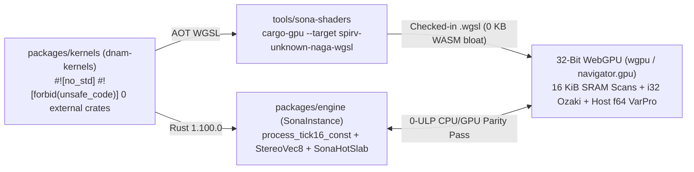

# ADR-0022: State-Space Operator Neural Architecture (`SONA`) `v3.0`, Compile-Time Tiers, Shared Kernels, `32-Bit` `WebGPU` & `zerocopy` Wire Format

This architectural decision record supersedes [`ADR-0001`](0001-superseded-tri-physics-prototype.md), [`ADR-0002`](0002-tri-operator-recurrent-architecture.md), [`ADR-0004`](0004-division-free-polyadaa-and-c2-wavefolder.md), [`ADR-0008`](0008-per-stem-kronecker-statistics-and-wide-gram.md), [`ADR-0011`](0011-end-to-end-stage-wiring-and-arena-slice-topology.md), [`ADR-0017`](0017-pure-rust-analytical-varpro-solver-and-planar-decoupling.md), and [`ADR-0021`](0021-unified-matryoshka-gru-and-direct-register-stages.md), establishing the **`SONA` (`State-Space Operator Neural Architecture`) `v3.0`** runtime engine, compile-time `const` `SonaTierSpec` capacity locking, shared `#![no_std]` `packages/kernels/` (`dnam-kernels`) + AOT `cargo-gpu` `.wgsl` shader pipeline, split-precision `32-bit` `WebGPU` + host-`f64` `VarPro` solver (`REQ-4.1`–`REQ-4.3`), and declarative `zerocopy` `v3.0` wire containers across [`../specs/architecture/sona_architecture.md`](../specs/architecture/sona_architecture.md) and its companion subsystem specifications.

---

## 1. Context & Problem Statement: Bottlenecks Exposed in `TORA v3`

Empirical certification against the black-box signal-chain matrix (`Chain-01..15`), embedded ARM Cortex-A76 L1D/WCET budgets (`REQ-6.1`), and portable GPU/browser acceleration (`REQ-4.1`–`REQ-4.3`) exposed four structural bottlenecks in `TORA v3`:

| `TORA v3` Bottleneck | Root Cause Mechanism | Measurable Acoustic, Numerical, or Hardware Failure |
| :--- | :--- | :--- |
| **1. Coupled `GRU` Local-Minima Trap & White-Box Seed Leakage** | Coupled `GRU` (`h_{n-1}` inside `z, r, n`) under sequential CPU `L-BFGS` could not discover stiff crossovers, rectifiers, or dual-release time constants from random initializations. | Forced circuit-specific heuristics (`DIODE_WR = 48.0`, `ENV_BZ = [-6.65, -6.25, -5.85]`, hardcoded LR4 seeds) inside `specialty.rs` (`731` LOC), violating `REQ-1.9` (`ref[arch.pillars.universal-black-box]`, `ref[repo.code.universal-black-box]`). |
| **2. Sequential `O(L)` Training & Broken `2x -> 1x` ZOH** | Coupled `GRU` gates block `O(log₂ L)` GPU prefix scans; additionally, omitting `z` on the input update (`h_new = (1 - z) h_old + r n`) broke continuous-time ZOH invariance. | Caused `+6 dB` LF gain and resonance shifts across sample rates, requiring `lane_w_r_max > 6.0` workarounds in `rescale_1x.rs` and restricting CPU training to `256 ms` (`12,288`-sample) subwindows. |
| **3. `1x` Aliasing, Post-Hoc ISS Clamping & `Lite`-Strip Control Loss** | `Lite` and `Full` ran Padé `tanh` at `1x` (`48 kHz`) with zero `ADAA`; ISS contraction relied on halving `w_rec *= 0.5` across `57,344` simulation steps; `ControlBus` params lived in `Arena 1`. | `1x` HF alias foldback on `Lite`/`Full`; non-structural post-hoc contraction loss; stripping containers to `Lite` reset controls to `identity()`, breaking `REQ-5.6`. |
| **4. L1D Working-Set Bloat & Unidirectional Sequential Ordering** | `sizeof(V3HotCore)` (`27,520 B`) + eager `255`-slot `ControlBus` bloated `14x` working sets; strict sequential `Router -> Pre -> Core -> Cab -> Tank` ordering orphaned `H1`, `T1`, and delay/diffuser primitives. | Could not represent `Phaser/Chorus -> Drive`, `Reverb -> Fuzz`, `220 Hz` audio-rate Ring Mod (`Chain-10` `switch=1`), or nonlinear/LPF feedback delay loops (`Chain-08`) without bespoke bypass hacks. |

---

## 2. Five Architectural Decisions & Counterexample Analysis

### Decision 1 — `SONA` Causal Operator Crossbar + 4-Block State-Space Core + Cabinet & Coercive Feedback (`ref[arch.operators.tri-kernel]`, `ref[arch.topology.signal-flow]`)

| Subsystem | Canonical `SONA` `v3.0` Decision | Rejected Alternative & Failure Mode |
| :--- | :--- | :--- |
| **Top-of-Frame Causal Operator Crossbar** | Lift causal `Op-T` ring reads (`τ ≥ 4`, `M=1` Catmull-Rom / `M=2` Hermite-Hann grains / `M=3` barberpole + `Quad 0` `128`-frame (`1,024 B` = `16 CL`, `[[u16; 4]; 128]`) inline `fp16` ring on `1 / 2 / 3 / 4` `tank_quads` (`M = 4 / 8 / 12 / 16` lines) + Schroeder diffusers + optional cold `ext_lines` `a ∈ {2, 4}`), precomputable input-only `Op-P` (`HilbertH1Lattice6Sec` + pure-`f32` branch-cut-guarded `T1SubHarmonicTracker`), and `4`-lane `Q0.32` quadrature phasors (`0.05 Hz..20 kHz`) **above** the nonlinear core, with coercive `Op-T` feedback writes (`‖G_loop‖ < 1`) and `0-ULP` integer-lag `freeze == true` write locking at frame exit. | Keeping unidirectional sequential stage execution prevents pre-drive phasers/reverbs (`Phaser -> Drive`, `Reverb -> Fuzz`), audio-rate ring modulation, and nonlinear feedback delay loops (`Chain-08`) unless device-specific bypass switches are added (violating `REQ-1.9`). |
| **Passive `2x2` ZDF `TPT-SVF` Associative Scan** | Use `2x2` energy-preserving ZDF `TPT-SVF` modes (`g = tan(π f_c / f_s) > 0`, `k = 1/Q ≥ 0`, `‖A_tpt[n]‖₂ ≤ 1`) computed with simultaneous `(LP, BP, HP, AllPass)` outputs and analytical bilinear ZOH frequency prewarping (`g_host = tan(pi * f_c / f_s_host)` on `3 kHz`/cold paths). | Coupled `GRU` states or unnormalized Cartesian pole interpolation overflow `f32` inside `O(log₂ L)` GPU prefix scans and suffer `+6 dB` gain/resonance shifts under `2x -> 1x` ZOH rate transfer. |
| **Decoupled `1D` Scalar `ParaLRU` (Exact In-SRAM Fwd / Linear Bwd)** | Replace coupled `GRU` gates with scalar self-rectifying diode-RC `ParaLRU` lanes (`v_i[n] = α_rel,i v_i[n-1] + (1 - α_atk,i) φ_rect(u_i[n] - κ_i α_rel,i v_i[n-1])`, `κ_i ∈ [0, 1]`, strictly contractive `J_i[n] ∈ (0, r_max] ⊂ (0, 1)`), paired with lower-triangular `4x4` spatial tiles between blocks; GPU forward steps exact lane-parallel `step_paralru_vec4` inside `var<workgroup>` SRAM and GPU backward executes an exact 2-level `O(log₂ 256)` cross-tile `LinearScanElem` suffix adjoint scan (`0` Newton kink stagnation, `0` `5.33 ms` BPTT truncation). | Coupled `GRU` (`h_{n-1}` in all 3 gates) prevents decoupled lane/adjoint scans and requires destructive post-hoc `w_rec *= 0.5` clamping (`recovery.rs`), while time-parallel `K = 3` Newton `ParaLRU` forward scans stall across sharp convex `ε = 10^-3` kinks (`> 10.0` / `2.8M ULP` error on sustained drives + `128 ULP` `f32` tree drift) and grow `O(N)` piecewise pieces under `(max, +)` relaxation. |
| **Pure-`f32` `PolyADAA1` + Batched `rcp_pos_quad_nr2` & `C^2` Wavefolder** | Combine algebraic midpoint/half-difference `(m_n, d_n)` `PolyADAA1` (`eval_poly_adaa_algebraic` + `C^2` wavefolder) with pure-`f32` branchless rail-crossing reciprocals (`SimdVec4::rcp_pos_nr2` / batched `rcp_pos_quad_nr2`, zero `FDIV`, analytical `0.000000` DC equilibrium, `0-ULP` sign-flip watermark). | `1x` Padé `tanh` without `ADAA` aliases severely on `Lite`/`Full`; legacy `6`-step `f64` Newton rail-crossing scalar loops fail to translate into pure `32-bit` WGSL compute shaders (`REQ-4.1`). |
| **100% Self-Contained `1x` `Arena 0` & Zero `rate_1x_cal`** | Store `1x`-calibrated `48 kHz` `Lite` weights, `ControlClampDescriptorWire`, `CP1`, `U_int`, `W_ctrl`, and `Lite` `fp16` `W_readout` inside `Arena 0` (`Arena0LiteWire`, `4,608 B`), paired with `2x`-OS `Arena 1..3` deltas (`32/48/96/128` `FIR` + `8/12/24/32` shared `Kautz` pairs) and ZOH host rate adaptation (`reserve: [u8; 2_688]` inside `SonaCoreProDeltaWire`, eliminating `rate_1x_cal` / `V3_META_RATE_1X_CAL`). | Placing `ControlBus` params in `Arena 1` silently resets controls when stripping to `Lite` (`REQ-5.6`), while duplicating `rate_1x_cal` sidecars inside `Arena 2` wastes `2,688 B` of aligned arena footprint. |

### Decision 2 — Optimize-First Compile-Time `const` `SonaTierSpec` Locking vs. Capture-Time Resizing (`ref[arch.tiers.maximize-quality-within-budget]`, `ref[qual.tiers.floors-not-stopping-criteria]`)

1. **Why `const` Tier Shapes Are Locked at Compile Time (`~85–90%` Headroom Utilization):**
   - Microarchitectural optimizations (`process_tick16_const`, `StereoVec8`, fast-path `PolyADAA1` + `rcp_pos_quad_nr2`, zero-spill `SonaHotSlab`) run **first** at engine design time, and every freed cycle is reinvested into exact locked compile-time `const` `SonaTierSpec` capacities (`LITE_SPEC [1,1,1,1]` `4` grps/`4` quads/`3` tiles/`1` `tank_quad` @ `1x`, `FULL_SPEC [2,2,1,1]` `6` grps/`6` quads/`13` tiles/`2` `tank_quads` @ `2x`, `PRO_SPEC [3,2,2,1]` `8` grps/`8` quads/`23` tiles/`3` `tank_quads` @ `2x`, `ULTRA_SPEC [4,3,2,1]` `10` grps/`10` quads/`35` tiles/`4` `tank_quads` @ `2x` RT / `4x` bounce `FullBand64Tap` `43`-spl PDC) occupying `~85–90%` of each tier's `REQ-6.1` `1x Cortex-A76` WCET (`1,190 / 2,083 / 4,166 / 8,333 ns`, targeting `<= 1,000 / 1,800 / 3,600 / 7,200 ns` with `10–15%` `P99.9` margin) and exact `N x ActiveHot <= 64 KiB` L1D (`<= 4,608 / 7,936 / 15,872 / 28,672 B` on `SonaHotSlab`: `14 x 4,608 = 64,512 B`, `8 x 7,936 = 63,488 B`, `4 x 15,872 = 63,488 B`, `2 x 28,672 = 57,344 B`, backed by cumulative `4,608 / 7,936 / 15,872 / 30,720 B` = `72 / 124 / 248 / 480 CL` wire arenas).
   - **Rejected Alternative (Capture-Time Dynamic Tier Resizing):** Dynamically scaling block/lane/FIR/Kautz counts per model prevents full LLVM loop unrolling and SIMD register pinning (`~25–45%` throughput loss from dynamic loop bounds and L1D spills), causes L1I/branch divergence across `14x` serial instances, breaks constant-size `zerocopy` `Arena0LiteWire..Arena3UltraDeltaWire` structs and `uplo='U'` `STAT` indexing, and forces divergent dynamic bounds inside `workgroup_size(256)` `.wgsl` kernels.
   - **Only Valid Per-Model Variability:** Only cold `Op-T` `ext_lines` delay-ring capacity (`0 B` up to power-of-two DRAM rings wrapped via `& ext_mask`) and active `3 kHz` control count `P` (`0` extra `48 kHz` static MACs per `REQ-6.1`) vary per captured `.dnam` model.
2. **Quality-Maximization Flywheel (`§4` Floors Are Not Stopping Criteria):**
   - GPU/CPU solver speedups (`16 KiB` SRAM fusion, optional `subgroups`, `i32` Ozaki reductions, `64–128` seeds, full `2.0–2.5 s` capsules, continuous Kautz pole & `Op-T` delay polish) never trigger `ThresholdStop` early exit once `-18 / -23 / -30 / -34 dB` `bESR` qualification floors pass; optimization runs inside fixed `const` shapes to asymptotic diminishing returns (`|Delta bESR| < 0.01 dB/epoch`).

#### Prior-Art Equivalent-Quality LV2 Instance Comparison on `1× RK3582 Cortex-A76` (`2.4 GHz`, `48 kHz` + LV2 @ `80%` RT Cap)

| Architecture & Equivalent Quality Tier | Native LV2 Topology | Per-Instance Compute, Cache & LV2 Overhead on `Cortex-A76` (`64 KB` L1D / `512 KB` L2) | Est. `1× A76` CPU / LV2 Instance | Est. Safe Mono LV2 Instances (`1× A76` @ 80% Cap) | Est. Safe Stereo LV2 Chains (`1× A76` @ 80% Cap) | Est. Complete Stereo Rigs (`Drive+Amp+Cab+FX` on `1× A76`) |
| :--- | :---: | :--- | :---: | :---: | :---: | :---: |
| **Factory "Grey-Box" Multi-FX Blocks** (C++ LUTs + `2×–8×` OS Newton–Raphson + FFT Cab + FDN) | Per-block mono/stereo (`4–7×` blocks per rig) | Decoupled sub-circuits (`1D`/`2D` LUTs, `1`-step NR, per-block oversampling filters, FFT/FIR cab, FDN tank) + `4–7×` host block dispatch & L1I/L1D eviction | `2.0% – 6.0%` per single block (`14.0% – 26.0%` per `5–7` block stereo rig) | `15 – 35×` single blocks | `12 – 25×` single stereo blocks | `3 – 5×` full rigs (`5–7` chained blocks each) |
| **`NAM A2 Standard / Full` (Studio Grade)** | Mono LV2 (`2×` LV2s for stereo) | `~12,146` MACs (23 dilated conv layers) + `203.1 KB` state (`> 3.1×` L1D; `2` instances spill `512 KB` L2 to L3/DRAM) + C++ `Eigen` & LV2 port/trim overhead | `16.0% – 22.0%` (mono) `32.0% – 44.0%` (stereo pair) | `3 – 5×` mono LV2s | `1 – 2×` stereo pairs (`2–4` LV2s) | `1 – 2×` full rigs (`4–6` chained LV2s each) |
| **`NAM A2 Lite / Feather` (Live Grade)** | Mono LV2 (`2×` LV2s for stereo) | `~1,871` MACs at `75%` NEON utilization (`C = 3` unaligned loops) + `76.2 KB` state (`> 64 KB` L1D) + LV2 port/trim wrapper overhead | `6.5% – 9.0%` (mono) `13.0% – 18.0%` (stereo pair) | `8 – 12×` mono LV2s | `4 – 6×` stereo pairs (`8–12` LV2s) | `3 – 4×` full rigs (`4–6` chained LV2s each) |
| **`GuitarML Proteus` (`LSTM-40`, 1–2 Knobs)** | Mono LV2 (`2×` LV2s for stereo) | `~6,560–7,040` serial recurrent MACs + `160×` `sigmoid`/`tanh` `libm` calls/sample + `48 kHz` LV2 knob port smoothing (`+40·P` MACs static) + LV2 dispatch | `12.0% – 17.0%` (mono) `24.0% – 34.0%` (stereo pair) | `4 – 6×` mono LV2s | `2 – 3×` stereo pairs (`4–6` LV2s) | `2 – 3×` full rigs (`4–6` chained LV2s each) |
| **`NAM ParametricOD` (3-Knob WaveNet/LSTM)** | Mono LV2 (`2×` LV2s for stereo) | Dilated conv / LSTM stack + `48 kHz` per-sample `FiLM` knob projections (`+2·C·P` MACs/layer when static) + `tanh` + LV2 control port smoothing | `18.0% – 25.0%` (mono) `36.0% – 50.0%` (stereo pair) | `3 – 4×` mono LV2s | `1 – 2×` stereo pairs (`2–4` LV2s) | `1 – 2×` full rigs (`4–6` chained LV2s each) |
| **`SONA Full` (`FULL_SPEC` @ `2×` OS)** | **True Stereo LV2 (`1×` unified LV2)** | **`[2,2,1,1]` `24`-lane `SONA` core @ `2×` OS (`6` `TPT-SVF` quads, `48` FIR, `12` Kautz, `2` `Op-T` quads), `<= 7,936 B` `SonaHotSlab`, `0` static control MACs, `0` `FDIV`/`FSQRT`/`libm`** | **Target `≤ 8.6%` (`≤ 1,800 ns` A76, `≤ 10.0%` ceiling)** | **`≥ 8×` LV2s** | **`≥ 8×` true-stereo LV2s** | **`≥ 8×` complete stereo rigs (`1` LV2 each)** |
| **`SONA Lite` (`LITE_SPEC` @ `1×`)** | **True Stereo LV2 (`1×` unified LV2)** | **`[1,1,1,1]` `16`-lane / `4` `TPT-SVF` quads (`32` FIR, `8` Kautz, `1` `Op-T` quad), `<= 4,608 B` `SonaHotSlab`, `0` static control MACs, `0` `FDIV`/`FSQRT`/`libm`** | **Target `≤ 4.8%` (`≤ 1,000 ns` A76, `≤ 5.7%` ceiling)** | **`≥ 14×` LV2s** | **`≥ 14×` true-stereo LV2s** | **`≥ 14×` complete stereo rigs (`1` LV2 each)** |

### Decision 3 — Option A (`dnam-kernels` + AOT `cargo-gpu` `.wgsl`) & `32-Bit` `WebGPU` + Host `f64` `VarPro` (`ref[sdk.rust.shared-nostd-kernels]`, `REQ-4.1`–`REQ-4.3`)

| Toolchain / Precision Option | Portability & `CPU == GPU` Parity | Build & Browser Impact | Outcome |
| :--- | :--- | :--- | :--- |
| **Hand-Written Duplicate `.wgsl` Shaders** | High drift risk between Rust CPU reference and WGSL GPU kernels (`tanh`/`rcp`/`PolyADAA1` ULP divergence). | Breaks single-source maintainability across `TPT-SVF`, `ParaLRU`, and `Op-T`. | Rejected |
| **Runtime `naga` / Nightly Shader Compilation in Workspace** | Ties every build (`moon check --all`) and browser runtime to `rust-gpu` compiler internals or bloats `dnam.wasm`. | Violates `0 KB` WASM bloat and stable `Rust 1.100.0` workspace toolchain. | Rejected |
| **Option A: `#![no_std]` `packages/kernels/` (`dnam-kernels`) + Offline AOT `cargo-gpu` (`spirv-unknown-naga-wgsl`)** | **100% single-source `f32`/`i32`/`u32` math compiled identically to CPU SIMD and `naga`-validated `.wgsl` (`<= 1.5 ULP`/step operators, `<= 1e-4 * max(1, peak)` linear tree scans, `0-ULP` Ozaki slices).** | **Normal `moon check --all` stays on stable `Rust 1.100.0`; browser `navigator.gpu` submits checked-in `.wgsl` (`0 KB` added to `dnam.wasm`); CI verifies shader rebuild drift.** | **Selected** |

- **Universal `<= 15.0 KiB` SRAM + `256x` Checkpointing + `i32` Ozaki + Host `f64` `VarPro` (`71a043c`-Derived):**
  - Startup WGSL probes (`< 1 ms`) verify `i32` Ozaki dot exactness, `pow2_ceil_fp32`, and adapter limits (`subgroups` optional alongside universal `<= 15.0 KiB <= 16 KiB` `var<workgroup>` 4-block persistent-tile Blelloch `2×2` `TPT-SVF` + exact in-SRAM `step_paralru_vec4` forward and `<= 14.5 KiB` 2-level cross-tile `LinearScanElem`/`TptAdjointElem` reverse-adjoint scans).
  - `256x` activation checkpointing shrinks `16 stems x 2.5 s` (`1.92M` frames) from `~780 MiB` to `~3.1 MiB` (`<= 128 MiB` storage bindings, `< 256 MiB` browser worker cap, `< 64 MiB` `WasmSimd128TrainerBackend` CPU fallback, `<= 4–8 GiB` native 2-D `RESIDENT_BATCHED`/`STREAMED` ceiling).
  - `3 × 8-bit` mantissa Ozaki contractions (`pow2_ceil_fp32`, `s0` signed 9-bit in `[-256, +256]` and `s1/s2` 8-bit) accumulate strictly in `i32` (`d0 <= 1024 × 256² = 67,108,864 = 2^26`, `d2 <= 83,886,080 = 5 × 2^24 <= i32::MAX`, immune to driver fast-math without requiring SPIR-V `NoContraction`), reading back `~132 KiB`/epoch into host `f64` `MM-Cholesky` + `33`-band `LTAS` KKT + `Schur` tier re-balancing, followed by one `~25 ms` deterministic host CPU `SonaInstance` + `Wide192Accum` pass (`0-ULP` CPU/GPU runtime parity).

### Decision 4 — Microarchitectural Optimization Suite (`ref[arch.simd.two-level-traits]`, `ref[arch.tiers.hardware-budget]`)

1. **`process_tick16_const` Register Hoisting:** Steps `16` host stereo frames (`32` @ `2x` OS) per `3 kHz` control tick with `TPT-SVF`, `ParaLRU`, `FIR`, and `KautzStereoBank4` (`KautzQuadState<B::Vec4>`) states hoisted into SIMD registers (`16x` fewer L1D loads/stores).
2. **`StereoVec8` (`AVX2+FMA`, `SVE2`, `SME`) + Interleaved `2x SimdVec4` (`NEON`, `WASM SIMD128`):** Dual-channel `8`-lane throughput while preserving `0-ULP` cross-ISA parity via identical `Vec4`-pair reduction trees.
3. **Amortized Fast-Path `PolyADAA1` + `rcp_pos_nr2` / `rcp_pos_quad_nr2`:** Evaluates interior samples (`|u| <= 1`) branchlessly via `eval_interior_odd_even_*` with zero reciprocal calls and computes rail-crossing reciprocals in `StereoVec8` via `rcp_pos_nr2` (or batched pairs via `KernelVec4::rcp_pos_quad_nr2`, with `0` GPR transfers and `0` per-lane branches).
4. **Zero-Spill `SonaHotSlab`, `RealtimeEngineSwap` & `hotpath` / Disassembly Verification:** Contiguous `[0..ActiveHotBytes)` layout (`SonaLiteHotPrefix` `[0..4,608 B)` packs `sona_states`, `sona_groups` (`0..4`), `sona_tiles` (`0..3`), hot `ro_groups` readout tables, `Lite` cabinet FIR/Kautz + `quad0` 128-frame (`1,024 B` = `16 CL`, `[[u16; 4]; 128]`) `fp16` inline ring, `hilbert`, `4x Q0.32`, and `stage0_*` crossbar state ahead of higher-tier extension deltas and cold boxed `SonaColdTail` holding `ctrl_params`, `ctrl_state`, and `ext_lines`, while `ControlBus` sits on `DnamEngine`; `0 B` transient scratch/instance), paired with non-blocking ping-pong `RealtimeEngineSwap` (`pending_slot` + `8` `retired_slots` using cold-pre-warmed `std::sync::Mutex`, zero RT heap deallocs) and `DnamHostHandle` (`HostMutex`), audited via `packages/engine/tests/realtime_disassembly_audit.rs` (`ref[sdk.rust.realtime-disassembly-audit]`) and `hotpath` latency/alloc percentiles.

### Decision 5 — Clean `v3.0` `"sona"` Schema & Declarative `zerocopy` Wire Containers (`ref[sdk.rust.zerocopy-wire-structs]`, `REQ-8.8`)

- Fresh **`v3.0` (`version_major = 3, version_minor = 0`, `"architecture": "sona"`, zero `v2`/`tora` backwards compatibility)** containers exploit compile-time `const` `SonaTierSpec` sizes so `.dnam`, `.dnam-prev`, `.dnam-seal`, `.dnam-proj`, `DNWB`, WAV headers, `SonaCellDescWire`, and constant-sized `Arena0LiteWire..Arena3UltraDeltaWire` slices serialize/deserialize strictly via `#[repr(C)]` `zerocopy::byteorder::little_endian` structs with compile-time `size_of` / alignment assertions (`#![forbid(unsafe_code)]`, `0` manual `from_le_bytes`/`to_le_bytes` slicing).

---

## 3. Consequences & Verification Scope

1. **Positive Consequences:** Eliminates `REQ-1.9` white-box seed leaks (`specialty.rs`), enables portable `32-bit` `WebGPU` + browser `navigator.gpu` training (`REQ-4.1`–`REQ-4.3`) with `0 KB` WASM bloat, fixes `Lite`-strip control loss (`REQ-5.6`), maximizes perceptual quality inside `~85–90%` of `REQ-6.1` L1D/WCET ceilings via compile-time `const` tiers (`ref[arch.tiers.maximize-quality-within-budget]`, `ref[qual.tiers.floors-not-stopping-criteria]`), and eliminates hand-coded wire parsing (`ref[sdk.rust.zerocopy-wire-structs]`).
2. **Trade-Offs:** Requires maintaining isolated offline `tools/sona-shaders/` `.wgsl` regeneration checks when `packages/kernels/` (`dnam-kernels`) changes, re-validating compile-time `SonaTierSpec` before container schemas freeze, and breaking `v2`/`tora` binary compatibility in favor of clean `v3.0` `"sona"` containers.
3. **Target Qualification Gate:** Must certify across `56/56` primary cells (`Chains 01..11, 13..15` incl. `Chains 07` and `08`), `16/16` analytical cells, and `52/52` (`13 x 4`) unrecorded-control cells (`packages/capture/tests/qualification_matrix/solver_benchmark_matrix.rs`) on both `DynamicTrainer` CPU and `wgpu` WebGPU (`0-ULP` runtime parity; full `13`-chain and `wgpu` execution completing in Phases 4–5).
