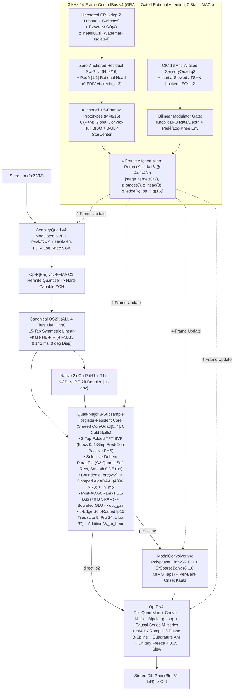

# ADR-0024: SONA v4.0 Kernels, All-Tier 2x Linear-Phase HB-FIR, Perimeter Operators, Quad-Major L1D & ControlBus GRA

This architectural decision record formalizes the **SONA v4.0** core kernel mathematics, all-tier 2× oversampling architecture, Quad-Major L1D/SIMD microarchitecture, perimeter operator upgrades (`Op-N[Pre]`, `Op-T`, `ModalConvolver`, `Op-P`, `SensoryQuad`), and **`ControlBus v4 (GRA — Gated Rational Attention)`** runtime control plane across the [SONA architecture specification](../specs/architecture/sona_architecture.md) and its companion DSP, container, security, and SDK specifications, fulfilling [`REQ-1.1`–`REQ-8.8`](../requirements/system_goals_and_requirements.md).

Because no third-party `v3.0` `.dnam` containers exist in the wild, the team ratified a **direct Phase 0 → Phase 1..4 cut to SONA v4.0** rather than accumulating workaround heuristics atop `v3.0` VM ceilings, while preserving active paradigm continuity via timestamped amendments in [`ADR-0005`](0005-contractive-rotor-hilbert-and-t1-tracker.md), [`ADR-0006`](0006-model-declared-delays-and-tank-feedback-guard.md), [`ADR-0007`](0007-exact-integer-control-bus-and-tempo-inversion.md), [`ADR-0013`](0013-typescript-sdk-architecture-and-dual-target-runtime.md), [`ADR-0018`](0018-signal-chain-fixtures-crate-and-whitebox-distillation.md), [`ADR-0019`](0019-simd-kernel-architecture-and-realtime-execution-optimizations.md), [`ADR-0020`](0020-modular-monorepo-and-dnam-proj-container.md), and [`ADR-0022`](0022-sona-state-space-operator-and-webgpu-architecture.md).

---

## 1. Context & Problem Statement

Qualification across the 18 black-box signal chains (`Chain-01..18`) and adversarial Red-Team `binary32` audits exposed structural mathematical and microarchitectural ceilings across every subsystem of `SONA v3.0`:

| Naive or Legacy `v3.0` Formulation | Failure Mechanism | Audible or Numerical Consequence |
| :--- | :--- | :--- |
| **Forced C¹ `PolyADAA1` & State-Feedback Block-0 PHS** | `PolyADAA1` requires piecewise rail clamping (`MAX_ALG_R` absent), while state-feedback PHS couples damping into the recurrent state matrix (breaking `O(log₂ N)` GPU scans and overflowing `f32` Jacobians at spectral radius `2.8784 > 1`). Unclamped `AlgADAA1` overflows `f32` at `|r| ≥ 5.541e12` (`REQ-7.2`) and cancels in backward differences (`253×` error at `r = 100`, sign flip at `r = 1e4`). | High-gain fuzz and diode stages hit `-22 dB` aliasing floors or non-convergent GPU adjoints; `NR2` adds `4.5×` forward error relative to `NR3`. |
| **Split `1×` Lite / `2×` Full..Ultra `poly3` & 9th-Order Half-Band IIR (`HB-IIR`) OS2X** | Running Lite at `1×` while Full..Ultra run at `2×` creates a shared-prefix `CoreQuad[0..4]` cliff violating strict `REQ-5.1`–`REQ-5.4` Matryoshka parity. Meanwhile, a 9th-order `HB-IIR` allpass polyphase oversampler introduces `1.79..13.5` samples of nonlinear group-delay dispersion. | Baking `HB-IIR` inverse phase into FIR breaks `4×` offline bounce parity (`+2.81 dB` unaligned / `-6.00 dB` aligned, `REQ-5.5`) and induces `-9.22 dB` comb notches in `ParallelAlignLine`. |
| **Single-Step `sqrt` `soft_rect`, Hard-Clamped `ParaLRU` ODE & Unnormalized `adaa_even`** | `sqrt` `soft_rect_zero_dc` consumes `~84` NEON ops per quad (`6` `NR3` chains); hard-clamped `rho` and `Box(0,1)` `CoreLruAtk` collapse gradients by `100×–5,000×`; `adaa_even ∈ [0, 0.25]` impairs Hessian conditioning; 5-tap SVF tone adds `80` zero Hessian eigenvalues at Ultra. | Wastes `~70` cycles/quad on ARM Cortex-A76, stalls `L-SSBroyden` on stiff dual-release envelopes, and deprives `LR4` + drive + tilt chains of Block 2/3 depth. |
| **Pre-Only `g_dyn` Dynamics, `cold.hoisted_core` L1D Spills & All-`f32` Hot-Slab Candidate** | Pre-ADAA `g_dyn` inverts B+ supply sag polarity (`-11..-23 dB` vs `-33..-36 dB`), `6 dB/oct` leaks `+39.9 dB` on fast gates, `cold.hoisted_core` (`~6.5 KiB`) spills active `1×` L1D to `6,256 B` (`14× > 64 KiB`), while converting `CoreQuad`/`Tiles`/`W_ro` to `f32` bloats `14×` L1D to `96–99 KiB` and destroys `-80 dB` `REQ-8.5` Tardos `f32 → fp16` survival. | Fails `14×` RK3582 L1D ceilings (`<= 4,681 B` hot target), triggers `97%–99.6%` WebGPU thread starvation on `ParaLRU`, and breaks watermark survival (`REQ-8.5`). |
| **Perimeter Mathematical Ceilings (`Op-N[Pre]`, `Op-T`, `ModalConvolver`, `Op-P`, `SensoryQuad`)** | `Op-N[Pre]` `1/(2π)` 1-harmonic quantizer leaves `54.4%` MSE unmodeled and leaky `cos⁴` ZOH loses `98.5%` hold energy (`Chain-18` capped at `-9.4..-17.6 dB`). `Op-T` broadcast modulation collides Delay vs Reverb (`Chain-12`), `±16 Hz` clips `28.6 Hz` grains (`Chain-16`), and `g_loop >= 0` blocks negative regen (`Chain-17`). `ModalConvolver` lacks `144..377`-sample early reflections (`Chain-05`) and leaks `0 dB` `96 kHz` `q=2` FIR mirrors. `Op-P` lacks `2θ` doubler / `|u|-env` Octavia (`Chain-10`) and leaks `-4.6..-15.3 dB` `OS2X` midpoint images. `SensoryQuad` linear `[0, 2]` VCA lacks `+24 dB` makeup and log-knee ratio (`Chain-09/13`). | Five physical device classes hit mathematical expressiveness floors independent of optimizer tuning (`REQ-1.9`). |
| **Rank-Deficient `16×16` `W_ctrl` + `"CEXT"` & Unaligned Control Ramps** | `v3.0` wastes `~59–70%` of `9,280 B` control bytes on dead `u_int` / `CEXT` / `cp1_ultra` regions, has zero `Knob × Dynamic` coupling, leaves `tempo.rs` beat-locking unwired, discards `75%` of micro-ramp steps, and suffers `196 Hz` `K_ctrl = 15` beat jitter at `44.1 kHz`. | Cannot realize 5-D rational FMV tone stacks (`Chain-04/15`), asymmetric rotary inertia (`Chain-07`), or zipper-free `Op-T` / `6`-edge routing modulation. |

---

## 2. Decision & Counterexample Matrix

### 2.1 Core Nonlinearity, Envelope, Tone, Oversampling & L1D Decisions

| Mechanism & Spec Rule | Canonical `SONA v4.0` Selection | Counterexample to Naive Formulation |
| :--- | :--- | :--- |
| **All-Tier `2×` `15`-Tap Symmetric Linear-Phase Half-Band FIR (`HB-FIR`) Oversampling** (`ref[arch.tiers.maximize-quality-within-budget]`, `ref[arch.bounce.oversampling]`, `ref[dsp.router.parallel-alignment]`) | Run all four tiers (`Lite`, `Full`, `Pro`, `Ultra`) natively at `2×` via a compile-time `15`-tap symmetric linear-phase `HB-FIR` (`1` center tap `0.5` + `4` nonzero symmetric odd pairs = `4` FMAs upsample + `4` FMAs downsample), delivering exact `7` `1×`-sample (`0.146 ms` @ `48 kHz`) integer delay, `0.000°` phase dispersion, `0.126 dB` ripple `<= 18 kHz`, `-31.9 dB` stopband `>= 30 kHz`, `-41.2 dB` `>= 32 kHz`, and 100% shared `CoreQuad[0..4]` prefix across all tiers. | `9th-Order Half-Band IIR Allpass Polyphase Oversampler` has `1.79..13.5` samples of nonlinear dispersion, failing `4×` bounce parity (`+2.81 dB` unaligned / `-6.00 dB` aligned) and creating `-9.22 dB` `ParallelAlignLine` comb notches; `1× Simplex PolyADAA2` scores `-22.23 dB` vs `-36.36 dB` (`-14.1 dB` worse); `Arena 1 CoreQuad[0..4] 2× Override` breaks `REQ-5.1`–`REQ-5.4` prefix invariance. |
| **Clamped Singularity-Free `AlgADAA1(0.5)` (`MAX_ALG_R = 4096.0`, `NR3`) & Cancellation-Free GL/Möbius Backward** (`ref[dsp.op-n.polyadaa.clamp]`, `ref[dsp.op-n.polyadaa.rail-crossing]`, `ref[train.pipeline.webgpu-scans-and-ozaki]`) | Clamp `r_curr` to `[-4096.0, +4096.0]` before `AlgADAA1` and `adaa_prev` store, use `NR3` `rsqrt`/`rcp`, evaluate cancellation-free positive `P` for `deven` and 4-pt linear / 5-pt Rational-Möbius Gauss-Legendre quadrature (`0 FDIV`, `0 exp/log`) for `dodd` when `r_n * r_p >= 0 && min(|r_p|, |r_n|) > 2.0`, compute `GLU` strictly on bounded `g_se * A_odd`, and polarize `lin_mix` toward `{0, 1}` lanes. | Unclamped `AlgADAA1` overflows `f32` at `|r| >= 5.541e12` (`REQ-7.2`); `NR2` increases forward error `4.5×`; direct difference backward fails with `253×` error at `r = 100` and flips sign at `r = 1e4`; applying `GLU` to unbounded `out_odd` explodes to `10³²` inside `REQ-7.1` `±100` inputs. Verified across 578 exhaustive pairs in `[-4096, 4096]²`: `<= 1.79e-7` fwd err, `<= 8.68e-6` (`dodd`) / `4.08e-7` (`deven`) bwd rel err, `0` sign flips. |
| **C² Quartic Spline `soft_rect`, Smooth `ParaLRU` ODE & `4×` `adaa_even` Normalization** (`ref[dsp.op-n.wavefolder.cubic-c2]`, `ref[dsp.op-n.core.matryoshka-blocks]`) | Replace `84`-op `sqrt` `soft_rect_zero_dc` with C² quartic spline `phi(z) = eps * t³ * (2 - t) + max(z - 2*eps, 0)` (`12–14` NEON ops, `0` `rsqrt`/`rcp`), replace hard-clamped `rho` with `1 - alpha_atk * rcp_ge1_nr2(1 + gamma_duhem * |flux|)` under `ComplementLog` / continuous-time ZOH, and scale `adaa_even` by `4.0×` (`[0, 0.25] → [0, 1.0]`). | `sqrt` `soft_rect_zero_dc` wastes `~70` cycles/quad; hard-clamped `rho` with `Box(0,1)` `CoreLruAtk` causes `100×–5,000×` vanishing gradients; unnormalized `adaa_even` causes `16×` Hessian ill-conditioning on `w_even`. Verified `-33.38 dB` `ParaLRU` envelope parity with `0.0` negative leak. |
| **Dual Pre/Post Dynamics: C∞ Bounded `g_pre(v²)` & Post-ADAA Rank-1 `SE-Bus`** (`ref[dsp.op-n.core.interblock-tiles]`, `ref[train.pipeline.backbone-trajectory-opt]`) | Compute C∞ `g_pre = (g_0 + g_inf * d_pre * e) * rcp_ge1_nr2(1 + d_pre * e)` with `e = min(v_eff², 1e6)` and `g_0, g_inf ∈ [0, 2.5]` (`12 dB/oct` gate and sag pre-drive), paired with post-ADAA rank-1 Squeeze-and-Excitation `SE-Bus` (`g_se = rcp_ge1_nr2(1 + d_bus * p_bus)` reusing `Slot 8` at `+0 B` WebGPU SRAM and orthogonal-gauge invariance). | Pre-only `g_dyn` inverts B+ sag polarity (`-11..-23 dB` vs `-33..-36 dB` with `SE-Bus`); `|v|` kinks at `0` when Duhem `η > 0`; pre-ADAA `4×4` SE and `GLA`/`Gated DeltaNet` overflow `15.5 KiB` WebGPU SRAM (`16.9..21.0 KiB > 15.87 KiB`). |
| **3-Tap Orthogonal Folded SVF Tone, 1-Step Predictor-Corrector Passive `PHS` & 2-Block `LR4`** (`ref[dsp.op-n.core.tpt-tone-basis]`, `ref[dsp.router.lr4-crossover]`) | Collapse 5-tap SVF tone to 3 orthogonal hoisted coefficients `(c_lp, c_bp, c_u)` on Blocks `1..3` (`(c_lp, c_bp, c_kbp, c_u)` on Block 0); realize Block 0 `PHS` via 1-step linear predictor feeding passive LTV `TPT-SVF` (`k_eff = k + k_nl * min(v_1lin², 64)`, `‖M_n‖₂ <= 1`); factor `LR4` Mid bandpass as `[H_HP2 * H_LP2]²` in `Block 0 → Block 1` (`-285.69 dB`). | 5-tap tone creates `80` zero Hessian eigenvalues at Ultra; state-feedback `PHS` breaks `O(log₂ N)` GPU scans and diverges (`rho = 2.88`); naive `LR4` consumes all 4 blocks leaving zero stages for drive and tilt. |
| **Rebalanced Matryoshka Block Pyramid (`[1,1,1,1]`, `[2,2,1,1]`, `[2,2,2,2]`, `[3,3,2,2]`) & Quad-Major L1D Fusion** (`ref[arch.tiers.arena-hierarchy]`, `ref[sdk.rust.realtime-disassembly-audit]`, `ref[sec.watermark.tardos-code]`) | Set `MAX_OUTGOING_PER_QUAD = 7` (`5 / 13 / 24 / 37` tiles), execute Quad-Major 4-frame / 8-subsample register-resident loops deleting `cold.hoisted_core` (`~6.5 KiB`), inline `SensoryHot`, shrink inline `transport0_ring` `128 → 64` frames, retain compact `fp16` `CoreQuad`/`Tiles`/`W_ro` (`Lite 2× = 4,432 B`, `14× = 60.59 KiB <= 64 KiB`), split `W_ro_head` into additive `odd` + `even_lru` deltas, keep explicit `u16` `rect_sign_mask`, and apply x86 `#[target_feature]` / `__m256` `Avx2Stereo8` / WASM lane / 3-op NEON scrub fixes. | Retaining `v3.0` `[3,2,2,1]` / `[4,3,2,1]` starves Block 2 & 3 symmetry; moving `CoreQuad`/`Tiles`/`W_ro` to `f32` bloats `Lite` `14×` L1D to `96–99 KiB > 64 KiB` and breaks `-80 dB` `REQ-8.5` Tardos `f32 → fp16` survival; shared `W_ro_head` breaks orthogonal-gauge parity on `StarCenter`-muted switches. |

$$
e_i = \min(v_{\text{eff},i}^2, 10^6), \qquad g_{\text{pre},i} = \big(g_{0,i} + g_{\infty,i} d_{\text{pre},i} e_i\big) \cdot \mathrm{rcpGe1Nr2}\big(1.0 + d_{\text{pre},i} e_i\big) \in [0, 2.5]
$$

$$
p_{\text{bus}}[n] = \sum_{j=0}^{3} w_{\text{sq},j} \min(|v_{\text{eff},j}[n]|, 10^6), \qquad g_{\text{se},i}[n] = \mathrm{rcpGe1Nr2}\big(1.0 + d_{\text{bus},i} p_{\text{bus}}[n]\big) \in (0, 1]
$$

$$
t = \mathrm{clamp}\left(\frac{z}{2\epsilon}, 0, 1\right), \qquad \phi(z) = \epsilon t^3(2 - t) + \max(z - 2\epsilon, 0), \qquad \phi'(z) = t^2(3 - 2t) \in [0, 1]
$$

### 2.2 Perimeter DSP & `ControlBus v4 (GRA)` Decisions

| Mechanism & Spec Rule | Canonical `SONA v4.0` Selection | Counterexample to Naive Formulation |
| :--- | :--- | :--- |
| **`Op-N[Pre]` v4: 4-FMA C¹ Hermite Staircase Quantizer & Phase-Wrap ZOH** (`ref[dsp.op-n.bitcrusher.quantizer]`, `ref[dsp.op-n.bitcrusher.zoh-phase]`) | Order strictly `quantize → ZOH`, evaluate a `4`-FMA C¹ Hermite deadzone staircase quantizer (`0 FDIV`), and clock a rate-invariant log-frequency `Q0.32` phase-wrap ZOH with independent hold sharpness `κ_h ∈ [0, 1]`. | `v3.0` 1-harmonic `1/(2π)` quantizer leaves `54.4%` unmodeled MSE and leaky `cos⁴` ZOH loses `98.5%` hold energy, capping `Chain-18` at `-9.4..-17.6 dB` vs `-30.6..-55.3 dB` (`0.98`) and `-325+ dB` (`1.0`). |
| **`Op-T` Transport v4: Per-Quad Modulation, Passive Convex `M_fb` & Spatial Physics** (`ref[dsp.op-t.window.m2-pitch]`, `ref[dsp.op-t.window.m3-barberpole]`, `ref[dsp.op-t.guard.bibo-decay]`, `ref[dsp.op-t.zero-fdiv]`) | Add `QuadCtrlRoute` per-quad modulation + per-tap readout `m_tap[q][0..4]`, convex `M_fb(α, β) = α H_4(1) + (1 - α)(cos β I_4 + sin β J_{2×2})`, bipolar `g_loop ∈ [-0.9990, +0.9990]`, lower-triangular `M_series`, `alpha_sum_fb`, `±64 Hz` ramp & modulatable `ramp_spans_samples`, wired `bspline_barberpole_3phase_f32`, `lfo_rate_ratio_fp16[4]`, quadrature AM, bounded shimmer (`V_ceil = 4.0`), unitary `H_4(1)` freeze, and `0.25` samp/samp delay slew. | Broadcast `Op-T` modulation collides Delay vs Reverb on `Chain-12`; `g_loop >= 0` blocks negative regen (`Chain-17`); `±16 Hz` ramp clips `28.6 Hz` grains (`Chain-16`); `V_ceil = 0.985` clips passive shimmer; unwired `0.25` slew and Pass-1 shimmer sign bug break continuous sweeps. |
| **`ModalConvolver` v4 & `Op-P` v4 (`T1+`, Native `2× H1`)** (`ref[dsp.op-m.hilbert.h1-anchors]`, `ref[dsp.op-m.tracker.t1-dc-blocker]`, `ref[dsp.op-m.kautz.rate-convert]`) | Add `ErSparseBank` (`8` Lite / `16` Ultra `2×2` MIMO taps on the `1,024`-sample FIR ring), reclaim dead `128 B` `KautzSoaBlockWire.dr` for per-bank Kautz onset + `c_cross_fp16[4]`, use cold-load Kaiser polyphase sinc for high-SR FIR, wire `w_kautz_*` + 2-basis `fp16` FIR voicing morph; upgrade `Op-P` to native `2× H1`, pre-`T1` LPF (`g_trk`), and 8-feature `T1+` (`2θ` doubler, `|x|-env_dc` Octavia, soft-square OC-2, stereo/2-band) with decoupled crossbar gates. | Missing early-reflection taps force `Chain-05` to cannibalize `Op-T`; `q=2` zero-stuffing at `96 kHz` leaks `0 dB` mirror images; `1× H1` midpoint interpolation leaks `-4.6..-15.3 dB` `OS2X` images; 4-feature `T1` misses Octavia / `2θ` physics (`Chain-10`). |
| **`SensoryQuad` v4: Unified `0-FDIV` Log-Knee VCA & 4-Frame Per-Block VCA** (`ref[train.audit.phase3.clamp-dynamic]`) | Replace linear `[0, 2]` gain with `exp2(clamp(makeup - s * max(fast_log2(max(ex - theta_lin, 0) + c_knee) - l_scale, 0), -5.0, +4.0))` (`-30..+24 dB`, `0 FDIV`), add modulated `sense_svf_g_oct[0..4]`, continuous Peak/RMS, `16`-sample CIC anti-aliasing before `3 kHz` `q3`, and 4-frame per-block audio-rate VCA. | Linear `[0, 2]` gain lacks `+24 dB` makeup and dB-linear ratio/threshold (`Chain-09/13`), whereas Unified Log-Knee VCA matches hyperbolic optical (`-57.60 dB`) and power-law VCA (`-59.29 dB`) in one primitive, and 4-frame VCA tracks `0.26 ms` gates (`Chain-02`). |
| **`ControlBus v4 (GRA)`: Hybrid `CP1` + `SwiGLU + Padé-[1/1]` + Anchored `1.5-Entmax` Prototypes** (`ref[dsp.ctrl.accum.exact-int]`, `ref[dsp.ctrl.dispatch.micro-ramp]`, `ref[dsp.tempo.q64-q32-phase]`, `ref[sec.watermark.orthogonal-gauge]`, `ref[sdk.rust.zerocopy-wire-structs]`) | Reclaim `6,336 B` strictly non-Tardos/non-`SO(4)` control bytes (`0 B` ControlBus growth, `0` static MACs); keep `ExactIntMainAccumulator` on `SO(4)`-isolated `z_head[0..4]` + unrotated `CP1` → Zero-Anchored `SwiGLU + Padé-[1/1]` (`0 FDIV` via `recip_nr3`) → Anchored `1.5-Entmax` Prototypes (`m = 0` implicit `StarCenter`, `6`-edge routing gates & per-quad `Op-T` deltas) → bilinear dynamic + inertia gate + live `TSYN` lock → 4-frame micro-ramp (`K_ctrl(44.1k) = 16`, `0` discarded steps, `0` tile rewrites) → `0`-cost static idle, with `O(P + M)` global BIBO verification. | Pure `1.5-Entmax` prototypes without `SwiGLU + Padé-[1/1]` lose `-12 dB` on 5-D rational FMV (`-22.5..-24.5 dB` vs `-35.3 dB`); `v3.0` `16×16 W_ctrl + CEXT` has zero `Knob × Dynamic` coupling and `~59–70%` dead bytes; `12 kHz` tile rewriting costs `~1,400 FLOPs/samp`; `K_ctrl(44.1k) = 15` induces `196 Hz` beat jitter. |

---

## 3. Consequences & Evaluated R&D Candidates

1. **Positive Consequences:**
   - **L1D, WCET & Matryoshka Alignment (`REQ-5.1`–`REQ-5.6`, `REQ-6.1`–`REQ-6.3`):** `Lite 2×` fits in `4,432 B` true-hot L1D (`14× = 60.59 KiB <= 64 KiB` Cortex-A76 L1D, zero cold spills), cuts Ultra `fp16` tile decodes `8×` (`2,240 → 280`), eliminates the `1×`/`2×` shared-prefix cliff, and preserves `0-ULP` cross-ISA parity and `0` `FDIV`/`FSQRT`/`IDIV`/`libm` instructions.
   - **Watermark & Numerical Security (`REQ-7.1`, `REQ-7.2`, `REQ-8.5`):** Retains `fp16` `CoreQuad`/`Tiles`/`W_ro` (`2 * fp16_ulp` Tardos floor), keeps `ExactIntMainAccumulator` / `SO(4)` `z_head[0..4]` isolated from `6,336 B` control reclamation (`layout_7680` derived via `core::mem::offset_of!`), certifies `±1e9` finite safety, and bounds all `3¹⁶` control corners in `O(P + M)` time (`< 5 µs`).
2. **Evaluated & Rejected R&D Alternatives:**
   - **9th-Order Half-Band IIR Allpass Polyphase Oversampler:** Rejected due to `1.79..13.5`-sample nonlinear phase dispersion breaking `4×` bounce parity (`REQ-5.5`) and creating `-9.22 dB` parallel-alignment comb notches.
   - **Tier-0 CoreQuad `2×` Override (`Arena 1` Override) & `1×` Simplex `PolyADAA2` Core:** Rejected because overriding `CoreQuad[0..4]` breaks `REQ-5.1`–`REQ-5.4` prefix invariance and `1× PolyADAA2` trails `2× AlgADAA1` by `-14.1 dB` on broadband multitone excitation.
   - **Gated Linear Attention (`GLA`), `Gated DeltaNet` & Pre-ADAA `4×4` SE / Audio-Rate `Q·K` Attention:** Rejected because all three exceed the `15.5 KiB` WebGPU workgroup SRAM ceiling (`16.9..21.0 KiB > 15.87 KiB`), break continuous-time ZOH, and triple CPU WCET.
   - **Full `f32` Hot-Slab CoreQuad, Tile & Readout Storage:** Rejected because it bloats `Lite` `14×` L1D to `96–99 KiB > 64 KiB` and destroys `-80 dB` `REQ-8.5` Tardos `f32 → fp16` survival.
   - **Pure Unanchored `1.5-Entmax` Prototypes Without `SwiGLU + Padé-[1/1]`:** Rejected after empirical 5-D FMV testing showed `-12 dB` regression against `SwiGLU + Padé-[1/1]` (`-22.5..-24.5 dB` vs `-35.3 dB`).
   - **Per-Tick `12 kHz` Inter-Block Tile Rewriting:** Rejected because folding dynamic gains into `37` tiles every `4` frames explodes control-update CPU (`~1,400 FLOPs/sample`); applying micro-ramped `out_gain` and `6` scalar edge gates achieves identical semantics at `O(1)` cost.
