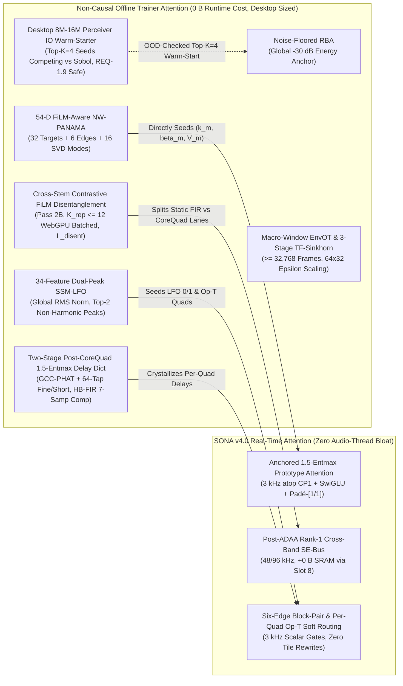

# ADR-0025: Unified Runtime Attention and Desktop-Sized Non-Causal Offline Trainer Attention

This architectural decision record documents the unified co-design of **SONA v4.0**'s three zero-bloat runtime attention mechanisms alongside seven hardened non-causal offline trainer attention mechanisms, the accompanying `<= 15.0 KiB` WebGPU SRAM scan optimizations, and the decoupling of desktop-targeted browser trainer worker memory budgets ([`REQ-4.3`](../requirements/system_goals_and_requirements.md)) from ultra-lean embedded and WebAudio real-time inference budgets ([`REQ-6.1`](../requirements/system_goals_and_requirements.md)) across the [WebGPU and VarPro solver specification](../specs/training/webgpu_and_varpro_solver.md), [capture and alignment specification](../specs/training/capture_and_alignment.md), and [TypeScript SDK specification](../specs/sdks/typescript_sdk.md).

---

## 1. Context & Problem Statement

Offline black-box identification under `REQ-1.9` (zero pretraining, zero target-identity heuristics, zero hardcoded crossover rules) stalled on complex multi-stage, modulated, and time-domain chains under `v3.0` due to four coupled solver bottlenecks and an unnecessary mobile-trainer assumption:

| Naive or Legacy Trainer / Attention Formulation | Failure Mechanism | Audible or Numerical Consequence |
| :--- | :--- | :--- |
| **Unfloored Max-Norm Relative Band-Attention (`RBA`)** | When a stem band has zero measured hardware noise (`F_b == 0` on noiseless or gated silence), dividing by `E_{y,b} + F_b` lets `-50 dB` leakage dominate the max normalization. | Crushes legitimate transient gradients to `~0.1` on gated fuzz and percussive attacks. |
| **Single-Stage Log-Spaced `M = 64` Delay Dictionary & `4,096`-Frame TBPTT `EnvOT` / Unscaled `12`-Step Sinkhorn** | Sparse log-spaced delay taps leave `1,566..3,000`-sample blind spots with zero waveform gradient and omit `g_fb`; `4,096`-frame (`85 ms`) windows cannot observe `250 ms` echoes; `12` Sinkhorn steps at `ε = 0.05` fail `rel_err < 1e-6` finite-difference checks. | Echo/FDN chains (`Chain-08/16`) stall at wrong repeat lags and fail gradient verification (`rel_err >= 1e-6`). |
| **`31`-D Kernel Cross-Attention & Per-Frame L2-Normalized Single-Peak `SSM-LFO`** | Scoring only `31` `stage_targets` leaves cross-attention blind to `v4.0` FiLM/routing/readout deltas and overfits LOOCV when `N_int < 2`; per-frame L2 normalization distorts broadband AM/tremolo into square-wave `lfo_skew` and single-peak extraction misses polyrhythmic dual LFOs. | Fails to transfer corner structure into `ControlBus v4` prototypes and misidentifies rotary/chorus LFO rates (`Chain-07`). |
| **Pure `StarCenter` Static-FIR Pass 2 Without Cross-Stem Contrastive Disentanglement** | Fitting `StarCenter` alone collapses tone stacks (`FMV`, `Tone`, `Clean/Dirty`) into static `ModalConvolver` FIR taps and allocates zero `CoreQuad` lanes for unactivated switch modes (`LP`/`HP` voicings). | Subsequent `ControlBus` fitting cannot undo spectral energy baked into static `FIR` taps (`Chain-01/03/04/06/15`). |
| **Mobile-Constrained `< 256 MiB` Browser Worker Cap & Starved `ParaLRU` WebGPU Scans** | Restricting desktop browser trainer workers to `< 256 MiB` (`< 64 MiB` WASM) forced a tiny `1.43M int8` warm-starter cap and chunked `85 ms` OT windows, while `v3.0` `ParaLRU` left `97%–99.6%` of GPU threads idle and `pass0` burned `596` barriers/tile. | Blocks `8M–16M` multi-resolution `Perceiver IO` warm-starts and full `32,768`-frame macro-window OT despite web training targeting desktop workstations rather than mobile phones. |

---

## 2. Decision & Counterexample Matrix

### 2.1 Co-Designed Runtime Attention & Hardened Offline Trainer Attention

| Mechanism & Spec Rule | Canonical `SONA v4.0` Selection | Counterexample to Naive Formulation |
| :--- | :--- | :--- |
| **Runtime `3 kHz` Anchored `1.5-Entmax` Prototype Attention** (`ref[dsp.ctrl.dispatch.micro-ramp]`, `ref[train.pipeline.control-projection-fit]`, `ref[sec.watermark.orthogonal-gauge]`) | Run `M = 8/16` anchored `1.5-Entmax` prototypes (`m = 0` implicit `StarCenter` anchor, branchless sorting network + `1` `rsqrt_pos_nr3`) atop `CP1 + Zero-Anchored SwiGLU + Padé-[1/1]`, directly seeded by offline `54-D NW-PANAMA` and emitting sparse regime deltas, `6` routing gates, and per-quad `Op-T` deltas with `O(P + M)` BIBO guarantees. | Running unanchored `1.5-Entmax` prototypes without `SwiGLU + Padé-[1/1]` drops `-12 dB` on 5-D rational FMV; running audio-rate `Q·K` attention breaks `REQ-6.1` embedded budgets. |
| **Runtime `48/96 kHz` Post-ADAA Rank-1 Cross-Band `SE-Bus`** (`ref[train.pipeline.webgpu-scans-and-ozaki]`, `ref[sec.watermark.reciprocal-gauge]`) | Place rank-1 Squeeze-and-Excitation strictly **post-ADAA, pre-GLU** (`g_se = rcp_ge1_nr2(1 + d_bus * p_bus)`), pulling back `∂L/∂p_bus` directly from existing `Slot 8` `feature_outputs` + `d_loss_d_features` at `+0 B` WebGPU SRAM and preserving reciprocal-gauge invariance. | Placing `4×4` SE pre-ADAA allocates extra shared tile buffers (`16.896 KiB > 15.872 KiB` WebGPU SRAM overflow) and inverts shared B+ rail droop polarity (`-11..-23 dB` vs `-33..-36 dB`). |
| **Runtime `3 kHz` Six-Edge Block-Pair & Per-Quad `Op-T` Soft Routing** (`ref[dsp.op-n.core.interblock-tiles]`, `ref[dsp.op-t.window.m2-pitch]`) | Apply `6` scalar block-pair routing gates directly onto the 6 tile sums (zero tile rewrites) paired with independent per-quad `Op-T` modulation (`QuadCtrlRoute`) and per-tap readout `m_tap[q][0..4]` (`0` extra MACs). | Folding `out_gain` into `37` `f32` tiles every `4` frames explodes `12 kHz` CPU (`~1,400 FLOPs/samp`); broadcasting `Op-T` modulation across all quads collapses Delay and Reverb into identical states (`Chain-12`). |
| **Offline Global-Energy-Floored Relative Band-Attention (`RBA`, Pass 2B `AdamW`)** (`ref[train.pipeline.backbone-trajectory-opt]`) | Anchor the `RBA` denominator with global signal energy `E_{y,b} + F_b + 1e-3 * mean(E_y)` (`-30 dB` relative floor) so silent or noiseless bands (`F_b == 0`) do not over-amplify residual floor leaks. | Unfloored `E_{y,b} + F_b` lets `-50 dB` leakage hijack max-normalization on gated targets, crushing valid transient gradients to `~0.1`. |
| **Offline Two-Stage Post-CoreQuad `1.5-Entmax` Delay & Pole Dictionary** (`ref[train.capture.alignment.multi-regime]`, `ref[dsp.op-m.kautz.rate-convert]`) | Stage (i) runs `< 1 ms` FFT post-CoreQuad `GCC-PHAT` + `10 ms` envelope cross-correlation across all `48,000` lags to extract peaks and 2-echo `g_fb`; Stage (ii) evaluates `M = 64` `1.5-entmax` (`32` fine taps `±0,1,2,4,8` around peaks + `32` short-lag taps `5..200`), crystallizing per-quad delays while compensating `15`-tap `HB-FIR`'s exact `7`-sample delay. | Single-stage log-spaced taps leave `1,566..3,000`-sample blind spots with zero gradient and omit `g_fb`, stalling multi-tap BBD and shimmer identification. |
| **Offline Macro-Window `EnvOT` & Three-Stage `ε`-Scaled `64×32` `TF-Sinkhorn`** (`ref[train.pipeline.webgpu-scans-and-ozaki]`) | Evaluate `EnvOT`/`TF-Sinkhorn` over stitched `>= 32,768`-frame (`683 ms`) or full `2–12 s` capsule windows resident in desktop browser worker RAM, using GPU `64×32` 3-stage `ε`-scaling (`0.4 → 0.15 → 0.05`, `24` steps or residual `< 1e-6` capped at `48`). | `4,096`-frame (`85 ms`) TBPTT windows cannot bridge `250 ms` echo periods; unscaled `12`-step `ε = 0.05` Sinkhorn fails central finite-difference verification (`rel_err >= 1e-6`). |
| **Offline `54-D` FiLM-Aware `NW-PANAMA` Cross-Attention & `34`-Feature Dual-Peak `SSM-LFO`** (`ref[train.pipeline.control-projection-fit]`, `ref[train.audit.phase3.clamp-dynamic]`) | Expand `NW-PANAMA` targets to `54-D` (`[32 stage_targets, 6 routing gates, top-16 SVD FiLM/readout modes]`), gate LOOCV on `N_int >= 2`, and initialize runtime `1.5-Entmax` prototypes directly from `M_met`; run `34`-feature `SSM-LFO` (`32` centered log-mag bands + broadband log-RMS + stereo ITD) with **global temporal RMS normalization** and **top-2 non-harmonic peak extraction**. | `31-D` targets ignore FiLM/routing deltas and overfit LOOCV at `N_int < 2`; per-frame L2 normalization distorts broadband AM into square-wave `lfo_skew` while single-peak extraction misses dual-LFO chorus (`Chain-07`). |
| **Offline Cross-Stem Contrastive FiLM Disentanglement Attention (Pass 2B, `0 B` Runtime Cost)** (`ref[arch.pillars.universal-black-box]`, `ref[train.pipeline.backbone-trajectory-opt]`) | Compute cross-stem difference cosine similarity `C_{s,s'}` over `[33 Gabor ΔS, 16 staircase ΔD, 16 env ΔE]` (`< 2 ms`), batch `K_rep = min(S - 1, 12)` stems in desktop WebGPU (`wg_y = K_rep`), jointly optimize shared `θ_base` + per-stem deltas `δφ_s` (`δφ_0 ≡ 0`), and apply tapered `1.5-entmax` Lane-Responsibility Orthogonalization `L_disent` (tapers to `0` before Phase 2C `L-SSBroyden`). | Optimizing `StarCenter` alone collapses knob-varying tone stacks into static `FIR` taps and leaves unactivated switch lanes (`Chain-06` `LP`/`HP`) dead at zero gradient. |
| **Desktop-Class `8M–16M` Multi-Resolution `Perceiver IO` Warm-Starter & `REQ-4.3` Decoupling** (`ref[arch.pillars.universal-black-box]`, `ref[sdk.ts.web-audio.realtime-bridge]`, `ref[sdk.ts.perf.profiling-budgets]`) | Amend `REQ-4.3` to permit `<= 1–2 GiB` in desktop-targeted GPU browser workers (`<= 512 MiB` CPU WASM fallback) while preserving `<= 128 MiB` per GPU storage binding and strict `REQ-6.1` AudioWorklet/RK3582 runtime budgets; size the optional OPFS/IndexedDB-cached `Perceiver IO` warm-starter at `8M–16M` parameters (`~16–32 MiB fp16`, `< 15 ms` WebGPU), emitting Top-`K = 4` seeds masked by `(1 - lin_mix_true)` that compete fairly against Sobol seeds in `phase2a.rs` (`REQ-1.9` OOD-safe). | Pinning desktop web trainers to a mobile `< 256 MiB` worker cap forced an under-parameterized `1.43M int8` draft and fragmented `85 ms` OT windows; conversely, bypassing Sobol competition would risk OOD warm-start regressions (`REQ-1.9`). |

### 2.2 WebGPU `<= 15.0 KiB` SRAM Scan Optimizations (`sona-shaders-gpu`)

To match `SONA v4.0`'s expanded core and batched multi-stem training within strict `<= 15,872 B` (`<= 15.5 KiB`) portable WebGPU workgroup shared memory (`REQ-4.2`):

1. **8-Thread `L/R × 4-Lane` `ParaLRU` Split & `κ(1 - η) == 0` `O(log₂ N)` Fast-Path:** Splits `ParaLRU` across 8 active threads per frame (eliminating `97%–99.6%` GPU thread starvation) and switches pure-Duhem / feedforward lanes where `κ(1 - η) == 0` directly onto the exact `O(log₂ N)` associative scan.
2. **Constant-`M` Register-Squaring Stereo Scan (Blocks `1..3`):** Keeps `M^(2^k)` in 4 thread-local registers and stores only `(b0_L, b1_L, b0_R, b1_R)` (`4,096 B <= 6,144 B` SRAM), scanning both Left and Right channels across 256 frames in one pass (`-50%` barriers, `-60%` `2×2` matmuls).
3. **`pass0` Binary-Tree Reduction & Diagonal `L-SSBroyden` Preconditioning:** Reuses `after_l.a`/`after_r.a` to delete the redundant `unit_lru` scan (`-72` barriers/tile) and replaces Hillis-Steele with binary-tree reduction (`-144` barriers/tile, cutting `596 → ~220` barriers/tile inside `<= 15.0 KiB` SRAM), paired with per-family diagonal preconditioning inside GPU `inner_opt_step` (`+0 B` SRAM).

---

## 3. Consequences & Evaluated R&D Candidates

1. **Positive Consequences:**
   - **Zero Audio-Thread / Embedded Runtime Bloat (`REQ-6.1`):** All seven offline trainer attention modules and the `8M–16M` `Perceiver IO` warm-starter reside exclusively in `packages/train`, `packages/capture`, and `packages/train-warmstart`; `dnam-vm`, `.dnam` containers, and `AudioWorklet` WASM runtimes retain `0 B` trainer overhead and `4,432 B` `Lite 2×` L1D footprints.
   - **Zero-Pretraining `REQ-1.9` Qualification & OOD Safety:** `T3` Waves 1–5 across all 18 signal chains run with zero pretraining using the offline attention suite (noise-floored `RBA`, two-stage delay dictionary, macro-window `EnvOT`/`TF-Sinkhorn`, `54-D` `NW-PANAMA`, dual-peak `SSM-LFO`, and cross-stem contrastive `FiLM` disentanglement), while the optional `Perceiver IO` warm-starter enters strictly as competing Top-`K = 4` hypotheses alongside Sobol seeds (`phase2a.rs`), guaranteeing automatic rejection on corrupted or out-of-distribution rigs.
2. **Evaluated & Rejected R&D Alternatives:**
   - **Pre-ADAA `4×4` Squeeze-and-Excitation & Audio-Rate `Q·K` Attention:** Rejected because `16.896 KiB` SRAM overflows the `15,872 B` WebGPU shared-memory ceiling and audio-rate attention breaks `REQ-6.1` cycle budgets.
   - **Mobile-Constrained `1.43M int8` `Perceiver IO` Warm-Starter & Unchecked Neural Seed Override:** Rejected because the web trainer targets desktop workstations (`REQ-4.3`), not mobile handsets, and unchecked neural override violates `REQ-1.9` out-of-distribution guarantees.
   - **Unfloored Max-Norm `RBA`, Coarse Log-Only Delay Dictionary & `4,096`-Frame `EnvOT`:** Rejected because silent-band leakage crushes transients, log-only taps miss `1,566..3,000`-sample echo peaks, and `85 ms` windows truncate `250 ms` echo tails.
   - **Pure `StarCenter` Static-FIR Pass 2 Without Cross-Stem Contrastive FiLM Disentanglement:** Rejected because tone stacks and clean/dirty parallel paths collapse into non-parametric static FIR weights before `ControlBus` optimization begins.
