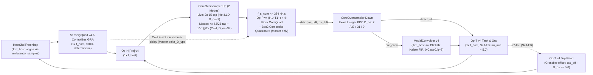

# ADR-0026: Core-Only Two-Mode Multirate Offline Rendering, Crossbar Latency Invariance & Deterministic ControlBus

This architectural decision record formalizes the clean-sheet **SONA v4.0** co-design of Core-Only Two-Mode Multirate Rendering (`RenderMode::Live` and `RenderMode::Master`), `Box2` composite quadrature with midpoint `lin_mix` alignment, latency-invariant `Op-T` crossbar delay parameterization (`tau_eff >= 42.0`), unified `vm.latency_samples()` host-shell alignment, wire cleanup, and 100% deterministic `ControlBus GRA` (retiring `ou_drift` / `live_analog_drift` for `+24 B` reclaimed wire space). Together these contracts fulfill [`REQ-1.4`–`REQ-8.5`](../requirements/system_goals_and_requirements.md) across [`sona_architecture.md`](../specs/architecture/sona_architecture.md) and its companion DSP, container, training, security, and SDK specifications.

---

## 1. Context & Problem Statement

Direct codebase inspection and periodic-FFT simulation of the legacy Whole-VM `4×` offline bounce pipeline (`Bounce4xOversampler`, `bounce_patchbay`, `lagrange.rs`, `hydrate.rs`, `runtime.rs`) plus `ControlBus` `ou_drift` uncovered five concrete failures:

| Rejected Legacy Mechanism | Failure Mechanism | Audible or Numerical Consequence |
| :--- | :--- | :--- |
| **Whole-VM `Bounce4x` (`19/11`-Tap Lagrange Filter)** | `HB_2X_TAPS` in `bounce4x.rs` rolls off `-1.01 dB` at `18 kHz` (`-2.02 dB` round-trip) and `-2.03 dB` at `20 kHz` (`-4.06 dB` round-trip), while stopband rejection is only `-13.6 dB` at `28 kHz`, `-19.2 dB` at `30 kHz`, and `-26.2 dB` at `32 kHz` (only reaching `> 95 dB` above `41.5 kHz`). | Audible `20 kHz` HF droop (`-4.06 dB`) and severe `28–32 kHz` foldback aliasing during offline mastering bounce (`REQ-5.5`). |
| **Silent `192 kHz` 1-Octave Pitch/Cutoff Corruption** | `runtime.rs` clamps `bounce_sr_hz = sample_rate_hz.min(96_000)` (`f_s_vm = 384 kHz`), while `bounce.rs` discards `set_offline_bounce(true)` errors and still drives `4 × 192 kHz = 768 kHz` audio through a VM calibrated for `384 kHz`. | Shifts every filter cutoff, modal pole, and delay time by a full octave during `192 kHz` offline bounce. |
| **Perimeter Bloat, `CaseC` Drift & Dual-Engine Duplication** | `hydrate.rs` forces `alloc_rho = zoh.rho_vm.min(min_rho_384k).min(0.125)` (`8×` @ `48 kHz`) on every VM; `ModalConvolver` enters `CaseC` 6-pt Lagrange (`24 KiB` cold FIR + `16×` MACs at `48 kHz`); `Op-N[Pre]` aliasing and `K_ctrl` warp by `4×`; `HostShellPatchbay` duplicates `bounce_patchbay` and `4×` align rings. | Wastes `48 MiB -> 3 MiB` `Op-T` reverb RAM on Ultra instances, bloats `48 kHz` bounce CPU, and risks live-vs-bounce divergence. |
| **Naive `4×` Core Without `Box2` or Train-at-`4×` Deployment** | `AlgADAA1` integrates over subsample width `1/M`, shifting transfer phase and frequency rolloff between `2×` and `4×`. Running naive `4×` without `Box2` shifts skip-tile and `ModalConvolver` phase; conversely, training at `4×` without `Box2` breaks `Live 2×` deployment (`-13.43 dB` on 24-tone learned-FIR benchmark). | Either `Master` regresses `+7.7 dB` vs `16×` analog (`-11.32 dB`) or `Live 2×` fails `Lite` acceptance (`-13.43 dB`). |
| **Stochastic `3 kHz` `ou_drift` / `live_analog_drift` Wobble** | `ou_drift` (`232` dead code refs, `0` requirements, `0` JS/UI/Studio bindings, hard-zeroed in capture) forces `static_z_stage` vs `eff_z_stage` plumbing and disables on bounce, breaking live-to-master null identity while occupying `24 B` across Arena 0 (`16 B`) and Arena 3 (`8 B`). | Contradicts `Live ↔ Master` determinism and complicates `ControlBus GRA` and watermark exclusion layouts without benefit. |

---

## 2. Decision & Counterexample Matrix

### 2.1 Core-Only Two-Mode Multirate, `Box2` Quadrature & Crossbar Decisions

| Mechanism & Spec Rule | Canonical `SONA v4.0` Selection (`ADR-0026`) | Counterexample to Naive Formulation |
| :--- | :--- | :--- |
| **Unconditional `f_{s,vm} == f_{s,host}` & Two-Mode `CoreOversampler`** (`ref[arch.bounce.oversampling]`, `ref[arch.pillars.dual-rate-plane]`, `ref[dsp.zoh.op-m-poles]`) | Lock perimeter (`SensoryQuad`, `Op-N[Pre]`, `ModalConvolver`, `Op-T`, `ControlBus GRA`, `HostShellPatchbay`) unconditionally at `f_{s,vm} == f_{s,host}` (`44.1..384 kHz`), and switch ONLY `Op-P v4 + 4-Block CoreQuad` between `RenderMode::Live` (`2×` `15`-tap hot `192 B` `HB-FIR`, `D_os = 7` @ `44.1..192k` / `0` @ `352.8–384k`) and `RenderMode::Master` (`4×` `63`-tap Kaiser `β=10.2` primary `1×↔2×` + `23`-tap Minimax `f_p=24k` secondary `2×↔4×` + `z⁻¹@2×` `8 B` integer register in cold `~1.8 KiB` slab, `D_os = 37` @ `44.1..96k` / `31` @ `176.4–192k` / `0` @ `352.8–384k`) under `M_core = min(M_target, floor(384_000.0 / f_{s,host}))` and `f_{s,core} = M_core * f_{s,vm}` (so `352.8 kHz` yields `352.8 kHz`). Cold `4`-slot microchunk control delay ring (`ΔD_up = 16` samples, `~1.2 KiB`) aligns `Master` core snapshots (`< 16 µs` vs `K_ctrl = 16`). | **Whole-VM `Bounce4x`** loses `-4.06 dB` @ `20 kHz`, leaks `-19.2 dB` @ `30 kHz`, breaks `192 kHz` by 1 octave, and forces `8×` `Op-T` RAM bloat (`48 MiB -> 3 MiB`). **Multi-Mode Fallback Proliferation** (`Master2x`, `Ultra8x`, `ShortDelay4x`) adds redundant mode state and validation complexity (`8×` `63/23/15` + `Box4` `-111 dB` stays strictly a non-shipping research benchmark). `Master` delivers `<= 0.025 dB` ripple `<= 20 kHz` (`0.0006 dB` Minimax / `0.0226 dB` Kaiser primary, `0.0001 dB` `<= 24 kHz` secondary) and `-101.0 dB` `>= 30 kHz` Kaiser / `-83.1 dB` `>= 28 kHz` Minimax primary and `-98.7 dB` `>= 72 kHz` secondary attenuation. |
| **Train-at-`2×` with `Master` `Box2` Composite Quadrature + Midpoint `lin_mix`** (`ref[arch.bounce.oversampling]`, `ref[dsp.op-n.core.matryoshka-blocks]`) | Keep GPU/CPU training at `2×` (`Box(1)` = no-op, zero `tools/sona-shaders` changes), and evaluate 2-subpanel composite quadrature `Box2` `0.5*(A[m] + A[m-1])` on `(adaa_odd, adaa_even)` paired with `0.5*(r_n + r_p)` midpoint `lin_mix` alignment in CPU `Master` (`4×`) mode (`Box2` bypassed on `lin_mix = 1` lanes). | **Naive `4×` Core Without `Box2`** regresses 24-tone learned-FIR error from `-19.00 dB` (`Live`) to `-11.32 dB` (`-12.73 dB` parity). **Train-at-`4×` (Without `Box2`) Deployed With `Live 2×`** collapses `Live 2×` to `-13.43 dB` (failing `Lite` `-18 dB`). **Train-at-`2×` + `Master` `Box2`** reaches **`-19.51 dB`** vs `16×` analog, **`-27.24 dB`** 24-tone / **`-37.56 dB`** HiGain / **`-42.62 dB`** Clean `Live↔Master` parity, **`-74.75 dB`** `6.23 kHz` `12×`-drive alias floor (`+30.7 dB` over `Live`), and **`-48.4 dB`** 4-stage `TPT-SVF` bilinear accuracy. |
| **Latency-Invariant `Op-T` Crossbar Delay (`τ_eff >= 42.0`) & Unified `HostShellPatchbay`** (`ref[dsp.op-t.ring.capacity]`, `ref[dsp.crossbar.top-of-frame]`, `ref[dsp.router.parallel-alignment]`, `ref[sdk.rust.c-abi-and-host-handle]`) | Serialize `.dnam` crossbar taps (`opt_to_lr != 0`) as effective total loop delay `tau_eff >= 42.0` (`>= 0.875 ms` @ `48 kHz`) and uniformly index `Op-T` rings at `tau_ring_cb = tau_eff - vm.latency_samples() >= 5.0` across `Live` (`D_os = 7`) and `Master` (`D_os = 37/31/0`), while self-feedback retains `tau_min = 5.0`. Delete `bounce_patchbay`, `is_bounce_4x`, and `runtime.rs:105`'s `min(96_000)` clamp; align `HostShellPatchbay` / `ReturnAligner` / `ParallelAlignLine` at `1× f_{s,host}` via `vm.latency_samples()`; unify streaming DAW bounce and `render_offline_bounce` (`D_os` strip/pad) onto one causal path. | Hardcoding `7`-sample `HB-FIR` subtraction in `#2` or indexing `tau_min = 5.0` on crossbar taps shifts comb/chorus loop period by `30` samples (`0.625 ms`) between `Live` and `Master` or forces a `ShortDelay4x` fallback mode; duplicating `bounce_patchbay` inflates alignment rings `4×` and caused the `192 kHz` 1-octave bounce failure. Unified `vm.latency_samples()` delivers `0-ULP` streaming↔file identity and `4×` smaller alignment rings. |
| **Wire Cleanup, `<= 192 kHz` `Op-T`/Convolver Cap & Deterministic `ControlBus GRA`** (`ref[container.dnam.tier-prefix]`, `ref[dsp.op-m.kautz.rate-convert]`, `ref[dsp.ctrl.dispatch.sparse-and-active-ramps]`, `ref[sdk.rust.zerocopy-wire-structs]`) | Retire dead `SonaOversamplerParams` (`32 B` runtime struct), `tier_os2x[0..4]` (bits `0..=3`), and `SONA_META_TIER_OS_EXPLICIT` (bit `6`) into reserved `0`; delete `lagrange.rs` (`CaseC` 6-pt Lagrange), `CaseA (q=8)`, and `min_rho_384k` / `.min(0.125)` (`4×–8×` `Op-T` heap savings); cap `ModalConvolver` high-SR FIR and `Op-T` Schroeder budgets cleanly at `<= 192 kHz` host rates; delete `ou_drift` / `live_analog_drift` (`+24 B` reclaimed: `16 B` in Arena 0 + `8 B` in Arena 3) so `ControlBus GRA` is 100% deterministic. | Retaining `min_rho_384k`/`.min(0.125)` wastes `48 MiB -> 3 MiB` per `2 s` Ultra reverb; retaining `CaseC` wastes `24 KiB` cold FIR and `16×` FIR MACs; retaining `ou_drift` adds non-deterministic state divergence between `Live` and `Master` and `24 B` of dead wire payload. |

### 2.2 Mathematical Proof of `Box2` Composite Quadrature Equivalence

Each `AlgADAA1` evaluation at oversampling factor $M$ integrates over one subsample step of width $1/M$, multiplying its small-signal response for normalized frequency $\omega$, where $\omega = 1$ at $1\times$ Nyquist and $\mathrm{sinc}(x) = \sin(\pi x)/(\pi x)$, by $H_{\text{ADAA1}}^{(M)}(\omega) = \mathrm{sinc}(\omega / (2M)) e^{-j\pi\omega / (2M)}$. Averaging two adjacent `4×` quadrature samples via `Box2` gives:

$$
\bar{y}[m] = 0.5\big(\mathcal{A}[m] + \mathcal{A}[m - 1]\big)
$$

$$
H_{\text{ADAA1}}^{(4)}(\omega) \cdot \frac{1 + e^{-j\pi\omega/4}}{2} = \mathrm{sinc}\left(\frac{\omega}{8}\right)\cos\left(\frac{\pi\omega}{8}\right) e^{-j\pi\omega/4} \equiv \mathrm{sinc}\left(\frac{\omega}{4}\right) e^{-j\pi\omega/4} = H_{\text{ADAA1}}^{(2)}(\omega)
$$

Paired with midpoint `lin_mix` evaluation $0.5(r_n + r_{n-1})$ (`0 B` extra state, bypassing `Box2` on `lin_mix = 1` lanes), `Box2` enforces exact small-signal phase and amplitude equivalence between `Live` (`2×`) and `Master` (`4×`) across skip tiles (`Block 0 -> 3`, `Block 1 -> 3`), `direct_s2`, and `ModalConvolver` FIR while eliminating `30.7 dB` of nonlinear aliasing.

---

## 3. Consequences & Evaluated R&D Candidates

1. **Positive Consequences:**
   - **Passband, Aliasing & `192 kHz` Parity (`REQ-5.5`):** Restores `<= 0.025 dB` passband flatness (`0..20 kHz` vs `-4.06 dB`), `-101.0 dB` `>= 30 kHz` Kaiser / `-83.1 dB` `>= 28 kHz` Minimax primary and `-98.7 dB` `>= 72 kHz` secondary stopband attenuation, `-74.75 dB` `6.23 kHz` alias floor, `-37.56 dB` high-gain / `-42.62 dB` clean / `-27.24 dB` 24-tone `Live↔Master` parity, `0` octave shift at `192 kHz`, and `0-ULP` streaming-to-file identity.
   - **Memory, Cache & Determinism (`REQ-6.1`, `REQ-8.5`):** Shrinks `Op-T` heap allocation `4×–8×` (`min_rho_384k` deleted), eliminates `bounce_patchbay` (`4×` smaller host align rings) and `CaseC` (`24 KiB` FIR + `16×` MACs), keeps `Live` hot L1D unchanged at `4,432 B` (`14× = 60.59 KiB <= 64 KiB`), and reclaims `+24 B` in `ControlBus GRA` with 100% deterministic `Live`/`Master` parity.
   - **Scope Boundary With Phase 4 (`ADR-0027`):** `ADR-0026` updates only stale `4× 64-tap (43-sample PDC)` bounce wording in [`psychoacoustic_quality_and_tiers.md §4`](../specs/architecture/psychoacoustic_quality_and_tiers.md#4-canonical-4-tier-quality-benchmark-matrix); full replacement of the legacy 4-metric/8-loss stack with the Minimum-Phase `ERBlet` 6-Axis `UATT` unified loss, internal CI ceilings, and non-blocking creator advisory executes cleanly in Phase 4 (`ADR-0027`).
2. **Evaluated & Rejected R&D Alternatives:**
   - **Whole-VM `Bounce4x` (`19/11` Lagrange + `CaseC` + `bounce_patchbay` + `8×` `Op-T` Pre-Allocation):** Rejected due to `-4.06 dB` `@ 20 kHz` droop, `-19.2 dB` `@ 30 kHz` stopband leakage, `192 kHz` 1-octave pitch corruption, and `4×–8×` `Op-T` RAM bloat.
   - **Naive `4×` Core Without `Box2` Composite Quadrature:** Rejected because 24-tone learned-FIR accuracy degrades `+7.7 dB` (`-11.32 dB` vs `-19.51 dB` with `Box2`) and `Live↔Master` parity collapses to `-12.73 dB`.
   - **Train-at-`4×` (Without `Box2`) Deployed With `Live 2×`:** Rejected because `Live 2×` fails `Lite` quality floors at `-13.43 dB` with `-13.39 dB` `Live↔Master` divergence.
   - **Multi-Mode Fallback Proliferation (`Master2x`, `Ultra8x`, `ShortDelay4x`):** Rejected as shipping runtime modes because `tau_eff >= 42.0` + `M_core = min(M_target, floor(384_000.0 / f_host))` (`f_s_core = M_core * f_s_vm`) unifies all rates and delays cleanly under two modes (`Live` and `Master`).
   - **Stochastic `3 kHz` `ou_drift` / `live_analog_drift` Wobble:** Rejected because it contradicts deterministic `Live↔Master` parity, never ran in capture/training, and wasted `24 B` of wire space.
