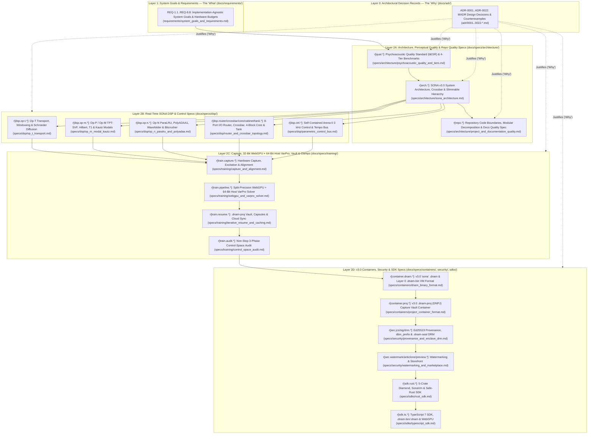

# Dynamic Neural Audio Modeler (DNAM) — Specification Manual

Welcome to the canonical Single-Source-of-Truth (SSOT) specification manual for **Dynamic Neural Audio Modeler (DNAM)**.

The manual is organized into **three distinct engineering layers (`requirements/`, `specs/`, `adr/`)** plus canonical authoring templates (`templates/`):
- **Requirements (`docs/requirements/`):** Implementation-agnostic system goals and functional requirements (`REQ-1.1`–`REQ-8.8`, **"the what"**).
- **Normative Specifications (`docs/specs/`):** Concrete architectural, mathematical, DSP, training, container, security, and repository quality contracts (**"the how"**), with every normative rule carrying a unique Rust Reference-style `r[<domain>.<subdomain>.<rule>]` identifier so implementation code (`ref[...]`) and tests (`verify[...]`) can cite every specification.
- **Architectural Decision Records (`docs/adr/`):** Atomic MADR decision records (`NNNN-kebab-case.md`) documenting design rationales, counterexamples, and rejected R&D alternatives (**"the why"**).

Before authoring or editing any document in `docs/`, read the [**Specification Authoring & Documentation Guide (`docs/CONTRIBUTING.md`)**](CONTRIBUTING.md), the [**Repository, Code & Documentation Quality Specification (`docs/specs/architecture/project_and_documentation_quality.md`)**](specs/architecture/project_and_documentation_quality.md), and use the templates in [`docs/templates/`](templates/spec_template.md).

---

## 1. Specification Architecture & Reading Order

---

## 2. Canonical Specification Directory

### Layer 1 — System Goals & Functional Requirements ("The What", `docs/requirements/`)

| Document | Rule / ID Prefix | Authoritative Scope |
| :--- | :---: | :--- |
| **[`requirements/system_goals_and_requirements.md`](requirements/system_goals_and_requirements.md)** | `REQ-1.1`–`REQ-8.8` | **Implementation-Agnostic System Goals, Hardware Budgets & Security Requirements (41 Formal Requirements):** Universal nonlinear/LTI/state-space/delay, full-rig coverage & universal trainable/data-programmable black-box runtime (`REQ-1.1`–`REQ-1.9`), device-agnostic bESR quality, non-stop clamping & 12-subdivision tempo sync (`REQ-2.1`–`REQ-2.5`), progressive single-project capture vault refinement & capsule persistence (`REQ-3.1`–`REQ-3.3`), portable 32-bit WebGPU acceleration, split-precision 64-bit host solver accuracy & 2-D streamed memory ceilings (`REQ-4.1`–`REQ-4.3`), single-run slimmable multi-tier training & dynamic tier scaling (`REQ-5.1`–`REQ-5.6`), embedded real-time budgets & loop constraints (`REQ-6.1`–`REQ-6.3`), unclipped 32-bit float I/O & 1→1 / 2→1 / 1→2 / 2→2 topologies (`REQ-7.1`–`REQ-7.4`), and provenance, hardware DRM, watermarking & marketplace security (`REQ-8.1`–`REQ-8.8`). |

### Layer 2A — System Architecture & Psychoacoustic Quality Specifications (`docs/specs/architecture/`)

| Specification | Rule Prefix | Authoritative Scope |
| :--- | :---: | :--- |
| **[`specs/architecture/psychoacoustic_quality_and_tiers.md`](specs/architecture/psychoacoustic_quality_and_tiers.md)** | `r[qual.*]` | **Psychoacoustic Quality Standard (bESR) & 4-Tier Benchmarks:** 4th-order Bezout complementary 3-band crossover (LF / MF / HF), Floor-Regularized Noise-Adjusted bESR (4.77 dB worst-band bound), rectangular joint energy-interval bounds, companion MR-IIR, LTAS tilt, and SegESR metrics, and the Lite / Full / Pro / Ultra qualification floors (`ref[qual.tiers.floors-not-stopping-criteria]`, never stopping criteria). |
| **[`specs/architecture/sona_architecture.md`](specs/architecture/sona_architecture.md)** | `r[arch.*]` | **Modular SONA v3.0 System Architecture, Crossbar Signal Flow & Slimmable Hierarchy:** Top-of-Frame Causal Operator Crossbar (`"io_router"` 8-Port I/O Router, input-only Op-P H1 + 32-bit T1, 4× Q0.32 0.05 Hz..20 kHz phasors, causal τ ≥ 4 Op-T reads, pre-core `Op-N[Pre]`), 4-Block Matryoshka SONA Core (passive 2×2 ZDF TPT-SVF, contractive 1D ParaLRU, 32-bit PolyADAA1 & C² wavefolder), `"cabinet"` (FIR 32..128 + Kautz 8..32 pairs), `"spatial_tank"` (Op-T coercive feedback + data-driven RAM write-enable sustain), register-hoisted 16-frame sub-blocks with execution-ordered cache-locked working sets (4,544 / 7,552 / 11,200 / 14,656 B hot footprints), compile-time fixed tier locking (`ref[arch.tiers.maximize-quality-within-budget]`), and single-source portable operators across CPU SIMD, 32-bit WebGPU, and 64-bit host VarPro training. |
| **[`specs/architecture/project_and_documentation_quality.md`](specs/architecture/project_and_documentation_quality.md)** | `r[repo.*]` | **Repository, Code & Documentation Quality Specification:** Language-agnostic strict static type safety and acyclic module import boundaries, hierarchical modular decomposition and 4-tier test separation (`ref[repo.code.modular-decomposition-and-tests]`), compile-time constant evaluation and algebraic/layout assertions (`ref[repo.code.constant-eval-and-derivations]`), universal black-box engine/solver purity (`ref[repo.code.universal-black-box]`), two-tier AGENTS.md budgets, one-way clean-room separation, `r[...]` / `ref[...]` traceability, and GitHub CommonMark + MathJax / Mermaid rendering contracts. |

### Layer 2B — Real-Time SONA DSP & Control Subsystems (`docs/specs/dsp/`)

| Specification | Rule Prefix | Authoritative Scope |
| :--- | :---: | :--- |
| **[`specs/dsp/op_t_transport.md`](specs/dsp/op_t_transport.md)** | `r[dsp.op-t.*]` | **Op-T Transport & Elastic Buffer Kernel:** Model-declared 64-byte-aligned delay histories (2- or 4-byte elements, branchless bitwise power-of-two masking), stateless 4-tap Catmull-Rom cubic Hermite delay reader (τ ≥ 4), continuous 4-lane crossfading, centered partition-of-unity pitch windowing, calibrated RAM write-enable (`WE`) sustain lock, partitioned in-buffer Schroeder diffusers, coercive feedback guard, and Family 4 1-pole ballistic envelope ducking VCA. |
| **[`specs/dsp/op_m_modal_kautz.md`](specs/dsp/op_m_modal_kautz.md)** | `r[dsp.op-m.*]` | **Op-P / Op-M Modal, TPT-SVF & Filter Kernel:** Passive 2×2 ZDF TPT-SVF (‖A_tpt‖₂ ≤ 1, analytical g = tan(π f_c / f_s) bilinear ZOH), 4-lane Q0.32 quadrature phasors (0.05 Hz..20 kHz), precomputable input-only Op-P (6-section H1 Hilbert lattice + 32-bit float branch-cut-guarded T1 tracker), shared-pole Cabinet Kautz modal bank (8/12/24/32 pairs), and Op-M control estimator. |
| **[`specs/dsp/op_n_paralru_and_polyadaa.md`](specs/dsp/op_n_paralru_and_polyadaa.md)** | `r[dsp.op-n.*]` | **Op-N 1D ParaLRU, 32-Bit PolyADAA1, Wavefolder & Bitcrusher Kernel:** Contractive 1D scalar ParaLRU (κ_i ∈ [0, 1], exact in-SRAM forward step / O(log₂ N) linear reverse-adjoint scan on GPU), 32-bit fast-path PolyADAA1 + batched 2-step Newton-Raphson reciprocals, analytical Zero-DC equilibrium, C² wavefolder, 2D hysteresis, fixed-hertz ZOH bitcrusher, and Op-N control estimator. |
| **[`specs/dsp/router_and_crossbar_topology.md`](specs/dsp/router_and_crossbar_topology.md)** | `r[dsp.router.*]`, `r[dsp.crossbar.*]`, `r[dsp.core.*]`, `r[dsp.cabinet.*]`, `r[dsp.tank.*]`, `r[dsp.head.*]`, `r[dsp.zoh.*]` | **8-Port I/O Router (`"io_router"`), Top-of-Frame Causal Crossbar & SONA Core Topology:** Return-to-send isolation, 200 Hz TPT LR4 split, parallel alignment (64-tap full-band, 16-tap low-latency, 4-tap minimal-latency), WDW routing, Causal Crossbar → pre-core `Op-N[Pre]` → 4-Block SONA Core (Lite..Ultra) → `"cabinet"` (32..128 FIR + 8..32 Kautz) → `"spatial_tank"` 128 B quad coercive Op-T feedback (‖G_loop‖ < 1), and analytical bilinear ZOH rate adaptation (44.1–384 kHz & 4× bounce). |
| **[`specs/dsp/parametric_control_bus.md`](specs/dsp/parametric_control_bus.md)** | `r[dsp.ctrl.*]`, `r[dsp.tempo.*]` | **Self-Contained Arena 0 3 kHz Parametric & Autonomous Control Bus:** Shared descriptors and base CP1 / `U_int` / `W_ctrl` / 16-bit half-precision `W_readout` inside Arena 0 (Lite-strip-complete per `REQ-5.6`, 8-D Rank-4 base + Ultra 16-D Rank-8 delta); exact-integer sufficient-statistic accumulation; outward-checked trust-region clipping; micro-ramping; and 20–400 BPM tempo sync across 12 rhythmic subdivisions (`REQ-2.5`). |

### Layer 2C — Hardware Capture, 32-Bit WebGPU + 64-Bit Host VarPro Solver, Vault & Clamping (`docs/specs/training/`)

| Specification | Rule Prefix | Authoritative Scope |
| :--- | :---: | :--- |
| **[`specs/training/capture_and_alignment.md`](specs/training/capture_and_alignment.md)** | `r[train.capture.*]` | **Hardware Capture, Universal Excitation & Latency Alignment:** Capture-first methodology across effect families, 2-step hardware calibration & clean 32-bit float pad staging, Star + commutator capture schedule with null-homing verification, co-designed disjoint-comb excitation with live tail extension & DNWB white-box distillation, and multi-regime sub-sample hardware latency alignment. |
| **[`specs/training/webgpu_and_varpro_solver.md`](specs/training/webgpu_and_varpro_solver.md)** | `r[train.pipeline.*]`, `r[train.gram.*]` | **SONA v3.0 Split-Precision 32-Bit WebGPU + 64-Bit Host VarPro Solver:** under 1 ms startup hardware probes, Physics Probe (Op-P prepass + OMP Kautz + Op-T lag/LFO ID) → Capsule Optimization (64–128-seed Sobol population + full-capsule 96k–120k 16 KiB SRAM 256× checkpointed scans + signed 32-bit Ozaki reductions + continuous Kautz pole & Op-T lag polish to diminishing-returns convergence inside fixed tier shapes) → Nested VarPro/Schur (64-bit host MM-Cholesky / 33-band LTAS KKT + readout subspace) → Control-Bus/CP1 (`CP1`/`U_int`) → Host Parity & Export (0-ULP CPU exact wide-integer parity pass, 3-phase audit, ISS & watermarking). |
| **[`specs/training/iterative_resume_and_caching.md`](specs/training/iterative_resume_and_caching.md)** | `r[train.resume.*]`, `r[train.cache.*]`, `r[train.cloud.*]` | **`.dnam-proj` v3.0 Capture Vault Editing, Capsule Persistence & Cloud Sync:** Non-destructive capture addition, removal, replacement, and toggling, Two-Path (Fast-Path vs. Deterministic Full Re-Pool) compositional re-solving, SHA-256 dependency digests, 2.0–2.5 s 32-bit float capsule persistence, and HTTP Range cloud object-storage sync. |
| **[`specs/training/control_space_audit.md`](specs/training/control_space_audit.md)** | `r[train.audit.*]` | **Non-Stop 3-Phase Control-Space Audit & Automatic Clamping:** Phase-1 Pre-Flight Audit (`[CLAMP-RANGE]`, `[CLAMP-SWITCH]`, `[CLAMP-STABILITY]`), Phase-2 Stop-Gradient Corner Barrier `L_barrier` & `[CLAMP-RAIL]`, Phase-3 Post-Polish Export Certification (`[CLAMP-DYNAMIC]`, `[CLAMP-HEAD-GAIN]`, `[NUMERIC-ENVELOPE]`), and the Consolidated Stem Prescription Report. |

### Layer 2D — v3.0 Binary Containers, Security & SDK Specifications (`docs/specs/containers/`, `docs/specs/security/` & `docs/specs/sdks/`)

| Specification | Rule Prefix | Authoritative Scope |
| :--- | :---: | :--- |
| **[`specs/containers/dnam_binary_format.md`](specs/containers/dnam_binary_format.md)** | `r[container.dnam.*]` | **3-Layer Binary Stack — `.dnam-bin` (`DNBN`/`DBRM`/`TSYN`) & `.dnam` (`"sona"`) Hybrid Containers:** 64-byte-aligned Layer 0 `.dnam-bin` executable VM payload embedded verbatim as `dbin_prefix` inside Layer 1 `.dnam` (with Region 4 = 0 B to prevent duplicate weights), constant-size nested Arena 0..3 tier payloads (4,544 / 7,552 / 11,200 / 14,656 B VM active-hot footprints inside 4,608 / 7,936 / 15,872 / 28,672 B L1D ceilings; 4,608 / 7,936 / 15,872 / 30,720 B cumulative wire arenas), 128 B `TankQuad`, 256 B `SonaOs2xHot`, `"CEXT"`, self-contained Arena 0 controls & CP1/`W_readout`, authenticated prefix stripping, and growable `DMU1`/`DMUE` framing. |
| **[`specs/containers/project_container_format.md`](specs/containers/project_container_format.md)** | `r[container.proj.*]` | **`.dnam-proj` v3.0 (`DNPJ`) Project & Capture Vault Container:** Front-loaded 64-byte preamble + SHA-256 chunk directory + RFC 8785 JCS manifest for HTTP Range inspection, CALB, SPCM, INPC/STMC 2.0–2.5 s full-bandwidth (20 Hz–20 kHz) 32-bit float capsules, STAT cached `StarCenter` trajectories & `uplo='U'` sufficient statistics, < 0.2 ms WGHT `.dnam` + `.dnam-bin` export, and AUTH provenance. |
| **[`specs/security/provenance_and_enclave_drm.md`](specs/security/provenance_and_enclave_drm.md)** | `r[sec.taxonomy.*]`, `r[sec.jcs.*]`, `r[sec.policy.*]`, `r[sec.sig.*]`, `r[sec.drm.*]` | **Cryptographic Provenance (Ed25519), `OemDeviceCertificate` Attestation & Canonical AEAD `.dnam-seal` (`DNSL`) DRM:** Preset-safe RFC 8785 JCS `immutable_header_sha256`, `DAU1` authentication binding verbatim `.dnam-bin` `dbin_prefix`, `DCRC` 32..36 `crc_dbin_prefix` integrity (Region 4 = 0 B), creator-signed `DistributionPolicy`, 2-certificate Ed25519 delegation chain, RFC 9180 HPKE (0x0020/0x0001/0x0003) + ChaCha20-Poly1305 AEAD `.dnam-seal` (`DNSL` & `DNPL` logical payload carrying `dbin_prefix`), DAW host `.dnam-prev` containment, and 3 Protection Profiles. |
| **[`specs/security/watermarking_and_marketplace.md`](specs/security/watermarking_and_marketplace.md)** | `r[sec.watermark.*]`, `r[sec.anticlone.*]`, `r[sec.preview.*]`, `r[sec.edge.*]` | **Forensic Traitor Tracing, Anti-Cloning Gate & Marketplace Cloud Infrastructure:** Mechanism A1/A2 (0-ULP Cabinet Kautz + 3 kHz control-bus SO(4) + 40-lane SONA sign-flip gauge), Layer 2 [0.2, 0.8] guard-band phase coding, Layer 3 disjoint 7,680-coord linear Tardos codebook separated from `.dnam-bin` `dbin_prefix`, `"CEXT"`, and `Op-N[Pre]` (Region 4 = 0 B), little-endian Cabinet + 48..52 `delay_samples` f32le tank structural fingerprinting, interactive `.dnam-prev` auditioning, and edge fulfillment. |
| **[`specs/sdks/rust_sdk.md`](specs/sdks/rust_sdk.md)** | `r[sdk.rust.*]` | **5-Crate Diamond (`dnam-kernels`, `dnam-vm`, `dnam-engine`, `dnam-train`, `dnam-capture`), `#![no_std]` VM & Safe-Rust C-ABI:** Acyclic 5-crate diamond (`dnam-kernels -> dnam-vm -> {dnam-engine, dnam-train} -> dnam-capture` + `dnam-fixtures`), `#![forbid(unsafe_code)]` / bounded hardware FFI boundaries, Rust 2018+ submodule trees & `proptest!`, single-source `KernelVec4`/`GpuVec4`/`StereoVec8` + AOT `cargo-gpu` WGSL parity, declarative `#[repr(C)] zerocopy` `*Wire` structs (`DnamBinHeaderWire`, `DnamBinRuntimeMetaWire`, `TankQuadWire`, `Arena0LiteWire..Arena3UltraDeltaWire`), `SonaVm::open_dnam_bin` + `SonaHotSlab` / 224 B `TankQuadHotCompact`, release dual-`.rlib` disassembly audit, and `DnamHostHandle`/`RealtimeEngineSwap`/`SpscControlRing`/`FtzDazGuard`. |
| **[`specs/sdks/typescript_sdk.md`](specs/sdks/typescript_sdk.md)** | `r[sdk.ts.*]` | **TypeScript 7 SDK (`@dnam-project/dnam`), N-API v10 / WASM SIMD128 & Browser `navigator.gpu` WebGPU:** Zero-barrel concrete subpath imports, `AudioParam`-aligned `Parameter` API, camelCase Layer 0 `.dnam-bin` (`inspectDnamBin`, `stripDnamBinToTier`) & v3.0 `"sona"` `.dnam` codec with RFC 8785 JCS round-trip parity, zero-copy `Float32Array` & `processAsync`, WebAudio `DnamAudioNode`, `navigator.gpu` `.wgsl` trainer (0 KB WASM bloat, ≤ 128 MiB bindings, < 256 MiB worker cap, `WasmSimd128` fallback), and SONA reference kernels. |

### Layer 3 — Architectural Decision Records ("The Why", `docs/adr/`) & Authoring Templates (`docs/templates/`)

| ADR / Template | Status / Type | Scope |
| :--- | :---: | :--- |
| **[`adr/0001-superseded-tri-physics-prototype.md`](adr/0001-superseded-tri-physics-prototype.md)** | Superseded by ADR-0022 | Early three-pillar R&D prototype (Core 1, Core 2, q_8 control bus) and the 5 prototype findings archived prior to TORA/SONA. |
| **[`adr/0002-superseded-tri-operator-recurrent-architecture.md`](adr/0002-superseded-tri-operator-recurrent-architecture.md)** | Superseded by ADR-0022 | Historical TORA 3-operator + 4-stage architecture and grey-box Multi-FX comparison, superseded by SONA v3.0 (ADR-0022). |
| **[`adr/0003-band-balanced-besr-and-noise-qualification.md`](adr/0003-band-balanced-besr-and-noise-qualification.md)** | Accepted | Why plain broadband ESR and fixed pre-emphasis fail; rectangular joint energy-interval bounds, LTAS, and SegESR. |
| **[`adr/0004-superseded-division-free-polyadaa-and-c2-wavefolder.md`](adr/0004-superseded-division-free-polyadaa-and-c2-wavefolder.md)** | Superseded by ADR-0022 | Historical 6-step `f64` PolyADAA rail crossing, plus carried-forward C² cubic-envelope wavefolder and fixed-hertz ZOH bitcrusher formulations. |
| **[`adr/0005-contractive-rotor-hilbert-and-t1-tracker.md`](adr/0005-contractive-rotor-hilbert-and-t1-tracker.md)** | Accepted | Op-M quadrant-reduced contractive rotor, Q0.192 LFO phase, H1 ties-to-even interpolation, T1 tracker, and Cabinet Kautz ZOH. |
| **[`adr/0006-model-declared-delays-and-tank-feedback-guard.md`](adr/0006-model-declared-delays-and-tank-feedback-guard.md)** | Accepted | Op-T model-declared delay capacities, Q0.32 delay pointers, centered granular pitch windowing, Spatial Feedback Tank max-tree guard, and continuous 4-lane WE amendment. |
| **[`adr/0007-exact-integer-control-bus-and-tempo-inversion.md`](adr/0007-exact-integer-control-bus-and-tempo-inversion.md)** | Accepted | Why naive conditioning and P ≤ 16 buses fail; CP1 arbitrary-P control projections, 2 Hadamard diagonals, 4-D trust clip, and tempo inversion. |
| **[`adr/0008-superseded-per-stem-kronecker-statistics-and-wide-gram.md`](adr/0008-superseded-per-stem-kronecker-statistics-and-wide-gram.md)** | Superseded by ADR-0022 | Historical v2 256-D STAT + fp16 coreset format; superseded by v3 2.0–2.5 s fp32 capsules (`uplo='U'` Gram & wide-accumulator precision carried forward). |
| **[`adr/0009-jcs-prefix-signing-hpke-and-preview-containment.md`](adr/0009-jcs-prefix-signing-hpke-and-preview-containment.md)** | Accepted | RFC 8785 JCS header digest, DMU1/DME1 mutable suffix, RFC 9180 HPKE low-order key rejection, offline auth, and `.dnam-prev`. |
| **[`adr/0010-rust-reference-spec-rules-and-madr-decisions.md`](adr/0010-rust-reference-spec-rules-and-madr-decisions.md)** | Accepted | Three-layer requirements/specs/adr hierarchy, Rust Reference `r[...]` / `ref[...]` / `verify[...]` rules, MADR conventions, and documentation guardrails. |
| **[`adr/0011-superseded-end-to-end-stage-wiring-and-arena-slice-topology.md`](adr/0011-superseded-end-to-end-stage-wiring-and-arena-slice-topology.md)** | Superseded by ADR-0022 | Historical v2 256-D feature bus slot map and Role A/B slice schema; stage modulation bounds and preset/bypass contracts carried forward. |
| **[`adr/0012-superseded-python-sdk-architecture-and-idiomatic-api.md`](adr/0012-superseded-python-sdk-architecture-and-idiomatic-api.md)** | Superseded by ADR-0018 | Historical `dnam` Python SDK architecture superseded by the pure-Rust + TypeScript monorepo. |
| **[`adr/0013-typescript-sdk-architecture-and-dual-target-runtime.md`](adr/0013-typescript-sdk-architecture-and-dual-target-runtime.md)** | Accepted | Idiomatic `@dnam-project/dnam` TypeScript 7 SDK architecture, dual-target N-API v10 + raw WASM SIMD128 runtime, `AudioParam`-aligned parameters, and camelCase/JCS schema parity. |
| **[`adr/0014-superseded-python-3-15-free-threading-and-stable-abi-abi3t.md`](adr/0014-superseded-python-3-15-free-threading-and-stable-abi-abi3t.md)** | Superseded by ADR-0018 | Historical Python 3.15 (3.15t) and PyO3 abi3t toolchain superseded by the pure-Rust capture crate and TypeScript SDK. |
| **[`adr/0015-realtime-host-concurrency-spsc-and-telemetry-seqlock.md`](adr/0015-realtime-host-concurrency-spsc-and-telemetry-seqlock.md)** | Accepted | `dnam_engine::host` 3-Lane SPSC control ingress (`SpscControlRing`), `AcceptedStateShadow`, wait-free `AtomicU64` `TelemetryCell` seqlock, and safe ping-pong `RealtimeEngineSwap`. |
| **[`adr/0016-codesigned-disjoint-comb-stimulus-and-null-homing-capture.md`](adr/0016-codesigned-disjoint-comb-stimulus-and-null-homing-capture.md)** | Accepted | Closed-loop feedback-adaptive disjoint-comb excitation (Laws 0.A–0.F, Laws 1–3), sub-sample null-homing alignment, Mode A/B control capture with < 0.05 dB null homing, and 1.0 s live null-test auto-patch. |
| **[`adr/0017-superseded-pure-rust-analytical-varpro-solver-and-planar-decoupling.md`](adr/0017-superseded-pure-rust-analytical-varpro-solver-and-planar-decoupling.md)** | Superseded by ADR-0022 | Historical v2 5-pass analytical VarPro + fp16 coreset architecture superseded by SONA 32-bit WebGPU + host-`f64` VarPro (ADR-0022). |
| **[`adr/0018-signal-chain-fixtures-crate-and-whitebox-distillation.md`](adr/0018-signal-chain-fixtures-crate-and-whitebox-distillation.md)** | Accepted | Pure-Rust black-box signal-chain fixtures crate (`dnam-fixtures`: `BlackBoxModel`, `FixtureDeviceMetadata`, Archetypes & Fault Decorators), `dnam_capture` dual-mode `DistillationTarget` / DNWB white-box runners / MR-IIR metrics, and Python retirement. |
| **[`adr/0019-simd-kernel-architecture-and-realtime-execution-optimizations.md`](adr/0019-simd-kernel-architecture-and-realtime-execution-optimizations.md)** | Accepted | Two-level SIMD trait hierarchy (`SimdVec4` / `MathBackend` + domain traits), single-library multi-ISA dispatch (NEON/SVE2/SME, SSE2/SSE4.2/AVX2, WASM SIMD128), stereo/pre-collapsed DSP kernels, and release disassembly CI gate. |
| **[`adr/0020-modular-monorepo-and-dnam-proj-container.md`](adr/0020-modular-monorepo-and-dnam-proj-container.md)** | Accepted | 13-Package Pure-IO monorepo DAG (5-crate Rust diamond + TypeScript/UI/host packages), 3-layer `.dnam-bin` / `.dnam` / `.dnam-proj` container stack, HTTP Range sync, INPC/STMC capsules, and < 0.2 ms `.dnam` export. |
| **[`adr/0021-superseded-unified-matryoshka-gru-and-direct-register-stages.md`](adr/0021-superseded-unified-matryoshka-gru-and-direct-register-stages.md)** | Superseded by ADR-0022 | Historical TORA v3 Zero-DC Matryoshka GRU and sequential CPU L-BFGS solver, superseded by SONA v3.0 (ADR-0022). |
| **[`adr/0022-sona-state-space-operator-and-webgpu-architecture.md`](adr/0022-sona-state-space-operator-and-webgpu-architecture.md)** | Accepted | SONA v3.0 Top-of-Frame Causal Operator Crossbar, passive 2×2 TPT-SVF, contractive 1D ParaLRU, pure-`f32` PolyADAA1 + `rcp_pos_quad_nr2`, compile-time `const SonaTierSpec` locking, shared `#![no_std]` `packages/kernels/` + offline AOT WGSL + 32-bit WebGPU + host-`f64` VarPro, `process_tick16_const`/`StereoVec8`/`SonaHotSlab`, and clean v3.0 `"sona"` `zerocopy` containers. |
| **[`templates/requirement_template.md`](templates/requirement_template.md)** · **[`spec_template.md`](templates/spec_template.md)** · **[`adr_template.md`](templates/adr_template.md)** | Templates | Canonical authoring templates for `REQ-X.Y` requirements, `r[...]` normative specifications, and MADR `NNNN-*.md` records. |

---

## 3. Monorepo Package & Developer Guides

For package-level module routing, build/test workflows, and public API references, consult the package guides below. Shared `#![no_std]` kernels live in `packages/kernels/`, `tools/sona-shaders/` emits checked-in AOT WGSL compute shaders, and [rust_sdk.md](specs/sdks/rust_sdk.md) defines the 5-crate diamond including `dnam-vm` and `dnam-train`:

| Scope / Package | Discovery Router (`AGENTS.md` / `index.md`) | Contributing & Architecture Guide | Package API & CLI Reference |
| :--- | :--- | :--- | :--- |
| **Monorepo Root** | [`AGENTS.md`](../AGENTS.md) | [`CONTRIBUTING.md`](../CONTRIBUTING.md) | [`README.md`](../README.md) |
| **Specification Manual (`docs/`)** | [`docs/index.md`](index.md) | [`docs/CONTRIBUTING.md`](CONTRIBUTING.md) | [`requirements/system_goals_and_requirements.md`](requirements/system_goals_and_requirements.md) |
| **Shared DSP Kernels (`packages/kernels/`)** | [`packages/kernels/AGENTS.md`](../packages/kernels/AGENTS.md) | [`packages/kernels/CONTRIBUTING.md`](../packages/kernels/CONTRIBUTING.md) | [`packages/kernels/README.md`](../packages/kernels/README.md) |
| **Rust SIMD Engine (`packages/engine/`)** | [`packages/engine/AGENTS.md`](../packages/engine/AGENTS.md) | [`packages/engine/CONTRIBUTING.md`](../packages/engine/CONTRIBUTING.md) | [`packages/engine/README.md`](../packages/engine/README.md) |
| **JS / WebAudio SDK (`packages/js/`)** | [`packages/js/AGENTS.md`](../packages/js/AGENTS.md) | [`packages/js/CONTRIBUTING.md`](../packages/js/CONTRIBUTING.md) | [`packages/js/README.md`](../packages/js/README.md) |
| **Design System & Visualizers (`packages/ui/`)** | [`packages/ui/AGENTS.md`](../packages/ui/AGENTS.md) | [`packages/ui/CONTRIBUTING.md`](../packages/ui/CONTRIBUTING.md) | [`packages/ui/README.md`](../packages/ui/README.md) |
| **Desktop Studio (`packages/studio/`)** | [`packages/studio/AGENTS.md`](../packages/studio/AGENTS.md) | [`packages/studio/CONTRIBUTING.md`](../packages/studio/CONTRIBUTING.md) | [`packages/studio/README.md`](../packages/studio/README.md) |
| **Capture, Solver & `.dnam-proj` (`packages/capture/`)** | [`packages/capture/AGENTS.md`](../packages/capture/AGENTS.md) | [`packages/capture/CONTRIBUTING.md`](../packages/capture/CONTRIBUTING.md) | [`packages/capture/README.md`](../packages/capture/README.md) |
| **Black-Box Audio Fixtures (`packages/fixtures/`)** | [`packages/fixtures/AGENTS.md`](../packages/fixtures/AGENTS.md) | [`packages/fixtures/CONTRIBUTING.md`](../packages/fixtures/CONTRIBUTING.md) | [`packages/fixtures/README.md`](../packages/fixtures/README.md) |
| **Project Guardrails (`tests/`)** | [`tests/AGENTS.md`](../tests/AGENTS.md) | [`docs/CONTRIBUTING.md`](CONTRIBUTING.md) | [`tests/docs_registry_guardrails.test.ts`](../tests/docs_registry_guardrails.test.ts) |
