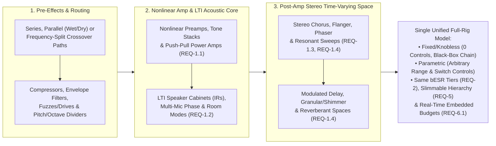
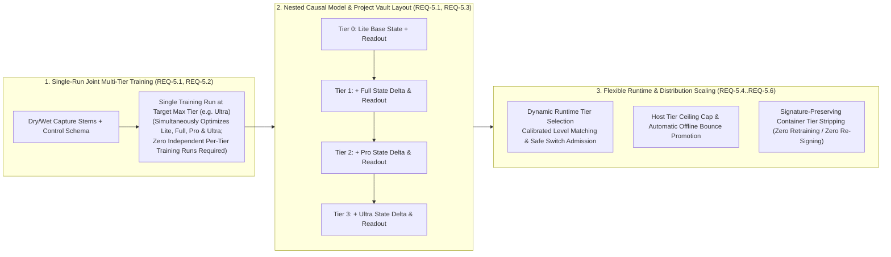

# System Goals, Functional Requirements & Hardware Budgets

This specification defines the **eight implementation-agnostic system goals, functional requirements (`REQ-1`–`REQ-8`), real-time commodity hardware budgets, and model/marketplace security guarantees** that govern **Dynamic Neural Audio Modeler (DNAM)**.

All requirements in this document are stated independently of internal model topology, cryptographic primitive, or solver implementation:

- For the perceptual quality metric (bESR) and 4-tier acceptance thresholds (Lite, Full, Pro, Ultra), see the [psychoacoustic quality and tiers specification](../specs/architecture/psychoacoustic_quality_and_tiers.md).
- For the concrete SONA DSP and training architecture that fulfills these goals, see the [SONA architecture specification](../specs/architecture/sona_architecture.md) and [ADR-0022](../adr/0022-sona-state-space-operator-and-webgpu-architecture.md) for prior-art comparisons.
- For the cryptographic provenance, hardware enclave DRM, forensic watermarking, and anti-cloning architecture that fulfills Goal 8, see the [provenance and enclave DRM specification](../specs/security/provenance_and_enclave_drm.md) and [watermarking and marketplace specification](../specs/security/watermarking_and_marketplace.md).

---

## 1. End-to-End Requirement Architecture

```mermaid
flowchart LR
    subgraph Goal12 ["Goals 1 & 2: System Coverage & Perceptual Quality"]
        G1A["Goal 1 (REQ-1): Nonlinear, LTI, Resonant, Delay & Complex Full-Rig Systems"]
        G1B["Goal 1 (REQ-1): Closed-Loop Adaptive Excitation, Null Homing & Universal Black-Box Runtime"]
        G2A["Goal 2 (REQ-2): Device-Agnostic 3-Band Noise-Adjusted bESR Tiers"]
        G2B["Goal 2 (REQ-2): Quiet Stems, Parametric Control, Tempo Sync & Non-Stop Clamping"]
    end

    subgraph Goal34 ["Goals 3 & 4: Iterative Vault Refinement & Portable 32-Bit GPU/CPU Training"]
        G3A["Goal 3 (REQ-3): Single-Project Capture Vault Incremental Stem Refinement"]
        G3B["Goal 3 (REQ-3): Zero Old-Stem Drift & Compact Capsule Persistence"]
        G4A["Goal 4 (REQ-4): Portable 32-Bit GPU Acceleration + Deterministic CPU Fallback"]
        G4B["Goal 4 (REQ-4): Split-Precision 64-Bit Host Solver Accuracy & 2-D Streamed Memory Bounds"]
    end

    subgraph Goal56 ["Goals 5 & 6: Single-Run Slimmable Tiers & Real-Time Budgets"]
        G5A["Goal 5 (REQ-5): Nested Slimmable Hierarchy (Lite < Full < Pro < Ultra)"]
        G5B["Goal 5 (REQ-5): Single-Run Joint Multi-Tier Training (No Per-Tier Retraining)"]
        G5C["Goal 5 (REQ-5): Dynamic Tier Switching, Bounce Promotion & Tier Stripping"]
        G6A["Goal 6 (REQ-6): Embedded Budget (>= 14x Lite, >= 8x Full, >= 4x Pro, >= 2x Ultra @ 48 kHz)"]
    end

    subgraph Goal78 ["Goals 7 & 8: Unclipped 32-Bit Float I/O, Channel Topologies & Marketplace Security"]
        G7A["Goal 7 (REQ-7): Unclipped 32-Bit Float I/O, Mono/True-Stereo (1->1, 2->1, 1->2, 2->2) & Stability"]
        G8A["Goal 8 (REQ-8): Creator Provenance, Distribution Policy & 3 DRM Profiles"]
        G8B["Goal 8 (REQ-8): Zero-Degradation Buyer Watermarking & Collusion Resistance"]
        G8C["Goal 8 (REQ-8): Multi-Stage Anti-Cloning Gate & Automated Device Revocation"]
    end

    Goal12 --> Goal34 --> Goal56 --> Goal78
```

---

## 2. Goal 1 — Universal Instrument, System & Flexible Input Coverage (Nonlinear + LTI + Full Rigs)

A conforming system must accurately model four fundamental physical classes of audio equipment and acoustic spaces—both as isolated hardware units and combined into **complex, end-to-end full rigs**—across the full audible bandwidth (20 Hz–20 kHz) for any musical source, including electric/acoustic guitar, bass, synthesizers, drums, vocals, acoustic instruments, and mastering gear:

| Requirement ID | Physical System Class | Representative Hardware & Acoustic Targets | Required Physical Phenomena |
| :--- | :--- | :--- | :--- |
| **`REQ-1.1`** | **Nonlinear Preamps, Amplifiers & Drives** | Tube heads (Preamp → Tone Stack → Driver → Push-Pull Power/OT), solid-state/CMOS/JFET drives, comparator/octave wavefolder fuzzes, optical/FET compressors, analog tape | Multi-stage soft/hard clipping, asymmetric conduction, dual-polarity interstage bias shift, power-supply sag, and folded phase-space hysteresis |
| **`REQ-1.2`** | **Linear, Time-Invariant (LTI) Systems** | Speaker cabinets (1×15 ported flip-top cabs, 4×12 guitar cabs, multi-mic setups), passive/active EQs, studio rooms, early reflections, chambers, plates, halls | Multi-resonance impulse responses: bass-reflex port resonances (40–110 Hz), speaker cone breakup modes (1.5–6 kHz), mic phase/comb notches (3–16 kHz), and reverberant decay |
| **`REQ-1.3`** | **Selective State-Space & Resonant Filters** | Envelope filters / auto-wahs, analog resonant LP/BP/HP filters (including self-oscillating high-Q peaks), dynamic EQs, phasers, Uni-Vibe, harmonic tremolo | Signal-envelope, free-running LFO, and tempo-synced (`REQ-2.5`) resonant frequency and damping trajectories with preserved resonance Q across wide sweeps |
| **`REQ-1.4`** | **Modulated & Time-Warped Delay Networks** | Through-zero flangers, stereo chorus, rotary Doppler, BBD/tape echoes (with self-oscillation and rhythmic subdivisions), spring reverb drip, hall reverbs, granular clouds, pitch shimmer, spectral freeze | Click-free fractional delay modulation (manual ms/Hz and host/MIDI tempo-synced subdivisions per `REQ-2.5`), dispersive all-pass chirp, stereo feedback diffusion, windowed time/pitch warping, and modeled freeze responses, including lossless infinite hold when present in the captured source |
| **`REQ-1.5`** | **Complex Full-Rig & Multi-Block Signal Chains** | End-to-end multi-unit studio/stage rigs spanning pre-effects (compressors, envelope filters, fuzzes/drives, pitch/octave dividers), nonlinear preamps/amplifiers, LTI speaker cabinets (IRs) and microphones, and post-amp time-varying modulation, delay, granular/shimmer, and reverberant acoustic spaces | Single unified model capturing arbitrary series, parallel (wet/dry or frequency-split), and mono/stereo-routed (1 → 1, 2 → 1, 1 → 2, 2 → 2, and 4-Cable-Method 4CM per `REQ-7.4`) signal chains—supporting both fixed/knobless full-rig captures (zero exposed controls) and parametric/tempo-synced full-rig models—while jointly resolving compound cross-block interactions (`REQ-1.1`–`REQ-1.4`) within the same bESR quality tiers (`REQ-2.1`–`REQ-2.2`), slimmable hierarchy (`REQ-5.1`–`REQ-5.2`), and real-time hardware budgets (`REQ-6.1`) |

### Complex End-to-End Full-Rig & Multi-Block Signal Chain Coverage (`REQ-1.5`)

The system must not be limited to isolated single pedals or standalone amplifier heads; it must capture and model **complete, end-to-end multi-unit rigs as a single unified model**:

| Full-Rig Requirement Aspect | Normative Specification (`REQ-1.5`) |
| :--- | :--- |
| **Arbitrary Multi-Block Topologies** | Must model arbitrary series, parallel (wet/dry blend or frequency-split crossover, such as sub-bass compression combined with high-pass distortion and cabinet simulation), and mono (1 → 1, 2 → 1) or true-stereo (1 → 2, 2 → 2, `REQ-7.4`) chains spanning pre-effects, amplifiers, speaker cabinets (IRs) + microphones, and post-amp modulation/delay/granular/reverb units as one unified model. |
| **Fixed/Knobless vs. Parametric Full-Rig Modes** | Must support both **fixed/knobless full-rig captures** (zero exposed controls, treating the entire multi-unit signal chain as a single black-box system) and **parametric full-rig models** exposing arbitrary user-selected continuous range knobs and discrete switch selectors across one or more units in the rig. |
| **Compound Cross-Block Physical Interactions** | Must jointly resolve inter-stage physical coupling—including nonlinear preamp/power-amp harmonics exciting speaker-cabinet and room resonances (`REQ-1.1` + `REQ-1.2`), envelope/LFO filter sweeps feeding or following nonlinear clipping (`REQ-1.3`), and stereo diffusive delay/reverb tails (`REQ-1.4`)—while meeting the same device-agnostic bESR quality tiers (`REQ-2.1`–`REQ-2.2`), single-run slimmable tier hierarchy (`REQ-5.1`–`REQ-5.2`), and real-time embedded hardware budgets (`REQ-6.1`). |

### Black-Box Identification, Flexible Stem & Excitation Requirements (`REQ-1.6`–`REQ-1.9`)

| Requirement ID | Requirement | Specification |
| :--- | :--- | :--- |
| **`REQ-1.6`** | **Zero Control-Name or Manifest Heuristics** | Capture excitation synthesis and model training must never rely on control names or manifest heuristics to infer circuit behavior, ensuring fixed/knobless rigs and multi-effect + amp + cab chains (`REQ-1.5`) are supported identically ([capture and alignment §1.4](../specs/training/capture_and_alignment.md#14-co-designed-disjoint-comb-excitation-live-tail-extension--white-box-distillation)). |
| **`REQ-1.7`** | **Closed-Loop Feedback-Adaptive & Co-Designed Full-Bandwidth Excitation, Musical Transient Coverage & Dynamic Tail Extension** | Must provide a deterministic, full-bandwidth (20 Hz–20 kHz) universal excitation signal for any musical source that excites linear frequency response, harmonic and intermodulation nonlinearities, dynamic envelope ballistics, and musical transient trajectories without manual per-device tuning, with real-time feedback adaptation of spectral pre-emphasis, operating knee/gate levels, high-resonance frequency zoom, and early convergence termination (plus automatic live recording extension whenever a stem's wet decay tail continues ringing above the measured noise floor and in-window guard-band bleed tracking). |
| **`REQ-1.8`** | **Adaptive Continuous/Discrete Control Capture, Acoustic Null Homing & White-Box Distillation** | Must support adaptive continuous-sweep and stationary-stop hardware control capture with live acoustic null homing (< 0.05 dB) alongside programmatic white-box and grey-box target distillation from circuit simulators, DSP languages, scientific computing runtimes, and audio plugins. |
| **`REQ-1.9`** | **Universal Trainable & Data-Programmable Black-Box Runtime** | Both the real-time inference engine and the identification solver must operate as a universal, data-programmable black-box dynamical system parameterized exclusively by learned weights and declarative coefficients—with zero device-, brand-, or circuit-specific runtime sub-topologies, zero hardcoded crossover frequencies or circuit-emulation equations, zero conditional stage-bypass flags (`REQ-6.1`), and zero solver branching on target identity—so newly encountered hardware topologies (including arbitrary multi-band crossovers, overlapping passband filters, compound dynamics, nonlinear amplifiers, and modulated spatial rigs) are modeled strictly through parameter identification without modifying engine code or breaking container version compatibility ([SONA architecture §1.1](../specs/architecture/sona_architecture.md#11-four-foundational-pillars-of-sona)). |

---

## 3. Goal 2 — Perceptual Studio Quality (bESR), Parametric Control & Quiet Stem Handling

| Requirement ID | Requirement | Specification |
| :--- | :--- | :--- |
| **`REQ-2.1`** | **Perceptual Band-Balanced Metric (bESR)** | Plain broadband ESR must not be used as a quality criterion because 1/f² low-frequency dominance, time-domain MSE high-frequency phase-mismatch bias, and loud-passage masking hide upper-harmonic errors. Report **Floor-Regularized, Noise-Adjusted Band-Balanced bESR** separately for each applicable output channel. Its raw score weights **Low (20–250 Hz)**, **Mid (250 Hz–2.5 kHz)**, and **High (2.5–18 kHz)** equally and can never be more than 4.77 dB (10 log₁₀ 3) better than that channel's worst single band. Apply the separately reported noise-qualified composite acceptance rule ([psychoacoustic quality and tiers](../specs/architecture/psychoacoustic_quality_and_tiers.md)). |
| **`REQ-2.2`** | **Device-Agnostic Quality Standard** | One identical, signal-measured quality standard per tier (Lite, Full, Pro, Ultra) applies across all device types—with zero subjective "clean vs. high-gain" carve-outs—by accounting for sub-sample clock jitter and applicable measured per-channel, per-band noise floors. Deterministic and transport-phase-locked (`REQ-2.5`) targets must satisfy full sample-aligned multi-band error criteria, while unsynchronized free-running LFO modulation or stochastic diffuse tails are evaluated via phase-invariant spectral and envelope criteria. Each applicable output must pass independently; qualifying noise-limited bands follow the specified band and composite acceptance rules, and silent inputs alone do not establish noise-only output ([psychoacoustic quality and tiers §2](../specs/architecture/psychoacoustic_quality_and_tiers.md#2-device-agnostic-quality-evaluation-zero-subjective-carve-outs)). |
| **`REQ-2.3`** | **Quiet Tonal Stems vs. Muted Stems** | Quiet outputs whose active signal exceeds their measured noise floor by more than 6.0 dB (for example, a minimum-volume stem that reduces level without fully muting) must be fitted and evaluated as active rather than discarded by a fixed level cutoff. A genuinely muted output follows the measured-noise-floor residual rule independently of other channels. |
| **`REQ-2.4`** | **Parametric Conditioning & Non-Stop Clamping** | Models must interpolate smoothly across intermediate continuous range and discrete switch control states while automatically clamping unobserved ranges, unrecorded switch options, and unstable multi-knob corners without pausing training for user confirmation ([control-space audit](../specs/training/control_space_audit.md)). |
| **`REQ-2.5`** | **MIDI / Host Tempo Sync & Rhythmic Subdivision** | Time-based model parameters—including delay and echo repeat times, modulation rates (chorus, flanger, phaser, tremolo, rotary, auto-wah, and cyclic sweeps), granular/slicer periods, and rhythmic step trajectories—must natively support both **free-running manual mode (Hz / ms)** and **tempo-synchronized rhythmic mode (BPM)** locked to host transport tempo, external MIDI clock (24 PPQN beat clock), or tap tempo across all **12 canonical musical subdivisions** (1/2., 1/2, 1/2T, 1/4., 1/4, 1/4T, 1/8., 1/8, 1/8T, 1/16., 1/16, 1/16T, spanning dotted 1.5×, straight 1.0×, and triplet 2/3× note feels), including independent Left/Right polyrhythmic subdivisions (such as 1/4 + 1/8. ping-pong). Tempo synchronization must preserve the modeled hardware's time-dependent tonal and spatial diffusion characteristics (including automatic range selection on multi-range units), reject external clock/tap jitter without pitch warble, and transition across continuous tempo ramps or discrete subdivision changes without clicks or pitch discontinuities while meeting all real-time execution constraints (`REQ-6.1`–`REQ-6.3`) ([parametric control bus §7](../specs/dsp/parametric_control_bus.md#7-host-midi-and-tap-tempo-synchronization-req-25), [SONA architecture §6](../specs/architecture/sona_architecture.md#6-subsystem-specification-index)). |

### 3.1 MIDI / Host Tempo Sync & 12-Subdivision Rhythmic Grid (`REQ-2.5`)

To support studio DAW automation and live pedalboard performance without manual millisecond/Hertz conversion, any time-varying delay, modulation, granular, or sequenced model must support seamless switching between manual parameter control and musical tempo synchronization:

| Tempo Sync Aspect | Normative Requirement (`REQ-2.5`) |
| :--- | :--- |
| **Clock Sources & Jitter Rejection** | Must lock to (1) **Host DAW / Plugin Transport Tempo (BPM & musical beat/bar phase PPQ)**, (2) **External MIDI Beat Clock (0xF8 at 24 PPQN with Start 0xFA / Continue 0xFB / Stop 0xFC)**, and (3) **Hardware Footswitch / UI Tap Tempo**, rejecting external clock arrival jitter and human tap variance so sustained repeats never exhibit pitch warble, with instant fallback to **Free-Running Manual Mode (ms / Hz)** when tempo sync is disabled. |
| **Supported Tempo Range** | Support finite tempos from **20 through 400 BPM**, inclusive, for all three clock sources. Report unsupported or invalid values; never present a silently clamped tempo as synchronized to the requested source. |
| **Transport Start & Position Jumps** | Initialize synchronized phase to the supplied position on the first frame of playback start and offline bounce. For in-play jumps, provide smooth shortest-arc relocking by default and an immediate phase-lock option with parameter micro-ramping; retain delay history and validate audible transitions. |
| **12 Canonical Subdivisions, Dual Polyrhythms & Spatial Preservation** | Must support all 12 rhythmic subdivisions relative to a quarter-note beat (`T_quarter = 60 / BPM` seconds): **1/2.** (3.0×), **1/2** (2.0×), **1/2T** (4/3×), **1/4.** (1.5×), **1/4** (1.0×), **1/4T** (2/3×), **1/8.** (0.75×), **1/8** (0.5×), **1/8T** (1/3×), **1/16.** (0.375×), **1/16** (0.25×), and **1/16T** (1/6×), supporting independent Left/Right dual subdivisions (e.g., 1/4 + 1/8. ping-pong) while preserving the natural spatial diffusion of multi-tap and reverberant tails. |
| **Coupled Timbral Fidelity & Multi-Range Continuity** | Synchronizing a time-based control must preserve the hardware's time-dependent tonal behavior—such as analog clock/tape high-frequency rolloff, feedback damping, and automatic range selection (or octave folding) when a target subdivision spans multiple hardware time ranges—across both desktop and zero-allocation embedded runtimes. |
| **Musical Phase Alignment & Artifact-Free Transitions** | Musical bar/beat phase (PPQ) must align periodic modulation cycles and rhythmic/granular windows to downbeats without causing discontinuities in active delay repeats; continuous tempo ramps must glide smoothly, whereas large tempo jumps or discrete subdivision changes must transition without clicks or unnatural pitch jumps while satisfying `REQ-6.1`–`REQ-6.3`. |

---

## 4. Goal 3 — Single-Project Capture Vault Refinement & Compact Capsule Persistence

| Requirement ID | Requirement | Specification |
| :--- | :--- | :--- |
| **`REQ-3.1`** | **Non-Destructive Single-Project Capture Vault Refinement** | Models must support non-destructive incremental refinement—adding, replacing, disabling, or removing individual control-state stems inside a single self-contained project container—without retraining unchanged stems from scratch or requiring external multi-file audio folders ([iterative resume and caching §1](../specs/training/iterative_resume_and_caching.md#1-single-project-capture-vault-editing--compositional-re-solve)). |
| **`REQ-3.2`** | **Zero Old-Stem Perturbation on Expansion** | Adding stems to expand a control's observed range or polynomial degree must preserve previously converged stem responses without degradation and verify cryptographic provenance digests before reusing cached statistics. |
| **`REQ-3.3`** | **Compact Capsule Persistence & Cloud Range Inspectability** | Project containers must persist reusable calibration, compact coreset capsules, and sufficient statistics inside a single portable file whose metadata and chunk directory can be inspected in one front-loaded range read for local or cloud object-storage synchronization, while keeping exported runtime model containers stripped of all training-only data ([iterative resume and caching §2](../specs/training/iterative_resume_and_caching.md#2-compact-capsule-vault-persistence)). |

---

## 5. Goal 4 — Portable 32-Bit GPU-Accelerated & CPU-Fallback Training Under Bounded Memory

| Requirement ID | Requirement | Specification |
| :--- | :--- | :--- |
| **`REQ-4.1`** | **Portable 32-Bit GPU Acceleration & Self-Contained CPU Fallback** | Training must execute self-contained on commodity desktop/server hosts and inside browser background workers—accelerating multi-seed nonlinear and dynamic identification via portable 32-bit GPU compute (32-bit floating-point and 32-bit integer device tensors over browser and native graphics compute APIs, with zero 64-bit device-tensor requirements and zero external Python, CUDA, or deep-learning framework dependencies) while providing a deterministic, feature-complete host CPU and WebAssembly fallback when no compatible GPU adapter is present—supporting sub-second incremental linear/vault updates alongside sub-second to multi-second full nonlinear identification over full-bandwidth 32-bit floating-point audio stems. |
| **`REQ-4.2`** | **Split-Precision 64-Bit Host Solver Accuracy & Deterministic Runtime Parity** | Forward/adjoint device trajectories and on-device sufficient-statistic contractions must execute strictly in 32-bit floating-point and 32-bit integer precision—probed at startup against silent reduced-precision matmul or fast-math corruption and accumulated via exact integer-slice or wide-significand error-free reductions—while all normal-equation solves, rational pole extractions, spectral-balance projections, and multi-tier prefix re-balancing execute in double-precision (64-bit) floating-point arithmetic on the host, concluding with a deterministic reference-engine pass that guarantees bit-exact runtime parity across GPU-accelerated and CPU-only runs ([solver specification §3](../specs/training/webgpu_and_varpro_solver.md#3-wide-significand-gram-contraction--cross-platform-accuracy)). |
| **`REQ-4.3`** | **2-D Streamed Memory Budgeting, Desktop Browser Worker Sizing & Multi-Workgroup / Multi-Core Scaling** | Training must dynamically plan resident versus 2-D streamed execution (time-block × stem-group tiling plus intra-workgroup scan checkpointing) to enforce strict buffer and memory ceilings—staying within ≤ 128 MiB per GPU storage binding for portable graphics-compute compliance, ≤ 1–2 GiB total inside desktop-targeted GPU-accelerated browser worker sandboxes (and ≤ 512 MiB on CPU-only WebAssembly trainer fallback, permitting larger optional warm-start initialization models and multi-stem resident evaluation without relaxing ultra-lean real-time WebAssembly and embedded runtime inference budgets under `REQ-6.1`), ≤ 1 GiB for standard coreset/capsule solves on native desktop hosts, and a bounded configurable host ceiling (defaulting to ≤ 4–8 GiB with ≤ 1 GiB per tensor allocation) when streaming multi-minute, multi-dozen-stem raw captures—while scaling across GPU compute workgroups and host CPU cores. |

---

## 6. Goal 5 — Single-Run Slimmable Multi-Tier Architecture (Lite / Full / Pro / Ultra)

Rather than training, storing, and distributing separate disconnected models for different compute budgets (e.g., separate "Nano", "Feather", "Standard", and "Heavy" models that each require an independent training run), a conforming system must use a **nested slimmable multi-tier hierarchy (Lite $\subset$ Full $\subset$ Pro $\subset$ Ultra) where training at the highest target tier simultaneously trains all lower tiers in a single training run**:

| Requirement ID | Requirement | Specification |
| :--- | :--- | :--- |
| **`REQ-5.1`** | **Nested Slimmable Multi-Tier Hierarchy (Lite ⊂ Full ⊂ Pro ⊂ Ultra)** | Models and containers must organize capacity into exactly four tiers—**Lite** (Mix-Ready / Live Grade), **Full** (True Studio Quality), **Pro** (Mastering / Reference Grade), and **Ultra** (Unconstrained Workstation Max)—using causally nested recurrent/modal states (Lite ⊂ Full ⊂ Pro ⊂ Ultra) paired with compact per-tier linear readout projections trained jointly in a single training run (`REQ-5.2`) without structural padding zeros, enabling instant loudness-matched tier switching (`REQ-5.4`) and signature-preserving tier stripping (`REQ-5.6`). Tier capacities may be adjusted within explicit supported bounds without adding tiers, while retaining their quality and deployment requirements ([SONA architecture §2.1](../specs/architecture/sona_architecture.md#21-lower-block-triangular-arena-hierarchy), [binary container format §2](../specs/containers/dnam_binary_format.md#2-tier-prefix-hardware-loading)). |
| **`REQ-5.2`** | **Single-Run Joint Multi-Tier Training (Zero Independent Per-Tier Training)** | **Training a model at the highest tier (or any selected maximum target tier `t_max`) must simultaneously train and calibrate all lower tiers (`t ≤ t_max`) within that single training run.** Each tier must **not** need to be independently trained, captured, or distilled; a single training execution produces one unified container in which Lite, Full, Pro, and Ultra each independently meet their respective quality standards ([psychoacoustic quality and tiers §4](../specs/architecture/psychoacoustic_quality_and_tiers.md#4-canonical-4-tier-quality-benchmark-matrix), [solver specification](../specs/training/webgpu_and_varpro_solver.md)). |
| **`REQ-5.3`** | **Multi-Tier Incremental Project Vault Refinement** | A single incremental vault refinement invocation must update all active tiers (Lite through `t_max`) together from one project container, without separate per-tier training jobs. Reuse unchanged stem/tier statistics without re-evaluation; changes to a target, weights, or upstream basis dependencies automatically replay compact capsules. The incremental pass must preserve sufficient statistics in a nested tier-prefix representation ([project container format §2.3](../specs/containers/project_container_format.md#23-tier-ordered-upper-triangular-starcenter-statistics-stat)). |
| **`REQ-5.4`** | **Loudness-Matched Dynamic Runtime Tier Switching** | Runtime engines and hosts must be able to request a different tier (Lite, Full, Pro, Ultra) from the same loaded container without file reloads. Admitted changes must avoid audible level jumps and target 0.00 dB calibrated per-tier loudness parity at default controls. Defer or explicitly reject a change when its state or resources cannot be preserved safely; immediate completion is not guaranteed ([tier-transition contract](../specs/architecture/sona_architecture.md#on-demand-tier-transition-contract)). |
| **`REQ-5.5`** | **Host Maximum Tier Ceiling & Automatic Offline Bounce Promotion** | Plugins and embedded hosts must be able to cap the maximum loaded tier to bound memory and compute on resource-constrained hardware. A tier request targets `min(t_requested, t_host_ceiling, t_container_max)` under the applied ceiling; until an admitted change completes, the active tier may remain different from that target. Ceiling changes must not be reported as applied prematurely. Desktop DAWs must support optional automatic promotion to the highest available tier during offline bounce/rendering ([SONA architecture §3.5](../specs/architecture/sona_architecture.md#35-4times-zoh-polyphase-oversampling-on-offline-bounce)). |
| **`REQ-5.6`** | **Signature-Preserving Container Tier Stripping** | Any multi-tier container, including an encrypted container, must support lossless stripping of higher-tier weights and control projections down to a target lower tier (Pro, Full, or Lite) **without retraining and without invalidating creator or marketplace cryptographic signatures**. Verification must authenticate the retained control descriptors, tier boundaries, and lower-tier payload ([binary container format §2](../specs/containers/dnam_binary_format.md#2-tier-prefix-hardware-loading), [provenance and enclave DRM §2.3](../specs/security/provenance_and_enclave_drm.md#23-two-certificate-ed25519-delegation-chain--4-tier-cumulative-arena-digests)). |

> [!NOTE]
> `REQ-5.3`'s single statistics pass is over the project vault and new or statistics-invalidated stems; it does not require distinct tiers to share one feature trajectory. Target or weight updates may require bounded replay of the affected stems. A separate validation-only render may be necessary to establish `REQ-3.2`; it does not refresh unchanged statistics and its cost must be accounted for. All tiers remain part of the one joint training run required by `REQ-5.2`.

---

## 7. Goal 6 — Real-Time Commodity Hardware Budget & Execution Constraints

### 7.1 Target Embedded Platform & Per-Tier Instance Budgets (`REQ-6.1`)

The reference commodity embedded target is the **Rockchip RK3582** (as deployed on the **Darkglass Anagram**: 2× Cortex-A76 @ 2.4 GHz + 4× Cortex-A55 @ 1.8 GHz with ARM64 NEON SIMD, allocating 1× Cortex-A76 core = **20,833 ns/sample raw period at 48 kHz**, or **16,667 ns/sample usable budget under the 80% real-time scheduling cap** including host plugin wrapper dispatch and multi-instance cache pressure, with all processing stages executing unconditionally). A conforming runtime must sustain the following simultaneous real-time (48 kHz) serial pedalboard instance counts ([SONA architecture §2](../specs/architecture/sona_architecture.md#2-4-tier-slimmable-simd-hierarchy-lite--full--pro--ultra)):

| DNAM Tier | Target Grade | Minimum Simultaneous 48 kHz Instances (1× Cortex-A76 @ 80% RT Cap) | Maximum Per-Instance Embedded Budget | Max Single-Core CPU Share (% of 80% RT Cap) | Primary Deployment Target |
| :--- | :--- | :---: | :---: | :---: | :--- |
| **Lite** | **Mix-Ready / Live Grade** | **≥ 14× instances** | ≤ 1,190 ns/sample | ≤ 5.7% (≤ 7.1% of 80% cap) | High-density embedded serial pedalboard chains (≥ 28× across 2× Cortex-A76) & web previews |
| **Full** | **True Studio Quality** | **≥ 8× instances** | ≤ 2,083 ns/sample | ≤ 10.0% (≤ 12.5% of 80% cap) | Default studio & stage flagship block (≥ 16× across 2× Cortex-A76) |
| **Pro** | **Mastering / Reference Grade** | **≥ 4× instances** | ≤ 4,166 ns/sample | ≤ 20.0% (≤ 25.0% of 80% cap) | Mastering & critical reference multi-block chains (≥ 8× across 2× Cortex-A76) |
| **Ultra** | **Unconstrained Workstation Max** | **≥ 2× instances (1× Cortex-A76) & 4× Bounce** | ≤ 8,333 ns/sample | ≤ 40.0% (≤ 50.0% of 80% cap) | Dual-rig embedded chains (≥ 4× across 2× Cortex-A76), desktop DAWs & 4× oversampled offline rendering |

### 7.2 Real-Time Hardware Budget & Loop Execution Requirements (`REQ-6.1`–`REQ-6.3`)

| Requirement ID | Requirement | Specification |
| :--- | :--- | :--- |
| **`REQ-6.1`** | **Simultaneous Real-Time Tier Instance Budgets & Single-Binary Runtime SIMD Dispatch** | On a single reference embedded core (1× Cortex-A76 @ 2.4 GHz, 48 kHz), executing all processing stages unconditionally on every audio frame within an 80% real-time scheduling cap (16,667 ns/sample usable budget including host plugin wrapper overhead and multi-instance cache pressure, with zero stage-bypass flags), a conforming runtime must sustain **≥ 14× simultaneous Lite instances (≤ 1,190 ns/sample)**, **≥ 8× simultaneous Full instances (≤ 2,083 ns/sample)**, **≥ 4× simultaneous Pro instances (≤ 4,166 ns/sample)**, and **≥ 2× simultaneous Ultra instances (≤ 8,333 ns/sample, plus desktop real-time and 4× oversampled offline bounce)**, with zero extra static audio-rate multiply-accumulate cost when user controls are static. Each target architecture (ARM64, x86-64, WebAssembly) must ship as a single library binary that automatically selects the widest supported hardware vector instruction set at startup while maintaining bit-accurate parity across backends. Validate representative supported control counts and active automation as well as static settings ([SONA architecture §2.2](../specs/architecture/sona_architecture.md#22-hardware--dsp-benchmark-summary)). |
| **`REQ-6.2`** | **Zero Pipeline-Stalling Instructions, libm Calls or Unbounded Loops** | Real-time audio (48 kHz) and control (3 kHz) loops must execute zero pipeline-stalling variable-latency division or square-root instructions—including floating-point division (FDIV), floating-point square root (FSQRT), and integer division or remainder (IDIV, DIV, SDIV, UDIV, or software 128-bit division helpers)—zero standard math-library transcendental or remainder calls (`fmod`, `fmodf`, `sin`, `cos`, `tan`, `exp`, `log`, `pow`), and zero unbounded data-dependent loops, enforced by automated release-binary disassembly verification in continuous integration ([Op-N specification](../specs/dsp/op_n_paralru_and_polyadaa.md) and [Op-M specification](../specs/dsp/op_m_modal_kautz.md)). |
| **`REQ-6.3`** | **Zero Real-Time Allocations, Nondeterministic Calls, RNE & Denormal-Tail Resilience** | Audio callbacks must execute with zero heap allocations, zero redundant intermediate feature-bus or cross-boundary audio buffer copies, zero blocking locks or OS syscalls (including uncached runtime feature queries or mutex acquisitions on the audio path), bounded constant-time per-frame work and admitted state, standard round-to-nearest, ties-to-even rounding, and non-trapping floating-point exceptions. Long captured histories may exceed L1 capacity; the instance and timing budgets still apply. Prevent sustained recirculation of nonzero subnormal 32-bit floating-point values in recursive states using platform-appropriate handling (eliding software bit-masking when hardware flush-to-zero is active at block entry). Gradual underflow of intermediate values is permitted where hardware flushing is unavailable; implementations must still meet applicable real-time budgets, including during decaying tails ([floating-point policy](../specs/architecture/sona_architecture.md#floating-point-environment-at-the-audio-callback)). |

Before loading or changing a model, tier, or effective sample rate, admit its declared memory and any simultaneously live transition state against the host's memory ceiling. An exceeded ceiling, unrepresentable size, or allocation failure must be reported explicitly without silently truncating captured delay history or disturbing an already active configuration.

---

## 8. Goal 7 — Unclipped 32-Bit Floating-Point Signal Chain Input & Output

Modern embedded DSP pedalboards (such as the Darkglass Anagram) and desktop DAWs maintain a 32-bit binary floating-point signal chain throughout the internal processing graph prior to final hardware DAC quantization:

| Requirement ID | Requirement | Specification |
| :--- | :--- | :--- |
| **`REQ-7.1`** | **Validated Unclipped 32-Bit Float Operating Range** | Every certified model and supported configuration must have a validated per-input operating envelope of at least [-100.0, +100.0] (+40 dBFS peak) simultaneously on its audio inputs, and support outputs through at least the same magnitude without safety clipping. With valid controls and certified initial or reachable state, inputs in that envelope must not trigger representational saturation in the signal path. Larger ranges may be advertised only when validated. Never apply an artificial 0 dBFS clip; intended modeled nonlinearities and ordinary finite-precision rounding remain. |
| **`REQ-7.2`** | **All-Finite-Input Safety & Stability** | Accept every finite 32-bit floating-point audio input. Outside the certified range, defined representational saturation may alter the signal, but outputs and persistent states must remain finite and saturation must be reported. Recurrent systems must meet their BIBO and applicable Lyapunov guarantees for permitted controls; finite-value saturation alone does not establish Lyapunov stability ([control-space audit](../specs/training/control_space_audit.md)). |
| **`REQ-7.3`** | **32-Bit Floating-Point WAV I/O** | Capture and training WAV I/O must support unclipped 32-bit binary floating-point (`WAVE_FORMAT_IEEE_FLOAT`, `format_tag = 3`) alongside 16/24/32-bit integer PCM ([capture and alignment](../specs/training/capture_and_alignment.md)). |
| **`REQ-7.4`** | **Mono (1 → 1, 2 → 1) & True Stereo (1 → 2, 2 → 2) Channel Topologies** | Hardware capture, model training, and real-time inference must natively support all four audio channel I/O routing topologies with 0.00 dB nonlinear drive and threshold parity between 1 → 2 and centered 2 → 2 inputs, zero unrequested mono-collapsing of stereo inputs, and zero right-channel loss when stereo models are deployed in mono outputs: (1) **Mono-In / Mono-Out (1 → 1)** for single-channel chains, (2) **Stereo-In / Mono-Out (2 → 1)** for dual-input or sidechain-keyed mono processors, (3) **Mono-In / Stereo-Out (1 → 2)** for mono sources expanding into stereo processing, and (4) **True Stereo (2 → 2)** for independent stereo left/right or 4CM Inst/Return dual-path chains ([SONA architecture §3.2](../specs/architecture/sona_architecture.md#32-pure-stereo-vm-boundary-sensoryquad--host-shell-8-port-patchbay), [router and crossbar topology](../specs/dsp/router_and_crossbar_topology.md)). |

> [!IMPORTANT]
> A finite maximum-representable 32-bit float input passed through a gain of two has no finite 32-bit representation. The certified unclipped envelope (`REQ-7.1`) and all-finite-input safety (`REQ-7.2`) are therefore distinct; see the [numerical range and saturation specification](../specs/architecture/sona_architecture.md#finite-precision-range-and-saturation-policy).

### 8.1 Canonical Channel I/O Topologies (`1 → 1`, `2 → 1`, `1 → 2`, `2 → 2`, `REQ-7.4`)

A conforming system must treat channel topology as a first-class property across capture, training, container metadata, and runtime execution:

| I/O Topology | Channel Routing | Representative Hardware & Rig Targets | Capture, Training & Runtime Execution Requirement (`REQ-7.4`) |
| :--- | :---: | :--- | :--- |
| **Mono (1 → 1)** | 1 In → 1 Out | Single-channel overdrive/fuzz pedals, mono compressors, envelope filters, standalone amp heads, single-mic speaker cabinets | Captures and trains 1-channel dry to 1-channel wet stems; at runtime, avoids redundant stereo output computation in mono signal chains while producing a phase-coherent mono output (preserving both channels of any stereo-captured ping-pong delay or dual-mic model rather than dropping the right channel). |
| **Stereo-to-Mono (2 → 1)** | 2 In → 1 Out | Dual-input vintage tube amps (Normal + Bright jumpered inputs), stereo-in mono-summed stages, sidechain-keyed mono compressors/gates (Main In + Aux Key In → Mono Out) | Preserves both input channels (`[x_L, x_R]` or `[x_main, x_aux]` sidechain key) during capture, training, and internal nonlinear, tonal, and dynamics processing without prematurely collapsing the input to mono, then produces a single phase-coherent mono output without redundant second-channel output computation. |
| **Mono-to-Stereo (1 → 2)** | 1 In → 2 Out | Mono guitar/synth into stereo chorus, through-zero flanger, rotary speaker, ping-pong delay, dual-mic speaker cabinet (SM57 + R121), stereo hall/shimmer reverb, or mono-in stereo-out full rig | Captures 1-channel dry against 2-channel (`[y_L, y_R]`) wet stems; expands mono input across stereo tonal and spatial stages to synthesize phase-accurate stereo imaging with continuous stereo width control down to mono compatibility. |
| **True Stereo (2 → 2)** | 2 In → 2 Out | True-stereo rack/pedal processors (stereo chorus/phaser/delay/reverb fed by a stereo source), dual-amp stereo rigs, stereo mastering bus gear, and 4-Cable-Method (4CM) `[Inst In, Loop Return] → [Loop Send, Main Out]` rigs | Captures and trains full 2-channel dry (`[x_L, x_R]` or `[x_inst, x_return]`) to 2-channel wet (`[y_L, y_R]`) stems without collapsing input channels to mono; preserves independent Left/Right nonlinear, tonal, and spatial separation (or isolated 4CM loop routing), fully linked dynamics imaging (0.00 deg to two decimal places in the [normal finite domain](../specs/dsp/router_and_crossbar_topology.md)), and 0.00 dB drive-threshold parity with 1 → 2 mode when fed a centered mono signal. Direction is undefined for silence or zero gain; underflow follows the finite-safety and denormal policies rather than an angle guarantee. |

---

## 9. Goal 8 — Model Provenance, Hardware DRM, Forensic Watermarking & Marketplace Security

A conforming ecosystem must protect creator intellectual property, hardware OEM partnerships, and marketplace integrity across open community sharing, desktop/mobile DAWs, browser runtimes, and offline hardware pedalboards—**without requiring internet connectivity during live performance and without adding any overhead (0 flops) to real-time audio processing**:

```mermaid
flowchart LR
    subgraph Prov ["1. Provenance & Creator Policy (REQ-8.1, REQ-8.2)"]
        P1["Cryptographic Creator & Marketplace Signatures<br/>(Immutable Model/Tier Digests vs. Mutable Presets/Tags)"]
        P2["Creator-Signed Distribution Policy<br/>(Allowed Protection Profiles & Manufacturer/Model Exclusivity)"]
    end

    subgraph DRM ["2. Graduated DRM & Hardware Attestation (REQ-8.3, REQ-8.4)"]
        D1["3 Profiles: Open, DeviceAllowlisted & EnclaveSealed"]
        D2["Flexible OEM Onboarding: Self-Registered, OTA Companion Enrollment, or Factory HSM"]
        D3["100% Offline Stage Operation & 0 Real-Time Audio Flops"]
    end

    subgraph Trace ["3. Forensic Watermarking & Anti-Cloning (REQ-8.5, REQ-8.6)"]
        W1["Audible-Zero Buyer Watermark Across All Tiers<br/>(Survives Header Stripping, Collusion & Lite Truncation)"]
        W2["Multi-Stage Anti-Cloning Ingestion Gate<br/>(Signatures + Prefix-Composable Structural Fingerprint + Active Audio Probe)"]
        W3["Evidence-Based Attribution & Revocation from Future Licensing"]
    end

    subgraph Market ["4. Storefront & Container Safety (REQ-8.7, REQ-8.8)"]
        M1["Interactive Browser Auditioning, Measured Preview Defenses & Multi-Creator Royalties"]
        M2["Declarative, Code-Execution-Free Binary Containers (Zero Arbitrary Code on Load)"]
    end

    Prov --> DRM --> Trace --> Market
```

| Requirement ID | Requirement | Specification |
| :--- | :--- | :--- |
| **`REQ-8.1`** | **Cryptographic Provenance & Preset-Safe Metadata Partitioning** | Containers must carry verifiable cryptographic signatures binding the creator's identity, training dataset provenance, model topology, control descriptors and projection data, tier boundaries, and all applicable creator and buyer cumulative tier digests (`REQ-5.6`), plus a marketplace licensing counter-signature when commercially distributed. The container format must partition **immutable signed fields** from **mutable user and storefront fields** (user presets and platform catalog tags) so users and marketplaces can edit and grow that metadata in the same file without invalidating signatures, subject to explicit host resource limits ([provenance and enclave DRM §2.1](../specs/security/provenance_and_enclave_drm.md#21-preset-safe-canonical-header-digest-rfc-8785-jcs)). |
| **`REQ-8.2`** | **Creator-Signed Distribution Policy & OEM Hardware Exclusivity** | Creators must be able to cryptographically restrict which protection profiles (Open, DeviceAllowlisted, EnclaveSealed) and which hardware OEM manufacturers—either manufacturer-wide or restricted to specific hardware device models—may license, seal, or execute a model. Neither a buyer nor a marketplace may strip or widen a creator's distribution policy without invalidating the creator's signature ([provenance and enclave DRM §2.2](../specs/security/provenance_and_enclave_drm.md#22-creator-signed-distributionpolicy--protection-profile-exclusivity)). |
| **`REQ-8.3`** | **Graduated Protection Profiles & Flexible OEM Hardware Integration** | The system must support three graduated container protection profiles: (1) **Open** (unencrypted weights for community and unrestricted cross-platform use), (2) **DeviceAllowlisted** (plaintext header for instant DAW browser indexing + encrypted weights bound to a user's allowlisted device keys, requiring zero factory attestation infrastructure), and (3) **EnclaveSealed** (opaque hardware-sealed container decrypted only inside secure hardware memory). OEM hardware must support self-registered keys, post-factory OTA companion-app certificate enrollment (for already-shipped units), and factory-line HSM provisioning ([provenance and enclave DRM §3–§4](../specs/security/provenance_and_enclave_drm.md#3-pillar-2-hardware-enclave--oem-drm-oemdevicecertificate-attestation--dnam-seal-dnsl-wrapper)). |
| **`REQ-8.4`** | **Offline Stage Reliability & Zero Real-Time Audio Overhead (0 DSP Flops)** | After a protected model is authorized and issued to a device, it must remain loadable and usable on that device offline indefinitely without periodic renewal, provided its authorization and required local keys remain intact. Signature verification, local policy enforcement, key unwrapping, and weight decryption must complete at container load time with **zero runtime internet dependency** and **zero operations (0 flops)** added to the real-time 48 kHz audio or 3 kHz control loops ([offline authorization](../specs/security/provenance_and_enclave_drm.md#offline-authorization-and-future-revocation)). |
| **`REQ-8.5`** | **Perceptually Transparent, Collusion- & Truncation-Resistant Buyer Watermarking** | Every licensed commercial container must embed a deterministic, buyer-specific forensic watermark directly inside the model weights across all tiers (Lite through Ultra) that introduces zero audible degradation (0.00 dB), cannot be removed by stripping headers or applying weight-space equivalence/rescaling transforms, and survives precision reduction (32-bit to 16-bit floating-point), multi-buyer collusion averaging, and tier stripping down to Lite-only (`REQ-5.6`) ([watermarking and marketplace §1](../specs/security/watermarking_and_marketplace.md#1-pillar-3-forensic-traitor-tracing--02-ms-dual-mechanism-buyer-watermarking)). |
| **`REQ-8.6`** | **Multi-Stage Anti-Cloning Ingestion Gate & Evidence-Based Device Revocation** | Marketplace uploads must be screened by a fast multi-stage anti-cloning pipeline that checks (A) cryptographic signature and dataset provenance, (B) tier-prefix-composable structural fingerprints, and (C) active synthetic-probe responses. Evaluate detection and attribution against defined leak, collusion, stripping and recapture workloads. A confirmed leak may trigger automatic revocation of a device from **future licensing only when independent evidence identifies that device as the source**. A license watermark or device-specific copy alone is not such evidence; retain inconclusive cases for review without revoking an unidentified device ([watermarking and marketplace](../specs/security/watermarking_and_marketplace.md)). |
| **`REQ-8.7`** | **Interactive Auditioning, Measured Preview Protection, Stateless Fulfillment & Royalty Splits** | Commercial storefronts must enable live, zero-latency browser auditioning across curated presets via dedicated, on-demand-generated (< 1 ms) preview containers that: (1) physically omit all higher-tier (Full, Pro, Ultra) weights, (2) anchor each preview around a target preset, with a bounded responsive control for eligible single-control models, (3) target perceptually transparent stage-fused phase dispersion, (4) target defenses against defined black-box capture stimuli while preserving natural playing, and (5) target session-bound white-box and acoustic watermarks. Measure protection, false alarms, audition fidelity and attribution against declared workloads; do not promise prevention of all reconstruction or replay-based copying. Storefronts must also store only a single canonical master per model with stateless on-demand per-buyer watermarking/sealing at fulfillment time (zero storage multiplication) and automated multi-creator revenue splits ([watermarking and marketplace §3–§4](../specs/security/watermarking_and_marketplace.md#3-commercial-storefront-platform-auditioning-royalty-splits--storefront-metadata)). |
| **`REQ-8.8`** | **Declarative, Code-Execution-Free Binary Containers** | All runtime model containers, preview containers, capture project vaults, and hardware-sealed envelopes must use strictly validated declarative metadata and non-executable binary layouts that never execute arbitrary code during deserialization (prohibiting executable serialization formats such as Python `pickle`) and fail fast on malformed headers, unaligned offsets, or checksum mismatches ([project container format §1.1](../specs/containers/project_container_format.md#11-64b-preamble--content-addressed-chunk-directory)). |

### 9.1 Interactive Storefront Auditioning & Anti-Harvesting Security Requirements (`REQ-8.7`)

Prospective buyers must be able to play their own instruments and feel live parameter responsiveness in the browser while protecting commercial models against weight extraction and automated black-box capture:

| Protection Layer | Implementation-Agnostic Requirement (`REQ-8.7`) | Threat Mitigated |
| :--- | :--- | :--- |
| **1. Dedicated Preview Container Type & High-Tier Omission** | Interactive previews must use a distinct container identifier that is rejected as a full production model by DAWs/hardware hosts and physically omits all higher-tier (Full, Pro, Ultra) parameter arenas, transmitting only the base Lite tier. | Prevents direct extraction of studio/mastering tier weights from browser memory or network caches and prevents confusion between preview and production files. |
| **2. Bounded Preview Controls & Rank Deficiency** | Anchor each preview at a preset and restrict its controllable behavior: single-control models expose a bounded responsive window or safe switch pair, whereas multi-control models with a nonzero continuous-control space enforce strict aggregate control-rank deficiency across published previews. | Preserves single-control auditioning while preventing multi-control previews from jointly spanning the full continuous control manifold. |
| **3. Sub-Millisecond Stateless On-Demand Generation (< 1 ms)** | Preview containers must be synthesized on demand directly from the master container's base-tier prefix in < 1 ms of CPU time without executing audio rendering or neural network forward passes, requiring zero pre-generated per-session file storage. | Enables instant per-click preset switching and unique per-visitor session personalization at the CDN edge with zero storage multiplication. |
| **4. Stage-Fused Static Phase Dispersion (Rebuilt-Engine Resistance)** | Preview generation applies a perceptually transparent, flat-magnitude all-pass phase and state-selectivity perturbation fused into intrinsic stage and output projection weights rather than a removable external filter or runtime flag. | Prevents trivial recovery of production weights by stripping an outer filter or recompiling the open-source runtime. |
| **5. Dynamic Synthetic-Sweep & Impulse Input Guard** | The control loop monitors input excitation statistics with zero hardware division or square-root calls and smoothly engages non-stationary phase/spectral dispersion when synthetic probe stimuli are detected, while preserving natural musical playing. | Disrupts automated swept-sine, impulse, and white-noise black-box harvesting stimuli during browser auditioning. |
| **6. Black-Box Acoustic Watermarking & Ephemeral Session Binding** | Preview generation embeds keyed, psychoacoustically masked session-specific transfer-function watermarks alongside session expiration and origin bindings. | Enables forensic attribution of unauthorized browser captures and binds previews to ephemeral storefront sessions. |

> [!NOTE]
> **Control-Rank Containment Rules:**
> - **Single adjustable control (`P = 1`):** Expose a bounded continuous window or two observed safe switch options around the preset anchor; strict rank deficiency does not apply to a 1-D or discrete space.
> - **No adjustable controls (`P = 0`):** Zero-dimensional control space; no control surface is exposed.
> - **Multiple adjustable controls (`P ≥ 2`):** Across all published preset previews for a model, the combined continuous control directions must remain strictly rank-deficient (`r < D_cont`) inside a shared model-scoped subspace ([watermarking and marketplace §3](../specs/security/watermarking_and_marketplace.md#3-commercial-storefront-platform-auditioning-royalty-splits--storefront-metadata)). Discrete switches remain locked to their preset options when `D_cont ≤ 1`.
