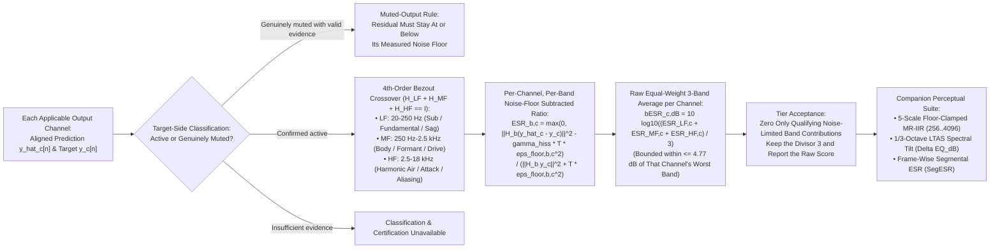

# Psychoacoustic Quality Standard (bESR) & 4-Tier Benchmarks

This specification defines the perceptual quality evaluation framework (bESR, MR-IIR, LTAS spectral tilt, and SegESR), device-agnostic noise-floor rules, quiet versus muted stem classification, and 4-tier (Lite, Full, Pro, and Ultra) acceptance benchmarks for **Dynamic Neural Audio Modeler (DNAM)**.

For overarching system goals and hardware budgets, see the [system goals and requirements](../../requirements/system_goals_and_requirements.md). For why plain broadband ESR and fixed pre-emphasis fail, see [ADR-0003](../../adr/0003-band-balanced-besr-and-noise-qualification.md); for SONA tier sizing and optimization budgets, see [sona_architecture.md §2.2](sona_architecture.md#22-hardware--dsp-benchmark-summary) and [ADR-0022](../../adr/0022-sona-state-space-operator-and-webgpu-architecture.md). Fitting statistics and certification are specified in [webgpu_and_varpro_solver.md](../training/webgpu_and_varpro_solver.md) (`ref[train.pipeline.nested-varpro-schur]`).

---

## 1. Floor-Regularized, Noise-Adjusted Band-Balanced bESR



### 1.1 4th-Order-Flat Bezout Complementary 3-Band Crossover

`r[qual.besr.bezout-crossover]`

DNAM partitions the spectrum into three bands satisfying $H_{\text{LF}} + H_{\text{MF}} + H_{\text{HF}} \equiv I$ using the causal Binomial / Bezout identity $(H_1 + (1 - H_1))^7 \equiv 1$, where $H_1(z) = (1-r)/(1-rz^{-1})$ and $r=e^{-2\pi f_c/f_s}$ is a 1-pole low-pass filter at cutoff $f_c$:
$$\mathcal{L}_{f_c}(z) = H_1(z)^4 \Big(1 + 4\big(1 - H_1(z)\big) + 10\big(1 - H_1(z)\big)^2 + 20\big(1 - H_1(z)\big)^3\Big)$$
With $q=1-H_1$, the complementary high-pass filter has a fourth-order zero at DC:
$$1-\mathcal{L}_{f_c}=q^4(35-84q+70q^2-20q^3)$$

Because the low-pass branch contains $H_1^4$, its response exhibits a nominal -80 dB/decade slope where the one-pole section follows its analog high-frequency asymptote, though that slope does not hold all the way to digital Nyquist. The three transfer functions below sum to unity in exact arithmetic, while finite-precision reconstruction and filter state require separate validation:

| Band | Transfer Function | Nominal Frequency Span | Perceptual & Physical Role |
| :--- | :--- | :---: | :--- |
| **Low / Sub (LF)** | `H_LF(z) = L_250(z)` | 20–250 Hz | Fundamental weight, cabinet port resonance, and power-supply sag. |
| **Mid / Body (MF)** | `H_MF(z) = L_2500(z) - L_250(z)` | 250 Hz–2.5 kHz | Core note definition, formant structure, and primary distortion character. |
| **High / Air (HF)** | `H_HF(z) = 1 - L_2500(z)` | 2.5–18 kHz | Harmonic overtone sheen, pick and slap attack, and aliasing control. |

#### Metric Filter Response

`r[qual.besr.filter-response]`

The nominal frequency ranges are descriptive spans rather than brick-wall boundaries: the low band extends to DC, the high band extends to Nyquist, and adjacent bands overlap. Equal weighting applies to the three resulting band error ratios rather than to disjoint spectral energy bins.

> [!WARNING]
> Complementary summation does not bound individual filter gains. For $H_1(z)=(1-r)/(1-rz^{-1})$ at $f_s=48\text{ kHz}$ and $f_c=250\text{ Hz}$, the two branches reach approximately +9.33 dB and +9.19 dB near the crossover and cancel only when recombined unchanged. Do not silently reuse certificates or cached objectives computed with a different filter.

These filters define strictly the offline perceptual bESR evaluation crossover and are never instantiated inside the runtime DSP virtual machine; the 8-Port I/O Router LR4 audio split in [router_and_crossbar_topology.md](../dsp/router_and_crossbar_topology.md) (`ref[dsp.router.lr4-crossover]`) is a separate runtime signal crossover.

### 1.2 Per-Band Noise-Floor Subtraction & Worst-Band Mathematical Bound

`r[qual.besr.noise-subtracted]`

For each applicable output channel $c$ and band $b \in \lbrace \text{LF}, \text{MF}, \text{HF} \rbrace$, evaluate target and residual energies against the channel's label-free empirical repeatability floor $F_{b,c} = F_{b,c}^{\text{noise}} + F_{b,c}^{\text{inc}}$ derived from target probes $(x, y)$ over $T$ selected samples with hysteresis factor $\gamma_{\text{hiss}} = 1.0$.

Here $F_{b,c}^{\text{noise}} = T \epsilon_{\text{floor},b,c}^2$ is the selection-matched noise energy and $F_{b,c}^{\text{inc}}$ is the empirical inter-repeat incoherence variance across repeated identical stimuli (zero for deterministic targets):
$$\text{ESR}_{b,c} = \frac{\max\Big(0,\ \big\Vert H_b(z)(\hat{y}_c - y_c) \big\Vert _2^2 - \gamma_{\text{hiss}} F_{b,c}\Big)}{\big\Vert H_b(z) y_c \big\Vert _2^2 + F_{b,c}}, \qquad \text{bESR}_{c,\text{dB}} = 10 \log_{10}\left(\frac{\text{ESR}_{\text{LF},c} + \text{ESR}_{\text{MF},c} + \text{ESR}_{\text{HF},c}}{3}\right)$$

Because zero-initialized band filters are non-stationary during startup, compute $F_{b,c}$ using the matched finite-timeline protocol in §1.4 before clamping the numerator at zero, rather than substituting a stationary scalar floor.

> [!IMPORTANT]
> **Mathematical Worst-Band Bound (4.77 dB Ceiling):** Because raw bESR averages the three band ratios with equal weights 1/3, a channel's raw composite score in dB can never be more than $10 \log_{10}(3) \approx 4.77\text{ dB}$ better than that channel's single worst frequency band.

#### Sum-Denominator Convention & Zero-Denominator Rules

`r[qual.besr.zero-denominator]`

For a nonempty selection with valid finite data and a validated noise floor, positive denominators evaluate the formula directly where a zero clipped numerator yields a zero ratio (-∞ dB). When the denominator is zero, the band ratio is 0 if error energy is zero and +∞ (failing band and composite checks) if error energy is nonzero; missing noise evidence, empty selections, non-finite inputs, or underflow-erased nonzero energy render certification unavailable rather than passing.

#### Per-Output Independent Evaluation

`r[qual.besr.per-output]`

Evaluate every applicable output channel $c$ independently against its tier's composite, per-band, and spectral-tilt LTAS thresholds, alongside its MR-IIR and SegESR companion diagnostics and monotone non-regression checks. Pooled stereo summaries may be shown for display, but every required channel must pass on its own so pooling never masks a missing or degraded channel.

### 1.3 Noise-Limited Composite Acceptance

`r[qual.besr.noise-qualified]`

For an active output channel $c$ and tier $t$ with per-band goal $g_{b,t}$ in dB, let $F_{b,c} = T \epsilon_{\text{floor},b,c}^2$, $Y_{b,c} = \Vert H_b y_c \Vert _2^2$, and $R_{b,c} = \Vert H_b(\hat{y}_c-y_c) \Vert _2^2$. Band $b$ qualifies for the noise-limited exception if and only if all three conditions hold:

1. $F_{b,c} > 0$ and the channel, floor, selection, and raw metric are valid.
2. $Y_{b,c} / F_{b,c} < 10^{-g_{b,t}/10}$ (target-to-floor ratio is strictly below the required band SNR).
3. $R_{b,c} \le 10^{0.1} F_{b,c}$ (residual energy is within 1.0 dB of the measured floor).

In the noise-qualified composite acceptance score, replace each qualifying band's ratio with 0, keep non-qualifying band ratios unchanged, and divide their sum by 3 so the three-band divisor remains invariant. Report both the raw composite and the noise-qualified composite alongside the qualification mask.

### 1.4 Finite-Timeline Filtering and Matched Noise Floor

`r[qual.besr.finite-timeline]`

Initialize the bESR band filters with zero state at the first sample of the aligned prediction and target timeline, including any aligned pre-roll context. Filter the entire available timeline in sample order and extract the declared selection only after filtering; never concatenate disjoint slices or reset filter state at selection boundaries.

Compute expected filtered noise energy $F_{b,c}$ over the identical selected indices, zero-state start, timeline context, filter coefficients, and sample rate, setting $\epsilon_{\text{floor},b,c}^2 = F_{b,c}/T$. Bind the timeline origin, selected indices, output roles, sample rate, filter version, and matched floor energies into certification metadata per [project_container_format.md §1.2](../containers/project_container_format.md#12-rfc-8785-jcs-project-manifest).

### 1.5 Conservative Decisions with Uncertain Noise Floors

`r[qual.besr.uncertain-floor]`

For fixed recorded energies $Y_{b,c}$ and $R_{b,c}$, both the raw band ratio and the noise-qualified contribution decrease monotonically as $F_{b,c}$ increases. Given validated simultaneous bounds $0 \le L_{b,c} \le F_{b,c} \le U_{b,c}$, the decision is a guaranteed pass only when all bands and the composite pass at $L_{b,c}$, a guaranteed failure when any criterion fails even at $U_{b,c}$, and unavailable when the two endpoints disagree.

#### Joint Energy-Interval Decisions

`r[qual.besr.joint-intervals]`

When target, residual, and matched-floor energies each lie in simultaneous intervals $Y \in [Y_-,Y_+]$, $R \in [R_-,R_+]$, and $F \in [F_-,F_+]$ with linear band goal $g = 10^{g_{b,t}/10} > 0$ and residual factor $q = 10^{0.1}$, the raw ratio $r(Y,R,F)$ is bounded by:
$$r_- = r(Y_+,R_-,F_+), \qquad r_+ = r(Y_-,R_+,F_-)$$

Because the qualified contribution $c(Y,R,F)$ jumps upward when $Y g$ crosses $F$, checking only the target endpoints $Y_-$ and $Y_+$ is insufficient. Evaluate its rectangular bounds at $(F_-, R_+)$ and $(F_+, R_-)$:

| Bound | Condition | Evaluation Point |
| :--- | :--- | :--- |
| **Upper Bound `c_+` at `(F_-, R_+)`** | `F_- = 0` or `R_+ > q F_-` | `c(Y_-, R_+, F_-)` |
| **Upper Bound `c_+` at `(F_-, R_+)`** | `F_- > 0`, `R_+ ≤ q F_-`, and `Y_+ g < F_-` | 0 (entire interval qualifies) |
| **Upper Bound `c_+` at `(F_-, R_+)`** | `F_- > 0`, `R_+ ≤ q F_-`, and `Y_+ g ≥ F_-` | `r(max(Y_-, F_-/g), R_+, F_-)` (interior boundary `Y = F_-/g` does not qualify) |
| **Lower Bound `c_-` at `(F_+, R_-)`** | `F_+ > 0`, `R_- ≤ q F_+`, and `Y_- g < F_+` | 0 |
| **Lower Bound `c_-` at `(F_+, R_-)`** | Otherwise | `c(Y_+, R_-, F_+)` |

> [!NOTE]
> **Exact Residual Comparison & Calibration Profiles:** In exact rational arithmetic, the residual qualification condition $R \le 10^{0.1} F$ is evaluated without irrational approximation via $R^{10} \le 10 F^{10}$. Statistical floor-bracketing profiles and R&D counterexamples are archived in [ADR-0003](../../adr/0003-band-balanced-besr-and-noise-qualification.md).

---

## 2. Device-Agnostic Quality Evaluation (Zero Subjective Carve-Outs)

DNAM applies one single, objective, signal-measured standard per tier across all hardware device classes, from clean preamps and LTI cabinets to high-gain tube heads, self-oscillating filters, and extreme comparator fuzzes.

### 2.1 Sub-Sample Clock Jitter Floor (8 kHz)

`r[qual.eval.jitter-floor]`

At $f_s = 48\text{ kHz}$, an uncompensated converter clock drift or USB stream startup jitter of 0.05 samples (1 µs) introduces a phase error $\Delta\phi = 2\pi \frac{8000}{48000}(0.05) = 0.052\text{ rad}$ (3°) at 8 kHz. This phase error imposes a mathematical time-domain subtraction ceiling of $20 \log_{10}(0.052) = -25.6\text{ dB}$ unless sub-sample jitter is aligned during calibration as specified in [capture_and_alignment.md §1.5](../training/capture_and_alignment.md#15-multi-regime-sub-sample-hardware-latency-alignment).

### 2.2 Signal-Measured Thermal Hiss Floor (Noise-Floor Limited Criterion)

`r[qual.eval.thermal-hiss]`

Deterministic models must not memorize random analog thermal noise. Apply the per-output, per-band qualification in §1.3 whenever a measured target-to-floor ratio lies below the tier's required band SNR and the residual remains within 1.0 dB of that floor. A qualifying band satisfies its band requirement and contributes zero to composite acceptance while remaining visible in the reported raw score.

### 2.3 Universal Label-Free Quality Scope

`r[qual.eval.metric-scope]`

All targets share one universal certification contract with zero archetype or device-family carve-outs. Every target is scored jointly on repeatability-floored bESR, MR-IIR (`ref[qual.companion.mr-iir]`), 33-band LTAS (`ref[qual.companion.ltas]`), 20 ms 3-band Bezout envelope SegESR (`ref[qual.companion.seg-esr]`), and LUFS parity (`ref[arch.topology.auto-unity-leveling]`), parameterized solely by its empirical target repeatability profile measured strictly from target $(x, y)$ pairs.

HF error-ratio thresholds and LTAS tilt limits remain distinct criteria: for a noiseless sinusoid with constant gain error, -20, -26, and -30 dB error ratios permit roughly 0.92, 0.45, and 0.28 dB of attenuation versus 0.35, 0.15, and 0.10 dB tier tilt limits. Perceptual claims beyond objective distortion metrics require a separate listening protocol.

### 2.4 Quiet Signal, Autonomous Output & Muted Outputs

`r[qual.eval.quiet-vs-muted]`

An output whose active signal exceeds its measured broadband noise floor by more than 6.0 dB—even when quiet in absolute dBFS, such as a minimum-volume stem that attenuates without muting—is classified as active and evaluated under active-output rules. An independently confirmed nonzero signal in the evaluated selection is also active even below that threshold, and sustained tails or autonomous oscillators can remain active even when external inputs are silent.

Only an output within 6.0 dB of its measured noise floor and corroborated by valid target-side and noise evidence can be classified as genuinely muted, in which case its residual must stay at or below that measured floor. Being below 6.0 dB alone never establishes a mute, and another output channel's level never establishes mute status.

Noise-floor evidence must account for all relevant input channels, returns, control settings, and output histories. If suitable noise-only data or independently validated calibration cannot establish the applicable floor, report classification and noise-adjusted certification as unavailable rather than guessing a floor. For an independently established exact zero floor and exact-silent target, evaluate the muted-output rule in the linear domain: zero residual passes and nonzero residual fails.

---

## 3. Companion Perceptual Metrics (MR-IIR, LTAS Tilt & SegESR)

`r[qual.companion.suite]`

Three complementary perceptual diagnostics are evaluated per output channel alongside 3-band bESR:

| Diagnostic Metric | Mathematical Formulation | Perceptual & Physical Purpose |
| :--- | :--- | :--- |
| **Multi-Resolution Log-IIR (MR-IIR)** | Log-magnitude spectral distance across 5-scale multi-Q 2nd-order IIR resonator cascades `M in {256, 512, 1024, 2048, 4096}`, `r_M = exp(-π / M)`, hop `H = M / 4`, clamped to a scale-matched floor | Short scales (256, 512 ≈ 5–10 ms) lock drum transients, slap-bass pops, and pick attacks; long scales (2048, 4096 ≈ 42–85 ms) resolve low bass fundamentals (31 Hz vs. 41 Hz) and cabinet resonances. |
| **1/3-Octave Spectral Tilt (ΔEQ_dB)** | Maximum absolute noise-adjusted LTAS deviation over the 33-band base-10 one-third-octave grid (20 Hz–20 kHz, preserving 2–18 kHz HF); unadjusted tilt reported separately | Detects shelving droop or resonant filter tilt that alters mix placement. |
| **Segmental Envelope ESR (SegESR)** | Duration-weighted mean of repeatability-floored 20 ms 3-band Bezout RMS energy-envelope ratios across active frames, converted to dB | Weights quiet decay tails equally with loud transients across deterministic and modulated targets. |

### 3.1 Measured MR-IIR Noise Floor

`r[qual.companion.mr-iir]`

For each output channel $c$ at sample rate $f_s \ge 8{,}000\text{ Hz}$, evaluate 5 resonator time-scales $M \in \lbrace 256, 512, 1024, 2048, 4096 \rbrace$ with pole radius $r_M = \exp(-\pi / M)$ and hop $H = M / 4$ across $K = 32$ log-spaced probe frequencies $f_k = 20 \cdot (f_{\max} / 20)^{k / (K - 1)}$ over $[20\text{ Hz}, f_{\max}]$ where $f_{\max} = \min(20{,}000\text{ Hz}, 0.45 f_s)$. Step each unity-peak-gain 2nd-order bandpass resonator from zero initial state across the complete aligned timeline before extracting the post-warmup slice (`ref[qual.besr.finite-timeline]`):
$$H_{M,k}(z) = \frac{\frac{1}{2}(1 - r_M^2)(1 - z^{-2})}{1 - 2 r_M \cos(2\pi f_k / f_s) z^{-1} + r_M^2 z^{-2}}$$

Over sliding windows of length $M$ hopped by $H = M / 4$ within the slice, including the final tail window or one partial window when the slice is shorter than $M$, compute target RMS $A_{M,k,h}$, prediction RMS $\hat{A}_{M,k,h}$, and scale-matched resonator-filtered noise floor RMS $\sigma_{M,k,h}$ rather than a fixed -60 dBFS or target-peak floor. Clamp $\tilde{A}_{M,k,h} = \max(A_{M,k,h}, \sigma_{M,k,h})$ and $\tilde{\hat{A}}_{M,k,h} = \max(\hat{A}_{M,k,h}, \sigma_{M,k,h})$ identically across compared models:
$$\mathcal{L}_M = \frac{\sqrt{\sum_{k,h} (\tilde{A}_{M,k,h} - \tilde{\hat{A}}_{M,k,h})^2}}{\sqrt{\sum_{k,h} \tilde{A}_{M,k,h}^2}} + \frac{1}{N_{M}} \sum_{k,h} \left\vert \ln \tilde{A}_{M,k,h} - \ln \tilde{\hat{A}}_{M,k,h} \right\vert, \qquad \mathrm{MR\text{-}IIR}_c = \frac{1}{5} \sum_{M} \mathcal{L}_M$$

When the floor is identically zero, $\sigma_{M,k,h} = 0$, cell log-magnitude distance is 0 when both magnitudes are zero and $+\infty$ when only one is zero; similarly, the spectral-convergence ratio is 0 when both numerator and denominator vanish and $+\infty$ when only the denominator vanishes. Because floor clamping is not noise-power subtraction, MR-IIR is governed by §4's monotone adjacent-tier and old-stem non-regression rules rather than fixed cutoffs.

### 3.2 Noise-Adjusted LTAS

`r[qual.companion.ltas]`

For each output channel $c$ and 1/3-octave band $b \in \mathcal{B}_c$ with Welch PSD band power $P_{\hat{y},b,c}$, target band power $P_{y,b,c}$, and matched expected target-noise power $F^{\text{LTAS}}_{b,c}$, the noise-adjusted band deviation and maximum-band tilt criterion are:
$$\Delta^{\text{adj}}_{b,c} = 10 \log_{10}\left(\frac{P_{\hat{y},b,c}}{P_{y,b,c} - F^{\text{LTAS}}_{b,c}}\right), \qquad D^{\text{adj}}_{\max,c} = \max_{b \in \mathcal{B}_c} \left\vert\Delta^{\text{adj}}_{b,c}\right\vert$$

Welch PSD estimates over a slice of length $N$ use `rate_scale = max(1, ceil(f_s / 48,000))`, `win_cap = 16,384 * next_pow2(rate_scale)`, `seg_len = min(N, win_cap)`, `n_fft = max(2 * win_cap, next_pow2(ceil(f_s)))`, `hop = max(1, floor(seg_len / 2))`, a symmetric cosine Hann window $w_i = 0.5(1 - \cos(2\pi i / (L - 1)))$ normalized by $\sum w_i^2$, and an inclusive tail segment anchored at $N - L$ if unvisited.

```text
+---------------------------------------------------------------------------------------------------+
| 33-BAND BASE-10 ONE-THIRD-OCTAVE LTAS PARTITION (20 Hz .. 20,000 Hz, Anchored at 1,000 Hz)        |
| Ideal Band j in [-17..13]: [1000 * 10^((2j - 1)/20), 1000 * 10^((2j + 1)/20)] Hz                  |
+---------------------------------------------------------------------------------------------------+
|  • Sub/Low-Mid (21 intervals): [20 Hz .. 2,000 Hz)  (j = -17..3, clipped at 20 Hz & split @ 2 kHz)|
|  • HF Diagnostic (11 intervals): [2,000 Hz .. 18,000 Hz] (j = 3..13, 18,000 Hz included in last)  |
|  • Upper Air (1 interval):     (18,000 Hz .. 20,000 Hz] (j = 13 above 18 kHz, 20,000 Hz included) |
+---------------------------------------------------------------------------------------------------+
```

Round each shared interior boundary to IEEE-754 double precision (64-bit) once and assign it to the higher-frequency half-open interval `[low, high)`, except 18,000 Hz (included in the final HF interval) and 20,000 Hz (included in the final upper-air interval), assuming Nyquist is at least 20,000 Hz. A non-excluded band with positive corrected target power and zero prediction power evaluates to -∞ dB (+∞ magnitude) and fails.

Exclude band $b$ from $D^{\text{adj}}_{\max,c}$ only when independent target-side evidence bounds target signal power at or below $F^{\text{LTAS}}_{b,c}$ and residual band power satisfies $R^{\text{LTAS}}_{b,c} \le 10^{0.1} F^{\text{LTAS}}_{b,c}$ (+1.0 dB guard). In adjacent-tier or old-stem comparisons, excluded bands must also exhibit raw residual power no larger than the baseline's.

### 3.3 Segmental ESR Aggregation

`r[qual.companion.seg-esr]`

For each eligible active 20 ms window $f$ with sample count $n_f \approx \mathrm{round}(0.020 \cdot f_{s,f})$, output channel $c$, and Bezout band $b \in \lbrace \text{LF}, \text{MF}, \text{HF} \rbrace$, compute the 3-band RMS envelope trajectories $E_{f,b,c}(y) = \sqrt{\frac{1}{n_f} \Vert H_b(z) y_{f,c} \Vert_2^2}$ and $E_{f,b,c}(\hat{y})$ alongside the probe-derived envelope floor $F_{f,b,c}^{\text{env}}$:
$$r_{f,c} = \frac{1}{3} \sum_{b \in \lbrace \text{LF}, \text{MF}, \text{HF} \rbrace} \frac{\max\Big(0,\ \big(E_{f,b,c}(\hat{y}) - E_{f,b,c}(y)\big)^2 - F_{f,b,c}^{\text{env}}\Big)}{E_{f,b,c}(y)^2 + F_{f,b,c}^{\text{env}}}, \qquad w_f = \frac{n_f}{f_{s,f}}, \qquad \overline{r}_c = \frac{\sum_f w_f r_{f,c}}{\sum_f w_f}, \qquad \mathrm{SegESR}_c = 10 \log_{10}\left(\overline{r}_c\right)$$

Set full-frame length $L = \mathrm{round}(f_{s,f} / 50)$ (960 samples at 48 kHz), and segment aligned timelines at sample-rate transitions so no frame spans a rate change. Retain eligible final partial frames weighted by exact duration $w_f = n_f / f_{s,f}$ without zero-padding or averaging ratios in dB. Include all confirmed active frames (> 6.0 dB above the matched frame floor); excluded noise-limited frames must satisfy $R_{f,c} \le 10^{0.1} F_{f,c}$ under jointly valid bounds.

---

## 4. Canonical 4-Tier Quality Benchmark Matrix

`r[qual.tiers.benchmark-matrix]`

Each compile-time fixed-capacity tier (Lite, Full, Pro, and Ultra; hardware dimensions in [sona_architecture.md §2.1](sona_architecture.md#21-lower-block-triangular-arena-hierarchy)) and output channel is evaluated identically under one universal, label-free repeatability contract across captured and held-out controls.

In addition to the absolute floors below, adjacent retained tiers must satisfy universal monotone per-output non-regression: on identical aligned inputs, targets, controls, and initial state, a higher tier's raw composite and per-band bESR, MR-IIR, maximum absolute noise-adjusted LTAS, excluded-band LTAS residuals, and SegESR must be no worse than the lower tier's.

| DNAM Tier | Target Grade | Noise-Qualified Composite Acceptance | Per-Band Requirement (LF / MF / HF or ≤ NoiseFloor + 1.0 dB) | Max Absolute Noise-Adjusted LTAS (dB) | Multi-Control Unseen Acceptance | Primary Application |
| :--- | :--- | :---: | :--- | :---: | :---: | :--- |
| **Lite** | **Mix-Ready / Live Grade** | **≤ -18 dB** | LF ≤ -23 dB, MF ≤ -20 dB, HF ≤ -15 dB | **≤ 0.75 dB** | **≤ -16 dB** | High-density live pedalboard chains & browser previews |
| **Full** | **True Studio Quality** | **≤ -23 dB** | LF ≤ -27 dB, MF ≤ -25 dB, HF ≤ -20 dB | **≤ 0.35 dB** | **≤ -21 dB** | Default studio & stage flagship block |
| **Pro** | **Mastering / Reference Grade** | **≤ -30 dB** | LF ≤ -34 dB, MF ≤ -31 dB, HF ≤ -26 dB | **≤ 0.15 dB** | **≤ -27 dB** | Mastering & critical solo reference rigs |
| **Ultra** | **Unconstrained Workstation Max** | **≤ -34 dB** | LF ≤ -38 dB, MF ≤ -35 dB, HF ≤ -30 dB | **≤ 0.10 dB** | **≤ -32 dB** | Archival workstation & 4× 64-tap full-band (43-sample PDC) bounce |

### 4.1 Qualification Floors Are Not Solver Stopping Criteria

`r[qual.tiers.floors-not-stopping-criteria]`

The composite bESR thresholds (-18 / -23 / -30 / -34 dB), per-band limits, LTAS tilt limits (≤ 0.75 / 0.35 / 0.15 / 0.10 dB), and unseen multi-control bounds (-16 / -21 / -27 / -32 dB) are minimum qualification failure floors, never solver stopping criteria or early-exit threshold stops (`REQ-2.1`, `REQ-5.2`).

SONA maximizes per-tier perceptual fidelity inside the fixed compile-time hardware and 64 KiB L1D budgets (`ref[arch.tiers.maximize-quality-within-budget]`, [sona_architecture.md §2.2](sona_architecture.md#22-hardware--dsp-benchmark-summary)) via asymptotic diminishing-returns convergence (|ΔbESR| < 0.01 dB/epoch across full 2.0–2.5 s capsules, 64–128-seed exploration, and continuous Kautz pole and Op-T lag polish), subject to adjacent-tier monotone non-regression.
