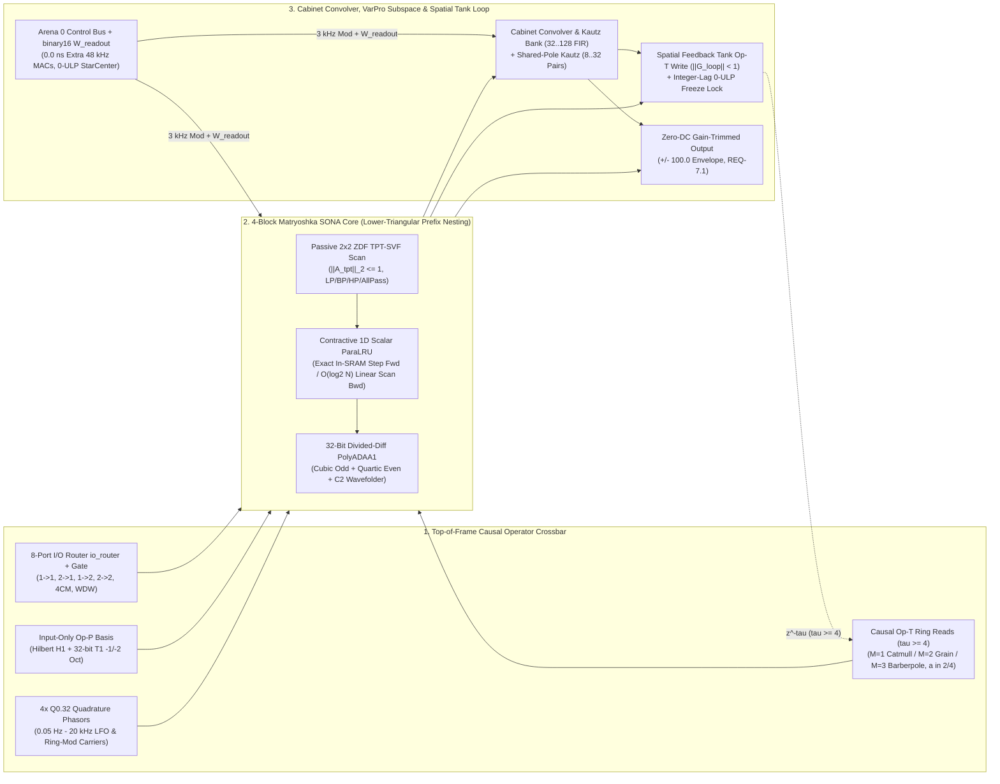
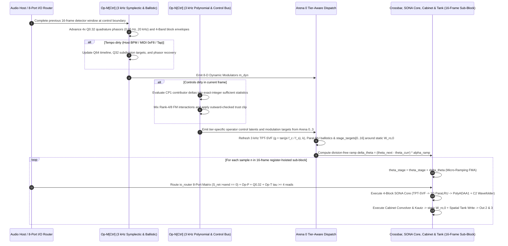
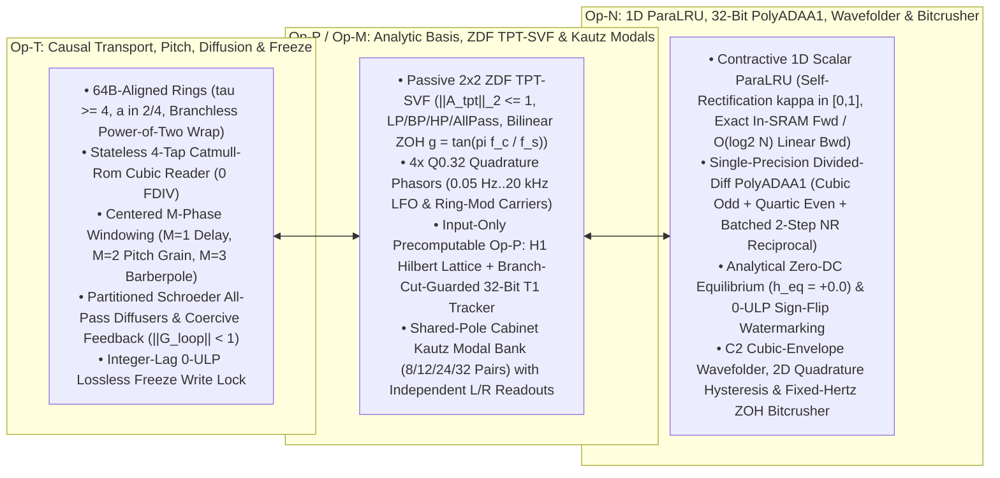
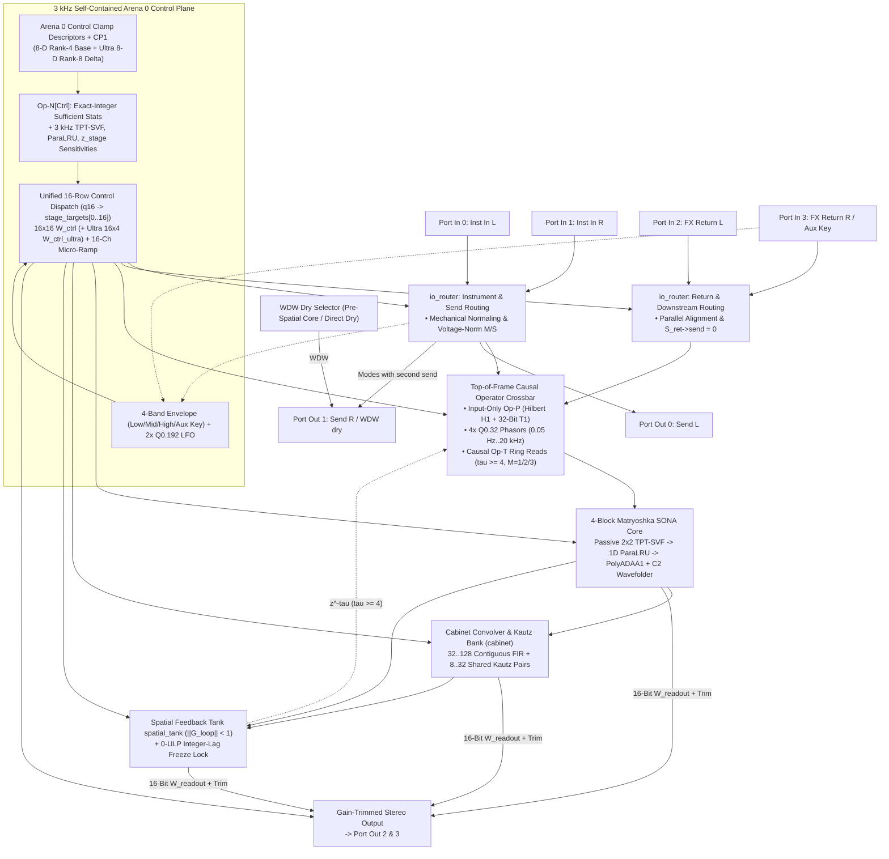
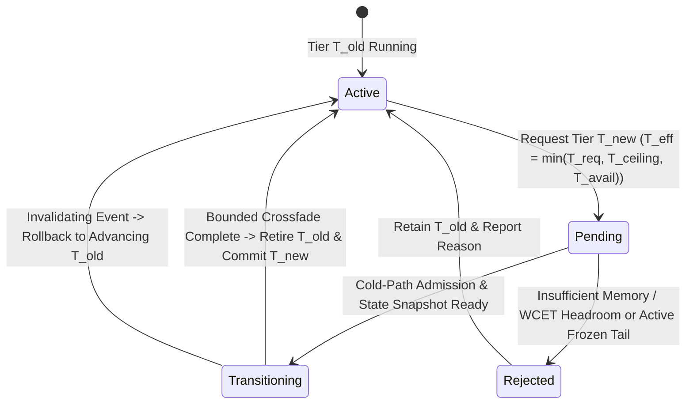
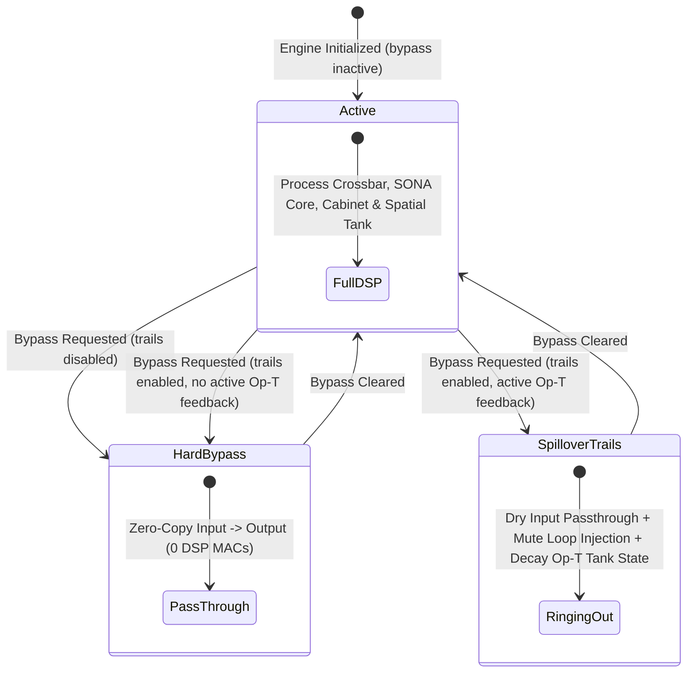
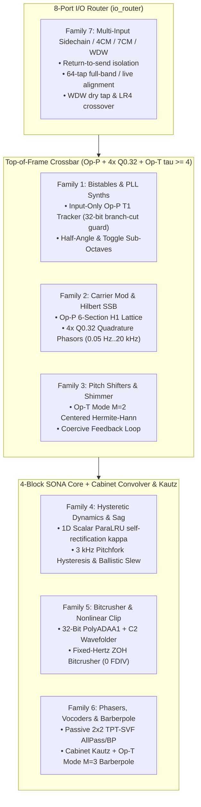

# State-Space Operator Neural Architecture (SONA) System Overview

This specification defines the State-Space Operator Neural Architecture (SONA v3.0) for **Dynamic Neural Audio Modeler (DNAM)** across its portable 32-bit operator library, real-time inference engine, compiled compute shaders, and split-precision system-identification solver.

SONA unifies analog, digital, and acoustic audio hardware into four unconditional blocks: a Top-of-Frame Causal Operator Crossbar (`io_router`, input-only Op-P, 4-lane Q0.32 phasors, and causal Op-T reads), a 4-Block Matryoshka Core (passive 2×2 ZDF TPT-SVF, contractive 1-D ParaLRU, and 32-bit float PolyADAA1 plus wavefolder), a Cabinet Convolver & Kautz Bank (`cabinet`), and a coercive Op-T Spatial Feedback Tank (`spatial_tank`) driven by an Arena 0 3 kHz control bus.

A single-source 32-bit portable operator library compiles identically to vectorized CPU execution targets and ahead-of-time compiled compute shaders for 32-bit WebGPU acceleration and double-precision host VarPro training.

For implementation-agnostic requirements, see the [system goals and requirements](../../requirements/system_goals_and_requirements.md). For psychoacoustic quality tiers, see [psychoacoustic_quality_and_tiers.md](psychoacoustic_quality_and_tiers.md). For architectural rationales and trade-offs, see [ADR-0022](../../adr/0022-sona-state-space-operator-and-webgpu-architecture.md), [ADR-0015](../../adr/0015-realtime-host-concurrency-spsc-and-telemetry-seqlock.md), [ADR-0019](../../adr/0019-simd-kernel-architecture-and-realtime-execution-optimizations.md), and [ADR-0020](../../adr/0020-modular-monorepo-and-dnam-proj-container.md).

---

## 1. Executive Summary & Core Architectural Pillars

### 1.1 Four Foundational Pillars of SONA

SONA v3.0 establishes four foundational pillars across real-time audio execution, 3 kHz control conditioning, v3.0 cache-aligned binary containers, and 32-bit WebGPU plus double-precision host VarPro identification.

#### 1.1.1 Pillar 1: Dual-Space Factored Control Architecture

`r[arch.pillars.dual-space-control]`

SONA factors 3 kHz control-bus trajectories and fixed-shape half-precision `W_readout` subspace coordinates from shared `StarCenter` trajectories to enable non-destructive Capture Vault stem editing as specified in [iterative_resume_and_caching.md §1.2](../training/iterative_resume_and_caching.md#12-two-path-vault-editing--dependency-digests).

#### 1.1.2 Pillar 2: Unified Self-Similar Dual-Rate Control Plane (Op-M[Ctrl] & Op-N[Ctrl])

`r[arch.pillars.dual-rate-plane]`

The control plane runs Op-M and Op-N kernels at a 16-sample stride at the 48 kHz reference rate (3 kHz). Each control tick updates bilinear ZOH TPT-SVF poles $g = \tan(\pi f_c / f_s)$ and damping $k = 1/Q$, ParaLRU ballistics $(\alpha_{\text{rel}}, \alpha_{\text{atk}}, \kappa)$, 4-lane Q0.32 quadrature phasor increments spanning 0.05 Hz to 20 kHz, Op-T delay targets, and collapsed readout deltas across rate-dependent strides $K_{\text{ctrl}}(f_{s,\text{eff}})$ per the [router ZOH contract](../dsp/router_and_crossbar_topology.md).

#### 1.1.3 Pillar 3: Self-Contained Arena 0 Control Descriptors & Tier-Local CP1 Projections

`r[arch.pillars.cp1-projections]`

SONA supports $P \ge 0$ physical controls with control clamp descriptors, `CP1`, `U_int`, `W_ctrl`, and Lite half-precision `W_readout` slices stored wholly inside Arena 0 per [dnam_binary_format.md](../containers/dnam_binary_format.md) so tier-prefix stripping retains complete parametric conditioning.

Lite, Full, and Pro use 8-D static latents (4 readout and 4 core/operator, Rank-4 FM) meeting REQ-5.6, whereas Ultra adds an 8-D delta (4 readout and 4 operator, Rank-8 FM) and a 16 × 4 dispatch delta in Arena 3 per [parametric_control_bus.md §2.3](../dsp/parametric_control_bus.md#23-o1-additive-latent-sufficient-statistic-control-scaling).

#### 1.1.4 Pillar 4: Universal Trainable & Data-Programmable Black-Box Runtime (REQ-1.9)

`r[arch.pillars.universal-black-box]`

Every SONA tier executes a fixed, unconditional mathematical basis parameterized strictly by learned v3.0 SONA container weights. The Top-of-Frame Causal Crossbar combines the 8-Port I/O Router (`io_router`), input-only Op-P (6-section H1 Hilbert lattice and 32-bit float T1 sub-harmonic tracker), 4-lane Q0.32 quadrature phasors, and causal $\tau \ge 4$ Op-T ring reads.

Downstream of the crossbar, signal flow passes unconditionally through the 4-Block Matryoshka SONA Core (passive 2×2 TPT-SVF, contractive 1-D ParaLRU, and 32-bit float PolyADAA1 plus $C^2$ wavefolder), Cabinet Convolver & Kautz Bank (`cabinet`), coercive Op-T Spatial Feedback Tank (`spatial_tank`), and 3 kHz control bus—with zero white-box sub-circuits, zero hardcoded crossover frequencies, zero conditional bypass flags, and zero target-identity solver branches.

### 1.2 The SONA Architectural Breakthrough



Positioning Op-T transport reads with causal margin $\tau \ge 4$ above the nonlinear SONA core avoids delay-free algebraic loops and lets learned crossbar weights mix dry inputs, chorus/delay/reverb returns, 0.05 Hz–20 kHz quadrature ring-mod/LFO carriers, and input-only Op-P channels directly into the core while writing core and cabinet outputs back into Op-T rings under coercive loop gain below unity. Pre-drive phasers, pre-dirt reverbs, BBD/tape loop saturation, audio-rate ring modulation, and modulated rotary rigs emerge naturally from learned weights.

Input-only Op-P emits analytic quadrature and sub-octave divider channels derived solely from dry input $x[n]$ using a 32-bit branch-cut guard (zero weight when unused), allowing the capture pipeline to precompute Op-P on the host CPU in under 0.5 ms before uploading batches to 32-bit WebGPU.

Engaging freeze mode locks Op-T ring writes at integer lag with 0-ULP re-quantization drift over 30 s, while honoring per-ring descriptor precision $a \in \lbrace 2, 4 \rbrace$ (binary16 inline on Lite and Full, selectable binary16 or binary32 cold extension rings on Pro and Ultra).

Meanwhile, the single-source 32-bit portable operator library compiles identically to CPU vector targets and pre-validated compute shaders with zero WebAssembly binary bloat. These compute shaders drive 16 KiB workgroup-shared-memory Blelloch scans, 256× checkpointing, 3 × 8-bit integer Ozaki reductions, and double-precision host VarPro.

#### Dual-Rate (48 kHz Audio vs. 3 kHz Control) SONA Execution Lifecycle

`r[arch.lifecycle.dual-rate]`

Host parameter updates apply at the control boundary in timestamp order, with DAW automation taking precedence over live Studio or MIDI events on exact-timestamp ties per [parametric_control_bus.md](../dsp/parametric_control_bus.md):



Across all tiers, each tier's readout section stores one static base readout matrix `W_ro,0` (16×12 in Lite, 24×12 in Full, 32×12 in Pro, and 40×12 in Ultra). At 3 kHz control boundaries, latent and macro modulation drives `stage_targets[0..16]` plus `stage_latent_mods` (96 half-precision entries) and `stage_latent_ctrl_ultra` (256 entries), alongside optional `stage_latent_core_mods` (1,024 entries) when core lane modulation metadata is active.

All `stage_latent_*` sensitivity tables index strictly the unrotated operator latent slice `z_stage` (4-D in Lite through Pro; 8-D in Ultra) rather than `z_head`.

This indexing keeps buyer `SO(4)` gauge `Q_buyer` invariant with 0-ULP compatibility. On Ultra, Arena 3's `stage_latent_ctrl_ultra` subset supersedes rather than sums with Arena 0's per-block `stage_latent_mods` subset.

#### Floating-Point Environment at the Audio Callback

`r[arch.fp.callback-env]`

All block-processing entry points enforce round-to-nearest, ties-to-even (RNE) with non-trapping floating-point exceptions and subnormal protection via a hardware flush-to-zero / denormals-are-zero guard:

| Target Architecture | Hardware & Target Floating-Point Control Policy |
| :--- | :--- |
| `aarch64` | Save `FPCR`, clear rounding-mode bits 23:22 and trap-enable bits 8:12 and 15, set `FZ` bit 24, and set `FIZ` bit 0 when `FEAT_AFP` `AH` bit 1 is set, eliding redundant `FPCR` restoration writes when unchanged. Persistent recursive-state writebacks additionally execute branchless IEEE-754 scrubbing (non-finite `exp == 255 -> +0.0`, subnormals `exp == 0 -> ±0.0`). |
| `x86_64` | Save `MXCSR`, clear rounding-control bits 14:13 and sticky flags 0:5, set `FTZ` bit 15, `DAZ` bit 6, and exception masks 7:12, and restore `MXCSR` on exit. Persistent recursive-state writebacks additionally execute branchless IEEE-754 scrubbing (non-finite `exp == 255 -> +0.0`, subnormals `exp == 0 -> ±0.0`). |
| **WebAssembly / Portable** | Standard WebAssembly enforces RNE with gradual underflow; apply unconditional branchless 4-lane vector IEEE-754 scrubbing (non-finite `exp == 255 -> +0.0`, subnormals `exp == 0 -> ±0.0`) on persistent recursive writebacks while preserving signs and normal values. |

#### Finite-Precision Range and Saturation Policy

`r[arch.fp.range-saturation]`

Every certified model guarantees an unclipped operating envelope of at least ±100.0 (+40 dBFS peak) simultaneously on all active audio inputs (REQ-7.1), and finite output/state safety for all finite 32-bit float inputs via the ±1e9 (`S = 1,000,000,000.0`) and binary16 (±65,504.0) safety guards (REQ-7.2):

| Bit | Event Flag (`overflow_or_saturation_flags`) | Condition |
| :---: | :--- | :--- |
| 0 | `INPUT_SATURATED` | A processed audio input exceeded the ±1e9 safety ceiling. |
| 1 | `FP16_SATURATED` | A finite delay write exceeded ±65,504.0 (`0x7BFF` / `0xFBFF`). |
| 2 | `INTERNAL_SATURATED` | An intermediate or recursive-state safety guard clamped a value to ±1e9. |
| 3 | `OUTPUT_SATURATED` | The processed output guard clamped a value to ±1e9. |
| 4 | `OUTSIDE_CERTIFIED_INPUT` | An input exceeded the model's certified input envelope (> ±100.0). |
| 5 | `INVALID_NONFINITE` | A non-finite external sample, control, or parameter was detected and rejected. |

#### Wait-Free Telemetry Seqlock & Real-Time Host Concurrency

`r[arch.telemetry.seqlock-publication]`

Real-time host wrappers ([ADR-0015](../../adr/0015-realtime-host-concurrency-spsc-and-telemetry-seqlock.md)) decouple audio rendering callbacks from concurrent UI, MIDI, Studio, and host control and telemetry threads using lock-free, allocation-free concurrency primitives.

The telemetry writer packs the telemetry snapshot into a 64-byte-aligned array of 29 atomic 64-bit words guarded by a monotonic sequence counter, setting the counter odd before relaxed stores and publishing the even increment with release ordering on completion.

Lock-free telemetry readers acquire the leading sequence word, copy the 29 words, issue an acquire fence, and verify unchanged sequence counters with bounded retry and last-good fallback without locking the audio engine.

The host engine wrapper drains the triple-lane lock-free ring buffer (`ref[dsp.ctrl.op-m.spsc-ingress]`) at the start of each host sub-block (default 512 frames ≈ 10.67 ms at 48 kHz) using pre-warmed non-blocking locks and publishes telemetry at sub-block exit.

Lock-free sequence-locked engine hot-swap stages replacement engines in a non-real-time pending slot, polls non-blockingly on the audio thread without blocking or allocating, and moves displaced engine working sets into an 8-slot retirement array reclaimed off the audio thread. Lock-free progress telemetry reports GPU compute capabilities, 2-D planner mode, and convergence progress during training.

### 1.3 Universal Zero-FDIV State-Space & Operator Kernels

`r[arch.operators.tri-kernel]`

Every analog, digital, and acoustic circuit in the audio production domain is spanned by SONA's three single-source 32-bit portable operator families shared across CPU SIMD and GPU compute execution:



For cutoff frequency $f_c[n]$ and damping $k[n] = 1/Q[n] \ge 0$ with $g[n] = \tan(\pi f_c[n] / f_s) > 0$, $a_1 = 1 / (1 + g(g + k))$, $a_2 = g a_1$, and $a_3 = g a_2$ computed on the 3 kHz or cold path, each unconditionally passive 2×2 ZDF TPT-SVF mode obeys $\mathbf{s}[n] = \mathbf{A}_{\text{tpt}}[n]\mathbf{s}[n-1] + \mathbf{b}_{\text{tpt}}[n]u[n]$:
$$s_1'[n] = (2a_1 - 1) s_1[n-1] - 2a_2 s_2[n-1] + 2a_2 u[n], \qquad s_2'[n] = 2a_2 s_1[n-1] + (1 - 2a_3) s_2[n-1] + 2a_3 u[n]$$

By the energy identity $(s_1')^2 + (s_2')^2 = s_1^2 + s_2^2 - 4 g[n] k[n] v_1[n]^2 \le s_1^2 + s_2^2$, the spectral norm satisfies $\Vert\mathbf{A}_{\text{tpt}}[n]\Vert_2 \le 1$ under arbitrary high-Q resonant sweeps, preventing overflow inside $O(\log_2 L)$ WebGPU prefix scans while adapting across 44.1–384 kHz via bilinear prewarping and emitting simultaneous LP, BP, HP, and AllPass (`u - 2 k v1`) taps.

In the 1-D scalar ParaLRU block, each lane $i$ applies a decoupled self-rectification feedback scalar $\kappa_i \in [0, 1]$ across 6 4-lane SIMD vector operations, with inter-lane mixing restricted to lower-triangular 4×4 spatial tiles between blocks:
$$v_i[n] = \alpha_{\text{rel},i} v_i[n-1] + (1 - \alpha_{\text{atk},i}) \phi_{\text{rect}}\big(u_i[n] - \kappa_i \alpha_{\text{rel},i} v_i[n-1]\big)$$
Because $\phi_{\text{rect}}'$ remains bounded in $[0, 1]$, the structural scalar Jacobian obeys $J_i[n] \in [\alpha_{\text{rel},i}(1 - \kappa_i(1 - \alpha_{\text{atk},i})), \alpha_{\text{rel},i}] \subset (0, r_{\max}] \subset (0, 1)$ unconditionally.

Downstream Op-N nonlinearities evaluate midpoint/half-difference `(m_n, d_n)` cubic-odd plus quartic-even PolyADAA1 and $C^2$ continuous wavefolding antiderivatives across 4-lane vector batches.

Branchless rail-crossing reciprocals use 2-step Newton-Raphson IEEE-754 reciprocal approximation guarded by $1.0 \times 10^{-6}$ minimum crossing-span and division thresholds across both stereo 8-lane vectors and batched quad nonlinearities.

Because $g'(\pm 1) = 0$, evaluation stays numerically stable in 32-bit single-precision floating point, preserving exact positive-zero DC equilibrium and 0-ULP hidden-lane sign-flip watermarking with sign weights $s_i \in \lbrace -1, +1 \rbrace$.

### 1.4 Self-Similar Dual-Rate Kernel Architecture

`r[arch.operators.self-similar]`

| Universal Operator Family | Audio-Rate Execution (48 kHz / 96 kHz 2×) | Control-Plane Execution (3 kHz, `f_s / K_ctrl`) | Shared SIMD / GPU Compute Mechanism |
| :--- | :--- | :--- | :--- |
| **Op-T (Transport)** | Fractional delay ring buffer (`tau >= 4`, `a` in 2 or 4), pitch grains, Schroeder diffusers, 0-ULP freeze | Integer-plus-`Q0.32` delay targets, 4× `Q0.32` (0.05 Hz–20 kHz) quadrature phasor increments, coercive bounds | Branchless power-of-two ring wrap masking, Catmull-Rom Horner FMA |
| **Op-P / Op-M (SVF, Analytic & Modal)** | Passive 2×2 TPT-SVF (LP, BP, HP, AllPass), H1 Hilbert SSB, 32-bit T1 tracker, cabinet Kautz bank | TPT-SVF bilinear `g = tan(pi f_c / f_s)` and damping updates, `Q0.192` rotors, `Q64`/`Q32` tempo phase, 4-band detectors | Energy-preserving 2×2 ZDF step/compose & 4-lane / paired stereo FMA |
| **Op-N (ParaLRU & Polynomials)** | Contractive 1-D scalar ParaLRU (`κ_i`), fast-path PolyADAA1 + batched 2-step NR reciprocal, C² wavefolder, bitcrusher | Packed CP1 Lobatto/FM projections, exact-integer sufficient stats, 3 kHz ParaLRU ballistics & trust clip | Branchless in-register 2-step NR reciprocal / FMA (zero spills, CPU == GPU) |

### 1.5 SIMD Architecture, Lane Packing & Zero-Stall Dispatch

#### 1.5.1 SIMD Lane Packing (AVX2, ARM NEON & WebAssembly SIMD128)

`r[arch.simd.lane-packing]`

SONA organizes all 4-block Matryoshka state-space lanes (16 / 24 / 32 / 40 lanes across 4 / 6 / 8 / 10 four-lane groups), TPT-SVF quads (4 / 6 / 8 / 10 quads), inter-block tiles (3 / 13 / 23 / 35 lower-triangular 4×4 triples), cabinet FIR/Kautz banks, 16-bit half-precision delay conversions, and spatial tank quads inside 4-lane vector primitives.

These 4-lane primitives pair natively into 8-lane stereo vectors on 256-bit SIMD architectures (x86 AVX2+FMA, ARM SVE2, ARM SME), or execute as interleaved 4-lane left/right pairs on 128-bit SIMD targets (ARM NEON, WebAssembly SIMD128):

```text
SONA v3.0 4-Block Matryoshka 4-Lane SIMD Hierarchy (Compile-Time Fixed-Capacity Tier Profiles):
+--------------------+--------------------+--------------------+--------------------+
| Block 0 (4-Lane B) | Block 1 (4-Lane B) | Block 2 (4-Lane B) | Block 3 (4-Lane B) | -> Tier / Mode
+--------------------+--------------------+--------------------+--------------------+
| 1 x Vec4 (4 lanes) | 1 x Vec4 (4 lanes) | 1 x Vec4 (4 lanes) | 1 x Vec4 (4 lanes) | -> Lite  [1,1,1,1] (16 lanes @ 1x 48kHz)
| 2 x Vec4 (8 lanes) | 2 x Vec4 (8 lanes) | 1 x Vec4 (4 lanes) | 1 x Vec4 (4 lanes) | -> Full  [2,2,1,1] (24 lanes @ 2x OS)
| 3 x Vec4 (12 lanes)| 2 x Vec4 (8 lanes) | 2 x Vec4 (8 lanes) | 1 x Vec4 (4 lanes) | -> Pro   [3,2,2,1] (32 lanes @ 2x OS)
| 4 x Vec4 (16 lanes)| 3 x Vec4 (12 lanes)| 2 x Vec4 (8 lanes) | 1 x Vec4 (4 lanes) | -> Ultra [4,3,2,1] (40 lanes @ 2x / 4x)
+--------------------+--------------------+--------------------+--------------------+
```

| Tier | Block Profile & Groups/Lanes | TPT-SVF Quads & Tiles | Oversample Factor | Cabinet (FIR Taps + Kautz Pairs) | Tank Quads (Op-T) | Wire Arena & Active Hot Working-Set Ceiling |
| :--- | :---: | :---: | :---: | :---: | :---: | :--- |
| **Lite** (Tier 0) | `[1, 1, 1, 1]` (4 grps = 16 lanes) | 4 quads, 3 tiles (0..3) | 1 (1× @ 48 kHz + PolyADAA1) | 32 FIR/ch + 8 Kautz (2 blks = 16 poles) | 1 (`M = 4` lines, 128-frame / 1,024 B inline 16-bit buffer in Quad 0 + opt. cold lines) | 4,608 B (72 CL), Active Hot ≤ 4,608 B |
| **Full** (Tier 1) | `[2, 2, 1, 1]` (6 grps = 24 lanes) | 6 quads, 13 tiles (0..13) | 2 (2× OS + PolyADAA1) | 48 FIR/ch + 12 Kautz (3 blks = 24 poles) | 2 (`M = 8` lines + Schroeder; Quad 0 128-frame inline + Quad 1) | 7,936 B (124 CL, +3,328 B / 52 CL), Active Hot ≤ 7,936 B |
| **Pro** (Tier 2) | `[3, 2, 2, 1]` (8 grps = 32 lanes) | 8 quads, 23 tiles (0..23) | 2 (2× OS + PolyADAA1) | 96 FIR/ch + 24 Kautz (6 blks = 48 poles) | 3 (`M = 12` lines + Schroeder; opt. 16-bit / 32-bit cold extended lines) | 15,872 B (248 CL, +7,936 B / 124 CL), Active Hot ≤ 15,872 B |
| **Ultra** (Tier 3) | `[4, 3, 2, 1]` (10 grps = 40 lanes) | 10 quads, 35 tiles (0..35) | 2 RT (4× bounce 64-tap PDC) | 128 FIR/ch + 32 Kautz (8 blks = 64 poles) | 4 (`M = 16` lines + 8-stage partitioned Schroeder diffuser bank) | 30,720 B (480 CL, +14,848 B / 232 CL), Active Hot ≤ 28,672 B |

**Exact Matryoshka Block/Group Indexing & 35-Tile Lower-Triangular Edge Topology:**

```text
Group -> (Block, Local Slot) Mapping (10 Groups total = 40 lanes):
  Groups 0..4 (Lite  [1,1,1,1]): (0, 0), (1, 0), (2, 0), (3, 0)
  Groups 4..6 (Full  [2,2,1,1]): (0, 1), (1, 1)
  Groups 6..8 (Pro   [3,2,2,1]): (0, 2), (2, 1)
  Groups 8..10 (Ultra[4,3,2,1]): (0, 3), (1, 2)

Block -> Active Group Indices:
  Block 0 (4 groups = 16 lanes): [0, 4, 6, 8]
  Block 1 (3 groups = 12 lanes): [1, 5, 9]
  Block 2 (2 groups =  8 lanes): [2, 7]
  Block 3 (1 group  =  4 lanes): [3]

All 35 Lower-Triangular (src_group, dst_group) Tiles Ordered Strictly by Tier Introduction:
  0..3   (Lite,  +3): (0,1), (1,2), (2,3)
  3..13  (Full, +10): (0,5), (4,1), (4,5), (0,2), (4,2), (0,3), (4,3), (5,2), (1,3), (5,3)
  13..23 (Pro,  +10): (6,1), (6,5), (0,7), (4,7), (6,2), (6,7), (6,3), (1,7), (5,7), (7,3)
  23..35 (Ultra,+12): (0,9), (4,9), (6,9), (8,1), (8,5), (8,9), (8,2), (8,7), (8,3), (9,2), (9,7), (9,3)
```

#### 1.5.2 Portable SIMD Abstraction & Shared Kernel Layering

`r[arch.simd.two-level-traits]`

Portable single-precision mathematical primitives are cleanly separated from graph orchestration so both CPU SIMD execution targets and compiled GPU compute shaders execute identical operator equations:

| Layer | Responsibility & Shared Capabilities |
| :--- | :--- |
| **Vector & Constants Layer** | 4-lane vector arithmetic, paired 8-lane stereo operations, compile-time derived filter/table constants, software IEEE-754 half-precision codecs, and fixed-point Ozaki slice helpers |
| **Operator Kernel Layer** | 2×2 ZDF TPT-SVF step/compose, 1-D ParaLRU step/scan, PolyADAA1, wavefolder, shared-pole Kautz modal banks, Op-T delay/diffuser readers, H1 Hilbert lattice, and 32-bit T1 subharmonic tracker |
| **Backend Primitives** | Target-neutral vector abstractions, fused 4×4 matrix-vector multiply-add, branchless Newton-Raphson reciprocals, CRC32C checksumming, and subnormal flushing |

Above the mathematical primitives, the runtime graph engine composes execution-ordered cache-locked state slabs, executing register-hoisted stereo sub-blocks while enforcing a strict acyclic layered dependency hierarchy (from outer host runtime through execution topology, operator evaluation, vector algebra, and portable 32-bit primitives; see [ADR-0019](../../adr/0019-simd-kernel-architecture-and-realtime-execution-optimizations.md), [ADR-0022](../../adr/0022-sona-state-space-operator-and-webgpu-architecture.md)).

#### 1.5.3 Single-Library Per-Architecture Runtime SIMD Dispatch & 0.000000 ULP Parity

`r[arch.simd.single-library-dispatch]`

Each target architecture compiles all supported ISA backends into a single distributable binary (`aarch64` NEON/SVE2/SME, x86 SSE2/SSE4.2/AVX2+FMA, WebAssembly SIMD128, and portable scalar fallback) using lock-free cached startup capability probing ([ADR-0019](../../adr/0019-simd-kernel-architecture-and-realtime-execution-optimizations.md)).

Both 8-lane stereo vectors and interleaved 4-lane pairs execute identical fixed vector-pair reduction trees and unfused 2-step Newton-Raphson inverse square roots to guarantee 0.000000 ULP bit parity across CPU backends, `<= 1.5` ULP/step against compiled GPU operators, `<= 1e-4 * max(1.0, peak)` on 256-wide linear scans, and 0-ULP on signed 32-bit fixed-point Ozaki slice reductions.

#### 1.5.4 Division-Free & Math-Library-Free Real-Time Lowering Rules

`r[arch.simd.zero-stall-lowering]`

Real-time 48 kHz and 3 kHz paths execute zero hardware divisions, square roots, external math-library calls, or unbounded loops per `REQ-6.2`, `REQ-6.3`, and [ADR-0019](../../adr/0019-simd-kernel-architecture-and-realtime-execution-optimizations.md):

| Real-Time Operation | Division-Free & External-Math-Free Mechanism |
| :--- | :--- |
| **Prohibited Machine Lowering** | Zero `FDIV`, `FSQRT`, `IDIV`, `UDIV`, `SDIV`, and external math-library transcendental or remainder calls. |
| **Phase & Ring Wrapping** | Angle reductions via branchless periodic folding; power-of-two extended delay lines wrap via bitmask or single-step branchless wrap. |
| **Reciprocals & Prewarping** | PolyADAA1 rail crossings run in pure 32-bit floating point via batched 2-step Newton-Raphson reciprocals; bilinear `g = tan(pi * f_c / f_s)` stays strictly on the 3 kHz or cold path. |

### 1.6 Differentiability and Gradient Dynamics

`r[arch.operators.differentiability]`

| Operator | Forward & Backward Parallel / Analytical Formulation |
| :--- | :--- |
| **1. Op-T (Continuous Delay & Crossbar)** | Horner Catmull-Rom derivative `∂d(τ)/∂μ = 3 c_3' μ² + 2 c_2' μ + c_1'` with coarse-to-fine Gaussian envelope surrogate gradient and fractional delay/LFO polish. |
| **2. TPT-SVF (2×2 Passive Associative Scan)** | Unconditionally contractive 2×2 linear transition `‖A_tpt[n]‖_2 ≤ 1` evaluated via `O(log₂ N)` 2×2 matrix Blelloch prefix/suffix scans inside 6.0 KiB reusable scratch (≤ 15.0 KiB fused workgroup shared memory; zero overflow). |
| **3. ParaLRU (1-D Exact Fwd + Linear Adjoint)** | Decoupled 1-D scalar diode-RC recurrence with `J_i[n] ∈ (0, r_max] ⊂ (0, 1)` evaluated via exact lane-parallel in-SRAM forward stepping + 2-level `O(log₂ N)` cross-tile linear reverse-adjoint scan inside ≤ 15.0 KiB fused SRAM (zero BPTT truncation). |
| **4. Op-N (PolyADAA1 & Bitcrusher STE)** | Analytic derivative of divided-difference PolyADAA1 + C² wavefolder (zero 0/0 instability) plus grouped stop-gradient / 4-term Fourier surrogate for quantizers ([Op-N §2.3](../dsp/op_n_paralru_and_polyadaa.md#23-family-5-precomputed-reciprocal-zoh-sample-rate-reducer--bitcrusher)). |

$$(a_{\text{second}}, \tilde{b}_{\text{second}}) \circ (a_{\text{first}}, \tilde{b}_{\text{first}}) = (a_{\text{second}} a_{\text{first}}, a_{\text{second}} \tilde{b}_{\text{first}} + \tilde{b}_{\text{second}}), \qquad J_i[n] \in \big[\alpha_{\text{rel},i}(1 - \kappa_i(1 - \alpha_{\text{atk},i})),\ \alpha_{\text{rel},i}\big] \subset (0, 1)$$

---

## 2. 4-Tier Slimmable SIMD Hierarchy (Lite / Full / Pro / Ultra)

### 2.1 Lower-Block-Triangular Arena Hierarchy

`r[arch.tiers.arena-hierarchy]`

Weights use a four-tier causally nested lower-block-triangular delta layout across Arena 0..3, stored in fixed-capacity 64-byte-aligned binary arenas.

All four tiers use fixed compile-time capacities tuned to stay inside the 64 KiB ARM Cortex-A76 L1D cache budget (`REQ-5.1`, `REQ-5.2`).

Arena 0 (4,608 B = 72 CL) is 100% self-contained: it carries 1×-calibrated 48 kHz Lite base weights, I/O router crossbar and 4× `Q0.32` phasors, Op-P config, 32 FIR taps + 8 Kautz pairs, Quad 0 Op-T tank, self-contained control tables (control clamp descriptors, `CP1`, `U_int`, `W_ctrl`), and the static base half-precision readout matrix.

Stripping a container to Lite reads Arena 0 directly without touching Arena 1..3 (`REQ-5.6`), while 3 kHz modulation drives `stage_targets[0..16]` plus `z_stage`-indexed sensitivity tables, keeping buyer `SO(4)` gauge `Q_buyer` on `z_head` invariant.

Arena 1..3 hold 2×-OS-calibrated incremental deltas for Full, Pro, and Ultra, with analytical continuous-time ZOH adapting any model cleanly across 44.1–384 kHz. The Pro delta includes a reserved 2,688 B slot preserving 64-byte alignment and the 15,872 B Pro cumulative arena ceiling, serving as a Role B linear Tardos carrier in watermarked issuances (`0x00` unwatermarked).

All 48 kHz operator dimensions remain strictly compile-time constants; only cold Op-T extended delay line duration (constant-time power-of-two masking per `REQ-6.3`) and declared 3 kHz control count $P$ (zero extra 48 kHz static MACs per `REQ-6.1`) vary per capture.

| Parameter | Lite (Arena 0) | Full (Arena 0..1) | Pro (Arena 0..2) | Ultra (Arena 0..3) |
| :--- | :---: | :---: | :---: | :---: |
| **Cumulative Wire Arena Footprint (64 B CL)** | 4,608 B (72 CL) | 7,936 B (124 CL, +3,328 B / 52 CL) | 15,872 B (248 CL, +7,936 B / 124 CL) | 30,720 B (480 CL, +14,848 B / 232 CL) |
| **Active Hot Working-Set Ceiling (L1D Budget)** | ≤ 4,608 B (14× = 64,512 B ≤ 64 KiB) | ≤ 7,936 B (8× = 63,488 B ≤ 64 KiB) | ≤ 15,872 B (4× = 63,488 B ≤ 64 KiB) | ≤ 28,672 B (2× = 57,344 B ≤ 64 KiB) |
| **4-Block Matryoshka SONA Core** | `[1, 1, 1, 1]` (4 groups / 16 lanes / 4 SVF quads, 3 tiles) @ 1× PolyADAA1 | `[2, 2, 1, 1]` (6 groups / 24 lanes / 6 SVF quads, 13 tiles) @ 2× OS | `[3, 2, 2, 1]` (8 groups / 32 lanes / 8 SVF quads, 23 tiles) @ 2× OS | `[4, 3, 2, 1]` (10 groups / 40 lanes / 10 SVF quads, 35 tiles) @ 2× RT / 4× Bounce |
| **Cabinet Early FIR Taps (per ch)** | 32 | 48 | 96 (2.0 ms) | 128 (2.67 ms) |
| **Cabinet Shared Kautz Pole Pairs** | 8 pairs (2 blocks = 16 poles) | 12 pairs (3 blocks = 24 poles) | 24 pairs (6 blocks = 48 poles) | 32 pairs (8 blocks = 64 poles) |
| **Op-T Transport (Tank Quads) & Diffusion** | 1 quad (`M = 4` lines, 128-frame / 1,024 B inline 16-bit Quad 0 + opt. cold lines) | 2 quads (`M = 8` lines + Schroeder; Quad 0 inline + Quad 1) | 3 quads (`M = 12` lines + Schroeder, opt. 16/32-bit cold extended lines) | 4 quads (`M = 16` lines + 8-stage partitioned Schroeder diffuser) |
| **Control Bus Latent Dim (`z_ctrl`, Arena 0 Base)** | 8-D (4 + 4, `R = 4`) | 8-D (4 + 4, `R = 4`) | 8-D (4 + 4, `R = 4`) | 16-D (8 + 8, `R = 8`, +16×4 delta in Arena 3) |

### 2.2 Hardware & DSP Benchmark Summary

`r[arch.tiers.hardware-budget]`

Reference embedded serial pedalboard budgets target one ARM Cortex-A76 core (Rockchip RK3582 @ 2.4 GHz, 20,833.33 ns/sample raw period at 48 kHz, or 16,667 ns/sample usable budget under the 80% real-time scheduling cap including LV2 dispatch and multi-instance cache spill), executing all topological blocks unconditionally on every stereo frame per [system goals and requirements §7](../../requirements/system_goals_and_requirements.md#7-goal-6--real-time-commodity-hardware-budget--execution-constraints).

On Rockchip RK3582 (2× Cortex-A76 @ 2.4 GHz with 64 KB L1D / 512 KB L2 per core), per-instance frame latency $t_{\text{A76+LV2}}(t, B)$, core utilization $u_{\text{core}}(t, B)$, and safe serial instance count $N_{\text{safe}}(t, B)$ for block size $B \in [64, 128]$ obey:

$$t_{\text{A76+LV2}}(t, B) = \kappa_{\text{cache}} \left(\alpha_{\text{uarch}}(t) \cdot t_{\text{bench}}(t) + \frac{T_{\text{LV2-block}}}{B}\right), \qquad u_{\text{core}}(t, B) = \frac{t_{\text{A76+LV2}}(t, B)}{T_{\text{sample}}}, \qquad N_{\text{safe}}(t, B) = \left\lfloor \frac{\eta_{\text{RT}}}{u_{\text{core}}(t, B)} \right\rfloor$$

| Tier Profile | Target 1× A76 Budget (85–90% Utilization) | Active Hot Working Set vs 64 KiB L1D | Normative Serial Core Budget (1× A76 @ 80% RT Cap) | Safe Serial (2× A76 Cores) | Real-Time Instruction Invariant |
| :--- | :---: | :---: | :---: | :---: | :--- |
| **Lite** (`[1,1,1,1]` @ 1×, 4 grps/4 quads, 3 tiles, 32 FIR, 8 Kautz, 1 tank quad) | ≤ 1,000 ns/sample | 14 × ≤ 4,608 B = 64,512 B ≤ 64 KiB | **≥ 14×** (≤ 1,190 ns/sample) | **≥ 28×** | Zero FDIV, FSQRT, IDIV/UDIV/SDIV, math-lib, allocs, locks, or syscalls (`REQ-6.2`, `REQ-6.3`) |
| **Full** (`[2,2,1,1]` @ 2×, 6 grps/6 quads, 13 tiles, 48 FIR, 12 Kautz, 2 tank quads) | ≤ 1,800 ns/sample | 8 × ≤ 7,936 B = 63,488 B ≤ 64 KiB | **≥ 8×** (≤ 2,083 ns/sample) | **≥ 16×** | 2× OS (-90 dB alias immunity) inside Studio flagship budget |
| **Pro** (`[3,2,2,1]` @ 2×, 8 grps/8 quads, 23 tiles, 96 FIR, 24 Kautz, 3 tank quads) | ≤ 3,600 ns/sample | 4 × ≤ 15,872 B = 63,488 B ≤ 64 KiB | **≥ 4×** (≤ 4,166 ns/sample) | **≥ 8×** | Mastering reference capacity (2.0 ms FIR + 48 Kautz poles + 12 delay lines) |
| **Ultra** (`[4,3,2,1]` @ 2×/4×, 10 grps/10 quads, 35 tiles, 128 FIR, 32 Kautz, 4 tank quads) | ≤ 7,200 ns/sample | 2 × ≤ 28,672 B = 57,344 B ≤ 64 KiB | **≥ 2×** (≤ 8,333 ns/sample) + Bounce | **≥ 4×** | Dual-rig workstation max + 4× bounce (64-tap PDC) + 8-stage Schroeder |

For prior-art LV2 instance comparisons against grey-box Multi-FX, NAM A2, GuitarML Proteus, and NAM ParametricOD, see [ADR-0022](../../adr/0022-sona-state-space-operator-and-webgpu-architecture.md).

#### 2.2.1 Compile-Time Fixed Tier Locking & Fixed-Shape Quality Maximization

`r[arch.tiers.maximize-quality-within-budget]`

Compiled inference runtimes eliminate register spills and hot-loop bottlenecks via register-hoisted 16-frame sub-blocks, paired stereo vector dispatch, fast-path PolyADAA1 with 2-step Newton-Raphson reciprocals, and contiguous cache-locked working-set packing.

Satisfying `REQ-5.1` and `REQ-6.1` while verified via timing percentiles and machine disassembly audits, compile-time tier dimensions target 85–90% of each tier's Cortex-A76 WCET budget (≤ 1,000 / 1,800 / 3,600 / 7,200 ns/sample vs. 1,190 / 2,083 / 4,166 / 8,333 ns/sample ceilings, reserving 10–15% for P99.9 margin) inside the 64 KiB L1D limit.

Operator shapes stay compile-time fixed across all captured models with zero dynamic loop counters or runtime operator scaling. Fixing shapes preserves full compiler loop unrolling and SIMD register pinning, keeps 14× serial instances warm in L1I, locks Arena 0..3 byte offsets, and keeps GPU compute workgroups branch-free.

Solver capacity—16 KiB SRAM fusion, subgroup reductions, signed 32-bit Ozaki slice reductions, 64–128 seeds, full 2.0–2.5 s capsules, and continuous Kautz/Op-T polish—is invested solely into maximizing weights until diminishing returns (`|ΔbESR| < 0.01 dB/epoch`), never stopping early at §4 quality floors (`ref[qual.tiers.floors-not-stopping-criteria]`).

### 2.3 State RAM Audit: Lite Budget

`r[arch.tiers.state-ram]`

The execution-ordered hot working-set slab packs hot 48 kHz weights and recursive states contiguously in strict Matryoshka execution order inside the active hot prefix (64-byte-aligned, zero transient heap scratch per instance) strictly ahead of higher-tier extension deltas, cold control-bus and static readout staging, and cold Op-T extended delay rings past the active ceiling. Lower-tier audio callbacks never touch cache lines past their own active working-set boundary:

```text
+---------------------------------------------------------------------------------------------------+
| Execution-Ordered 64 B-Aligned Working Set ([0..ActiveHot) + Cold Tail)                           |
+---------------------------------------------------------------------------------------------------+
| HOT REGION [0..ActiveHot) — Strictly Ordered Before Higher-Tier & Cold Arrays:                    |
|   1. I/O Router (Gain/Matrix/XO/Gate) -> Op-P (Hilbert H1 + T1 SubHarmonic) -> 4x Q0.32 Phasors   |
|   2. Lite Active Core: groups[0..4] (16 lanes, 4 TPT-SVF quads) + tiles[0..3] + Direct Readout    |
|   3. Lite Cabinet & Tank: 32-tap Mirrored FIR + 8-pair Kautz SoA + Spatial Tank Quad 0 (1,024 B)  |
|   --- End of Lite Working Set: ActiveHot <= 4,608 B (72 CL) ------------------------------------- |
|   4. Higher-Tier Hot Extensions (Contiguous per Tier Prefix):                                     |
|      - Full Delta:  groups[4..6], tiles[3..13], FIR[32..48], Kautz[8..12], Quad 1                   |
|        -> ActiveHot <= 7,936 B (124 CL)                                                           |
|      - Pro Delta:   groups[6..8], tiles[13..23], FIR[48..96], Kautz[12..24], Quad 2               |
|        -> ActiveHot <= 15,872 B (248 CL)                                                          |
|      - Ultra Delta: groups[8..10], tiles[23..35], FIR[96..128], Kautz[24..32], Quad 3             |
|        -> ActiveHot <= 28,672 B (448 CL; 30,720 B cumulative wire via Arena 3 delta)              |
+---------------------------------------------------------------------------------------------------+
| COLD TAIL [ActiveHot..) — Zero L1D Footprint on Hot 48 kHz Audio Loops:                           |
|   - Inactive Higher-Tier Delta Arrays (groups[N_g..10], tiles[N_t..35], cabinet/tank extensions)  |
|   - 3 kHz Control Bus: Control Clamp Descriptors[P] + CP1 + U_int + W_ctrl + Control-Bus State    |
|   - Per-Quad Partitioned Schroeder Banks & Ultra 8-Stage Partitioned Schroeder Diffuser Rings     |
|   - Cold Half-Precision Readout Tables & Lock-Free Epoch-Retired Ping-Pong Instance Swap           |
|   - Cold Op-T Extended Ring (0 B dry .. multi-second power-of-two DRAM, a in {2, 4} bytes/sample) |
+---------------------------------------------------------------------------------------------------+
```

| State Component | Lite | Full | Pro | Ultra |
| :--- | :---: | :---: | :---: | :---: |
| **SONA Core Stereo State (4 × 8-lane stereo vectors = 128 B/group)** | 512 B (4 grps) | 768 B (6 grps) | 1,024 B (8 grps) | 1,280 B (10 grps) |
| **Cabinet FIR Tap Weights (32-bit, 32 / 48 / 96 / 128 taps/ch)** | 256 B | 384 B | 768 B | 1,024 B |
| **Cabinet FIR Stereo History Ring (mirrored Lite/Pro/Ultra; power-of-two Full)** | 512 B | 512 B | 2,048 B | 2,048 B |
| **Cabinet Kautz Modal State & Coeffs (11 × 4-lane vectors = 176 B/bank)** | 352 B (2 banks) | 528 B (3 banks) | 1,056 B (6 banks) | 1,408 B (8 banks) |
| **Inline Spatial Tank Quad 0 16-bit Ring (128 frames × 4 lines × 2 B = 16 CL)** | 1,024 B | 1,024 B (+ Quad 1) | 1,024 B (+ Quad 1..2) | 1,024 B (+ Quad 1..3) |
| **Subtotal — Core State, Cabinet FIR/Kautz & Inline Quad 0 Ring** | **2,656 B** | **3,216 B** | **5,920 B** | **6,784 B** |
| **Hot Core Weights, Tiles, Readouts, Quad Headers, Front-End & Alignment** | 1,952 B | 4,144 B | 6,624 B | 8,896 B |
| **Transient Kernel Scratch (Call Stack)** | Stack (0 B/inst) | Stack (0 B/inst) | Stack (0 B/inst) | Stack (0 B/inst) |
| **Total Active Hot Working Set (1× Lite / 2× Full..Ultra)** | **4,608 B** (≤ 4,608 B) | **7,360 B** (≤ 7,936 B) | **12,544 B** (≤ 15,872 B) | **15,680 B** (≤ 28,672 B) |
| **Static-Control Accumulator + Cold Extended Lines (`a ∈ {2, 4}`)** | 64 B + Model-declared | 64 B + Model-declared | 64 B + Model-declared | 128 B + Model-declared |

Within the hot layout, the cache-locked working set stores both Cabinet FIR tap weights (256 / 384 / 768 / 1,024 B) and Cabinet FIR stereo history rings. Lite (≤ 32 taps) and Pro or Ultra (96 or 128 taps) write double-mirrored contiguous history rings (512 B in the Lite prefix, and 2,048 B in the Pro delta, keeping the 512 B prefix buffer accounted under Hot Core Weights on Pro and Ultra).

Full (48 taps inside a 64-entry 32-bit float ring) wraps single-copy segments with a bitwise 63 mask. Each stereo Kautz runtime bank (11 × 4-lane vectors = 176 B/bank) expands the serialized 8 × 4-lane vector = 128 B/block wire layout.

Hot core parameter blocks (groups, inter-block tiles, group readouts, compact tank quads) sit alongside front-end and oversampling blocks (I/O router, Op-P, 4× `Q0.32` phasor bank, and 2× oversampling state).

Combined with the state and FIR/Kautz components above, total hot working memory stays strictly within 4,608 / 7,936 / 15,872 / 28,672 B in the runtime slab (and 4,608 / 7,936 / 15,872 / 30,720 B across wire arenas, preserving the 64 KiB L1D multi-instance budget).

### 2.4 Computational Efficiency & Verification

`r[arch.tiers.efficiency]`

Every active SONA tier executes all topological operators unconditionally on every 16-frame audio sub-block with zero operator-bypass flags, zero dynamic resizing, and zero heap allocations or locks.

Hot loops execute via 8-lane stereo or interleaved 4-lane vector math, fast-path PolyADAA1 with 2-step Newton-Raphson reciprocals, and zero-spill cache-locked working sets. Mono (`1 → 1`, `2 → 1`) topologies emit the phase-coherent Mid readout while advancing dual-channel histories, and all inline and cold extended delay memory is admitted against the host memory ceiling before activation.

---

## 3. Canonical Signal Flow & Crossbar Topology Overview

### 3.1 Detailed Signal Flow & Operator Boundaries

`r[arch.topology.signal-flow]`

SONA executes a unified 8-Port I/O Router (`io_router`) and Top-of-Frame Causal Operator Crossbar feeding the 4-Block Matryoshka SONA Core, Cabinet Convolver & Kautz Bank (`cabinet`), 16-bit half-precision `W_readout`, and coercive Op-T Spatial Feedback Tank (`spatial_tank`, `||G_loop|| < 1`):



### 3.2 8-Port I/O Router (`io_router`) & Voltage-Normalized Mid/Side

`r[arch.topology.io-router]`

The 8-Port I/O Router (`io_router`) provides 4 input ports and 4 output ports:

- **Port In 0..1:** Instrument In Left / Right.
- **Port In 2..3:** FX Loop Return Left / Right (or Aux Key).
- **Port Out 0:** FX Loop Send Left or optional mono WDW send.
- **Port Out 1:** FX Loop Send Right, or center dry in WDW.
- **Port Out 2..3:** Main Out Left / Right; wet-only L/R in WDW.

In WDW mode (pre-spatial core or direct dry), Port Out 1 carries the center dry tap while Ports Out 2/3 carry the stereo wet output and Port Out 0 provides an optional mono send. A zero $\mathbf{S}_{\text{ret}\to\text{send}}$ matrix block in `io_router` and input-only pre-core Op-P isolate external sends from return-derived feedback, while the 3 kHz control bus evaluates all 16 rows of `W_ctrl` unconditionally over unified $\mathbf{q}_{16}$ ([router_and_crossbar_topology.md](../dsp/router_and_crossbar_topology.md), `ref[dsp.router.ports]`).

Mid/Side channels are voltage-normalized (`x_mid = 0.5(L+R)`, `x_side = 0.5(L-R)`) for unity-gain reconstruction.

### 3.3 Gated RMS Auto-Unity Leveling & Per-Tier Loudness Parity

`r[arch.topology.auto-unity-leveling]`

Auto-unity leveling (`io_config.leveling`) anchors at the declared default control settings. Pre-stored linear tier gain trims (`tier_gain_trim_lin`) maintain calibrated per-tier loudness parity across Lite, Full, Pro, and Ultra without runtime division or transcendental calls.

#### On-Demand Tier Transition Contract

`r[arch.tiers.transition-contract]`

Runtime tier changes use on-demand state transfer and a bounded parallel crossfade rather than continuously stepping inactive tiers:



| Transition Phase | Normative Execution Requirement |
| :--- | :--- |
| **1. Request & Admission** | Track requested tier, effective target `min(t_req, t_ceiling, t_avail)`, active tier, and transition status (`pending`, `transitioning`, `completed`, `rejected`). Admit only after verifying state compatibility, stable latency, prepared memory, and WCET headroom. |
| **2. State Preparation** | Prepare target weights, transition buffers, and crossfade ramps off the audio thread, transferring compatible TPT-SVF, ParaLRU, delay, control, and tempo state from a sample-aligned snapshot. |
| **3. Active Tail Preservation** | Never silently reset or drop an active delay, modal, autonomous, or frozen tail; defer or reject a down-tier request if the target tier cannot retain an active contribution. |
| **4. Parallel Render & Handoff** | Advance both old and target paths with time-aligned inputs and controls across a bounded precomputed crossfade, retiring the old path and committing the target tier only after the final fade sample. |

### 3.4 Spillover Trails State Machine

`r[arch.topology.spillover-trails]`

When bypassing an active rig with trails enabled, active Op-T feedback and diffuser delay lines continue ringing out their tail while fresh input injection into the feedback loop is muted:



### 3.5 $4\times$ ZOH Polyphase Oversampling on Offline Bounce

`r[arch.bounce.oversampling]`

When a DAW host renders offline with automatic tier maximization enabled, the engine promotes to $t_{\text{bounce}} = \min(t_{\text{avail}}, t_{\text{max-sup}})$ and steps the analytical ZOH-rescaled SONA graph—with $g = \tan(\pi f_c / (4 f_s))$, rescaled ParaLRU rates, and rescaled Kautz and Op-T parameters—at $4 f_s$ through a 2-stage linear-phase half-band polyphase upsampler/downsampler with > 95 dB stopband attenuation and 12 host samples of oversampler PDC.

Active parallel-alignment groups promote to 64-tap full-band alignment (31 host samples centering offset, yielding 43 host samples combined nominal PDC per [router_and_crossbar_topology.md](../dsp/router_and_crossbar_topology.md), `ref[dsp.router.parallel-alignment]`). Offline bounce runs on an isolated state or restores live monitoring state and tier upon completion without disturbing active delay histories.

---

## 4. Coverage of the 7 Goal 1 Hardware Families

`r[arch.families.coverage]`



| Family | Hardware Archetypes | SONA Operator & Crossbar Mapping | Core Zero-FDIV Audio-Rate Formulation | Differentiable GPU/CPU Surrogate | Acceptance Criterion |
| :--- | :--- | :--- | :--- | :--- | :--- |
| **Family 1: Bistables & PLL Synths** | Boss OC-2, Mu-Tron Octave Divider, Schumann PLL | Crossbar Op-P (T1 Subharmonic Tracker) → SONA Core | T1 5 Hz DC blocker, 32-bit branch-cut guard, scaled reciprocal sqrt, half-angle (`cos`, `sin`), toggle (`f/2`, `f/4`) | Precomputable dry-input Op-P pass (< 0.5 ms) + hard-forward tracker | Sub-octave frequency/amplitude tracking and zero DC offset |
| **Family 2: Carrier Mod & Hilbert SSB** | Moog MF-102 Ring Mod, Bode 735 Frequency Shifter | Crossbar Op-P (`H1`) + 4× `Q0.32` Phasors (0.05 Hz–20 kHz) | 15-anchor 6-section H1 lattice (4-lane stereo) + `Q0.32` degree-5 Hermite quadrature ring cross-products | Phase-insensitive demodulated STFT loss + analytical `Q0.32` carrier | SSB rejection ≥ 42.0 dB across 100 Hz–10 kHz (≤ 0.34°), clean audio-rate Ring Mod |
| **Family 3: Polyphonic & Scale Pitch Shifters** | Eventide H3000, DigiTech Whammy, EHX POG | Crossbar Op-T Mode `M = 2` (`tau >= 4`) + Spatial Tank Feedback | Centered `M = 2` Hermite-Hann grains (`H(φ_A)+H(φ_B)≡1`), 4-tap Catmull-Rom, -24..24 st pitch/warp | Continuous Softmax Diatonic Scale Quantizer + Catmull-Rom `∂d/∂μ` | Pitched chord THD+N ≤ -68 dB and click-free sweep transitions |
| **Family 4: Hysteretic Dynamics & Ducking** | Boss NS-2, SG-1 Slow Gear, UREI 1176LN, SPL Transient, TC 2290 | Matryoshka 1-D ParaLRU (`kappa_i`) + 3 kHz control bus + Op-T VCA | Self-rectifying ParaLRU diode-RC ballistics, pitchfork hysteresis `h[k]`, monotone `log₂`/`exp₂` LUT, 1-pole slew | Exact in-SRAM forward step + `O(log₂ N)` cross-tile linear backward scan (zero BPTT truncation) | Silence noise floor reduction ≥ 72 dB; zero gate chatter |
| **Family 5: Bitcrushers & ZOH Reducers** | E-mu SP-1200, WMD Geiger Counter | SONA Core Op-N (PolyADAA1, C² Wavefolder, Bitcrusher) | 32-bit PolyADAA1 + 2-step NR reciprocals, nearest-step quantizer (ties to +∞), 128-bit integer ZOH phase (0 FDIV) | Hard runtime forward + grouped STE / 4-term Fourier backward surrogate | Exact dyadic boundary rounding and full-rate/fractional latch parity |
| **Family 6: Vocoders, Formants & Barberpole** | EMS Vocoder 2000, EHX Talking Pedal, Maestro Stage Phaser | TPT-SVF (AllPass/BP) + `cabinet` Kautz + Op-T `M = 3` | Passive 2×2 ZDF TPT-SVF, 8/12/24/32 shared Kautz pairs, `M = 3` barberpole, partitioned Schroeder diffusers | ≤ 15.0 KiB fused SRAM 2×2 matrix Blelloch scan + continuous Kautz pole polish | Vowel formant peaks (`F₁, F₂, F₃`) within ±0.4 dB |
| **Family 7: Multi-Input Sidechain / 4CM / 7CM / WDW** | Dual-amp 4CM/7CM loops, keyed gates/ducks, WDW rigs | `io_router` (8-Port I/O Router) + Crossbar & Coercive Tank | Return-to-send isolation, 200 Hz TPT LR4 split, 64-tap sub-sample alignment, WDW dry tap | Decoupled dual-target multi-task loss `L_4CM = λ_pre L_pre + λ_post L_post` | Crossover passband ripple ≤ 0.05 dB and isolated send paths |

### 4.1 Family 1: Bistables & PLL Guitar Synthesizers

`r[arch.families.f1-bistables]`

Analog archetypes include the Boss OC-2, Mu-Tron Octave Divider, and Schumann PLL, which use CMOS 4013 dual D-flip-flops and 4046 VCO PLLs to derive $f_0/2$ and $f_0/4$ sub-octaves. SONA realizes this family via Crossbar Op-P (the T1 subharmonic tracker), executing the tracker-only 5 Hz T1 DC blocker, 32-bit float branch-cut guard, scaled exponent-split normalization, half-angle quadratures (`cos`, `sin`), and toggle dividers (`f/2`, `f/4`) per [op_m_modal_kautz.md §3](../dsp/op_m_modal_kautz.md#3-family-1-sub-harmonic-synthesizers-bistable-dividers--pll-tracking) and [router_and_crossbar_topology.md](../dsp/router_and_crossbar_topology.md).

### 4.2 Family 2: Audio-Rate Carrier Modulation & Hilbert SSB

`r[arch.families.f2-hilbert-ssb]`

Analog archetypes include the Moog MF-102 Ring Modulator and Bode 735 Frequency Shifter built around 4-quadrant multipliers and dual 90° dome networks. SONA pairs a 6-section H1 Hilbert lattice (≤ 0.34° quadrature error across 100 Hz–10 kHz) with 4-lane `Q0.32` quadrature phasors spanning 0.05 Hz to 20 kHz and bilinear ring-mod cross-products in the crossbar, capturing both slow rotary sweeps and audio-rate ring modulation per [op_m_modal_kautz.md §2](../dsp/op_m_modal_kautz.md#2-family-2-hilbert-ssb-lattice--carrier-modulation).

### 4.3 Family 3: Polyphonic Phase-Locked & Intelligent Scale Pitch Shifters

`r[arch.families.f3-pitch]`

Analog and digital archetypes include the Eventide H3000, DigiTech Whammy, and EHX POG. SONA realizes polyphonic pitch shifting and shimmer via Crossbar Op-T Mode `M = 2` using centered partition-of-unity Hermite-Hann windows defined by $u = 1 - \vert 2\phi - 1 \vert$ and $H(\phi) = u^2(3 - 2u)$, 4-tap Catmull-Rom delay reads with $\tau_m \ge 4.0$, coercive Op-T feedback writes satisfying $\Vert G_{\text{loop}}\Vert < 1$, and -24..24 semitone pitch/warp modulation per [parametric_control_bus.md](../dsp/parametric_control_bus.md).

### 4.4 Family 4: Hysteretic Dynamics, Noise Gates, Limiters & Ducking

`r[arch.families.f4-dynamics]`

Hardware archetypes span the Boss NS-2, Boss SG-1 Slow Gear, UREI 1176LN, SPL Transient Designer, and TC 2290. SONA models these behaviors using decoupled 1-D scalar ParaLRU self-rectification $\kappa_i$ for dual-release optical/diode ballistics and sag with contractive Jacobian $J_i \in (0, 1)$, supercritical pitchfork hysteresis $h[k] = \sigma((e[k] - \theta_{\mathrm{mid}})/\tau_h + \kappa(2 h[k-1] - 1))$, monotone 32-bit float $\log_2$ lookup, and 1-pole ballistic slew bounded by $\tau_{\text{attack}} \ge 0.5\text{ ms}$ and $\tau_{\text{release}} \ge 20.0\text{ ms}$.

### 4.5 Family 5: Sample-Rate Reducers, Bitcrushers & Non-Smooth Digital Quantizers

`r[arch.families.f5-bitcrusher]`

Hardware archetypes include the E-mu SP-1200 and WMD Geiger Counter. SONA's Op-N stage evaluates the uniform nearest-step quantizer $Q_B(x) = \lfloor x 2^{B-1} + 0.5 \rfloor 2^{-(B-1)}$ with halfway ties toward $+\infty$, fixed-hertz integer ZOH phase accumulation with pre-reduction carry detection and division-free 128-bit integer reciprocal transfer per [op_n_paralru_and_polyadaa.md §2.3](../dsp/op_n_paralru_and_polyadaa.md#23-family-5-precomputed-reciprocal-zoh-sample-rate-reducer--bitcrusher), plus 32-bit PolyADAA1 and $C^2$ wavefolding.

### 4.6 Family 6: Multi-Band Vocoders, Formant Vowels & Barberpole Tank

`r[arch.families.f6-formants]`

Analog archetypes include the EMS Vocoder 2000, EHX Talking Pedal, and Maestro Stage Phaser. SONA pairs passive 2×2 ZDF TPT-SVF BP and AllPass taps feeding the nonlinear core with shared-pole `cabinet` Kautz resonators (8 / 12 / 24 / 32 pairs) using dynamic sweep contraction (`ref[dsp.op-m.kautz.sweep-contraction]`, [op_m_modal_kautz.md](../dsp/op_m_modal_kautz.md)), `M = 3` raised-cosine barberpole sweeps, and partitioned Schroeder unitary diffusers.

### 4.7 Family 7: Multi-Input Sidechain / 4CM / 7CM / WDW Units

`r[arch.families.f7-multi-input]`

Rig topologies include external 4CM/7CM dual-amp loops, auxiliary key sidechain compression and gating, and Wet-Dry-Wet (WDW) rigs. SONA's 8-Port I/O Router (`io_router`) enforces strict return-to-send isolation and 64-tap full-band, 16-tap low-latency, or 4-tap minimal-latency parallel alignment (`ref[dsp.router.parallel-alignment]`).

The router also implements the 200 Hz TPT LR4 crossover (`ref[dsp.router.lr4-crossover]`) and pre-spatial-core or direct-dry WDW routing (`ref[dsp.router.wdw-contract]`).

---

## 5. End-to-End Trainer–Engine Isomorphism & Requirement Traceability

### 5.1 End-to-End Isomorphism Scope

`r[arch.isomorphism.guarantees]`

SONA establishes end-to-end capture–engine isomorphism across the shared portable operator library, the real-time inference engine, compiled GPU compute shaders, and the capture/identification solver per [ADR-0022](../../adr/0022-sona-state-space-operator-and-webgpu-architecture.md), binding single-source serialization (§5.2), split-precision 32-bit WebGPU and 64-bit host VarPro optimization (§5.3), non-stop 3-phase control auditing (§5.4), true-stereo 8-Port I/O preservation (§5.5), and nested 4-tier extraction (§5.6).

### 5.2 Single-Source SONA Serialization & CPU/GPU Parity

`r[arch.isomorphism.sona-serialization]`

SONA serializes fitted TPT-SVF $(g, k)$, 1-D ParaLRU $(\alpha_{\text{rel}}, \alpha_{\text{atk}}, \kappa)$, PolyADAA1 and $C^2$ wavefolder weights, 4×4 inter-block tiles, and `cabinet` FIR/Kautz parameters alongside Op-T crossbar delays, LFOs, and Arena 0 control-bus / `W_readout` slices.

Every parameter packs directly into fixed-capacity 64-byte-aligned Arena 0..3 slices using identical single-source 32-bit operator definitions shared across CPU SIMD execution and compiled 32-bit GPU compute shaders per [webgpu_and_varpro_solver.md §4.1](../training/webgpu_and_varpro_solver.md#41-zero-ulp-engine-capture-isomorphism-parity).

### 5.3 Split-Precision 32-Bit WebGPU & 64-Bit Host VarPro Pipeline

`r[arch.isomorphism.two-sweep]`

The Split-Precision 32-Bit WebGPU and 64-Bit Host VarPro Pipeline in [webgpu_and_varpro_solver.md](../training/webgpu_and_varpro_solver.md) runs five solver passes: Physics Probe (< 1 ms GPU probes, < 0.5 ms Op-P prepass, OMP Kautz, and Op-T lag/LFO ID) followed by Capsule Optimization across 64–128 Sobol black-box seeds and 96k–120k sample capsules using 16 KiB SRAM 256× checkpointed scans, 3 × 8-bit signed integer Ozaki contractions, and continuous Kautz/Op-T polish until `|ΔbESR| < 0.01 dB/epoch` within ≤ 128 MiB storage bindings, < 256 MiB browser, < 64 MiB WASM CPU, and ≤ 4–8 GiB native ceilings.

The remaining passes execute Nested VarPro/Schur (64-bit host MM-Cholesky, 33-band LTAS KKT, and Schur prefix re-balancing), Control-Bus/CP1 subspace fitting, and a ~25 ms deterministic CPU reference evaluation with exact wide integer accumulation, audit, and watermarking (`REQ-1.5`, `REQ-4.1`–`REQ-4.3`).

### 5.4 Non-Stop 3-Phase Audit Wiring

`r[arch.isomorphism.audit-wiring]`

The solver pipeline combines startup variance gates, non-stop 3-phase clamping (`[CLAMP-RANGE]`, `[CLAMP-SWITCH]`, `[CLAMP-STABILITY]`, `[CLAMP-RAIL]`, `[CLAMP-DYNAMIC]`), and `[STAB-ZERO-DC]` / head-gain export certification inside the compile-time fixed tier profiles per [control_space_audit.md](../training/control_space_audit.md).

### 5.5 True-Stereo Input Preservation & 8-Port I/O Routing

`r[arch.isomorphism.stereo-preservation]`

Stem extraction preserves 2-channel audio arrays $\mathbf{X} \in \mathbb{R}^{N \times 2}$ (Left/Right or Main/Aux) and enforces the physical port assignments, causal alignment, and send isolation of the 8-Port I/O Router (`io_router`).

### 5.6 Nested 4-Tier Fixed-Shape Extraction (Lite ⊂ Full ⊂ Pro ⊂ Ultra)

`r[arch.isomorphism.nested-bus]`

SONA builds a fixed-shape nested 4-tier hierarchy matching `REQ-5` across Lite, Full, Pro, and Ultra profiles.

Captured models persist v3.0 `"sona"` runtime weights (`WGHT`), cached `StarCenter` trajectories, and tier-ordered `uplo='U'` sufficient statistics (`STAT`) inside `.dnam-proj` v3.0 per [project_container_format.md §2.3](../containers/project_container_format.md#23-tier-ordered-upper-triangular-starcenter-statistics-stat).

### 5.7 Cross-Cutting Structural Invariants

`r[arch.refinements.summary]`

Causal $\tau \ge 4$ Op-T transport reads sit ahead of the nonlinear core while `spatial_tank` feedback enforces `||G_loop|| < 1`, 0-ULP integer-lag freeze lock, and partitioned Schroeder diffusion.

Passive 2×2 TPT-SVF with `||A_tpt||_2 <= 1`, contractive 1-D scalar ParaLRU obeying $J_i \in (0, r_{\max}] \subset (0, 1)$, and 32-bit float PolyADAA1 (2-step Newton-Raphson reciprocals and exact positive-zero DC equilibrium) anchor the unconditional core.

These operators compose identically across CPU SIMD execution (register-hoisted 16-frame sub-blocks and paired stereo vectors) and compiled GPU compute shaders using 16 KiB SRAM and signed 32-bit Ozaki reductions.

Execution-ordered cache-locked working sets (≤ 4,608 / 7,936 / 15,872 / 28,672 B) and fixed-capacity 64-byte-aligned binary arenas (Arena 0..3) keep Arena 0 control-complete (`REQ-5.6`) and ping-pong hot-swaps lock-free.

### 5.8 Canonical SONA Requirement Realization Matrix (`REQ-1`–`REQ-8.8`)

`r[arch.verification.matrix]`

| Goal ID | Requirement Domain | SONA v3.0 Architectural Realization | Canonical Specifications |
| :--- | :--- | :--- | :--- |
| **`REQ-1`** | **Model Classes & Accuracy** | Top-of-Frame Crossbar (`io_router`, Op-P, 4× `Q0.32`, Op-T `τ ≥ 4`) + 4-Block SONA Core (TPT-SVF, ParaLRU, PolyADAA1, C² wavefolder) + `cabinet` (FIR + Kautz) + `spatial_tank` (`‖G_loop‖ < 1`). | [op_t_transport.md](../dsp/op_t_transport.md), [op_m_modal_kautz.md](../dsp/op_m_modal_kautz.md), [op_n_paralru_and_polyadaa.md](../dsp/op_n_paralru_and_polyadaa.md) |
| **`REQ-1.5`** | **Full-Rig Multi-Control Modeling** | Self-contained Arena 0 CP1 projections (8-D Rank-4 in Lite..Pro, 16-D Rank-8 + 16×4 delta in Ultra) + 3 kHz TPT-SVF/ParaLRU/`W_readout` dispatch. | [parametric_control_bus.md](../dsp/parametric_control_bus.md), [webgpu_and_varpro_solver.md](../training/webgpu_and_varpro_solver.md) |
| **`REQ-1.9`** | **Universal Black-Box Runtime & Solver** | Fixed unconditional tier basis parameterized strictly by learned weights (`ref[arch.pillars.universal-black-box]`, `ref[repo.code.universal-black-box]`), zero white-box sub-circuits, zero bypass flags, and 64–128-seed data-driven ID. | [sona_architecture.md §1.1](#11-four-foundational-pillars-of-sona), [project_and_documentation_quality.md §1](project_and_documentation_quality.md#1-static-type-safety--package-import-boundaries) |
| **`REQ-2`** | **Quality, Control Bus & Tempo Sync** | Per-output noise-adjusted bESR, MR-IIR, 33-band LTAS, SegESR (§4 floors surpassed to `∣ΔbESR∣ < 0.01 dB/epoch` per `ref[qual.tiers.floors-not-stopping-criteria]`), and non-stop 3-phase clamping. | [psychoacoustic_quality_and_tiers.md](psychoacoustic_quality_and_tiers.md), [control_space_audit.md](../training/control_space_audit.md) |
| **`REQ-2.5`** | **MIDI / Host Tempo Sync** | 20–400 BPM `Q64`/`Q32` tempo tracking across 12 subdivisions, reachable 32-bit float physical inversion, and `SmoothRelock` / `ImmediatePhaseLock`. | [parametric_control_bus.md §7](../dsp/parametric_control_bus.md#7-host-midi-and-tap-tempo-synchronization-req-25) |
| **`REQ-3`** | **Capture Vault Editing & Capsule Persistence** | Single-file `.dnam-proj` v3.0 (`DNPJ`), 2.0–2.5 s 32-bit float `INPC`/`STMC` capsules, `STAT` `uplo='U'` slices + cached trajectories, HTTP Range sync, and Two-Path Vault editing. | [iterative_resume_and_caching.md](../training/iterative_resume_and_caching.md), [project_container_format.md](../containers/project_container_format.md) |
| **`REQ-4`** | **Portable 32-Bit WebGPU + 64-Bit Host Training** | Single-source portable kernels + compiled GPU compute shaders, < 1 ms probes, 16 KiB SRAM + 256× checkpointing (≤ 128 MiB binding, < 256 MiB browser, < 64 MiB WASM CPU, ≤ 4–8 GiB native), signed 32-bit Ozaki + 64-bit host VarPro + 0-ULP CPU parity pass. | [webgpu_and_varpro_solver.md §3](../training/webgpu_and_varpro_solver.md#3-wide-significand-gram-contraction--cross-platform-accuracy) |
| **`REQ-5`** | **Multi-Tier Slimmable Scaling** | Compile-time nested Lite ⊂ Full ⊂ Pro ⊂ Ultra profiles, single-run joint training, on-demand bounded crossfade, and Arena 0-complete Lite stripping. | [sona_architecture.md §2–§3](#2-4-tier-slimmable-simd-hierarchy-lite--full--pro--ultra), [dnam_binary_format.md](../containers/dnam_binary_format.md) |
| **`REQ-6`** | **Embedded Real-Time Execution** | ≥ 14× Lite, ≥ 8× Full, ≥ 4× Pro, ≥ 2× Ultra @ 48 kHz on 1× Cortex-A76 (80% RT cap, ~85–90% fill), register-hoisted 16-frame sub-blocks, paired stereo SIMD, zero FDIV/FSQRT/IDIV/math-lib/allocs/syscalls. | [sona_architecture.md §1–§2](#1-executive-summary--core-architectural-pillars) |
| **`REQ-7`** | **Unclipped 32-Bit Signal Chain, Topologies & Stability** | ±100.0 (+40 dBFS) certified unclipped envelope, ±1e9 all-finite safety guards, 1→1/2→1/1→2/2→2 topologies, structural ParaLRU + TPT-SVF stability, and 3-phase control clamping. | [router_and_crossbar_topology.md](../dsp/router_and_crossbar_topology.md), [control_space_audit.md](../training/control_space_audit.md) |
| **`REQ-8.1`–`REQ-8.8`** | **Provenance, Enclave DRM, Watermarking & Verified Containers** | RFC 8785 JCS header digest, `DAU1`/`DAI1`/`DSA1` Ed25519 prefix signatures, RFC 9180 HPKE `EnclaveSealed`, 0-ULP hidden-lane sign-flip + Kautz + Tardos watermark, `.dnam-prev` containment, and 64-byte-aligned v3.0 `"sona"` containers. | [provenance_and_enclave_drm.md](../security/provenance_and_enclave_drm.md), [watermarking_and_marketplace.md](../security/watermarking_and_marketplace.md), [dnam_binary_format.md](../containers/dnam_binary_format.md) |

---

## 6. Subsystem Specification Index

`r[arch.index.subsystems]`

The tables below index every canonical specification and active architectural decision record across the DNAM architecture.

| Domain | Specification | Scope & Primary Subsystems |
| :--- | :--- | :--- |
| **Architecture** | [psychoacoustic_quality_and_tiers.md](psychoacoustic_quality_and_tiers.md) | Noise-adjusted bESR, MR-IIR, LTAS, SegESR, and 4-tier quality floors (`ref[qual.tiers.floors-not-stopping-criteria]`). |
| **Architecture** | [project_and_documentation_quality.md](project_and_documentation_quality.md) | Repository code boundaries, strict typing, modular decomposition, constant evaluation, black-box purity, and documentation guardrails (`r[repo.*]`). |
| **Real-Time DSP** | [op_t_transport.md](../dsp/op_t_transport.md) | Universal transport, centered windowing, Schroeder diffusion, and integer-lag freeze (Op-T). |
| **Real-Time DSP** | [op_m_modal_kautz.md](../dsp/op_m_modal_kautz.md) | Passive 2×2 TPT-SVF, Hilbert H1, 32-bit T1, `Q0.32` quadrature phasors, and shared Kautz (Op-P / Op-M). |
| **Real-Time DSP** | [op_n_paralru_and_polyadaa.md](../dsp/op_n_paralru_and_polyadaa.md) | Contractive 1-D ParaLRU, 32-bit PolyADAA1 with batched 2-step Newton-Raphson reciprocals, C² wavefolder, and ZOH bitcrusher (Op-N). |
| **Real-Time DSP** | [router_and_crossbar_topology.md](../dsp/router_and_crossbar_topology.md) | 8-Port I/O Router (`io_router`), causal crossbar, 4-Block SONA Core, `cabinet`, `spatial_tank`, and analytical ZOH. |
| **Real-Time DSP** | [parametric_control_bus.md](../dsp/parametric_control_bus.md) | Self-contained Arena 0 3 kHz dual-rate control plane and modulation bus. |
| **Training & Audit** | [webgpu_and_varpro_solver.md](../training/webgpu_and_varpro_solver.md) | SONA v3.0 split-precision 32-bit WebGPU and 64-bit host VarPro solver pipeline. |
| **Training & Audit** | [iterative_resume_and_caching.md](../training/iterative_resume_and_caching.md) | Dual-space factored control stem resume and Two-Path Vault editing. |
| **Training & Audit** | [control_space_audit.md](../training/control_space_audit.md) | Non-stop 3-phase control-space audit and automatic clamping. |
| **Training & Audit** | [capture_and_alignment.md](../training/capture_and_alignment.md) | Hardware excitation, multi-mic calibration, and router latency alignment. |
| **Containers** | [dnam_binary_format.md](../containers/dnam_binary_format.md) | 64-byte-aligned v3.0 `"sona"` hybrid binary wire format (`DNAM`). |
| **Containers** | [project_container_format.md](../containers/project_container_format.md) | Single-file cloud-ready v3.0 project and Capture Vault container (`.dnam-proj` / `DNPJ`). |
| **Security** | [provenance_and_enclave_drm.md](../security/provenance_and_enclave_drm.md) | Ed25519 signatures, hardware enclave DRM, and protection profiles. |
| **Security** | [watermarking_and_marketplace.md](../security/watermarking_and_marketplace.md) | Buyer watermarking (sign-flip, Kautz, Tardos), structural fingerprint, and storefront previews. |

| Active ADR | Decision Topic |
| :--- | :--- |
| [ADR-0003](../../adr/0003-band-balanced-besr-and-noise-qualification.md) | Band-balanced bESR and noise-floor qualification |
| [ADR-0005](../../adr/0005-contractive-rotor-hilbert-and-t1-tracker.md) | Contractive rotor, Hilbert H1 lattice, and T1 tracker |
| [ADR-0006](../../adr/0006-model-declared-delays-and-tank-feedback-guard.md) | Model-declared delays and tank feedback guard |
| [ADR-0007](../../adr/0007-exact-integer-control-bus-and-tempo-inversion.md) | Exact-integer control bus and tempo inversion |
| [ADR-0009](../../adr/0009-jcs-prefix-signing-hpke-and-preview-containment.md) | JCS prefix signing, HPKE sealing, and preview containment |
| [ADR-0010](../../adr/0010-rust-reference-spec-rules-and-madr-decisions.md) | Architectural specification rules and MADR decisions |
| [ADR-0013](../../adr/0013-typescript-sdk-architecture-and-dual-target-runtime.md) | Managed host SDK architecture and dual-target runtime |
| [ADR-0015](../../adr/0015-realtime-host-concurrency-spsc-and-telemetry-seqlock.md) | Real-time host concurrency, SPSC, and telemetry seqlock |
| [ADR-0016](../../adr/0016-codesigned-disjoint-comb-stimulus-and-null-homing-capture.md) | Co-designed disjoint-comb stimulus and null-homing capture |
| [ADR-0018](../../adr/0018-signal-chain-fixtures-crate-and-whitebox-distillation.md) | Signal-chain verification fixtures and white-box distillation |
| [ADR-0019](../../adr/0019-simd-kernel-architecture-and-realtime-execution-optimizations.md) | SIMD kernel architecture and real-time execution optimizations |
| [ADR-0020](../../adr/0020-modular-monorepo-and-dnam-proj-container.md) | Modular monorepo and `.dnam-proj` container |
| [ADR-0022](../../adr/0022-sona-state-space-operator-and-webgpu-architecture.md) | SONA state-space operator and WebGPU architecture |
