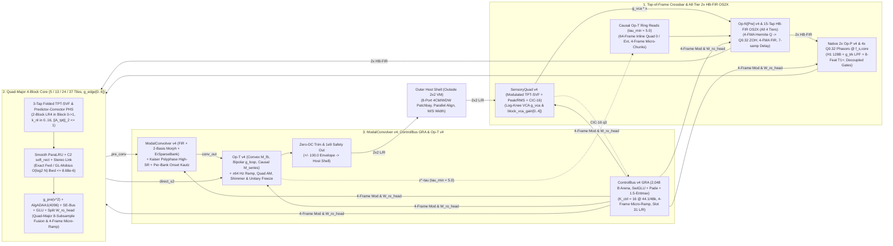
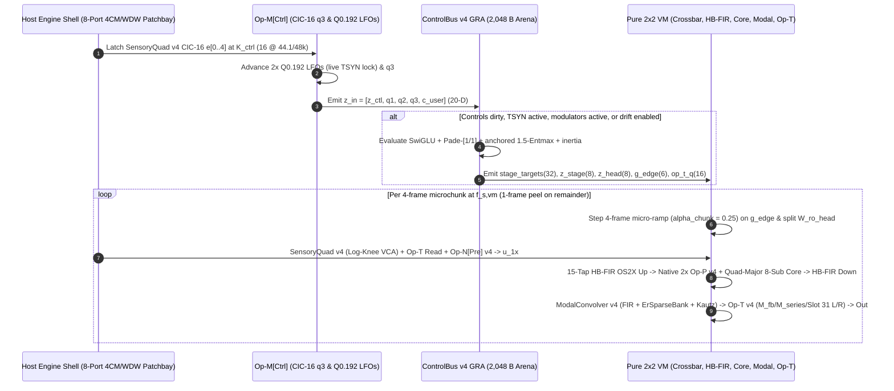
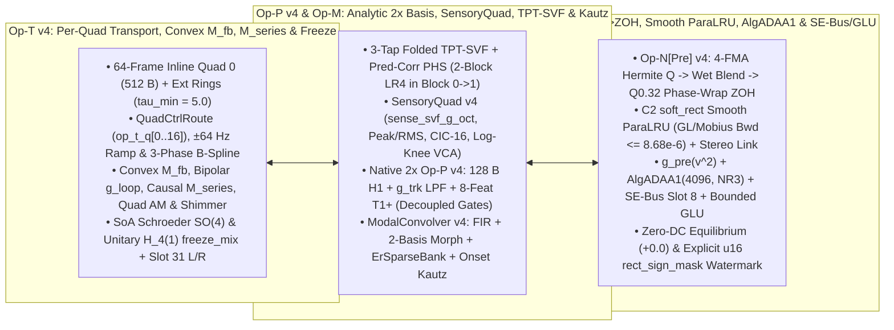
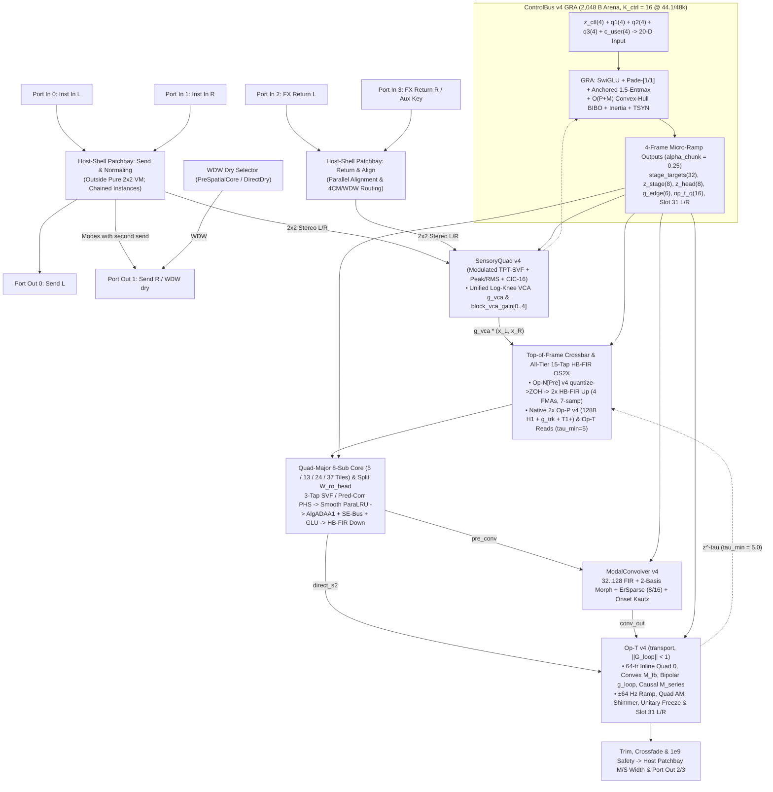
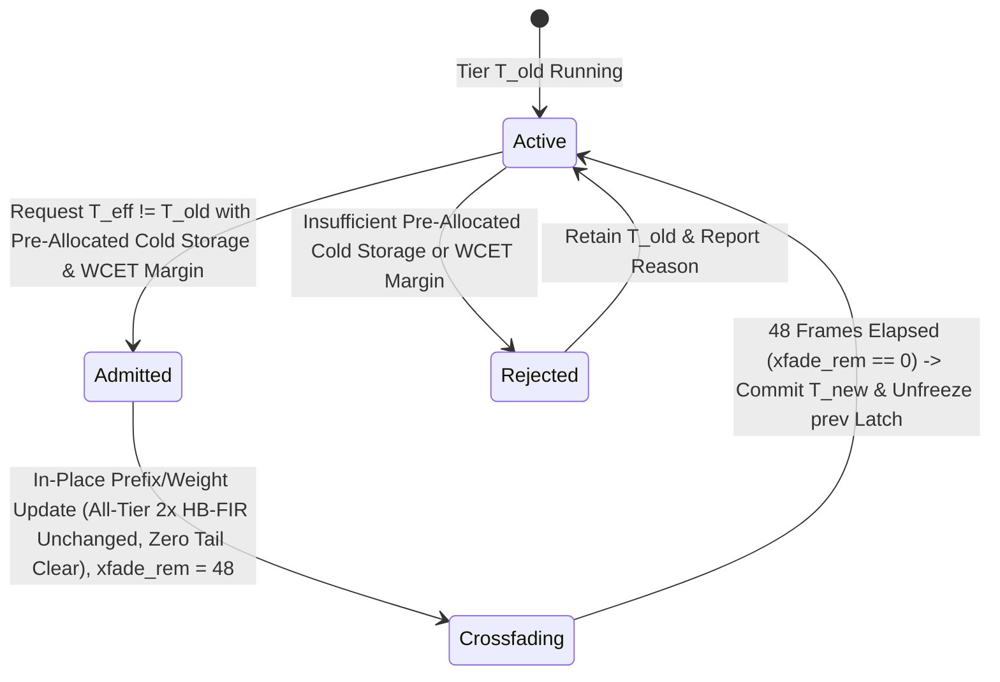
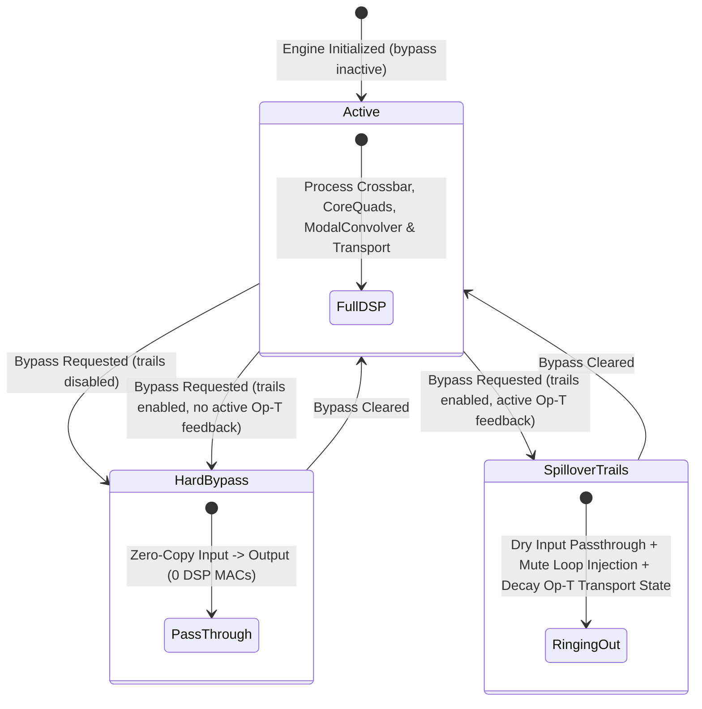
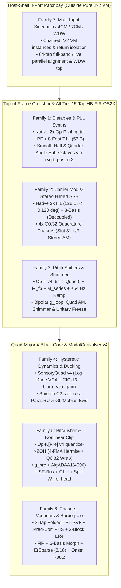

# State-Space Operator Neural Architecture (SONA) System Overview

This specification defines the State-Space Operator Neural Architecture (SONA v4.0) for **Dynamic Neural Audio Modeler (DNAM)** across its portable 32-bit operator library, deterministic zero-allocation DSP virtual machine, compiled GPU compute shaders, unified client runtime, and non-causal trainer attention / split-precision solver.

SONA v4.0 unifies analog, digital, and acoustic hardware inside a pure 2-in / 2-out DSP virtual machine: a Top-of-Frame Crossbar (SensoryQuad v4 Log-Knee VCA, `Op-N[Pre]` v4 `quantize -> ZOH`, all-tier 2× 15-tap HB-FIR OS2X, native 2× Op-P v4 with decoupled gates, and 64-frame inline Op-T reads) feeding a Quad-Major 8-subsample 4-Block Matryoshka Core (3-tap SVF, Pred-Corr PHS, smooth `ParaLRU`, `AlgADAA1(4096)`, `SE-Bus`, GLU, `g_edge[0..6]`, and split `W_ro_head`).

Downstream stages comprise ModalConvolver v4 (early FIR, 2-basis `fp16` morph, `ErSparseBank`, Kaiser polyphase high-SR FIR, and per-bank onset Kautz), LinearReadout (`ro_pole_48k` + split `W_ro_head`), and Op-T v4 (`M_fb`, bipolar `g_loop`, `M_series`, quadrature AM, shimmer, unitary freeze, and `slot 31 L/R`) driven by ControlBus v4 GRA, while host multi-port 4CM/WDW routing wraps outside the VM.

A unified runtime spans web, desktop, and DAW plugin hosts alongside offline desktop training workers (1–2 GiB WebGPU compute or 512 MiB WASM CPU fallback running 8M–16M non-causal `Perceiver IO` teacher/OOD generalization; `REQ-4.3`), cleanly decoupled from the lean real-time audio-thread VM (`REQ-6.1`, 6,336 B reclaimed non-Tardos/non-`SO(4)` container footprint).

For implementation-agnostic requirements, see [system_goals_and_requirements.md](../../requirements/system_goals_and_requirements.md). For psychoacoustic quality tiers, see [psychoacoustic_quality_and_tiers.md](psychoacoustic_quality_and_tiers.md). For architectural rationales and trade-offs, see [ADR-0024](../../adr/0024-sona-v4-kernel-hb-fir-perimeter-and-control-bus-gra.md), [ADR-0025](../../adr/0025-unified-runtime-and-non-causal-trainer-attention.md), [ADR-0022](../../adr/0022-sona-state-space-operator-and-webgpu-architecture.md), [ADR-0015](../../adr/0015-realtime-host-concurrency-spsc-and-telemetry-seqlock.md), [ADR-0019](../../adr/0019-simd-kernel-architecture-and-realtime-execution-optimizations.md), and [ADR-0020](../../adr/0020-modular-monorepo-and-dnam-proj-container.md).

---

## 1. Executive Summary & Core Architectural Pillars

### 1.1 Four Foundational Pillars of SONA

SONA v4.0 establishes four foundational pillars across real-time audio execution, `ControlBus` v4 (`GRA`) modulation, v4.0 cache-aligned binary containers (6,336 B non-Tardos/non-`SO(4)` byte reclamation), and non-causal teacher-student WebGPU/VarPro identification.

#### 1.1.1 Pillar 1: Dual-Space Factored Control Architecture

`r[arch.pillars.dual-space-control]`

SONA factors `ControlBus` v4 (`GRA`) latent trajectories (`z_stage[0..8]`, `z_head[0..8]`, `g_edge[0..6]`, `op_t_q[0..16]`) and split `W_ro_head` subspace coordinates from shared `StarCenter` trajectories to enable non-destructive Capture Vault stem editing as specified in [iterative_resume_and_caching.md §1.2](../training/iterative_resume_and_caching.md#12-two-path-vault-editing--dependency-digests).

#### 1.1.2 Pillar 2: Unified Self-Similar Dual-Rate Control Plane (`ControlBus` v4 `GRA`)

`r[arch.pillars.dual-rate-plane]`

`ControlBus` v4 (`GRA`) executes at 4-frame aligned cadence `K_ctrl(f_{s,vm}) = 4 * max(2, round(f_{s,vm} / 12_000.0))` (`K_ctrl = 16` at both 44.1 kHz and 48 kHz, `gcd(K_ctrl, 4) = 4`), ramping `[stage_targets(32), z_stage(8), z_head(8), g_edge(6), op_t_q(16)]` via 4-frame micro-ramps (`alpha_chunk = 0.25`) while skipping with zero static MACs when idle.

Across sample rates, the VM separates perimeter rate $f_{s,\mathrm{vm}}$ from core rate $f_{s,\mathrm{core}}$. In live 44.1–384 kHz execution, $f_{s,\mathrm{vm}} = f_{s,\mathrm{host}}$; in offline 4× bounce, internal `OS2X` is bypassed and $f_{s,\mathrm{vm}} = 4 f_{s,\mathrm{host}}$, with $\rho_{\mathrm{vm}} = 48000 / f_{s,\mathrm{vm}}$.

All four tiers (Lite, Full, Pro, Ultra) run native 2× 15-tap linear-phase HB-FIR OS2X at $f_{s,\mathrm{core}} = 2 f_{s,\mathrm{vm}}$ whenever `os2x_active = !offline_bounce && (2.0 * f_{s,vm} <= 384_000.0)`, and $f_{s,\mathrm{core}} = f_{s,\mathrm{vm}}$ otherwise, with $\rho_{\mathrm{core}} = 48000 / f_{s,\mathrm{core}}$.

Cold load precomputes base core `TPT-SVF` poles $g_{\mathrm{host}} = \tan(\pi f_c / f_{s,\mathrm{core}})$, `k_base = 1/Q`, `SensoryQuad` v4 SVF/ParaLRU ZOH scaling, continuous-time `ComplementLog` decay rates, Kaiser polyphase high-SR FIR taps, and `ro_pole_48k` readout decay (`hp_lp_pole`).

Each `K_ctrl` tick updates ControlBus GRA (SwiGLU + Padé-[1/1] + anchored 1.5-Entmax), inertia slew, 2× Q0.192 skewed LFOs, live `TSYN` lock, CIC-16 `SensoryQuad` `q3`, native 2× Q0.32 phasors, and 4-frame micro-ramp targets ([router_and_crossbar_topology.md](../dsp/router_and_crossbar_topology.md)).

#### 1.1.3 Pillar 3: Self-Contained 2,048 B `GRA` Control Arena & Tier-Local Projections

`r[arch.pillars.cp1-projections]`

SONA v4.0 supports $P \ge 0$ physical controls with clamp descriptors, `GRA` 2,048 B arena weights, `TSYN` tempo tables, compact `fp16` `W_ro,0` (`REQ-8.5`), and split `W_ro_head` stored inside the Layer 0 container per [dnam_binary_format.md](../containers/dnam_binary_format.md), reclaiming 6,336 B of redundant v3 control/routing slabs without altering Tardos or `SO(4)` watermark bounds.

All tiers use the unified 20-D GRA input (`[z_ctl, q1, q2, q3, c_user]` with `O(P + M)` convex-hull BIBO certification) emitting `z_stage[0..8]`, `z_head[0..8]`, `g_edge[0..6]`, `op_t_q[0..16]`, `stage_targets[0..32]`, and `slot 31 L/R` stereo AM modulation ([parametric_control_bus.md §2.3](../dsp/parametric_control_bus.md#23-o1-additive-latent-sufficient-statistic-control-scaling)).

#### 1.1.4 Pillar 4: Universal Trainable & Data-Programmable Black-Box Runtime (REQ-1.9)

`r[arch.pillars.universal-black-box]`

Every SONA v4.0 tier executes a fixed, unconditional 2-in / 2-out mathematical basis parameterized strictly by learned weights. The Crossbar combines SensoryQuad v4 (Log-Knee VCA, CIC-16 `q3`, `block_vca_gain[0..4]`), `Op-N[Pre]` v4 (`quantize -> ZOH`), all-tier 15-tap HB-FIR OS2X, native 2× Op-P v4 (H1, `g_trk` LPF, T1+, decoupled crossbar gates), and 64-frame inline Op-T reads with $\tau_{\min} = 5.0$.

Downstream, signal flow passes unconditionally through the Quad-Major 8-subsample 4-Block Matryoshka Core (tiling `[1,1,1,1]` / `[2,2,1,1]` / `[2,2,2,2]` / `[3,3,2,2]` with 5/13/24/37 tiles, 3-tap folded SVF, Pred-Corr PHS, smooth ParaLRU, `g_pre(v²)`, `AlgADAA1(4096)`, SE-Bus, GLU, `g_edge[0..6]`, and split `W_ro_head`), ModalConvolver v4 (FIR, 2-basis morph, ErSparseBank, onset Kautz), and LinearReadout.

Output conditioning runs through `Op-T` v4 (per-quad routing, passive convex `M_fb`, bipolar `g_loop`, causal `M_series`, quadrature AM, ±64 Hz ramp, 3-phase B-spline, shimmer, unitary freeze, and `slot 31 L/R` stereo gain) driven by `ControlBus` v4—with zero white-box sub-circuits, zero runtime crossovers, and zero conditional bypass flags.

### 1.2 The SONA Architectural Breakthrough



Positioning Op-T reads with causal floor $\tau_{\min} = 5.0$ above `Op-N[Pre]`, all-tier 2× 15-tap HB-FIR OS2X, native 2× Op-P v4, and the Quad-Major SONA core yields 0-ULP block-size invariance across 1-frame and 16-frame buffers while enforcing exact integer OS2X group delay (7 1×-samples = 0.146 ms at 48 kHz, 0.000° phase dispersion, -48.31 dB alias parity vs 4× bounce).

Native 2× Op-P v4 steps H1 (128 B hot state, <= 0.128° phase error across 20 Hz..Nyquist without rate-bridge workarounds or midpoint interpolation), 1-pole pre-T1 LPF (`g_trk`), and 8-feature T1+ (56 B) directly at $f_{s,\mathrm{core}}$ with `op_p_to_core` and `phasor_to_core` decoupled from `Op-T` `wet_scale`.

Blending `Op-T` v4 feedback through passive convex cross-quad mixing `M_fb`, bipolar `g_loop in [-0.9990, +0.9990]`, causal `M_series`, `eta_even` shimmer, quadrature AM, and unitary `H_4(1)` `freeze_mix` (0.25 slew) delivers rich spatial modulation inside 64-frame inline Quad 0 + external rings with zero audible hold drift.

Meanwhile, the single-source 32-bit portable operator library compiles identically to CPU vector targets and ahead-of-time GPU compute shaders (`<= 15.0 KiB` workgroup shared memory via `pass0` binary-tree reductions), driving Blelloch/GL scans, 256× checkpointing, 3 × 8-bit integer Ozaki reductions, non-causal `Perceiver IO` teacher training, and host VarPro.

#### Dual-Rate (48 kHz Audio vs. 3 kHz Control) SONA Execution Lifecycle

`r[arch.lifecycle.dual-rate]`

Host parameter updates apply at the control boundary in timestamp order, with DAW automation taking precedence over live Studio or MIDI events on exact-timestamp ties per [parametric_control_bus.md](../dsp/parametric_control_bus.md):



Cold init and `reset()` zero dynamic modulators and `env_states`, set `lfo_phasors` to unit identity, evaluate `GRA` with skewed identity `q2` and zeroed `q3`, and snap `current_stage_params = stage_targets` ahead of frame 0:

```text
lfo_phases_q192 = [[0; 3]; 2],  lfo_phasors = [[1.0, 0.0], [1.0, 0.0]],  env_states = [0.0; 4],  ou_drift_state = [0.0; 4]
ctrl_sub_counter = 0,  sample_tick = 0,  current_stage_params = stage_targets,  deltas = [0.0; 32]
```

At frame 0 and every `ctrl_sub_counter == 0` (`K_ctrl = 4 * max(2, round(f_{s,vm} / 12_000.0))` giving 16 at 44.1/48 kHz), `ControlBus` v4 runs `GRA` when active (zero static MACs when idle), updating recursive slews (`prev_oct`, `current_psi`) and feeding 4-frame micro-ramps (`alpha_chunk = 4.0 / K_ctrl = 0.25`).

Callbacks enter 4-frame micro-chunks strictly when `(sample_tick & 3) == 0 && rem_frames >= 4 && rem_tick >= 4`, executing Quad-Major 8-subsample `CoreQuad` blocks under all-tier `HB-FIR` `OS2X` (`g_edge[0..6]` and split `W_ro_head` scaled per 4-frame boundary with zero per-frame tile rewrites) for exact 0-ULP split invariance.

Per VM frame, SensoryQuad v4 feeds Log-Knee VCA (`g_vca`) and 4-frame `block_vca_gain[0..4]`, Op-T reads feed `(s0_L, s0_R)` into `Op-N[Pre]` v4 (`quantize -> ZOH`), and 15-tap HB-FIR OS2X feeds native 2× Op-P v4 (H1, `g_trk` LPF, T1+) alongside Quad-Major 8-subsample `CoreQuad` blocks.

Downstream, HB-FIR downsamples `(pre_conv, direct_s2)`, ModalConvolver v4 adds early FIR + `ErSparseBank` + Kautz, and Op-T v4 applies `M_fb`, `M_series`, `slot 31 L/R` stereo AM, `mono_out`, 48-fr crossfade, `eff_trim`, and ±1.0e9 safety clamp.

All `stage_latent_*` and `GRA` `z_stage` projections index the unrotated operator latent slice rather than `z_head` (which modulates split `W_ro_head` additive deltas), keeping buyer `SO(4)` gauge `Q_buyer` invariant with 0-ULP compatibility.

#### Floating-Point Environment at the Audio Callback

`r[arch.fp.callback-env]`

All block-processing entry points enforce round-to-nearest, ties-to-even (RNE) with non-trapping floating-point exceptions and subnormal protection via a hardware flush-to-zero / denormals-are-zero guard:

| Target Architecture | Hardware & Target Floating-Point Control Policy |
| :--- | :--- |
| `aarch64` | Save `FPCR`, clear rounding-mode bits 23:22 and trap-enable bits 8:12 and 15, set `FZ` bit 24, and set `FIZ` bit 0 when `FEAT_AFP` `AH` bit 1 is set, eliding redundant `FPCR` restoration writes when unchanged. Persistent recursive-state writebacks additionally execute branchless IEEE-754 scrubbing (non-finite `exp == 255 -> +0.0`, subnormals `exp == 0 -> ±0.0`). |
| `x86_64` | Save `MXCSR`, clear rounding-control bits 14:13 and sticky flags 0:5, set `FTZ` bit 15, `DAZ` bit 6, and exception masks 7:12, and restore `MXCSR` on exit. Persistent recursive-state writebacks additionally execute branchless IEEE-754 scrubbing (non-finite `exp == 255 -> +0.0`, subnormals `exp == 0 -> ±0.0`). |
| **WebAssembly / Portable** | Standard WebAssembly enforces RNE with gradual underflow; apply unconditional branchless 4-lane vector IEEE-754 scrubbing (non-finite `exp == 255 -> +0.0`, subnormals `exp == 0 -> ±0.0`) on persistent recursive writebacks while preserving signs and normal values. |

#### Finite-Precision Range and Saturation Policy

`r[arch.fp.range-saturation]`

Every certified model guarantees an unclipped operating envelope of at least ±100.0 (+40 dBFS peak) simultaneously on all active audio inputs (REQ-7.1), and finite output/state safety for all finite 32-bit float inputs via the ±1e9 (`S = 1,000,000,000.0`) and binary16 (±65,504.0) safety guards (REQ-7.2):

| Bit | Event Flag (`overflow_or_saturation_flags`) | Condition |
| :---: | :--- | :--- |
| 0 | `INPUT_SATURATED` | A processed audio input exceeded the ±1e9 safety ceiling. |
| 1 | `FP16_SATURATED` | A finite delay write exceeded ±65,504.0 (`0x7BFF` / `0xFBFF`). |
| 2 | `INTERNAL_SATURATED` | An intermediate or recursive-state safety guard clamped a value to ±1e9. |
| 3 | `OUTPUT_SATURATED` | The processed output guard clamped a value to ±1e9. |
| 4 | `OUTSIDE_CERTIFIED_INPUT` | An input exceeded the model's certified input envelope (> ±100.0). |
| 5 | `INVALID_NONFINITE` | A non-finite external sample, control, or parameter was detected and rejected. |

#### Wait-Free Telemetry Seqlock & Real-Time Host Concurrency

`r[arch.telemetry.seqlock-publication]`

Real-time host wrappers ([ADR-0015](../../adr/0015-realtime-host-concurrency-spsc-and-telemetry-seqlock.md)) decouple audio rendering callbacks from concurrent UI, MIDI, Studio, and host control and telemetry threads using lock-free, allocation-free concurrency primitives.

The telemetry writer packs the telemetry snapshot into a 64-byte-aligned array of 29 atomic 64-bit words guarded by a monotonic sequence counter, setting the counter odd before relaxed stores and publishing the even increment with release ordering on completion.

Lock-free telemetry readers acquire the leading sequence word, copy the 29 words, issue an acquire fence, and verify unchanged sequence counters with bounded retry and last-good fallback without locking the audio engine.

The host engine wrapper drains the triple-lane lock-free ring buffer (`ref[dsp.ctrl.op-m.spsc-ingress]`) at the start of each host sub-block (default 512 frames ≈ 10.67 ms at 48 kHz) using pre-warmed non-blocking locks and publishes telemetry at sub-block exit.

Lock-free sequence-locked engine hot-swap stages replacement engines in a non-real-time pending slot, polls non-blockingly on the audio thread without blocking or allocating, and moves displaced engine working sets into an 8-slot retirement array reclaimed off the audio thread. Lock-free progress telemetry reports GPU compute capabilities, 2-D planner mode, and convergence progress during training.

### 1.3 Universal Zero-FDIV State-Space & Operator Kernels

`r[arch.operators.tri-kernel]`

Every analog, digital, and acoustic circuit in the audio production domain is spanned by SONA's three single-source 32-bit portable operator families shared across CPU SIMD and GPU compute execution:



Each Core `TPT-SVF` mode steps via 3-tap folded evaluation with Block 0 Predictor-Corrector PHS (`k_eff[n] = k[n] + k_nl * min(v_{1,lin}[n]^2, 64.0)` using Pass A linear predictor `v_{1,lin}[n]`) and `a_1 = rcp_nr2(1 + g^2 + g * k_eff)`, guaranteeing energy contraction and overflow safety across both WebGPU training and CPU execution across 44.1–384 kHz (`LP, BP, HP, AllPass`).

In the smooth `ParaLRU` block, each lane $i$ replaces sharp `abs`/`ReLU` hinges with $C^2$ quartic `soft_rect`, keeps selective gate `gamma_i` and `kappa_i in [0, 1]`, executes exact linear-time forward recursion + Gauss-Legendre / Möbius scan backward (`<= 8.68e-6` error across 4,096 samples), and runs in-register stereo linking in 8-thread split mode (`kappa_i * (1 - eta_i) == 0`).

Downstream Op-N v4 nonlinearities apply amplitude scaling `g_pre(v^2)`, shared `AlgADAA1(4096, NR3)` table lookup (`A_even` normalized on `[0.0, 1.0]`), C² wavefolding, SE-Bus Slot 8 pooling across Blocks 0..3, and cross-lane GLU (`adaa_even_i + glu_mix_i * (g_se_i * adaa_odd_i) * (g_se_{(i+1)%4} * adaa_odd_{(i+1)%4})`) with positive-zero DC equilibrium and explicit `u16` `rect_sign_mask` sign-flip watermarking (`s_i in {-1, +1}`).

### 1.4 Self-Similar Dual-Rate Kernel Architecture

`r[arch.operators.self-similar]`

| Universal Operator Family | Audio-Rate Execution (`f_{s,vm}` / `f_{s,core}`) | Control-Plane Execution (`f_{s,vm} / K_ctrl`, 4-Frame Micro-Ramp) | Shared SIMD / GPU Compute Mechanism |
| :--- | :--- | :--- | :--- |
| **Op-T v4 (Transport)** | 64-frame inline Quad 0 + ext rings (`tau_min = 5.0`), per-quad `M_fb` + `M_series`, bipolar `g_loop`, ±64 Hz ramp, 3-phase B-spline, quad AM, shimmer, unitary `H_4(1)` freeze | `ControlBus` v4 `op_t_q[0..16]`, `stage_targets[16..25]`, `slot 31 L/R` stereo AM, 4× `Q0.32` phasors | Branchless power-of-two ring wrap masking, 32-bit GPU-safe triangle fold, Catmull-Rom Horner FMA |
| **Op-P / Op-M (SVF, Analytic & Modal)** | `SensoryQuad` v4 (`TPT-SVF` + CIC-16 + Log-Knee VCA), 3-tap folded `CoreQuad` SVF + Pred-Corr PHS (`f_{s,core}`), native 2× `Op-P` v4 (`H1` + `g_trk` + `T1+`), `ModalConvolver` v4 (`f_{s,vm}`) | `TPT-SVF` `g_host * exp2_clamped5`, `sense_svf_g_oct[0..4]`, Kautz ZOH (`rho_vm`), Kaiser polyphase high-SR FIR, `Q0.192` LFOs, `TSYN` lock | Energy-preserving 2×2 ZDF / Pred-Corr PHS step, 4-lane / paired stereo FMA, batched 4-frame FIR shift |
| **Op-N v4 (Pre, ParaLRU & Nonlinear)** | `Op-N[Pre]` v4 `quantize -> ZOH` (`f_{s,vm}`), all-tier 15-tap `HB-FIR` `OS2X`, smooth `C²` `soft_rect` `ParaLRU` + `SE-Bus` + `AlgADAA1(4096)` + `GLU` | ControlBus v4 GRA (2,048 B, SwiGLU + Padé-[1/1] + anchored 1.5-Entmax), `g_edge[0..6]`, split `W_ro_head`, `O(P+M)` BIBO hull | 4-FMA Hermite quantizer, GL/Möbius scan bwd, 4-FMA `HB-FIR`, `NR3` / FMA (CPU == GPU) |

### 1.5 SIMD Architecture, Lane Packing & Zero-Stall Dispatch

#### 1.5.1 SIMD Lane Packing (AVX2, ARM NEON & WebAssembly SIMD128)

`r[arch.simd.lane-packing]`

SONA organizes all 4-block Matryoshka state-space lanes (16 / 24 / 32 / 40 lanes across 4 / 6 / 8 / 10 `CoreQuad` groups), TPT-SVF quads (4 / 6 / 8 / 10 quads), inter-block tiles (5 / 13 / 24 / 37 lower-triangular 4×4 triples, max 7 outgoing/quad), `ModalConvolver` FIR/Kautz banks, 16-bit half-precision delay conversions, and `TransportQuad` banks inside 4-lane vector primitives.

These 4-lane primitives pair natively into 8-lane stereo vectors on 256-bit SIMD architectures (x86 AVX2+FMA, ARM SVE2, ARM SME), or execute as interleaved 4-lane left/right pairs on 128-bit SIMD targets (ARM NEON, WebAssembly SIMD128):

```text
SONA v4.0 4-Block Matryoshka 4-Lane SIMD Hierarchy (Compile-Time Fixed-Capacity Tier Profiles):
+--------------------+--------------------+--------------------+--------------------+
| Block 0 (4-Lane B) | Block 1 (4-Lane B) | Block 2 (4-Lane B) | Block 3 (4-Lane B) | -> Tier / Mode
+--------------------+--------------------+--------------------+--------------------+
| 1 x Vec4 (4 lanes) | 1 x Vec4 (4 lanes) | 1 x Vec4 (4 lanes) | 1 x Vec4 (4 lanes) | -> Lite  [1,1,1,1] (16 lanes @ 2x HB-FIR)
| 2 x Vec4 (8 lanes) | 2 x Vec4 (8 lanes) | 1 x Vec4 (4 lanes) | 1 x Vec4 (4 lanes) | -> Full  [2,2,1,1] (24 lanes @ 2x HB-FIR)
| 2 x Vec4 (8 lanes) | 2 x Vec4 (8 lanes) | 2 x Vec4 (8 lanes) | 2 x Vec4 (8 lanes) | -> Pro   [2,2,2,2] (32 lanes @ 2x HB-FIR)
| 3 x Vec4 (12 lanes)| 3 x Vec4 (12 lanes)| 2 x Vec4 (8 lanes) | 2 x Vec4 (8 lanes) | -> Ultra [3,3,2,2] (40 lanes @ 2x / 4x)
+--------------------+--------------------+--------------------+--------------------+
```

| Tier | CoreQuad Block Profile & Lanes | TPT-SVF Quads & Tiles | Oversample Factor | ModalConvolver (FIR + ErSparse + Kautz) | TransportQuads (Op-T v4) | Active-Hot L1D Working Set vs Ceiling |
| :--- | :---: | :---: | :---: | :---: | :---: | :--- |
| **Lite** (Tier 0) | `[1, 1, 1, 1]` (4 CoreQuads = 16 lanes) | 4 quads, 5 tiles (0..5) | 2 (All-Tier 15-tap HB-FIR `OS2X` + `AlgADAA1(4096)`) | 32 FIR/ch + 8 ErSparse + 8 Kautz (2 blks = 16 poles) | 1 quad (4 lanes, 64-frame / 512 B inline `fp16` Quad 0 + opt. ext) | 4,432 B true-hot <= 4,608 B ceiling (14× = 60.59 KiB <= 64 KiB) |
| **Full** (Tier 1) | `[2, 2, 1, 1]` (6 CoreQuads = 24 lanes) | 6 quads, 13 tiles (0..13) | 2 (All-Tier 15-tap HB-FIR `OS2X` + `AlgADAA1(4096)`) | 48 FIR/ch + 16 ErSparse + 12 Kautz (3 blks = 24 poles) | 2 quads (8 lanes + `M_fb`/`M_series` + 8 Schroeder; Quad 0 64-frame inline + Quad 1) | <= 8,192 B active-hot ceiling |
| **Pro** (Tier 2) | `[2, 2, 2, 2]` (8 CoreQuads = 32 lanes) | 8 quads, 24 tiles (0..24) | 2 (All-Tier 15-tap HB-FIR `OS2X` + `AlgADAA1(4096)`) | 96 FIR/ch + 16 ErSparse + 24 Kautz (6 blks = 48 poles) | 3 quads (12 lanes + `M_fb`/`M_series` + shimmer + 12 Schroeder; opt. `fp16`/`f32` cold ext) | <= 16,384 B active-hot ceiling |
| **Ultra** (Tier 3) | `[3, 3, 2, 2]` (10 CoreQuads = 40 lanes) | 10 quads, 37 tiles (0..37, max 7 out/quad) | 2 RT HB-FIR (4× bounce 64-tap PDC) | 128 FIR/ch + 16 ErSparse + 32 Kautz (8 blks = 64 poles) | 4 quads (16 lanes + 16 partitioned Schroeder stages across Quads 0..3 up to 16,384 samples at 384 kHz, `abs(a_diff) <= 0.75`, unitary freeze) | <= 32,768 B active-hot ceiling |

**Exact Matryoshka Block/Group Indexing & 37-Tile Lower-Triangular Edge Topology (`MAX_OUTGOING_PER_QUAD = 7`):**

```text
Group -> (Block, Local Slot) Mapping (10 Groups total = 40 lanes, Quad-Major [0, 4, 8, 1, 5, 9, 2, 6, 3, 7]):
  Groups 0..4 (Lite  [1,1,1,1]): (0, 0), (1, 0), (2, 0), (3, 0)
  Groups 4..6 (Full  [2,2,1,1]): (0, 1), (1, 1)
  Groups 6..8 (Pro   [2,2,2,2]): (2, 1), (3, 1)
  Groups 8..10 (Ultra[3,3,2,2]): (0, 2), (1, 2)

Block -> Active Group Indices:
  Block 0 (3 groups = 12 lanes): [0, 4, 8]
  Block 1 (3 groups = 12 lanes): [1, 5, 9]
  Block 2 (2 groups =  8 lanes): [2, 6]
  Block 3 (2 groups =  8 lanes): [3, 7]

All 37 Lower-Triangular (src_group, dst_group) Tiles Ordered Strictly by Tier Introduction:
  0..5   (Lite,  +5): (0,1), (1,2), (2,3), (0,2), (1,3)
  5..13  (Full,  +8): (0,3), (0,5), (4,1), (4,5), (4,2), (4,3), (5,2), (5,3)
  13..24 (Pro,  +11): (0,6), (4,6), (0,7), (4,7), (1,6), (5,6), (1,7), (5,7), (2,7), (6,3), (6,7)
  24..37 (Ultra,+13): (0,9), (4,9), (8,1), (8,5), (8,9), (8,2), (8,6), (8,3), (8,7), (9,2), (9,6), (9,3), (9,7)
```

Arena 1 through Arena 3 each carry a 256-byte full-replacement crossbar coupling block (`op_p_to_core`, `phasor_to_core`, `opt_to_lr`, and `phasor_stereo_phase`), enabling per-tier crossbar conditioning while Lite fixes `phasor_stereo_phase` at 0.0.

Across all four tiers, ModalConvolver uses 32 / 48 / 96 / 128 lag-ordered early FIR taps per channel; base, prefix, and delta FIR/Kautz poles remain binary32 on wire whereas Full..Ultra PrefixOverride intermediate FIR bands (taps 16..32, 32..48, 48..96) and Kautz `b_gamma` / `c` override bands pack as IEEE-754 binary16.

#### 1.5.2 Portable SIMD Abstraction & Shared Kernel Layering

`r[arch.simd.two-level-traits]`

Portable single-precision mathematical primitives are cleanly separated from graph orchestration so both CPU SIMD execution targets and compiled GPU compute shaders execute identical operator equations:

| Layer | Responsibility & Shared Capabilities |
| :--- | :--- |
| **Vector & Constants Layer** | 4-lane vector arithmetic, paired 8-lane stereo operations, compile-time derived filter/table constants, software IEEE-754 half-precision codecs, and fixed-point Ozaki slice helpers |
| **Operator Kernel Layer** | `SensoryQuad` v4 sensing, 2×2 ZDF TPT-SVF step/compose + Pred-Corr PHS, Selective-Duhem 1-D `ParaLRU` (`C² soft_rect`), `AlgADAA1(4096)` (plus 1× `PolyADAA1` refs), wavefolder, `SE-Bus`, bounded `GLU`, `ErSparseBank` + Kautz modal banks, `Op-T` v4 readers, native 2× `H1` Hilbert lattice, and 8-feature `T1+` rotor |
| **Backend Primitives** | Target-neutral vector abstractions, fused 4×4 matrix-vector multiply-add, branchless Newton-Raphson reciprocals, CRC32C checksumming, and subnormal flushing |

Above the mathematical primitives, the runtime graph engine composes execution-ordered cache-locked state slabs, executing register-hoisted stereo sub-blocks while enforcing a strict acyclic layered dependency hierarchy (from outer host runtime through execution topology, operator evaluation, vector algebra, and portable 32-bit primitives; see [ADR-0019](../../adr/0019-simd-kernel-architecture-and-realtime-execution-optimizations.md), [ADR-0022](../../adr/0022-sona-state-space-operator-and-webgpu-architecture.md)).

#### 1.5.3 Single-Library Per-Architecture Runtime SIMD Dispatch & 0.000000 ULP Parity

`r[arch.simd.single-library-dispatch]`

Each target architecture compiles all supported ISA backends into a single distributable binary (`aarch64` NEON/SVE2/SME, x86 SSE2/SSE4.2/AVX2+FMA, WebAssembly SIMD128, and portable scalar fallback) using lock-free cached startup capability probing ([ADR-0019](../../adr/0019-simd-kernel-architecture-and-realtime-execution-optimizations.md)).

Both 8-lane stereo vectors and interleaved 4-lane pairs execute identical fixed vector-pair reduction trees and `.fms` vector Newton-Raphson inverse square roots (`rsqrt_pos_nr2`, `rsqrt_pos_nr3`), while standalone `rsqrt_nr2_pair_f32` uses unfused `FP_CONTRACT OFF` steps.

This guarantees 0.000000 ULP bit parity across same-FMA-class CPU backends (and across all CPU backends on explicitly unfused `FP_CONTRACT OFF` paths), `<= 1.5` ULP/step between hardware-FMA and non-FMA CPU or GPU targets on `.fma` chains, `<= 1e-4 * max(1.0, peak)` on 256-wide linear scans, and 0-ULP on 32-bit Ozaki slice reductions.

#### 1.5.4 Division-Free & Math-Library-Free Real-Time Lowering Rules

`r[arch.simd.zero-stall-lowering]`

Real-time 48 kHz and 3 kHz paths execute zero hardware divisions, square roots, external math-library calls, or unbounded loops per `REQ-6.2`, `REQ-6.3`, and [ADR-0019](../../adr/0019-simd-kernel-architecture-and-realtime-execution-optimizations.md):

| Real-Time Operation | Division-Free & External-Math-Free Mechanism |
| :--- | :--- |
| **Prohibited Machine Lowering** | Zero `FDIV`, `FSQRT`, `IDIV`, `UDIV`, `SDIV`, and external math-library transcendental or remainder calls. |
| **Phase & Ring Wrapping** | Angle reductions via branchless periodic folding; power-of-two extended delay lines wrap via bitmask or single-step branchless wrap. |
| **Reciprocals & Prewarping** | Clamped `AlgADAA1(4096)` evaluates `NR3` reciprocals and inverse square roots (while 1× `PolyADAA1` reference rail crossings use batched `NR2`); bilinear `tan(pi * f_c / f_{s,core})` or ZOH `tan(rho_core * atan(g_ref))` prewarping stays strictly on the cold boundary, while 3 kHz and 4-frame updates scale `g_host` via `exp2_clamped5(g_oct_lane)`. |

### 1.6 Differentiability and Gradient Dynamics

`r[arch.operators.differentiability]`

| Operator | Forward & Backward Parallel / Analytical Formulation |
| :--- | :--- |
| **1. Op-T v4 (Continuous Delay & Crossbar)** | Horner Catmull-Rom derivative `∂d(τ)/∂μ = 3 c_3' μ² + 2 c_2' μ + c_1'` with coarse-to-fine Gaussian envelope surrogate gradient and fractional delay/LFO polish. |
| **2. TPT-SVF (Block 0 Pred-Corr PHS & Blocks 1..3 Scan)** | Block 0 1-step Predictor-Corrector Passive PHS (linear Pass A `v_{1,lin}[n]` -> passive LTV `TPT-SVF` with `k_eff[n] = k + k_nl * min(v_{1,lin}[n]², 64.0)`, `‖M_n‖₂ <= 1`, `O(log₂ N)` 256-thread GPU parallel) plus Blocks 1..3 constant-M register-squaring stereo scan (`4,096 B <= 6,144 B` SRAM) and `pass0` binary-tree reductions (`<= 15.0 KiB` fused workgroup SRAM). |
| **3. ParaLRU (8-Thread Split Fwd + GL/Möbius Adjoint)** | Decoupled Selective-Duhem 1-D `C²` quartic `soft_rect` recurrence with `J_i[n] ∈ [(1 - rho_i[n]) alpha_rel,i, alpha_rel,i] ⊂ [0, 1)` evaluated via 8-thread `L/R × 4-lane` split (`O(log₂ N)` fast-path whenever `kappa*(1 - eta) == 0`) + 2-level `O(log₂ N)` cross-tile linear reverse-adjoint scan inside `<= 15.0 KiB` SRAM (zero BPTT truncation). |
| **4. Op-N (AlgADAA1, SE-Bus, GLU & Op-N[Pre] v4)** | Cancellation-free Gauss-Legendre / Möbius backward of clamped `AlgADAA1(4096, NR3)` (`<= 8.68e-6` error across `[-4096, 4096]²`) + `g_pre(v²)` + `SE-Bus` (`Slot 8` pullback, +0 B SRAM) + bounded `GLU` plus `Op-N[Pre]` v4 (`4-FMA C¹ Hermite staircase quantizer -> decoupled hard-capable Q0.32 phase-wrap ZOH`, 1-D affine scan, zero STE; [Op-N §2.3](../dsp/op_n_paralru_and_polyadaa.md#23-family-5-precomputed-reciprocal-zoh-sample-rate-reducer--bitcrusher)). |

$$(a_{\text{second}}, \tilde{b}_{\text{second}}) \circ (a_{\text{first}}, \tilde{b}_{\text{first}}) = (a_{\text{second}} a_{\text{first}}, a_{\text{second}} \tilde{b}_{\text{first}} + \tilde{b}_{\text{second}}), \qquad J_i[n] \in \big[(1 - \rho_i[n])\alpha_{\text{rel},i},\ \alpha_{\text{rel},i}\big] \subset [0, 1)$$

---

## 2. 4-Tier Slimmable SIMD Hierarchy (Lite / Full / Pro / Ultra)

### 2.1 Lower-Block-Triangular Arena Hierarchy

`r[arch.tiers.arena-hierarchy]`

Weights use a four-tier causally nested lower-block-triangular delta layout across Arena 0..3, stored in fixed-capacity 64-byte-aligned binary arenas.

All four tiers use fixed compile-time capacities tuned to stay inside the 64 KiB ARM Cortex-A76 L1D cache budget (`REQ-5.1`, `REQ-5.2`).

Arena 0 (4,608 B / 72 CL hot prefix ceiling, self-contained 2,048 B GRA arena, and compact `fp16` `W_ro,0`) carries Lite base weights calibrated at native 2× HB-FIR OS2X, SensoryQuad v4, native 2× Op-P v4, `Op-N[Pre]` v4, 32 FIR + 8 `ErSparseBank` + 8 Kautz pairs, and Quad 0 Op-T v4, saving 6,336 B across redundant v3 slabs.

Stripping a container to Lite reads Arena 0 directly without touching Arena 1..3 (`REQ-5.6`), while ControlBus v4 drives 4-frame micro-ramped `stage_targets[0..32]`, `g_edge[0..6]`, `op_t_q[0..16]`, `z_stage`, `z_head`, and `slot 31 L/R`, keeping buyer SO(4) gauge invariance on `z_head`.

Arena 1..3 hold incremental deltas for Full, Pro, and Ultra, with analytical continuous-time ZOH and Kaiser polyphase FIR adapting cleanly across 44.1–384 kHz (`REQ-8.5`). All 48 kHz operator dimensions remain compile-time fixed; only cold `Op-T` extended rings (`REQ-6.3`) and declared 3 kHz control count $P$ (zero static MACs when idle per `REQ-6.1`) vary per capture.

| Parameter | Lite (Arena 0) | Full (Arena 0..1) | Pro (Arena 0..2) | Ultra (Arena 0..3) |
| :--- | :---: | :---: | :---: | :---: |
| **Active Hot Working Set vs L1D Ceiling** | 4,432 B <= 4,608 B (14× = 60.59 KiB <= 64 KiB) | <= 8,192 B ceiling | <= 16,384 B ceiling | <= 32,768 B ceiling |
| **4-Block Matryoshka Core (`CoreQuad`s)** | `[1, 1, 1, 1]` (4 quads / 16 lanes, 5 tiles) @ 2× HB-FIR | `[2, 2, 1, 1]` (6 quads / 24 lanes, 13 tiles) @ 2× HB-FIR | `[2, 2, 2, 2]` (8 quads / 32 lanes, 24 tiles) @ 2× HB-FIR | `[3, 3, 2, 2]` (10 quads / 40 lanes, 37 tiles) @ 2× RT / 4× Bounce |
| **`ModalConvolver` v4 (FIR + `ErSparse` + Kautz)** | 32 FIR + 8 ErSparse + 8 Kautz pairs | 48 FIR + 16 ErSparse + 12 Kautz pairs | 96 FIR + 16 ErSparse + 24 Kautz pairs | 128 FIR + 16 ErSparse + 32 Kautz pairs |
| **`Op-T` v4 (`TransportQuad`) & Diffusion** | 1 quad (64-frame / 512 B inline Quad 0 + opt. ext) | 2 quads + `M_fb`/`M_series` + 8 Schroeder | 3 quads + `M_fb`/`M_series` + shimmer + 12 Schroeder | 4 quads + `M_fb`/`M_series` + 16 Schroeder + unitary freeze |
| **Control Bus Architecture (`GRA`)** | 2,048 B `GRA` (`20-D -> [32, 8, 8, 6, 16]`) | Unified `GRA` + Tier Deltas | Unified `GRA` + Tier Deltas | Unified `GRA` + Tier Deltas (`W_ro` `fp16` `REQ-8.5`) |

### 2.2 Hardware & DSP Benchmark Summary

`r[arch.tiers.hardware-budget]`

Reference embedded serial pedalboard budgets target one ARM Cortex-A76 core (Rockchip RK3582 @ 2.4 GHz, 20,833.33 ns/sample raw period at 48 kHz, or 16,667 ns/sample usable budget under the 80% real-time scheduling cap including LV2 dispatch and multi-instance cache spill), executing all topological blocks unconditionally on every stereo frame per [system goals and requirements §7](../../requirements/system_goals_and_requirements.md#7-goal-6--real-time-commodity-hardware-budget--execution-constraints).

On Rockchip RK3582 (2× Cortex-A76 @ 2.4 GHz with 64 KB L1D / 512 KB L2 per core), per-instance frame latency $t_{\text{A76+LV2}}(t, B)$, core utilization $u_{\text{core}}(t, B)$, and safe serial instance count $N_{\text{safe}}(t, B)$ for block size $B \in [64, 128]$ obey:

$$t_{\text{A76+LV2}}(t, B) = \kappa_{\text{cache}} \left(\alpha_{\text{uarch}}(t) \cdot t_{\text{bench}}(t) + \frac{T_{\text{LV2-block}}}{B}\right), \qquad u_{\text{core}}(t, B) = \frac{t_{\text{A76+LV2}}(t, B)}{T_{\text{sample}}}, \qquad N_{\text{safe}}(t, B) = \left\lfloor \frac{\eta_{\text{RT}}}{u_{\text{core}}(t, B)} \right\rfloor$$

| Tier Profile | Target 1× A76 Budget (85–90% Utilization) | Active Hot Working Set vs 64 KiB L1D | Normative Serial Core Budget (1× A76 @ 80% RT Cap) | Safe Serial (2× A76 Cores) | Real-Time Instruction Invariant |
| :--- | :---: | :---: | :---: | :---: | :--- |
| **Lite** (`[1,1,1,1]` @ 2× HB-FIR, 4 quads, 5 tiles, 32 FIR, 8 ErSparse, 8 Kautz, 1 quad) | <= 1,000 ns/sample | 14 × 4,432 B = 62,048 B <= 64 KiB | **>= 14×** (<= 1,190 ns/sample) | **>= 28×** | Zero FDIV, FSQRT, IDIV/UDIV/SDIV, math-lib, allocs, locks, or syscalls (`REQ-6.2`, `REQ-6.3`) |
| **Full** (`[2,2,1,1]` @ 2× HB-FIR, 6 quads, 13 tiles, 48 FIR, 16 ErSparse, 12 Kautz, 2 quads) | <= 1,800 ns/sample | <= 8,192 B active-hot ceiling | **>= 8×** (<= 2,083 ns/sample) | **>= 16×** | All-tier 2× 15-tap HB-FIR (-48.31 dB bounce parity, 0.000° dispersion) inside Studio flagship budget |
| **Pro** (`[2,2,2,2]` @ 2× HB-FIR, 8 quads, 24 tiles, 96 FIR, 16 ErSparse, 24 Kautz, 3 quads) | <= 3,600 ns/sample | <= 16,384 B active-hot ceiling | **>= 4×** (<= 4,166 ns/sample) | **>= 8×** | Mastering reference capacity (`ErSparseBank` + 48 Kautz poles + 12 delay lines + shimmer) |
| **Ultra** (`[3,3,2,2]` @ 2×/4×, 10 quads, 37 tiles, 128 FIR, 16 ErSparse, 32 Kautz, 4 quads) | <= 7,200 ns/sample | <= 32,768 B active-hot ceiling | **>= 2×** (<= 8,333 ns/sample) + Bounce | **>= 4×** | Dual-rig workstation max + 4× bounce + 16 partitioned Schroeder stages + unitary freeze |

For prior-art LV2 instance comparisons against grey-box Multi-FX, NAM A2, GuitarML Proteus, and NAM ParametricOD, see [ADR-0022](../../adr/0022-sona-state-space-operator-and-webgpu-architecture.md) and [ADR-0024](../../adr/0024-sona-v4-kernel-hb-fir-perimeter-and-control-bus-gra.md).

#### 2.2.1 Compile-Time Fixed Tier Locking & Fixed-Shape Quality Maximization

`r[arch.tiers.maximize-quality-within-budget]`

Compiled inference runtimes eliminate register spills and hot-loop bottlenecks via Quad-Major 8-subsample execution over 4-frame causal micro-chunks, paired stereo vector dispatch, `AlgADAA1(4096)` + 3-step NR3 reciprocals, and contiguous cache-locked working-set packing.

Satisfying `REQ-5.1` and `REQ-6.1` while verified via timing percentiles and machine disassembly audits, compile-time tier dimensions target 85–90% of each tier's Cortex-A76 WCET budget (<= 1,000 / 1,800 / 3,600 / 7,200 ns/sample vs. 1,190 / 2,083 / 4,166 / 8,333 ns/sample ceilings, reserving 10–15% for P99.9 margin) inside the 64 KiB L1D limit.

Operator shapes stay compile-time fixed across all captured models with zero dynamic loop counters or runtime operator scaling. Fixing shapes preserves full compiler loop unrolling and SIMD register pinning, keeps 14× serial Lite instances inside 60.59 KiB L1D, locks tier offsets, and keeps GPU compute workgroups branch-free.

Solver capacity (`<= 15.0 KiB` SRAM `pass0` binary-tree fusion, GL/Möbius `ParaLRU` scans, 32-bit Ozaki reductions, offline 8M–16M non-causal Perceiver IO teacher workers using 1–2 GiB WebGPU or 512 MiB WASM CPU fallback per `REQ-4.3`, and Kautz/Op-T polish) invests solely into quality (`|ΔbESR| < 0.01 dB/epoch`), never stopping at §4 floors (`ref[qual.tiers.floors-not-stopping-criteria]`).

### 2.3 State RAM Audit: Lite Budget

`r[arch.tiers.state-ram]`

The Quad-Major hot working-set slab packs hot weights and recursive states contiguously in strict execution order (`0..ActiveHot`, 64-byte-aligned, zero transient heap scratch and zero `cold.hoisted_core`) strictly ahead of cold `GRA` control tables and extended `Op-T` delay rings:

```text
+---------------------------------------------------------------------------------------------------+
| Execution-Ordered 64 B-Aligned Working Set ([0..ActiveHot) + Cold Tail)                           |
+---------------------------------------------------------------------------------------------------+
| HOT REGION [0..ActiveHot) — Zero cold.hoisted_core, Strictly Cache-Aligned:                        |
|   1. Hot Scalars (64 B) + SensoryQuad (176 B) + Op-P/N[Pre]/Crossbar (376 B) + HB-FIR (192 B)    |
|   2. Lite Core: CoreQuads[0..4] State (512 B) + Params (704 B) + Readouts (384 B) + 5 Tiles (480 B)|
|   3. FIR (384 B) + ErSparse[8] (80 B) + Kautz[2] (352 B) + Op-T Q0 & 64-fr Inline Ring (728 B)     |
|   --- End of Lite 2x Prefix: 4,432 B (14x = 60.59 KiB <= 64 KiB L1D) -----------------------------|
|   4. Higher-Tier Hot Extensions (Contiguous per Tier Prefix, <= 8,192 / 16,384 / 32,768 B):        |
|      - Full Delta:  CoreQuads[4..6], tiles[5..13], FIR[32..48], ErSparse 16, Kautz 12, Quad 1      |
|      - Pro Delta:   CoreQuads[6..8], tiles[13..24], FIR[48..96], Kautz 24, Quad 2                  |
|      - Ultra Delta: CoreQuads[8..10], tiles[24..37], FIR[96..128], Kautz 32, Quad 3                |
+---------------------------------------------------------------------------------------------------+
| COLD TAIL [ActiveHot..) — Zero L1D Footprint on Hot 48 kHz Audio Loops:                             |
|   - ControlBus v4 GRA (2,048 B Arena) + Control Clamp Descriptors[P] + TSYN                        |
|   - Per-Quad Partitioned Schroeder Banks (16 stages across Quads 0..3) & Kaiser High-SR FIR Tables |
|   - Cold fp16 LinearReadout Base W_ro,0 (REQ-8.5) & Lock-Free Epoch-Retired Ping-Pong Swap         |
|   - Cold Op-T Extended Ring (0 B dry .. multi-second power-of-two DRAM, a in {2, 4} bytes/sample) |
+---------------------------------------------------------------------------------------------------+
```

| Lite 2× True-Hot State Component | Byte Allocation | Architectural Role |
| :--- | :---: | :--- |
| **Hot Header Scalars** (`counts`, `trim`, `slot 30/31`, `op_n_pre`, `sat_flags`) | 64 B | Eliminates per-frame `cold` scalar spills |
| **`core_states[4]`** (4 × 128 B) | 512 B | `svf_s1`, `svf_s2`, `lru_v`, `adaa_prev` (L+R stereo lane state) |
| **`core_quads_hot[4]`** (4 × 176 B, `fp16` + `f32 svf_a1`) | 704 B | Hoisted 3-tap SVF, Pred-Corr PHS, `ParaLRU`, `g_pre`, `lin_mix`, `se_bus`, `GLU` |
| **`readouts_hot[4]`** (4 × 96 B, incl. split `W_ro_head`) | 384 B | Compact `W_ro` slice + `odd`/`even_lru` deltas (2 × fp16 ULP Tardos floor, `REQ-8.5`) |
| **`tiles_hot[5]`** (5 × 96 B + scalar `g_edge`) | 480 B | 5 causal Lite tiles decoded once per 8 subsamples; 6 scalar `g_edge[0..6]` gates |
| **`sensory_hot`** (48 B state + 128 B params + `svf_a1`) | 176 B | Modulated 4-lane `TPT-SVF` + Peak/RMS + `ParaLRU` + CIC-16 + Log-Knee VCA |
| **`op_p`** (128 B `H1` + 56 B `T1+` + 48 B phasors) + **`op_n_pre`** (48 B) + **Crossbar** (96 B) | 376 B | Native 2× `Op-P` v4, `Op-N[Pre]` v4, and decoupled crossbar coupling |
| **`fir_32`** (128 B w + 256 B hist) + **`ErSparseBank[8]`** (80 B) | 464 B | Contiguous Lite early FIR slice (32 taps) + 8 early-reflection 2×2 MIMO taps |
| **`kautz_hot[2]`** (2 × 176 B) | 352 B | 2 shared-pole stereo Kautz banks (8 pairs, per-bank `onset_delay_samp` + `c_cross`) |
| **`transport0_hot`** (216 B) + **Inline 64-Frame Ring** (512 B) | 728 B | 512 B 64-frame `fp16` ring + Quad 0 hot routing/limiter/B-spline/AM registers |
| **`os2x_hbfir_15`** (15-tap stereo delay history) | 192 B | Upsample + `(pre_conv, direct_s2)` downsample linear-phase stereo histories |
| **Total Lite 2× Active-Hot Working Set** | **4,432 B** | **14× serial = 62,048 B = 60.59 KiB <= 64 KiB L1D (<= 4,608 B ceiling)** |

Within the hot layout, ModalConvolver v4 stores one contiguous FIR history ring (no double-mirroring), updating FIR taps, 2-basis `fp16` morphing, `ErSparseBank` (8/16 MIMO taps), and per-bank `onset_delay_samp[4]` via batched 4-frame shifts while keeping all active operators cache-locked inside 4,432 B at Lite (60.59 KiB for 14× serial instances).

### 2.4 Computational Efficiency & Verification

`r[arch.tiers.efficiency]`

Every active SONA tier executes all topological operators unconditionally on every 4-frame causal micro-chunk (8 subsamples under native 2× `HB-FIR` `OS2X`) with zero operator-bypass flags, zero dynamic resizing, and zero heap allocations or locks.

Hot loops execute via 8-lane stereo or interleaved 4-lane vector math, Quad-Major 8-subsample register pinning, clamped `AlgADAA1(4096)` with 3-step `NR3` reciprocals and inverse square roots, and zero-spill cache-locked working sets. Mono (`1 → 1`, `2 → 1`) topologies emit the phase-coherent Mid readout while advancing dual-channel histories, and all inline and cold extended delay memory is admitted against the host memory ceiling before activation.

---

## 3. Canonical Signal Flow & Crossbar Topology Overview

### 3.1 Detailed Signal Flow & Operator Boundaries

`r[arch.topology.signal-flow]`

SONA separates multi-port physical studio routing (8-Port Patchbay and post-VM M/S width in the outer host shell) from its pure 2-in / 2-out DSP virtual machine executing a Top-of-Frame Causal Operator Crossbar (SensoryQuad, input-only Op-P, smooth Op-N[Pre], 4× Q0.32 phasors, Op-T reads) feeding CoreQuads, `ModalConvolver` (`modal_convolver`), half-precision `LinearReadout` (`ro_pole_48k`), and symmetric coercive Op-T Transport (`transport`, `||G_loop|| < 1`):



### 3.2 Pure Stereo VM Boundary, SensoryQuad & Host-Shell 8-Port Patchbay

`r[arch.topology.io-router]`

The DSP virtual machine operates across a clean 2-in / 2-out stereo boundary supporting 1 → 1, 2 → 1, 1 → 2, and 2 → 2 channel topologies (REQ-7.4), using voltage-normalized Mid/Side, where `x_mid = 0.5 * (L + R)` and `x_side = 0.5 * (L - R)`, for unity-gain stereo reconstruction. At input, SensoryQuad v4 runs modulated TPT-SVF (`sense_svf_g_oct`), Peak/RMS + ParaLRU + CIC-16 `q3`, Log-Knee VCA `g_vca`, and 4-frame `block_vca_gain[0..4]` with 0° stereo shift and zero fixed crossovers.

Multi-port studio topologies sit cleanly in the outer host engine shell via the 8-Port Patchbay (`4CM`/`7CM`/`WDW`, parallel latency alignment, zero $\mathbf{S}_{\text{ret}\to\text{send}}$ return-to-send isolation, and post-VM M/S width), composing split-point rigs by chaining separate pure 2×2 VM instances:

- **Port In 0..1:** Instrument In Left / Right.
- **Port In 2..3:** FX Loop Return Left / Right (or Aux Key).
- **Port Out 0:** FX Loop Send Left or optional mono WDW send.
- **Port Out 1:** FX Loop Send Right, or center dry in WDW.
- **Port Out 2..3:** Main Out Left / Right; wet-only L/R in WDW ([router_and_crossbar_topology.md](../dsp/router_and_crossbar_topology.md), `ref[dsp.router.ports]`).

In WDW mode (pre-spatial core or direct dry), Port Out 1 carries the center dry tap while Ports Out 2/3 carry the stereo wet output and Port Out 0 provides an optional mono send.

### 3.3 Gated RMS Auto-Unity Leveling & Per-Tier Loudness Parity

`r[arch.topology.auto-unity-leveling]`

Auto-unity leveling anchors at declared default control settings (`leveling` shell metadata). Pre-stored linear tier gain trims (`tier_gain_trim_lin`) maintain calibrated per-tier loudness parity across Lite, Full, Pro, and Ultra without runtime division or transcendental calls.

#### On-Demand Tier Transition Contract

`r[arch.tiers.transition-contract]`

Runtime tier changes resolve effective tier `t_eff = min(t_req, t_ceiling, t_avail)` and switch weights in-place on the single active execution slab paired with a 48-frame frozen-output linear crossfade ([router_and_crossbar_topology.md §8.1](../dsp/router_and_crossbar_topology.md#81-canonical-midside-output-head-factorization)), avoiding parallel dual-graph stepping while full-container model reloads run through lock-free ping-pong swaps in the host shell.



| Transition Phase | Normative Execution Requirement |
| :--- | :--- |
| **1. Request & Admission** | Resolve effective tier `min(t_req, t_ceiling, t_avail)` against hardware ceiling and pre-allocated cold storage capacity (`REQ-5.4`). Reject non-destructively without allocation if cold ring capacity or WCET margin is unavailable. |
| **2. In-Place Weight & State Transfer** | Update `CoreQuad`, tile, `LinearReadout`, and `TransportQuad` parameters in-place with zero heap allocations, preserve phase/recursive/control/tempo and `HB-FIR` `OS2X` delay history seamlessly (zero `warm_seed` transients), zero-fill newly unlocked FIR/modal slots, and snap Kautz `prev_oct`. |
| **3. Active Tail & Lock Preservation** | Keep retained `TransportQuad`, modal, control, continuous `freeze_mix` (`slot 16`), and host write-lock (`bit 2`) state intact across admitted transitions with zero silent buffer wipes. |
| **4. 48-Frame Frozen-`prev` Linear Crossfade** | Latch `xfade_rem = 48` on transition and freeze the last rendered output `prev` across all 48 frames (`a = f32(xfade_rem) * (1.0 / 48.0)` in unfused `binary32`), guaranteeing 0-ULP split invariance across arbitrary host block sizes. |

### 3.4 Spillover Trails State Machine

`r[arch.topology.spillover-trails]`

When bypassing an active rig with trails enabled, active Op-T feedback and diffuser delay lines continue ringing out their tail while fresh input injection into the feedback loop is muted:



### 3.5 $4\times$ ZOH Polyphase Oversampling on Offline Bounce

`r[arch.bounce.oversampling]`

When a DAW host renders offline with automatic tier maximization enabled, the engine promotes to $t_{\text{bounce}} = \min(t_{\text{avail}}, t_{\text{max-sup}})$, sets $f_{s,\mathrm{vm}} = 4 f_{s,\mathrm{host}}$, and bypasses internal `OS2X` so $f_{s,\mathrm{core}} = f_{s,\mathrm{vm}}$ and $\rho_{\mathrm{core}} = \rho_{\mathrm{vm}}$.

The entire VM (SensoryQuad v4, TPT-SVF, ParaLRU, `Q0.32` phasors, Op-P v4, Kautz, Op-T v4, and `K_ctrl`) steps uniformly at $4 f_{s,\mathrm{host}}$ through a 2-stage linear-phase half-band polyphase upsampler and downsampler with > 95 dB stopband attenuation and 12 host samples of oversampler PDC (while live all-tier 2× 15-tap HB-FIR OS2X maintains -48.31 dB alias parity vs 4× bounce with 7 1×-samples = 0.146 ms group delay and 0.000° dispersion).

Host-shell parallel-alignment groups outside the 2×2 VM promote to 64-tap full-band alignment (31 host samples centering offset, yielding 43 host samples combined nominal PDC per [router_and_crossbar_topology.md](../dsp/router_and_crossbar_topology.md), `ref[dsp.router.parallel-alignment]`). Offline bounce runs on an isolated state or restores live monitoring state and tier upon completion without disturbing active delay histories.

---

## 4. Coverage of the 7 Goal 1 Hardware Families

`r[arch.families.coverage]`



| Family | Hardware Archetypes | SONA v4.0 Operator & Crossbar Mapping | Core Zero-FDIV Audio-Rate Formulation | Differentiable GPU/CPU Surrogate | Acceptance Criterion |
| :--- | :--- | :--- | :--- | :--- | :--- |
| **Family 1: Bistables & PLL Synths** | Boss OC-2, Mu-Tron Octave Divider, Schumann PLL | Native 2× `Op-P` v4 (`g_trk` LPF + 8-feat `T1+` 56 B) → `CoreQuad`s | Stereo-mid 5 Hz DC blocker, 50 Hz `g_trk` LPF, 32-bit branch-cut guard, `rsqrt_pos_nr3` `T1+` features with decoupled `op_p_to_core` | Native 2× `Op-P` pass with `T1+` smooth phase-difference tracking | Sub-octave frequency/amplitude tracking and zero DC offset |
| **Family 2: Carrier Mod & Hilbert SSB** | Moog MF-102 Ring Mod, Bode 735 Frequency Shifter | Native 2× `Op-P` v4 (`128 B H1`, 3-basis) + 4× `Q0.32` + `slot 31 L/R` | Native 2× `H1` (`<= 0.128°` across 20 Hz..Nyquist) + decoupled `phasor_to_core` + `slot 31 L/R` stereo AM | Phase-insensitive MR-IIR / 33-band Gabor / SpecOT / IF+GD loss + analytical `Q0.32` carrier | SSB rejection >= 42.0 dB across 100 Hz–10 kHz, clean audio-rate Ring Mod |
| **Family 3: Polyphonic & Scale Pitch Shifters** | Eventide H3000, DigiTech Whammy, EHX POG | `Op-T` v4 (64-fr Quad 0 + ext, `tau_min = 5.0`, `QuadCtrlRoute`) | Convex `M_fb`, causal `M_series`, ±64 Hz ramp, 3-phase B-spline, quadrature AM, `eta_even` shimmer (`V_ceil = 4.0`), unitary freeze | Continuous Softmax Diatonic Scale Quantizer + Catmull-Rom `∂d/∂μ` | Pitched chord THD+N <= -68 dB and click-free sweep transitions |
| **Family 4: Hysteretic Dynamics & Ducking** | Boss NS-2, SG-1 Slow Gear, UREI 1176LN, SPL Transient, TC 2290 | `SensoryQuad` v4 (`Log-Knee VCA` + CIC-16) + smooth `ParaLRU` + freeze | Modulated `sense_svf_g_oct`, 0-FDIV Log-Knee VCA `-30..+24 dB`, 4-fr `block_vca_gain`, `C²` `soft_rect` smooth `ParaLRU`, unitary freeze | GL/Möbius scan backward (`<= 8.68e-6` error across 4,096 samples, zero BPTT truncation) | Silence noise floor reduction >= 72 dB; zero gate chatter |
| **Family 5: Bitcrushers & ZOH Reducers** | E-mu SP-1200, WMD Geiger Counter | `Op-N[Pre]` v4 (`quantize -> ZOH`) + `CoreQuad`s (`AlgADAA1`, `SE-Bus`, `GLU`) | 4-FMA C¹ Hermite quantizer -> decoupled hard-capable `Q0.32` wrap ZOH + `g_pre(v²)` + `AlgADAA1(4096, NR3)` + `SE-Bus` + `GLU` | Analytic `quantize -> ZOH` & `AlgADAA1` gradients (zero STE) | Smooth frequency-aliased folddown and full-rate/fractional latch parity |
| **Family 6: Vocoders, Formants & Barberpole** | EMS Vocoder 2000, EHX Talking Pedal, Maestro Stage Phaser | 3-tap folded `TPT-SVF` + Pred-Corr PHS + `ModalConvolver` v4 + `Op-T` v4 | Pred-Corr PHS + passive `ZDF TPT-SVF` (2-block `LR4` in Block 0->1), FIR + 2-basis morph + `ErSparseBank` (8/16) + onset Kautz + `ro_pole_48k` | `pass0` binary-tree SRAM (`<= 15.0 KiB`) + Kaiser polyphase high-SR FIR | Vowel formant peaks (`F₁, F₂, F₃`) within ±0.4 dB |
| **Family 7: Multi-Input Sidechain / 4CM / 7CM / WDW** | Dual-amp 4CM/7CM loops, keyed gates/ducks, WDW rigs | Outer Host-Shell 8-Port Patchbay + `SensoryQuad` v4 & `CoreQuad` M/S | Return-to-send isolation, 64-tap align & WDW tap in host shell; arbitrary `SensoryQuad` sidechain keying & `M/S` inside VM | Decoupled dual-target multi-task loss `L_4CM = λ_pre L_pre + λ_post L_post` | Sidechain split stability and isolated send paths |

### 4.1 Family 1: Bistables & PLL Guitar Synthesizers

`r[arch.families.f1-bistables]`

Analog archetypes include the Boss OC-2, Mu-Tron Octave Divider, and Schumann PLL, which use CMOS 4013 dual D-flip-flops and 4046 VCO PLLs to derive $f_0/2$ and $f_0/4$ sub-octaves. SONA realizes this family via native 2× `Op-P` v4 (`T1+`: 1-pole 50 Hz pre-`T1` LPF `g_trk`, 5 Hz stereo DC blocker, 32-bit branch-cut guards, `rsqrt_pos_nr3`, and 8 continuous sub-harmonic features in 56 B with decoupled `op_p_to_core` gating per [op_m_modal_kautz.md §3](../dsp/op_m_modal_kautz.md#3-family-1-sub-harmonic-synthesizers-bistable-dividers--pll-tracking)).

### 4.2 Family 2: Audio-Rate Carrier Modulation & Hilbert SSB

`r[arch.families.f2-hilbert-ssb]`

Analog archetypes include the Moog MF-102 Ring Modulator and Bode 735 Frequency Shifter built around 4-quadrant multipliers and dual 90° dome networks. SONA pairs native 2× stereo `H1` (128 B hot state, <= 0.128° phase error across 20 Hz..Nyquist without rate-bridge workarounds) and a decoupled 3-basis carrier with 4-lane `Q0.32` quadrature phasors and `slot 31 L/R` stereo differential AM per [op_m_modal_kautz.md §2](../dsp/op_m_modal_kautz.md#2-family-2-hilbert-ssb-lattice--carrier-modulation).

### 4.3 Family 3: Polyphonic Phase-Locked & Intelligent Scale Pitch Shifters

`r[arch.families.f3-pitch]`

Analog and digital archetypes include the Eventide H3000, DigiTech Whammy, and EHX POG. SONA realizes polyphonic pitch shifting and shimmer via Op-T v4 `TransportQuad`s using centered Hermite-Hann windows, ±64 Hz delay ramps, wired 3-phase B-spline modulation, quadrature AM, passive convex `M_fb`, causal `M_series`, `eta_even` shimmer (`V_ceil = 4.0`), bipolar `g_loop`, and unitary freeze ([op_t_transport.md](../dsp/op_t_transport.md)).

### 4.4 Family 4: Hysteretic Dynamics, Noise Gates, Limiters & Ducking

`r[arch.families.f4-dynamics]`

Hardware archetypes span the Boss NS-2, Boss SG-1 Slow Gear, UREI 1176LN, SPL Transient Designer, and TC 2290. SONA models these behaviors cleanly with zero white-box gate or VCA special cases using SensoryQuad v4 (`sense_svf_g_oct`, Peak/RMS + ParaLRU + CIC-16, Log-Knee VCA `-30..+24 dB`, `block_vca_gain[0..4]`), smooth $C^2$ `soft_rect` ParaLRU, and continuous `freeze_mix`.

### 4.5 Family 5: Sample-Rate Reducers, Bitcrushers & Non-Smooth Digital Quantizers

`r[arch.families.f5-bitcrusher]`

Hardware archetypes include the E-mu SP-1200 and WMD Geiger Counter. SONA evaluates `Op-N[Pre]` v4 in `quantize -> ZOH` order (4-FMA $C^1$ Hermite staircase quantizer -> wet blend -> decoupled hard-capable `Q0.32` phase-wrap ZOH), followed by `g_pre(v²)`, `AlgADAA1(4096, NR3)`, $C^2$ wavefolding, SE-Bus Slot 8 pooling, and bounded GLU ([op_n_paralru_and_polyadaa.md §2.3](../dsp/op_n_paralru_and_polyadaa.md#23-family-5-precomputed-reciprocal-zoh-sample-rate-reducer--bitcrusher)).

### 4.6 Family 6: Multi-Band Vocoders, Formant Vowels & Barberpole Tank

`r[arch.families.f6-formants]`

Analog archetypes include the EMS Vocoder 2000, EHX Talking Pedal, and Maestro Stage Phaser. SONA pairs 3-tap folded TPT-SVF + Block 0 Predictor-Corrector PHS (2-block partial-fraction LR4 in Block 0->1) with ModalConvolver v4 (32..128 FIR + 2-basis `fp16` morph + `ErSparseBank` + Kaiser high-SR FIR + per-bank `onset_delay_samp[4]` Kautz; [op_m_modal_kautz.md](../dsp/op_m_modal_kautz.md)), `ro_pole_48k`, and Op-T v4 diffusers.

### 4.7 Family 7: Multi-Input Sidechain / 4CM / 7CM / WDW Units

`r[arch.families.f7-multi-input]`

Rig topologies include external 4CM/7CM dual-amp loops, auxiliary key sidechain compression and gating, and Wet-Dry-Wet (WDW) rigs. The outer host engine shell wraps an 8-Port Patchbay enforcing strict return-to-send isolation, pre-spatial-core or direct-dry WDW tapping (`ref[dsp.router.wdw-contract]`), and 64-tap full-band, 16-tap low-latency, or 4-tap minimal-latency parallel alignment (`ref[dsp.router.parallel-alignment]`) around pure 2-in / 2-out VM instances.

Inside each 2-in / 2-out VM instance, `SensoryQuad` v4 runs four modulated `TPT-SVF` + Peak/RMS + `ParaLRU` + CIC-16 sensing lanes feeding Unified Log-Knee VCA and 4-frame `block_vca_gain[0..4]` alongside per-`CoreQuad` Mid/Side coupling.

---

## 5. End-to-End Trainer–Engine Isomorphism & Requirement Traceability

### 5.1 End-to-End Isomorphism Scope

`r[arch.isomorphism.guarantees]`

SONA establishes end-to-end capture–engine isomorphism across the shared portable operator library, the deterministic zero-allocation 2-in / 2-out DSP virtual machine (`.dnam-bin`), the unified host/runtime/DRM shell (`.dnam`, [ADR-0025](../../adr/0025-unified-runtime-and-non-causal-trainer-attention.md)), compiled GPU compute shaders, and the capture/identification solver per [ADR-0022](../../adr/0022-sona-state-space-operator-and-webgpu-architecture.md) and [ADR-0024](../../adr/0024-sona-v4-kernel-hb-fir-perimeter-and-control-bus-gra.md).

### 5.2 Single-Source SONA Serialization & CPU/GPU Parity

`r[arch.isomorphism.sona-serialization]`

SONA v4.0 serializes SensoryQuad v4 (`sense_svf_g_oct`, Peak/RMS, Log-Knee VCA), 3-tap folded TPT-SVF + Block 0 Pred-Corr PHS, smooth `soft_rect` ParaLRU, `g_pre`, `AlgADAA1(4096)`, and C² wavefolder (`rect_sign_mask`).

Core output structures additionally serialize SE-Bus, GLU, 5/13/24/37 tiles (`g_edge[0..6]`), ModalConvolver v4 (FIR, 2-basis morph, `ErSparseBank`, onset Kautz), compact `fp16` `W_ro,0` (`REQ-8.5`), and split `W_ro_head`.

It additionally serializes Op-T v4 (64-frame Quad 0, `M_fb`, bipolar `g_loop`, `M_series`, quadrature AM, ±64 Hz ramp, 3-phase B-spline, shimmer, unitary freeze), `Op-N[Pre]` v4 (`quantize -> ZOH`), native 2× Op-P v4 (H1, `g_trk` LPF, T1+, decoupled crossbar gates), and the 2,048 B ControlBus v4 GRA arena (6,336 B reclaimed; [webgpu_and_varpro_solver.md §4.1](../training/webgpu_and_varpro_solver.md#41-zero-ulp-engine-capture-isomorphism-parity)).

### 5.3 Split-Precision 32-Bit WebGPU & 64-Bit Host VarPro Pipeline

`r[arch.isomorphism.two-sweep]`

The Split-Precision 32-Bit WebGPU and 64-Bit Host VarPro Pipeline ([webgpu_and_varpro_solver.md](../training/webgpu_and_varpro_solver.md)) executes five passes: Pass 1 runs once over the full active coreset (or 8.0–12.0 s StarCenter `SPCM`) via O(N log N) Toeplitz FIR, 0.9992-seeded Kautz OMP, and soft GCC-PHAT/cepstrum Op-T seeding alongside native 2× Op-P precomputation.

Pass 2 optimizes the full nonlinear subspace via Phase 2A Sobol Top-K, Phase 2B chunked TBPTT AdamW under a cosine MR-IIR / Gabor / SpecOT / SegESR / bESR / IF+GD / LTAS / UltrasonicHinge homotopy (co-trained on desktop worker nodes with 8M–16M non-causal Perceiver IO teacher/OOD generalization using 1–2 GiB WebGPU or 512 MiB WASM CPU fallback per `REQ-4.3` & [ADR-0025](../../adr/0025-unified-runtime-and-non-causal-trainer-attention.md)), Phase 2C 16,384-frame streamed L-SSBroyden, and Phase 2D QAT.

Execution runs inside persistent `GpuTrainArena` allocations using `pass0` binary-tree reductions (`<= 15.0 KiB` SRAM), 8-thread split smooth `ParaLRU` (`kappa*(1 - eta) == 0`) with GL/Möbius scan backward (`<= 8.68e-6` error across 4,096 samples), `tile_mix_fwd_adj`, and 2D split-64 Ozaki reductions.

Passes 3–5 then run binary64 Nested VarPro/Schur with binary16 readout coordinate rounding, ControlBus v4 GRA subspace identification (`O(P + M)` convex-hull BIBO) paired with deterministic < 10 ms PANAMA corner recommendation, and a ~25 ms deterministic CPU reference pass for exact 0-ULP export (`REQ-1.5`, `REQ-4.1`–`REQ-4.3`).

### 5.4 Non-Stop 3-Phase Audit Wiring

`r[arch.isomorphism.audit-wiring]`

The solver pipeline combines startup variance gates, non-stop 3-phase clamping (`[CLAMP-RANGE]`, `[CLAMP-SWITCH]`, `[CLAMP-STABILITY]`, `[CLAMP-RAIL]`, `[CLAMP-DYNAMIC]`), and `[STAB-ZERO-DC]` / `O(P + M)` convex-hull BIBO certification inside the compile-time fixed tier profiles per [control_space_audit.md](../training/control_space_audit.md).

### 5.5 True-Stereo Input Preservation & 2-In / 2-Out / 8-Port Shell Routing

`r[arch.isomorphism.stereo-preservation]`

Stem extraction preserves 2-channel audio arrays $\mathbf{X} \in \mathbb{R}^{N \times 2}$ (Left/Right or Main/Aux) for pure 2-in / 2-out VM identification (`SensoryQuad` v4, `CoreQuad` M/S coupling, `ModalConvolver` v4, `Op-T` v4), while the outer host shell enforces physical 8-Port Patchbay assignments, causal parallel alignment, and post-VM M/S width control.

### 5.6 Nested 4-Tier Fixed-Shape Extraction (Lite ⊂ Full ⊂ Pro ⊂ Ultra)

`r[arch.isomorphism.nested-bus]`

SONA builds a fixed-shape nested 4-tier hierarchy matching `REQ-5` across Lite, Full, Pro, and Ultra profiles (`[1,1,1,1]`, `[2,2,1,1]`, `[2,2,2,2]`, `[3,3,2,2]` with 5/13/24/37 tiles).

Captured models persist v4.0 `"sona"` runtime weights (`WGHT`), cached `StarCenter` trajectories, and tier-ordered `uplo='U'` sufficient statistics (`STAT`) inside `.dnam-proj` per [project_container_format.md §2.3](../containers/project_container_format.md#23-tier-ordered-upper-triangular-starcenter-statistics-stat).

### 5.7 Cross-Cutting Structural Invariants

`r[arch.refinements.summary]`

Causal $\tau_{\min} = 5.0$ Op-T reads sit ahead of `Op-N[Pre]` v4 (`quantize -> ZOH`), all-tier 15-tap HB-FIR OS2X, and native 2× Op-P v4 (128 B H1 + `g_trk` + T1+ with decoupled gates), while Op-T v4 enforces convex `M_fb`, bipolar `g_loop`, causal `M_series`, `eta_even` shimmer, quadrature AM, and unitary `freeze_mix`.

Pre-core SensoryQuad v4 (CIC-16 `q3`, Log-Knee VCA, `block_vca_gain[0..4]`) and Quad-Major `CoreQuad`s (3-tap SVF + Pred-Corr PHS, smooth ParaLRU, `g_pre(v²)` + `AlgADAA1(4096)` + SE-Bus + GLU, explicit `rect_sign_mask`, 6 scalar `g_edge[0..6]`, and split `W_ro_head`) anchor the unconditional core.

These operators compose identically across CPU SIMD execution (4-frame causal micro-chunks synced to `K_ctrl(44.1k) = 16`, target-ISA 256-bit SIMD dispatch) and compiled GPU compute shaders using `pass0` binary-tree reductions (`<= 15.0 KiB` SRAM), `GL/Möbius` backward scans, and signed 32-bit Ozaki reductions.

Execution-ordered cache-locked working sets (4,432 B Lite 2× `14× = 60.59 KiB <= 64 KiB` and `<= 8,192 / 16,384 / 32,768 B` ceilings, zero `cold.hoisted_core`) and 64-byte-aligned binary arenas (reclaiming 6,336 B across non-Tardos/non-`SO(4)` slabs) keep `.dnam-bin` Arena 0 control-complete (`REQ-5.6`).

### 5.8 Canonical SONA Requirement Realization Matrix (`REQ-1`–`REQ-8.8`)

`r[arch.verification.matrix]`

| Goal ID | Requirement Domain | SONA v4.0 Architectural Realization | Canonical Specifications |
| :--- | :--- | :--- | :--- |
| **`REQ-1`** | **Model Classes & Accuracy** | Top-of-Frame Crossbar (`SensoryQuad` v4, `Op-N[Pre]` v4, 15-tap `HB-FIR` `OS2X`, native 2× `Op-P` v4, `Op-T` `tau_min = 5.0`) + Quad-Major `CoreQuad`s + `ModalConvolver` v4 + `Op-T` v4. | [op_t_transport.md](../dsp/op_t_transport.md), [op_m_modal_kautz.md](../dsp/op_m_modal_kautz.md), [op_n_paralru_and_polyadaa.md](../dsp/op_n_paralru_and_polyadaa.md) |
| **`REQ-1.5`** | **Full-Rig Multi-Control Modeling** | Self-contained 2,048 B `ControlBus` v4 `GRA` (`[stage_targets(32), z_stage(8), z_head(8), g_edge(6), op_t_q(16)]`, `slot 31 L/R` stereo AM) + 4-frame micro-ramp (`K_ctrl = 16` @ 44.1/48 kHz). | [parametric_control_bus.md](../dsp/parametric_control_bus.md), [webgpu_and_varpro_solver.md](../training/webgpu_and_varpro_solver.md) |
| **`REQ-1.9`** | **Universal Black-Box Runtime & Solver** | Fixed unconditional tier basis parameterized strictly by learned weights (`ref[arch.pillars.universal-black-box]`, `ref[repo.code.universal-black-box]`), zero white-box sub-circuits, zero bypass flags, and data-driven ID. | [sona_architecture.md §1.1](#11-four-foundational-pillars-of-sona), [project_and_documentation_quality.md §1](project_and_documentation_quality.md#1-static-type-safety--package-import-boundaries) |
| **`REQ-2`** | **Quality, Control Bus & Tempo Sync** | Per-output noise-adjusted bESR, MR-IIR, 33-band LTAS, SegESR (§4 floors surpassed to `\|ΔbESR\| < 0.01 dB/epoch` per `ref[qual.tiers.floors-not-stopping-criteria]`), and `O(P+M)` convex-hull BIBO clamping. | [psychoacoustic_quality_and_tiers.md](psychoacoustic_quality_and_tiers.md), [control_space_audit.md](../training/control_space_audit.md) |
| **`REQ-2.5`** | **MIDI / Host Tempo Sync** | 20–400 BPM `Q64`/`Q32` physical `PeriodMs`/`FrequencyHz` tempo tracking (`TSYN` rows + live tempo lock + 3 Lobatto anchors, unconditional `K_ctrl` cadence). | [parametric_control_bus.md §7](../dsp/parametric_control_bus.md#7-host-midi-and-tap-tempo-synchronization-req-25) |
| **`REQ-3`** | **Capture Vault Editing & Capsule Persistence** | Single-file `.dnam-proj` (`DNPJ`), 2.0–2.5 s 32-bit float `INPC`/`STMC` capsules, `STAT` `uplo='U'` slices + cached trajectories, HTTP Range sync, and Two-Path Vault editing. | [iterative_resume_and_caching.md](../training/iterative_resume_and_caching.md), [project_container_format.md](../containers/project_container_format.md) |
| **`REQ-4`** | **Portable 32-Bit WebGPU + 64-Bit Host Training** | Single-source portable kernels + compiled GPU shaders, `<= 15.0 KiB` SRAM (`pass0` binary-tree), GL/Möbius backward (`<= 8.68e-6`), desktop 8M–16M non-causal `Perceiver IO` teacher (1–2 GiB GPU / 512 MiB WASM per `REQ-4.3`), and Ozaki + VarPro. | [webgpu_and_varpro_solver.md §3](../training/webgpu_and_varpro_solver.md#3-wide-significand-gram-contraction--cross-platform-accuracy) |
| **`REQ-5`** | **Multi-Tier Slimmable Scaling** | Compile-time nested `[1,1,1,1]` / `[2,2,1,1]` / `[2,2,2,2]` / `[3,3,2,2]` (5/13/24/37 tiles), zero-mutation `.dnam-bin` truncation, 48-fr crossfade, and Arena 0-complete Lite stripping. | [sona_architecture.md §2–§3](#2-4-tier-slimmable-simd-hierarchy-lite--full--pro--ultra), [dnam_binary_format.md](../containers/dnam_binary_format.md) |
| **`REQ-6`** | **Embedded Real-Time Execution** | `>= 14×` Lite 2× (4,432 B = 60.59 KiB L1D) and `<= 8,192 / 16,384 / 32,768 B` ceilings @ 48 kHz on Cortex-A76, 4-frame micro-chunks (0-ULP `1 == 16`), zero FDIV/FSQRT/IDIV/allocs. | [sona_architecture.md §1–§2](#1-executive-summary--core-architectural-pillars) |
| **`REQ-7`** | **Unclipped 32-Bit Signal Chain, Topologies & Stability** | ±100.0 (+40 dBFS) certified unclipped envelope, ±1e9 all-finite safety guards, 1→1/2→1/1→2/2→2 topologies, structural ParaLRU + TPT-SVF stability, and 3-phase control clamping. | [router_and_crossbar_topology.md](../dsp/router_and_crossbar_topology.md), [control_space_audit.md](../training/control_space_audit.md) |
| **`REQ-8.1`–`REQ-8.8`** | **Provenance, Enclave DRM, Watermarking & Compact Containers** | RFC 8785 JCS header digest, `DAU1`/`DAI1`/`DSA1` Ed25519 signatures, RFC 9180 HPKE, Tardos + `rect_sign_mask` watermarks, compact `fp16` `W_ro` (`REQ-8.5`), and 6,336 B reclaimed v4.0 containers. | [provenance_and_enclave_drm.md](../security/provenance_and_enclave_drm.md), [watermarking_and_marketplace.md](../security/watermarking_and_marketplace.md), [dnam_binary_format.md](../containers/dnam_binary_format.md) |

---

## 6. Subsystem Specification Index

`r[arch.index.subsystems]`

The tables below index every canonical specification and active architectural decision record across the DNAM architecture.

| Domain | Specification | Scope & Primary Subsystems |
| :--- | :--- | :--- |
| **Architecture** | [psychoacoustic_quality_and_tiers.md](psychoacoustic_quality_and_tiers.md) | Noise-adjusted bESR, MR-IIR, LTAS, SegESR, and 4-tier quality floors (`ref[qual.tiers.floors-not-stopping-criteria]`, 18-archetype black-box summary). |
| **Architecture** | [project_and_documentation_quality.md](project_and_documentation_quality.md) | Repository 5-layer diamond code boundaries, strict typing, modular decomposition, constant evaluation, black-box purity, and documentation guardrails (`r[repo.*]`). |
| **Real-Time DSP** | [op_t_transport.md](../dsp/op_t_transport.md) | `Op-T` v4 (64-fr Quad 0 + ext, per-quad routing, convex `M_fb`, bipolar `g_loop`, causal `M_series`, ±64 Hz ramp, 3-phase B-spline, quad AM, shimmer, unitary freeze). |
| **Real-Time DSP** | [op_m_modal_kautz.md](../dsp/op_m_modal_kautz.md) | Modulated `TPT-SVF`, native 2× `Op-P` v4 (`128 B H1`, `g_trk` LPF, 8-feat `T1+`, decoupled gates), `ModalConvolver` v4 (FIR, 2-basis morph, `ErSparseBank`, Kaiser high-SR, onset Kautz). |
| **Real-Time DSP** | [op_n_paralru_and_polyadaa.md](../dsp/op_n_paralru_and_polyadaa.md) | 3-tap folded `TPT-SVF` + Pred-Corr `PHS` (`LR4`), `Op-N[Pre]` v4 (`quantize -> ZOH`), `C²` `soft_rect` smooth `ParaLRU` (GL/Möbius bwd), `g_pre(v²)` + `AlgADAA1(4096)` + `SE-Bus` + `GLU`, `rect_sign_mask`. |
| **Real-Time DSP** | [router_and_crossbar_topology.md](../dsp/router_and_crossbar_topology.md) | Pure 2×2 VM (`SensoryQuad` v4 Log-Knee VCA, crossbar, all-tier 15-tap `HB-FIR` `OS2X`, Quad-Major `CoreQuad`s, `ModalConvolver` v4, split `W_ro_head`, `Op-T` v4), host 8-Port Patchbay, and ZOH. |
| **Real-Time DSP** | [parametric_control_bus.md](../dsp/parametric_control_bus.md) | 2,048 B `ControlBus` v4 `GRA` (`SwiGLU` + `Padé-[1/1]` + anchored 1.5-Entmax, `O(P+M)` BIBO hull), `K_ctrl(44.1k)=16`, 4-frame micro-ramp, `slot 31 L/R`, and live `TSYN` lock. |
| **Training & Audit** | [webgpu_and_varpro_solver.md](../training/webgpu_and_varpro_solver.md) | SONA split-precision 32-bit WebGPU (`<= 15.0 KiB` SRAM, non-causal `Perceiver IO` teacher per `REQ-4.3`) and 64-bit host VarPro solver pipeline. |
| **Training & Audit** | [iterative_resume_and_caching.md](../training/iterative_resume_and_caching.md) | Dual-space factored control stem resume and Two-Path Vault editing. |
| **Training & Audit** | [control_space_audit.md](../training/control_space_audit.md) | Non-stop 3-phase control-space audit and automatic clamping. |
| **Training & Audit** | [capture_and_alignment.md](../training/capture_and_alignment.md) | Hardware excitation, multi-mic calibration, and router latency alignment. |
| **Containers** | [dnam_binary_format.md](../containers/dnam_binary_format.md) | 64-byte-aligned `"sona"` binary format stack (`.dnam-bin` VM container `DNBN` and `.dnam` shell container). |
| **Containers** | [project_container_format.md](../containers/project_container_format.md) | Single-file cloud-ready project and Capture Vault container (`.dnam-proj` / `DNPJ`). |
| **Security** | [provenance_and_enclave_drm.md](../security/provenance_and_enclave_drm.md) | Ed25519 signatures, hardware enclave DRM, and protection profiles. |
| **Security** | [watermarking_and_marketplace.md](../security/watermarking_and_marketplace.md) | Buyer watermarking (`rect_sign_mask`, Kautz, Tardos), structural fingerprint, and storefront previews. |

| Active ADR | Decision Topic |
| :--- | :--- |
| [ADR-0003](../../adr/0003-band-balanced-besr-and-noise-qualification.md) | Band-balanced bESR and noise-floor qualification |
| [ADR-0005](../../adr/0005-contractive-rotor-hilbert-and-t1-tracker.md) | Contractive rotor, Hilbert H1 lattice, and T1 tracker |
| [ADR-0006](../../adr/0006-model-declared-delays-and-tank-feedback-guard.md) | Model-declared delays and tank feedback guard |
| [ADR-0007](../../adr/0007-exact-integer-control-bus-and-tempo-inversion.md) | Exact-integer control bus and tempo inversion |
| [ADR-0009](../../adr/0009-jcs-prefix-signing-hpke-and-preview-containment.md) | JCS prefix signing, HPKE sealing, and preview containment |
| [ADR-0010](../../adr/0010-rust-reference-spec-rules-and-madr-decisions.md) | Architectural specification rules and MADR decisions |
| [ADR-0013](../../adr/0013-typescript-sdk-architecture-and-dual-target-runtime.md) | Managed host SDK architecture and dual-target runtime |
| [ADR-0015](../../adr/0015-realtime-host-concurrency-spsc-and-telemetry-seqlock.md) | Real-time host concurrency, SPSC, and telemetry seqlock |
| [ADR-0016](../../adr/0016-codesigned-disjoint-comb-stimulus-and-null-homing-capture.md) | Co-designed disjoint-comb stimulus and null-homing capture |
| [ADR-0018](../../adr/0018-signal-chain-fixtures-crate-and-whitebox-distillation.md) | Signal-chain verification fixtures and white-box distillation |
| [ADR-0019](../../adr/0019-simd-kernel-architecture-and-realtime-execution-optimizations.md) | SIMD kernel architecture and real-time execution optimizations |
| [ADR-0020](../../adr/0020-modular-monorepo-and-dnam-proj-container.md) | Modular monorepo and `.dnam-proj` container |
| [ADR-0022](../../adr/0022-sona-state-space-operator-and-webgpu-architecture.md) | SONA state-space operator and WebGPU architecture |
| [ADR-0024](../../adr/0024-sona-v4-kernel-hb-fir-perimeter-and-control-bus-gra.md) | SONA v4.0 kernel refinements, 15-tap HB-FIR, perimeter v4, and ControlBus GRA |
| [ADR-0025](../../adr/0025-unified-runtime-and-non-causal-trainer-attention.md) | Unified runtime and non-causal Perceiver IO trainer attention |
