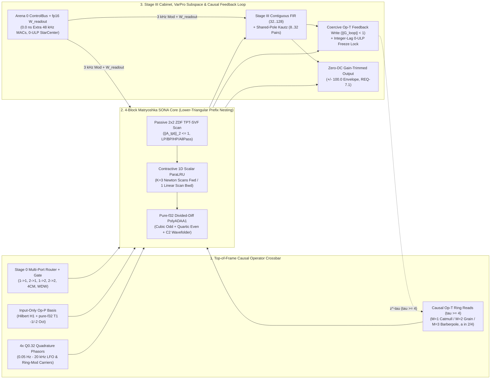
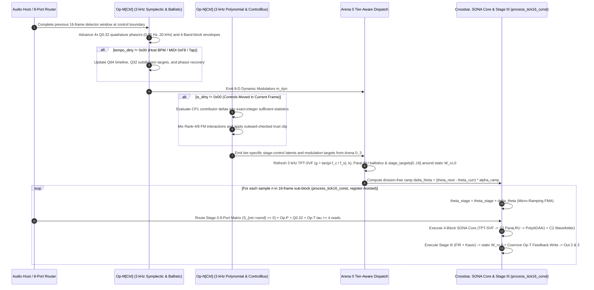
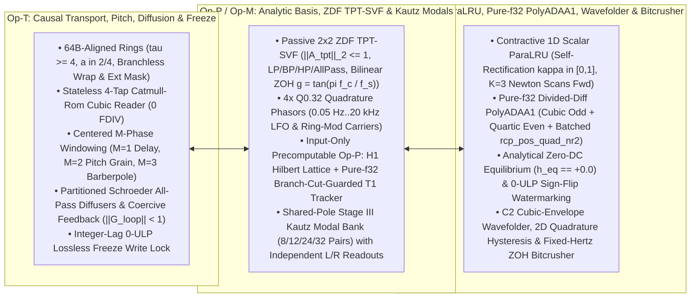
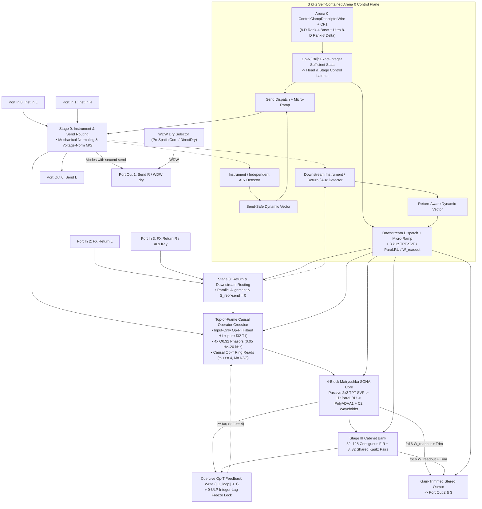
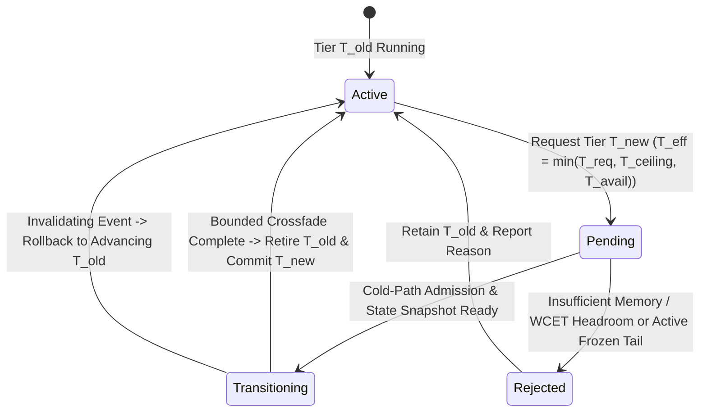
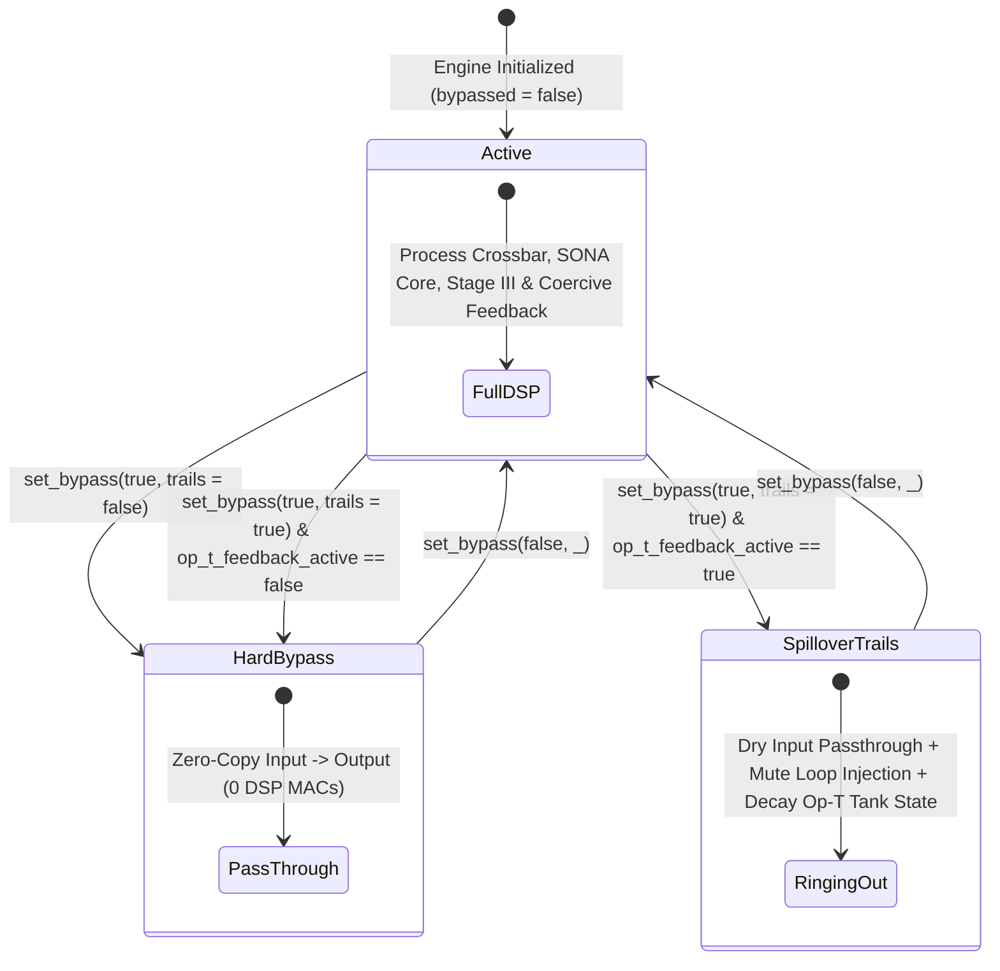
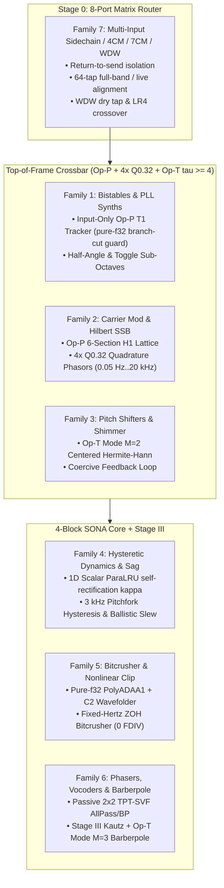

# State-Space Operator Neural Architecture (`SONA`) System Overview

This specification defines the **State-Space Operator Neural Architecture (`SONA` `v3.0`)** for **Dynamic Neural Audio Modeler (DNAM)** across `packages/kernels/` (`dnam-kernels`), [`packages/engine/`](../../../packages/engine/README.md) (`SonaInstance` / `DnamEngine`), [`packages/capture/`](../../../packages/capture/README.md), and `tools/sona-shaders/`. `SONA` unifies all analog, digital, and acoustic audio gear into a **Top-of-Frame Causal Operator Crossbar** (`Stage 0` 8-Port Router + precomputable `Op-P` + `4`-lane `Q0.32` quadrature phasors + causal `tau >= 4` `Op-T` transport reads), a **4-Block Matryoshka State-Space Core** (passive `2x2` ZDF `TPT-SVF` + contractive `1D` scalar `ParaLRU` + pure-`f32` divided-difference `PolyADAA1` & $C^2$ wavefolder), **Stage III Cabinet (`FIR` + Shared `Kautz`)**, **Coercive `Op-T` Feedback (`||G_loop|| < 1`)**, and a **Self-Contained `Arena 0` `3 kHz` Control Bus**—executed with `0` stage-bypass flags and compiled from single-source `#![no_std]` Rust kernels into both multi-ISA CPU SIMD (`StereoVec8` / `2x SimdVec4`) and AOT `.wgsl` shaders for `32-bit` `WebGPU` + host-`f64` `VarPro` training.

For implementation-agnostic requirements, see [`../../requirements/system_goals_and_requirements.md`](../../requirements/system_goals_and_requirements.md). For psychoacoustic quality tiers, see [`psychoacoustic_quality_and_tiers.md`](psychoacoustic_quality_and_tiers.md). For architectural rationales and trade-offs, see [`../../adr/0022-sona-state-space-operator-and-webgpu-architecture.md`](../../adr/0022-sona-state-space-operator-and-webgpu-architecture.md), [`../../adr/0015-realtime-host-concurrency-spsc-and-telemetry-seqlock.md`](../../adr/0015-realtime-host-concurrency-spsc-and-telemetry-seqlock.md), [`../../adr/0019-simd-kernel-architecture-and-realtime-execution-optimizations.md`](../../adr/0019-simd-kernel-architecture-and-realtime-execution-optimizations.md), and [`../../adr/0020-modular-monorepo-and-dnam-proj-container.md`](../../adr/0020-modular-monorepo-and-dnam-proj-container.md).

---

## 1. Executive Summary & Core Architectural Pillars

### 1.1 Four Foundational Pillars of `SONA`

`SONA` `v3.0` establishes four foundational architectural pillars across real-time audio execution, `3 kHz` control conditioning, `v3.0` `zerocopy` containers, and `32-bit` `WebGPU` + host-`f64` identification:

1. `r[arch.pillars.dual-space-control]` **Pillar 1: Dual-Space Factored Control Architecture:**  
   Factors `3 kHz` `ControlBus` trajectories and fixed-shape `W_readout` (`fp16`) subspace coordinates from shared `StarCenter` trajectories to enable non-destructive Capture Vault stem editing ([`../training/iterative_resume_and_caching.md` §1.2](../training/iterative_resume_and_caching.md#12-two-path-vault-editing--dependency-digests)).
2. `r[arch.pillars.dual-rate-plane]` **Pillar 2: Unified Self-Similar Dual-Rate Control Plane (`Op-M[Ctrl]` & `Op-N[Ctrl]`):**  
   Executes the control plane using `Op-M` and `Op-N` kernels at a `16`-sample stride at the `48 kHz` reference rate (`3 kHz`), updating `TPT-SVF` bilinear ZOH poles $g = \tan(\pi f_c / f_s)$ and damping $k = 1/Q$, `ParaLRU` ballistics $(\alpha_{\text{rel}}, \alpha_{\text{atk}}, \kappa)$, `4`-lane `Q0.32` quadrature phasor increments (`0.05 Hz..20 kHz`), `Op-T` target pointers, and collapsed `W_readout` deltas across rate-dependent strides $K_{\text{ctrl}}(f_{s,\text{eff}})$ ([router §9](../dsp/router_and_stages_topology.md#9-continuous-time-zero-order-hold-zoh-sample-rate-adaptability-441192-khz--4-bounce)).
3. `r[arch.pillars.cp1-projections]` **Pillar 3: Self-Contained `Arena 0` Control Descriptors & Tier-Local `CP1` Projections:**  
   Supports $P \ge 0$ physical controls with base `ControlClampDescriptorWire`, `CP1`, `U_int`, `W_ctrl`, and `Lite` `fp16` `W_readout` slices stored wholly inside `Arena 0` (`Arena0LiteWire`, [`../containers/dnam_binary_format.md` §2.4](../containers/dnam_binary_format.md#packed-control-projection-profile)) so `strip_container_to_tier(Lite)` retains complete parametric conditioning (`REQ-5.6`). `Lite`, `Full`, and `Pro` use `8-D` static latents (`4` readout + `4` stage, Rank-4 FM); `Ultra` adds an `8-D` delta (`+4` readout + `+4` stage, Rank-8 FM) and a `16 × 4` stage-dispatch delta in `Arena 3` ([`../dsp/parametric_control_bus.md` §2.3](../dsp/parametric_control_bus.md#23-o1-additive-latent-sufficient-statistic-control-scaling)).
4. `r[arch.pillars.universal-black-box]` **Pillar 4: Universal Trainable & Data-Programmable Black-Box Runtime (`REQ-1.9`):**  
   Executes a fixed, unconditional basis of general mathematical operators—Top-of-Frame Causal Crossbar (`Stage 0` 8-Port Router, input-only `Op-P` `HilbertH1Lattice6Sec` + pure-`f32` `T1SubHarmonicTracker`, `4x Q0.32` quadrature phasors, causal `tau >= 4` `Op-T` reads), `4`-Block Matryoshka `SONA` Core (passive `2x2` `TPT-SVF` + contractive `1D` `ParaLRU` + pure-`f32` `PolyADAA1` & $C^2$ wavefolder), `Stage III` (`FIR` + `Kautz`), coercive `Op-T` feedback, and `3 kHz` `ControlBus`—parameterized strictly by learned `v3.0` `"sona"` container weights (`0` white-box sub-circuits, `0` hardcoded crossover frequencies, `0` conditional stage-bypass flags, and `0` target-identity solver branches).

### 1.2 The SONA Architectural Breakthrough



1. **Top-of-Frame Causal Crossbar (`Op-T` + `Op-P` + `4x Q0.32` Phasors):** Lifting `Op-T` transport reads ($\tau \ge 4$ preventing delay-free algebraic loops) above the nonlinear `SONA` core lets learned crossbar mixing weights freely feed dry inputs, `Op-T` chorus/delay/reverb returns, `0.05 Hz..20 kHz` quadrature ring-mod/LFO carriers, and input-only `Op-P` sub-harmonics directly into `TPT-SVF -> ParaLRU -> PolyADAA1`, while writing core/cabinet outputs back into `Op-T` rings with coercive loop limiting ($\Vert\mathbf{G}_{\text{loop}}\Vert < 1$). Pre-drive phasers (`TPT-SVF` `AllPass` into `PolyADAA1`), `Reverb -> Fuzz`, `BBD/Tape` loop LPF + saturation (`Chain-08`), `220 Hz` audio-rate ring modulation (`Chain-10` `switch=1`), and `Chorus/Rotary -> Amp` (`Chain-07`) emerge purely from learned weights.
2. **Precomputable Input-Only `Op-P` (`HilbertH1Lattice6Sec` + Pure-`f32` `T1SubHarmonicTracker`):** `Op-P` emits analytic quadrature and sub-octave divider channels derived solely from dry input $x[n]$ using a pure-`f32` branch-cut guard (`0.0` weight when unused), allowing `dnam-capture` to precompute `Op-P` once on host CPU (`< 0.5 ms`) before uploading batches to `32-bit` `WebGPU`.
3. **Lossless `0-ULP` Integer-Lag Freeze & Descriptor Precision (`a in {2, 4}`):** Setting `freeze == true` locks `Op-T` ring writes with zero `fp16` re-quantization drift over `30 s`, while honoring per-ring descriptor precision $a \in \lbrace 2, 4 \rbrace$ (`fp16` inline on `Lite`/`Full`, selectable `fp16` or `f32` cold `ext_lines` on `Pro`/`Ultra`).
4. **Single-Source `#![no_std]` `packages/kernels/` + AOT `cargo-gpu` `.wgsl` (`REQ-4.1`–`REQ-4.3`):** `dnam-kernels` (`packages/kernels/`, `#![forbid(unsafe_code)]`, `0` external crates) compiles identically to CPU SIMD (`dnam-engine`) and `naga`-validated `.wgsl` compute shaders (`tools/sona-shaders/` via `cargo-gpu --target spirv-unknown-naga-wgsl`, `0 KB` added to `dnam.wasm`), driving native `wgpu` and browser `navigator.gpu` (`16 KiB` `var<workgroup>` Blelloch scans, optional `subgroups`, `256x` activation checkpointing, `3 x 8-bit` `i32` Ozaki reductions, and host-`f64` `VarPro`).

#### Dual-Rate (`48 kHz` Audio vs. `3 kHz` Control) SONA Execution Lifecycle

`r[arch.lifecycle.dual-rate]`

Host parameter updates apply at the control boundary in timestamp order, with DAW automation taking precedence over live Studio/MIDI on exact-timestamp ties ([control bus §1.1](../dsp/parametric_control_bus.md#host-automation-timing)):



Across all tiers, `VarProReadout*Wire` stores the static base readout matrix `W_ro,0` (`16×12` in `Lite`, `24×12` / `32×12` / `40×12` in `Full`/`Pro`/`Ultra`), while `3 kHz` latent/macro modulation drives `stage_targets[0..16]` plus `stage_latent_mods_fp16[0..80]` / `stage_latent_ctrl_ultra_fp16[0..256]` (and optional `stage_latent_core_mods_fp16[0..1024]` when `V3_META_CORE_MODS_PRESENT` is set). All `stage_latent_*` sensitivity tables index strictly the unrotated stage latent slice `z_stage[0..D_s]` (`D_s = 4` `ctrl_basis_4[0..4]` on `Lite..Pro`; `D_s = 8` `[ctrl_basis_4[0..4], z_stage_ultra[0..4]]` on `Ultra`) — never `z_head[0..4]` — preserving `0-ULP` compatibility with buyer `SO(4)` gauge `Q_buyer`; on `Ultra`, `Arena 3` `stage_latent_ctrl_ultra_fp16[0..160]` (`[8][10]`) supersedes (replaces, never sums with) `Arena 0`'s `[4][4]` `ADAA`/`ParaLRU` subset (`stage_latent_mods_fp16[48..80]`).

#### Floating-Point Environment at the Audio Callback

`r[arch.fp.callback-env]`

All block-processing entry points enforce round-to-nearest, ties-to-even (`RNE`) with non-trapping floating-point exceptions and subnormal state protection via `FtzDazGuard`:

| Target Architecture | Hardware Control Register Policy (`FtzDazGuard`) |
| :--- | :--- |
| **`aarch64`** | Save `FPCR`; clear `RMode` bits `23:22` and exception trap-enable bits `8:12, 15`; set `FZ` bit `24`; if `AH` bit `1` is set (`FEAT_AFP`), set `FIZ` bit `0`; guard `FtzDazGuard::drop` with `cur_fpcr != self.prev_fpcr` to eliminate redundant `msr fpcr` pipeline flushes inside nested audio callbacks. Per-sample recursive-state software flushing (`flush_recursive_state_f32` / `flush_recursive_state_vec4`) compiles to a zero-cost no-op because hardware `FZ` is active throughout the callback. |
| **`x86_64`** | Save `MXCSR`; clear `RC` bits `14:13` and sticky flags `0:5`; set `FTZ` (`15`), `DAZ` (`6`), and exception masks `7:12`; restore saved `MXCSR` on exit. Per-sample recursive-state software flushing (`flush_recursive_state_f32` / `flush_recursive_state_vec4`) compiles to a zero-cost no-op because hardware `FTZ`/`DAZ` is active throughout the callback. |
| **WebAssembly / Portable** | Standard WASM enforces `RNE` with gradual underflow; apply branchless 4-lane `SimdVec4::flush_subnormal` (`v128` exponent-mask zeroing, `exp == 0 -> ±0.0f32`) in `flush_recursive_state_f32` / `flush_recursive_state_vec4` to persistent recursive-state writebacks while preserving sign, normals, infinities, and `NaN` payloads. |

#### Finite-Precision Range and Saturation Policy

`r[arch.fp.range-saturation]`

Every model and configuration guarantees an unclipped operating envelope of at least `±100.0` (`+40 dBFS` peak) simultaneously on all active audio inputs (`REQ-7.1`), and finite output/state safety for all finite `f32` inputs via the `±1e9` (`S = 1,000,000,000.0`) and `fp16` (`±65,504.0`) safety guards (`REQ-7.2`):

| Bit | Event Flag (`overflow_or_saturation_flags`) | Condition |
| :---: | :--- | :--- |
| `0` | `INPUT_SATURATED` | A processed audio input exceeded the `±1e9` safety ceiling. |
| `1` | `FP16_SATURATED` | A finite delay write exceeded `±65,504.0` (`0x7BFF` / `0xFBFF`). |
| `2` | `INTERNAL_SATURATED` | An intermediate or recursive-state safety guard clamped a value to `±1e9`. |
| `3` | `OUTPUT_SATURATED` | The processed output guard clamped a value to `±1e9`. |
| `4` | `OUTSIDE_CERTIFIED_INPUT` | An input exceeded the model's certified input envelope (`≥ ±100.0`). |
| `5` | `INVALID_NONFINITE` | A non-finite external sample, control, or parameter was detected and rejected. |

#### Wait-Free Telemetry Seqlock & Real-Time Host Concurrency

`r[arch.telemetry.seqlock-publication]`

Real-time host wrappers (`dnam_engine::host::DnamHostHandle`, [`../../adr/0015-realtime-host-concurrency-spsc-and-telemetry-seqlock.md`](../../adr/0015-realtime-host-concurrency-spsc-and-telemetry-seqlock.md)) decouple audio rendering callbacks from concurrent UI, MIDI, Studio, and TypeScript (`N-API` / `WASM`) control and telemetry threads in 100% safe `#![no_std]` + `alloc` Rust (`#[forbid(unsafe_code)]`):
1. **Wait-Free `AtomicU64` Seqlock (`TelemetryCell`):** `TelemetryWriter` packs `DnamTelemetrySnapshot` (`RawTelemetryRecord`) into a cache-line-aligned (`#[repr(align(64))]`) array of `29` `AtomicU64` words guarded by a monotonically advancing sequence counter `seq: AtomicU64` (`seq` odd before relaxed word stores, `Release` store `seq + 1` on completion). `TelemetryReader::read()` loads `seq1` (`Acquire`), copies the `29` atomic words, issues an `Acquire` fence, and verifies `seq1 == seq2` (with bounded retry and last-good snapshot fallback) without locking `DynamicDnamEngine`.
2. **Sub-Block SPSC Drain, Lock-Free Triple-Buffer `SlotSwapGuard` & Telemetry Publication:** `DnamHostHandle` drains the 3-Lane `SpscControlRing` (`ref[dsp.ctrl.op-m.spsc-ingress]`) at the start of every `64`-frame sub-block and publishes the updated `DnamTelemetrySnapshot` to `TelemetryCell` at sub-block exit. Hot-swapping containers or tiers uses a wait-free, lock-free triple-buffer SPSC `SlotSwapGuard` with epoch-based host-side retirement (**zero `Mutex`**, zero RT heap allocations or deallocations), dropping retired `SonaHotSlab` / `DynamicDnamEngine` allocations strictly on the non-real-time controller thread. On the trainer side, lock-free `DNPR` seqlock telemetry surfaces active `WebGPU` adapter capabilities, `2-D` memory planner mode, and per-tier convergence progress.

---

### 1.3 Universal Zero-`FDIV` State-Space & Operator Kernels

`r[arch.operators.tri-kernel]`

Every analog, digital, and acoustic circuit in the audio production domain is spanned by `SONA`'s three shared `#![no_std]` mathematical operator families (`dnam-kernels`):



1. **Unconditionally Passive `2x2` ZDF `TPT-SVF` (`0` Overflow, Analytical Bilinear ZOH):** For cutoff frequency $f_c[n]$ and damping $k[n] = 1/Q[n] \ge 0$ with $g[n] = \tan(\pi f_c[n] / f_s) > 0$, $a_1 = 1 / (1 + g(g + k))$, $a_2 = g a_1$, and $a_3 = g a_2$ (evaluated strictly on the `3 kHz` / cold path), each resonant mode obeys the exact `2x2` linear transition $\mathbf{s}[n] = \mathbf{A}_{\text{tpt}}[n]\mathbf{s}[n-1] + \mathbf{b}_{\text{tpt}}[n]u[n]$:
   $$s_1'[n] = (2a_1 - 1) s_1[n-1] - 2a_2 s_2[n-1] + 2a_2 u[n], \qquad s_2'[n] = 2a_2 s_1[n-1] + (1 - 2a_3) s_2[n-1] + 2a_3 u[n]$$
   By the energy identity $(s_1')^2 + (s_2')^2 = s_1^2 + s_2^2 - 4 g[n] k[n] v_1[n]^2 \le s_1^2 + s_2^2$, $\Vert\mathbf{A}_{\text{tpt}}[n]\Vert_2 \le 1$ unconditionally under arbitrary audio-rate modulation (`Chain-06` `Q=12` Wah), never overflowing `f32` inside `O(log₂ L)` WebGPU prefix scans (`0` `log`/`exp` stabilization) while transferring across `44.1..384 kHz` via exact bilinear prewarping (`g_host = tan(pi * f_c / f_s_host)`) and yielding simultaneous `(LP, BP, HP, AllPass)` (`AllPass = u - 2 k v1`) taps.
2. **Contractive `1D` Scalar `ParaLRU` (`K = 3` Newton Scans Forward, `1` Linear Scan Backward):** Each scalar lane $i$ applies a single decoupled self-rectification feedback scalar $\kappa_i \in [0, 1]$:
   $$v_i[n] = \alpha_{\text{rel},i} v_i[n-1] + (1 - \alpha_{\text{atk},i}) \phi_{\text{rect}}\big(u_i[n] - \kappa_i \alpha_{\text{rel},i} v_i[n-1]\big)$$
   Because $\phi_{\text{rect}}'$ stays bounded in $[0, 1]$, the scalar Jacobian satisfies $J_i[n] \in [\alpha_{\text{rel},i}(1 - \kappa_i(1 - \alpha_{\text{atk},i})), \alpha_{\text{rel},i}] \subset (0, r_{\max}] \subset (0, 1)$ unconditionally (`6` `SimdVec4` ops on CPU, `0` post-hoc `w_rec *= 0.5` ISS hacks; inter-lane mixing occurs solely via lower-triangular `4x4` spatial tiles between blocks).
3. **Pure-`f32` Divided-Difference `PolyADAA1` + $C^2$ Wavefolder (`0-FDIV`, `0` `0/0`):** Pairs midpoint/half-difference `(m_n, d_n)` cubic-odd + quartic-even `PolyADAA1` (`eval_poly_adaa1_*`) and $C^2$ wavefolding (`eval_c2_wavefolder_adaa_*`) with pure-`f32` branchless rail-crossing reciprocals via `SimdVec4::rcp_pos_nr2(max(upper - lower, 1.0e-6))` (`TINY_CROSSING_EPS = 1.0e-6`, `RAIL_CROSSING_MIN_SPAN = 1.0e-6`) and batched `rcp_pos_quad_nr2` (safe in `f32` because $g'(\pm 1) = 0$), preserving exact analytical `0.000000` DC equilibrium (`h_eq == +0.0`) and `0-ULP` hidden-lane sign-flip watermarking (`s_i in {-1, +1}`).

#### 2.0 Self-Similar Dual-Rate Kernel Architecture

`r[arch.operators.self-similar]`

| Universal Kernel (`dnam-kernels`) | Audio-Rate Execution (`48 kHz` / `96 kHz` `2x`) | Control-Plane Execution (`3 kHz`, `f_s / K_ctrl`) | Shared SIMD / WGSL Mechanism |
| :--- | :--- | :--- | :--- |
| **`Op-T` (Transport)** | Fractional delay ring buffer (`tau >= 4`, `a in {2, 4}`), pitch grains, Schroeder diffusers, `0-ULP` freeze | Integer-plus-`Q0.32` delay targets, `4x Q0.32` (`0.05 Hz..20 kHz`) quadrature phasor increments, coercive bounds | Branchless wrap, `& ext_mask`, Catmull-Rom Horner FMA |
| **`Op-P` / `Op-M` (SVF, Analytic & Modal)** | Passive `2x2` `TPT-SVF` `(LP, BP, HP, AllPass)`, `H1` Hilbert SSB, pure-`f32` `T1` tracker, Stage III Kautz bank | `TPT-SVF` bilinear `g = tan(pi f_c / f_s)` and `k` updates, `Q0.192` rotors, `Q64`/`Q32` tempo phase, 4-band detectors | Energy-preserving `2x2` ZDF step/compose & `SimdVec4` / `StereoVec8` FMA |
| **`Op-N` (`ParaLRU` & Polynomials)** | Contractive `1D` scalar `ParaLRU` (`κ_i`), fast-path `PolyADAA1` + batched `rcp_pos_quad_nr2`, `C²` wavefolder, bitcrusher | Packed `CP1` Lobatto/FM projections, exact-integer sufficient stats, `3 kHz` `ParaLRU` ballistics & trust clip | Branchless in-register `rcp_pos_nr2` / FMA (`0` GPR spills, `CPU == WGSL`) |

#### 2.4.1 SIMD Lane Packing (AVX2, ARM NEON & WebAssembly SIMD128)

`r[arch.simd.lane-packing]`

`SONA` organizes all 4-block Matryoshka state-space lanes (`16 / 24 / 32 / 40` lanes across `4 / 6 / 8 / 10` `SonaGroup` slots), `TPT-SVF` quads (`4 / 6 / 8 / 10` quads), inter-block tiles (`3 / 13 / 23 / 35` lower-triangular `4x4` triples), Stage III `FIR` + `Kautz` banks, `fp16` delay conversions (`f32x4_to_fp16x4` / `fp16x4_to_f32x4`), and `Stage 4` `Op-T` quads in `4`-lane SIMD primitives (`SimdVec4` / `GpuVec4` in `packages/kernels/`, paired into `StereoVec8` on `AVX2+FMA`/`SVE2`/`SME` or interleaved `2x SimdVec4` on `NEON`/`WASM SIMD128`):

```text
SONA v3.0 4-Block Matryoshka 4-Lane SIMD Hierarchy (Compile-Time const SonaTierSpec Locked at Gate 0b):
+--------------------+--------------------+--------------------+--------------------+
| Block 0 (4-Lane B) | Block 1 (4-Lane B) | Block 2 (4-Lane B) | Block 3 (4-Lane B) | -> Tier / Mode
+--------------------+--------------------+--------------------+--------------------+
| 1 x Vec4 (4 lanes) | 1 x Vec4 (4 lanes) | 1 x Vec4 (4 lanes) | 1 x Vec4 (4 lanes) | -> LITE_SPEC  [1,1,1,1] (16 lanes @ 1x 48kHz)
| 2 x Vec4 (8 lanes) | 2 x Vec4 (8 lanes) | 1 x Vec4 (4 lanes) | 1 x Vec4 (4 lanes) | -> FULL_SPEC  [2,2,1,1] (24 lanes @ 2x OS)
| 3 x Vec4 (12 lanes)| 2 x Vec4 (8 lanes) | 2 x Vec4 (8 lanes) | 1 x Vec4 (4 lanes) | -> PRO_SPEC   [3,2,2,1] (32 lanes @ 2x OS)
| 4 x Vec4 (16 lanes)| 3 x Vec4 (12 lanes)| 2 x Vec4 (8 lanes) | 1 x Vec4 (4 lanes) | -> ULTRA_SPEC [4,3,2,1] (40 lanes @ 2x / 4x)
+--------------------+--------------------+--------------------+--------------------+
```

| Tier (`const` `SonaTierSpec`) | `blocks` & Groups/Lanes | `TPT-SVF` Quads & Tiles | `oversample_factor` | Stage III (`fir_taps` + `kautz_pairs`) | `tank_quads` (`Op-T`) | Wire Arena & `ActiveHot` Ceiling |
| :--- | :---: | :---: | :---: | :---: | :---: | :---: |
| **`Lite` (`LITE_SPEC`, Tier `0`)** | `[1, 1, 1, 1]` (`4` grps = `16` lanes) | `4` quads, tiles `0..3` (`3`) | `1` (`1x` @ `48 kHz` + `PolyADAA1`) | `32` FIR/ch + `8` Kautz (`2` blks = `16` poles) | `1` (`M = 4` lines, `128`-frame/`1,024 B` `[[u16; 4]; 128]` inline `fp16` in `Quad 0` + opt. cold `ext_lines`) | `ARENA_LITE_BYTES = 4,608 B` (`72 CL`), `ActiveHot <= 4,608 B` |
| **`Full` (`FULL_SPEC`, Tier `1`)** | `[2, 2, 1, 1]` (`6` grps = `24` lanes) | `6` quads, tiles `0..13` (`13`) | `2` (`2x` OS + `PolyADAA1`) | `48` FIR/ch + `12` Kautz (`3` blks = `24` poles) | `2` (`M = 8` lines + Schroeder; `Quad 0` `128`-frame inline + `Quad 1`) | `ARENA_FULL_BYTES = 7,936 B` (`124 CL`, delta `3,328 B = 52 CL`), `ActiveHot <= 7,936 B` |
| **`Pro` (`PRO_SPEC`, Tier `2`)** | `[3, 2, 2, 1]` (`8` grps = `32` lanes) | `8` quads, tiles `0..23` (`23`) | `2` (`2x` OS + `PolyADAA1`) | `96` FIR/ch + `24` Kautz (`6` blks = `48` poles) | `3` (`M = 12` lines + Schroeder; opt. `fp16`/`f32` cold `ext_lines`) | `ARENA_PRO_BYTES = 15,872 B` (`248 CL`, delta `7,936 B = 124 CL`), `ActiveHot <= 15,872 B` |
| **`Ultra` (`ULTRA_SPEC`, Tier `3`)** | `[4, 3, 2, 1]` (`10` grps = `40` lanes) | `10` quads, tiles `0..35` (`35`) | `2` RT (`4x` bounce `FullBand64Tap` `43`-spl PDC) | `128` FIR/ch + `32` Kautz (`8` blks = `64` poles) | `4` (`M = 16` lines + `8`-stage `PartitionedSchroederDiffuserBank`) | `ARENA_ULTRA_BYTES = 30,720 B` (`480 CL`, delta `14,848 B = 232 CL`), `ActiveHot <= 30,720 B` |

**Exact Matryoshka Block/Group Indexing & 35-Tile Lower-Triangular Edge Topology (`packages/engine/src/stages/sona_core/model.rs`):**

```rust
pub const SONA_GROUP_BLOCK_AND_LOCAL: [(usize, usize); 10] = [
    (0, 0), (1, 0), (2, 0), (3, 0), // Groups 0..4: Lite [1,1,1,1]
    (0, 1), (1, 1),                 // Groups 4..6: Full [2,2,1,1]
    (0, 2), (2, 1),                 // Groups 6..8: Pro  [3,2,2,1]
    (0, 3), (1, 2),                 // Groups 8..10: Ultra [4,3,2,1]
];

pub const SONA_BLOCK_GROUP_SLOTS: [[usize; 4]; 4] = [
    [0, 4, 6, 8],                   // Block 0 (up to 4 groups = 16 lanes)
    [1, 5, 9, usize::MAX],          // Block 1 (up to 3 groups = 12 lanes)
    [2, 7, usize::MAX, usize::MAX], // Block 2 (up to 2 groups = 8 lanes)
    [3, usize::MAX, usize::MAX, usize::MAX], // Block 3 (1 group = 4 lanes)
];

// All 35 lower-triangular (src_group, dst_group) edges ordered strictly by tier introduction:
//   0..3   (Lite,  +3):  [1,1,1,1] -> 3 edges
//   3..13  (Full, +10):  [2,2,1,1] -> 13 cumulative edges
//   13..23 (Pro,  +10):  [3,2,2,1] -> 23 cumulative edges
//   23..35 (Ultra,+12):  [4,3,2,1] -> 35 cumulative edges
pub const SONA_INTERBLOCK_TILES: [(usize, usize); 35] = [
    (0, 1), (1, 2), (2, 3),                                                         // 0..3   Lite
    (0, 5), (4, 1), (4, 5), (0, 2), (4, 2), (0, 3), (4, 3), (5, 2), (1, 3), (5, 3), // 3..13  Full
    (6, 1), (6, 5), (0, 7), (4, 7), (6, 2), (6, 7), (6, 3), (1, 7), (5, 7), (7, 3), // 13..23 Pro
    (0, 9), (4, 9), (6, 9), (8, 1), (8, 5), (8, 9), (8, 2), (8, 7), (8, 3), (9, 2), (9, 7), (9, 3), // 23..35 Ultra
];
```

1. `r[arch.simd.two-level-traits]` **Two-Level SIMD Trait Hierarchy & Shared `dnam-kernels` Primitives ([`ADR-0019`](../../adr/0019-simd-kernel-architecture-and-realtime-execution-optimizations.md), [`ADR-0022`](../../adr/0022-sona-state-space-operator-and-webgpu-architecture.md)):**
   - **Level 1 (`packages/kernels/` + `math/backend.rs`):** `SimdVec4` / `GpuVec4` (`f32x4` portable register abstraction) and `StereoVec8` (`256`-bit / scalable stereo `L+R` dispatch on `AVX2+FMA`, `SVE2`, `SME`, falling back to interleaved `2x SimdVec4` on `NEON` and `WASM SIMD128`), `MathBackend` (`Crc32cBackend`, `fma_mat4x4_vec4`, `f32x4_to_fp16x4`, `fp16x4_to_f32x4`, `rcp_pos_nr2`, batched `rcp_pos_quad_nr2`, `rsqrt_pos_nr2`, `rsqrt_pos_pair_nr2`, `flush_subnormal`), plus `const_eval`, `TPT-SVF` `mat2x2` step/compose, `ParaLRU` + scalar Newton op, fast-path `PolyADAA1` + $C^2$ wavefolder, `KautzModalBank`, `Op-T` readers, `HilbertH1`/`T1` tracker, and `pow2_ceil_fp32` + `3x8-bit` Ozaki slice helpers reside in `#![no_std]` `packages/kernels/` (`dnam-kernels`).
   - **Level 2 (Domain-Scoped Backend Traits):** Higher-level DSP traits (`OpMBackend`, `OpNBackend`, `OpTBackend`, `Stage3Backend`, `EngineBackend`) live inside `packages/engine/` (`engine -> stages -> operators -> math -> dnam-kernels`), enforcing a strict acyclic dependency graph while enabling `process_tick16_const` register-hoisted stereo dispatch across `SonaInstance`.
2. `r[arch.simd.single-library-dispatch]` **Single-Library Per-Architecture Runtime SIMD Dispatch & `0.000000 ULP` Parity ([`ADR-0019`](../../adr/0019-simd-kernel-architecture-and-realtime-execution-optimizations.md)):**
   - Each target architecture compiles all ISA tiers into a single binary (`aarch64/{neon,sve2,sme}`, `x86/{sse2,sse42,avx2}`, `wasm`, `scalar`) with `AtomicU8`-cached startup capability probing (`DynamicDnamEngine`). Both `StereoVec8` and interleaved `2x SimdVec4` execute identical fixed `Vec4`-pair reduction trees and unfused `rsqrt_nr2_pair_f32` steps to guarantee **`0.000000 ULP` bit parity** across CPU backends (`< 1.5 ULP` vs. AOT `.wgsl` trajectories and `0-ULP` on `i32` Ozaki reductions).
3. `r[arch.simd.zero-stall-lowering]` **Division-Free & `libm`-Free LLVM Lowering Rules (`REQ-6.2`, `REQ-6.3`, [`ADR-0019`](../../adr/0019-simd-kernel-architecture-and-realtime-execution-optimizations.md)):**
   - Zero `FDIV`, `FSQRT`, `IDIV`/`UDIV`/`SDIV`, `libm` (`fmodf`, `tanf`, `tanhf`), or unbounded loops in `48 kHz` or `3 kHz` paths: reduce angles via `floor_f32((theta + PI) * INV_TAU)`, wrap power-of-two `ext_lines` rings via `& ext_mask` or branchless single-step wrap, evaluate `PolyADAA1` rail crossings in pure `f32` via batched `rcp_pos_quad_nr2`, and precompute bilinear `g = tan(pi * f_c / f_s)` strictly on `3 kHz` / cold paths.

#### 2.4.2 Differentiability and Gradient Dynamics

`r[arch.operators.differentiability]`

| Operator | Forward & Backward Parallel / Analytical Formulation |
| :--- | :--- |
| **1. `Op-T` (Continuous Delay & Crossbar)** | Horner Catmull-Rom derivative `∂d(τ)/∂μ = 3 c_3' μ² + 2 c_2' μ + c_1'` with coarse-to-fine Gaussian envelope surrogate gradient and fractional delay/LFO polish. |
| **2. `TPT-SVF` (`2x2` Passive Associative Scan)** | Unconditionally contractive `2x2` linear transition `‖A_tpt[n]‖_2 ≤ 1` evaluated via `O(log₂ L)` `mat2x2` Blelloch prefix scans inside `8 KiB` WebGPU `var<workgroup>` SRAM (`0` overflow). |
| **3. `ParaLRU` (`1D` Scalar Newton Scan)** | Decoupled `1D` scalar diode-RC recurrence with `J_i[n] ∈ (0, r_max] ⊂ (0, 1)` evaluated via `K = 3` scalar Newton Blelloch scans forward + `1` linear scan backward inside `2 KiB` SRAM (`O(log₂ L)`). |
| **4. `Op-N` (`PolyADAA1` & Bitcrusher STE)** | Analytic derivative of divided-difference `PolyADAA1` + `C²` wavefolder (`0` `0/0` instability) plus grouped stop-gradient / 4-term Fourier surrogate for quantizers ([Op-N §2.3](../dsp/op_n_commuted_cascade.md#23-family-5-precomputed-reciprocal-zoh-sample-rate-reducer--bitcrusher)). |

$$(a_2, \tilde{b}_2) \circ (a_1, \tilde{b}_1) = (a_2 a_1, a_2 \tilde{b}_1 + \tilde{b}_2), \qquad J_i[n] \in \big[\alpha_{\text{rel},i}(1 - \kappa_i(1 - \alpha_{\text{atk},i})),\ \alpha_{\text{rel},i}\big] \subset (0, 1)$$

---

## 2. 4-Tier Slimmable SIMD Hierarchy (`Lite` / `Full` / `Pro` / `Ultra`)

### 2.1 Lower-Block-Triangular Arena Hierarchy

`r[arch.tiers.arena-hierarchy]`

Weights use a four-tier causally nested lower-block-triangular delta layout (`Arena 0..3`, `64 B`-aligned, serialized as constant-size `zerocopy` `Arena0LiteWire..Arena3UltraDeltaWire` structs) monomorphized over **four compile-time `const` `SonaTierSpec` profiles (`LITE_SPEC`, `FULL_SPEC`, `PRO_SPEC`, `ULTRA_SPEC`)** locked once at **`Gate 0b`** inside the `64 KiB` (`65,536 B`) ARM Cortex-A76 L1D cache budget (`REQ-5.1`, `REQ-5.2`):
- **100% Self-Contained `Arena 0` & Elimination of `rate_1x_cal` Duality (`REQ-5.6`):** `Arena0LiteWire` (`Arena 0`, `4,608 B = 72 CL`) is **100% self-contained**: it carries `1x`-calibrated `48 kHz` `Lite` base parameters, `Stage 0` crossbar & `4× Q0.32` phasors, `Op-P` config, `32` FIR taps + `8` Kautz pairs, `Quad 0` `Op-T` tank, **self-contained control tables (`ControlClampDescriptorWire`, `CP1`, `U_int`, `W_ctrl`)**, and the static base `fp16` readout matrix `W_ro,0` inside `VarProReadoutLiteWire` (while `3 kHz` latent/macro modulation drives `stage_targets[0..16]` plus `z_stage[0..D_s]`-indexed `stage_latent_mods_fp16[0..80]` / superseding `Arena 3` `stage_latent_ctrl_ultra_fp16[0..256]` and optional `stage_latent_core_mods_fp16[0..1024]`, keeping buyer `SO(4)` gauge `Q_buyer` on `z_head[0..4]` invariant rather than using per-latent readout tensors). Stripping or extracting `Lite` from any higher-tier `.dnam` reads `Arena 0` directly without touching `Arena 1..3`. `Arena 1..3` hold strictly `2×`-OS-calibrated incremental deltas (`Full`, `Pro`, `Ultra`); analytical continuous-time ZOH handles arbitrary host sample rates (`44.1–384 kHz`). There is **zero** `rate_1x_cal` / `V3_META_RATE_1X_CAL` sidecar copy: the `2,688 B` span inside `SonaCoreProDeltaWire` (`4,608 B`) is a contiguous `reserve: [u8; 2_688]` alignment/Tardos-carrier region preserving exact `64 B` cache-line boundaries and `ARENA_PRO_BYTES = 15,872 B`.
- **Zero Capture-Time Tier Resizing:** All `48 kHz` operator counts (`blocks`, `groups`, `lanes`, `TPT-SVF` quads, `FIR` taps, `Kautz` pairs, `Op-T` `tank_quads`, and OS ratios) are strictly compile-time `const` once locked at `Gate 0b`. Only cold `Op-T` `ext_lines` ring duration (`0 B` on dry rigs up to multi-second power-of-two DRAM rings with `& ext_mask` `O(1)` wrap per `REQ-6.3`) and declared `3 kHz` control count `P` (`0` extra `48 kHz` static MACs per `REQ-6.1`) vary per captured `.dnam` model.

| Parameter (`const SonaTierSpec`) | `Lite` (`Arena 0`, `LITE_SPEC`) | `Full` (`Arena 0..1`, `FULL_SPEC`) | `Pro` (`Arena 0..2`, `PRO_SPEC`) | `Ultra` (`Arena 0..3`, `ULTRA_SPEC`) |
| :--- | :---: | :---: | :---: | :---: |
| **Cumulative Wire Arena Footprint (`64 B` CL)** | `4,608 B` (`72 CL`) | `7,936 B` (`124 CL`, `+3,328 B / 52 CL`) | `15,872 B` (`248 CL`, `+7,936 B / 124 CL`) | `30,720 B` (`480 CL`, `+14,848 B / 232 CL`) |
| **`SonaHotSlab` `ActiveHot` Ceiling (`N × ActiveHot <= 64 KiB`)** | `<= 4,608 B` (`14× = 64,512 B <= 64 KiB`) | `<= 7,936 B` (`8× = 63,488 B <= 64 KiB`) | `<= 15,872 B` (`4× = 63,488 B <= 64 KiB`) | `<= 30,720 B` (`2× = 61,440 B <= 64 KiB`) |
| **4-Block Matryoshka `SONA` Core** | `[1, 1, 1, 1]` (`4` groups / `16` lanes / `4` `TPT-SVF` quads, `3` tiles `0..3`) @ `1×` `PolyADAA1` | `[2, 2, 1, 1]` (`6` groups / `24` lanes / `6` `TPT-SVF` quads, `13` tiles `0..13`) @ `2×` OS | `[3, 2, 2, 1]` (`8` groups / `32` lanes / `8` `TPT-SVF` quads, `23` tiles `0..23`) @ `2×` OS | `[4, 3, 2, 1]` (`10` groups / `40` lanes / `10` `TPT-SVF` quads, `35` tiles `0..35`) @ `2×` RT / `4×` Bounce |
| **Stage III Early `FIR` Taps (per ch)** | `32` | `48` | `96` (`2.0 ms`) | `128` (`2.67 ms`) |
| **Stage III Shared `Kautz` Pole Pairs** | `8` pairs (`2` blocks = `16` poles) | `12` pairs (`3` blocks = `24` poles) | `24` pairs (`6` blocks = `48` poles) | `32` pairs (`8` blocks = `64` poles) |
| **`Op-T` Transport (`tank_quads`) & Diffusion** | `1` quad (`M = 4` lines, `128`-frame/`1,024 B` inline `fp16` `Quad 0` `[[u16; 4]; 128]` + opt. cold `ext_lines`) | `2` quads (`M = 8` lines + Schroeder diffusion; `Quad 0` inline + `Quad 1`) | `3` quads (`M = 12` lines + Schroeder diffusion, opt. `fp16`/`f32` cold `ext_lines`) | `4` quads (`M = 16` lines + `8`-stage `PartitionedSchroederDiffuserBank`) |
| **Control Bus Latent Dim (`z_ctrl`, `Arena 0` Base)** | `8-D` (`4` + `4`, `R = 4`) | `8-D` (`4` + `4`, `R = 4`) | `8-D` (`4` + `4`, `R = 4`) | `16-D` (`8` + `8`, `R = 8`, `+16×4` delta in `Arena 3`) |

### 2.2 Hardware & DSP Benchmark Summary

`r[arch.tiers.hardware-budget]`

Reference embedded serial pedalboard budgets on `1×` ARM Cortex-A76 core (`Rockchip RK3582 @ 2.4 GHz`, `20,833.33 ns/sample` raw period at `48 kHz`, **`16,667 ns/sample` usable budget under the `80%` real-time scheduling cap** including LV2 host dispatch and multi-instance cache spill, executing **all topological blocks unconditionally on every stereo frame with zero stage-bypass flags**, see [`../../requirements/system_goals_and_requirements.md` §7](../../requirements/system_goals_and_requirements.md#7-goal-6--real-time-commodity-hardware-budget--execution-constraints)):

1. `r[arch.tiers.maximize-quality-within-budget]` **Optimize-First `Gate 0b` Compile-Time `const` Tier Locking & Fixed-Shape Asymptotic Quality Maximization (`REQ-5.1`, `REQ-6.1`):**
   - **Optimize Microarchitecture First, Then Lock `Gate 0b` `const` Capacities:** `dnam-kernels` and `dnam-engine` MUST first eliminate spills and hot-loop bottlenecks via `process_tick16_const` register hoisting, `StereoVec8` / `2x SimdVec4` dispatch, fast-path `PolyADAA1` + batched `rcp_pos_quad_nr2`, and contiguous `SonaHotSlab` packing (verified with `hotpath` percentiles and `packages/engine/tests/realtime_disassembly_audit.rs`), then reinvest freed cycles at `Gate 0b` to lock the largest compile-time `const` `SonaTierSpec` dimensions (`LiteSpec`, `FullSpec`, `ProSpec`, `UltraSpec`) utilizing **`~85–90%` of each tier's `REQ-6.1` Cortex-A76 WCET budget (`≤ 1,000 / 1,800 / 3,600 / 7,200 ns/sample` targets vs. `1,190 / 2,083 / 4,166 / 8,333 ns/sample` ceilings, reserving `10–15%` for `P99.9` margin) and `N × ActiveHot ≤ 64 KiB` L1D**.
   - **Strictly Constant Shapes Across Captures (`0` Capture-Time Tier Resizing):** Once locked at `Gate 0b`, operator shapes remain compile-time `const` across all captured models (`0` dynamic loop counters or runtime operator scaling—preserving full LLVM unrolling and SIMD register pinning against a `~25–45%` dynamic-loop penalty, keeping `14×` serial instances `100%` warm in L1I, fixing `Arena0LiteWire..Arena3UltraDeltaWire` byte offsets, and keeping `workgroup_size(256)` `.wgsl` kernels branch-free). Solver optimizations (`16 KiB` SRAM fusion, `subgroups`, `i32` Ozaki, `64–128` seeds, full `2.0–2.5 s` capsules, continuous `Kautz`/`Op-T` polish) are invested exclusively into maximizing weights within these fixed `const` shapes until asymptotic diminishing returns (`∣ΔbESR∣ < 0.01 dB/epoch`), never triggering `ThresholdStop` shortcuts on `§4` floors (`ref[qual.tiers.floors-not-stopping-criteria]`).

On **Rockchip RK3582** (`2× Cortex-A76 @ 2.4 GHz` with `64 KB` L1D / `512 KB` L2 per core), per-instance frame latency $t_{\text{A76+LV2}}(t, B)$, core utilization $u_{\text{core}}(t, B)$, and safe serial instance count $N_{\text{safe}}(t, B)$ for block size $B \in [64, 128]$ obey:

$$t_{\text{A76+LV2}}(t, B) = \kappa_{\text{cache}} \left(\alpha_{\text{uarch}}(t) \cdot t_{\text{bench}}(t) + \frac{T_{\text{LV2-block}}}{B}\right), \qquad u_{\text{core}}(t, B) = \frac{t_{\text{A76+LV2}}(t, B)}{T_{\text{sample}}}, \qquad N_{\text{safe}}(t, B) = \left\lfloor \frac{\eta_{\text{RT}}}{u_{\text{core}}(t, B)} \right\rfloor$$

| Tier Profile (`const` `SonaTierSpec`) | `Gate 0b` Target `1× A76` Budget (`85–90%` Utilization) | `N × ActiveHot` vs `64 KiB` L1D | Normative Serial Core Budget (`1× A76` @ 80% RT Cap) | Safe Serial (`2× A76` Cores) | Real-Time Instruction Invariant |
| :--- | :---: | :---: | :---: | :---: | :--- |
| **`Lite` (`LITE_SPEC [1,1,1,1]` @ `1×`, `4` grps/`4` quads, `3` tiles, `32` FIR, `8` Kautz, `1` tank quad)** | `≤ 1,000 ns/sample` | `14 × <= 4,608 B = 64,512 B <= 64 KiB` | **`≥ 14×`** (`≤ 1,190 ns/sample`) | **`≥ 28×`** | Zero `FDIV`, `FSQRT`, `IDIV`/`UDIV`/`SDIV`, `libm`, allocs, locks, or syscalls (`REQ-6.2`, `REQ-6.3`) |
| **`Full` (`FULL_SPEC [2,2,1,1]` @ `2×`, `6` grps/`6` quads, `13` tiles, `48` FIR, `12` Kautz, `2` tank quads)** | `≤ 1,800 ns/sample` | `8 × <= 7,936 B = 63,488 B <= 64 KiB` | **`≥ 8×`** (`≤ 2,083 ns/sample`) | **`≥ 16×`** | `2×` OS (`-90 dB` alias immunity) inside Studio flagship budget |
| **`Pro` (`PRO_SPEC [3,2,2,1]` @ `2×`, `8` grps/`8` quads, `23` tiles, `96` FIR, `24` Kautz, `3` tank quads)** | `≤ 3,600 ns/sample` | `4 × <= 15,872 B = 63,488 B <= 64 KiB` | **`≥ 4×`** (`≤ 4,166 ns/sample`) | **`≥ 8×`** | Mastering reference capacity (`2.0 ms` FIR + `48` Kautz poles + `12` delay lines) |
| **`Ultra` (`ULTRA_SPEC [4,3,2,1]` @ `2×`/`4×`, `10` grps/`10` quads, `35` tiles, `128` FIR, `32` Kautz, `4` tank quads)** | `≤ 7,200 ns/sample` | `2 × <= 30,720 B = 61,440 B <= 64 KiB` | **`≥ 2×`** (`≤ 8,333 ns/sample`) + Bounce | **`≥ 4×`** | Dual-rig workstation max + `4×` bounce (`FullBand64Tap` `43`-spl PDC) + `8`-stage Schroeder |

**Prior-Art Equivalent-Quality LV2 Instance Comparison on `1× RK3582 Cortex-A76` (`2.4 GHz`, `48 kHz` + LV2 @ `80%` RT Cap):**

| Architecture & Equivalent Quality Tier | Native LV2 Topology | Per-Instance Compute, Cache & LV2 Overhead on `Cortex-A76` (`64 KB` L1D / `512 KB` L2) | Est. `1× A76` CPU / LV2 Instance | Est. Safe Mono LV2 Instances (`1× A76` @ 80% Cap) | Est. Safe Stereo LV2 Chains (`1× A76` @ 80% Cap) | Est. Complete Stereo Rigs (`Drive+Amp+Cab+FX` on `1× A76`) |
| :--- | :---: | :--- | :---: | :---: | :---: | :---: |
| **Factory "Grey-Box" Multi-FX Blocks** (C++ LUTs + `2×–8×` OS Newton–Raphson + FFT Cab + FDN) | Per-block mono/stereo (`4–7×` blocks per rig) | Decoupled sub-circuits (`1D`/`2D` LUTs, `1`-step NR, per-block oversampling filters, FFT/FIR cab, FDN tank) + `4–7×` host block dispatch & L1I/L1D eviction | `2.0% – 6.0%` per single block (`14.0% – 26.0%` per `5–7` block stereo rig) | `15 – 35×` single blocks | `12 – 25×` single stereo blocks | `3 – 5×` full rigs (`5–7` chained blocks each) |
| **`NAM A2 Standard / Full` (Studio Grade)** | Mono LV2 (`2×` LV2s for stereo) | `~12,146` MACs (23 dilated conv layers) + `203.1 KB` state (`> 3.1×` L1D; `2` instances spill `512 KB` L2 to L3/DRAM) + C++ `Eigen` & LV2 port/trim overhead | `16.0% – 22.0%` (mono)<br/>`32.0% – 44.0%` (stereo pair) | `3 – 5×` mono LV2s | `1 – 2×` stereo pairs (`2–4` LV2s) | `1 – 2×` full rigs (`4–6` chained LV2s each) |
| **`NAM A2 Lite / Feather` (Live Grade)** | Mono LV2 (`2×` LV2s for stereo) | `~1,871` MACs at `75%` NEON utilization (`C = 3` unaligned loops) + `76.2 KB` state (`> 64 KB` L1D) + LV2 port/trim wrapper overhead | `6.5% – 9.0%` (mono)<br/>`13.0% – 18.0%` (stereo pair) | `8 – 12×` mono LV2s | `4 – 6×` stereo pairs (`8–12` LV2s) | `3 – 4×` full rigs (`4–6` chained LV2s each) |
| **`GuitarML Proteus` (`LSTM-40`, 1–2 Knobs)** | Mono LV2 (`2×` LV2s for stereo) | `~6,560–7,040` serial recurrent MACs + `160×` `sigmoid`/`tanh` `libm` calls/sample + `48 kHz` LV2 knob port smoothing (`+40·P` MACs static) + LV2 dispatch | `12.0% – 17.0%` (mono)<br/>`24.0% – 34.0%` (stereo pair) | `4 – 6×` mono LV2s | `2 – 3×` stereo pairs (`4–6` LV2s) | `2 – 3×` full rigs (`4–6` chained LV2s each) |
| **`NAM ParametricOD` (3-Knob WaveNet/LSTM)** | Mono LV2 (`2×` LV2s for stereo) | Dilated conv / LSTM stack + `48 kHz` per-sample `FiLM` knob projections (`+2·C·P` MACs/layer when static) + `tanh` + LV2 control port smoothing | `18.0% – 25.0%` (mono)<br/>`36.0% – 50.0%` (stereo pair) | `3 – 4×` mono LV2s | `1 – 2×` stereo pairs (`2–4` LV2s) | `1 – 2×` full rigs (`4–6` chained LV2s each) |
| **`SONA Full` (`FULL_SPEC` @ `2×` OS)** | **True Stereo LV2 (`1×` unified LV2)** | **`[2,2,1,1]` `24`-lane `SONA` core @ `2×` OS (`6` `TPT-SVF` quads, `48` FIR, `12` Kautz, `2` `Op-T` quads), `<= 7,936 B` `SonaHotSlab`, `0` static control MACs, `0` `FDIV`/`FSQRT`/`libm`** | **Target `≤ 8.6%` (`≤ 1,800 ns` A76, `≤ 10.0%` ceiling)** | **`≥ 8×` LV2s** | **`≥ 8×` true-stereo LV2s** | **`≥ 8×` complete stereo rigs (`1` LV2 each)** |
| **`SONA Lite` (`LITE_SPEC` @ `1×`)** | **True Stereo LV2 (`1×` unified LV2)** | **`[1,1,1,1]` `16`-lane / `4` `TPT-SVF` quads (`32` FIR, `8` Kautz, `1` `Op-T` quad), `<= 4,608 B` `SonaHotSlab`, `0` static control MACs, `0` `FDIV`/`FSQRT`/`libm`** | **Target `≤ 4.8%` (`≤ 1,000 ns` A76, `≤ 5.7%` ceiling)** | **`≥ 14×` LV2s** | **`≥ 14×` true-stereo LV2s** | **`≥ 14×` complete stereo rigs (`1` LV2 each)** |

### 2.3 State RAM Audit: Lite Budget

`r[arch.tiers.state-ram]`

`SonaHotSlab` packs hot `48 kHz` weights and recursive states contiguously in strict Matryoshka execution order inside `[0..ActiveHotBytes)` (`64 B`-aligned, `0 B/instance` transient scratch) **strictly BEFORE** all higher-tier extension arrays, cold `P`-sized `ControlBusWire` / `U16` `VarProReadout` staging, and cold `Op-T` `ext_lines` rings past `ActiveHotBytes`, guaranteeing that lower-tier audio callbacks never touch cache lines past `[0..ActiveHotBytes)`:

```text
+---------------------------------------------------------------------------------------------------+
| SonaHotSlab: Contiguous Execution-Ordered 64 B-Aligned Working Set ([0..ActiveHotBytes) + Tail)   |
+---------------------------------------------------------------------------------------------------+
| HOT REGION [0..ActiveHotBytes) — Strictly Ordered Before Higher-Tier & Cold Arrays:               |
|   1. Stage 0 Router (Gain/Matrix/XO/Gate) -> Op-P (HilbertH1 + T1SubHarmonic) -> 4x Q0.32 Phasors |
|   2. Lite Active Core: groups[0..4] (16 lanes, 4 TPT-SVF quads) + tiles[0..3] + Direct Readout    |
|   3. Lite Stage III: 32-tap Mirrored L/R FIR + 8-pair Kautz SoA + Stage IV Quad 0 (128f/1,024B) |
|   --- End of Lite Working Set: ActiveHotBytes <= 4,608 B (72 CL) -------------------------------- |
|   4. Higher-Tier Hot Extensions (Contiguous per Tier Prefix):                                     |
|      - Full Delta:  groups[4..6], tiles[3..13], FIR[32..48], Kautz[8..12], Quad 1 (+Schroeder)    |
|        -> ActiveHotBytes <= 7,936 B (124 CL)                                                      |
|      - Pro Delta:   groups[6..8], tiles[13..23], FIR[48..96], Kautz[12..24], Quad 2               |
|        -> ActiveHotBytes <= 15,872 B (248 CL)                                                     |
|      - Ultra Delta: groups[8..10], tiles[23..35], FIR[96..128], Kautz[24..32], Quad 3              |
|        + 8-stage PartitionedSchroederDiffuserBank -> ActiveHotBytes <= 30,720 B (480 CL)          |
+---------------------------------------------------------------------------------------------------+
| COLD TAIL [ActiveHotBytes..) — Zero L1D Footprint on Hot 48 kHz Audio Loops:                      |
|   - Inactive Higher-Tier Delta Arrays (groups[N_g..10], tiles[N_t..35], Stage III/IV extensions)  |
|   - 3 kHz Control Bus: ControlClampDescriptorWire[P] + CP1 + U_int + W_ctrl + SonaControlBusState |
|   - Cold VarProReadout*Wire FP16 Tables & Epoch-Retire Triple-Buffer Guard (SlotSwapGuard)        |
|   - Cold Op-T ext_lines Ring (0 B dry .. multi-second power-of-two DRAM, a in {2, 4} bytes/sample) |
+---------------------------------------------------------------------------------------------------+
```

| State Component | `Lite` (`LITE_SPEC`) | `Full` (`FULL_SPEC`) | `Pro` (`PRO_SPEC`) | `Ultra` (`ULTRA_SPEC`) |
| :--- | :---: | :---: | :---: | :---: |
| **Stage III L/R `FIR` Logical Tap Weights (`f32`, `32..128`/ch + circular stereo history ring)** | `256 B` | `384 B` | `768 B` | `1,024 B` |
| **Stage III L/R `Kautz` Complex States (`8..32` pairs `f32`)** | `128 B` | `192 B` | `384 B` | `512 B` |
| **`SONA` Core State (`TPT-SVF` + `ParaLRU` + `PolyADAA1`)** | `256 B` | `384 B` | `512 B` | `640 B` |
| **Inline Stage IV `Quad 0` `fp16` Ring (`128` frames × `4` lines × `2 B` = `16 CL`, `[[u16; 4]; 128]`)** | `1,024 B` | `1,024 B` (`+ Quad 1`) | `1,024 B` (`+ Quad 1..2`) | `1,024 B` (`+ Quad 1..3`) |
| **Transient Kernel Scratch (`SonaTickScratch`)** | Stack (`0 B`/inst) | Stack (`0 B`/inst) | Stack (`0 B`/inst) | Stack (`0 B`/inst) |
| **Total `ActiveHot` `SonaHotSlab` Budget (`N × ActiveHot <= 64 KiB`)** | **`<= 4,608 B` (`72 CL`)** | **`<= 7,936 B` (`124 CL`)** | **`<= 15,872 B` (`248 CL`)** | **`<= 30,720 B` (`480 CL`)** |
| **Static-Control Accumulator + Cold `ext_lines` (`a in {2, 4}`)** | `64 B` + Model-declared | `64 B` + Model-declared | `64 B` + Model-declared | `128 B` + Model-declared |

Across every tier, the `FIR` line (`256 / 384 / 768 / 1,024 B` logical tap weights, paired with its circular stereo history ring) together with all active hot states and weights stays strictly inside the `ActiveHot <= 4,608 / 7,936 / 15,872 / 30,720 B` L1D working-set ceiling measured per tier at `Gate 0b`.

### 2.4 Computational Efficiency & Verification

`r[arch.tiers.efficiency]`

Every active `SONA` tier executes all topological blocks unconditionally on every `process_tick16_const` `16`-frame sub-block (`0` stage-bypass flags, `0` dynamic operator resizing, `0 B` heap allocations or locks), using `StereoVec8` (`AVX2+FMA`/`SVE2`/`SME`) or interleaved `2x SimdVec4` (`NEON`/`WASM`), amortized fast-path `PolyADAA1` + batched `rcp_pos_quad_nr2`, and zero-spill `SonaHotSlab` layouts. Mono (`1 → 1`, `2 → 1`) output topologies emit the phase-coherent Mid readout while retaining dual-channel internal histories. All inline and cold `ext_lines` memory is admitted against the host memory ceiling before activation.

---

## 3. Canonical Signal Flow & Crossbar Topology Overview

### 3.1 Detailed Signal Flow & Stage Boundaries

`r[arch.topology.signal-flow]`

`SONA` replaces unidirectional stage chaining with a **Stage 0 8-Port Router + Top-of-Frame Causal Operator Crossbar** feeding the **4-Block Matryoshka `SONA` Core**, **Stage III Cabinet (`FIR` + `Kautz`)**, **`fp16` `W_readout`**, and **Coercive `Op-T` Feedback (`||G_loop|| < 1`)**:



---

### 3.2 Stage 0: 8-Port Matrix Router & Voltage-Normalized Mid/Side

`r[arch.topology.stage0-router]`

Stage 0 provides 4 input ports and 4 output ports:
- **Port In 0..1:** Instrument In Left / Right.
- **Port In 2..3:** FX Loop Return Left / Right (or Aux Key).
- **Port Out 0:** FX Loop Send Left / optional mono WDW send.
- **Port Out 1:** FX Loop Send Right, or center dry in WDW.
- **Port Out 2..3:** Main Out Left / Right; wet-only L/R in WDW.

In WDW mode (`PreSpatialCore` or `DirectDry`), Port Out 1 carries the center dry tap while Ports Out 2/3 carry the stereo wet output and Port Out 0 provides an optional mono send. A zero $\mathbf{S}_{\text{ret}\to\text{send}}$ matrix block and partitioned detector/dispatch routing isolate external sends from return-derived feedback (see [router §1](../dsp/router_and_stages_topology.md#1-stage-0-8-port-matrix-router-req-74)). Mid/Side channels are voltage-normalized ($x_{\text{mid}} = 0.5(L+R), x_{\text{side}} = 0.5(L-R)$) for unity-gain reconstruction.

### 3.3 Gated RMS Auto-Unity Leveling & Per-Tier Loudness Parity

`r[arch.topology.auto-unity-leveling]`

Auto-unity leveling (`io_config.leveling`) anchors at the declared default control settings. Pre-stored linear tier gain trims (`tier_gain_trim_lin`) maintain calibrated per-tier loudness parity across `Lite`, `Full`, `Pro`, and `Ultra` without runtime division or transcendental calls.

#### On-Demand Tier Transition Contract

`r[arch.tiers.transition-contract]`

Runtime tier changes use **on-demand state transfer and a bounded parallel crossfade** rather than continuously stepping inactive tiers:



1. **Request & Admission:** Track the requested tier, effective target $\min(t_{\text{req}}, t_{\text{ceiling}}, t_{\text{avail}})$, active tier, and transition status (`pending`, `transitioning`, `completed`, `rejected`). Admit a transition only after verifying state compatibility, stable latency, prepared memory, and worst-case callback headroom.
2. **State Preparation:** Prepare target weights, transition buffers, and crossfade ramps off the audio thread, transferring compatible `TPT-SVF`, `ParaLRU`, delay, control, and tempo state from a sample-aligned snapshot.
3. **Active Tail Preservation:** Never silently reset or drop an active delay, modal, autonomous, or frozen tail; defer or reject a down-tier request if the target tier cannot retain an active contribution.
4. **Parallel Render & Handoff:** Advance both old and target paths with time-aligned inputs and control events across a bounded precomputed crossfade, retiring the old path and committing the target tier only after the final fade sample.

### 3.4 Spillover Trails State Machine

`r[arch.topology.spillover-trails]`

When bypassing an active rig with `trails = true`, active `Op-T` feedback/diffuser delay lines continue ringing out their tail while fresh input injection into the feedback loop is muted:



### 3.5 $4\times$ ZOH Polyphase Oversampling on Offline Bounce

`r[arch.bounce.oversampling]`

When a DAW host renders offline (`is_offline_bounce == true`):
1. **Tier Promotion:** When `maximize_tier_on_bounce` is enabled, promote to $t_{\text{bounce}} = \min(t_{\text{avail}}, t_{\text{max-sup}})$.
2. **Polyphase Oversampling:** Step the analytical ZOH-rescaled `SONA` engine (`g = tan(pi * f_c / (4 * f_s))`, rescaled `ParaLRU` rates, rescaled `Kautz` / `Op-T` parameters) at $4 f_s$ through a 2-stage linear-phase half-band polyphase upsampler/downsampler ($> 95\text{ dB}$ stopband attenuation, `12` host samples oversampler PDC).
3. **Alignment Promotion:** Promote active parallel-alignment groups to `FullBand64Tap` (`31` host samples centering offset, `43` host samples combined nominal PDC with the oversampler; see [router §1](../dsp/router_and_stages_topology.md#parallel-path-sub-sample-alignment)).
4. **Live State Isolation:** Execute offline bounce on an isolated state or restore live monitoring state and tier upon completion without disturbing active histories.

---

## 4. Coverage of the 7 Goal 1 Hardware Families

`r[arch.families.coverage]`



| Family | Hardware Archetypes | `SONA` Operator & Crossbar Mapping | Core Zero-`FDIV` Audio-Rate Formulation | Differentiable GPU/CPU Surrogate | Acceptance Criterion |
| :--- | :--- | :--- | :--- | :--- | :--- |
| **Family 1: Bistables & PLL Synths** | Boss OC-2, Mu-Tron Octave Divider, Schumann PLL | **Crossbar `Op-P` (`T1SubHarmonicTracker`)** → `SONA` Core | `T1` `5 Hz` DC blocker, pure-`f32` branch-cut guard, scaled `rsqrt`, half-angle (`cos`, `sin`), toggle (`f/2`, `f/4`) | Precomputable dry-input `Op-P` pass (`< 0.5 ms`) + hard-forward tracker | Sub-octave frequency/amplitude tracking and zero DC offset |
| **Family 2: Carrier Mod & Hilbert SSB** | Moog MF-102 Ring Mod, Bode 735 Frequency Shifter | **Crossbar `Op-P` (`H1`) + `4x Q0.32` Phasors (`0.05 Hz..20 kHz`)** | `15`-anchor `6`-section `H1` lattice (`Vec4` stereo) + `Q0.32` degree-5 Hermite quadrature ring cross-products | Phase-insensitive demodulated STFT loss + analytical `Q0.32` carrier | SSB rejection `≥ 42.0 dB` across `100 Hz–10 kHz` (`≤ 0.34°`), clean `220 Hz` Ring Mod |
| **Family 3: Polyphonic & Scale Pitch Shifters** | Eventide H3000, DigiTech Whammy, EHX POG | **Crossbar `Op-T` Mode `M = 2` (`tau >= 4`) + Coercive Feedback** | Centered `M = 2` Hermite-Hann grains (`H(φ_A)+H(φ_B)≡1`), 4-tap Catmull-Rom, `-24..24` st pitch/warp | Continuous Softmax Diatonic Scale Quantizer + Catmull-Rom `∂d/∂μ` | Pitched chord THD+N `≤ -68 dB` and click-free sweep transitions |
| **Family 4: Hysteretic Dynamics & Ducking** | Boss NS-2, SG-1 Slow Gear, UREI 1176LN, SPL Transient, TC 2290 | **Matryoshka `1D` `ParaLRU` (`kappa_i`) + `3 kHz` `ControlBus` + `Op-T` VCA** | Self-rectifying `ParaLRU` diode-RC ballistics, pitchfork hysteresis `h[k]`, monotone `f32` `log₂`/`exp₂` LUT, 1-pole slew | `K = 3` Newton Blelloch forward scan + `1` linear backward scan (`O(log₂ L)`) | Silence noise floor reduction `≥ 72 dB`; zero gate chatter |
| **Family 5: Bitcrushers & ZOH Reducers** | E-mu SP-1200, WMD Geiger Counter | **`SONA` Core `Op-N` (`PolyADAA1`, `C²` Wavefolder, Bitcrusher)** | Pure-`f32` `PolyADAA1` + `rcp_pos_quad_nr2`, nearest-step quantizer (ties to `+∞`), `u128` ZOH phase (`0 FDIV`) | Hard runtime forward + grouped STE / 4-term Fourier backward surrogate | Exact dyadic boundary rounding and full-rate/fractional latch parity |
| **Family 6: Vocoders, Formants & Barberpole** | EMS Vocoder 2000, EHX Talking Pedal, Maestro Stage Phaser | **`TPT-SVF` (`AllPass`/`BP`) + Stage III `Kautz` + `Op-T` `M = 3`** | Passive `2x2` ZDF `TPT-SVF`, `8/12/24/32` shared Kautz pairs, `M = 3` barberpole, partitioned Schroeder diffusers | `8 KiB` SRAM `mat2x2` Blelloch scan + continuous Kautz pole polish | Vowel formant peaks (`F₁, F₂, F₃`) within `±0.4 dB` |
| **Family 7: Multi-Input Sidechain / 4CM / 7CM / WDW** | Dual-amp 4CM/7CM loops, keyed gates/ducks, WDW rigs | **Stage 0: 8-Port Matrix Router** + Crossbar & Coercive Tank | Return-to-send isolation, `200 Hz` TPT LR4 split, 64-tap sub-sample alignment, WDW dry tap | Decoupled dual-target multi-task loss `L_4CM = λ_pre L_pre + λ_post L_post` | Crossover passband ripple `≤ 0.05 dB` and isolated send paths |

### 4.1 Family 1: Bistables & PLL Guitar Synthesizers

`r[arch.families.f1-bistables]`

- **Analog Archetypes:** Boss OC-2, Mu-Tron Octave Divider, Schumann PLL (CMOS 4013 dual D-flip-flops generating $f_0/2, f_0/4$ sub-octaves and 4046 VCO PLL tracking).
- **SONA Realization (`Crossbar Op-P` `T1SubHarmonicTracker`):** Executes the tracker-only `5 Hz` `T1` DC blocker, pure-`f32` branch-cut guard (`0` `f64` dependency in `dnam-kernels`), scaled exponent-split envelope normalization, half-angle quadratures (`cos`, `sin`), and divider square features (`f/2`, `f/4`) inside the precomputable input-only `Op-P` crossbar channels ([`op_m_modal_kautz.md` §3](../dsp/op_m_modal_kautz.md#3-family-1-sub-harmonic-synthesizers-bistable-dividers--pll-tracking), [`router_and_stages_topology.md`](../dsp/router_and_stages_topology.md)).

### 4.2 Family 2: Audio-Rate Carrier Modulation & Hilbert SSB

`r[arch.families.f2-hilbert-ssb]`

- **Analog Archetypes:** Moog MF-102 Ring Modulator, Bode 735 Frequency Shifter (4-quadrant multiplier and Weaver dual $90^\circ$ dome filter).
- **SONA Realization (`Crossbar Op-P H1 + 4x Q0.32 Phasors`):** Combines `HilbertH1Lattice6Sec` (`≤ 0.34°` quadrature error across `100 Hz–10 kHz`) with `4`-lane `Q0.32` quadrature phasors spanning `0.05 Hz..20 kHz` and bilinear ring-mod cross-products in the crossbar (natively modeling both slow rotary modulation and `220 Hz` audio-rate ring modulation, [`op_m_modal_kautz.md` §2](../dsp/op_m_modal_kautz.md#2-family-2-hilbert-ssb-lattice--carrier-modulation)).

### 4.3 Family 3: Polyphonic Phase-Locked & Intelligent Scale Pitch Shifters

`r[arch.families.f3-pitch]`

- **Analog Archetypes:** Eventide H3000, DigiTech Whammy, EHX POG.
- **SONA Realization (`Crossbar Op-T Mode M=2 + Coercive Feedback`):** Uses centered grain windows with partition-of-unity Hermite-Hann envelopes ($u = 1 - |2\phi - 1|$, $H(\phi) = u^2(3 - 2u)$, $H(\phi_A) + H(\phi_B) \equiv 1$), 4-tap Catmull-Rom delay reads ($\tau_m \ge 4.0$), coercive `Op-T` shimmer feedback writes ($\Vert\mathbf{G}_{\text{loop}}\Vert < 1$), and `-24..24` semitone pitch/warp control ([control bus §5](../dsp/parametric_control_bus.md#pitch-ratio-and-time-warp-profile)).

### 4.4 Family 4: Hysteretic Dynamics, Noise Gates, Limiters & Ducking

`r[arch.families.f4-dynamics]`

- **Analog Archetypes:** Boss NS-2, Boss SG-1 Slow Gear, UREI 1176LN, SPL Transient Designer, TC 2290.
- **SONA Realization (`1D ParaLRU + 3 kHz ControlBus + Op-T VCA`):** Combines decoupled `1D` scalar `ParaLRU` self-rectification $\kappa_i$ (modeling optical dual-release, diode peak hold, B+ sag, and feedback compression with contractive Jacobian $J_i \in (0, 1)$), supercritical pitchfork hysteresis $h[k] = \sigma((e[k] - \theta_{\mathrm{mid}})/\tau_h + \kappa(2 h[k-1] - 1))$, monotone `f32` $\log_2$ lookup ([control bus §5](../dsp/parametric_control_bus.md#monotone-f32-log-envelope-lookup-profile)), and 1-pole ballistic slew limiting ($\tau_{\mathrm{attack}} \ge 0.5\text{ ms}, \tau_{\mathrm{release}} \ge 20.0\text{ ms}$).

### 4.5 Family 5: Sample-Rate Reducers, Bitcrushers & Non-Smooth Digital Quantizers

`r[arch.families.f5-bitcrusher]`

- **Analog Archetypes:** E-mu SP-1200, WMD Geiger Counter.
- **SONA Realization (`SONA Core Op-N`):** Evaluates the uniform nearest-step quantizer $Q_B(x) = \lfloor x 2^{B-1} + 0.5 \rfloor 2^{-(B-1)}$ (halfway ties toward $+\infty$), fixed-hertz integer ZOH phase accumulator with pre-reduction carry detection and division-free `u128` reciprocal rate transfer ([Op-N §2.3](../dsp/op_n_commuted_cascade.md#23-family-5-precomputed-reciprocal-zoh-sample-rate-reducer--bitcrusher)), plus pure-`f32` `PolyADAA1` and $C^2$ wavefolding.

### 4.6 Family 6: Multi-Band Vocoders, Formant Vowels & Barberpole Tank

`r[arch.families.f6-formants]`

- **Analog Archetypes:** EMS Vocoder 2000, EHX Talking Pedal, Maestro Stage Phaser.
- **SONA Realization (`TPT-SVF + Stage III Kautz + Op-T M=3`):** Pairs passive `2x2` ZDF `TPT-SVF` (`BP` and `AllPass` phaser taps feeding the nonlinear core), shared-pole Stage III `Kautz` resonators (`8/12/24/32` pairs) with dynamic sweep contraction ([`op_m_modal_kautz.md` §4.3](../dsp/op_m_modal_kautz.md#43-dynamic-sweep-contraction-rule-refinement-10)), `M = 3` raised-cosine barberpole sweeps, and partitioned Schroeder unitary mixing.

### 4.7 Family 7: Multi-Input Sidechain / 4CM / 7CM / WDW Units

`r[arch.families.f7-multi-input]`

- **Analog Archetypes:** External amplifier loop insertion (4CM/7CM dual amps), auxiliary key sidechain detection, and Wet-Dry-Wet (WDW) rigs.
- **SONA Realization (`Stage 0: 8-Port Matrix Router`):** Enforces return-to-send isolation, `FullBand64Tap` / `Live16Tap` / `IntegerDelayOnly` parallel path alignment ([router §1](../dsp/router_and_stages_topology.md#parallel-path-sub-sample-alignment)), the `200 Hz` TPT LR4 clean/drive crossover ([router §1](../dsp/router_and_stages_topology.md#stage-0-lr4-cleandrive-crossover)), and `PreSpatialCore` / `DirectDry` WDW routing ([router §1](../dsp/router_and_stages_topology.md#wdw-dry-tap-and-wet-output-contract)).

---

## 5. Five End-to-End Trainer–Engine Isomorphism & Pipeline Guarantees

`r[arch.isomorphism.guarantees]`

`SONA` establishes five end-to-end capture–engine isomorphism and split-precision training guarantees across `packages/kernels/`, [`packages/engine/`](../../../packages/engine/README.md), `tools/sona-shaders/`, and [`packages/capture/`](../../../packages/capture/README.md) ([`ADR-0022`](../../adr/0022-sona-state-space-operator-and-webgpu-architecture.md)):

| Guarantee ID | Subsystem Scope | `SONA` `v3.0` Architectural Realization |
| :--- | :--- | :--- |
| **1. Single-Source `dnam-kernels` Parity (§5.1)** | `packages/kernels/` → `packages/engine/` & `tools/sona-shaders/` | Executes identical `#![no_std]` `f32`/`i32`/`u32` `TPT-SVF`, `ParaLRU`, `PolyADAA1`, `Kautz`, and `Op-T` math on CPU SIMD and AOT `.wgsl` (`< 1.5 ULP` trajectory parity), concluding with a `~25 ms` deterministic host CPU `SonaInstance` + `Wide192Accum` pass (`0-ULP` runtime parity). |
| **2. Split-Precision `32-Bit` `WebGPU` + Host-`f64` `VarPro` (§5.2)** | `packages/capture/src/solver/` (`gpu-wgpu` + `DynamicTrainer`) | Runs `Stage A` (probe + `Op-P` + OMP Kautz + `Op-T` lag/LFO ID) → `Stage B` (`64–128`-seed population + full-capsule `96k–120k` `TPT-SVF`/`ParaLRU` `16 KiB` SRAM scan + `i32` Ozaki + host-`f64` `MM-Cholesky`/`LTAS` KKT + continuous `Kautz`/`Op-T` polish + `Schur` to `BestUntilDiminishingReturns`) → `Stage C` (readout subspace + `CP1`/`U_int`) → `Stage D` (`0-ULP` CPU pass + audit + watermark). |
| **3. End-to-End 3-Phase Audit Wiring (§5.3)** | Audit Engine (`packages/capture/src/audit.rs`) | Wires Step-0 calibration, variance gates, non-stop 3-phase clamping, and `[STAB-ZERO-DC]` export certification inside the fixed `const` `SonaTierSpec` shapes. |
| **4. True-Stereo Calibration & 8-Port Routing (§5.4)** | Stem Extractor & Router | Preserves 2-channel stem arrays `X ∈ R^(N×2)` (`[Left, Right]` or `[Main, Aux]`) with causal parallel alignment and return-to-send isolation. |
| **5. Fixed-Shape Nested `Lite ⊂ Full ⊂ Pro ⊂ Ultra` Extraction (§5.5)** | `Arena0LiteWire..Arena3UltraDeltaWire` + `.dnam-proj` `v3.0` | Trains `LiteSpec ⊂ FullSpec ⊂ ProSpec ⊂ UltraSpec` in one single run (`REQ-5.2`) using `2.0–2.5 s` `fp32` `INPC`/`STMC` capsules, `uplo='U'` `STAT` statistics, and self-contained `Arena 0` controls (`REQ-5.6`). |

### 5.1 Single-Source `SONA` Serialization & CPU/GPU Parity

`r[arch.isomorphism.stage2-serialization]`

`SONA` serializes fitted `TPT-SVF` $(g, k)$, `1D` `ParaLRU` $(\alpha_{\text{rel}}, \alpha_{\text{atk}}, \kappa)$, `PolyADAA1` / $C^2$ wavefolder weights, `4x4` inter-block spatial tiles, Stage III `FIR`/`Kautz` parameters, `Op-T` crossbar delays/LFOs, and `Arena 0` `ControlBus` / `fp16` `W_readout` directly into `zerocopy` `Arena0LiteWire..Arena3UltraDeltaWire` slices using shared `#![no_std]` `packages/kernels/` math across CPU and `32-bit` `.wgsl` shaders ([`../training/four_stage_pipeline.md` §4.1](../training/four_stage_pipeline.md#41-zero-ulp-engine-capture-isomorphism-parity)).

### 5.2 Joint Full-Rig Training via `32-Bit` `WebGPU` & Host-`f64` `VarPro` Cholesky

`r[arch.isomorphism.two-sweep]`

The **Split-Precision `32-Bit` `WebGPU` + Host-`f64` `VarPro` Pipeline** ([`../training/four_stage_pipeline.md`](../training/four_stage_pipeline.md)) runs `< 1 ms` startup hardware probes, universal `16 KiB` `var<workgroup>` Blelloch scans with `256×` activation checkpointing (`~3.1 MiB` for `16` stems `× 2.5 s`), `<= 128 MiB` storage bindings (`< 256 MiB` browser worker cap, `< 64 MiB` `WasmSimd128TrainerBackend` fallback, `<= 4–8 GiB` native 2-D `RESIDENT_BATCHED`/`STREAMED`), fast-math-immune `3 x 8-bit` `i32` Ozaki `ExactGramAccumulator` contractions (`~132 KiB`/epoch readback), host `f64` `MM-Cholesky` + `33`-band `LTAS` KKT + `Schur` prefix re-balancing, `64–128`-seed Sobol exploration (`0` white-box `specialty.rs` seeds), continuous `Kautz` pole / `Op-T` lag polish to `|Delta bESR| < 0.01 dB/epoch`, and a final deterministic host CPU `SonaInstance` + `Wide192Accum` pass (`REQ-1.5`, `REQ-4.1`–`REQ-4.3`).

### 5.3 Step-0 System-ID & Non-Stop 3-Phase Audit Wiring in `fit_job`

`r[arch.isomorphism.audit-wiring]`

The pipeline combines Step-0 calibration, variance gates, non-stop clamp phases (`[CLAMP-RANGE]`, `[CLAMP-SWITCH]`, `[CLAMP-STABILITY]`, `[CLAMP-RAIL]`, `[CLAMP-DYNAMIC]`), and head gain certification ([`../training/control_space_audit.md`](../training/control_space_audit.md)).

### 5.4 True-Stereo Input Preservation & 8-Port Matrix Router Execution

`r[arch.isomorphism.stereo-preservation]`

Stem extraction preserves 2-channel audio arrays $\mathbf{X} \in \mathbb{R}^{N \times 2}$ (`[Left, Right]` or `[Main, Aux]`) and enforces the physical port assignments, causal alignment, and send isolation of the 8-Port Matrix Router.

### 5.5 Nested 4-Tier Fixed-Shape Extraction (`Lite ⊂ Full ⊂ Pro ⊂ Ultra`)

`r[arch.isomorphism.nested-bus]`

`SONA` builds a fixed-shape nested 4-tier hierarchy matching `REQ-5` (`LiteSpec [1,1,1,1]`, `FullSpec [2,2,1,1]`, `ProSpec [3,2,2,1]`, `UltraSpec [4,3,2,1]`), persisting `v3.0` `"sona"` runtime weights (`WGHT`), cached `StarCenter` trajectories, and tier-ordered `uplo='U'` sufficient statistics (`STAT`) inside `.dnam-proj` `v3.0` ([`../containers/project_container_format.md` §2.3](../containers/project_container_format.md#23-tier-ordered-upper-triangular-starcenter-statistics-stat)).

---

## 6. Summary of Architectural Refinements

`r[arch.refinements.summary]`

| # | Architectural Refinement | Target Subsystem | Mathematical / Structural Specification |
| :- | :--- | :--- | :--- |
| **1** | **Top-of-Frame Causal `Op-T` Crossbar Lift (`τ ≥ 4`)** | Crossbar `Op-T` | Lifts causal `Op-T` reads (`M = 1, 2, 3`) and partitioned Schroeder diffusers above the `SONA` core with coercive feedback (`‖G_loop‖ < 1`), enabling pre-drive phaser/reverb and nonlinear delay loops without bypass hacks ([Op-T §1 & §3](../dsp/op_t_transport.md#11-exact-sized-delay-histories-and-branchless-wrap)). |
| **2** | **Passive `2×2` ZDF `TPT-SVF` & Analytical Bilinear ZOH** | `SONA` Core `TPT-SVF` | Enforces `‖A_tpt[n]‖_2 ≤ 1` (`0` overflow in `8 KiB` SRAM `mat2x2` prefix scans) with simultaneous `(LP, BP, HP, AllPass)` outputs and exact `g = tan(π f_c / f_s)` ZOH rate invariance. |
| **3** | **Contractive `1D` Scalar `ParaLRU` (`K = 3` Newton Scans)** | `SONA` Core `ParaLRU` | Decoupled self-rectification `κ_i ∈ [0, 1]` guarantees `J_i[n] ∈ (0, r_max] ⊂ (0, 1)` structurally (`0` post-hoc `w_rec *= 0.5` ISS clamping; `O(log₂ L)` WebGPU scan). |
| **4** | **Pure-`f32` `PolyADAA1` + Batched `rcp_pos_quad_nr2`** | `SONA` Core `Op-N` | Amortizes interior samples (`∣u∣ ≤ 1`) to `6` FMAs and batches rail-crossing reciprocals via `rcp_pos_quad_nr2` (`0` `FDIV`, `0` GPR spills, `CPU == WGSL`), preserving analytical `h_eq == +0.0` DC equilibrium. |
| **5** | **Precomputable `Op-P` (`H1` + Pure-`f32` `T1`) & `4× Q0.32` Carriers** | Crossbar `Op-P` & `Q0.32` | Evaluates input-only `HilbertH1Lattice6Sec` + pure-`f32` branch-cut-guarded `T1` once on host (`< 0.5 ms`), plus `0.05 Hz..20 kHz` quadrature phasors for LFOs and audio-rate ring modulation (`Chain-10`). |
| **6** | **Contiguous Stage III `FIR` (`32..128`) & Shared `Kautz` (`8..32`)** | Stage III `Op-M[Modal]` | Double-mirrored FIR histories + normalized coupled-form shared-pole Kautz resonators (`refinement 13`, dynamic sweep contraction `r_eff,m`, two-step warped pole extraction + continuous GPU/CPU pole polish). |
| **7** | **`process_tick16_const` Hoisting & `StereoVec8` (`0-ULP` Parity)** | `dnam-kernels` & `dnam-engine` | Hoists state into SIMD registers across `16`-frame `3 kHz` ticks (`16×` fewer L1D loads/stores) and pairs `StereoVec8` (`AVX2`/`SVE2`/`SME`) with `2× SimdVec4` (`NEON`/`WASM`) via identical `Vec4` reduction trees. |
| **8** | **Zero-Spill `SonaHotSlab`, `SlotSwapGuard` & Self-Contained `Arena 0` Controls** | `SonaInstance` & `Arena 0` | Packs `[0..ActiveHotBytes)` in execution order (`0 B` scratch/inst; `<= 4,608 / 7,936 / 15,872 / 30,720 B`), lock-free triple-buffer SPSC `SlotSwapGuard` (zero `Mutex`), and self-contained `1x`-calibrated `Arena 0` (`REQ-5.6`). |
| **9** | **Optimize-First `Gate 0b` `const` Tier Lock & Diminishing Returns** | `SonaTierSpec` & Capture | Locks fixed compile-time `const` `SonaTierSpec` shapes (`[1,1,1,1]..[4,3,2,1]`, `4/6/8/10` quads, `1/2/3/4` `tank_quads`, zero `rate_1x_cal`) inside `~85–90%` of `REQ-6.1` WCET/L1D (`0` capture-time resizing); optimizes weights across `64–128` seeds and `2.0–2.5 s` capsules to `|Delta_bESR| < 0.01 dB/epoch`. |
| **10** | **AOT `.wgsl` (`16 KiB` SRAM, `i32` Ozaki, Host `f64` `VarPro`)** | `tools/sona-shaders` & Capture | Emits `naga`-validated `.wgsl` from `dnam-kernels` (`0 KB` WASM bloat), `256×` checkpointed scans (`~3.1 MiB`), fast-math-immune `3 × 8-bit` `i32` Ozaki (`~132 KiB`/epoch), and `0-ULP` CPU verification pass. |
| **11** | **Declarative `zerocopy` `v3.0` `"sona"` Containers & `0-ULP` Freeze** | Containers & `Op-T` | Replaces manual byte slicing with `#[repr(C)]` `zerocopy::byteorder::little_endian` wire structs + compile-time asserts (`ref[repo.code.zerocopy-wire-structs]`), honoring `a ∈ {2, 4}` ring precision and `0-ULP` freeze lock. |
| **12** | **LR4 Crossover, Return-to-Send Isolation & Ballistic VCA** | Stage 0 & `Op-T` | Preserves `S_{ret->send} == 0`, `FullBand64Tap`/`Live16Tap` alignment, `200 Hz` LR4 split, `τ_attack ≥ 0.5 ms` / `τ_release ≥ 20.0 ms` ducking slew, and `0-ULP` hidden-lane sign-flip + Kautz watermarking. |

---

## 7. Canonical SONA Requirement Realization Matrix (`REQ-1`–`REQ-8.8`)

`r[arch.verification.matrix]`

| Goal ID | Requirement Domain | `SONA` `v3.0` Architectural Realization | Canonical Specifications |
| :--- | :--- | :--- | :--- |
| **`REQ-1`** | **Model Classes & Accuracy** | Top-of-Frame Crossbar (`Stage 0`, `Op-P`, `4× Q0.32`, `Op-T` `τ ≥ 4`) + 4-Block `SONA` Core (`TPT-SVF`, `ParaLRU`, `PolyADAA1`, `C²` wavefolder) + Stage III (`FIR` + `Kautz`) + coercive `Op-T` feedback (`‖G_loop‖ < 1`). | [`op_t_transport.md`](../dsp/op_t_transport.md), [`op_m_modal_kautz.md`](../dsp/op_m_modal_kautz.md), [`op_n_commuted_cascade.md`](../dsp/op_n_commuted_cascade.md) |
| **`REQ-1.5`** | **Full-Rig Multi-Control Modeling** | Self-contained `Arena 0` `CP1` projections (`8-D` Rank-4 in `Lite..Pro`, `16-D` Rank-8 + `16×4` delta in `Ultra`) + `3 kHz` `TPT-SVF`/`ParaLRU`/`W_readout` dispatch. | [`parametric_control_bus.md`](../dsp/parametric_control_bus.md), [`four_stage_pipeline.md`](../training/four_stage_pipeline.md) |
| **`REQ-1.9`** | **Universal Black-Box Runtime & Solver** | Fixed unconditional `const` `SonaTierSpec` basis parameterized strictly by learned weights (`ref[arch.pillars.universal-black-box]`, `ref[repo.code.universal-black-box]`), `0` white-box sub-circuits, `0` bypass flags, and `64–128`-seed data-driven ID (`0` `specialty.rs` heuristics). | [`sona_architecture.md` §1.1](#11-four-foundational-pillars-of-sona), [`project_and_documentation_quality.md` §1](project_and_documentation_quality.md#1-static-type-safety--package-import-boundaries) |
| **`REQ-2`** | **Quality, Control Bus & Tempo Sync** | Per-output noise-adjusted `bESR`, `MR-IIR`, 33-band `LTAS`, `SegESR` (`§4` floors surpassed to `∣ΔbESR∣ < 0.01 dB/epoch` per `ref[qual.tiers.floors-not-stopping-criteria]`), and non-stop 3-phase clamping. | [`psychoacoustic_quality_and_tiers.md`](psychoacoustic_quality_and_tiers.md), [`control_space_audit.md`](../training/control_space_audit.md) |
| **`REQ-2.5`** | **MIDI / Host Tempo Sync** | `20–400 BPM` `Q64`/`Q32` tempo tracking across 12 subdivisions, reachable `f32` physical inversion, and `SmoothRelock` / `ImmediatePhaseLock`. | [`parametric_control_bus.md` §7](../dsp/parametric_control_bus.md#7-host-midi-and-tap-tempo-synchronization-req-25) |
| **`REQ-3`** | **Capture Vault Editing & Capsule Persistence** | Single-file `.dnam-proj` `v3.0` (`DNPJ`), `2.0–2.5 s` `fp32` `INPC`/`STMC` capsules, `STAT` `uplo='U'` slices + cached trajectories, `HTTP Range` sync, and Two-Path Vault editing. | [`iterative_resume_and_caching.md`](../training/iterative_resume_and_caching.md), [`project_container_format.md`](../containers/project_container_format.md) |
| **`REQ-4`** | **Portable `32-Bit` `WebGPU` + Host-`f64` Training** | Single-source `dnam-kernels` + AOT `.wgsl`, `< 1 ms` probes, `16 KiB` SRAM + `256×` checkpointing (`<= 128 MiB` binding, `< 256 MiB` browser, `< 64 MiB` WASM CPU fallback, `<= 4–8 GiB` native), `i32` Ozaki + host `f64` `VarPro` + `0-ULP` CPU parity pass. | [`four_stage_pipeline.md` §3](../training/four_stage_pipeline.md#3-wide-significand-gram-contraction--cross-platform-accuracy) |
| **`REQ-5`** | **Multi-Tier Slimmable Scaling** | Compile-time `const` nested `LiteSpec ⊂ FullSpec ⊂ ProSpec ⊂ UltraSpec`, single-run joint training, on-demand bounded crossfade, and `Arena 0`-complete `Lite` stripping. | [`sona_architecture.md` §2–§3](#2-4-tier-slimmable-simd-hierarchy-lite--full--pro--ultra), [`dnam_binary_format.md`](../containers/dnam_binary_format.md) |
| **`REQ-6`** | **Embedded Real-Time Execution** | `≥ 14× Lite`, `≥ 8× Full`, `≥ 4× Pro`, `≥ 2× Ultra` @ `48 kHz` on `1×` Cortex-A76 (`80%` RT cap, `Gate 0b` `~85–90%` fill), `process_tick16_const`, `StereoVec8`, zero `FDIV`/`FSQRT`/`IDIV`/`libm`/allocs/syscalls. | [`sona_architecture.md` §1–§2](#1-executive-summary--core-architectural-pillars) |
| **`REQ-7`** | **Unclipped `f32` Signal Chain, Topologies & Stability** | `±100.0` (`+40 dBFS`) certified unclipped envelope, `±1e9` all-finite safety guards, `1→1`/`2→1`/`1→2`/`2→2` topologies, structural `ParaLRU` + `TPT-SVF` stability, and 3-phase control clamping. | [`router_and_stages_topology.md`](../dsp/router_and_stages_topology.md), [`control_space_audit.md`](../training/control_space_audit.md) |
| **`REQ-8.1`–`REQ-8.8`** | **Provenance, Enclave DRM, Watermarking & `zerocopy` Containers** | RFC 8785 JCS header digest, `DAU1`/`DAI1`/`DSA1` `Ed25519` prefix signatures, RFC 9180 HPKE `EnclaveSealed`, `0-ULP` hidden-lane sign-flip + Kautz + Tardos watermark, `.dnam-prev` containment, and `zerocopy` `v3.0` `"sona"` containers. | [`provenance_and_enclave_drm.md`](../security/provenance_and_enclave_drm.md), [`watermarking_and_marketplace.md`](../security/watermarking_and_marketplace.md), [`dnam_binary_format.md`](../containers/dnam_binary_format.md) |

---

## 8. Subsystem Specification Index

`r[arch.index.subsystems]`

- **Architecture & Quality Specifications (`docs/specs/architecture/`)**
  - [`psychoacoustic_quality_and_tiers.md`](psychoacoustic_quality_and_tiers.md): Noise-Adjusted Band-Split ESR (`bESR`), Companion Metrics & 4-Tier Quality Matrix (`ref[qual.tiers.floors-not-stopping-criteria]`).
  - [`project_and_documentation_quality.md`](project_and_documentation_quality.md): Repository, `dnam-kernels`, `zerocopy` Wire Structs & Documentation Quality Specification (`r[repo.*]`).
- **Real-Time DSP Subsystems (`docs/specs/dsp/`)**
  - [`op_t_transport.md`](../dsp/op_t_transport.md): Universal Transport, Windowing, Schroeder Diffusion & Freeze (`Op-T`).
  - [`op_m_modal_kautz.md`](../dsp/op_m_modal_kautz.md): Passive `2×2` `TPT-SVF`, Hilbert `H1`, Pure-`f32` `T1`, `Q0.32` Quadrature Phasors & Shared `Kautz` (`Op-P` / `Op-M`).
  - [`op_n_commuted_cascade.md`](../dsp/op_n_commuted_cascade.md): Contractive `1D` `ParaLRU`, Pure-`f32` `PolyADAA1` + `rcp_pos_quad_nr2`, $C^2$ Wavefolder & ZOH Bitcrusher (`Op-N`).
  - [`router_and_stages_topology.md`](../dsp/router_and_stages_topology.md): Stage 0 Router, Top-of-Frame Causal Crossbar, `4`-Block `SONA` Core, Stage III, Coercive Feedback & Analytical Bilinear ZOH.
  - [`parametric_control_bus.md`](../dsp/parametric_control_bus.md): Self-Contained `Arena 0` `3 kHz` Dual-Rate Control Plane & Modulation Bus.
- **Training Pipeline & Control Audit (`docs/specs/training/`)**
  - [`four_stage_pipeline.md`](../training/four_stage_pipeline.md): `SONA` `v3.0` Split-Precision `32-Bit` `WebGPU` + Host-`f64` `VarPro` Solver Pipeline.
  - [`iterative_resume_and_caching.md`](../training/iterative_resume_and_caching.md): Dual-Space Factored Control Stem Resume & Two-Path Vault.
  - [`control_space_audit.md`](../training/control_space_audit.md): Non-Stop 3-Phase Control-Space Audit & Automatic Clamping.
  - [`capture_and_alignment.md`](../training/capture_and_alignment.md): Hardware Excitation, Multi-Mic Calibration & Router Alignment.
- **Container Binary Formats (`docs/specs/containers/`)**
  - [`dnam_binary_format.md`](../containers/dnam_binary_format.md): `64 B`-Aligned `zerocopy` `v3.0` `"sona"` Hybrid Binary Wire Format (`DNAM`).
  - [`project_container_format.md`](../containers/project_container_format.md): Single-File Cloud-Ready `v3.0` Project & Capture Vault Container (`.dnam-proj` / `DNPJ`).
- **Security, Provenance, Watermarking & SDK (`docs/specs/security/`, `docs/specs/sdks/`)**
  - [`provenance_and_enclave_drm.md`](../security/provenance_and_enclave_drm.md): `Ed25519` Signatures, Enclave DRM & Protection Profiles.
  - [`watermarking_and_marketplace.md`](../security/watermarking_and_marketplace.md): Buyer Watermarking (Sign-Flip + Kautz + Tardos), Structural Fingerprint & Storefront Previews.
  - [`typescript_sdk.md`](../sdks/typescript_sdk.md): TypeScript 7 SDK (`@dnam-project/dnam`), `N-API v10` / `WASM SIMD128` & `navigator.gpu` WebGPU Training.
- **Active Architectural Decision Records (`docs/adr/`)**
  - [`0003-band-balanced-besr-and-noise-qualification.md`](../../adr/0003-band-balanced-besr-and-noise-qualification.md), [`0005`](../../adr/0005-contractive-rotor-hilbert-and-t1-tracker.md), [`0006`](../../adr/0006-model-declared-delays-and-tank-feedback-guard.md), [`0007`](../../adr/0007-exact-integer-control-bus-and-tempo-inversion.md), [`0009`](../../adr/0009-jcs-prefix-signing-hpke-and-preview-containment.md), [`0010`](../../adr/0010-rust-reference-spec-rules-and-madr-decisions.md), [`0013`](../../adr/0013-typescript-sdk-architecture-and-dual-target-runtime.md), [`0015`](../../adr/0015-realtime-host-concurrency-spsc-and-telemetry-seqlock.md), [`0016`](../../adr/0016-codesigned-disjoint-comb-stimulus-and-null-homing-capture.md), [`0018`](../../adr/0018-signal-chain-fixtures-crate-and-whitebox-distillation.md), [`0019`](../../adr/0019-simd-kernel-architecture-and-realtime-execution-optimizations.md), [`0020`](../../adr/0020-modular-monorepo-and-dnam-proj-container.md), and [`0022-sona-state-space-operator-and-webgpu-architecture.md`](../../adr/0022-sona-state-space-operator-and-webgpu-architecture.md).
