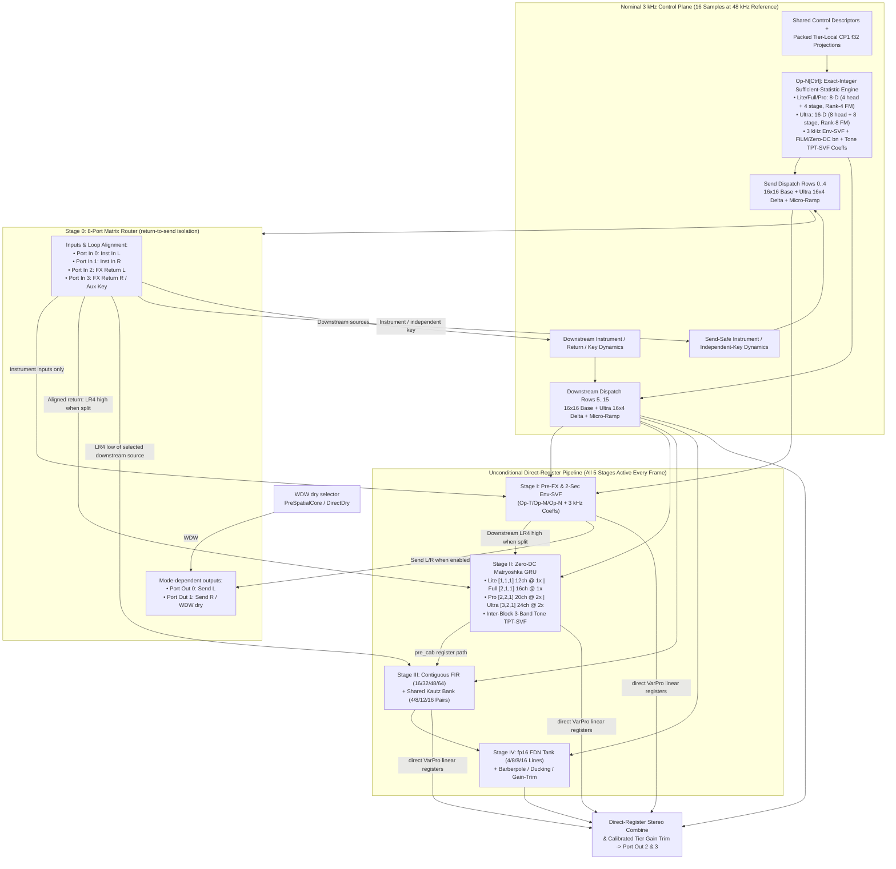
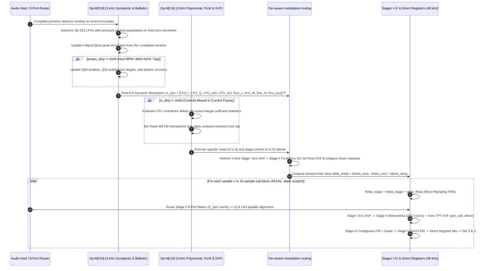
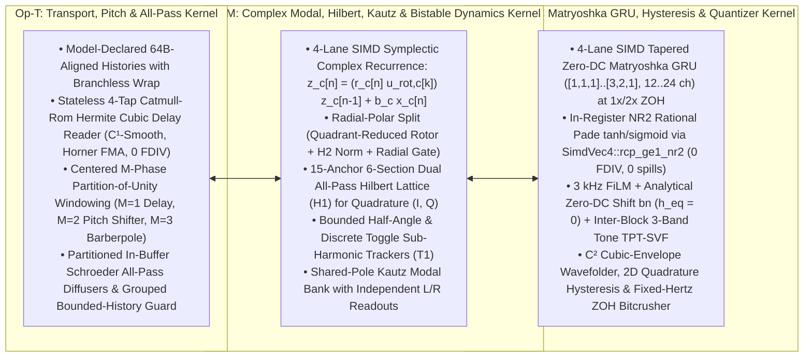
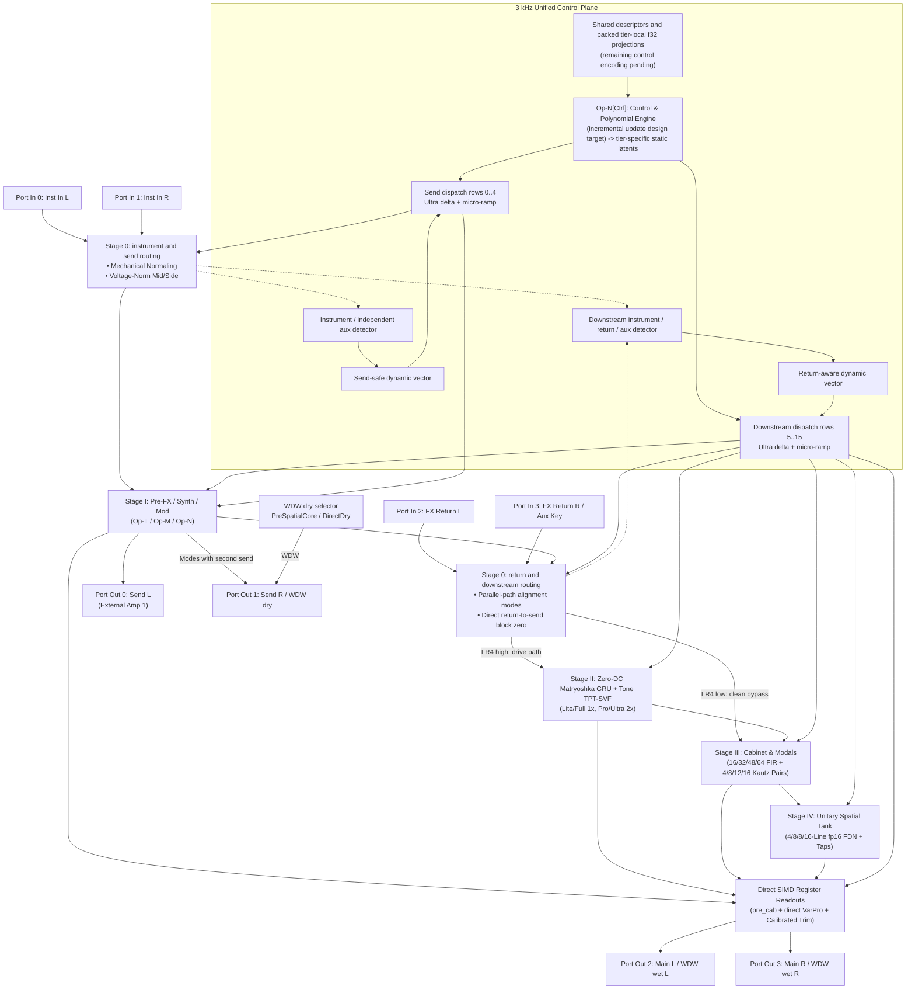
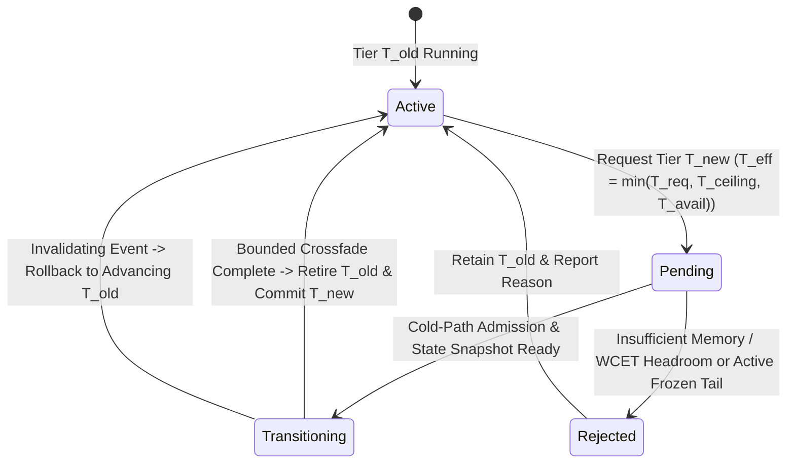
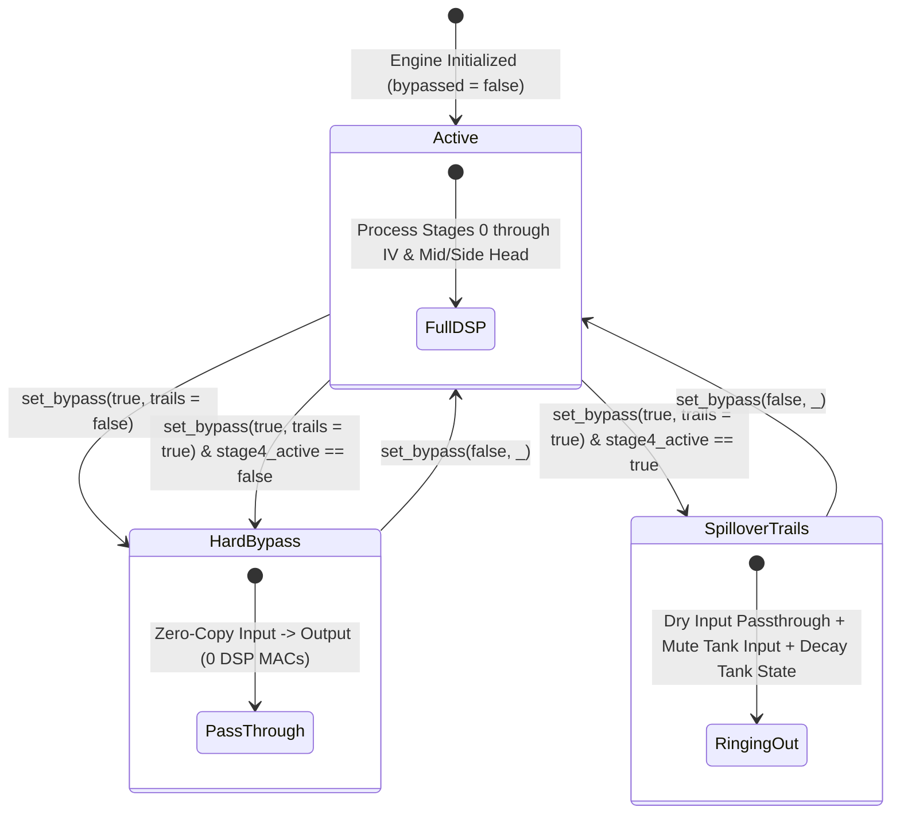
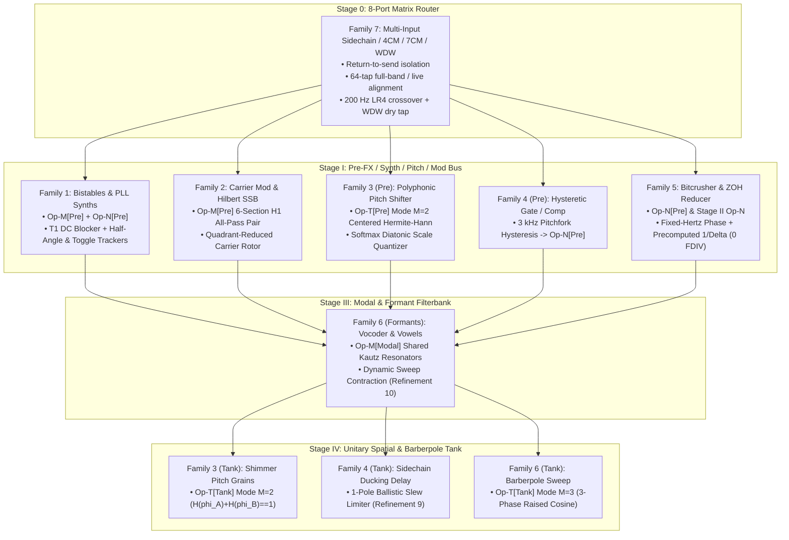

# Tri-Operator Recurrent Architecture (`TORA`) System Overview

This specification defines the **Tri-Operator Recurrent Architecture (`TORA` `v3`)** for **Dynamic Neural Audio Modeler (DNAM)** across [`packages/engine/`](../../../packages/engine/README.md) and [`packages/capture/`](../../../packages/capture/README.md). TORA unifies the modeling of all analog and digital audio gear across **three universal zero-`FDIV` SIMD operator kernels** (`Op-T`, `Op-M`, `Op-N`), an **8-Port Matrix Router** (`Stage 0`), a **Self-Similar 3 kHz Dual-Rate Control Plane**, and **four unconditionally active physical processing stages (`Stage I`–`Stage IV`) accumulating `pre_cab` and `direct` linear `VarPro` readouts directly in SIMD registers** (`0` stage-bypass flags, `0` `256-D` intermediate feature bus).

For implementation-agnostic requirements, see [`../../requirements/system_goals_and_requirements.md`](../../requirements/system_goals_and_requirements.md). For psychoacoustic quality tiers, see [`psychoacoustic_quality_and_tiers.md`](psychoacoustic_quality_and_tiers.md). For architectural decision records, see [`../../adr/0002-tri-operator-recurrent-architecture.md`](../../adr/0002-tri-operator-recurrent-architecture.md) and [`../../adr/0021-unified-matryoshka-gru-and-direct-register-stages.md`](../../adr/0021-unified-matryoshka-gru-and-direct-register-stages.md).

---

## 1. Executive Summary & Core Architectural Pillars

### 1.1 Four Foundational Pillars of `TORA`

The **Tri-Operator Recurrent Architecture (`TORA` `v3`)** unifies all physical audio hardware into **three universal zero-`FDIV` SIMD operator kernels** (`Op-T`, `Op-M`, `Op-N`) orchestrated across an **8-Port Matrix Router**, **four unconditionally active direct-register physical stages (`Stages I–IV`)**, and a **Unified Dual-Rate Self-Similar Control Plane**:

1. `r[arch.pillars.dual-space-control]` **Pillar 1: Dual-Space Factored Control Architecture:**  
   Factors kinematic/parametric `FiLM`, Zero-DC $b_n$, and inter-block `TPT-SVF` controls from shared `StarCenter` trajectories to support non-destructive Capture Vault stem refinement ([`../training/iterative_resume_and_caching.md` §1.2](../training/iterative_resume_and_caching.md#12-two-path-vault-editing--dependency-digests)).
2. `r[arch.pillars.dual-rate-plane]` **Pillar 2: Unified Self-Similar Dual-Rate Control Plane (`Op-M[Ctrl]` & `Op-N[Ctrl]`):**  
   Executes the control plane using the `Op-M` and `Op-N` kernels at a 16-sample stride at the `48 kHz` reference rate (`3 kHz`), decimated Stage I `Env-SVF` & Stage II `FiLM` / Zero-DC / `TPT-SVF` coefficient updates, and the rate-dependent stride $K_{\text{ctrl}}(f_{s,\text{eff}})$ at other effective rates ([router §9](../dsp/router_and_stages_topology.md#9-continuous-time-zero-order-hold-zoh-sample-rate-adaptability-44196-khz--4-bounce)).
3. `r[arch.pillars.cp1-projections]` **Pillar 3: Shared Control Descriptors & Tier-Local `CP1` Projections:**  
   Supports $P \ge 0$ physical controls using shared descriptors and packed tier-local `f32` projection slices ([`../containers/dnam_binary_format.md` §2.4](../containers/dnam_binary_format.md#packed-control-projection-profile)). `Lite`, `Full`, and `Pro` use `8-D` static latents (`4` head + `4` stage, Rank-4 FM); `Ultra` adds an `8-D` delta (`+4` head + `+4` stage, Rank-8 FM) and a `16 × 4` stage-dispatch delta in `Arena 3` ([`../dsp/parametric_control_bus.md` §2.3](../dsp/parametric_control_bus.md#23-o1-additive-latent-sufficient-statistic-control-scaling)).
4. `r[arch.pillars.universal-black-box]` **Pillar 4: Universal Trainable & Data-Programmable Black-Box Runtime (`REQ-1.9`):**  
   Executes a fixed, unconditional basis of general mathematical operators (`Op-T`, `Op-M`, `Op-N`, multi-section `TPT-SVF`, Matryoshka Zero-DC `GRU`, `FIR` + `Kautz` rational poles, `fp16` `FDN`, and `3 kHz` `ControlBus`) parameterized strictly by learned container weights and declarative coefficients—forbidding device-specific white-box sub-circuits, hardcoded crossover frequencies, conditional stage-bypass flags, and target-identity solver branches so newly encountered audio gear never requires engine modifications or major container version bumps.

### 1.2 The TORA Architectural Breakthrough



#### Dual-Rate (`48 kHz` Audio vs. `3 kHz` Control) TORA Execution Lifecycle

`r[arch.lifecycle.dual-rate]`

Host parameter updates apply at the control boundary in timestamp order, with DAW automation taking precedence over live Studio/MIDI on exact-timestamp ties ([control bus §1.1](../dsp/parametric_control_bus.md#host-automation-timing)):



#### Floating-Point Environment at the Audio Callback

`r[arch.fp.callback-env]`

All block-processing entry points enforce round-to-nearest, ties-to-even (`RNE`) with non-trapping floating-point exceptions and subnormal state protection via `FtzDazGuard`:

| Target Architecture | Hardware Control Register Policy (`FtzDazGuard`) |
| :--- | :--- |
| **`aarch64`** | Save `FPCR`; clear `RMode` bits `23:22` and exception trap-enable bits `8:12, 15`; set `FZ` bit `24`; if `AH` bit `1` is set (`FEAT_AFP`), set `FIZ` bit `0`; guard `FtzDazGuard::drop` with `cur_fpcr != self.prev_fpcr` to eliminate redundant `msr fpcr` pipeline flushes inside nested audio callbacks. Per-sample recursive-state software flushing (`flush_recursive_state_f32` / `flush_recursive_state_vec4`) compiles to a zero-cost no-op because hardware `FZ` is active throughout the callback. |
| **`x86_64`** | Save `MXCSR`; clear `RC` bits `14:13` and sticky flags `0:5`; set `FTZ` (`15`), `DAZ` (`6`), and exception masks `7:12`; restore saved `MXCSR` on exit. Per-sample recursive-state software flushing (`flush_recursive_state_f32` / `flush_recursive_state_vec4`) compiles to a zero-cost no-op because hardware `FTZ`/`DAZ` is active throughout the callback. |
| **WebAssembly / Portable** | Standard WASM enforces `RNE` with gradual underflow; apply branchless 4-lane `SimdVec4::flush_subnormal` (`v128` exponent-mask zeroing, `exp == 0 -> ±0.0f32`) in `flush_recursive_state_f32` / `flush_recursive_state_vec4` to persistent recursive-state writebacks while preserving sign, normals, infinities, and `NaN` payloads. |

#### Finite-Precision Range and Saturation Policy

`r[arch.fp.range-saturation]`

Every model and configuration guarantees an unclipped operating envelope of at least `±100.0` (`+40 dBFS` peak) simultaneously on all active audio inputs (`REQ-7.1`), and finite output/state safety for all finite `f32` inputs via the `±1e9` (`S = 1,000,000,000.0`) and `fp16` (`±65,504.0`) safety guards (`REQ-7.2`):

| Bit | Event Flag (`overflow_or_saturation_flags`) | Condition |
| :---: | :--- | :--- |
| `0` | `INPUT_SATURATED` | A processed audio input exceeded the `±1e9` safety ceiling. |
| `1` | `FP16_SATURATED` | A finite delay write exceeded `±65,504.0` (`0x7BFF` / `0xFBFF`). |
| `2` | `INTERNAL_SATURATED` | An intermediate or recursive-state safety guard clamped a value to `±1e9`. |
| `3` | `OUTPUT_SATURATED` | The processed output guard clamped a value to `±1e9`. |
| `4` | `OUTSIDE_CERTIFIED_INPUT` | An input exceeded the model's certified input envelope (`≥ ±100.0`). |
| `5` | `INVALID_NONFINITE` | A non-finite external sample, control, or parameter was detected and rejected. |

#### Wait-Free Telemetry Seqlock & Real-Time Host Concurrency

`r[arch.telemetry.seqlock-publication]`

Real-time host wrappers (`dnam_engine::host::DnamHostHandle`, [`../../adr/0015-realtime-host-concurrency-spsc-and-telemetry-seqlock.md`](../../adr/0015-realtime-host-concurrency-spsc-and-telemetry-seqlock.md)) decouple audio rendering callbacks from concurrent UI, MIDI, Studio, and TypeScript (`N-API` / `WASM`) control and telemetry threads in 100% safe `#![no_std]` + `alloc` Rust (`#[forbid(unsafe_code)]`):
1. **Wait-Free `AtomicU64` Seqlock (`TelemetryCell`):** `TelemetryWriter` packs `DnamTelemetrySnapshot` (`RawTelemetryRecord`) into a cache-line-aligned (`#[repr(align(64))]`) array of `29` `AtomicU64` words guarded by a monotonically advancing sequence counter `seq: AtomicU64` (`seq` odd before relaxed word stores, `Release` store `seq + 1` on completion). `TelemetryReader::read()` loads `seq1` (`Acquire`), copies the `29` atomic words, issues an `Acquire` fence, and verifies `seq1 == seq2` (with bounded retry and last-good snapshot fallback) without locking `DynamicDnamEngine`.
2. **Sub-Block SPSC Drain & Telemetry Publication:** `DnamHostHandle` drains the 3-Lane `SpscControlRing` (`ref[dsp.ctrl.op-m.spsc-ingress]`) at the start of every `64`-frame sub-block and publishes the updated `DnamTelemetrySnapshot` to `TelemetryCell` at sub-block exit, while `RealtimeEngineSwap` performs non-blocking ping-pong hot-swaps so retired `DynamicDnamEngine` instances are dropped exclusively on the non-real-time controller thread.

---

### 1.3 The 3 Universal Zero-FDIV SIMD Operator Kernels

`r[arch.operators.tri-kernel]`

Every analog, digital, and acoustic circuit in the audio production domain is spanned by three orthogonal mathematical operator kernels:



#### 2.0 Self-Similar Dual-Rate Kernel Architecture

`r[arch.operators.self-similar]`

| Universal Kernel | Audio-Rate Execution (`48 kHz` / `96 kHz` `2x`) | Control-Plane Execution (`3 kHz`, `f_s / K_ctrl`) | Shared SIMD Mechanism |
| :--- | :--- | :--- | :--- |
| **`Op-T` (Transport)** | Fractional delay ring buffer, pitch grains, all-pass diffusers | Integer-plus-`Q0.32` delay targets and inward `f32` reader bounds | Branchless wrap and Catmull-Rom Horner FMA |
| **`Op-M` (Symplectic Complex & Ballistics)** | Complex resonant filters, `H1` Hilbert SSB, Kautz modal bank, `Env-SVF` | `Q0.192` quadrature LFO rotors, `Q64`/`Q32` tempo phase, 4-Band block-peak envelopes & `Env-SVF` / `TPT-SVF` coeff updates | Quadrant-reduced contractive rotor, 1-pole ballistics & `SimdVec4` ZDF filter |
| **`Op-N` (Polynomials, `GRU` & Nonlinearities)** | Zero-DC Matryoshka `GRU` (`NR2` Padé `tanh`/`sigmoid`), `C²` wavefolder, bitcrushers | Packed `CP1` Lobatto/FM projections, exact-integer accumulator, `3 kHz` `FiLM` & `b_n`, outward trust clip | Branchless in-register `rcp_ge1_nr2` / FMA (`0` GPR spills) |

#### 2.4.1 SIMD Lane Packing (AVX2, ARM NEON & WebAssembly SIMD128)

`r[arch.simd.lane-packing]`

`TORA` organizes all 4-lane Matryoshka `GRU` hidden blocks, `Env-SVF`/`TPT-SVF` states, `fp16` delay conversions (`f32x4_to_fp16x4` / `fp16x4_to_f32x4`), and parameter matrices in **4-lane SIMD blocks** (`float32x4_t` in NEON, `v128` `f32x4` in WebAssembly `SIMD128`, half of `__m256` in AVX2) matching the nested tier pyramid (`[1, 1, 1]` = `3×` 4-lane blocks in `Lite`, `[2, 1, 1]` = `4×` in `Full`, `[2, 2, 1]` = `5×` in `Pro`, `[3, 2, 1]` = `6×` in `Ultra`):

```text
TORA v3 Tapered 3-Block 4-Lane Matryoshka GRU SIMD Hierarchy:
+--------------------+--------------------+--------------------+
| Block 0 (4-Lane B) | Block 1 (4-Lane B) | Block 2 (4-Lane B) | -> Tier / Mode
+--------------------+--------------------+--------------------+
| 1 x Vec4 (4 ch)    | 1 x Vec4 (4 ch)    | 1 x Vec4 (4 ch)    | -> Lite  [1,1,1] = 12 ch @ 1x (48 kHz)
| 2 x Vec4 (8 ch)    | 1 x Vec4 (4 ch)    | 1 x Vec4 (4 ch)    | -> Full  [2,1,1] = 16 ch @ 1x (48 kHz)
| 2 x Vec4 (8 ch)    | 2 x Vec4 (8 ch)    | 1 x Vec4 (4 ch)    | -> Pro   [2,2,1] = 20 ch @ 2x (96 kHz)
| 3 x Vec4 (12 ch)   | 2 x Vec4 (8 ch)    | 1 x Vec4 (4 ch)    | -> Ultra [3,2,1] = 24 ch @ 2x (4x Bounce)
+--------------------+--------------------+--------------------+
```

| Tier | Tier Index | Stage II `GRU` Pyramid (`C_gru` ch @ Rate) | Stage III (`FIR` + Kautz Pairs) | Stage IV (`fp16` FDN Lines + Taps) |
| :--- | :---: | :--- | :---: | :---: |
| **`Lite`** | Tier `0` | `[1, 1, 1]` (`12` ch, `3` `Vec4` blks) @ `1x` | `16` FIR + `4` Kautz (`8` poles) | `4`-line FDN + `1` tap |
| **`Full`** | Tier `1` | `[2, 1, 1]` (`16` ch, `4` `Vec4` blks) @ `1x` | `32` FIR + `8` Kautz (`16` poles) | `8`-line FDN + `2` taps |
| **`Pro`** | Tier `2` | `[2, 2, 1]` (`20` ch, `5` `Vec4` blks) @ `2x` | `48` FIR + `12` Kautz (`24` poles) | `8`-line FDN + `4` taps |
| **`Ultra`** | Tier `3` | `[3, 2, 1]` (`24` ch, `6` `Vec4` blks) @ `2x` (`4x` bounce) | `64` FIR + `16` Kautz (`32` poles) | `16`-line FDN + `4` taps |

1. `r[arch.simd.two-level-traits]` **Two-Level SIMD Trait Hierarchy & Domain-Scoped Backend Traits ([`ADR-0019`](../../adr/0019-simd-kernel-architecture-and-realtime-execution-optimizations.md), [`ADR-0021`](../../adr/0021-unified-matryoshka-gru-and-direct-register-stages.md)):**
   - **Level 1 (`math/backend.rs`):** `SimdVec4` defines the portable 4-lane `f32` register abstraction—including broadcast lane multiply-accumulate `fma_lane::<const LANE: usize>` (`vfmaq_laneq_f32` on NEON), simultaneous stereo 4-lane horizontal reduction `horizontal_sum_pair(v0, v1) -> (f32, f32)` (`vpaddq_f32` on NEON, `_mm_hadd_ps` on SSE3+/AVX2), interleaved stereo pair broadcast `splat_pair(a, b) -> [a, b, a, b]`, orthogonal pair swap `pair_swap_neg([v0, v1, v2, v3]) -> [-v1, v0, -v3, v2]`, in-register IEEE-754 exponential-halving inverse reciprocal `rcp_ge1_nr2`, fixed-latency 4-lane inverse square root `rsqrt_pos_nr2` and stereo pair `rsqrt_pos_pair_nr2` (backed by NEON `vrsqrteq_f32` / `vrsqrtsq_f32` on `aarch64`), and `flush_subnormal` (paired with `flush_recursive_state_vec4`)—while `MathBackend` (`Crc32cBackend`) provides $4\times 4$ matrix-vector tile accumulation `fma_mat4x4_vec4`, batch 4-lane IEEE-754 half-precision conversion `f32x4_to_fp16x4` / `fp16x4_to_f32x4` (`vcvt_f16_f32` / `vcvt_f32_f16` on NEON, `_mm_cvtps_ph` / `_mm_cvtph_ps` on `F16C`), hardware `CRC32C` (`__crc32cd`/`__crc32cb` on ARM64 `+crc`, `_mm_crc32_u64`/`_mm_crc32_u8` on `SSE4.2+`), `fast_unit_phasor`, and unfused 2-step Newton-Raphson `rsqrt_nr2_f32` / `rsqrt_nr2_pair_f32`.
   - **Level 2 (Domain-Scoped Backend Traits):** Higher-level DSP traits (`OpMBackend`, `OpNBackend`, `OpTBackend`, `Stage2Backend`, `Stage3Backend`, `StageBackend`, `EngineBackend`) are defined inside their respective domain modules (`operators/`, `stages/`, `engine/`) rather than `math/`, enforcing a strict one-way dependency DAG (`engine -> stages -> operators -> math`) while allowing `X86Avx2FmaBackend` and `ArmSmeBackend` to override wide multi-vector kernels (`dot16_stereo`, `step_stage2_stereo`, `tracker_exp_scales_f32`) with zero GPR spills.
2. `r[arch.simd.single-library-dispatch]` **Single-Library Per-Architecture Runtime SIMD Dispatch & `0.000000 ULP` Parity ([`ADR-0019`](../../adr/0019-simd-kernel-architecture-and-realtime-execution-optimizations.md)):**
   - Each target architecture compiles all of its ISA tiers into a single binary (`math/aarch64/{neon,sve2,sme}` on `aarch64`, `math/x86/{sse2,sse42,avx2}` on `x86_64`, `math/wasm.rs` on `wasm32`, plus `math/scalar.rs` fallback) using function-level `#[target_feature]` attributes and `AtomicU8`-cached runtime capability detection (`0 = Unchecked`, `1 = Unavailable`, `2 = Available`), dispatched once at engine construction via `DynamicDnamEngine`.
   - Where hardware fused multiply-add (`FMA`) vs. separate multiply-then-add would alter bit-exact rounding in non-FMA scalar reference formulas (such as the 2-step Newton-Raphson `rsqrt_nr2_pair_f32` step $\rho(1.5 - (0.5 r^2 \rho)\rho)$ in `Op-M` `T1`), all SIMD backends execute unfused IEEE-754 multiply and subtract instructions (`vmulq_f32`/`vsubq_f32`, `_mm_mul_ps`/`_mm_sub_ps`, `f32x4_mul`/`f32x4_sub`) to guarantee `0.000000 ULP` bit parity across `ScalarBackend`, `NeonBackend`, `ArmSve2Backend`, `ArmSmeBackend`, `X86Sse2Backend`, `X86Sse42Backend`, `X86Avx2FmaBackend`, and `WasmSimd128Backend`.
3. `r[arch.simd.zero-stall-lowering]` **Division-Free & `libm`-Free LLVM Lowering Rules (`REQ-6.2`, `REQ-6.3`, [`ADR-0019`](../../adr/0019-simd-kernel-architecture-and-realtime-execution-optimizations.md)):**
   - **Range Reduction Without `fmodf` or `while` Loops:** Never call `f32::rem_euclid` or `%` on floating-point values (which LLVM lowers to an external `bl _fmodf` `libm` call) or use data-dependent `while` loops for angle wrapping; always reduce angles via `k = floor_f32((theta + PI) * INV_TAU)` followed by `theta - k * TAU` (`INV_TAU = 1 / (2π)`).
   - **Ring & Block Indexing Without `IDIV`/`UDIV`:** Never use integer `/` or `%` (including `.is_multiple_of(runtime_len)`) on runtime struct fields in `48 kHz` or `3 kHz` paths; use power-of-two bitmasks (`idx & (N - 1)`), branchless single-step wrap `i + (L & -[i < 0])`, or incremental `(block_idx, in_block_offset)` counters.
   - **Division-Free Reciprocals & Square Roots:** Precompute reciprocals (`inv_xfade_denom`, `inv_sigma_knee`, `alpha_ramp`) on the cold or `3 kHz` setup path, and evaluate any dynamic reciprocals or square roots via exponent-seeded 6-step `f64` Newton-Raphson (`newton6_reciprocal_f64`) and Newton-Goldschmidt (`sqrt_f64`) with zero `FDIV` or `FSQRT` instructions.

#### 2.4.2 Differentiability and Gradient Dynamics

`r[arch.operators.differentiability]`

| Operator | Forward & Backward Mathematical Formulation |
| :--- | :--- |
| **1. `Op-T` (Continuous Fractional Delay)** | Horner Catmull-Rom derivative `∂d(τ)/∂μ = 3 c_3' μ² + 2 c_2' μ + c_1'` with coarse-to-fine Gaussian envelope surrogate gradient during delay identification. |
| **2. `Op-M` (Parallel Scan Recurrence)** | First-order complex recurrence admits an `O(log₂ L)` associative scan `(a₂, b̃₂) ∘ (a₁, b̃₁) = (a₂ a₁, a₂ b̃₁ + b̃₂)`. |
| **3. `Op-N` (Non-Smooth Surrogates & STE)** | Hard runtime forward `q̂(x) = sg[Q_B(x)] + (x - sg[x])` with grouped stop-gradient and optional 4-term Fourier backward surrogate ([Op-N §2.3](../dsp/op_n_commuted_cascade.md#23-family-5-precomputed-reciprocal-zoh-sample-rate-reducer--bitcrusher)). |

$$\frac{\partial d(\tau)}{\partial \mu} = 3 c_3' \mu^2 + 2 c_2' \mu + c_1', \qquad (a_2, \tilde{b}_2) \circ (a_1, \tilde{b}_1) = (a_2 a_1, a_2 \tilde{b}_1 + \tilde{b}_2), \qquad \hat q(x) = \mathrm{sg}[Q_B(x)] + \big(x - \mathrm{sg}[x]\big)$$

---

## 2. 4-Tier Slimmable SIMD Hierarchy (`Lite` / `Full` / `Pro` / `Ultra`)

### 2.1 Lower-Block-Triangular Arena Hierarchy

`r[arch.tiers.arena-hierarchy]`

Weights use a four-tier causally nested lower-block-triangular delta layout (`Arena 0..3`, `64 B`-aligned) engineered via **Inverted L1D-Resident Max-Quality Sizing** inside the `64 KiB` ARM Cortex-A76 L1D cache budget (`REQ-5.1`, `REQ-5.2`): `Lite` and `Full` run Stage II natively at `1×` (`48 kHz`) using continuous-time ZOH gate scaling while nested inside `2×` (`96 kHz`, `4×` bounce) `Pro` and `Ultra`, transient `14.8 KiB` kernel scratch lives on the audio callback stack (`0 B/instance`), cold `3 kHz` control params sit at the trailing tail of the hot engine state, and all five stages execute unconditionally on every stereo frame (`0` bypass flags).

| Parameter | `Lite` (`Arena 0`) | `Full` (`Arena 0..1`) | `Pro` (`Arena 0..2`) | `Ultra` (`Arena 0..3`) |
| :--- | :---: | :---: | :---: | :---: |
| **Cumulative `64 B`-Aligned Arena Ceiling** | `≤ 4,608 B` | `≤ 10,240 B` | `≤ 18,432 B` | `≤ 28,672 B` |
| **Stage I `Env-SVF` & Pre-FX Bus** | `2`-Sec ZDF + Pre-Bus | Prefix + Delta | Prefix + Delta | Prefix + Delta |
| **Stage II Zero-DC Matryoshka `GRU`** | `[1, 1, 1]` (`12` ch) @ `1×` | `[2, 1, 1]` (`16` ch) @ `1×` | `[2, 2, 1]` (`20` ch) @ `2×` | `[3, 2, 1]` (`24` ch) @ `2×` (`4×` bounce) |
| **Stage III Early FIR Taps (per ch)** | `16` (`128 B` slice) | `32` (`+128 B` = `256 B`) | `48` (`+128 B` = `384 B`) | `64` (`+128 B` = `512 B`) |
| **Stage III Shared Kautz Pole Pairs** | `4` pairs (`8` poles, `128 B`) | `8` pairs (`16` poles, `256 B`) | `12` pairs (`24` poles, `384 B`) | `16` pairs (`32` poles, `512 B`) |
| **Stage IV Tank Lines (`fp16`) & Taps** | `M = 4` lines + `1` tap | `M = 8` lines + `2` taps | `M = 8` lines + `4` taps | `M = 16` lines + `4` taps |
| **Control Bus Latent Dim (`z_ctrl`)** | `8-D` (`4` + `4`, `R = 4`) | `8-D` (`4` + `4`, `R = 4`) | `8-D` (`4` + `4`, `R = 4`) | `16-D` (`8` + `8`, `R = 8`) |

### 2.2 Hardware & DSP Benchmark Summary

`r[arch.tiers.hardware-budget]`

Reference embedded serial pedalboard budgets on `1×` ARM Cortex-A76 core (`Rockchip RK3582 @ 2.4 GHz`, `20,833.33 ns/sample` raw period at `48 kHz`, **`16,667 ns/sample` usable budget under the `80%` real-time scheduling cap** including LV2 host dispatch and multi-instance cache spill, executing **all 5 DSP stages unconditionally on every stereo frame with zero bypass flags**, see [`../../requirements/system_goals_and_requirements.md` §7](../../requirements/system_goals_and_requirements.md#7-goal-6--real-time-commodity-hardware-budget--execution-constraints)):

| Requirement | Reference Budget (`1×` Cortex-A76 @ `80%` RT Cap) |
| :--- | :--- |
| **`Lite` instances per embedded core** | `≥ 14×` serial at `48 kHz` (`≤ 1,190 ns/sample`, `N × HotBytes ≈ 62 KiB ≤ 64 KiB` L1D) |
| **`Full` instances per embedded core** | `≥ 8×` serial at `48 kHz` (`≤ 2,083 ns/sample`, `N × HotBytes ≈ 58 KiB ≤ 64 KiB` L1D) |
| **`Pro` instances per embedded core** | `≥ 4×` serial at `48 kHz` (`≤ 4,166 ns/sample`, `N × HotBytes ≈ 39 KiB ≤ 64 KiB` L1D) |
| **`Ultra` instances per embedded core** | `≥ 2×` serial at `48 kHz` (`≤ 8,333 ns/sample`, `N × HotBytes ≈ 52 KiB ≤ 64 KiB` L1D) + Desktop RT & `4×` Bounce |
| **Real-time loop instruction invariant** | Zero pipeline-stalling `FDIV`, `FSQRT`, `IDIV`/`UDIV`/`SDIV`, `libm`/`fmodf`, unbounded loops, or nondeterministic calls (`REQ-6.2`, `REQ-6.3`) |

**Measured Worst-Case All-Stages-Active Desktop NEON (`realtime_wcet`) & RK3582 Scaling Model:**

In standalone desktop `ARM64 NEON` worst-case stereo WCET benchmarking (`cargo bench -p dnam-engine --bench realtime_wcet` with **all 5 DSP stages active unconditionally**, `0` bypass flags, stack-allocated scratch, `SimdVec4::rcp_ge1_nr2`, and guarded `FtzDazGuard`), measured stereo frame times $t_{\text{bench}}(t)$ are **`158.64 ns` (`Lite`)**, **`196.97 ns` (`Full`)**, **`452.70 ns` (`Pro`)**, and **`531.14 ns` (`Ultra`)**, clearing the tight desktop ceilings (`≤ 220 / 300 / 500 / 700 ns`) and validating serial chains (`14x Lite = 283.9 us P50`, `8x Full = 201.3 us P50`, `4x Pro = 230.5 us P50`, `2x Ultra = 134.9 us P50` vs. `2,666.67 us` block budget). On **Rockchip RK3582** (`2× Cortex-A76 @ 2.4 GHz` with `64 KB` L1D / `512 KB` L2 per core), per-instance frame latency $t_{\text{A76+LV2}}(t, B)$, utilization $u_{\text{core}}(t, B)$, and safe serial instance count $N_{\text{safe}}(t, B)$ for block size $B \in [64, 128]$ are modeled as:

$$t_{\text{A76+LV2}}(t, B) = \kappa_{\text{cache}} \left(\alpha_{\text{uarch}}(t) \cdot t_{\text{bench}}(t) + \frac{T_{\text{LV2-block}}}{B}\right), \qquad u_{\text{core}}(t, B) = \frac{t_{\text{A76+LV2}}(t, B)}{T_{\text{sample}}}, \qquad N_{\text{safe}}(t, B) = \left\lfloor \frac{\eta_{\text{RT}}}{u_{\text{core}}(t, B)} \right\rfloor$$

1. **Microarchitectural Scaling ($\alpha_{\text{uarch}}(t)$):** Scales desktop wide-issue Apple Silicon NEON timings (`~3.8 GHz`, `4× 128-bit` pipes) to a single **Cortex-A76 @ `2.4 GHz`** (`2× 128-bit` NEON FMA pipes, `19.2 GFLOP/s` peak/core), keeping hot state inside `64 KiB` L1D via stereo `4×4` weight-tile reuse and stack scratch eviction.
2. **Amortized LV2 Host Dispatch ($T_{\text{LV2-block}} / B \approx 50\text{–}120\text{ ns/frame}$):** Accounts for `LV2_Descriptor::run()`, nested `FtzDazGuard` check (`cur_fpcr != self.prev_fpcr` eliminates redundant flushes), `LV2_Atom_Sequence` automation, and port buffer routing.
3. **L1D Residency at `N × HotBytes <= 64 KiB` ($\kappa_{\text{cache}} \approx 1.05\text{–}1.15$):** Keeping all `14× Lite` (`~62 KiB`), `8× Full` (`~58 KiB`), `4× Pro` (`~39 KiB`), and `2× Ultra` (`~52 KiB`) hot weights & states resident inside Cortex-A76's `64 KiB` L1D avoids L2/L3 cache-spill jitter spikes.
4. **Real-Time Scheduling Headroom ($\eta_{\text{RT}} = 0.80$):** Caps usable DSP allocation at `80%` (`16,667 ns/sample`), reserving `20%` margin for ALSA/DMA interrupts and OS jitter.

| Tier Profile | Measured Desktop NEON (`t_bench` / Gate) | `N × HotBytes` vs `64 KiB` L1D | Est. RK3582 `1× A76` + LV2 | Normative Serial Core Budget (`1× A76` @ 80% RT Cap) | Safe Serial (`2× A76` Cores) |
| :--- | :---: | :---: | :---: | :---: | :---: |
| **`Lite` (`[1,1,1]` @ `1×`, `16` FIR, `4` Kautz, `4` FDN)** | **`158.64 ns`** (`≤ 220 ns`) | `14 × ~4.5 KiB ≈` **`62 KiB`** (`Arena ≤ 4,608 B`) | `~540–890 ns` (`2.6–4.3%`) | **`≥ 14×`** (`≤ 1,190 ns/sample`) | **`≥ 28×`** |
| **`Full` (`[2,1,1]` @ `1×`, `32` FIR, `8` Kautz, `8` FDN)** | **`196.97 ns`** (`≤ 300 ns`) | `8 × ~7.2 KiB ≈` **`58 KiB`** (`Arena ≤ 10,240 B`) | `~850–1,350 ns` (`4.1–6.5%`) | **`≥ 8×`** (`≤ 2,083 ns/sample`) | **`≥ 16×`** |
| **`Pro` (`[2,2,1]` @ `2×`, `48` FIR, `12` Kautz, `8` FDN)** | **`452.70 ns`** (`≤ 500 ns`) | `4 × ~9.8 KiB ≈` **`39 KiB`** (`Arena ≤ 18,432 B`) | `~1,850–2,850 ns` (`8.9–13.7%`) | **`≥ 4×`** (`≤ 4,166 ns/sample`) | **`≥ 8×`** |
| **`Ultra` (`[3,2,1]` @ `2×`, `64` FIR, `16` Kautz, `16` FDN)** | **`531.14 ns`** (`≤ 700 ns`) | `2 × ~26 KiB ≈` **`52 KiB`** (`Arena ≤ 28,672 B`) | `~2,400–3,700 ns` (`11.5–17.8%`) | **`≥ 2×`** (`≤ 8,333 ns/sample`) + Desktop / `4×` Bounce | **`≥ 4×`** |

**Prior-Art Equivalent-Quality LV2 Instance Comparison on `1× RK3582 Cortex-A76` (`2.4 GHz`, `48 kHz` + LV2 @ `80%` RT Cap):**

When comparing plugin instance budgets on an embedded Linux LV2 host (such as Darkglass Anagram / MOD / Elk on Rockchip RK3582), **LV2 plugin and host-graph overhead** compounds across per-block dispatch (`T_LV2-block / B`), dual mono-to-stereo duplication (`2×` instances consume `406.2 KB` in stereo `NAM A2 Standard`), and multi-block `4–7×` full-rig chaining, whereas `DNAM` executes a complete true-stereo hardware rig in **one unified LV2 instance**:

| Architecture & Equivalent Quality Tier | Native LV2 Topology | Per-Instance Compute, Cache & LV2 Overhead on `Cortex-A76` (`64 KB` L1D / `512 KB` L2) | Est. `1× A76` CPU / LV2 Instance | Est. Safe Mono LV2 Instances (`1× A76` @ 80% Cap) | Est. Safe Stereo LV2 Chains (`1× A76` @ 80% Cap) | Est. Complete Stereo Rigs (`Drive+Amp+Cab+FX` on `1× A76`) |
| :--- | :---: | :--- | :---: | :---: | :---: | :---: |
| **Factory "Grey-Box" Multi-FX Blocks** (C++ LUTs + `2×–8×` OS Newton–Raphson + FFT Cab + FDN) | Per-block mono/stereo (`4–7×` blocks per rig) | Decoupled sub-circuits (`1D`/`2D` LUTs, `1`-step NR, per-block oversampling filters, FFT/FIR cab, FDN tank) + `4–7×` host block dispatch & L1I/L1D eviction | `2.0% – 6.0%` per single block (`14.0% – 26.0%` per `5–7` block stereo rig) | `15 – 35×` single blocks | `12 – 25×` single stereo blocks | `3 – 5×` full rigs (`5–7` chained blocks each) |
| **`NAM A2 Standard / Full` (Studio Grade)** | Mono LV2 (`2×` LV2s for stereo) | `~12,146` MACs (23 dilated conv layers) + `203.1 KB` state (`> 3.1×` L1D; `2` instances spill `512 KB` L2 to L3/DRAM) + C++ `Eigen` & LV2 port/trim overhead | `16.0% – 22.0%` (mono)<br/>`32.0% – 44.0%` (stereo pair) | `3 – 5×` mono LV2s | `1 – 2×` stereo pairs (`2–4` LV2s) | `1 – 2×` full rigs (`4–6` chained LV2s each) |
| **`NAM A2 Lite / Feather` (Live Grade)** | Mono LV2 (`2×` LV2s for stereo) | `~1,871` MACs at `75%` NEON utilization (`C = 3` unaligned loops) + `76.2 KB` state (`> 64 KB` L1D) + LV2 port/trim wrapper overhead | `6.5% – 9.0%` (mono)<br/>`13.0% – 18.0%` (stereo pair) | `8 – 12×` mono LV2s | `4 – 6×` stereo pairs (`8–12` LV2s) | `3 – 4×` full rigs (`4–6` chained LV2s each) |
| **`GuitarML Proteus` (`LSTM-40`, 1–2 Knobs)** | Mono LV2 (`2×` LV2s for stereo) | `~6,560–7,040` serial recurrent MACs + `160×` `sigmoid`/`tanh` `libm` calls/sample + `48 kHz` LV2 knob port smoothing (`+40·P` MACs static) + LV2 dispatch | `12.0% – 17.0%` (mono)<br/>`24.0% – 34.0%` (stereo pair) | `4 – 6×` mono LV2s | `2 – 3×` stereo pairs (`4–6` LV2s) | `2 – 3×` full rigs (`4–6` chained LV2s each) |
| **`NAM ParametricOD` (3-Knob WaveNet/LSTM)** | Mono LV2 (`2×` LV2s for stereo) | Dilated conv / LSTM stack + `48 kHz` per-sample `FiLM` knob projections (`+2·C·P` MACs/layer when static) + `tanh` + LV2 control port smoothing | `18.0% – 25.0%` (mono)<br/>`36.0% – 50.0%` (stereo pair) | `3 – 4×` mono LV2s | `1 – 2×` stereo pairs (`2–4` LV2s) | `1 – 2×` full rigs (`4–6` chained LV2s each) |
| **`DNAM Full` (True Studio Quality)** | **True Stereo LV2 (`1×` unified LV2)** | **`[2,1,1]` `16`-ch `GRU` @ `1×`, `32` FIR + `8` Kautz + `8`-line FDN, L1D-resident across `8×` serial chains, `0` static control MACs, `0` `FDIV`/`FSQRT`/`libm`** | **`4.1% – 6.5%` (true stereo)** | **`8+` LV2s (`12–19×` est.)** | **`8+` true-stereo LV2s (`12–19×` est.)** | **`8+` complete stereo rigs (`1` LV2 each)** |
| **`DNAM Lite` (Live / Pedalboard Grade)** | **True Stereo LV2 (`1×` unified LV2)** | **`[1,1,1]` `12`-ch `GRU` @ `1×`, `16` FIR + `4` Kautz + `4`-line FDN, L1D-resident across `14×` serial chains, `0` static control MACs, `0` `FDIV`/`FSQRT`/`libm`** | **`2.6% – 4.3%` (true stereo)** | **`14+` LV2s (`18–29×` est.)** | **`14+` true-stereo LV2s (`18–29×` est.)** | **`14+` complete stereo rigs (`1` LV2 each)** |

### 2.3 State RAM Audit: Lite Budget

`r[arch.tiers.state-ram]`

| Raw State Component | `Lite` | `Full` | `Pro` | `Ultra` |
| :--- | :---: | :---: | :---: | :---: |
| **Stage III L/R FIR Histories (`f32`)** | `128 B` | `256 B` | `384 B` | `512 B` |
| **Stage III L/R Complex Modal States (`f32`)** | `64 B` | `128 B` | `192 B` | `256 B` |
| **Stage III Array Subtotal** | `192 B` | `384 B` | `576 B` | `768 B` |
| **Stage II `GRU` Hidden State (`12..24` ch L+R `f32`)** | `96 B` | `128 B` | `160 B` | `192 B` |
| **Transient Kernel Scratch (`V3KernelScratch`)** | Stack (`0 B`/inst) | Stack (`0 B`/inst) | Stack (`0 B`/inst) | Stack (`0 B`/inst) |
| **Static-Control Sufficient-Statistic Accumulator** | `64 B` | `64 B` | `64 B` | `128 B` |
| **Stage I / IV Delay Ring Histories (`fp16`)** | Model-declared | Model-declared | Model-declared | Model-declared |

### 2.4 Computational Efficiency & Verification

`r[arch.tiers.efficiency]`

All five DSP stages (`Stage 0`, `Stage I`, `Stage II`, `Stage III`, `Stage IV`) execute unconditionally on every stereo sample (`0` stage-bypass flags), with transient kernel scratch allocated on the audio callback stack (`0 B` per instance). Mono (`1 → 1`, `2 → 1`) output topologies emit the phase-coherent Mid readout while retaining dual-channel internal stage histories. All inline and cold-allocated state is admitted against the host memory ceiling before activation with zero real-time heap allocation.

---

## 3. Canonical Signal Flow & 4-Stage Topology Overview

### 3.1 Detailed Signal Flow & Stage Boundaries

`r[arch.topology.signal-flow]`

TORA organizes all real-time processing into four canonical physical stages coordinated by an 8-Port Matrix Router front-end, mirroring the physical topology of complete professional rig setups:



---

### 3.2 Stage 0: 8-Port Matrix Router & Voltage-Normalized Mid/Side

`r[arch.topology.stage0-router]`

Stage 0 provides 4 input ports and 4 output ports:
- **Port In 0..1:** Instrument In Left / Right.
- **Port In 2..3:** FX Loop Return Left / Right (or Aux Key).
- **Port Out 0:** FX Loop Send Left / optional mono WDW send.
- **Port Out 1:** FX Loop Send Right, or center dry in WDW.
- **Port Out 2..3:** Main Out Left / Right; wet-only L/R in WDW.

In WDW mode (`PreSpatialCore` or `DirectDry`), Port Out 1 carries the center dry tap while Ports Out 2/3 carry the stereo wet output and Port Out 0 provides an optional mono send. A zero $\mathbf{S}_{\text{ret}\to\text{send}}$ matrix block and partitioned detector/dispatch routing isolate external sends from return-derived feedback (see [router §1](../dsp/router_and_stages_topology.md#1-stage-0-8-port-matrix-router-req-74)). Mid/Side channels are voltage-normalized ($x_{\text{mid}} = 0.5(L+R), x_{\text{side}} = 0.5(L-R)$) for unity-gain reconstruction.

### 3.3 Gated RMS Auto-Unity Leveling & Per-Tier Loudness Parity

`r[arch.topology.auto-unity-leveling]`

Auto-unity leveling (`io_config.leveling`) anchors at the declared default control settings. Pre-stored linear tier gain trims (`tier_gain_trim_lin`) maintain calibrated per-tier loudness parity across `Lite`, `Full`, `Pro`, and `Ultra` without runtime division or transcendental calls.

#### On-Demand Tier Transition Contract

`r[arch.tiers.transition-contract]`

Runtime tier changes use **on-demand state transfer and a bounded parallel crossfade** rather than continuously stepping inactive tiers:



1. **Request & Admission:** Track the requested tier, effective target $\min(t_{\text{req}}, t_{\text{ceiling}}, t_{\text{avail}})$, active tier, and transition status (`pending`, `transitioning`, `completed`, `rejected`). Admit a transition only after verifying state compatibility, stable latency, prepared memory, and worst-case callback headroom.
2. **State Preparation:** Prepare target weights, transition buffers, and crossfade ramps off the audio thread, transferring compatible recursive, delay, control, and tempo state from a sample-aligned snapshot.
3. **Active Tail Preservation:** Never silently reset or drop an active delay, modal, autonomous, or frozen tail; defer or reject a down-tier request if the target tier cannot retain an active contribution.
4. **Parallel Render & Handoff:** Advance both old and target paths with time-aligned inputs and control events across a bounded precomputed crossfade, retiring the old path and committing the target tier only after the final fade sample.

### 3.4 Spillover Trails State Machine

`r[arch.topology.spillover-trails]`

When bypassing an active rig with `trails = true`, Stage IV Spatial Tank continues ringing out its tail while input injection is muted:



### 3.5 $4\times$ ZOH Polyphase Oversampling on Offline Bounce

`r[arch.bounce.oversampling]`

When a DAW host renders offline (`is_offline_bounce == true`):
1. **Tier Promotion:** When `maximize_tier_on_bounce` is enabled, promote to $t_{\text{bounce}} = \min(t_{\text{avail}}, t_{\text{max-sup}})$.
2. **Polyphase Oversampling:** Step the ZOH-rescaled engine at $4 f_s$ through a 2-stage linear-phase half-band polyphase upsampler/downsampler ($>95\text{ dB}$ stopband attenuation, `12` host samples oversampler PDC).
3. **Alignment Promotion:** Promote active parallel-alignment groups to `FullBand64Tap` (`31` host samples centering offset, `43` host samples combined nominal PDC with the oversampler; see [router §1](../dsp/router_and_stages_topology.md#parallel-path-sub-sample-alignment)).
4. **Live State Isolation:** Execute offline bounce on an isolated state or restore live monitoring state and tier upon completion without disturbing active histories.

---

## 4. Coverage of the 7 Goal 1 Hardware Families

`r[arch.families.coverage]`



| Family | Hardware Archetypes | TORA Stage & Operator Mapping | Core Zero-`FDIV` Audio-Rate Formulation | Differentiable Training Surrogate | Acceptance Criterion |
| :--- | :--- | :--- | :--- | :--- | :--- |
| **Family 1: Bistables & PLL Synths** | Boss OC-2, Mu-Tron Octave Divider, Schumann PLL | **Stage I:** `Op-M[Pre]` + `Op-N[Pre]` | `T1` `5 Hz` DC blocker, scaled `rsqrt`, half-angle (`cos`, `sin`) and toggle (`f/2`, `f/4`) trackers | Hard-forward tracker with surrogate gradient | Sub-octave frequency/amplitude tracking and zero DC offset |
| **Family 2: Carrier Mod & Hilbert SSB** | Moog MF-102 Ring Mod, Bode 735 Frequency Shifter | **Stage I:** `Op-M[Pre]` | 15-anchor 6-section `H1` all-pass pair + quadrant-reduced carrier rotor | Phase-insensitive demodulated STFT loss `L_carrier(ω_c)` | SSB rejection `≥ 42.0 dB` across `100 Hz–10 kHz` (`≤ 0.34°` quadrature error) |
| **Family 3: Polyphonic & Scale Pitch Shifters** | Eventide H3000, DigiTech Whammy, EHX POG | **Stage I** (`Op-T[Pre]`) & **Stage IV** (`Op-T[Tank]`) | Centered `M = 2` Hermite-Hann grains, 4-tap Catmull-Rom, `±24` st pitch/warp profile | Continuous Softmax Diatonic Scale Quantizer + Catmull-Rom `∂d/∂μ` | Pitched chord THD+N `≤ -68 dB` and click-free sweep transitions |
| **Family 4: Hysteretic Dynamics & Ducking** | Boss NS-2, SG-1 Slow Gear, UREI 1176LN, SPL Transient, TC 2290 | **`3 kHz` Control Bus** → `Op-N[Pre]` & `Op-T[Tank]` VCA | Supercritical pitchfork hysteresis map `h[k]`, monotone `f32` `log₂`/`exp₂` lookup, 1-pole ballistic slew (`τ_att ≥ 0.5 ms`, `τ_rel ≥ 20 ms`) | Differentiable pitchfork derivative `∂h/∂e = (1/τ_h)σ'(u)` + `ln(x + ε)` | Silence noise floor reduction `≥ 72 dB`; zero gate chatter |
| **Family 5: Bitcrushers & ZOH Reducers** | E-mu SP-1200, WMD Geiger Counter | **Stage I** (`Op-N[Pre]`) & **Stage II** (`Op-N`) | Nearest-step quantizer (halfway ties to `+∞`) + fixed-hertz integer ZOH phase (`0 FDIV`) | Hard runtime forward + grouped STE / 4-term Fourier backward surrogate | Exact dyadic boundary rounding and full-rate/fractional latch parity |
| **Family 6: Vocoders, Formants & Barberpole** | EMS Vocoder 2000, EHX Talking Pedal, Maestro Stage Phaser | **Stage III** (`Op-M[Modal]`) & **Stage IV** (`Op-T[Tank]`) | Shared Kautz modal poles, dynamic sweep contraction, `M = 3` barberpole and Givens/Householder mixing | Log-spectral formant envelope loss `L_formant` + continuous Catmull-Rom | Vowel formant peaks (`F₁, F₂, F₃`) within `±0.4 dB` |
| **Family 7: Multi-Input Sidechain / 4CM / 7CM / WDW** | Dual-amp 4CM/7CM loops, keyed gates/ducks, WDW center dry rigs | **Stage 0: 8-Port Matrix Router** + Stage I/IV Partition | Return-to-send isolation, `200 Hz` TPT LR4 split, 64-tap sub-sample alignment, and WDW dry tap | Decoupled dual-target multi-task loss `L_4CM = λ_pre L_pre + λ_post L_post` | Crossover passband ripple `≤ 0.05 dB` and isolated send paths |

### 4.1 Family 1: Bistables & PLL Guitar Synthesizers

`r[arch.families.f1-bistables]`

- **Analog Archetypes:** Boss OC-2, Mu-Tron Octave Divider, Schumann PLL (CMOS 4013 dual D-flip-flops generating $f_0/2, f_0/4$ sub-octaves and 4046 VCO PLL tracking).
- **TORA Realization (`Stage I` `Op-M[Pre]` + `Op-N[Pre]`):** Applies the tracker-only `5 Hz` `T1` DC blocker, scaled exponent-split envelope normalization, independent `prev_i_nonpositive` axis-crossing detection, smooth half-angle quadratures (`cos`, `sin`), and divider square features (`f/2`, `f/4`) routed into the direct-register Stage I readout ([`op_m_modal_kautz.md` §3](../dsp/op_m_modal_kautz.md#3-family-1-sub-harmonic-synthesizers-bistable-dividers--pll-tracking), [router §7](../dsp/router_and_stages_topology.md#7-unified-256-d-4-tier-kronecker-output-head)).

### 4.2 Family 2: Audio-Rate Carrier Modulation & Hilbert SSB

`r[arch.families.f2-hilbert-ssb]`

- **Analog Archetypes:** Moog MF-102 Ring Modulator, Bode 735 Frequency Shifter (4-quadrant multiplier and Weaver dual $90^\circ$ dome filter).
- **TORA Realization (`Stage I` `Op-M[Pre]`):** Uses the 6-section all-pass pair with the 15-anchor `H1` rate table (`≤ 0.34°` quadrature phase error across `100 Hz–10 kHz`) and the quadrant-reduced contractive carrier rotor (see [`op_m_modal_kautz.md` §2](../dsp/op_m_modal_kautz.md#2-family-2-hilbert-ssb-lattice--carrier-modulation)).

### 4.3 Family 3: Polyphonic Phase-Locked & Intelligent Scale Pitch Shifters

`r[arch.families.f3-pitch]`

- **Analog Archetypes:** Eventide H3000, DigiTech Whammy, EHX POG.
- **TORA Realization (`Stage I` `Op-T[Pre]` & `Stage IV` `Op-T[Tank]`):** Uses the centered grain-duration construction with partition-of-unity cubic Hermite-Hann windows ($u = 1 - |2\phi - 1|$, $H(\phi) = u^2(3 - 2u)$, $H(\phi_A) + H(\phi_B) \equiv 1$), 4-tap Catmull-Rom delay reads with per-head causal floor $\tau_m \ge 4.0$, and the `-24..24` semitone control-rate pitch/warp profile ([control bus §5](../dsp/parametric_control_bus.md#pitch-ratio-and-time-warp-profile)).

### 4.4 Family 4: Hysteretic Dynamics, Noise Gates, Limiters & Ducking

`r[arch.families.f4-dynamics]`

- **Analog Archetypes:** Boss NS-2, Boss SG-1 Slow Gear, UREI 1176LN, SPL Transient Designer, TC 2290.
- **TORA Realization (`3 kHz` Control Bus → `Op-N[Pre]` & `Op-T[Tank]` VCA):** Evaluates the supercritical pitchfork bifurcation hysteresis map $h[k] = \sigma\big((e[k] - \theta_{\mathrm{mid}})/\tau_h + \kappa(2 h[k-1] - 1)\big)$, monotone `f32` $\log_2$ lookup ([control bus §5](../dsp/parametric_control_bus.md#monotone-f32-log-envelope-lookup-profile)), and 1-pole ballistic slew limiting ($\tau_{\mathrm{attack}} \ge 0.5\text{ ms}, \tau_{\mathrm{release}} \ge 20.0\text{ ms}$) with audio-rate linear gain micro-ramping.

### 4.5 Family 5: Sample-Rate Reducers, Bitcrushers & Non-Smooth Digital Quantizers

`r[arch.families.f5-bitcrusher]`

- **Analog Archetypes:** E-mu SP-1200, WMD Geiger Counter.
- **TORA Realization (`Stage I` `Op-N[Pre]` & `Stage II` `Op-N`):** Evaluates the uniform nearest-step quantizer $Q_B(x) = \lfloor x 2^{B-1} + 0.5 \rfloor 2^{-(B-1)}$ (halfway ties toward $+\infty$) and the fixed-hertz integer ZOH phase accumulator with pre-reduction carry detection and division-free `u128` reciprocal rate transfer ([Op-N §2.3](../dsp/op_n_commuted_cascade.md#23-family-5-precomputed-reciprocal-zoh-sample-rate-reducer--bitcrusher)).

### 4.6 Family 6: Multi-Band Vocoders, Formant Vowels & Barberpole Tank

`r[arch.families.f6-formants]`

- **Analog Archetypes:** EMS Vocoder 2000, EHX Talking Pedal, Maestro Stage Phaser.
- **TORA Realization (`Stage III` `Op-M[Modal]` & `Stage IV` `Op-T[Tank]`):** Combines shared-pole Kautz resonators with dynamic sweep contraction ([`op_m_modal_kautz.md` §4.3](../dsp/op_m_modal_kautz.md#43-dynamic-sweep-contraction-rule-refinement-10)), 3-phase raised-cosine barberpole phase wrapping ($M=3$), and Givens/Householder unitary tank mixing.

### 4.7 Family 7: Multi-Input Sidechain / 4CM / 7CM / WDW Units

`r[arch.families.f7-multi-input]`

- **Analog Archetypes:** External amplifier loop insertion (4CM/7CM dual amps), auxiliary key sidechain detection, and Wet-Dry-Wet (WDW) rigs.
- **TORA Realization (`Stage 0: 8-Port Matrix Router`):** Enforces return-to-send isolation, `FullBand64Tap` / `Live16Tap` / `IntegerDelayOnly` parallel path alignment ([router §1](../dsp/router_and_stages_topology.md#parallel-path-sub-sample-alignment)), the `200 Hz` TPT LR4 clean/drive crossover ([router §1](../dsp/router_and_stages_topology.md#stage-0-lr4-cleandrive-crossover)), and `PreSpatialCore` / `DirectDry` WDW routing ([router §1](../dsp/router_and_stages_topology.md#wdw-dry-tap-and-wet-output-contract)).

---

## 5. Five End-to-End Trainer–Engine Isomorphism & Pipeline Guarantees

`r[arch.isomorphism.guarantees]`

TORA establishes five end-to-end capture–engine isomorphism and pipeline guarantees across [`packages/capture/`](../../../packages/capture/README.md) and [`packages/engine/`](../../../packages/engine/README.md) (for architectural rationale, see [`../../adr/0002-tri-operator-recurrent-architecture.md` §1](../../adr/0002-tri-operator-recurrent-architecture.md#1-context-five-structural-bottlenecks-in-conventional-neural-audio)):

| Guarantee ID | Subsystem Scope | TORA Architectural Realization |
| :--- | :--- | :--- |
| **1. Direct Stage Serialization (§5.1)** | Stage I/II (`stages/stage1_svf`, `stage2_gru`) | Directly serializes fitted Stage I `Env-SVF` & Stage II Zero-DC Matryoshka `GRU` (`[1,1,1]..[3,2,1]`, `FiLM`, `TPT-SVF`) weights into `Arena 0..3`. |
| **2. Joint Full-Rig Training (§5.2)** | `VarPro` + Windowed-BPTT (`packages/capture/src/solver/`) | Extracts rational physics (`Stage A`), trains 4-tier Matryoshka `GRU` via parallel Windowed-BPTT (`Stage B`, `< 6 s/chain`), solves `VarPro` readouts (`Stage C`), fits multi-knob `FiLM + CP1` (`Stage D`), and audits (`Stage E`). |
| **3. End-to-End 3-Phase Audit Wiring (§5.3)** | Audit Engine (`packages/capture/src/audit.rs`) | Wires pre-flight calibration, physical variance gates, non-stop 3-phase clamping, and `[STAB-ZERO-DC]` export certification into the training pipeline. |
| **4. True-Stereo Calibration & 8-Port Routing (§5.4)** | Stem Extractor & Router | Preserves 2-channel stem arrays `X ∈ R^(N×2)` (`[Left, Right]` or `[Main, Aux]`) with causal parallel alignment and return-to-send isolation. |
| **5. Nested 4-Tier Physical Hierarchy (§5.5)** | Direct-Register Hierarchy (`Arena 0..3`) | Evaluates nested `1x`/`2x` `GRU`, FIR (`16..64`), and Kautz (`4..16`) capacity (`<= 4,608..28,672 B`) alongside `uplo='U'` `STAT` statistics and `2.0–2.5 s` `fp32` capsules in `.dnam-proj`. |

### 5.1 Direct Stage II Commuted Cascade Serialization & Runtime Parity

`r[arch.isomorphism.stage2-serialization]`

Stage II serializes the fitted Zero-DC Matryoshka `GRU`, `3 kHz` `FiLM` + $b_n$ shift tables, inter-block `TPT-SVF` coefficients, and ZOH `1x`/`2x` calibration parameters directly into `Arena 0..3` using identical `NR2` Padé evaluations in training and runtime ([`../training/four_stage_pipeline.md` §4.1](../training/four_stage_pipeline.md#41-zero-ulp-engine-capture-isomorphism-parity)).

### 5.2 Joint Stage I–IV Full-Rig Training via Two-Sweep Block-Coordinate Cholesky

`r[arch.isomorphism.two-sweep]`

The **Analytical Variable-Projection, Windowed-BPTT & Cholesky Pipeline** ([`../training/four_stage_pipeline.md`](../training/four_stage_pipeline.md)) identifies upstream probes (`Stage A`), jointly fits the 4-tier Matryoshka `GRU` backbone + `2.0–2.5 s` `fp32` capsules (`Stage B`), and solves the direct-register `VarPro` linear readouts + multi-knob `FiLM` / `CP1` (`Stages C–E`), enabling single-run full-rig training (`REQ-1.5`).

### 5.3 Step-0 System-ID & Non-Stop 3-Phase Audit Wiring in `fit_job`

`r[arch.isomorphism.audit-wiring]`

The pipeline combines Step-0 calibration, variance gates, non-stop clamp phases (`[CLAMP-RANGE]`, `[CLAMP-SWITCH]`, `[CLAMP-STABILITY]`, `[CLAMP-RAIL]`, `[CLAMP-DYNAMIC]`), and head gain certification ([`../training/control_space_audit.md`](../training/control_space_audit.md)).

### 5.4 True-Stereo Input Preservation & 8-Port Matrix Router Execution

`r[arch.isomorphism.stereo-preservation]`

Stem extraction preserves 2-channel audio arrays $\mathbf{X} \in \mathbb{R}^{N \times 2}$ (`[Left, Right]` or `[Main, Aux]`) and enforces the physical port assignments, causal alignment, and send isolation of the 8-Port Matrix Router.

### 5.5 Nested 4-Tier Feature Bus Extraction (`Lite ⊂ Full ⊂ Pro ⊂ Ultra`)

`r[arch.isomorphism.nested-bus]`

TORA builds a nested 4-tier hierarchy matching `REQ-5` (`Lite` `[1,1,1] @ 1x`, `Full` `[2,1,1] @ 1x`, `Pro` `[2,2,1] @ 2x`, `Ultra` `[3,2,1] @ 2x`), persisting embedded runtime weights (`WGHT`), cached `StarCenter` trajectories, and tier-ordered `uplo='U'` sufficient statistics (`STAT`) inside `.dnam-proj` ([`../containers/project_container_format.md` §2.3](../containers/project_container_format.md#23-tier-ordered-upper-triangular-starcenter-statistics-stat)).

---

## 6. Summary of the 19 Architectural Refinements

`r[arch.refinements.summary]`

| # | Architectural Refinement | Target Subsystem | Mathematical / Structural Specification |
| :- | :--- | :--- | :--- |
| **1** | **Partitioned Schroeder All-Pass Buffer Segmentation** | Stage IV `Op-T[Tank]` | Non-overlapping `[0..L_main-1 ∣ L_main..L_main+L_ap-1]` segments with independent logical wrap ([Op-T §1 & §3](../dsp/op_t_transport.md#11-exact-sized-delay-histories-and-branchless-wrap)). |
| **2** | **Strictly Causal Stage II Delays & Early FIR Fitting** | Stage II & Stage III | Causal offsets (`d ≥ 0`) in Stage II and Stage III early FIR taps ([Op-N §3.2](../dsp/op_n_commuted_cascade.md#32-causality-audit--elimination-of-acausal-lookahead)). |
| **3** | **Inter-Block 3-Band `TPT-SVF` Tone Stack Basis** | Stage II | `3 kHz`-decimated trapezoidal SVF splitting low/mid/high energy between Matryoshka `GRU` blocks ([Op-N §4.1](../dsp/op_n_commuted_cascade.md#41-four-filter-tone-basis-refinement-3)). |
| **4** | **Two-Step Warped Laguerre/Kautz Modal Pole Extraction** | Stage III Trainer | Log-spaced initial eigenmodes (`40–4500 Hz`) with shared poles and independent L/R readouts ([`op_m_modal_kautz.md` §4.4](../dsp/op_m_modal_kautz.md#44-two-step-warped-laguerrekautz-modal-pole-extraction-refinement-4)). |
| **5** | **Slew-Rate Bounded Givens Rotation in Stage IV** | Stage IV `U(ψ, v)` | Bounds stereo rotation velocity to `∣Δψ∣ ≤ 0.05 rad/control tick` (`150 rad/s` at `3 kHz`). |
| **6** | **Topological Order Descriptors (`stage1_topology`)** | Stage I `Arena 0` | 4-bit bitfield selecting among the 4 canonical `Op-T`/`Op-M`/`Op-N` pre-chain permutations without buffer contention. |
| **7** | **LR4 Parallel Crossover & WDW Routing** | Stage 0 Router | `200 Hz` TPT LR4 clean/drive split and `PreSpatialCore`/`DirectDry` WDW output mapping ([router §1](../dsp/router_and_stages_topology.md#stage-0-lr4-cleandrive-crossover)). |
| **8** | **Stage I Sub-Harmonic DC Conditioning (`T1`)** | Family 1 → Stage I | Dedicated `5 Hz` TPT DC blocker before the analytic tracker pair ([`op_m_modal_kautz.md` §3](../dsp/op_m_modal_kautz.md#3-family-1-sub-harmonic-synthesizers-bistable-dividers--pll-tracking)). |
| **9** | **1-Pole Ballistic Slew Limiter on Sidechain Ducking Gains** | Family 4 Sidechain | `τ_attack ≥ 0.5 ms`, `τ_release ≥ 20.0 ms` eliminates zipper noise and transient chatter. |
| **10** | **Radial-Polar Rotor Contraction during Formant Sweeps** | Stage III Kautz | Dynamic sweep contraction `r_eff,m = min(r_m, max(0.25, 0.9950 - 0.15|Δθ_m|))` ([`op_m_modal_kautz.md` §4.3](../dsp/op_m_modal_kautz.md#43-dynamic-sweep-contraction-rule-refinement-10)). |
| **11** | **Lower-Triangular Direct-Register `VarPro` Readouts** | Stage II/III Readout | Nested tier readouts with precomputed `tier_gain_trim_lin` loudness matching. |
| **12** | **In-Register `NR2` Rational Padé & Zero-DC `b_n`** | Stage II `GRU` | Division-free `SimdVec4::rcp_ge1_nr2` Padé `tanh`/`sigmoid` with exact `h_eq = 0` rest equilibrium. |
| **13** | **Normalized Coupled-Form State-Space for Kautz Modals** | Stage III `Op-M[Modal]` | Coupled-form recurrence with forced-state bound `‖x[n]‖ ≤ r_max ‖x[n-1]‖ + ‖b_m‖ |u[n]|` ([`op_m_modal_kautz.md` §4.2](../dsp/op_m_modal_kautz.md#42-normalized-coupled-form-state-space-refinement-13)). |
| **14** | **Input Headroom Normalization & Denormal-Tail Handling** | Stage IV `Op-T[Tank]` | `-12 dB` tank input attenuation for `fp16` headroom plus guarded `FtzDazGuard` denormal immunity ([audio-block policy](#floating-point-environment-at-the-audio-callback)). |
| **15** | **Per-Head Causal Floor Margin `τ_m ≥ 4.0` Samples** | `Op-T` Multi-Tap Reader | Enforces `τ_m[n] = max(4.0, τ_raw,m[n])` independently per granular/barberpole read head. |
| **16** | **Return-to-Send Router Isolation** | Stage 0 8-Port Router | Enforces `S_{ret->send} == 0` and isolates send-path detectors/controls from returns. |
| **17** | **Parallel-Path Sub-Sample Alignment** | Stage 0 Router | `FullBand64Tap` (default/bounce), `LowLatency16Tap`, and `MinLatency4Tap` alignment modes ([router §1](../dsp/router_and_stages_topology.md#parallel-path-sub-sample-alignment)). |
| **18** | **Unified Self-Similar Dual-Rate Control Plane (`Op-M[Ctrl]` / `Op-N[Ctrl]`)** | Control Plane | Executes `3 kHz` control via 4-lane SIMD instances of `Op-M` and `Op-N`. |
| **19** | **Dual-Space Factored Control & `CP1` Additive Latent Scaling** | Parameter Bus | Shared descriptors + packed tier-local `CP1` `f32` projections (`8-D` Rank-4 base + `16-D` Rank-8 `Ultra`) with exact-integer sufficient statistics ([`../dsp/parametric_control_bus.md` §2.3](../dsp/parametric_control_bus.md#23-o1-additive-latent-sufficient-statistic-control-scaling)). |

---

## 7. Canonical TORA Requirement Realization Matrix (`REQ-1`–`REQ-8.8`)

`r[arch.verification.matrix]`

| Goal ID | Requirement Domain | TORA Architectural Realization | Canonical Specifications |
| :--- | :--- | :--- | :--- |
| **`REQ-1`** | **Model Classes & Accuracy** | `Op-T`, `Op-M`, and `Op-N` across Stages 0–IV (`Env-SVF`, Matryoshka `GRU`, Kautz, `fp16` FDN) with direct-register `VarPro` readouts. | [`op_t_transport.md`](../dsp/op_t_transport.md), [`op_m_modal_kautz.md`](../dsp/op_m_modal_kautz.md), [`op_n_commuted_cascade.md`](../dsp/op_n_commuted_cascade.md) |
| **`REQ-1.5`** | **Full-Rig Multi-Control Modeling** | Packed tier-local `CP1` projections (`8-D` Rank-4 in `Lite..Pro`, `16-D` Rank-8 + `16×4` stage-dispatch delta in `Ultra`) + `3 kHz` `FiLM` / Zero-DC / `TPT-SVF`. | [`parametric_control_bus.md`](../dsp/parametric_control_bus.md), [`four_stage_pipeline.md`](../training/four_stage_pipeline.md) |
| **`REQ-1.9`** | **Universal Black-Box Runtime & Solver** | Fixed unconditional mathematical basis parameterized strictly by learned weights/coefficients (`ref[arch.pillars.universal-black-box]`, `ref[repo.code.universal-black-box]`), zero white-box circuit sub-topologies, zero stage-bypass flags, and 100% data-driven identification. | [`tora_architecture.md` §1.1](#11-four-foundational-pillars-of-tora), [`project_and_documentation_quality.md` §1](project_and_documentation_quality.md#1-static-type-safety--package-import-boundaries) |
| **`REQ-2`** | **Quality, Control Bus & Tempo Sync** | Per-output noise-adjusted `bESR`, `MR-IIR`, 33-band `LTAS`, and duration-weighted `SegESR` with non-stop 3-phase clamping. | [`psychoacoustic_quality_and_tiers.md`](psychoacoustic_quality_and_tiers.md), [`control_space_audit.md`](../training/control_space_audit.md) |
| **`REQ-2.5`** | **MIDI / Host Tempo Sync** | `20–400 BPM` `Q64`/`Q32` tempo tracking across 12 subdivisions, reachable `f32` physical inversion, and `SmoothRelock` / `ImmediatePhaseLock`. | [`parametric_control_bus.md` §7](../dsp/parametric_control_bus.md#7-host-midi-and-tap-tempo-synchronization-req-25) |
| **`REQ-3`** | **Capture Vault Editing & Capsule Persistence** | Single-file `.dnam-proj` (`DNPJ`), `2.0–2.5 s` `fp32` `INPC`/`STMC` capsules, `STAT` `uplo='U'` slices + cached trajectories, `HTTP Range` sync, and Two-Path Vault editing. | [`iterative_resume_and_caching.md`](../training/iterative_resume_and_caching.md), [`project_container_format.md`](../containers/project_container_format.md) |
| **`REQ-4`** | **Deterministic Zero-GPU & Low-Memory Training** | Pure-Rust Windowed-BPTT + analytical `VarPro` Cholesky, wide-significand Gram bound (`∣ĝ - g∣ ≤ γ_N S`), `< 6 s/chain`, and `< 64 MiB` worker RAM ceiling. | [`four_stage_pipeline.md` §3](../training/four_stage_pipeline.md#3-wide-significand-gram-contraction--cross-platform-accuracy) |
| **`REQ-5`** | **Multi-Tier Slimmable Scaling** | Four nested tiers (`Lite ⊂ Full ⊂ Pro ⊂ Ultra`), single-run joint training, on-demand bounded tier crossfade, and keyless prefix stripping. | [`tora_architecture.md` §2–§3](#2-4-tier-slimmable-simd-hierarchy-lite--full--pro--ultra), [`dnam_binary_format.md`](../containers/dnam_binary_format.md) |
| **`REQ-6`** | **Embedded Real-Time Execution** | `≥ 14× Lite`, `≥ 8× Full`, `≥ 4× Pro`, `≥ 2× Ultra` @ `48 kHz` on `1×` Cortex-A76 (`80%` RT cap, all 5 stages unconditional), zero `FDIV`/`FSQRT`/`IDIV`/`UDIV`/`SDIV`/`libm`/`fmodf`, zero unbounded loops, zero allocations or syscalls. | [`tora_architecture.md` §1–§2](#1-executive-summary--core-architectural-pillars) |
| **`REQ-7`** | **Unclipped `f32` Signal Chain, Topologies & Stability** | `±100.0` (`+40 dBFS`) certified unclipped envelope, `±1e9` all-finite safety guards, `1→1`/`2→1`/`1→2`/`2→2` topologies, and 3-phase control-space clamping (`ref[train.audit.phase1.clamp-stability]`). | [`router_and_stages_topology.md`](../dsp/router_and_stages_topology.md), [`control_space_audit.md`](../training/control_space_audit.md) |
| **`REQ-8.1`–`REQ-8.8`** | **Provenance, Enclave DRM, Watermarking & Declarative Containers** | RFC 8785 JCS header digest, `DAU1`/`DAI1`/`DSA1` `Ed25519` prefix signatures, RFC 9180 HPKE `EnclaveSealed`, `0-ULP` `GRU` sign-flip + Kautz + Tardos watermark, `.dnam-prev` containment, and 64B-aligned containers. | [`provenance_and_enclave_drm.md`](../security/provenance_and_enclave_drm.md), [`watermarking_and_marketplace.md`](../security/watermarking_and_marketplace.md), [`dnam_binary_format.md`](../containers/dnam_binary_format.md) |

---

## 8. Subsystem Specification Index

`r[arch.index.subsystems]`

- **Architecture & Quality Specifications (`docs/specs/architecture/`)**
  - [`psychoacoustic_quality_and_tiers.md`](psychoacoustic_quality_and_tiers.md): Noise-Adjusted Band-Split ESR (`bESR`), Companion Metrics & 4-Tier Quality Matrix.
  - [`project_and_documentation_quality.md`](project_and_documentation_quality.md): Repository, Code & Documentation Quality Specification (`r[repo.*]`).
- **Real-Time DSP Subsystems (`docs/specs/dsp/`)**
  - [`op_t_transport.md`](../dsp/op_t_transport.md): Universal Transport, Windowing & Schroeder Diffusion Operator (`Op-T`).
  - [`op_m_modal_kautz.md`](../dsp/op_m_modal_kautz.md): Universal Symplectic Modal, Hilbert, Sub-Harmonic & Kautz Operator (`Op-M`).
  - [`op_n_commuted_cascade.md`](../dsp/op_n_commuted_cascade.md): Stage II Zero-DC Matryoshka `GRU`, Nonlinear, Wavefolder & Bitcrusher Operator (`Op-N`).
  - [`router_and_stages_topology.md`](../dsp/router_and_stages_topology.md): Stage 0 Router, Direct-Register 5-Stage Topology & ZOH Adaptation.
  - [`parametric_control_bus.md`](../dsp/parametric_control_bus.md): Self-Similar 3 kHz Dual-Rate Control Plane & Modulation Bus.
- **Training Pipeline & Control Audit (`docs/specs/training/`)**
  - [`four_stage_pipeline.md`](../training/four_stage_pipeline.md): TORA `v3` Analytical `VarPro`, Windowed-BPTT & Cholesky Training Pipeline.
  - [`iterative_resume_and_caching.md`](../training/iterative_resume_and_caching.md): Dual-Space Factored Control Stem Resume & Two-Path Vault.
  - [`control_space_audit.md`](../training/control_space_audit.md): Non-Stop 3-Phase Control-Space Audit Specification.
  - [`capture_and_alignment.md`](../training/capture_and_alignment.md): Hardware Excitation, Multi-Mic Calibration & Router Alignment.
- **Container Binary Formats (`docs/specs/containers/`)**
  - [`dnam_binary_format.md`](../containers/dnam_binary_format.md): 64B-Aligned Hybrid Binary Wire Format (`DNAM`).
  - [`project_container_format.md`](../containers/project_container_format.md): Single-File Cloud-Ready Project & Capture Vault Container (`.dnam-proj` / `DNPJ`).
- **Security, Provenance & Marketplace (`docs/specs/security/`)**
  - [`provenance_and_enclave_drm.md`](../security/provenance_and_enclave_drm.md): Ed25519 Signatures, Enclave DRM & Protection Profiles.
  - [`watermarking_and_marketplace.md`](../security/watermarking_and_marketplace.md): Buyer Watermarking (`GRU` Sign-Flip + Kautz + Tardos), Structural Fingerprint & Storefront Previews.
- **Architectural Decision Records (`docs/adr/`)**
  - [`0002-tri-operator-recurrent-architecture.md`](../../adr/0002-tri-operator-recurrent-architecture.md) through [`0021-unified-matryoshka-gru-and-direct-register-stages.md`](../../adr/0021-unified-matryoshka-gru-and-direct-register-stages.md).
