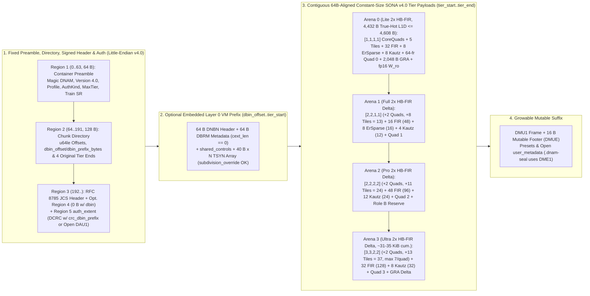

# `.dnam` Hybrid Binary Container & < 50 ns Zero-Copy Hardware Loader

DNAM defines five companion 64 B cache-line and SIMD-aligned v4.0 (`"architecture": "sona"`) binary container formats across a three-layer stack using declarative little-endian binary records. Together these containers satisfy [REQ-2.5](../../requirements/system_goals_and_requirements.md), [REQ-5.1, REQ-5.6](../../requirements/system_goals_and_requirements.md#6-goal-5--single-run-slimmable-multi-tier-architecture-lite--full--pro--ultra), [REQ-6.1](../../requirements/system_goals_and_requirements.md#7-goal-6--real-time-commodity-hardware-budget--execution-constraints), [REQ-8.1, REQ-8.5, REQ-8.8](../../requirements/system_goals_and_requirements.md#9-goal-8--model-provenance-hardware-drm-forensic-watermarking--marketplace-security), [ADR-0007](../../adr/0007-exact-integer-control-bus-and-tempo-inversion.md), [ADR-0009](../../adr/0009-jcs-prefix-signing-hpke-and-preview-containment.md), [ADR-0020](../../adr/0020-modular-monorepo-and-dnam-proj-container.md), [ADR-0022](../../adr/0022-sona-state-space-operator-and-webgpu-architecture.md), and [ADR-0024](../../adr/0024-sona-v4-kernel-hb-fir-perimeter-and-control-bus-gra.md).

---

## 1. Hybrid Binary Container Wire Framing & < 50 ns Zero-JSON Hardware Fast-Path

`r[container.dnam.wire-framing]`

Every v4.0 container enforces declarative little-endian framing, strict 64 B alignment at every binary region boundary, and fail-closed validation prior to audio rendering. Real-time virtual machines load bare `.dnam-bin` images (`"DNBN"`) or zero-copy embedded slices inside `.dnam` wrappers into L1D-resident memory in < 50 ns without executing a JSON parser on the audio thread.

### 1.1 Companion v4.0 Container Formats

`r[container.dnam.formats]`

All five companion v4.0 formats use packed little-endian binary record layouts with fixed 64 B region alignment and explicit byte offsets across the three-layer architecture (Layer 0 `.dnam-bin`, Layer 1 `.dnam` / `.dnam-seal` / `.dnam-prev`, and Layer 2 `.dnam-proj`).

Loaders validate header fields fail-closed and reject any container with `version_major != 4`, `version_minor != 0`, or a non-`"sona"` architecture using `UnsupportedVersion`.

| Container Format | Magic / Kind | Version & Architecture | Primary Role & Payload Summary | Canonical Cross-Reference |
| :--- | :--- | :--- | :--- | :--- |
| `.dnam-bin` | `"DNBN"` | v4.0, `"sona"` | Layer 0 zero-JSON VM binary carrying 64 B `"DNBN"` header, 64 B `"DBRM"` runtime metadata, `shared_controls`, `"TSYN"` tempo array (`cext_offset == 0`, `cext_len == 0`), and nested Arena 0..3 payloads (`§1.4`) | This specification (`§1.4`) |
| `.dnam` | `"DNAM"` | v4.0, `"sona"` | Layer 1 runtime shell wrapping verbatim embedded `.dnam-bin` (at `dbin_offset`, Region 4 == 0 B) alongside 64 B preamble, 128 B directory, RFC 8785 JCS header, Region 5 `auth_extent`, and `DMU1` + `DMUE` suffix | This specification (`§1.2–§1.3`) |
| `.dnam-proj` | `"DNPJ"` | v4.0, `"sona"` | Layer 2 cloud-ready Capture Vault front-loading a 64 B preamble, SHA-256 chunk directory, and JCS manifest alongside `CALB`, `SPCM`, `INPC`/`STMC` 2.0–2.5 s fp32 capsules, `STAT`, `WGHT`, and `AUTH` | [project_container_format.md](project_container_format.md) |
| `.dnam-seal` | `"DNSL"` | v4.0 | Opaque 64 B-aligned OEM hardware-enclave wrapper using `EnclaveSealed`, `DSA1` manifest, optional verbatim `dbin_prefix` inside `logical_prefix` (`DAI1`-signed), and `DME1` + `DMUE` suffix | [provenance_and_enclave_drm.md §3](../security/provenance_and_enclave_drm.md#3-pillar-2-hardware-enclave--oem-drm-oemdevicecertificate-attestation--dnam-seal-dnsl-wrapper) |
| `.dnam-prev` | `container_kind: "preview"` | v4.0, `"sona"` | Lite-only storefront auditioning container that physically omits Full, Pro, and Ultra payloads while retaining Arena 0 self-contained 2×-calibrated control descriptors, GRA tables, and `fp16` `W_ro` slices | [watermarking_and_marketplace.md §3](../security/watermarking_and_marketplace.md#3-commercial-storefront-platform-auditioning-royalty-splits--storefront-metadata) |

When a `.dnam` wrapper embeds an aligned `.dnam-bin` prefix (`dbin_prefix_bytes > 0` after Region 5), Region 4 (`shared_extent`) has zero length so control tables reside once inside `dbin_prefix`. When absent, Region 4 stores the `P` × 64 B descriptor table plus any overflow `CP1` stream.

Region 5 (`auth_extent`) holds a 64-byte `DCRC` Authentication Record (`"DCRC"`) storing `crc_dbin_prefix` at bytes 32..36 when an embedded Layer 0 prefix is active.

Authentication flags in the `DCRC` record track creator signatures (`FLAG_HAS_SIGNATURES`) and ChaCha20 encryption over `[tier_start..retained_end]` (`FLAG_ENCRYPTED_ARENA`); Open containers may instead use `DAU1`.

All four nested fixed-shape tier payloads obey Lite ⊂ Full ⊂ Pro ⊂ Ultra (`[1,1,1,1]`, `[2,2,1,1]`, `[2,2,2,2]`, `[3,3,2,2]`) at unified all-tier 2× 15-tap symmetric linear-phase HB-FIR oversampling (`OS2X`, zero Tier-1 core override).

Lite active-hot L1D fits inside 4,432 B (14× = 60.59 KiB <= 64 KiB), while Full/Pro/Ultra active-hot ceilings stay inside 8,192 / 16,384 / 32,768 B. Cumulative compile-time 64 B-aligned wire arenas (`ARENA_LITE_BYTES..ARENA_ULTRA_BYTES`, ~31–35 KiB Ultra wire) retain half-precision CoreQuad, InterBlockTile, and W_ro weights (REQ-8.5) while reclaiming 6,336 B of non-Tardos control bytes for GRA (2,048 B in Arena 0).



```text
+-----------------------------------------------------------------------+ 0x0000 (Byte 0, 64B-aligned)
| 1. Container Preamble (64 B, 64-byte aligned, little-endian)          |
|    • 0..4:   magic = "DNAM" (.dnam-seal uses DNSL Outer Preamble)     |
|    • 4..8:   version_major = 4 (u16le), version_minor = 0 (u16le)     |
|    • 8..12:  protection_profile(u8), auth_kind(u8), maximum_tier(u8)  |
|    • 12..16: sample_rate_train_hz = 48000 (u32le) | 16..64: zero(48B) |
+-----------------------------------------------------------------------+ 0x0040 (Byte 64, 64B-aligned)
| 2. Chunk Directory (128 B, 1-byte aligned, little-endian u64 offsets) |
|    • 0..16:  immutable_header_offset = 192, immutable_header_length   |
|    • 16..32: shared_binary_offset, shared_binary_length (0 w/ dbin)   |
|    • 32..48: authentication_envelope_offset, auth_envelope_length     |
|    • 48..64: dbin_offset (u64le), dbin_prefix_bytes (u64le, % 64==0)  |
|    • 64..104: tier_start (u64le) + original_tier_ends[4] (Lite..Ultra)|
+-----------------------------------------------------------------------+ 0x00C0 (Byte 192, 64B-aligned)
| 3. Canonical RFC 8785 JCS Immutable JSON Header ("sona") + Zero Pad   |
+-----------------------------------------------------------------------+ shared_binary_offset (64B-aligned)
| 4. Shared Binary Descriptors (0 B when dbin_prefix_bytes > 0; else    |
|    P * 64 B Descriptors + Overflow CP1 Stream) + Zero Pad to 64 B     |
+-----------------------------------------------------------------------+ authentication_envelope_offset (64B)
| 5. Region 5 auth_extent (64 B DCRC or Open DAU1) + Zero Pad to 64 B   |
+-----------------------------------------------------------------------+ dbin_offset (optional, 64B-aligned)
| 5B. Opt. Verbatim Layer 0 .dnam-bin Prefix [dbin_offset..tier_start)  |
|     ("DNBN" + "DBRM" [cext_len==0] + shared_controls + "TSYN")        |
|     -> Zero-copy slice [dbin_offset..retained_tier_end] is .dnam-bin! |
+=======================================================================+ tier_start (64B-aligned)
| 6A. Arena 0: Lite 2x Payload [tier_start .. original_tier_ends[0]]    | <- Lite strip boundary
|     (Self-contained Lite controls, CP1, U_int, 2,048 B GRA & fp16 RO) |
+-----------------------------------------------------------------------+ original_tier_ends[0] (64B-aligned)
| 6B. Arena 1: Full Delta Payload [ends[0] .. original_tier_ends[1]]    | <- Full strip boundary
+-----------------------------------------------------------------------+ original_tier_ends[1] (64B-aligned)
| 6C. Arena 2: Pro Delta Payload [ends[1] .. original_tier_ends[2]]     | <- Pro strip boundary
+-----------------------------------------------------------------------+ original_tier_ends[2] (64B-aligned)
| 6D. Arena 3: Ultra Delta Payload [ends[2] .. original_tier_ends[3]]   | <- Ultra strip boundary
+=======================================================================+ retained_tier_end (64B-aligned)
| 7. Growable DMU1 Mutable Frame (.dnam-seal uses DME1 HPKE) + 16-Byte  |
|    Mutable Footer (magic "DMUE" + u64le frame_len + u32le reserved=0) |
+-----------------------------------------------------------------------+ EOF
```

### 1.2 Preamble & Directory Invariants

`r[container.dnam.preamble-directory]`

All multi-byte integer and IEEE-754 floating-point wire fields are encoded strictly in little-endian byte order (`u16le`, `u32le`, `u64le`, `f32le`, `f64le`) inside packed binary records.

Loaders MUST verify exact record sizes, field monotonicities, and 64 B region alignments fail-closed before exposing runtime views, without unaligned-trap assumptions or unvalidated pointer aliasing.

Every region offset (`shared_binary_offset`, `authentication_envelope_offset`, `dbin_offset`, `tier_start`, and each issued `original_tier_ends` entry) is 64 B-aligned, strictly ordered, and checked against 64-bit unsigned overflow before allocation using zero-allocation bounds validation.

When `dbin_prefix_bytes > 0`, `shared_binary_length` equals 0 and `[dbin_offset .. tier_start)` carries the verbatim `.dnam-bin` prefix immediately after `auth_extent`, allowing zero-copy extraction of `[dbin_offset .. retained_tier_end]`.

When absent (`dbin_prefix_bytes == 0`), Region 4 (`shared_extent`) packs the `P` × 64 B Control Clamp Descriptor table followed by any overflow `CP1` stream ([ADR-0007](../../adr/0007-exact-integer-control-bus-and-tempo-inversion.md)).

Header offsets in `slimmable_tiers` and `tensor_directory` remain relative to `tier_start` so lower-tier issuances retain the creator-signed header verbatim.

**1. Container Preamble (64 B, 64-byte aligned, file offset 0..64):**

| Offset | Bytes | LE Wire Type | Field Name | Clean-Room Validation Invariant |
| :---: | :---: | :--- | :--- | :--- |
| 0..4 | 4 | `u8[4]` | `magic` | Exact `"DNAM"` (`.dnam-seal` uses the `DNSL` Outer Preamble defined in [provenance_and_enclave_drm.md §3](../security/provenance_and_enclave_drm.md#3-pillar-2-hardware-enclave--oem-drm-oemdevicecertificate-attestation--dnam-seal-dnsl-wrapper)) |
| 4..6 | 2 | `u16le` | `version_major` | Must equal 4 |
| 6..8 | 2 | `u16le` | `version_minor` | Must equal 0 |
| 8..9 | 1 | `u8` | `protection_profile` | 0 = Open, 1 = DeviceAllowlisted, 2 = EnclaveSealed; > 2 rejected |
| 9..10 | 1 | `u8` | `auth_kind` | 0 = CreatorOnly, 1 = CreatorAndMarketplace; > 1 rejected |
| 10..11 | 1 | `u8` | `maximum_tier` | 0 = Lite, 1 = Full, 2 = Pro, 3 = Ultra; > 3 rejected |
| 11..12 | 1 | `u8` | `reserved_flag` | Must equal 0 |
| 12..16 | 4 | `u32le` | `sample_rate_train_hz` | Must equal 48,000 |
| 16..64 | 48 | `u8[48]` | `reserved_pad` | All 48 bytes must equal `0x00` |

**2. Chunk Directory (128 B, 1-byte aligned, file offset 64..192):**

| Offset | Bytes | LE Wire Type | Field Name | Clean-Room Validation Invariant |
| :---: | :---: | :--- | :--- | :--- |
| 0..8 | 8 | `u64le` | `immutable_header_offset` | Must equal 192 (64 + 128) |
| 8..16 | 8 | `u64le` | `immutable_header_length` | Unpadded UTF-8 RFC 8785 JCS JSON byte length (> 0) |
| 16..24 | 8 | `u64le` | `shared_binary_offset` | 64 B-aligned, `>= align64(immutable_header_offset + immutable_header_length)` |
| 24..32 | 8 | `u64le` | `shared_binary_length` | Equals 0 when `dbin_prefix_bytes > 0`; else unpadded byte span of `P` × 64 B descriptors + `CP1` stream |
| 32..40 | 8 | `u64le` | `authentication_envelope_offset` | 64 B-aligned, `>= align64(shared_binary_offset + shared_binary_length)` |
| 40..48 | 8 | `u64le` | `authentication_envelope_length` | Byte span of Region 5 `auth_extent`: 64 B `DCRC` Authentication Record (`magic = "DCRC"`), or exclusively for Open (`protection_profile == 0`) a binary `DAU1` envelope |
| 48..56 | 8 | `u64le` | `dbin_offset` | Equals 0 when absent; else 64 B-aligned offset immediately after `auth_extent` (`>= align64(auth_offset + auth_len)`) |
| 56..64 | 8 | `u64le` | `dbin_prefix_bytes` | Equals 0 when absent; else > 0 and 64 B-aligned (`dbin_prefix_bytes % 64 == 0`), matching the byte span `[dbin_offset .. tier_start)` |
| 64..72 | 8 | `u64le` | `tier_start` | 64 B-aligned start of Arena 0 (`>= align64(auth_offset + auth_len)` when `dbin_prefix_bytes == 0`, else `== align64(dbin_offset + dbin_prefix_bytes)`) |
| 72..104 | 32 | `u64le[4]` | `original_tier_ends` | `[lite_end, full_end, pro_end, ultra_end]`, 64 B-aligned (`end[t] - tier_start == ARENA_TIER_BYTES[t]` through `maximum_tier`, compile-time derived 64 B-aligned v4.0 tier ceilings, monotone `end[t] <= end[t+1]`) |
| 104..128 | 24 | `u8[24]` | `reserved_tail` | All 24 bytes must equal `0x00` |

**3. 64-byte `DCRC` Authentication Record (64 B, 1-byte aligned, Region 5 `auth_extent`) & In-Memory `FLAG_*` Bitmask:**

Region 5 (`auth_extent`) holds a 64-byte `DCRC` Authentication Record (`"DCRC"`) for Open and DeviceAllowlisted containers, tracking `FLAG_HAS_SIGNATURES` when signed and `FLAG_ENCRYPTED_ARENA` when `[tier_start..retained_end]` is ChaCha20-encrypted. Exclusively for Open containers, Region 5 may instead hold a binary `DAU1` envelope binding any non-empty `dbin_prefix`.

| Offset | Bytes | LE Wire Type | Field Name | Clean-Room Validation Invariant |
| :---: | :---: | :--- | :--- | :--- |
| 0..4 | 4 | `u8[4]` | `magic` | Exact `"DCRC"` |
| 4..8 | 4 | `u32le` | `crc_prefix` | Castagnoli CRC-32C over container bytes `[0..authentication_envelope_offset]` |
| 8..24 | 16 | `u32le[4]` | `crc_tiers` | Cumulative CRC-32C over `[tier_start..original_tier_ends[t]]`; unretained tiers above `retained_tier` repeat `last_crc` (`slimmable_tiers.*.prefix_crc32c`) |
| 24..26 | 2 | `u16le` | `num_controls` | Total control count `P` (length of `controls_schema`) |
| 26..28 | 2 | `u16le` | `flags_hint` | Runtime `FLAG_*` bitmask (`1<<0` `LITE`, `1<<1` `FULL_DELTA`, `1<<2` `PRO_DELTA`, `1<<3` `ULTRA_DELTA`, `1<<9` `STEREO_OUT`, `1<<10` `HAS_SIGNATURES`, `1<<11` `ENCRYPTED_ARENA`; no dedicated Freeze bits) |
| 28..32 | 4 | `u32le` | `tail_time_ms_bits` | IEEE-754 binary32 bit representation of `io_config.tail_time_ms` |
| 32..36 | 4 | `u32le` | `crc_dbin_prefix` | Castagnoli CRC-32C over `[dbin_offset..tier_start)` when `dbin_prefix_bytes > 0` (0 when absent); verified fail-closed on load and tier strip |
| 36..64 | 28 | `u8[28]` | `reserved_pad` | All 28 bytes must equal `0x00` |

**4. Control Clamp Descriptor (64 B, 1-byte aligned, repeated `P` times in `shared_extent`) & Conditional Clamp Rule (8 B):**

| Offset | Bytes | LE Wire Type | Field Name | Clean-Room Validation Invariant |
| :---: | :---: | :--- | :--- | :--- |
| 0..1 | 1 | `u8` | `ctrl_kind` | `0 = Range`, `1 = Switch`, `0xFF = UnusedSlot` (`2 = BilinearCrossTerm` appears only in `CP1` contributor records; see §2.4) |
| 1..2 | 1 | `u8` | `lobatto_degree` | Lobatto degree `k` (`Range`), or `num_declared_options - 1` (`Switch`) |
| 2..4 | 2 | `u16le` | `active_options_mask` | Observed/active switch option bitmask; for `ctrl_kind == 1`, loaders validate `lobatto_degree <= 15`, `active_options_mask != 0`, and `(u32(active_options_mask) >> (u32(lobatto_degree) + 1)) == 0` |
| 4..8 | 4 | `f32le` | `default_val` | Default physical value (`Range`) or option index (`Switch`) |
| 8..12 | 4 | `f32le` | `safe_min_base` | Unconditional base lower physical bound |
| 12..16 | 4 | `f32le` | `safe_max_base` | Unconditional base upper physical bound |
| 16..20 | 4 | `f32le` | `scale_norm` | Pre-inverted normalization scale `2.0 / (x_decl_max - x_decl_min)` over `declared_range` so `x_norm = clamp(x_clamped * scale_norm + offset_norm, -1.0, +1.0)` maps `[x_decl_min, x_decl_max]` linearly into `[-1.0, +1.0]` |
| 20..24 | 4 | `f32le` | `offset_norm` | Normalization offset `-(x_decl_max + x_decl_min) / (x_decl_max - x_decl_min)` pairing with `scale_norm` over `declared_range` `[x_decl_min, x_decl_max]` |
| 24..36 | 12 | `f32le[3]` | `anchor_nodes_norm` | Normalized Lobatto anchor coordinates `t` in `[-1, +1]` |
| 36..40 | 4 | `u32le` | `_reserved` | Must equal 0 |
| 40..64 | 24 | `8-byte rule[3]` | `cond_rules` | Up to 3 conditional bound slots (8 B each: +0..2 `switch_ctrl_idx: u16le`, +2 `switch_opt_idx: u8`, +3 `rule_op: u8` (`0=none, 1=max_ceil, 2=min_floor, 3=and_prefix, 5=and_max_keep, 6=and_min_end`), +4..8 `bound_val: f32le`); header compilation fails closed if `conditional_bounds` require > 3 wire slots |

Conditional clamp evaluation initializes `eff_min = safe_min_base`, `eff_max = safe_max_base`, and `conj_active = true`, then validates and scans the three `cond_rules` slots in order.

Any active slot with nonzero `rule_op` fails container load closed if `rule_op` is reserved (4 or above 6), `switch_ctrl_idx >= num_controls`, target `ctrl_kind != 1`, switch option index exceeds 15, or `bound_val` is non-finite on opcodes 1, 2, 5, or 6.

Operation 0 or reserved codes such as 4 reset `conj_active = true` with no bound update, while `3 = and_prefix` updates `conj_active = conj_active && (active_switch_options[switch_ctrl_idx] == switch_opt_idx)`.

Operations `1 = max_ceil`, `2 = min_floor`, and trailing `6 = and_min_end` tighten `eff_max = min(eff_max, bound_val)` (code 1) or `eff_min = max(eff_min, bound_val)` (codes 2 and 6) whenever `conj_active` and the switch match hold, then reset `conj_active = true`.

Operation `5 = and_max_keep` updates `eff_max` identically when active and matching while setting `conj_active = hit` (`conj_active && match`) for the trailing slot. After all three slots, clamping enforces `eff_max = eff_min` whenever `eff_max < eff_min`.

### 1.3 Open `.dnam` Structural Layout

`r[container.dnam.open-layout]`

The fixed 64 B Container Preamble (`[0..64)`) and 128 B Chunk Directory (`[64..192)`) enforce `version_major = 4`, `version_minor = 0`, `protection_profile = 0` for Open, and `auth_kind = 0` (creator-only) or 1 (creator plus buyer).

Stripping a container to tier `T` retains the original preamble, directory, immutable header, shared binary, authentication envelope, optional `dbin_prefix`, and tier payloads through `original_tier_ends[T]`. Full Arena 0 controls remain intact even when stripping to Lite, and the mutable frame plus 16-byte `DMUE` Footer sit immediately after `original_tier_ends[T]` without re-signing.

#### Open Mutable Frame

`r[container.dnam.mutable-frame]`

Immediately after the retained tier boundary, every Open container places a growable `DMU1` frame (16-byte `DMU1` Header) followed by a 16-byte `DMUE` Footer (packed little-endian):

| Region / Record | Offset (rel. frame) | Bytes | LE Wire Type | Field & Invariant |
| :--- | :---: | :---: | :--- | :--- |
| `DMU1` Header (16 B) | 0..4 | 4 | `u8[4]` | `magic`: ASCII `"DMU1"` |
| `DMU1` Header | 4..8 | 4 | `u32le` | `crc32c`: Castagnoli CRC-32C (`poly 0x82F63B78`, init/XOR `0xFFFFFFFF`; `"{}"` = `0xA1CCB48F`, `"123456789"` = `0xE3069283`) over `"DMU1" \|\| u64le(json_len) \|\| JSON` |
| `DMU1` Header | 8..16 | 8 | `u64le` | `json_len`: Unpadded UTF-8 RFC 8259 JSON object byte length `N` (`N >= 2`) |
| JSON Payload | 16..16+N | `N` | `u8[N]` | UTF-8 RFC 8259 JSON object (no BOM, no duplicate keys) |
| Zero Pad | 16+N..EOF-16 | `pad` | `u8[pad]` | Optional zero-filled `0x00` padding |
| `DMUE` Footer (16 B) | EOF-16..EOF-12 | 4 | `u8[4]` | `magic`: ASCII `"DMUE"` |
| `DMUE` Footer | EOF-12..EOF-4 | 8 | `u64le` | `frame_len`: Byte span of the mutable frame immediately preceding this footer |
| `DMUE` Footer | EOF-4..EOF | 4 | `u32le` | `reserved`: Must equal 0 |

Enclave-sealed containers carry the HPKE-wrapped `DME1` frame using the same 16-byte `DMUE` Footer ([provenance_and_enclave_drm.md §3.3](../security/provenance_and_enclave_drm.md#encrypted-mutable-suffix)), whereas standard `.dnam` files use `DMU1` and reject `DME1` outside sealed `DNPL` context.

#### Mutable JSON Members

`r[container.dnam.mutable-json]`

| Member | Type & Specification |
| :--- | :--- |
| `version` | Optional mutable envelope version (1 when present; omitted defaults to 1). |
| `presets` | Array of preset objects (`id`, `name`, `controls: map<string, f64 \| string>`, optional `description`, `user_metadata`). |
| `user_metadata` | Open JSON object for model-level catalog tags and host data. |
| `control_user_metadata` | Object mapping signed `control_id` strings to open metadata objects. |
| `stem_user_metadata` | Object mapping signed `stem_id` strings to open metadata objects. |

On container load, the loader validates `DMU1`/`DME1` header CRC-32C and `DMUE` footer framing via zero-copy bounds validation and overlays mutable metadata onto the immutable header view without modifying authenticated prefix bytes. Loading a partial preset restores signed defaults for omitted controls at the effective tier before overlaying preset assignments and applying whole-batch conditional clamping ([parametric_control_bus.md](../dsp/parametric_control_bus.md#242-conditional-batch-safety)).

### 1.4 Bare Deterministic VM Binary Container (`.dnam-bin` / `"DNBN"`)

`r[container.dnam.vm-binary]`

The bare `.dnam-bin` (`"DNBN"`) Layer 0 format carries a complete, strictly numeric, 64 B-aligned VM register program with zero JSON, zero strings, zero dynamic memory allocation requirements, and zero dedicated freeze flags. Real-time virtual machines load standalone `.dnam-bin` files or zero-copy embedded `[dbin_offset..retained_tier_end]` slices extracted from `.dnam` wrappers in < 50 ns.

Every `.dnam-bin` payload begins with a fixed 64 B **VM Binary Header** (`"DNBN"`, bytes 0..64) immediately followed by a fixed 64 B **VM Runtime Metadata Record** (`"DBRM"`, bytes 64..128), aligned `shared_controls`, `TSYN` tempo entries (`cext_offset == 0`, `cext_len == 0` in v4.0), and Arena 0..3 payloads.

Stripping `.dnam-bin` to tier `t` per `REQ-5.6` slices raw file bytes directly to `[0..tier_end_offsets[t]]` with zero mutation to any header byte.

**1. VM Binary Header (`"DNBN"`, 64 B at offset 0..64) & VM Runtime Metadata Record (`"DBRM"`, 64 B at offset 64..128):**

The following 64 B `"DNBN"` Header (bytes 0..64), 64 B `"DBRM"` Runtime Metadata Record (bytes 64..128), and 40 B `TSYN` entry define the normative wire contract (reclaiming the legacy 1,280 B `CEXT` slot into Arena 0 and Arena 3 `ControlBus` v4 `GRA` weights):

| Record & Offset | Bytes | LE Wire Type | Field Name | Clean-Room Validation Invariant |
| :--- | :---: | :--- | :--- | :--- |
| `DNBN` 0..4 | 4 | `u8[4]` | `magic` | Exact `"DNBN"` |
| `DNBN` 4..8 | 4 | `2 × u16le` | `version_major`, `version_minor` | Must equal 4 and 0 |
| `DNBN` 8..9 | 1 | `u8` | `max_present_tier` | Original emitted ceiling in 0..=3 (Lite..Ultra; never mutated on `REQ-5.6` strip) |
| `DNBN` 9..10 | 1 | `u8` | `reserved0` | Must equal 0 |
| `DNBN` 10..12 | 2 | `u16le` | `flags` | Bits 0..3 `HAS_LITE..HAS_ULTRA_DELTA`; bit 4 `SINGLE_INPUT`; bits 5..6 strictly 0 (reserved); bit 7 `WET_POLARITY_INV` (applies `eff_trim = -clamp(tier_gain_trim[tier], 0.0625, 16.0)` and ±1.0e9 safety clamp inside the pure 2×2 VM ahead of host-shell M/S width); bit 8 `AUTO_UNITY_ENABLED`; bit 9 `STEREO_OUT`; bits 10..15 strictly 0 |
| `DNBN` 12..14 | 2 | `u16le` | `num_controls` | Total physical controls `P` (`0..=255`) |
| `DNBN` 14..16 | 2 | `u16le` | `tsyn_count` | Count of 40 B `TSYN` rows (`tsyn_len == tsyn_count * 40`) |
| `DNBN` 16..20 | 4 | `u32le` | `reference_sample_rate_hz` | Strictly in `[44,100..=96,000]` |
| `DNBN` 20..24 | 4 | `u32le` | `prefix_crc32c` | Castagnoli CRC-32C over `[0..20) \|\| [24..arena0_offset)` (excludes itself; covers Header + `DBRM` + `shared_controls` + `TSYN` + 64 B pad) |
| `DNBN` 24..28 | 4 | `u32le` | `arena0_offset` | Relative 64 B-aligned Arena 0 start (`>= 128`, `arena0_offset % 64 == 0`, relative to byte 0 of `.dnam-bin`) |
| `DNBN` 28..44 | 16 | `u32le[4]` | `tier_end_offsets` | `arena0_offset + ARENA_TIER_BYTES[t]` for `t <= max_present_tier`, else 0; compile-time 64 B-aligned tier lengths immutable under `REQ-5.6` truncation |
| `DNBN` 44..60 | 16 | `u32le[4]` | `tier_arena_crc32c` | Castagnoli CRC-32C over `[arena0_offset..tier_end_offsets[t])` for `t <= max_present_tier`, else 0 |
| `DNBN` 60..62 | 2 | `u16le` | `runtime_meta_bytes` | Must equal 64 |
| `DNBN` 62..64 | 2 | `u16le` | `reserved_flags_hi` | Must equal 0 |
| `DBRM` 0..4 | 4 | `u8[4]` | `magic` | Exact `"DBRM"` (at file offset 64..68) |
| `DBRM` 4..12 | 8 | `2 × u32le` | `shared_controls_offset`, `shared_controls_len` | `offset == 0` iff `len == 0`, else `>= 128 && % 64 == 0`; `len == num_controls * 64 + cp1_overflow_bytes` (`cp1_overflow_bytes` is 0 or `>= 8`) |
| `DBRM` 12..20 | 8 | `2 × u32le` | `tsyn_offset`, `tsyn_len` | `offset == 0` iff `len == 0`, else `% 64 == 0 && >= max(128, align64(shared_controls_end))`; `len == tsyn_count * 40` |
| `DBRM` 20..28 | 8 | `2 × u32le` | `cext_offset`, `cext_len` | Strictly 0 and 0 in canonical v4.0 (`CEXT` removed; legacy 1,280 B reclaimed into ControlBus v4 GRA inside Arena 0..3) |
| `DBRM` 28..31 | 3 | `3 × u8` | `ext_ring_pow2_frames`, `ext_ring_lines`, `ext_ring_format` | `pow2`: 0 or 7..=19 (`2^k` in 128..=524,288 frames at 384 kHz); `lines`: 0..=16; `format`: `0 = fp16`, `1 = f32` (> 1 rejected; logical OR across active quads sets `ext_ring_format`, sizing `(has_ext[q], cap[q])` per [op_t_transport.md §1.1.1](../dsp/op_t_transport.md#111-ring-declaration-unified-4-lane-quad-wire--active-hot-state)) |
| `DBRM` 31..32 | 1 | `u8` | `reserved0` | Must equal 0 |
| `DBRM` 32..36 | 4 | `u32le` | `declared_max_delay_48k` | Declared 48 kHz Transport delay ceiling (`<= 48,000`) |
| `DBRM` 36..48 | 12 | `3 × f32le` | `dc_blocker_pole_5hz`, `tail_time_ms`, `ro_pole_48k` | Finite 5 Hz pole (`(0.8, 1.0)` else fallback `0x3F7F_D51F`, ZOH-scaled into `wet_dc_pole` per [op_t_transport.md §1.1.1](../dsp/op_t_transport.md#111-ring-declaration-unified-4-lane-quad-wire--active-hot-state)), tail (`>= 0.0`), and learned `LinearReadout` leak pole (`[0.0, 0x3F7F_FFAC]`, ZOH-scaled via `ro_pole_48k^rho_core` or 0.0 bypass when `<= 0.0`) |
| `DBRM` 48..50 | 2 | `u16le` | `switch_xfade_samples` | Switch transition crossfade duration in samples |
| `DBRM` 50..52 | 2 | `u16le` | `reserved_cond_zero` | Must equal 0 (conditional clamp rules occupy the 3 inline slots inside each 64 B descriptor) |
| `DBRM` 52..60 | 8 | `u8[8]` | `content_hash_prefix` | First 8 B of SHA-256 of canonical JCS header when exported with `.dnam`, else SHA-256 of `"DNAM-BIN-CONTENT-V4\0" \|\| arena_0_lite` |
| `DBRM` 60..64 | 4 | `u32le` | `cp1_overflow_bytes` | Exact `"CP1\0"` trailing byte length inside `shared_controls` (0 when inline-only, else `>= 8`) |

All `.dnam-bin` region offsets are relative to byte 0 of the `.dnam-bin` slice (identical standalone or extracted at `dbin_offset`), zero-padded to 64 B alignment, and strictly ordered `128 <= shared_controls <= TSYN <= arena0_offset` with `cext_offset == 0` and `cext_len == 0`.

Retained tier `T` on load or zero-mutation `REQ-5.6` truncation is uniquely determined by matching `bytes.len() == tier_end_offsets[T]` for `T` in `0..=max_present_tier`, validating `prefix_crc32c` over the full prefix and `tier_arena_crc32c[T]` over `[arena0_offset..bytes.len())`.

**2. `TSYN` Physical Tempo-Sync Array (40 B × `tsyn_count`, `tsyn_offset % 64 == 0`, with `subdivision_override` Support):**

| Record & Offset | Bytes | LE Wire Type | Field Name | Clean-Room Validation Invariant |
| :--- | :---: | :--- | :--- | :--- |
| `TSYN` 0..4 | 4 | `2 × u16le` | `ctrl_idx`, `switch_ctrl_idx` | Target control index `< num_controls`, optional switch condition control index |
| `TSYN` 4..8 | 4 | `4 × u8` | `switch_opt_idx`, `has_switch_cond`, `mode`, `default_subdiv` | Active switch option, condition flag (`0 \| 1`), physical unit mode (`0 = PeriodMs`, `1 = FrequencyHz`), default subdivision (0..11) |
| `TSYN` 8..12 | 4 | `u32le` | `flags` | Bit 0 `tempo_clamp_inward`; bits 1..=31 strictly 0 (fail closed on nonzero) |
| `TSYN` 12..20 | 8 | `2 × f32le` | `div_ratio`, `bpm_factor` | Precomputed rational subdivision ratio and scaling factor (both finite and > 0.0; fail closed otherwise) |
| `TSYN` 20..32 | 12 | `f32le[3]` | `lobatto_anchors` | Physical anchor values `[v_min, v_mid, v_max]` for zero-JSON tempo inversion (all three finite; fails closed otherwise; multi-row per conditional rule) |
| `TSYN` 32..40 | 8 | `2 × f32le` | `declared_min`, `declared_max` | Finite declared physical control interval (`declared_min <= declared_max`; fails closed otherwise) |

Bare `.dnam-bin` execution supports runtime `subdivision_override` (0..11) directly against binary `TSYN` rows without requiring a JSON header (REQ-2.5).

When `subdivision_override` is supplied on a tempo-sync call, runtime evaluation overrides `default_subdiv` using the canonical rational `div_ratio` for that subdivision alongside the `lobatto_anchors`, `declared_min`, and `declared_max` bounds.

---

## 2. Tier-Prefix Hardware Loading

### 2.1 Lower-Block-Triangular Tier Payloads

`r[container.dnam.tier-prefix]`

Every tier's runtime topology is locked to fixed nested tier capacities (Lite ⊂ Full ⊂ Pro ⊂ Ultra) with zero capture-time tier resizing (`ref[arch.tiers.maximize-quality-within-budget]`).

All four tiers execute natively at unified 2× oversampling via the 15-tap symmetric linear-phase HB-FIR `OS2X` (zero Tier-1 core override), locking `[1,1,1,1]`, `[2,2,1,1]`, `[2,2,2,2]`, and `[3,3,2,2]` block profiles (4 / 6 / 8 / 10 CoreQuads, 5 / 13 / 24 / 37 tiles with `MAX_OUTGOING_PER_QUAD = 7`).

Lite active-hot L1D occupies 4,432 B (14× = 60.59 KiB <= 64 KiB Cortex-A76 L1D), Full/Pro/Ultra active-hot ceilings stay inside 8,192 / 16,384 / 32,768 B, and cumulative 64 B-aligned wire arenas (`ARENA_LITE_BYTES..ARENA_ULTRA_BYTES`, ~31–35 KiB Ultra wire) retain half-precision weights (REQ-8.5).

The Arena 0 Lite payload is 100% self-contained and stores the 2×-calibrated Lite `[1,1,1,1]` base parameters. It packs SensoryQuad v4, the Crossbar Block, 5 inter-block tiles, 32 ModalConvolver early FIR taps, 8 `ErSparseBank` MIMO taps, 8 Kautz pairs (with reclaimed `dr` holding `onset_delay_samp` and `c_cross_fp16`), a 64-frame inline Quad 0 ring, Lite half-precision LinearReadout + split `W_ro_head`, and 2,048 B self-contained Arena 0 GRA tables, so running Lite never reads Arena 1..3 (REQ-5.6).

Arena 1..3 Delta payloads store causally nested 2×-OS calibrated deltas for Full (`[2,2,1,1]`, +2 quads, +8 tiles = 13, +16 FIR, +8 `ErSparseBank` = 16, +4 Kautz, Quad 1), Pro (`[2,2,2,2]`, +2 quads, +11 tiles = 24, +48 FIR, +12 Kautz, Quad 2), and Ultra (`[3,3,2,2]`, +2 quads, +13 tiles = 37, +32 FIR, +8 Kautz, Quad 3, and Ultra GRA delta <= 9,280 B total control footprint, deleting `stage_latent_core_mods_fp16`) (REQ-5.1, REQ-5.2). Analytical ZOH and Kaiser polyphase FIR adapt all four tiers across 44.1–384 kHz.

All Tardos Role B alignment reserve spans remain strictly zeroed (0x00) in unwatermarked `.dnam` containers and are populated only in watermarked buyer copies, with every byte offset derived at compile time from the canonical 64 B-aligned tier arena field layout (Pro CoreQuad/Transport reserves, Ultra CoreQuad/Transport reserves, and Arena 3 Control Plane reserve).

### 2.2 Model-Declared Delay Histories (`delay_histories`)

`r[container.dnam.delay-histories]`

The signed immutable JSON header declares all required `Op-T` delay and all-pass histories in `delay_histories` (`"owner": "transport" | "crossbar"`). Each entry specifies `sample_format` (`"fp16"` for 2 B inline/cold storage on Lite and Full, or optional `"fp16"` / `"f32"` for 4 B cold `ext_lines` on Pro and Ultra to support 30 s shimmer tails):

```json
{
  "id": "transport.quad0.line0",
  "owner": "transport",
  "kind": "fractional",
  "introduced_tier": "lite",
  "sample_format": "fp16",
  "reference_samples": { "lite": "432000" }
}
```

Each `reference_samples` entry is canonical ASCII decimal text parsed as a nonzero `u64` (avoiding IEEE-754 binary64 integer precision limits) and admitted against the host memory ceiling on the cold path ([op_t_transport.md](../dsp/op_t_transport.md)).

### 2.3 Pre-Packed SIMD Data, Cell Descriptors & Load-Time Validation

`r[container.dnam.load-validation]`

Loaders validate all binary record headers, tensor offsets, 64 B alignments, shapes, finite coefficients, and cell descriptor commitments (SONA Cell Descriptor) before initializing runtime state memory. Recursive `TPT-SVF`, `ParaLRU`, and `Op-T` states initialize to exact resting zero equilibrium ([op_n_paralru_and_polyadaa.md](../dsp/op_n_paralru_and_polyadaa.md)).

#### Constant-Size Tier Arena Slice Directory

`r[container.dnam.tensor-directory]`

Every slice declared in `tensor_directory` has a 64 B-aligned `byte_offset` relative to `tier_start` (`byte_offset % 64 == 0`) and a `byte_length` bounded by `original_tier_ends[t] - tier_start == ARENA_TIER_BYTES[t]` (compile-time derived 64 B-aligned tier sizes across Lite..Ultra, reaching ~31–35 KiB cumulative Ultra wire).

True-hot active working memory fits strictly inside each tier L1D ceiling (4,432 B Lite 2× actual within 4,608 B ceiling = 60.59 KiB at 14× <= 64 KiB, plus <= 8,192 / 16,384 / 32,768 B Full..Ultra ceilings), and each slice maps directly onto the packed little-endian binary blocks listed below.

| Slice Identifier | Arena & Alignment | Cumulative Capacity | Binary Block & Canonical v4.0 Contents |
| :--- | :---: | :---: | :--- |
| `crossbar_and_sensory` | Arena 0 (0..256) | 256 B (4 CL) | Crossbar Block: `SensoryQuad` v4 (`sense_svf_*`, `sense_lru_*`, `sense_in_*`, `sense_tone_*`, Log-Knee VCA `b_makeup`, `s_slope`, `l_scale`, `c_knee`, `theta_lin`, `peak_rms_mix`), SONA Meta (`version_major = 4`, `tier_os2x = [true; 4]`), `Op-P` v4 `T1+` + 3-Basis Carrier, `Op-N[Pre]` v4 (`kappa_h`), Cell Descriptor & 4× Q0.32 Phasors |
| `sona_core_lite` | Arena 0 (64 B CL) | 4 quads, 5 tiles | Lite SONA Core: `core_quads[4]` (`CoreQuad` v4 `fp16` blocks) + `tiles[5]` (`InterBlockTilePair` `(0,1),(1,2),(2,3),(0,2),(1,3)`, `fp16` `w_even`/`w_lru`) + explicit `u16` `rect_sign_mask` |
| `conv_fir_lite` | Arena 0 (64 B CL) | 32 FIR/ch + 8 ErSparse | `ModalConvolver` Early FIR (32 L + 32 R `f32le` taps) + `ErSparseBank[8]` MIMO early reflection taps on the 1,024-sample ring (`CONVOLVER_EARLY_FIR_BASES[0]`) |
| `conv_kautz_lite` | Arena 0 (64 B CL) | 8 pairs (2 blks) | 2 × Kautz SoA Blocks (128 B each, reclaimed `dr` bytes 16..32 hold `onset_delay_samp: u16le[4]` + `c_cross_fp16: u16le[4]`, `CONVOLVER_KAUTZ_BASES[0]`) |
| `transport_lite` | Arena 0 (64 B CL) | 1 quad (4 lanes) | `TransportQuad` 0 v4 (`M_fb`, bipolar `g_loop`, ±64 Hz ramp, `sigma_knee <= 4.0`, `QuadCtrlRoute`, 64-frame / 512 B `fp16[64][4]` inline ring in hot state, `TRANSPORT_DELAY_BASES[0]`) |
| `linear_readout_lite` | Arena 0 (64 B CL) | 16 lanes | Lite `fp16` `LinearReadout`: `[L, R]` gains + `stage_latent_mods_fp16` + compact `fp16` `w_ro_fp16` (`REQ-8.5`) + split `W_ro_head` (`odd` + `even_lru`) (`LINEAR_READOUT_BASES[0]`) |
| `control_bus_lite` | Arena 0 (64 B CL) | 2,048 B `GRA` | Self-contained Arena 0 `ControlBus` v4 `GRA`: `cp1_dir`, `ExactIntMainAccumulator` `u_int_base[:,0..4]`, unrotated `CP1`, Zero-Anchored `SwiGLU` (H=8) + `Padé-[1/1]`, `1.5-Entmax` prototypes (M=8), bilinear gates, `rho_head_and_ctrl_tail` |
| `sona_core_full` | Arena 1 (64 B CL) | 6 quads, 13 tiles | Full SONA Core Delta: `core_quads[2]` (4, 5) + `tiles[8]` (5..13) + SONA Crossbar Coupling Block (256 B) |
| `conv_fir_full` | Arena 1 (64 B CL) | 48 FIR/ch + 16 ErSparse | `ModalConvolver` Early FIR (+16 L/R taps = 48 cum.) + +8 `ErSparseBank` taps (16 cum.) + 2-basis `fp16` FIR voicing morph (`CONVOLVER_EARLY_FIR_BASES[1]`) |
| `conv_kautz_full` | Arena 1 (64 B CL) | 12 pairs (3 blks) | 1 × Kautz SoA Block (+4 pairs = 12 cum., `CONVOLVER_KAUTZ_BASES[1]`) |
| `transport_full` | Arena 1 (64 B CL) | 2 quads (8 lanes) | `TransportQuad` 1 v4 (lanes 4..8, `M_series` lower-tri row, `TRANSPORT_DELAY_BASES[1]`) |
| `linear_readout_full` | Arena 1 (64 B CL) | 24 lanes | Full `fp16` `LinearReadout`: Full Convolver Prefix Override (192 B) + `w_ro_and_mods_fp16` + split `W_ro_head` delta (`ARENA_FULL_BYTES`) |
| `sona_core_pro` | Arena 2 (64 B CL) | 8 quads, 24 tiles | Pro SONA Core Delta (`[2,2,2,2]`): `core_quads[2]` (6, 7) + `tiles[11]` (13..24) + `crossbar_pro` (256 B) + `reserve` (`0x00` unless Tardos Role B watermarked) |
| `conv_fir_pro` | Arena 2 (64 B CL) | 96 FIR/ch | `ModalConvolver` Early FIR (+48 L/R taps = 96 cum., `CONVOLVER_EARLY_FIR_BASES[2]`) |
| `conv_kautz_pro` | Arena 2 (64 B CL) | 24 pairs (6 blks) | 3 × Kautz SoA Blocks (+12 pairs = 24 cum., `CONVOLVER_KAUTZ_BASES[2]`) |
| `transport_pro` | Arena 2 (64 B CL) | 3 quads (12 lanes) | 2 × `TransportQuad`s: `[0]` = Quad 2 (lanes 8..12, `M_series`), `[1]` = 128 B `reserve` (`0x00` unless Tardos Role B watermarked; `TRANSPORT_DELAY_BASES[2]`) |
| `linear_readout_pro` | Arena 2 (64 B CL) | 32 lanes | Pro `fp16` `LinearReadout`: Pro Convolver Prefix Override (384 B) + `w_ro_and_mods_fp16` + split `W_ro_head` delta (`ARENA_PRO_BYTES`) |
| `sona_core_ultra` | Arena 3 (64 B CL) | 10 quads, 37 tiles | Ultra SONA Core Delta (`[3,3,2,2]`, `MAX_OUTGOING_PER_QUAD = 7`): `core_quads[2]` (8, 9) + `tiles[13]` (24..37) + `crossbar_ultra` (256 B) + `reserve` (`stage_latent_core_mods_fp16` 2,048 B deleted / reclaimed into `GRA`) |
| `conv_fir_ultra` | Arena 3 (64 B CL) | 128 FIR/ch | `ModalConvolver` Early FIR (+32 L/R taps = 128 cum., `CONVOLVER_EARLY_FIR_BASES[3]`) |
| `conv_kautz_ultra` | Arena 3 (64 B CL) | 32 pairs (8 blks) | 2 × Kautz SoA Blocks (+8 pairs = 32 cum., `CONVOLVER_KAUTZ_BASES[3]`) |
| `transport_ultra` | Arena 3 (64 B CL) | 4 quads (16 lanes) | 2 × `TransportQuad`s: `[0]` = Quad 3 (lanes 12..16, 16 Schroeder stages up to 16,384 samples at 384 kHz, `abs(a_diff) <= 0.75`, `M_series`, unitary freeze), `[1]` = 128 B `reserve` (`TRANSPORT_DELAY_BASES[3]`) |
| `linear_readout_ultra` | Arena 3 (64 B CL) | 40 lanes | Ultra `fp16` `LinearReadout`: Ultra Convolver Prefix Override (576 B) + `w_ro_and_mods_fp16` + split `W_ro_head` delta (`LINEAR_READOUT_BASES[3]`) |
| `control_bus_ultra_delta` | Arena 3 (64 B CL) | <= 9,280 B cum. | Arena 3 `GRA` Ultra Delta: `w_ctrl_ultra`, `u_int_ultra[0]` (`z_head[0..4]` `SO(4)` only), `SwiGLU` (`H=16`) + `1.5-Entmax` (`M=16`) + `g_edge[0..6]` + `op_t_q[0..16]` + `stage_latent_ctrl_ultra_fp16[256]` + `reserve` (`ARENA_ULTRA_BYTES`) |

**1. Crossbar & SensoryQuad Block (256 B, Arena 0, bytes 0..256):**

| Arena Offset | Block Member (Bytes) | LE Wire Type | Clean-Room Sub-Fields & Bit Flags |
| :---: | :--- | :--- | :--- |
| 0..16 | `sense_svf_g` (16 B) | `f32le[4]` | `SensoryQuad` 48 kHz TPT-SVF cutoff tangent gains `[1e-5, 64.0]` (ZOH via `rescale_tpt_svf_g_zoh`, modulated by `sense_svf_g_oct[0..4]`, fallback 0.25). |
| 16..32 | `sense_lru_alpha_rel` (16 B) | `f32le[4]` | `SensoryQuad` 48 kHz ParaLRU release poles `[0.0, 0x3F7F_FFAC]` (ZOH `^rho_vm`, fallback 0.0). |
| 32..48 | `sense_lru_alpha_atk` (16 B) | `f32le[4]` | `SensoryQuad` 48 kHz ParaLRU attack poles `[0.0, 1.0]` (ZOH `^rho_vm`, fallback 0.0). |
| 48..56 | `sense_svf_k_fp16` (8 B) | `u16le[4]` | `SensoryQuad` TPT-SVF damping `[0.0, 8.0]` (`fp16`, fallback `1 / sqrt(2)`). |
| 56..64 | `sense_lru_kappa_fp16` (8 B) | `u16le[4]` | `SensoryQuad` ParaLRU self-feedback `[0.0, 1.0]` (`fp16`, fallback 0.0). |
| 64..68 | `meta.pipeline_flags` (4 B) | `u32le` | `ARENA0_PIPELINE_FLAGS_OFFSET = 64`; upper half `PIPE_MAGIC_HI = 0x444E_0000` (`PIPE_MAGIC_MASK = 0xFFFF_0000`); bits 0–2 reserved 0; `1<<3` `PIPE_FLAG_CONVOLVER_EXT`; `1<<4` `PIPE_FLAG_TRANSPORT_EXT`; `1<<5` `PIPE_FLAG_UNIFIED_W_CTRL`; `1<<6` `PIPE_FLAG_V4_MATRYOSHKA`; `1<<7` `PIPE_FLAG_SONA` (`PIPE_FLAG_ALL_SONA = 0x00F8`, canonical v4.0 `0x444E_00F8`). |
| 68..84 | `meta.tier_gain_trim` (16 B) | `f32le[4]` | `ARENA0_TIER_GAIN_TRIM_OFFSET = 68`; `[Lite, Full, Pro, Ultra]` output trim (<= 0.05 LU). |
| 84..88 | `meta.sona_meta_flags` (4 B) | `u32le` | `ARENA0_SONA_META_OFFSET = 84` (mirrored identically in SONA Cell Descriptor `cell_flags` at 204..208): bits 0–3 `tier_os2x[0..4]` (`[true, true, true, true]` in v4.0); bit 4 (`0x10`) `SONA_META_OS2X` (1); bit 5 (`0x20`) reserved 0; bit 6 (`0x40`) `SONA_META_TIER_OS_EXPLICIT`; bit 7 (`0x80`) `SONA_META_CONVOLVER_PREFIX_OVERRIDES`; bit 8 (`0x100`) `SONA_META_OS_EXT_PRESENT`; bit 9 (`0x200`) retired / strictly 0 (`stage_latent_core_mods_fp16` reclaimed into `GRA`); bits 16–20 (`1<<16` `SONA_META_TRANSPORT_TAP_GAINS`, `1<<17` `SONA_META_SENSORY_QUAD`, `1<<18` `SONA_META_GRA_CONTROL_BUS`, `1<<19` reserved 0, `1<<20` `SONA_META_TRANSPORT_LFO`). |
| 88..128 | `sense_mix` & crossbar scalars (40 B) | `u16le` + `f32le` | 88..96 `sense_in_l_fp16: u16le[4]` (`[-4.0, 4.0]`), 96..104 `sense_in_r_fp16: u16le[4]` (`[-4.0, 4.0]`), 104..112 `sense_tone_lp_fp16: u16le[4]` (`[-16.0, 16.0]`), 112..120 `sense_tone_bp_fp16: u16le[4]` (`[-16.0, 16.0]`), 120..124 `crossbar_op_gains_fp16: u16le[2]` (`[op_p_crossbar_gain, op_t_crossbar_gain]` in `[-4.0, 4.0]`), 124..128 `anti_zipper_ramp_scale: f32le` (`4 / K_ctrl` microchunk step fraction in `(0.0, 1.0]`, default 0.25 for `K_ctrl = 16` when `<= 1.0e-7` or non-finite). |
| 128..192 | `os_and_front_ext` (64 B) | `u16le` + `f32le` | `ARENA0_OS_PARAMS_OFFSET = 128`: 128..156 repurposed from legacy poly3/HB-IIR scalars (since 15-tap HB-FIR taps are compile-time fixed) into `SensoryQuad` v4 Unified Log-Knee VCA (`b_makeup`, `s_slope`, `l_scale`, `c_knee`, `theta_lin`, `peak_rms_mix`) + `Op-P` v4 `T1+` (`pole_trk`, `alpha_oct`, `beta_oc2`, `stereo_2band`); 156..180 `carrier_basis_w_fp16: u16le[3][4]` (`[hi*cos, hq*sin, sin]`); 180..192 `Op-N[Pre]` v4 Record (`gamma_bc: f32le`, `zoh_hold_depth: f32le` / `log2_rho_zoh`, `beta_q: u16le` + `kappa_h: u16le` hold sharpness in `[0.0, 1.0]`). |
| 192..208 | `cell_phasors.cell_desc` (16 B) | `SONA Cell Descriptor` | +0..4 `magic = "SONA"`, +4..6 `version_major = 4 (u16le)`, +6..8 `version_minor = 0 (u16le)`, +8..10 `tier_flags: u16le` (`0x01=Lite`, `0x03=Full`, `0x07=Pro`, `0x0F=Ultra`), +10..12 `oversample_factor: u16le` (2 across all tiers in v4.0), +12..16 `cell_flags: u32le` (mirrors `sona_meta_flags`). |
| 208..240 | `cell_phasors` clocks (32 B) | `f32le[4]`, `u32le[4]` | 208..224 `phasor_freq_hz: f32le[4]`, 224..240 `phasor_init_phase_q32: u32le[4]`. |
| 240..256 | `sense_hp_and_vca_fp16` (16 B) | `u16le[8]` | 240..248 `sense_tone_hp_fp16: u16le[4]` (`[-16.0, 16.0]`), 248..256 `sense_vca_w_fp16: u16le[4]` (`[-512.0, 512.0]`, driving Unified 0-FDIV Log-Knee VCA `[-5.0, +4.0]` octaves and 4-frame `block_vca_gain[0..4]`). |

Loaders ALWAYS validate `meta.pipeline_flags` at offset 64 via `(flags & 0xFFFF_0000) == 0x444E_0000 && (flags & 0x00E0) == 0x00E0` (`PIPE_FLAG_SONA | PIPE_FLAG_V4_MATRYOSHKA | PIPE_FLAG_UNIFIED_W_CTRL`, canonical v4.0 `0x444E_00F8`), rejecting `pipeline_flags == 0` fail-closed while treating bits 3 (`PIPE_FLAG_CONVOLVER_EXT`) and 4 (`PIPE_FLAG_TRANSPORT_EXT`) as informational.

The following table defines the flag-gated decoding rules for all defined bits in `sona_meta_flags` (offset 84, mirrored in `cell_flags` at bytes 204..208):

| Flag Constant | Bit | Behavior When Set (1) | Behavior When Clear (0) |
| :--- | :---: | :--- | :--- |
| `tier_os2x[0..4]` | 0–3 | Per-tier 2× 15-tap HB-FIR core OS bits (`[true, true, true, true]` in v4.0); runtime enables 2× core iff `os2x_active = !offline_bounce && tier_os2x[tier] && (2.0 * f_{s,vm} <= 384_000.0)` | Runs tier at 1× `f_{s,vm}` only when `2.0 * f_{s,vm} > 384_000.0` (above 192 kHz) or explicitly cleared under `SONA_META_TIER_OS_EXPLICIT` |
| `SONA_META_OS2X` | 4 (`0x10`) | Canonical 1 in v4.0 (`os2x = ((flags & 0x10) != 0) \|\| cell_desc.oversample_factor > 1`) | Summary OS bit clear (`os2x` follows `cell_desc.oversample_factor > 1`) |
| `SONA_META_TIER_OS_EXPLICIT` | 6 (`0x40`) | Bits 0–3 authoritatively specify `tier_os2x[0..4]` verbatim (canonical `[true, true, true, true]` across Lite..Ultra) | Loaders OR bits 0–3 with `[true, true, true, true]` |
| `SONA_META_CONVOLVER_PREFIX_OVERRIDES` | 7 (`0x80`) | Set iff tier `t` in 1–3 overrides its preceding `ModalConvolver` prefix by > 1e-7; applies `f32` override plus `fp16` slots | Retains inherited `f32` `ModalConvolver` Early FIR and Kautz SoA weights verbatim |
| `SONA_META_OS_EXT_PRESENT` | 8 (`0x100`) | Decodes bytes 128..192 verbatim (`SensoryQuad` v4 Log-Knee VCA, `Op-P` v4 `T1+`, `carrier_basis_w_fp16`, `Op-N[Pre]` v4 scalars including `kappa_h`) | Applies identity Log-Knee VCA (`g_vca == 1.0`), zeros `T1+` and `carrier_basis_w_fp16`, and bypasses `Op-N[Pre]` ([router_and_crossbar_topology.md §5](../dsp/router_and_crossbar_topology.md#5-4-block-matryoshka-sona-core)) |
| `SONA_META_CORE_MODS_PRESENT` | 9 (`0x200`) | Retired in v4.0 (`stage_latent_core_mods_fp16` 2,048 B reclaimed into `GRA`); loaders reject bit 9 set or treat 0 B | Must equal 0 in canonical v4.0 containers |
| `SONA_META_TRANSPORT_TAP_GAINS` & `SONA_META_TRANSPORT_LFO` | 16 (`0x1_0000`), 20 (`0x10_0000`) | Canonical 1 in v4.0; decoders ALWAYS unpack every extended `TransportQuad` record unconditionally | Unpacks every `TransportQuad` v4 record verbatim regardless of bits 16/20 (`freeze_mix_fp16` clamps to `[0.0, 1.0]`, `sigma_knee_fp16` clamps to `[1e-3, 4.0]` `0x4400`, finite `r_dc` clamps to `[0.95, 0.999995]`, `g_loop` clamps to `[-0.9990, +0.9990]`) |
| `SONA_META_SENSORY_QUAD` & `SONA_META_GRA_CONTROL_BUS` | 17 (`0x2_0000`), 18 (`0x4_0000`) | Canonical 1 in v4.0; decoders unpack all `SensoryQuad` v4 fields, `crossbar_op_gains_fp16`, and `ControlBus` v4 `GRA` tables unconditionally | `SensoryQuad` decoded unconditionally (`g_vca == 1.0` default); `GRA` bit 18 required in canonical v4.0 |
| Reserved bits | 5, 10–15, 19, 21–31 | Must equal 0 in canonical v4.0 containers | Ignored / 0 |

**2. SONA Core Element & Delta Binary Blocks (Arena 0..3):**

| Binary Block | Bytes / Shape | Exact Clean-Room Field Layout & v4.0 Invariants |
| :--- | :---: | :--- |
| `CoreQuad` Block (4 lanes, `fp16` retained per REQ-8.5) | 176 B hot (`fp16` + `f32` poles) | `svf_g f32le[4]`, `lru_alpha_rel f32le[4]`, `lru_alpha_atk f32le[4]`, `svf_k_fp16`, `lru_kappa_fp16`, `adaa_drive_fp16`, `lru_bias_drive_fp16`, 3 folded orthogonal tone coefficients `c_lp_fp16`, `c_bp_fp16`, `c_u_fp16` on Blocks 1..3 (plus `c_kbp_fp16` / `svf_k_nl_fp16` in `[0.0, 16.0]` on Block 0 quads `{0, 4, 8}`, strictly `0x0000` on Blocks 1..3 `{1, 2, 3, 5, 6, 7, 9}`), `g0_fp16` & `g_inf_fp16` (`[0.0, 2.5]`), `d_pre_fp16`, `lin_mix_fp16` (polarized `{0, 1}`), `se_w_sq_fp16` & `se_d_bus_fp16` (`SE-Bus`), `out_gain_fp16` (`[-4.0, +4.0]`), `wavefolder_mix_fp16` (strictly unsigned `[0.0, 1.0]`), **explicit `rect_sign_mask: u16le`** (1 bit/lane, never bit-15 -0.0), `in_mid_weight_fp16`, `in_side_weight_fp16`, `lru_stereo_link_fp16`, `lru_duhem_gamma_fp16`, `lru_signed_mix_fp16`, `glu_mix_fp16` |
| Inter-Block Tile Pair | 128 B (5 / 13 / 24 / 37) | 0..64 `w_odd_4x4 f32le[4][4]`, 64..96 `w_even_4x4_fp16 u16le[4][4]`, 96..128 `w_lru_4x4_fp16 u16le[4][4]` (`[src_lane][dst_lane]`, modulated via 6 scalar `g_edge[0..6]` gates with 0 tile rewrites; `MAX_OUTGOING_PER_QUAD = 7`) |
| SONA Crossbar Coupling Block | 256 B | 0..80 `op_p_to_core_fp16 u16le[10][4]`, 80..160 `phasor_to_core_fp16 u16le[10][4]`, 160..224 `opt_to_lr_fp16 u16le[16][2]`, 224..240 `phasor_stereo_phase_fp16 u16le[8]`, 240..256 `crossbar_reserved_fp16 u16le[8]` |
| Lite SONA Core (Arena 0) | 4 quads, 5 tiles | `core_quads[4]` (quads 0..4, `[1,1,1,1]`) + `tiles[5]` (`(0,1),(1,2),(2,3),(0,2),(1,3)`) |
| Full SONA Core Delta (Arena 1) | +2 quads, +8 tiles | `core_quads[2]` (4, 5, `[2,2,1,1]`) + `tiles[8]` (5..13) + `crossbar` (256 B SONA Crossbar Coupling Block) |
| Pro SONA Core Delta (Arena 2) | +2 quads, +11 tiles | `core_quads[2]` (6, 7, `[2,2,2,2]`) + `tiles[11]` (13..24) + `crossbar_pro` (256 B) + `reserve` (`0x00` unless Tardos Role B watermarked) |
| Ultra SONA Core Delta (Arena 3) | +2 quads, +13 tiles | `core_quads[2]` (8, 9, `[3,3,2,2]`) + `tiles[13]` (24..37, `MAX_OUTGOING_PER_QUAD = 7`) + `crossbar_ultra` (256 B) + `reserve` (`0x00` unless Tardos Role B watermarked; `stage_latent_core_mods_fp16` deleted and reclaimed into `GRA`) |

Inside each 256 B `SONA Crossbar Coupling Block`, `phasor_stereo_phase_fp16[0..4]` (bytes 224..232) encodes right-minus-left relative stereo phase offsets in radians clamped to $[-\pi, +\pi]$ (Lite defaults `[0.0; 4]`).

With `(c_st, s_st) = algebraic_unit_rotor_f32(rad)`, decoders compute `cos_R = cos_L * c_st - sin_L * s_st` and `sin_R = sin_L * c_st + cos_L * s_st`, while `phasor_stereo_phase_fp16[4..8]` (bytes 232..240) and `crossbar_reserved_fp16[0..8]` (bytes 240..256) are reserved `0x0000`.

Higher-tier 256 B `SONA Crossbar Coupling Blocks` (`crossbar` in Full Arena 1, `crossbar_pro` in Pro Arena 2, and `crossbar_ultra` in Ultra Arena 3) execute **complete tier replacement** on load, overwriting lower-tier crossbar coupling arrays in full (including Lite Arena 0 `rho_head_and_ctrl_tail[24..32]` `opt_to_lr`) rather than summing as additive deltas.

**3. ModalConvolver, Transport & LinearReadout Binary Blocks (Arena 0..3):**

| Binary Block | Bytes / Shape | Exact Relative Field Offsets & Clean-Room Invariants |
| :--- | :---: | :--- |
| `ModalConvolver` Early FIR & `ErSparseBank` | 128..384 B FIR + 80 / 80 B `ErSparse` | `fir_l: f32le[N]` + `fir_r: f32le[N]` (`N` in `{16, 32, 48}`) + `ErSparseBank` (8 Lite / +8 = 16 Full–Ultra 2×2 MIMO taps on the 1,024-sample ring) + 2-basis `fp16` FIR voicing morph (`CONVOLVER_EARLY_FIR_BASES`) |
| Kautz SoA Block (4 shared pairs) | 128 B | 0..16 `r_low f32le[4]`, 16..24 **`onset_delay_samp u16le[4]`** (reclaimed from `dr`, `[0, 1023]`), 24..32 **`c_cross_fp16 u16le[4]`** (reclaimed from `dr`), 32..48 `theta f32le[4]`, 48..64 `b_gamma f32le[4]`, 64..128 `c_{re,im}_{l,r} f32le[4]` (`CONVOLVER_KAUTZ_BASES`, `[2, 1, 3, 2]` blocks/tier) |
| `TransportQuad` v4 (4 `Op-T` lanes) | Extended v4 descriptor + 64-frame inline Quad 0 ring | `delay_samples f32le[4]`, `ramp_spans_samples f32le[4]` (modulatable), **bipolar `g_loop`** (`[-0.9990, +0.9990]`), `r_dc`, `damp_pole`, `lfo_rate_hz`, `ramp_rate_hz` (`[-64.0, +64.0]` Hz), `lfo_depths_fp16[4]`, `lfo_rate_ratio_fp16[4]`, `lfo_phase_off_q16[4]`, `ramp_phase_off_q16[4]`, `input_gains_fp16[4]`, `wet_tap_l/r_fp16[4]`, `allpass_g_fp16[4]`, `M_fb(alpha, beta)`, causal lower-triangular `M_series[q_dst][q_src]` (12 B `fp16`), `alpha_sum_fb`, `am_depth`, `eta_even`, `freeze_ortho_mix`, `sigma_knee_fp16` (`[1e-3, 4.0]` `0x4400`, `V_ceil = 4.0`), `freeze_mix_fp16`, `window_depth_fp16`, `scat_psi_fp16`, `allpass_delays u8[4]`, `flags u8` (`bit 1 = ext_f32`; Quad 0 inline ring shrunk to 64 frames = 512 B `fp16[64][4]`, setting `has_ext[0]` if `delay > 56.0` or `req_frames[0] > 64`) |
| Full / Pro / Ultra Convolver Prefix Override | 192 / 384 / 576 B | `fir_l: f32le[N]` + `fir_r: f32le[N]` + `c_{re,im}_{l,r}: f32le[N/4]` for `N` in `{16, 32, 48}` (`LINEAR_READOUT_BASES[1..3]`) |
| Lite `LinearReadout` (Arena 0) | `fp16` (`REQ-8.5`) | `pre_conv_{u,hp}_gain f32le[2]`, `direct_s2_{u,hp}_gain f32le[2]`, `stage_latent_mods_fp16[96]`, compact `fp16` `w_ro_fp16[208]`, plus additive **split `W_ro_head` (`odd` + `even_lru`)** deltas driven by `z_head[0..8]` |
| Full / Pro / Ultra `LinearReadout` | `fp16` (`REQ-8.5`) | `prefix_override` (192 / 384 / 576 B) + `w_ro_and_mods_fp16` (416 / 960 / 1,504 base + split `W_ro_head` delta, `ARENA_{FULL,PRO}_BYTES`) |

The Lite, Full, Pro, and Ultra LinearReadout blocks store a compact static half-precision base readout matrix `W_ro,0` (16×12, 24×12, 32×12, or 40×12, preserving `REQ-8.5` Tardos survival) paired with additive split `W_ro_head` deltas driven by `z_head[0..8]`.

Meanwhile, 3 kHz latent sensitivity enters through `stage_latent_mods_fp16`, `stage_latent_ctrl_ultra_fp16`, and ControlBus v4 GRA weights. Because buyer gauge `Q_buyer` rotates only `z_head[0..4]` (plus columns 0..4 of main_base, u_int_base, w_ctrl, and u_int_ultra Block 0), `W_ro_head_odd` flips cleanly with Mechanism A2 while every stage latent table indexes strictly unrotated `z_stage[0..D_s]`.

The table below gives the exact `fp16` index partitions inside the Lite `LinearReadout` (`stage_latent_mods_fp16[0..96]` and `w_ro_fp16[0..208]`):

| Sub-Array Slice | Elements | Exact Clean-Room Slot Layout |
| :--- | :---: | :--- |
| `stage_latent_mods_fp16[0..8]` | 8 | `default_knobs[8]` in `[0.0, 1.0]^8` for standalone Arena 0 audit inspection (0.0 additive runtime delta at `StarCenter`) |
| `stage_latent_mods_fp16[8..48]` | 40 | Five 8-element `z_stage[k]` vectors: `[8..16]` `w_svf_g_oct[8]`, `[16..24]` `w_svf_k_delta[8]`, `[24..32]` `w_kautz_oct[8]`, `[32..40]` `w_kautz_damp[8]`, `[40..48]` `w_tank_psi[8]` |
| `stage_latent_mods_fp16[48..80]` | 32 | Lite..Pro per-block `[4][4]` matrices `w_adaa_drive_scale` (`[48..64]`) and `w_lru_bias_shift` (`[64..80]`) across `(k in 0..4, b in 0..4)`; superseded on Ultra by `stage_latent_ctrl_ultra_fp16[0..160]` |
| `stage_latent_mods_fp16[80..96]` | 16 | Row-major `op_p_to_core[0..4][0..4]` |
| `w_ro_fp16[0..192]` | 192 | 16 lanes (`l = 4 * g + local_lane`, global quad `g` in 0..4) × 12 weights; per lane `l` at `12 * l .. 12 * l + 12`: `[pre_conv_odd_l, pre_conv_odd_r, pre_conv_even_l, pre_conv_even_r, pre_conv_lru_l, pre_conv_lru_r, direct_odd_l, direct_odd_r, direct_even_l, direct_even_r, direct_lru_l, direct_lru_r]` |
| `w_ro_fp16[192..208]` | 16 | Row-major `phasor_to_core[0..4][0..4]` |

In Full, Pro, and Ultra `LinearReadout` blocks (`w_ro_and_mods_fp16`), the first `12 * L_t` slots store lanes `l = 4 * g + local_lane` in tier-introduction global quad order `g` in `0..N_g` (N_g in 4, 6, 8, 10).

Runtime decoders unpack those slots per global quad `g`, while core execution traverses active quads in Quad-Major `SONA_BLOCK_QUAD_SLOTS` order (`[0, 4, 8, 1, 5, 9, 2, 6, 3, 7]` at Ultra).

Immediately following those `12 * L_t` lane weights are 8 `[L, R]` channel gain slots: `[pre_conv_u_gain_fp16[2], pre_conv_hp_gain_fp16[2], direct_s2_u_gain_fp16[2], direct_s2_hp_gain_fp16[2]]`.

These store `[L, R]` channel gains directly and execute full-tier replacement unpacked into `ro_gains_fp16[0..8]` with zero M/S conversion, followed by planar prefix-override FIR replacement taps (`fir_l` taps then `fir_r` taps), `kautz_b_gamma` slots, and interleaved `[c_re_l, c_im_l, c_re_r, c_im_r]` extra `kautz_c` slots:

| Readout Tier Block | Readout `W_ro,0` | `[L, R]` Gains (8) | Planar Extra FIR | `kautz_b_gamma` | Interleaved `kautz_c` | Zero-Filled Tail |
| :--- | :---: | :---: | :---: | :---: | :---: | :---: |
| Full `LinearReadout` | `[0..288]` (24×12) | `[288..296]` | `[296..328]` (taps 16..32) | `[328..336]` (8) | `[336..352]` (poles 4..8) | `[352..416]` |
| Pro `LinearReadout` | `[0..384]` (32×12) | `[384..392]` | `[392..424]` (taps 32..48) | `[424..436]` (12) | `[436..452]` (poles 8..12) | `[452..960]` |
| Ultra `LinearReadout` | `[0..480]` (40×12) | `[480..488]` | `[488..584]` (taps 48..96) | `[584..608]` (24) | `[608..656]` (poles 12..24) | `[656..1,504]` |

**4. Cold-Load Wire Clamping & Non-Finite Fallback Table:**

| Wire Section | Field(s) | Finite Clamp Domain | Non-Finite Fallback & Notes |
| :--- | :--- | :--- | :--- |
| Crossbar / Output Trim | `tier_gain_trim[0..4]` | [0.0625, 16.0] | 1.0 (used directly and sign-flipped by `WET_POLARITY_INV`) |
| `SensoryQuad` v4 & Op Gains | `sense_svf_g`, `sense_lru_alpha_*`, `sense_svf_k`, `sense_lru_kappa`, `sense_in_*`, `sense_tone_*`, Log-Knee VCA, `crossbar_op_gains` | `sense_svf_g` [1e-5, 64.0]; `sense_lru_alpha_rel` `[0.0, 0x3F7F_FFAC]`; `sense_lru_alpha_atk`, `sense_lru_kappa` [0.0, 1.0]; `sense_svf_k` [0.0, 8.0]; `sense_in_l/r`, `crossbar_op_gains` [-4.0, 4.0]; `sense_tone_{lp,bp,hp}` [-16.0, 16.0]; Log-Knee VCA `b_makeup` `[-5.0, +4.0]` oct, `s_slope` `[0.0, 4.0]`, `c_knee` `>= 1e-6`, `sense_vca_w` [-512.0, 512.0] | `sense_svf_g` -> 0.25; `sense_svf_k` -> 1 / sqrt(2); Log-Knee VCA -> identity (1.0); all other `SensoryQuad` and `crossbar_op_gains` fields -> 0.0 (`alpha_rel/atk` ZOH `^rho_vm`; `svf_g` via `rescale_tpt_svf_g_zoh`) |
| Crossbar Meta, `Op-P` v4 & `Op-N[Pre]` v4 | `anti_zipper_ramp_scale`, `T1+` scalars, `carrier_basis_w_fp16`, `gamma_bc`, `zoh_hold_depth`, `beta_q`, `kappa_h`, `phasor_init_phase_q32` | `anti_zipper_ramp_scale` (0.0, 1.0]; `carrier_basis_w_fp16` [-8.0, 8.0]; `Op-N[Pre]` `gamma_bc` [0.0, 1.0], `zoh_hold_depth` [0.0, 0.9999], `beta_q` [0.0, 16.0], `kappa_h` [0.0, 1.0]; `phasor_init_phase_q32` (`u32`, all bits valid) | `anti_zipper_ramp_scale` 0.25 (`4 / K_ctrl` for `K_ctrl = 16`) if `<= 1e-7` or non-finite; non-finite `Op-P` / `Op-N[Pre]` scalars -> 0.0 (forced bypass when `SONA_META_OS_EXT_PRESENT == 0`) |
| `CoreQuad` v4 Block (Poles & Rectifier) | `svf_g`, `svf_k`, `svf_k_nl`, `lru_alpha_rel`, `lru_alpha_atk`, `lru_kappa`, `lru_stereo_link`, `lru_duhem_gamma`, `lru_signed_mix` | `svf_g` [1e-5, 64.0]; `svf_k` [0.0, 8.0] (`fp16`); `svf_k_nl` `[0.0, 16.0]` on Block 0 (`{0, 4, 8}`, `fp16`) and fail-closed raw `0x0000` on Blocks 1..3; `lru_alpha_rel` `[0.0, 0x3F7F_FFAC]`; `lru_alpha_atk`, `lru_kappa`, `lru_stereo_link`, `lru_signed_mix` [0.0, 1.0]; `lru_duhem_gamma` [0.0, 64.0] | `svf_g` 0.25; `svf_k` 1 / sqrt(2); all other pole, nonlinear-damping, rectifier, and coupling fields -> 0.0 |
| `CoreQuad` v4 Block (Mix, `g_pre`, `SE-Bus`, `GLU`) | `adaa_drive`, `lru_bias_drive`, `in_mid_weight`, `in_side_weight`, `c_lp`, `c_bp`, `c_u`, `g0`, `g_inf`, `d_pre`, `lin_mix`, `se_w_sq`, `se_d_bus`, `out_gain`, `wavefolder_mix`, `rect_sign_mask`, `glu_mix` | `adaa_drive` [-32.0, 32.0]; `lru_bias_drive`, `in_*`, `c_*` [-16.0, 16.0]; `g0`, `g_inf` [0.0, 2.5]; `d_pre`, `se_d_bus` >= 0.0; `lin_mix`, `wavefolder_mix` [0.0, 1.0]; `out_gain`, `glu_mix` [-4.0, 4.0]; explicit `u16` `rect_sign_mask` (1 bit/lane: `0 = +1.0, 1 = -1.0`) | Non-finite magnitude -> 0.0 (`out_gain` -> 1.0 if unset, preserving explicit `rect_sign_mask` bit) |
| Inter-Block Tiles & Crossbar | `w_odd_4x4`, `w_even_4x4`, `w_lru_4x4`, `op_p_to_core`, `phasor_to_core`, `opt_to_lr`, `phasor_freq_hz`, `phasor_stereo_phase` | Tiles [-8.0, 8.0]; `opt_to_lr` [-4.0, 4.0]; `op_p`/`phasor_to_core` [-8.0, 8.0]; `phasor_freq_hz` `[-0.49 * f_{s,vm}, +0.49 * f_{s,vm}]`; `phasor_stereo_phase` [-pi, pi] | 0.0 (`w_even_4x4` and `w_lru_4x4` decode from `fp16`) |
| `LinearReadout` & `W_ro_head` | `*_gain`, `w_ro_*` (`W_ro,0`), split `W_ro_head_odd`, `W_ro_head_even_lru` | Finite `fp16` values preserved verbatim (`REQ-8.5`); `pre_conv`/`direct_s2` Lite gains finite-clamped to [-65504.0, 65504.0] | 0.0 on `NaN` / ±Inf (`ro_pole_48k` in `"DBRM"` clamps to `[0.0, 0x3F7F_FFAC]`, non-finite -> 0.0) |
| `ModalConvolver` v4 FIR, `ErSparseBank` & Kautz | `fir_l/r`, `ErSparseBank`, `b_gamma`, `c_{re,im}_{l,r}`, `r_low`, `onset_delay_samp`, `c_cross_fp16`, `theta` | `fir_l/r` [-16.0, 16.0]; `ErSparseBank` tap delays `[0, 1020]`; `b_gamma >= 0.0`; `r_base_48k = clamp(r_low, 0.0, 0.9995)` (`dr` retired); `onset_delay_samp` `[0, 1023]` (`u16le` ZOH-rescaled); `theta` `[0.0, pi - 1e-4]` | 0.0 on non-finite (`b_gamma == 0.0` keeps inactive poles zero; ZOH interior `theta` `[1e-4, pi - 1e-4]`) |
| `TransportQuad` v4 (Delays, Loop & Rates) | `delay_samples`, `ramp_spans_samples`, `g_loop`, `r_dc`, `damp_pole`, `lfo_rate_hz`, `ramp_rate_hz`, `lfo_depths`, `lfo_rate_ratio_fp16`, `M_fb`, `M_series`, `sigma_knee`, `freeze_mix`, `allpass_g`, `scat_psi` | `delay_samples` [5.0, max_tau] (48 kHz <= 48,000.0); `g_loop` `[-0.9990, +0.9990]` (`±0x3F7F_BE76`); `r_dc` `[0.95, 0.999995]`; `damp_pole` [0.0, 0.9995]; `lfo_rate_hz` [0.0, 16.0]; `ramp_rate_hz` `[-64.0, +64.0]`; `sigma_knee` `[1e-3, 4.0]` (`0x4400`, `V_ceil = 4.0`); `allpass_g` [-0.75, 0.75]; `||M_fb||_2 <= 1`; causal lower-tri `M_series` | `delay_samples` ZOH fallback 5.0; `r_dc` non-finite -> `0x3F7F_D51F`; `sigma_knee` -> 4.0 (`0x4400`); others non-finite -> 0.0 (see [op_t_transport.md §1.1.1](../dsp/op_t_transport.md#111-ring-declaration-unified-4-lane-quad-wire--active-hot-state)) |
| Control Plane (`GRA`, `CP1`, `U_int`) | `lfo_dphi_train`, `sigma_drift`, `rho_drift_train`, `lfo_skew`, `tank_dry_mix`, `ou_to_z_stage*`, `trust_radius_mh`, `SwiGLU`, `Padé-[1/1]`, `1.5-Entmax`, `g_edge[0..6]`, `op_t_q[0..16]`, `u_int*`, `w_ctrl*`, `cp1_*`, `stage_latent_*` | `lfo_dphi_train` [-pi, pi]; `sigma_drift` [0.0, 2.0]; `rho_drift_train` `(0.0, 0.9999]`; `lfo_skew` [-1.0, 1.0]; `tank_dry_mix` [-2.0, 2.0]; `ou_to_z_stage*` [-4.0, 4.0]; `trust_radius_mh` [0.01, 16.0]; `Padé-[1/1]` denominator offset `d_r` `[-0.75, +7.0]`; finite `f32`/`fp16` `GRA` weights verbatim | `tank_dry_mix` `0x0000` -> 0.0 and non-finite -> 1.0; `rho_drift_train` -> 0.999; `trust_radius_mh` -> 2.5 nominal / 1.0 fallback; others -> 0.0 (`GRA` `StarCenter` `k* == 1` fast-exit) |

---

### 2.4 Tier-Local Projection & ModalConvolver Slice Layout

#### ModalConvolver Separate 64B-Aligned Early FIR & Kautz Modal Slices

`r[container.dnam.cabinet-slices]`

Each tier stores its ModalConvolver v4 early FIR taps, `ErSparseBank` MIMO early reflections (8 Lite / 16 Full–Ultra), and shared-pole Kautz modal blocks in separate, non-overlapping 64 B-aligned slices ([op_m_modal_kautz.md](../dsp/op_m_modal_kautz.md)).

The early FIR slice (32 / 48 / 96 / 128 cumulative taps/ch) packs Left `f32` taps followed by Right `f32` taps (+32 taps/ch = 256 B in Lite, +16 = 128 B in Full, +48 = 384 B in Pro, +32 = 256 B in Ultra; 1,024 B total), paired with 2-basis `fp16` FIR voicing morph weights and Kaiser polyphase high-SR interpolation.

The Kautz modal slice (8 / 12 / 24 / 32 cumulative pairs) packs 4 shared pole pairs per 128 B block (`[r_low, onset_delay_samp_u16[4], c_cross_fp16[4], theta, b_gamma, c_re_l, c_im_l, c_re_r, c_im_r]`). Reclaiming the legacy 128 B `dr` field into per-bank `onset_delay_samp` (`u16le[4]`, ZOH-rescaled in `[0, 1023]`) and `c_cross_fp16` (`u16le[4]`) fixes `r_base_48k[m] = clamp(r_low[m], 0.0, 0.9995)` across all tiers.

```text
+--------------------------------------------------------------------------------------------+
| MODAL CONVOLVER v4 64B-ALIGNED SLICE LAYOUT ACROSS ARENA 0..3 (SONA v4.0)                  |
+--------------------------------------------------------------------------------------------+
|  Tier    | New Pairs | Early FIR Slice      | ErSparseBank | Kautz Modal Slice (128 B/blk) |
|  Lite    |     8     | +32 taps/ch = 256 B  |  8 taps (2x2)|  2 blocks = 256 B (4 CL)      |
|  Full    |     4     | +16 taps/ch = 128 B  | +8 = 16 taps |  1 block  = 128 B (2 CL)      |
|  Pro     |    12     | +48 taps/ch = 384 B  |  16 cum.     |  3 blocks = 384 B (6 CL)      |
|  Ultra   |     8     | +32 taps/ch = 256 B  |  16 cum.     |  2 blocks = 256 B (4 CL)      |
|  Total   |    32     | 128 taps/ch = 1,024B |  16 MIMO taps|  8 blocks = 1,024 B (16 CL)   |
+--------------------------------------------------------------------------------------------+
```

Canonical relative tier array bases (`rel. tier_start`) follow the compile-time 64 B-aligned constants `CONVOLVER_EARLY_FIR_BASES`, `CONVOLVER_KAUTZ_BASES`, `TRANSPORT_DELAY_BASES`, `LINEAR_READOUT_BASES`, and `ARENA{1,2,3}_CONVOLVER_PREFIX_OVERRIDE_OFFSET = LINEAR_READOUT_BASES[1..3]` derived from the Arena 0..3 layouts.

#### Packed Control Projection Profile

`r[container.dnam.cp1-profile]`

The `CP1` profile and ControlBus v4 GRA place all Lite..Pro base control descriptors, contributor streams, `ExactIntMainAccumulator` `u_int_base[:,0..4]`, self-contained Arena 0 GRA weights (2,048 B), `opt_to_lr[0..4]`, and Lite half-precision readout inside Arena 0. Stripping to Lite preserves full parametric controls without reading Arena 1..3 or `shared_extent` (REQ-5.6).

Reclaiming 6,336 B of strictly non-Tardos control bytes (cp1_base 576 B + `u_int_base[:,4..8]` 64 B + CEXT 1,280 B + `u_int_ultra[1..3]` 256 B + cp1_ultra 2,112 B + `stage_latent_core_mods_fp16` 2,048 B) funds ControlBus v4 GRA inside the <= 9,280 B control footprint while keeping `z_head[0..4]`, `w_ctrl`, and `w_ctrl_ultra` plus `rho_head_and_ctrl_tail[1..24]` and stage latent ultra controls intact.

Contributors follow `controls_schema` order: each `range` with `lobatto_degree = k > 0` emits one `k`-lane record (`k = 0` emits none), and each option in `represented_switch_options` emits one 1-lane record.

When contributors exceed 8 slots or inline `GRA` capacity, an overflow `"CP1\0"` binary stream (stored inside `.dnam-bin` `shared_controls` when `dbin_prefix_bytes > 0` with `Region 4 == 0 B`, or in Region 4 `shared_extent` when `dbin_prefix_bytes == 0`) takes canonical precedence whenever non-empty:

| Stream Offset | Bytes | LE Wire Type | Field Name & Clean-Room Encoding |
| :--- | :---: | :--- | :--- |
| 0..4 | 4 | `u8[4]` | `magic`: Exact `"CP1\0"` |
| 4..6 | 2 | `u16le` | `count`: Contributor slot count `C` |
| 6..7 | 1 | `u8` | `flags`: Bit 0 = `has_ultra`; remaining bits 0 |
| 7..8 | 1 | `u8` | `reserved`: Must equal 0 |
| 8..8+4*C | `4 * C` | `4-byte entry[C]` | Packed 4 B directory per slot `s`: +0..2 `control_idx: u16le`, +2 `raw_kl: u8` (`((ctrl_kind & 3) << 2) \| (lanes & 3)`), +3 `aux: u8` (`partner_control_id` when `ctrl_kind == 2`, else `option_idx`) |
| `8+4*C..` | var | `f32le[...]` | Concatenated `base_bytes` records (`4 * (9k + 4)` B each in row-major `[lane in 0..k][latent_dim in 0..8]` order: `main_base[k][8] \|\| emb[k] \|\| v_base[4]`), followed when `(flags & 1) != 0` by `ultra_bytes` records (`4 * (8k + 4)` B each in row-major `[lane in 0..k][latent_dim in 0..8]` order: `main_ultra[k][8] \|\| v_ultra[4]`) |

Inside Arena 0 (ControlBus v4 GRA, 2,048 B self-contained) and Arena 3 (Ultra GRA delta, total control footprint <= 9,280 B), control tables occupy fixed compile-time 64 B-aligned offsets:

| Arena Block | Bytes / Scope | LE Wire Type | Field Name & Sub-Slot Assignment |
| :--- | :---: | :--- | :--- |
| Arena 0 Control Scalars | 36 B | `f32le` + `u16le` | `lfo_dphi_train[2]`, `sigma_drift`, `rho_drift_train` (`(0.0, 0.9999]`, default 0.999), `lfo_skew_fp16[2]`, `tank_dry_mix_fp16` (`[-2.0, 2.0]`, default 1.0), `reserved_ctrl_fp16 = 0`, `ou_to_z_stage_fp16[4]`, `trust_radius_mh` (`[0.01, 16.0]`, default 2.5, fallback 1.0, mirrored by `rho_head_and_ctrl_tail[0]`) |
| Arena 0 `cp1_dir` | 28 B | `Inline CP1 Directory` | `cp1_dir_count: u16le` (0–8), `flags: u16le = 0`, `entries: u8[8][3]` `[ctrl_idx, kind_and_lanes, aux]` |
| Arena 0 `u_int_base` | 64 B active (`[:,0..4]`) | `f32le[4][4]` | `ExactIntMainAccumulator` `U_int^base[:,0..4]` for `SO(4)`-rotated `z_head[0..4]`; legacy `[:,4..8]` (64 B) reclaimed into `GRA` |
| Arena 0 `GRA` Weights | within 2,048 B | `f32le` + `fp16` | Unrotated `W_in` (`CP1`), Zero-Anchored `SwiGLU` (`H=8`), `Padé-[1/1]` (`0 FDIV`), Anchored `1.5-Entmax` prototypes (`M=8`, `m=0` `StarCenter`), bilinear dynamic/inertia gates (`q2`, `q3`), 6-edge `g_edge[0..6]`, `op_t_q[0..16]`, and **`slot 31 L/R`** stereo quadrature AM (reclaiming `cp1_base` 576 B + `CEXT` 1,280 B) |
| Arena 0 `w_ctrl` & `rho_head` | 1,024 B + 128 B | `f32le` | `w_ctrl` (`[16][16]`) + `rho_head_and_ctrl_tail[0..32]` (`[0]` mirrors `trust_radius_mh`, `[1..24]` Role B Tardos carriers, `[24..32]` `opt_to_lr[0..4][0..2]`) |
| Arena 3 `GRA` Ultra Delta | <= 9,280 B total | `f32le` + `u16le[256]` | `w_ctrl_ultra` (256 B), `u_int_ultra[0]` (`SO(4)` Block 0 `z_head[0..4]`), Ultra `SwiGLU` (`H=16`) + `1.5-Entmax` (`M=16`) delta (reclaiming `u_int_ultra[1..3]` 256 B + `cp1_ultra` 2,112 B + `stage_latent_core_mods_fp16` 2,048 B), `stage_latent_ctrl_ultra_fp16[256]` (`[0..80]` `w_adaa_drive_scale`, `[80..160]` `w_lru_bias_shift`, `[160..164]` `ou_to_z_stage_ultra_fp16[4]`), and 576 B Tardos `reserve` |

During full-graph VM execution, SensoryQuad v4 feeds its 16-sample CIC-boxcar anti-aliased 4-lane ParaLRU rectifier vector `[e_0, e_1, e_2, e_3]` into `env_states[0..4]` (q3) at each `K_ctrl` boundary (`K_ctrl(44.1 kHz) = K_ctrl(48 kHz) = 16`, gcd 4). It micro-ramps stage targets, `z_stage`, `z_head`, `g_edge`, and `op_t_q` once per 4-frame microchunk (alpha_chunk = 0.25) with active slot 31 L/R stereo differential quadrature AM ([router_and_crossbar_topology.md §2.6](../dsp/router_and_crossbar_topology.md#26-sensoryquad-op-mnsense-sensing-bank--input-vca), [parametric_control_bus.md §1.1](../dsp/parametric_control_bus.md#11-op-mctrl-3-khz-4-lane-symplectic-complex--ballistic-engine)).

When Ultra (`D_s = 8`, Arena 3 loaded) is active, the Arena 3 Control Plane `stage_latent_ctrl_ultra_fp16[0..160]` overrides (rather than sums with) Arena 0's 4×4 subset in the Lite LinearReadout `stage_latent_mods_fp16[48..80]`.

It computes `quad_adaa_oct[g]` and `quad_lru_bias[g]` directly across all 10 CoreQuad blocks from `stage_targets[2 + block_of(g)]` and `stage_targets[6 + block_of(g)]` plus the unrotated inner product over `eff_z_stage[0..8]`, mapping quads {0, 4, 8}, {1, 5, 9}, {2, 6}, and {3, 7} onto Blocks 0 through 3.

The Arena 0 Inline `CP1` Directory (`cp1_dir`) supports up to 8 inline contributors fitting inside Arena 0 `GRA` / `CP1` slices. Whenever fewer than two distinct physical controls carry contributors, `u_int_base` and `u_int_ultra` are zeroed.

Each 3 B entry `[ctrl_idx, kind_and_lanes, aux]` encodes `ctrl_kind` (0 = Range, 1 = Switch, 2 = `BilinearCrossTerm` per [parametric_control_bus.md §2.4](../dsp/parametric_control_bus.md#24-multi-option-switch-contributors--exact-integer-realization)) in the high nibble and lane count 1–3 in the low nibble, with `aux` holding the option index for Switch, `partner_control_id` for `ctrl_kind == 2`, or `0xFF` for Range.

#### Conditional Control Rules

`r[container.dnam.conditional-rules]`

Conditional safety bounds (`conditional_bounds`) and multi-range physical calibration (`calibration.conditional_physical_anchors`) use structured switch conjunctions (`when: [{"control_id": "...", "option_id": "..."}]`) ordered by `controls_schema` rather than delimiter-joined strings:

```json
{
  "conditional_bounds": [
    {
      "when": [
        { "control_id": "range", "option_id": "long" },
        { "control_id": "voicing", "option_id": "lead" }
      ],
      "min": 0.2,
      "max": 0.8
    }
  ],
  "calibration": {
    "conditional_physical_anchors": [
      {
        "when": [{ "control_id": "range", "option_id": "long" }],
        "anchors": [10.0, 100.0, 1000.0]
      }
    ]
  }
}
```

All matching `conditional_bounds` entries are intersected via inward `f32` rounding before ranking. For physical calibration, the matching rule with the greatest selector specificity is chosen, and any specificity tie is rejected as ambiguous.

---

## 3. Essential Metadata, Provenance, Presets, `ui_hints` & Open `user_metadata`

`r[container.dnam.metadata-ui-hints]`

Standardized `metadata` records attribution (`name`, `author`, `description`, `license`, `created_at`, `input_reference_dbfs`) alongside per-tier `slimmable_tiers` telemetry.

Per-tier telemetry tracks `loudness_lufs`, `output_trim_db`, and `validation_esr_db`, while content-addressed `provenance` pins `dataset_manifest_sha256`, `config_recipe_sha256`, and `epochs_trained`.

Model-level `io_config.capabilities` and `io_config.leveling` declare host parallel blend, wet polarity inversion, trails, tempo sync, and `rms_dbfs` or `k_weighted_lufs` auto-unity leveling (with zero dedicated freeze flags or freeze routing modes).

Each control entry may include physical `calibration` (`role`, `lobatto_physical_anchors`, `conditional_physical_anchors`, `tempo_sync_default_subdivision`) paired with intrinsic `ui_hints` for host rendering.

Host layout hints expose `section`, `order`, `size`, `color_hex`, `widget`, and `polarity`.

Scale and detent hints expose `detents`, `step`, `decimals`, `scale_labels`, `option_labels`, and `midpoint`.

When `midpoint` is present, host gesture coordinate `t` in `[0.0, 1.0]` maps to and from physical value `x` via the midpoint-anchored power-skew law:
$$\gamma_{\text{skew}} = \frac{\ln(0.5)}{\ln\left(\frac{x_{\text{mid}} - x_{\min}}{x_{\max} - x_{\min}}\right)}, \qquad x(t) = x_{\min} + (x_{\max} - x_{\min}) t^{1 / \gamma_{\text{skew}}}, \qquad t(x) = \left(\frac{x - x_{\min}}{x_{\max} - x_{\min}}\right)^{\gamma_{\text{skew}}}$$

---

## 4. Training Sample-Rate Anchoring & Continuous-Time ZOH Cross-Reference

`r[container.dnam.sample-rate-anchor]`

All v4.0 `.dnam` models serialize discrete-time parameters at the canonical reference rate `sample_rate_train_hz = 48000`, including per-bank `ModalConvolver` Kautz `onset_delay_samp[4]` (reclaimed from legacy `dr` and ZOH-rescaled across host rates). Source captures recorded at other rates are converted to aligned 48 kHz working copies during training while preserving source PCM provenance. At runtime, hosts operating at 44.1–384 kHz or 4× offline bounce apply analytical bilinear frequency prewarping (`TPT-SVF`), continuous-time ZOH transformations, and Kaiser polyphase high-SR FIR conversion per [router_and_crossbar_topology.md](../dsp/router_and_crossbar_topology.md).

---

## 5. Canonical `.dnam` JSON Header Schema

`r[container.dnam.jcs-header-schema]`

The RFC 8785 JCS immutable header locks the canonical v4.0 `"sona"` JSON schema in snake_case. Encoders must emit UTF-8 without a BOM, forbid duplicate keys, ensure all floating-point numbers are finite IEEE-754 binary64 values, and omit `null` or absent optional members prior to canonicalization so clean-room decoders across languages compute identical `immutable_header_sha256` digests.

Top-level optional `presets`, `user_metadata`, and `stem_user_metadata` — alongside `metadata.signatures`, `controls_schema[*].user_metadata`, `stems_registry[*].user_metadata`, and `slimmable_tiers.{lite,full,pro,ultra}.prefix_crc32c` — are stripped before hashing `immutable_header_sha256`.

At runtime, mutable suffix entries from `DMU1` or `DME1` (§1.3) overlay these stripped fields without altering the authenticated prefix.

**1. Top-Level JSON Header (`header`) & `ModelMetadata`:**

| Schema Object / Key | JSON Type | Default / Constraint | Normative Specification |
| :--- | :--- | :--- | :--- |
| `header.version` | `string` | Default `"4.0.0"` | Exact v4.0 container schema semver |
| `header.container_kind` | `string` | Default `"dnam"` (`"dnam" \| "preview"`) | Runtime model vs. storefront preview container |
| `header.architecture` | `string` | Default `"sona"` | Universal SONA state-space operator architecture |
| `header.sample_rate_train_hz` | `u32` | Default 48,000 | Canonical training grid sample rate in Hz |
| `header.metadata` | `ModelMetadata` | Required | Attribution, provenance, policy, and leveling metadata |
| `header.user_metadata` | `map<string, JSON value>` | Optional (default `{}`; JCS-stripped) | Open model-level metadata dictionary overlaid from `DMU1`/`DME1` |
| `header.stem_user_metadata` | `map<string, JSON value>` | Optional (omitted when empty; JCS-stripped) | Open per-stem metadata dictionary merged from `DMU1`/`DME1` |
| `header.io_config` | `IoConfig` | Required | Channel topology, PDC latency, tail decay, capabilities, leveling |
| `header.slimmable_tiers` | `SlimmableTiersConfig` | Required | Per-tier dimensions, offsets, calibration, and certification metrics |
| `header.controls_schema` | `ControlDescriptorJson[]` | Optional (default `[]`; max 255) | Ordered `range`/`switch` control descriptors |
| `header.presets` | `PresetDef[]` | Optional (default `[]`; JCS-stripped) | Creator factory presets (0–64) overlaid from `DMU1`/`DME1` |
| `header.control_bus` | `ControlBusConfig` | Optional (defaults populated) | 3 kHz `ControlBus` v4 `GRA` dimensions, `CP1` count, micro-ramp, and trust radius |
| `header.modal_convolver` | `ModalConvolverConfig` | Optional (defaults populated) | `ModalConvolver` v4 early FIR, `ErSparseBank`, voicing morph, and Kautz bank metadata |
| `header.transport` | `TransportConfig` | Optional (defaults populated) | `TransportQuad` v4 delay quads, stability ceilings, and hold-ramp invariants |
| `header.linear_readout` | `LinearReadoutConfig` | Optional (defaults populated) | `LinearReadout` metadata including runtime `ro_pole_48k` tilt/shelf pole |
| `header.delay_histories` | `DelayHistoryEntry[]` | Optional (omitted when empty; default `[]`) | Cold/inline delay history allocations (`owner: "transport" \| "crossbar"`) |
| `header.tensor_directory` | `map<string, TensorSliceEntry>` | Optional (default `{}`) | Canonical 64 B-aligned slice directory (`§2.3`) |
| `ModelMetadata.name` | `string` | Required, non-empty | Human-readable model name |
| `ModelMetadata.author` | `string \| null` | Optional (default `null`) | Creator or studio display name |
| `ModelMetadata.description` | `string \| null` | Optional (default `null`) | Notes describing modeled hardware rig |
| `ModelMetadata.license` | `string \| null` | Optional (default `null`) | SPDX or custom license identifier |
| `ModelMetadata.created_at` | `string` | Required | ISO-8601 / RFC 3339 UTC creation timestamp |
| `ModelMetadata.input_reference_dbfs` | `f32` | Default -20.5 | Calibrated 1 dBu (0.869 Vrms) reference level in dBFS |
| `ModelMetadata.provenance` | `DatasetProvenance` | Optional (defaults empty / 0) | `{ dataset_manifest_sha256: string, config_recipe_sha256: string \| null, epochs_trained: u32 }` |
| `ModelMetadata.distribution_policy` | `DistributionPolicy` | Optional (omitted when `null`) | `{ allowed_protection_profiles: ("open" \| "device_allowlisted" \| "enclave_sealed")[], allowed_oem_vendors: string[] }` |
| `ModelMetadata.signatures` | `ModelSignatures \| null` | Optional (default `null`; JCS-stripped) | JSON signature & `DeviceAllowlisted` CEK-wrap envelope excluded from `immutable_header_sha256` (below) |

**1b. `ModelSignatures`, `CreatorSignature`, `MarketplaceReceipt`, `AuthorizedDevice` & `RoyaltySplit` (`header.metadata.signatures`):**

| Schema Object / Key | JSON Type | Default / Constraint | Normative Specification |
| :--- | :--- | :--- | :--- |
| `ModelSignatures.immutable_header_sha256` | `string` | Required (64 hex chars) | Lowercase hex SHA-256 of the JCS-canonicalized projected header |
| `ModelSignatures.master_arena_sha256` | `string` | Required (64 hex chars) | Lowercase hex SHA-256 of the unwatermarked master Arena 0..3 |
| `ModelSignatures.tier_arena_sha256` | `string[4] \| null` | Optional (omitted when `null`) | Cumulative hex SHA-256 digests `[lite, full, pro, ultra]` for lossless tier stripping |
| `ModelSignatures.creator_signature` | `CreatorSignature` | Required | `{ signer_id: string, pubkey_ed25519: string (64 hex), sig_ed25519: string (128 hex) }` |
| `ModelSignatures.marketplace_receipt` | `MarketplaceReceipt \| null` | Optional (default `null`) | Marketplace counter-signature binding `master_arena_sha256` to `buyer_arena_sha256` |
| `MarketplaceReceipt.marketplace_id` / `license_id` | `string` / `string` | Required | Marketplace domain identifier and unique UUIDv7 license identifier |
| `MarketplaceReceipt.buyer_hash` / `license_tier` / `issued_at` | `string` | Required | Hex SHA-256 buyer identity, tier string (`"free" \| "personal" \| "commercial_studio" \| "oem_bundle"`), and ISO-8601 UTC timestamp |
| `MarketplaceReceipt.buyer_arena_sha256` / `buyer_tier_arena_sha256` | `string` / `string[4] \| null` | Required / Optional | Hex SHA-256 digest(s) of the decrypted plaintext buyer arena(s) |
| `MarketplaceReceipt.encryption_mode` | `string` | Default `"none"` | `"none"` (plaintext) or `"x25519_chacha20_arena"` (`DeviceAllowlisted` encrypted arena) |
| `MarketplaceReceipt.arena_nonce_96` / `ephemeral_pubkey_x25519` | `string \| null` | Required if encrypted | 24-hex ChaCha20 nonce (12 B) and 64-hex ephemeral X25519 public key (32 B) |
| `MarketplaceReceipt.authorized_devices` | `AuthorizedDevice[]` | Optional (default `[]`) | `[{ oem_vendor: string, model_code: string, device_id_hash: string, wrapped_cek: string \| null }]` (`wrapped_cek`: 96 hex = 48 B ciphertext + Poly1305 tag) |
| `MarketplaceReceipt.royalty_splits` / `receipt_sig_ed25519` | `RoyaltySplit[]` / `string` | Optional `[]` / Required (128 hex) | `[{ recipient_id: string, role: string, share_bps: u16 }]` (`sum == 10000`) and Ed25519 signature over `"DNAM-BUYER-RECEIPT-V1"` |

**2. `IoConfig`, `ModelCapabilities`, `LevelingConfig` & `SlimmableTiersConfig`:**

| Schema Object & Key | JSON Type | Default / Constraint | Normative Specification |
| :--- | :--- | :--- | :--- |
| `IoConfig.inputs` | `u8` | Default 2 (`1 \| 2`) | Input channel count (1 = mono, 2 = stereo/dual-port) |
| `IoConfig.output_mode` | `string` | Default `"stereo"` (`"stereo" \| "mono"`) | Output channel topology (`1->1`, `1->2`, `2->1`, `2->2`) |
| `IoConfig.latency_samples` | `u32` | Default 0 (always 0) | Algorithmic lookahead PDC latency in samples |
| `IoConfig.tail_time_ms` | `f32` | Default 0.0 (`>= 0.0`) | Decay tail duration in milliseconds (matches 64-byte `DCRC` `tail_time_ms_bits`) |
| `IoConfig.capabilities.blend_mode` | `string` | Default `"none"` (`"none" \| "host_parallel" \| "modeled_control"`) | Host parallel dry/wet blend exposure mode (`ModelCapabilities`) |
| `IoConfig.capabilities.default_blend` | `f32` | Default 1.0 (`[0.0, 1.0]`) | Default wet mix ratio when `blend_mode == "host_parallel"` |
| `IoConfig.capabilities.wet_polarity_inverted` | `bool` | Default `false` | True if modeled hardware inverts signal polarity relative to dry input |
| `IoConfig.capabilities.supports_trails` | `bool` | Default `false` | True if spillover bypass trails are supported |
| `IoConfig.capabilities.tempo_sync_capable` | `bool` | Default `false` | True if any control carries `delay_time_ms`, `grain_size_ms`, or `lfo_rate_hz` calibration |
| `IoConfig.leveling.auto_unity_enabled` | `bool` | Default `true` | Enables auto-unity gain trim anchored at default control settings (`LevelingConfig`) |
| `IoConfig.leveling.leveling_metric` | `string` | Default `"rms_dbfs"` (`"rms_dbfs" \| "k_weighted_lufs"`) | Loudness metric used to compute `unity_gain_offset_db` |
| `IoConfig.leveling.reference_input_level_db` | `f32` | Default -20.5 | Measured dry excitation reference level in dB |
| `IoConfig.leveling.measured_default_output_level_db` | `f32` | Default -20.5 | Measured wet output level in dB at default controls (`u = 0`) |
| `IoConfig.leveling.unity_gain_offset_db` | `f32` | Default 0.0 | `reference_input_level_db - measured_default_output_level_db` |
| `IoConfig.leveling.target_gain_db` | `f32` | Default 0.0 | Creator-configured target offset relative to unity (e.g., +3.0 dB boost) |
| `IoConfig.leveling.calibrated_trim_db` | `f32` | Default 0.0 | Total trim applied (`unity_gain_offset_db + target_gain_db` if `auto_unity_enabled`, else `target_gain_db`) |
| `SlimmableTiersConfig.{lite,full,pro,ultra}` | `TierProfile` | `lite`, `full`, `ultra` required; `pro` defaults to canonical `[2,2,2,2]` Pro profile | `{ feature_bus_dim: u16 (64..256), channels: u8 (16..40), tiles: u8 (5 \| 13 \| 24 \| 37), oversample_factor: u8 (2), early_fir_taps: u8 (32..128), er_sparse_taps: u8 (8 \| 16), kautz_modes: u8 (8..32), transport_lines: u8 (4..16), head_svd_rank: u8 (4 \| 8), loudness_lufs: f32, output_trim_db: f32, validation_esr_db: f32, arena_end_byte_offset: u32, prefix_crc32c: u32 }`; `prefix_crc32c` is stripped prior to JCS digest |

**3. `controls_schema[*]` (`ControlDescriptorJson`), `conditional_bounds`, `calibration`, `ui_hints` & `presets[*]`:**

| Schema Object & Key | JSON Type | Default / Constraint | Normative Specification |
| :--- | :--- | :--- | :--- |
| `ControlDescriptorJson.id` / `name` | `string` | Required | Machine-readable control ID and human-readable display label |
| `ControlDescriptorJson.type` | `string` | Required (`"range" \| "switch"`) | Continuous Lobatto knob (`"range"`) or discrete selector (`"switch"`) |
| `ControlDescriptorJson.unit` | `string \| null` | Optional (default `null`) | Physical unit string (e.g., `"dB"`, `"%"`, `"Hz"`, `"ms"`) |
| `ControlDescriptorJson.lobatto_degree` | `u8 \| null` | Optional (`range` only; 0–3, default `null` -> 2) | Node-Anchored Lobatto polynomial degree `K_p` |
| `ControlDescriptorJson.anchor_nodes_norm` | `f32[] \| null` | Optional (`range` only; default `null`) | Normalized Lobatto anchor coordinates in `[-1.0, +1.0]` |
| `ControlDescriptorJson.declared_range` | `[f32, f32] \| null` | Required for `range` (`min < max`) | Full physical dial interval `[x_decl_min, x_decl_max]` |
| `ControlDescriptorJson.safe_clamped_range` | `[f32, f32] \| null` | Optional (`range` only; default `null`) | Phase-1 `[CLAMP-RANGE]` interval `[x_safe_min, x_safe_max]` |
| `ControlDescriptorJson.default` | `f64 \| string` | Required | Finite numeric default for `range`, or declared option ID string for `switch` |
| `ControlDescriptorJson.conditional_bounds` | `StructuredConditionalBound[]` | Optional (omitted when empty; default `[]`) | Array of `{ when: { control_id: string, option_id: string }[], min?: f64, max?: f64 }` (ordered by `controls_schema`; <= 3 compiled wire slots) |
| `ControlDescriptorJson.represented_switch_options` | `u8[]` | Optional (`switch` only; omitted when `null`) | Explicit switch option indices represented in `CP1` when `Switch` has `>= 2` options |
| `ControlDescriptorJson.declared_options` | `string[] \| null` | Required for `switch` (1–16 entries) | Ordered declared option IDs |
| `ControlDescriptorJson.active_options` | `string[] \| null` | Optional (`switch` only; default `null`) | Observed option IDs enabled by `[CLAMP-SWITCH]` |
| `ControlDescriptorJson.clamp_warning` | `string \| null` | Optional (default `null`) | Non-blocking badge warning string when clamped |
| `ControlDescriptorJson.calibration` | `ControlCalibration` | Optional (omitted when `null`) | Physical semantic calibration and MIDI tempo-sync metadata (below) |
| `ControlDescriptorJson.ui_hints` | `ControlUiHints` | Optional (default `{}`) | Visual rendering and power-skew gesture mapping hints (below) |
| `ControlDescriptorJson.user_metadata` | `map<string, JSON value>` | Optional (default `{}`; JCS-stripped) | Open per-control dictionary excluded from `immutable_header_sha256` |
| `ControlCalibration.role` | `string` | Required inside `calibration` | One of 10 enumerated string values: `"delay_time_ms"`, `"lfo_rate_hz"`, `"feedback"`, `"mix"`, `"crossover_hz"`, `"stereo_mode"`, `"stereo_width"`, `"grain_size_ms"`, `"grain_pitch_semitones"`, `"grain_spray"` |
| `ControlCalibration.lobatto_physical_anchors` | `[f32, f32, f32]` | Optional (omitted when `null`) | Physical anchor values `[v_min, v_mid, v_max]` at `u` in `{-1, 0, +1}` |
| `ControlCalibration.conditional_physical_anchors` | `StructuredConditionalCurve[]` | Optional (omitted when empty; default `[]`) | Array of `{ when: { control_id: string, option_id: string }[], anchors: [f64, f64, f64] }` |
| `ControlCalibration.tempo_sync_default_subdivision` | `string` | Optional (omitted when `null`) | Default musical subdivision (`"1/2."`, `"1/2"`, `"1/2T"`, `"1/4."`, `"1/4"`, `"1/4T"`, `"1/8."`, `"1/8"`, `"1/8T"`, `"1/16."`, `"1/16"`, `"1/16T"`) |
| `ControlUiHints` | `object` | All fields optional | `section: string \| null`, `order: i32` (0), `widget: string \| null`, `size: string \| null`, `polarity: string \| null`, `midpoint: f32 \| null`, `detents: f32[]` (`[]`), `step: f32 \| null`, `decimals: u8 \| null`, `scale_labels: map<string, string>` (`{}`), `option_labels: map<string, string>` (`{}`), `color_hex: string \| null` |
| `PresetDef` (`presets[*]`) | `object` | JCS-stripped top-level array | `{ id: string, name: string, description: string \| null, controls: map<string, f64 \| string>, user_metadata: map<string, JSON value> }` |

**4. `ControlBusConfig`, `ModalConvolverConfig`, `TransportConfig`, `LinearReadoutConfig`, `DelayHistoryEntry` & `TensorSliceEntry`:**

| Schema Object (`header` Key) | Required / Canonical Fields & Defaults | Normative Invariant |
| :--- | :--- | :--- |
| `ControlBusConfig` (`"control_bus"`) | `envelopes: u8` (4), `lfo_oscillators: u8` (2), `fm_interaction_rank: u8` (4), `gra_hidden_dim: u8` (8 \| 16), `entmax_prototypes: u8` (8 \| 16), `modulation_bus_dim: u8` (32, plus `g_edge[6]` & `op_t_q[16]`), `k_ctrl_44k1_48k: u8` (16), `micro_ramp_frames: u8` (4), `head_trust_region_radius: f32` (2.5) | Declares 4 `SensoryQuad` v4 envelopes, 2 skewed quadrature `Q0.192` LFOs, Rank-4 `SO(4)`-isolated FM, `ControlBus` v4 `GRA` (`SwiGLU + Padé-[1/1] + 1.5-Entmax`), 32 `stage_targets` (`slot 31 L/R` active), 6-edge gates, 16 `Op-T` deltas, 4-frame micro-ramp, and outward trust radius |
| `ModalConvolverConfig` (`"modal_convolver"`) | `fir_taps: u8` (32), `er_sparse_taps: u8` (8 \| 16), `voicing_morph_bases: u8` (2), `kautz_modals: u8` (8), `per_bank_kautz_onset: bool` (`true`) | Base Lite early FIR tap count, `ErSparseBank` MIMO early taps, 2-basis `fp16` FIR voicing morph, shared Kautz modal pair count, and per-bank `onset_delay_samp` |
| `TransportConfig` (`"transport"`) | `delay_storage: string` (`"fp16"`), `interp: string` (`"catmull_rom_cubic"`), `inline_quad0_frames: u16` (64), `tzf_reference_tap_samples: f32` (64.0), `switch_xfade_samples: u16` (128), `allpass_delays_samples: u16[]` (8 or 16 elements), `dc_blocker_pole: f32` (0.995), `loop_ceiling: f32` (0.9990), `ramp_rate_max_hz: f32` (64.0), `sigma_sat_ceiling: f32` (4.0) | Declares transport delay storage, Catmull-Rom interpolation, 64-frame inline Quad 0 ring, Schroeder all-pass primes, bipolar loop ceiling 0.9990, ±64 Hz ramp ceiling, `sigma_knee <= 4.0`, and `DBRM` `dc_blocker_pole_5hz` |
| `LinearReadoutConfig` (`"linear_readout"`) | `ro_pole_48k: f32` (0.0) | Learned 48 kHz readout leak pole clamped to `[0.0, 0x3F7F_FFAC]` (`MAX_PARALRU_R_F32`) backing `"DBRM"` `ro_pole_48k` (0.0 disables `hp_lp` state evaluation) |
| `DelayHistoryEntry` (`delay_histories[*]`) | `id: string`, `owner: "transport" \| "crossbar"`, `kind: "fractional" \| "allpass"`, `introduced_tier: "lite" \| "full" \| "pro" \| "ultra"`, `sample_format: "fp16" \| "f32"` (default `"fp16"`), `reference_samples: map<Tier, string>` | Declares every cold/inline delay buffer (`reference_samples` encoded as canonical nonzero `u64` ASCII decimal text at 48 kHz) |
| `TensorSliceEntry` (`tensor_directory[*]`) | `arena: u8` (0–3), `dtype: "f32" \| "f64"`, `packing?: string`, `feature_dim?: u32`, `packed_len?: u32`, `shape?: u64[]`, `byte_offset: u32`, `byte_length: u32` | `byte_offset` and `byte_length` are 64 B-aligned relative to `tier_start` (`§2.3`) |

---

## 6. Marketplace Security, Signatures & Hardware DRM Cross-Reference

`r[container.dnam.security-crossref]`

| Container Security Mechanism | Wire / Envelope Realization | Canonical Specification |
| :--- | :--- | :--- |
| Preset-Safe Canonical Digest | SHA-256 of the projected RFC 8785 JCS immutable header (`immutable_header_sha256`). | [provenance_and_enclave_drm.md §2.1](../security/provenance_and_enclave_drm.md#21-preset-safe-canonical-header-digest-rfc-8785-jcs) |
| Creator Exclusivity Policy | `metadata.distribution_policy` (`allowed_protection_profiles`, `allowed_oem_vendors`). | [provenance_and_enclave_drm.md §2.2](../security/provenance_and_enclave_drm.md#22-creator-signed-distributionpolicy--protection-profile-exclusivity) |
| 2-Certificate Ed25519 Delegation & 4-Tier Stripping | Binary `DAU1` (Open `.dnam`, binding `dbin_prefix` when present) and `DAI1` (inner `DNPL` / `.dnam-seal` with `logical_prefix` `dbin_prefix`) envelopes plus Region 3 JSON `metadata.signatures` (`DCRC` `crc_dbin_prefix`) binding 4-tier prefix-digest lists + self-contained Arena 0 controls. | [provenance_and_enclave_drm.md §2.3](../security/provenance_and_enclave_drm.md#23-two-certificate-ed25519-delegation-chain--4-tier-cumulative-arena-digests) |
| OEM Hardware Enclave & `.dnam-seal` (`"DNSL"`) | `DSA1` outer manifest + optional `dbin_prefix` after aligned JCS header + RFC 9180 HPKE recipient slots + ChaCha20-Poly1305 tier records (v4.0 little-endian binary). | [provenance_and_enclave_drm.md §3](../security/provenance_and_enclave_drm.md#3-pillar-2-hardware-enclave--oem-drm-oemdevicecertificate-attestation--dnam-seal-dnsl-wrapper) |
| Dual-Mechanism Buyer Watermarking (Arena 0..3) | 0-ULP odd-symmetric SONA (`AlgADAA1`/`ParaLRU`/`SE-Bus`/cyclic `GLU` + explicit `u16` `rect_sign_mask` + `W_ro_head_odd`) hidden-lane sign-flip gauge + `ModalConvolver` Kautz gauges + EMR-masked `fp16`-ULP Tardos code (6,336 B `GRA` & 128 B Kautz `dr` isolated). | [watermarking_and_marketplace.md §1](../security/watermarking_and_marketplace.md#1-pillar-3-forensic-traitor-tracing--02-ms-dual-mechanism-buyer-watermarking) |
| 3 Container Protection Profiles | Open, `DeviceAllowlisted`, and `EnclaveSealed`. | [provenance_and_enclave_drm.md §4](../security/provenance_and_enclave_drm.md#4-three-container-protection-profiles--loader-auto-detection) |
