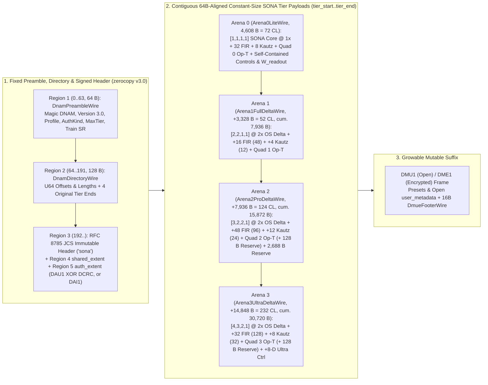

# `.dnam` Hybrid Binary Container & `< 50 ns` Zero-Copy Hardware Loader

DNAM defines four companion **64-byte cache-line and SIMD-aligned `v3.0` (`"architecture": "sona"`) Hybrid Binary Container formats** engineered via declarative `zerocopy` wire structs (`ref[repo.code.zerocopy-wire-structs]`) with **zero legacy `v2` or `TORA` backwards compatibility** ([`REQ-5.1`, `REQ-5.6`](../../requirements/system_goals_and_requirements.md#6-goal-5--single-run-slimmable-multi-tier-architecture-lite--full--pro--ultra), [`REQ-8.1`, `REQ-8.8`](../../requirements/system_goals_and_requirements.md#9-goal-8--model-provenance-hardware-drm-forensic-watermarking--marketplace-security), [`ADR-0007`](../../adr/0007-exact-integer-control-bus-and-tempo-inversion.md), [`ADR-0009`](../../adr/0009-jcs-prefix-signing-hpke-and-preview-containment.md), [`ADR-0020`](../../adr/0020-modular-monorepo-and-dnam-proj-container.md), [`ADR-0022`](../../adr/0022-sona-state-space-operator-and-webgpu-architecture.md)):

1. `r[container.dnam.formats]` **`.dnam` (Magic `b"DNAM"`, Version `3.0`, `"architecture": "sona"`):** Runtime deployment model built from `#[repr(C)]` `zerocopy::byteorder::little_endian::{U16, U32, U64, F32, F64}` structs (`FromBytes, IntoBytes, KnownLayout, Immutable`): a `64 B` `DnamPreambleWire`, `128 B` `DnamDirectoryWire`, RFC 8785 JCS immutable header, Region 4 `shared_extent` (`P * 64 B` `ControlClampDescriptorWire` table + overflow `CP1` contributor stream), Region 5 `auth_extent` (for `Open`, a signed `DAU1` authentication envelope with `FLAG_HAS_SIGNATURES` set **XOR** an unsigned `64 B` `DcrcAuthRecordWire` with `FLAG_HAS_SIGNATURES == 0`; for `DeviceAllowlisted`, a `DAI1` envelope), four nested compile-time `const` `SonaTierSpec` L1D-resident payloads (`Arena0LiteWire..Arena3UltraDeltaWire`: `Lite ⊂ Full ⊂ Pro ⊂ Ultra`, self-contained `1x`-calibrated `Arena 0` + `2x`-OS `Arena 1..3` deltas with zero `rate_1x_cal`, cumulative `64 B`-aligned bounds `4,608 / 7,936 / 15,872 / 30,720 B` and `ActiveHot <= 4,608 / 7,936 / 15,872 / 30,720 B` locked at `Gate 0b`), and a growable `DMU1`/`DME1` + `DMUE` mutable suffix. Loaders reject `version_major != 3 || version_minor != 0` or non-`"sona"` headers fail-fast with `DnamError::UnsupportedVersion`.
2. **`.dnam-proj` (Magic `b"DNPJ"`, Version `3.0`):** Single-file cloud-ready project and Capture Vault container front-loading a `64 B` preamble, content-addressed `SHA-256` chunk directory, and RFC 8785 JCS manifest for `HTTP Range` inspection alongside `CALB`, `SPCM`, `INPC`/`STMC` `2.0–2.5 s` full-bandwidth (`20 Hz–20 kHz`) `fp32` capsules, `STAT` cached `StarCenter` trajectories & fixed-`const` `uplo='U'` sufficient statistics, `WGHT` embedded `v3.0` `.dnam` weights, and `AUTH` provenance ([`project_container_format.md`](project_container_format.md)).
3. **`.dnam-seal` (Magic `b"DNSL"`, Version `3.0`):** Opaque 64-byte-aligned OEM hardware-enclave wrapper (`DnamProtectionProfile::EnclaveSealed`, `DSA1` manifest; see [`../security/provenance_and_enclave_drm.md` §3](../security/provenance_and_enclave_drm.md#3-pillar-2-hardware-enclave--oem-drm-oemdevicecertificate-attestation--dnam-seal-bdnsl-wrapper)).
4. **`.dnam-prev` (`container_kind: "preview"`, Version `3.0`):** Dedicated `Lite`-only storefront auditioning container that physically omits `Full`, `Pro`, and `Ultra` payloads while retaining self-contained `Arena 0` control descriptors and `Lite` `CP1`/`W_readout` slices ([`../security/watermarking_and_marketplace.md` §3](../security/watermarking_and_marketplace.md#3-commercial-storefront-platform-auditioning-royalty-splits--storefront-metadata)).

---

## 1. Hybrid Binary Container Wire Framing & `< 50 ns` Zero-JSON Hardware Fast-Path

`r[container.dnam.wire-framing]`



```text
+-----------------------------------------------------------------------+ 0x0000 (Byte 0, 64B-aligned)
| 1. DnamPreambleWire (#[repr(C, align(64))], zerocopy LE)              |
|    • 0..4:   magic = "DNAM" (.dnam-seal uses DnslPreambleWire)       |
|    • 4..8:   version_major = 3 (U16), version_minor = 0 (U16)         |
|    • 8..12:  protection_profile(u8), auth_kind(u8), maximum_tier(u8)  |
|    • 12..16: sample_rate_train_hz = 48000 (U32) | 16..64: zero (48 B) |
+-----------------------------------------------------------------------+ 0x0040 (Byte 64, 64B-aligned)
| 2. DnamDirectoryWire (#[repr(C)], 128 B, zerocopy U64 LE)             |
|    • 0..16:  immutable_header_offset = 192, immutable_header_length   |
|    • 16..32: shared_binary_offset, shared_binary_length               |
|    • 32..48: authentication_envelope_offset, auth_envelope_length     |
|    • 64..104: tier_start (U64) + original_tier_ends[4] (Lite..Ultra)  |
+-----------------------------------------------------------------------+ 0x00C0 (Byte 192, 64B-aligned)
| 3. Canonical RFC 8785 JCS Immutable JSON Header ("sona") + Zero Pad   |
+-----------------------------------------------------------------------+ shared_binary_offset (64B-aligned)
| 4. Shared Binary Descriptors (shared_extent: P * 64B ControlClamp-    |
|    DescriptorWire Table + Overflow CP1 Stream) + Zero Pad to 64 B     |
+-----------------------------------------------------------------------+ authentication_envelope_offset (64B)
| 5. Region 5 auth_extent (DAU1 XOR 64B DCRC Open / DAI1 Prot.) + Pad   |
+=======================================================================+ tier_start (64B-aligned)
| 6A. Arena 0: Arena0LiteWire [tier_start .. lite_end]                  | <- Lite strip boundary
|     (Includes self-contained Lite controls, CP1, U_int, W_ctrl & RO)  |
+-----------------------------------------------------------------------+ original_tier_ends[0] (64B-aligned)
| 6B. Arena 1: Arena1FullDeltaWire [lite_end .. full_end]               | <- Full strip boundary
+-----------------------------------------------------------------------+ original_tier_ends[1] (64B-aligned)
| 6C. Arena 2: Arena2ProDeltaWire [full_end .. pro_end]                 | <- Pro strip boundary
+-----------------------------------------------------------------------+ original_tier_ends[2] (64B-aligned)
| 6D. Arena 3: Arena3UltraDeltaWire [pro_end .. ultra_end]              | <- Ultra strip boundary
+=======================================================================+ retained_tier_end (64B-aligned)
| 7. Growable Mutable Frame (DMU1 Open / DME1 HPKE) + 16-Byte           |
|    DmueFooterWire (magic "DMUE" + U64 frame_len + U32 reserved=0)     |
+-----------------------------------------------------------------------+ EOF
```

### 1.1 Preamble & Directory Invariants

`r[container.dnam.preamble-directory]`

All integer and floating-point fields use `zerocopy::byteorder::little_endian::{U16, U32, U64, F32, F64}` (`#[repr(C)]` deriving `FromBytes, IntoBytes, KnownLayout, Immutable`, adding `Unaligned` wherever cast from arbitrary byte slices, with compile-time `size_of` / alignment assertions and `#![forbid(unsafe_code)]`, `ref[repo.code.zerocopy-wire-structs]`). Every binary region start (`shared_binary_offset`, `authentication_envelope_offset`, `tier_start`, and each issued `original_tier_ends[t]`) is `64 B`-aligned, strictly ordered, and checked against `u64` overflow before allocation (`validate_v3_dnam_layout_no_alloc`). Region 4 (`shared_extent`) packs the `P * 64 B` `ControlClampDescriptorWire` table followed by any overflow `CP1` contributor stream (`ADR-0007`), while `Arena0LiteWire` also embeds self-contained `Lite` control tables so tier stripping preserves parametric controls. Header `slimmable_tiers.*.arena_end_byte_offset` and `tensor_directory.*.byte_offset` values are relative to `tier_start` so lower-tier buyer issuances retain the creator-signed immutable header unmodified.

**Clean-Room Outer Framing Wire Structs (Exact Byte Offsets):**

1. **`DnamPreambleWire` (`64 B`, `#[repr(C, align(64))]`, file offset `0..64`):**

| Offset | Bytes | LE Wire Type | Field Name | Clean-Room Validation Invariant |
| :---: | :---: | :--- | :--- | :--- |
| `0..4` | `4` | `[u8; 4]` | `magic` | Exact `b"DNAM"` (`.dnam-seal` uses `DnslPreambleWire` defined in [`../security/provenance_and_enclave_drm.md` §3](../security/provenance_and_enclave_drm.md#3-pillar-2-hardware-enclave--oem-drm-oemdevicecertificate-attestation--dnam-seal-bdnsl-wrapper), never `DnamPreambleWire`) |
| `4..6` | `2` | `u16le` | `version_major` | Must equal `3` |
| `6..8` | `2` | `u16le` | `version_minor` | Must equal `0` |
| `8..9` | `1` | `u8` | `protection_profile` | `0 = Open`, `1 = DeviceAllowlisted`, `2 = EnclaveSealed`; `> 2` rejected |
| `9..10` | `1` | `u8` | `auth_kind` | `0 = CreatorOnly`, `1 = CreatorAndMarketplace`; `> 1` rejected |
| `10..11` | `1` | `u8` | `maximum_tier` | `0 = Lite`, `1 = Full`, `2 = Pro`, `3 = Ultra`; `> 3` rejected |
| `11..12` | `1` | `u8` | `reserved_flag` | Must equal `0` |
| `12..16` | `4` | `u32le` | `sample_rate_train_hz` | Must equal `48_000` |
| `16..64` | `48` | `[u8; 48]` | `reserved_pad` | All `48` bytes must equal `0x00` |

2. **`DnamDirectoryWire` (`128 B`, `align(1)`, file offset `64..192`):**

| Offset | Bytes | LE Wire Type | Field Name | Clean-Room Validation Invariant |
| :---: | :---: | :--- | :--- | :--- |
| `0..8` | `8` | `u64le` | `immutable_header_offset` | Must equal `192` (`V3_PREAMBLE_SIZE + V3_DIRECTORY_SIZE`) |
| `8..16` | `8` | `u64le` | `immutable_header_length` | Unpadded UTF-8 RFC 8785 JCS JSON byte length (`> 0`) |
| `16..24` | `8` | `u64le` | `shared_binary_offset` | `64 B`-aligned, `>= align64(immutable_header_offset + immutable_header_length)` |
| `24..32` | `8` | `u64le` | `shared_binary_length` | Unpadded byte span of `P * 64 B` descriptors + `CP1` stream |
| `32..40` | `8` | `u64le` | `authentication_envelope_offset` | `64 B`-aligned, `>= align64(shared_binary_offset + shared_binary_length)` |
| `40..48` | `8` | `u64le` | `authentication_envelope_length` | Byte span of Region 5 `auth_extent`: for `Open`, signed `DAU1` envelope (`FLAG_HAS_SIGNATURES` set) **XOR** `64 B` unsigned `DcrcAuthRecordWire` (`magic = b"DCRC"`, `FLAG_HAS_SIGNATURES == 0`) — mutually exclusive; for `DeviceAllowlisted`, `DAI1` envelope |
| `48..56` | `8` | `u64le` | `reserved_offset` | Must equal `0` |
| `56..64` | `8` | `u64le` | `reserved_capacity` | Must equal `0` |
| `64..72` | `8` | `u64le` | `tier_start` | `64 B`-aligned start of `Arena 0` (`>= align64(auth_offset + auth_len)`) |
| `72..104` | `32` | `[u64le; 4]` | `original_tier_ends` | `[lite_end, full_end, pro_end, ultra_end]`, `64 B`-aligned (`end[t] - tier_start == ARENA_*_BYTES` through `maximum_tier`, monotone `end[t] <= end[t+1]`) |
| `104..128` | `24` | `[u8; 24]` | `reserved_tail` | All `24` bytes must equal `0x00` |

3. **`DcrcAuthRecordWire` (`64 B`, `align(1)`, Region 5 `auth_extent` when unsigned) & In-Memory `FLAG_*` Bitmask (`flags_hint`):**
   For `Open` containers (`protection_profile = 0`), Region 5 (`auth_extent`) holds **either** a signed `DAU1` authentication envelope (`FLAG_HAS_SIGNATURES` set) **XOR** a `64 B` unsigned `DcrcAuthRecordWire` (`magic = b"DCRC"`, `FLAG_HAS_SIGNATURES == 0`) — mutually exclusive.

| Offset | Bytes | LE Wire Type | Field Name | Clean-Room Validation Invariant |
| :---: | :---: | :--- | :--- | :--- |
| `0..4` | `4` | `[u8; 4]` | `magic` | Exact `b"DCRC"` |
| `4..8` | `4` | `u32le` | `crc_prefix` | Castagnoli `CRC-32C` over container bytes `[0..authentication_envelope_offset]` |
| `8..24` | `16` | `[u32le; 4]` | `crc_tiers` | Cumulative `CRC-32C` over `[tier_start..original_tier_ends[t]]` (`0` for unretained tiers) |
| `24..26` | `2` | `u16le` | `num_controls` | Total control count `P` (`controls_schema.len()`) |
| `26..28` | `2` | `u16le` | `flags_hint` | Runtime `FLAG_*` bitmask (`1<<0` `LITE`, `1<<1` `FULL_DELTA`, `1<<2` `PRO_DELTA`, `1<<3` `ULTRA_DELTA`, `1<<9` `STEREO_OUT`, `1<<10` `HAS_SIGNATURES` (`0` in unsigned `DcrcAuthRecordWire`), `1<<11` `ENCRYPTED_ARENA`) |
| `28..32` | `4` | `u32le` | `tail_time_ms_bits` | IEEE-754 `f32::to_bits()` of `io_config.tail_time_ms` |
| `32..64` | `32` | `[u8; 32]` | `reserved_pad` | All `32` bytes must equal `0x00` |

4. **`ControlClampDescriptorWire` (`64 B`, `align(1)`, repeated `P` times in `shared_extent`) & `ConditionalClampRuleWire` (`8 B`):**

| Offset | Bytes | LE Wire Type | Field Name | Clean-Room Validation Invariant |
| :---: | :---: | :--- | :--- | :--- |
| `0..1` | `1` | `u8` | `ctrl_kind` | `0 = Range`, `1 = Switch`, `2 = BilinearCrossTerm` (`aux` / `partner_control_id` pairs two range controls to emit `psi = u_norm(ctrl) * u_norm(partner)`), `0xFF = UnusedSlot` |
| `1..2` | `1` | `u8` | `lobatto_degree` | Lobatto degree `k` (`Range`), or `num_declared_options - 1` (`Switch`) |
| `2..4` | `2` | `u16le` | `active_options_mask` | Observed/active switch option bitmask |
| `4..8` | `4` | `f32le` | `default_val` | Default physical value (`Range`) or option index (`Switch`) |
| `8..12` | `4` | `f32le` | `safe_min_base` | Unconditional base lower physical bound |
| `12..16` | `4` | `f32le` | `safe_max_base` | Unconditional base upper physical bound |
| `16..20` | `4` | `f32le` | `scale_norm` | Pre-inverted normalization scale `2.0 / (x_max - x_min)` so `x_norm = clamp(x_clamped * scale_norm + offset_norm, -1.0, +1.0)` maps `[x_min, x_max]` linearly into `[-1.0, +1.0]` |
| `20..24` | `4` | `f32le` | `offset_norm` | Normalization offset `-(x_max + x_min) / (x_max - x_min)` pairing with `scale_norm` so `[x_min, x_max]` maps linearly into `[-1.0, +1.0]` |
| `24..36` | `12` | `[f32le; 3]` | `anchor_nodes_norm` | Normalized Lobatto anchor coordinates `t in [-1, +1]` |
| `36..40` | `4` | `u32le` | `_reserved` | Must equal `0` |
| `40..64` | `24` | `[ConditionalClampRuleWire; 3]` | `cond_rules` | Up to `3` conditional bounds (`8 B` each: `+0..2` `switch_ctrl_idx: u16le`, `+2` `switch_opt_idx: u8`, `+3` `rule_op: u8` (`0=none, 1=max_ceil, 2=min_floor`), `+4..8` `bound_val: f32le`) |

### 1.2 Open `.dnam` Structural Layout

`r[container.dnam.open-layout]`

The fixed `64 B` `DnamPreambleWire` (`0..63`) and `128 B` `DnamDirectoryWire` (`64..191`) enforce `version_major = 3`, `version_minor = 0`, `protection_profile = 0` for `Open`, and `auth_kind = 0` (creator-only) or `1` (creator + buyer). Stripping a container to tier `T` (`strip_container_to_tier`) retains the original preamble, directory, immutable header, shared binary, authentication envelope, and tier payloads through `original_tier_ends[T]` (preserving full `Arena 0` controls even when `T = Lite`), placing the mutable frame and `DmueFooterWire` immediately after `original_tier_ends[T]` without re-signing.

#### Open Mutable Frame

`r[container.dnam.mutable-frame]`

Immediately after the retained tier boundary, every Open container places a growable `DMU1` frame (`Dmu1HeaderWire`, `16 B`) followed by a `16 B` `DmueFooterWire` (`#[repr(C)]`, `zerocopy`):

| Region / Struct | Offset (rel. frame) | Bytes | LE Wire Type | Field & Invariant |
| :--- | :---: | :---: | :--- | :--- |
| **`Dmu1HeaderWire` (`16 B`)** | `0..4` | `4` | `[u8; 4]` | `magic`: ASCII `"DMU1"` |
| **`Dmu1HeaderWire`** | `4..8` | `4` | `u32le` | `crc32c`: Castagnoli `CRC-32C` (`poly 0x82F63B78`, init/XOR `0xFFFFFFFF`; `"{}" = 0xA1CCB48F`, `"123456789" = 0xE3069283`) over `"DMU1" \|\| u64le(json_len) \|\| JSON` |
| **`Dmu1HeaderWire`** | `8..16` | `8` | `u64le` | `json_len`: Unpadded UTF-8 RFC 8259 JSON object byte length `N` (`N >= 2`) |
| **JSON Payload** | `16..16+N` | `N` | `[u8; N]` | UTF-8 RFC 8259 JSON object (no BOM, no duplicate keys) |
| **Zero Pad** | `16+N..EOF-16` | `pad` | `[u8; pad]` | Optional zero-filled `0x00` padding |
| **`DmueFooterWire` (`16 B`)** | `EOF-16..EOF-12` | `4` | `[u8; 4]` | `magic`: ASCII `"DMUE"` |
| **`DmueFooterWire`** | `EOF-12..EOF-4` | `8` | `u64le` | `frame_len`: Byte span of the mutable frame immediately preceding this footer |
| **`DmueFooterWire`** | `EOF-4..EOF` | `4` | `u32le` | `reserved`: Must equal `0` |

Protected containers replace `DMU1` with the HPKE-wrapped `DME1` frame using the same `16 B` `DmueFooterWire` ([`../security/provenance_and_enclave_drm.md` §3.3](../security/provenance_and_enclave_drm.md#encrypted-mutable-suffix)).

#### Mutable JSON Members

`r[container.dnam.mutable-json]`

| Member | Type & Specification |
| :--- | :--- |
| `version` | Optional mutable envelope version (`1` when present; omitted defaults to `1`). |
| `presets` | Array of preset objects (`id`, `name`, `controls: dict[str, float \| str]`, optional `description`, `user_metadata`). |
| `user_metadata` | Open JSON object for model-level catalog tags and host data. |
| `control_user_metadata` | Object mapping signed `control_id` strings to open metadata objects. |
| `stem_user_metadata` | Object mapping signed `stem_id` strings to open metadata objects. |

On container load, the loader validates `Dmu1HeaderWire`/`Dme1HeaderWire` CRC-32C and `DmueFooterWire` via zero-copy `Ref::from_bytes` and merges mutable `presets`, `user_metadata`, `control_user_metadata`, and `stem_user_metadata` over the signed immutable header view without modifying the authenticated prefix bytes. Loading a partial preset restores signed defaults for all omitted controls at the effective tier before overlaying the preset's assignments and applying whole-batch conditional clamping ([`../dsp/parametric_control_bus.md` §2.4.1](../dsp/parametric_control_bus.md#conditional-batch-safety)).

---

## 2. Tier-Prefix Hardware Loading

### 2.1 Lower-Block-Triangular Tier Payloads

`r[container.dnam.tier-prefix]`

Every tier's runtime topology is locked to a compile-time `const` `SonaTierSpec` (`LITE_SPEC ⊂ FULL_SPEC ⊂ PRO_SPEC ⊂ ULTRA_SPEC`, `0` capture-time tier resizing, `ref[arch.tiers.maximize-quality-within-budget]`), yielding constant-size `zerocopy` arena structs whose cumulative boundaries align strictly to `64 B` cache lines (`ARENA_LITE_BYTES = 4,608 B / 72 CL`, `ARENA_FULL_BYTES = 7,936 B / 124 CL`, `ARENA_PRO_BYTES = 15,872 B / 248 CL`, `ARENA_ULTRA_BYTES = 30,720 B / 480 CL`):
- **`Arena0LiteWire` (`Arena 0`, `0..4,608 B`, `72 CL`, 100% Self-Contained):** Stores the `1x`-calibrated `48 kHz` `Lite` (`[1,1,1,1]`) base parameters, `Stage0CrossbarWire` (`S_router`, `SonaMetaWire`, `SonaOsAndExtWire`, `SonaCellDescWire`, `4`-lane `Q0.32` phasors, `Op-P` config), `32` early FIR taps + `8` Kautz pairs, `Quad 0` `Op-T` tank (`M = 4`), `VarProReadoutLiteWire` (`Lite` `fp16` `W_readout`), and **self-contained base control tables (`Arena0ControlBusWire`: `CP1` dir/stream, `U_int`, `W_ctrl`)**. Extracting or running `Lite` reads `Arena 0` directly without touching `Arena 1..3` (`REQ-5.6`).
- **`Arena1FullDeltaWire..Arena3UltraDeltaWire` (`Arena 1..3`, `4,608..30,720 B`, `2x`-OS Calibrated):** Store causally nested `2×`-OS calibrated `Full` (`[2,2,1,1]`, `+3,328 B = 52 CL`), `Pro` (`[3,2,2,1]`, `+7,936 B = 124 CL`), and `Ultra` (`[4,3,2,1]`, `+14,848 B = 232 CL`) state deltas, incremental Stage III FIR/Kautz blocks, `Op-T` quads/diffusers, per-tier `VarPro` readout deltas, and `Arena3ControlBusWire` (`+8-D` `Ultra` `ControlBus`, `REQ-5.1`, `REQ-5.2`). Analytical ZOH converts `1x`/`2x` models cleanly to any host sample rate (`44.1–384 kHz`) without duplicating weights: **`rate_1x_cal` / `V3_META_RATE_1X_CAL` is completely eliminated**. All `reserve` regions (`SonaCoreProDeltaWire.reserve [u8; 2_688]` at `9,856..12,544`, `SonaCoreUltraDeltaWire.reserve [u8; 2_432]` at `20,096..22,528`, `Arena3ControlBusWire.reserve [u8; 576]` at `30,144..30,720`, `stage4_pro[1]` at `13,440..13,568`, and `stage4_ultra[1]` at `23,168..23,296`) are zeroed (`0x00`) in unwatermarked `.dnam` containers (non-zero only in Tardos Role B watermarked distribution copies), preserving exact `64 B` alignment and `ARENA_PRO_BYTES = 15,872 B` / `ARENA_ULTRA_BYTES = 30,720 B`.

### 2.2 Model-Declared Delay Histories (`delay_histories`)

`r[container.dnam.delay-histories]`

The signed immutable JSON header declares all required `Op-T` delay and all-pass histories in `delay_histories`, honoring `bytes_per_sample` `a ∈ {2, 4}` (`"fp16"` inline/cold on `Lite`/`Full`, optional `"fp16"` or `"f32"` cold `ext_lines` on `Pro`/`Ultra` for ultra-low-floor `30 s` shimmer tails):

```json
{
  "id": "tank.quad0.line0",
  "stage": "op_t_tank",
  "kind": "fractional",
  "introduced_tier": "lite",
  "sample_format": "fp16",
  "reference_samples": { "lite": "432000" }
}
```

Each `reference_samples` entry is canonical ASCII decimal text parsed as a nonzero `u64` (avoiding IEEE-754 `binary64` integer limits) and admitted against the host memory ceiling on the cold path ([`../dsp/op_t_transport.md` §1.1](../dsp/op_t_transport.md#11-exact-sized-delay-histories-and-branchless-wrap)).

### 2.3 Pre-Packed SIMD Data, `zerocopy` Descriptors & Load-Time Validation

`r[container.dnam.load-validation]`

Loaders validate all `zerocopy` wire headers, tensor offsets, 64-byte alignments, shapes, finite coefficients, and signature commitments (`SonaCellDescWire`, `#[repr(C)]` with `FromBytes, IntoBytes, KnownLayout, Immutable`) before exposing zero-copy `SonaHotSlab` views, and initialize recursive `TPT-SVF`, `ParaLRU`, and `Op-T` states to exact resting zero equilibrium ([`../dsp/op_n_commuted_cascade.md` §3.4](../dsp/op_n_commuted_cascade.md#34-boundary-conditions-resting-dc-equilibrium--pop-free-startup)).

`r[container.dnam.tensor-directory]` **Canonical 64B-Aligned Constant-Size Tier Arena Slice Directory (`ADR-0022`, `ref[repo.code.zerocopy-wire-structs]`):**
Every slice declared in `tensor_directory` has a 64-byte-aligned `byte_offset` relative to `tier_start` (`byte_offset % 64 == 0`), a `byte_length` within its owning tier's constant-size `Arena*Wire` cumulative prefix boundary `original_tier_ends[t] - tier_start` (`4,608 / 7,936 / 15,872 / 30,720 B`, `72 / 124 / 248 / 480 CL` across `Lite / Full / Pro / Ultra`, with `ActiveHot <= 4,608 / 7,936 / 15,872 / 30,720 B`), and maps directly onto the packed `zerocopy` wire structs below (`align(1)` unaligned castable `FromBytes, IntoBytes, KnownLayout, Immutable, Unaligned`):

| Slice Identifier | Arena Offset (`rel. tier_start`) | Bytes (`64 B` CL) | Wire Struct & Canonical Contents |
| :--- | :---: | :---: | :--- |
| `stage0_crossbar_phasors` | `0..256` (`Arena 0`) | `256 B` (`4 CL`) | `Stage0CrossbarWire`: `s_router`, `SonaMetaWire`, `SonaOsAndExtWire`, `SonaPhasorsAndDescWire` (`SonaCellDescWire` + `4× Q0.32` + gate/crossbar) |
| `sona_core_lite` | `256..1,408` (`Arena 0`) | `1,152 B` (`18 CL`) | `SonaCoreLiteWire`: `groups: [SonaGroupWire; 4]` (`768 B`) + `tiles: [SonaInterBlockTilePairWire; 3]` (`384 B`) |
| `stage3_early_fir_lite` | `1,408..1,664` (`Arena 0`) | `256 B` (`4 CL`) | `Stage3Fir32Wire`: `32` L + `32` R `f32le` taps (`STAGE3_EARLY_FIR_BASES[0] = 1,408`) |
| `stage3_kautz_modals_lite` | `1,664..1,920` (`Arena 0`) | `256 B` (`4 CL`) | `[KautzSoaBlockWire; 2]`: `8` pairs = `16` poles (`STAGE3_KAUTZ_BASES[0] = 1,664`) |
| `stage4_tank_lite` | `1,920..2,048` (`Arena 0`) | `128 B` (`2 CL`) | `Stage4QuadWire`: `Quad 0` (`lines 0..4`, `M = 4`, LFO, VCA, Schroeder, `ext_format`; `128`-frame/`1,024 B` `[[u16; 4]; 128]` inline ring in `SonaHotSlab`; `STAGE4_DELAY_BASES[0] = 1,920`) |
| `varpro_readout_lite` | `2,048..2,688` (`Arena 0`) | `640 B` (`10 CL`) | `VarProReadoutLiteWire`: M/S gains + `stage_latent_mods_fp16[96]` + `w_ro_fp16[208]` (`VARPRO_READOUT_BASES[0] = 2,048`) |
| `control_bus_lite` | `2,688..4,608` (`Arena 0`) | `1,920 B` (`30 CL`) | `Arena0ControlBusWire`: `lfo/drift/env`, `cp1_dir`, `u_int_base`, `cp1_base`, `w_ctrl`, `rho_head_and_ctrl_tail` (`ARENA_LITE_BYTES = 4,608`) |
| `sona_core_full` | `4,608..6,528` (`Arena 1`) | `1,920 B` (`30 CL`) | `SonaCoreFullDeltaWire`: `groups[2]` (`384 B`) + `tiles[10]` (`1,280 B`) + `SonaCrossbarBlockWire` (`256 B`) |
| `stage3_early_fir_full` | `6,528..6,656` (`Arena 1`) | `128 B` (`2 CL`) | `Stage3Fir16Wire`: `+16` L/R taps (`48` cum., `STAGE3_EARLY_FIR_BASES[1] = 6,528`) |
| `stage3_kautz_modals_full` | `6,656..6,784` (`Arena 1`) | `128 B` (`2 CL`) | `[KautzSoaBlockWire; 1]`: `+4` pairs (`12` cum., `STAGE3_KAUTZ_BASES[1] = 6,656`) |
| `stage4_tank_full` | `6,784..6,912` (`Arena 1`) | `128 B` (`2 CL`) | `Stage4QuadWire`: `Quad 1` (`lines 4..8`, `M = 8` cum. lines; `STAGE4_DELAY_BASES[1] = 6,784`) |
| `varpro_readout_full` | `6,912..7,936` (`Arena 1`) | `1,024 B` (`16 CL`) | `VarProReadoutFullWire`: `Stage3PrefixOverrideFullWire` (`192 B`) + `w_ro_and_mods_fp16[416]` (`ARENA_FULL_BYTES = 7,936`) |
| `sona_core_pro` | `7,936..12,544` (`Arena 2`) | `4,608 B` (`72 CL`) | `SonaCoreProDeltaWire`: `groups[2]` (`384 B`) + `tiles[10]` (`1,280 B`) + `crossbar_pro` (`256 B`) + `reserve: [u8; 2_688]` (`0` unless Tardos Role B watermarked) |
| `stage3_early_fir_pro` | `12,544..12,928` (`Arena 2`) | `384 B` (`6 CL`) | `Stage3Fir48Wire`: `+48` L/R taps (`96` cum., `STAGE3_EARLY_FIR_BASES[2] = 12,544`) |
| `stage3_kautz_modals_pro` | `12,928..13,312` (`Arena 2`) | `384 B` (`6 CL`) | `[KautzSoaBlockWire; 3]`: `+12` pairs (`24` cum., `STAGE3_KAUTZ_BASES[2] = 12,928`) |
| `stage4_tank_pro` | `13,312..13,568` (`Arena 2`) | `256 B` (`4 CL`) | `[Stage4QuadWire; 2]`: `[0]` = `Quad 2` (`lines 8..12`, `M = 12` cum. lines), `[1]` = zero-filled `128 B` alignment `reserve` (never `Quad 3`; `0` unless Tardos Role B watermarked; `STAGE4_DELAY_BASES[2] = 13,312`) |
| `varpro_readout_pro` | `13,568..15,872` (`Arena 2`) | `2,304 B` (`36 CL`) | `VarProReadoutProWire`: `Stage3PrefixOverrideProWire` (`384 B`) + `w_ro_and_mods_fp16[960]` (`ARENA_PRO_BYTES = 15,872`) |
| `sona_core_ultra` | `15,872..22,528` (`Arena 3`) | `6,656 B` (`104 CL`) | `SonaCoreUltraDeltaWire`: `groups[2]` + `tiles[12]` + `crossbar_ultra` + `stage_latent_core_mods_fp16[1_024]` (`0` unless `V3_META_CORE_MODS_PRESENT`) + `reserve[2_432]` (`0` unless Tardos Role B watermarked) |
| `stage3_early_fir_ultra` | `22,528..22,784` (`Arena 3`) | `256 B` (`4 CL`) | `Stage3Fir32Wire`: `+32` L/R taps (`128` cum., `STAGE3_EARLY_FIR_BASES[3] = 22,528`) |
| `stage3_kautz_modals_ultra` | `22,784..23,040` (`Arena 3`) | `256 B` (`4 CL`) | `[KautzSoaBlockWire; 2]`: `+8` pairs (`32` cum., `STAGE3_KAUTZ_BASES[3] = 22,784`) |
| `stage4_tank_ultra` | `23,040..23,296` (`Arena 3`) | `256 B` (`4 CL`) | `[Stage4QuadWire; 2]`: `[0]` = `Quad 3` (`lines 12..16`, `M = 16` cum. lines, `8`-stage diffuser), `[1]` = zero-filled `128 B` alignment `reserve` (never overwrites `Quads 0..2`, preserving `ref[dsp.head.tier-equivalence]`; `0` unless Tardos Role B watermarked; `STAGE4_DELAY_BASES[3] = 23,040`) |
| `varpro_readout_ultra` | `23,296..26,880` (`Arena 3`) | `3,584 B` (`56 CL`) | `VarProReadoutUltraWire`: `Stage3PrefixOverrideUltraWire` (`576 B`) + `w_ro_and_mods_fp16[1_504]` |
| `control_bus_ultra_delta` | `26,880..30,720` (`Arena 3`) | `3,840 B` (`60 CL`) | `Arena3ControlBusWire`: `w_ctrl_ultra` + `u_int_ultra` + `cp1_ultra` + `stage_latent_ctrl_ultra_fp16[256]` + `reserve[576]` (`0` unless Tardos Role B watermarked; `ARENA_ULTRA_BYTES = 30,720`) |

**Complete Clean-Room Byte-Offset Tables for `Arena0LiteWire..Arena3UltraDeltaWire`:**

1. **`Stage0CrossbarWire` (`256 B`, `Arena 0` `0..256`):**
   - `0..64`: `s_router: [[f32le; 4]; 4]` (`64 B`) — 4-port `S_router` (`S_ret->send == 0`).
   - `64..128`: `meta: SonaMetaWire` (`64 B`, `ARENA0_META_OFFSET = 64`):
     - `64..68` (`+0`): `pipeline_flags: u32le` (`ARENA0_PIPELINE_FLAGS_OFFSET = 64`) — upper half `PIPE_MAGIC_HI = 0x444E_0000` (`PIPE_MAGIC_MASK = 0xFFFF_0000`); lower bits: `1<<0` `PIPE_FLAG_ZERO_OP_T_PRE`, `1<<1` `PIPE_FLAG_STAGE1_EXT`, `1<<2` `PIPE_FLAG_STAGE2_EXT`, `1<<3` `PIPE_FLAG_STAGE3_EXT`, `1<<4` `PIPE_FLAG_STAGE4_EXT`, `1<<5` `PIPE_FLAG_UNIFIED_W_CTRL`, `1<<6` `PIPE_FLAG_V3_MATRYOSHKA`, `1<<7` `PIPE_FLAG_SONA` (`PIPE_FLAG_ALL_V2 = 0x00FF`).
     - `68..84` (`+4`): `tier_gain_trim: [f32le; 4]` (`ARENA0_TIER_GAIN_TRIM_OFFSET = 68`) — `[Lite, Full, Pro, Ultra]` output trim (`<= 0.05 LU`).
     - `84..88` (`+20`): `v3_meta_flags: u32le` (`ARENA0_V3_META_OFFSET = 84`, mirrored identically in `SonaCellDescWire.cell_flags` at `204..208`):
       - Bits `0..=3`: `tier_os2x[0..4]` (`1<<0` Lite, `1<<1` Full, `1<<2` Pro, `1<<3` Ultra).
       - Bit `4` (`0x0000_0010`): `V3_META_OS2X` (master `2×` oversampling enable).
       - Bit `5` (`0x0000_0020`): Reserved (`0`; legacy `rate_1x_cal` eliminated).
       - Bit `6` (`0x0000_0040`): `SONA_META_TIER_OS_EXPLICIT` — when `1`, bits `0..=3` authoritatively specify `tier_os2x[0..4]` verbatim so disabling `2×` OS on any tier round-trips without `SonaTierSpec.oversample_factor > 1` fallback override; when `0`, loaders OR bits `0..=3` with `[false, true, true, true]`.
       - Bit `7` (`0x0000_0080`): `V3_META_STAGE3_PREFIX_OVERRIDES`.
       - Bit `8` (`0x0000_0100`): `SONA_META_OS_EXT_PRESENT` — guards the full `64 B` `SonaOsAndExtWire` slice (`128..192`); when `1`, all `16` `f32le` fields (`os_ext` oversampler and Stage 0 extended mix/`Op-P` parameters across `128..192`) are decoded and clamped verbatim even when `os_up_quad_coeff == 0.0 && os_dec_c0 == 0.0`, preventing default replacement on reload.
       - Bit `9` (`0x0000_0200`): `V3_META_CORE_MODS_PRESENT` — guards `Arena 3` `SonaCoreUltraDeltaWire.stage_latent_core_mods_fp16[0..1024]` (`18,048..20,096` rel. `tier_start`); all `1,024` `u16le` entries (`2,048 B`) are zeroed (`0x0000`) unless this bit is set (`1`).
       - Bits `16..=20`: `1<<16` `V3_META_STAGE4_TAP_GAINS`, `1<<17` `V3_META_STAGE0_EXT`, `1<<18` `V3_META_STAGE0_ROUTE_CLEAN`, `1<<19` `V3_META_STAGE0_SUB2_PHASE`, `1<<20` `V3_META_STAGE4_LFO`.
     - `88..92` (`+24`): `dry_wet_mix: f32le` (`ARENA0_DRY_WET_OFFSET = 88`).
     - `92..96` (`+28`): `r_ac: f32le` (`ARENA0_R_AC_OFFSET = 92`).
     - `96..104` (`+32`): `stage0_gain: [f32le; 2]` (`ARENA0_STAGE0_PARAMS_OFFSET = 96`).
     - `104..120` (`+40`): `stage0_mix_matrix: [[f32le; 2]; 2]`.
     - `120..124` (`+56`): `stage0_xo_hz: f32le`.
     - `124..128` (`+60`): `anti_zipper_ramp_scale: f32le` (`ARENA0_ANTI_ZIPPER_RAMP_SCALE_OFFSET = 124`).
   - `128..192`: `os_ext: SonaOsAndExtWire` (`64 B`, `ARENA0_OS_PARAMS_OFFSET = 128`, 16 × `f32le` @ `+0..+64`): `os_up_quad_coeff (+0)`, `os_dec_c_prev1 (+4)`, `os_dec_c0 (+8)`, `os_up_pre_emph (+12)`, `os_dec_aa_mix (+16)`, `os_up_aa_mix (+20)`, `os_up_zoh_mix (+24)`, `stage0_xo_low_gain (+28)`, `stage0_xo_high_gain (+32)`, `stage0_clean_sub_mix (+36)`, `stage0_op_p_sub_mix (+40)`, `stage0_op_p_lpf_pole (+44)`, `stage0_op_p_env_pole (+48)`, `stage0_op_p_sub2_mix (+52)`, `stage0_op_p_oct_mix (+56)`, `stage0_op_p_env_mix (+60)`. Note `dec_c1 = 1.0 - os_dec_c_prev1 - os_dec_c0`.
   - `192..256`: `cell_phasors: SonaPhasorsAndDescWire` (`64 B`):
     - `192..208` (`+0..+16`): `cell_desc: SonaCellDescWire` (`16 B`, `align(1)`): `+0..4` `magic = b"SONA"`, `+4..6` `version_major = 3 (u16le)`, `+6..8` `version_minor = 0 (u16le)`, `+8..10` `tier_flags: u16le` (`0x01=Lite`, `0x03=Full`, `0x07=Pro`, `0x0F=Ultra`), `+10..12` `oversample_factor: u16le` (`1 | 2`), `+12..16` `cell_flags: u32le` (mirrors `v3_meta_flags`).
     - `208..224` (`+16..+32`): `phasor_freq_hz: [f32le; 4]`.
     - `224..240` (`+32..+48`): `phasor_init_phase_q32: [u32le; 4]`.
     - `240..256` (`+48..+64`): `gate_and_crossbar_fp16: [u16le; 8]` (IEEE-754 `binary16` RNE): `[0] gate_thresh`, `[1] gate_hyst`, `[2] gate_inv_knee`, `[3] gate_floor`, `[4] gate_atk_beta`, `[5] gate_rel_beta`, `[6] op_p_crossbar_gain`, `[7] op_t_crossbar_gain`.

2. **`SONA` Core Element & Delta Wire Structs (`Arena 0..3`):**

| Wire Struct | Bytes (`align(1)`) | Exact Relative Field Offsets & Types |
| :--- | :---: | :--- |
| **`SonaGroupWire`** (`4` lanes) | `192 B` | `0..16 svf_g [f32le; 4]`, `16..32 svf_k [f32le; 4]`, `32..48 lru_alpha_rel [f32le; 4]`, `48..64 lru_alpha_atk [f32le; 4]`, `64..80 lru_kappa [f32le; 4]`, `80..96 adaa_drive [f32le; 4]`, `96..112 lru_bias_drive [f32le; 4]`, `112..128 in_x_weight [f32le; 4]`, `128..136 tone_lp_fp16 [u16le; 4]`, `136..144 tone_bp_fp16 [u16le; 4]`, `144..152 tone_hp_fp16 [u16le; 4]`, `152..160 tone_ap_fp16 [u16le; 4]`, `160..168 tone_dir_fp16 [u16le; 4]`, `168..176 sag_depth_fp16 [u16le; 4]`, `176..184 wavefolder_mix_fp16 [u16le; 4]`, `184..192 rect_sign_fp16 [u16le; 4]` |
| **`SonaInterBlockTilePairWire`** | `128 B` | `0..64 w_odd_4x4 [[f32le; 4]; 4]`, `64..96 w_even_4x4_fp16 [[u16le; 4]; 4]`, `96..128 w_lru_4x4_fp16 [[u16le; 4]; 4]` |
| **`SonaCrossbarBlockWire`** | `256 B` | `0..80 op_p_to_group_fp16 [[u16le; 4]; 10]`, `80..160 phasor_to_group_fp16 [[u16le; 4]; 10]`, `160..224 opt_to_lr_fp16 [[u16le; 2]; 16]`, `224..240 phasor_stereo_phase_fp16 [u16le; 8]`, `240..256 crossbar_reserved_fp16 [u16le; 8]` |
| **`SonaCoreLiteWire`** (`Arena 0: 256..1,408`) | `1,152 B` | `0..768 groups [SonaGroupWire; 4]` (groups `0..4`), `768..1,152 tiles [SonaInterBlockTilePairWire; 3]` (tiles `0..3`) |
| **`SonaCoreFullDeltaWire`** (`Arena 1: 4,608..6,528`) | `1,920 B` | `0..384 groups [SonaGroupWire; 2]` (`4..6`), `384..1,664 tiles [SonaInterBlockTilePairWire; 10]` (`3..13`), `1,664..1,920 crossbar SonaCrossbarBlockWire` |
| **`SonaCoreProDeltaWire`** (`Arena 2: 7,936..12,544`) | `4,608 B` | `0..384 groups [SonaGroupWire; 2]` (`6..8`), `384..1,664 tiles [SonaInterBlockTilePairWire; 10]` (`13..23`), `1,664..1,920 crossbar_pro SonaCrossbarBlockWire`, `1,920..4,608 reserve [u8; 2_688]` (zeroed in unwatermarked `.dnam`; non-zero only in Tardos Role B watermarked copies; zero `rate_1x_*`) |
| **`SonaCoreUltraDeltaWire`** (`Arena 3: 15,872..22,528`) | `6,656 B` | `0..384 groups [SonaGroupWire; 2]` (`8..10`), `384..1,920 tiles [SonaInterBlockTilePairWire; 12]` (`23..35`), `1,920..2,176 crossbar_ultra SonaCrossbarBlockWire`, `2,176..4,224 stage_latent_core_mods_fp16 [u16le; 1_024]` (row-major `[k in 0..8][col in 0..128]`; zeroed unless `V3_META_CORE_MODS_PRESENT`), `4,224..6,656 reserve [u8; 2_432]` (zeroed in unwatermarked `.dnam`; non-zero only in Tardos Role B watermarked copies) |

   - **`SonaCoreUltraDeltaWire.stage_latent_core_mods_fp16[0..1024]` (`2,048 B` at `2,176..4,224`, `18,048..20,096` rel. `tier_start`):** Row-major `[k in 0..8][col in 0..128]` (`8 × 128 = 1,024` `fp16` entries) indexed strictly by unrotated stage latents `z_stage[0..8]` (`[ctrl_basis_4[0..4], z_stage_ultra[0..4]]`, `0-ULP` invariant under `SO(4)` gauge `Q_buyer` on `z_head[0..4]`). When `V3_META_CORE_MODS_PRESENT` (`0x0000_0200`) is set in `Ultra` mode (`D_s = 8`), at each `3 kHz` control boundary for global lane `l in 0..40`:
     - `col = l` (`0..40`): adds `sum_{k=0..7} fp16(k, l) * z_stage[k]` per-lane octave shift to `svf_g[l]` (combined with global `svf_g_oct` via `exp2`, clamped `[-3.0, +3.0]` oct total);
     - `col = 40 + l` (`40..80`): adds `sum_{k=0..7} fp16(k, 40 + l) * z_stage[k]` per-lane damping shift to `svf_k[l]` (combined with `svf_k_delta`, clamped `[0.0, 8.0]` total);
     - `col = 80 + l` (`80..120`): adds `sum_{k=0..7} fp16(k, 80 + l) * z_stage[k]` per-lane wavefolder mix delta onto `wavefolder_mix[l]` (clamped `[0.0, 1.0]`);
     - `col in 120..128`: reserved `0x0000`.
     When `V3_META_CORE_MODS_PRESENT == 0`, runtime skips `[0..1024]` (`0` MAC overhead). Tardos Role B never embeds into `stage_latent_core_mods_fp16` (leaving all `1,024` slots strictly unwatermarked for optional `Ultra` per-lane modulation); Arena 3 linear/reserve Tardos Role B carriers live strictly in the disjoint linear/reserve ranges itemized in [`watermarking_and_marketplace.md`](../security/watermarking_and_marketplace.md).

3. **Stage III, Stage IV & `VarPro` Readout Wire Structs (`Arena 0..3`):**

| Wire Struct | Bytes (`align(1)`) | Exact Relative Field Offsets & `Arena 0` Crossbar Sub-Slots |
| :--- | :---: | :--- |
| **`Stage3Fir16Wire` / `32Wire` / `48Wire`** | `128 / 256 / 384 B` | `fir_l: [f32le; N]` followed by `fir_r: [f32le; N]` for `N in {16, 32, 48}` (`STAGE3_EARLY_FIR_BASES = [1_408, 6_528, 12_544, 22_528]`) |
| **`KautzSoaBlockWire`** (`4` shared pairs) | `128 B` | `0..16 r_low`, `16..32 dr`, `32..48 theta`, `48..64 b_gamma`, `64..80 c_re_l`, `80..96 c_im_l`, `96..112 c_re_r`, `112..128 c_im_r` (all `[f32le; 4]`; `STAGE3_KAUTZ_BASES = [1_664, 6_656, 12_928, 22_784]`, `BLOCKS_PER_TIER = [2, 1, 3, 2]`, `TIER_CHANNEL_BASE = [0, 8, 12, 24]`) |
| **`Stage4QuadWire`** (`4` `Op-T` lines) | `128 B` | `0..16 delay_lengths [u32le; 4]`, `16..32 tap_gains [f32le; 4]`, `32..48 allpass_delays [u32le; 4]`, `48..64 allpass_g [f32le; 4]`, `64..68 g_loop`, `68..72 sigma_knee`, `72..76 base_psi`, `76..80 inject_gain`, `80..84 dry_mix`, `84..88 wet_mix`, `88..92 r_dc`, `92..96 vca_thresh`, `96..100 vca_kappa`, `100..104 vca_min_gain`, `104..108 vca_att`, `108..112 vca_rel`, `112..116 lfo_rate_hz`, `116..120 lfo_depth_samples`, `120..124 lfo_stereo_phase` (`f32le`), `124..128 ext_format u32le` (`STAGE4_DELAY_BASES = [1_920, 6_784, 13_312, 23_040]`; `Arena 0`: `Quad 0` `0..4`, `Arena 1`: `Quad 1` `4..8`, `Arena 2` `[Stage4QuadWire; 2]`: `[0]` `Quad 2` `8..12` + `[1]` zero-filled `128 B` `reserve` (never `Quad 3`), `Arena 3` `[Stage4QuadWire; 2]`: `[0]` `Quad 3` `12..16` + `[1]` zero-filled `128 B` `reserve` (never overwrites `Quads 0..2`, preserving `ref[dsp.head.tier-equivalence]`)) |
| **`Stage3PrefixOverrideFullWire`** | `192 B` | `0..64 fir_l [f32le; 16]`, `64..128 fir_r [f32le; 16]`, `128..144 c_re_l [f32le; 4]`, `144..160 c_im_l [f32le; 4]`, `160..176 c_re_r [f32le; 4]`, `176..192 c_im_r [f32le; 4]` (`VARPRO_READOUT_BASES[1] = 6,912`) |
| **`Stage3PrefixOverrideProWire`** | `384 B` | `0..128 fir_l [f32le; 32]`, `128..256 fir_r [f32le; 32]`, `256..288 c_re_l [f32le; 8]`, `288..320 c_im_l [f32le; 8]`, `320..352 c_re_r [f32le; 8]`, `352..384 c_im_r [f32le; 8]` (`VARPRO_READOUT_BASES[2] = 13,568`) |
| **`Stage3PrefixOverrideUltraWire`** | `576 B` | `0..192 fir_l [f32le; 48]`, `192..384 fir_r [f32le; 48]`, `384..432 c_re_l [f32le; 12]`, `432..480 c_im_l [f32le; 12]`, `480..528 c_re_r [f32le; 12]`, `528..576 c_im_r [f32le; 12]` (`VARPRO_READOUT_BASES[3] = 23,296`) |
| **`VarProReadoutLiteWire`** (`Arena 0: 2,048..2,688`) | `640 B` | `0..8 pre_cab_u_gain [f32le; 2]`, `8..16 pre_cab_hp_gain [f32le; 2]`, `16..24 direct_s2_u_gain [f32le; 2]`, `24..32 direct_s2_hp_gain [f32le; 2]`, `32..224 stage_latent_mods_fp16 [u16le; 96]` (`[0..80]` sequential `Lite` stage mods + `[80..96]` `op_p_to_group[0..4][0..4]`), `224..640 w_ro_fp16 [u16le; 208]` (`[0..192]` `16 lanes × 12` weights + `[192..208]` `phasor_to_group[0..4][0..4]`) |
| **`VarProReadoutFullWire`** (`Arena 1: 6,912..7,936`) | `1,024 B` | `0..192 prefix_override`, `192..1,024 w_ro_and_mods_fp16 [u16le; 416]` (`[0..288]` `24×12` weights, `[288..296]` M/S gains, `[296..328]` planar `fir_{l,r}[16..32]`, `[328..336]` `kautz_b_gamma[0..8]`, `[336..352]` interleaved `kautz_c[4..8]`, `[352..416]` `0`) |
| **`VarProReadoutProWire`** (`Arena 2: 13,568..15,872`) | `2,304 B` | `0..384 prefix_override`, `384..2,304 w_ro_and_mods_fp16 [u16le; 960]` (`[0..384]` `32×12` weights, `[384..392]` M/S gains, `[392..424]` planar `fir_{l,r}[32..48]`, `[424..436]` `kautz_b_gamma[0..12]`, `[436..452]` interleaved `kautz_c[8..12]`, `[452..960]` `0`) |
| **`VarProReadoutUltraWire`** (`Arena 3: 23,296..26,880`) | `3,584 B` | `0..576 prefix_override`, `576..3,584 w_ro_and_mods_fp16 [u16le; 1_504]` (`[0..480]` `40×12` weights, `[480..488]` M/S gains, `[488..584]` planar `fir_{l,r}[48..96]`, `[584..608]` `kautz_b_gamma[0..24]`, `[608..656]` interleaved `kautz_c[12..24]`, `[656..1_504]` `0`) |

   - **Single Static Base Readout Matrix (`W_ro,0`) & Gauge-Invariant `z_stage[0..D_s]` Sensitivity Domain:** `VarProReadoutLiteWire` (`640 B`) and `VarProReadout{Full,Pro,Ultra}Wire` store ONE static base `W_ro,0` matrix (`16×12` / `24×12` / `32×12` / `40×12`) rather than separate per-latent `W_{ro,r}` tensors; `3 kHz` latent sensitivity enters via `stage_latent_mods_fp16[0..80]`, `stage_latent_ctrl_ultra_fp16[0..256]`, and `W_ctrl` (driving `stage_targets[0..16]`). Because buyer `SO(4)` gauge `Q_buyer` rotates ONLY `z_head[0..4]` (and `cols 0..4` of `main_base`, `u_int_base`, `w_ctrl`, and `u_int_ultra` Block `0`) while `z_stage[0..D_s]` (`D_s = 4` `ctrl_basis_4[0..4]` on `Lite..Pro`; `D_s = 8` `[ctrl_basis_4[0..4], z_stage_ultra[0..4]]` on `Ultra`) corresponds to unrotated `cols 4..8` / `u_int_ultra` Blocks `1..2`, ALL `stage_latent_*` sensitivity tables index strictly `z_stage[0..D_s]` (never `z_head`).
   - **`VarProReadoutLiteWire` (`640 B`) exact sub-layouts:**
     - `stage_latent_mods_fp16[0..80]` (`80` `u16le` = `160 B`, in exact sequential order):
       - `[0..8]` `default_knobs[8]`: stores resting physical knob defaults in `[0.0, 1.0]^8` for standalone `Arena 0` preset/audit inspection (`0.0` additive runtime delta at `StarCenter` where `z_stage == 0`).
       - `[8..48]` Global `3 kHz` scalar sensitivities (`[8..16]` `w_svf_g_oct[8]`, `[16..24]` `w_svf_k_delta[8]`, `[24..32]` `w_kautz_oct[8]`, `[32..40]` `w_kautz_damp[8]`, `[40..48]` `w_tank_psi[8]`): index `k in 0..D_s` against `z_stage[k]` (indices `0..4` on `Lite..Pro`, all `0..8` on `Ultra`).
       - `[48..80]` Per-block `ADAA` & `ParaLRU` sensitivities (`Lite..Pro`, `D_s = 4`, no `Arena 3` dispatch): row-major `w_adaa_drive_scale[4][4]` (`[48..64]`) and row-major `w_lru_bias_shift[4][4]` (`[64..80]`) across `(k in 0..4, b in 0..4)`, dotted against `z_stage[0..4]` and added to `stage_targets[2 + b]` / `stage_targets[6 + b]` for cascade block `b in 0..4`. On `Ultra` (`D_s = 8`, `Arena 3` loaded), `Arena3ControlBusWire.stage_latent_ctrl_ultra_fp16[0..160]` (`[8][10]`) **supersedes (replaces, never sums with)** this `[48..80]` `[4][4]` subset.
       - Followed by `[80..96]` = row-major `op_p_to_group[0..4][0..4]` (`16`).
     - `w_ro_fp16[0..192]` (`16` lanes × `12` weights): for each global lane `l in 0..16`, the `12` consecutive `fp16` slots at `12 * l .. 12 * l + 12` are `[pre_cab_odd_l, pre_cab_odd_r, pre_cab_even_l, pre_cab_even_r, pre_cab_lru_l, pre_cab_lru_r, direct_odd_l, direct_odd_r, direct_even_l, direct_even_r, direct_lru_l, direct_lru_r]`; followed by `[192..208]` = row-major `phasor_to_group[0..4][0..4]` (`16`).
   - **`VarProReadout{Full,Pro,Ultra}Wire` (`w_ro_and_mods_fp16`) exact sub-layouts:**
     - Readout weights `[0..12*L_t]` (`24×12 = 288` for `Full`, `32×12 = 384` for `Pro`, `40×12 = 480` for `Ultra`) follow the exact `12`-slot per-lane ordering defined above for `VarProReadoutLiteWire`.
     - M/S gain `8`-slot order (`[288..296]` in `Full`, `[384..392]` in `Pro`, `[480..488]` in `Ultra`): `[pre_cab_u_ms[2], pre_cab_hp_ms[2], direct_s2_u_ms[2], direct_s2_hp_ms[2]]`.
     - Planar extra FIR delta order (`[296..328]` for `16..32` in `Full`, `[392..424]` for `32..48` in `Pro`, `[488..584]` for `48..96` in `Ultra`): all new `fir_l` `[start..end]` taps followed by all new `fir_r` `[start..end]` taps.
     - `kautz_b_gamma` slots: `Full [328..336]` (`8`), `Pro [424..436]` (`12`), and `Ultra [584..608]` (`24`).
     - Extra `kautz_c` slots (`4 × 4 = 16` in `Full [336..352]` for poles `4..8`, `4 × 4 = 16` in `Pro [436..452]` for poles `8..12`, `12 × 4 = 48` in `Ultra [608..656]` for poles `12..24`): per-pole interleaved `[c_re_l, c_im_l, c_re_r, c_im_r]` ordering (`4` consecutive `fp16` slots per pole pair). Remaining trailing slots (`Full [352..416]`, `Pro [452..960]`, `Ultra [656..1_504]`) are zero-filled (`0x0000`).

---

### 2.4 Tier-Local Projection & Stage III Slice Layout

#### Stage III Separate 64B-Aligned Early FIR & Kautz Modal Slices

`r[container.dnam.stage3-slices]`

Each tier stores its Stage III early FIR taps and shared-pole Kautz modal blocks in separate, non-overlapping 64-byte-aligned slices ([`../dsp/op_m_modal_kautz.md` §4.1](../dsp/op_m_modal_kautz.md#41-stage-iii-architecture--tier-allocation)):
- **Early FIR Slice (`stage3_early_fir`, `32 / 48 / 96 / 128` cumulative taps/ch):** Left `f32` taps followed by Right `f32` taps (`+32` taps/ch = `256 B` in `Lite`, `+16` = `128 B` in `Full`, `+48` = `384 B` in `Pro`, `+32` = `256 B` in `Ultra`; `1,024 B` cumulative across `Arena 0..3`).
- **Kautz Modal Slice (`stage3_kautz_modals`, `8 / 12 / 24 / 32` cumulative pole pairs):** Packs `4` shared pole pairs per `128 B` (`2 CL`) block (`2 / 1 / 3 / 2` incremental blocks across `Lite / Full / Pro / Ultra`) as eight consecutive `f32 × 4` SIMD vectors (`[r_low, dr, theta, b_gamma, c_re_l, c_im_l, c_re_r, c_im_r]`):

```text
+-----------------------------------------------------------------------------------+
| STAGE III 64B-ALIGNED SLICE LAYOUT ACROSS ARENA 0..3 (SONA v3.0)                  |
+-----------------------------------------------------------------------------------+
|  Tier    | New Pairs | Early FIR Slice      | Kautz Modal Slice (8-Vec SoA) | Sum |
|  Lite    |     8     | +32 taps/ch = 256 B  |  2 blocks = 256 B (4 CL)      | 512 |
|  Full    |     4     | +16 taps/ch = 128 B  |  1 block  = 128 B (2 CL)      | 256 |
|  Pro     |    12     | +48 taps/ch = 384 B  |  3 blocks = 384 B (6 CL)      | 768 |
|  Ultra   |     8     | +32 taps/ch = 256 B  |  2 blocks = 256 B (4 CL)      | 512 |
|  Total   |    32     | 128 taps/ch = 1,024B |  8 blocks = 1,024 B (16 CL)   |2,048|
+-----------------------------------------------------------------------------------+
```

Canonical relative tier array bases (`rel. tier_start`): `STAGE3_EARLY_FIR_BASES = [1_408, 6_528, 12_544, 22_528]`, `STAGE3_KAUTZ_BASES = [1_664, 6_656, 12_928, 22_784]`, `STAGE4_DELAY_BASES = [1_920, 6_784, 13_312, 23_040]`, `VARPRO_READOUT_BASES = [2_048, 6_912, 13_568, 23_296]`, and `ARENA{1,2,3}_STAGE3_PREFIX_OVERRIDE_OFFSET = VARPRO_READOUT_BASES[1..3] = [6_912, 13_568, 23_296]`.

#### Packed Control Projection Profile

`r[container.dnam.cp1-profile]`

The `CP1` profile places all `Lite..Pro` base control descriptors, `CP1` contributor streams, `U_int`, `W_ctrl`, `opt_to_lr[0..4]`, and `Lite` `W_readout` inside **`Arena 0` (`Arena0LiteWire`)** so `strip_container_to_tier(Lite)` preserves full parametric controls without consulting `Arena 1..3` or `shared_extent` (`REQ-5.6`). Contributors follow `controls_schema` order: each `range` with `lobatto_degree = k > 0` contributes one `k`-lane record (`k = 0` emits no record), and each switch option in `represented_switch_options` contributes one `1`-lane record.

1. **`CP1\0` Binary Stream Layout (`shared_extent` overflow & inline `cp1_base` / `cp1_ultra`):**
   - `0..4`: `magic = b"CP1\0"` (`4 B`).
   - `4..6`: `count: u16le` (contributor slot count `C`).
   - `6..7`: `flags: u8` (`bit 0 = has_ultra`).
   - `7..8`: `reserved: u8` (must equal `0`).
   - `8..8+4*C`: Packed directory (`4 B` per slot `s in 0..C`): `+0..2` `control_idx: u16le`, `+2` `raw_kl: u8` (`((ctrl_kind & 3) << 2) | (lanes & 3)`), `+3` `aux: u8` (`partner_control_id` when `ctrl_kind == 2`, else `option_idx`).
   - `8+4*C..`: Concatenated `f32le` `base_bytes` records (`4 * (9k + 4) B` each: `main_base[k][8] || emb[k] || v_base[4]`), followed if `(flags & 1) != 0` by `ultra_bytes` records (`4 * (8k + 4) B` each: `main_ultra[k][8] || v_ultra[4]`).

2. **`Arena0ControlBusWire` (`1,920 B`, `Arena 0` `2,688..4,608` = `ARENA0_CONTROL_BUS_AND_CLAMPS_OFFSET`) & `Arena3ControlBusWire` (`3,840 B`, `Arena 3` `26,880..30,720` = `ARENA3_CTRL_OFFSET`):**

| Wire Struct & Offset (`rel. tier_start`) | Relative Struct Offset | Bytes | LE Wire Type | Field Name & Sub-Slot Assignment |
| :--- | :---: | :---: | :--- | :--- |
| **`Arena0ControlBusWire` (`2,688..4,608`, `1,920 B`)** | `0..36` | `36` | `9 × f32le` | `lfo_dphi_train[2]`, `sigma_drift`, `rho_drift_train` (`0.999`), `env_poles[3]`, `dither_snr_scale`, `trust_radius_mh` (`2.5` at `2,720..2,724`, canonical trust radius mirrored by `rho_head_and_ctrl_tail[0]`) |
| `Arena0ControlBusWire` (`2,724`) | `36..64` | `28` | `Cp1InlineDirWire` | `cp1_dir` (`ARENA0_CP1_DIR_OFFSET = 2,724`; `+0..2` `cp1_dir_count: u16le` (`0..=8`), `+2..4` `flags: u16le = 0`, `+4..28` `entries: [[u8; 3]; 8]` where `[ctrl_idx, kind_and_lanes, aux]` encodes `kind = (b1 >> 4) & 0x0F in {0, 1, 2}`, `lanes = b1 & 0x0F in {1, 2, 3}`, `aux` = `option_idx` (`kind == 1`), `partner_control_id` (`kind == 2`), or `0xFF` (`kind == 0`)) |
| `Arena0ControlBusWire` (`2,752`) | `64..192` | `128` | `[[f32le; 8]; 4]` | `u_int_base` (`ARENA0_UINT_BASE_OFFSET = 2,752`) |
| `Arena0ControlBusWire` (`2,880`) | `192..768` | `576` | `[u8; 576]` | `cp1_base` (`ARENA0_CP1_BASE_OFFSET = 2,880`, end `3,456`; when `> 8` contributors or `> 576 B` overflow occurs, `shared_extent` `"CP1\0"` stream takes canonical precedence whenever non-empty) |
| `Arena0ControlBusWire` (`3,456`) | `768..1,792` | `1,024` | `[[f32le; 16]; 16]` | `w_ctrl` (`ARENA0_W_CTRL_OFFSET = 3,456`, end `4,480`) |
| `Arena0ControlBusWire` (`4,480`) | `1,792..1,920` | `128` | `[f32le; 32]` | `rho_head_and_ctrl_tail` (`ARENA0_RHO_HEAD_OFFSET = 4,480`; `[0]` mirrors canonical `ctrl_base.trust_radius_mh` `2,720..2,724`, **`[24..32] = opt_to_lr[0..4][0..2]`**) |
| **`Arena3ControlBusWire` (`26,880..30,720`, `3,840 B`)** | `0..256` | `256` | `[[f32le; 16]; 4]` | `w_ctrl_ultra` (`ARENA3_W_CTRL_ULTRA_OFFSET = 26,880`) |
| `Arena3ControlBusWire` (`27,136`) | `256..640` | `384` | `[[[f32le; 8]; 4]; 3]` | `u_int_ultra` (`ARENA3_UINT_ULTRA_OFFSET = 27,136`; Block `0` `u_int_ultra[0]: [[f32le; 8]; 4]` maps `z_fm^(4..7) -> Δz_raw[0..8]` (`8` columns × `4` rows), matching [`../dsp/parametric_control_bus.md`](../dsp/parametric_control_bus.md); Block `1`: `z_fm_base -> z_raw[8..16]`; Block `2`: `z_fm_ultra -> z_raw[8..16]`) |
| `Arena3ControlBusWire` (`27,520`) | `640..2,752` | `2,112` | `[u8; 2_112]` | `cp1_ultra` (`ARENA3_CP1_ULTRA_OFFSET = 27,520`, end `29,632`) |
| `Arena3ControlBusWire` (`29,632`) | `2,752..3,264` | `512` | `[u16le; 256]` | `stage_latent_ctrl_ultra_fp16` (`[0..80]` row-major `[k in 0..8][g in 0..10]` `w_adaa_drive_scale[8][10]`, `[80..160]` row-major `[k in 0..8][g in 0..10]` `w_lru_bias_shift[8][10]`, `[160..256]` reserved `0`; supersedes `Arena 0` `[48..80]` on `Ultra`) |
| `Arena3ControlBusWire` (`30,144`) | `3,264..3,840` | `576` | `[u8; 576]` | `reserve` (`0x00`-filled alignment pad to `30,720 B` in unwatermarked `.dnam`; non-zero only in Tardos Role B watermarked copies) |

   - **`Ultra` `stage_latent_ctrl_ultra_fp16[0..256]` Superseding Law (`D_s = 8`, `Arena 3` loaded):** `Arena3ControlBusWire.stage_latent_ctrl_ultra_fp16[0..160]` (`w_adaa_drive_scale[8][10]` at `[0..80]` + `w_lru_bias_shift[8][10]` at `[80..160]`, `[160..256]` reserved `0x0000`) **supersedes (replaces, never sums with)** `Arena 0`'s `[4][4]` subset (`VarProReadoutLiteWire.stage_latent_mods_fp16[48..80]`), computing per-group `group_adaa_oct[g]` and `group_lru_bias[g]` directly across all `10` `SONA` groups `g in 0..10` using base `stage_targets[2 + block_of(g)]` / `stage_targets[6 + block_of(g)]` (where `block_of(g) = SONA_GROUP_BLOCK_AND_LOCAL[g].0`: `{0, 4, 6, 8} -> 0`, `{1, 5, 9} -> 1`, `{2, 7} -> 2`, `{3} -> 3`) plus `sum_{k=0..7} w_*[k][g] * z_stage[k]` over unrotated `z_stage[0..8]` (`[ctrl_basis_4[0..4], z_stage_ultra[0..4]]`).
   - **Canonical `Cp1InlineDirWire` (`cp1_dir`) & `"CP1\0"` Precedence:** `Arena0ControlBusWire.cp1_dir` (`28 B` `Cp1InlineDirWire` at `2,724..2,752`) encodes `0..2` `cp1_dir_count: u16le` (`0..=8` inline contributors fitting inside `cp1_base[576 B]`, e.g., up to `8` `lanes=1` contributors at `52 B` = `416 B <= 576 B` or `4` `lanes=3` contributors at `124 B` = `496 B <= 576 B`), `2..4` `flags: u16le = 0`, and `4..28` `entries: [[u8; 3]; 8]` (`[ctrl_idx: u8, kind_and_lanes: u8, aux: u8]` with `kind = (b1 >> 4) & 0x0F in {0, 1, 2}`, `lanes = b1 & 0x0F in {1, 2, 3}`, `aux = option_idx` when `kind == 1`, `partner_control_id` when `kind == 2`, `0xFF` when `kind == 0`; zero legacy byte-sniffing). When `> 8` contributors (`P > 8`) or `> 576 B` overflow occurs, the `shared_extent` `"CP1\0"` stream is used and always takes canonical precedence whenever non-empty. `ctrl_base.trust_radius_mh` (`2,720..2,724`) is the canonical trust radius field (`rho_head_and_ctrl_tail[0]` mirrors it and `[24..32]` holds `opt_to_lr[0..4][0..2]`).
   - When fewer than two distinct physical controls have contributors, both interaction tensors (`u_int_base`, `u_int_ultra`) are zeroed/omitted (`0 B`).

#### Conditional Control Rules

`r[container.dnam.conditional-rules]`

Conditional safety bounds (`conditional_bounds`) and multi-range physical calibration (`calibration.conditional_physical_anchors`) use structured switch conjunctions (`when: [{"control_id": "...", "option_id": "..."}]`) ordered by `controls_schema` rather than delimiter-joined `"switch=option"` strings:

```json
{
  "conditional_bounds": [
    {
      "when": [
        { "control_id": "range", "option_id": "long" },
        { "control_id": "voicing", "option_id": "lead" }
      ],
      "min": 0.2,
      "max": 0.8
    }
  ],
  "calibration": {
    "conditional_physical_anchors": [
      {
        "when": [{ "control_id": "range", "option_id": "long" }],
        "anchors": [10.0, 100.0, 1000.0]
      }
    ]
  }
}
```

All matching `conditional_bounds` entries are intersected (`[L, U - 1]` inward `f32` rank intersection); for calibration, the matching entry with the greatest selector specificity is selected (reporting any specificity tie as ambiguous).

---

## 3. Essential Metadata, Provenance, Presets, `ui_hints` & Open `user_metadata`

`r[container.dnam.metadata-ui-hints]`

1. **Minimal Standardized `metadata`:** `name`, `author`, `description`, `license`, `created_at`, `input_reference_dbfs`, per-tier `slimmable_tiers` (`loudness_lufs`, `output_trim_db`, `validation_esr_db`), and content-addressed `provenance` (`dataset_manifest_sha256`, `config_recipe_sha256`).
2. **Intrinsic Per-Control `ui_hints`:** `section`, `order`, `size` (`"sm" | "md" | "lg"`), `color_hex`, `widget` (`"knob" | "slider" | "trim"` or `"toggle" | "segmented" | "rotary_select" | "footswitch"`), `polarity`, `detents`, `step`, `decimals`, `scale_labels`, `option_labels`, and midpoint-anchored power-skew curve:
   $$\gamma_{\text{skew}} = \frac{\ln(0.5)}{\ln\left(\frac{x_{\text{mid}} - x_{\min}}{x_{\max} - x_{\min}}\right)}, \qquad x(t) = x_{\min} + (x_{\max} - x_{\min}) t^{1 / \gamma_{\text{skew}}}, \qquad t(x) = \left(\frac{x - x_{\min}}{x_{\max} - x_{\min}}\right)^{\gamma_{\text{skew}}}$$
3. **Per-Control Physical Calibration (`controls_schema[*].calibration`):** `role`, `lobatto_physical_anchors`, `conditional_physical_anchors`, and `tempo_sync_default_subdivision`.
4. **Model-Level `io_config.capabilities` & `io_config.leveling`:** `blend_mode`, `default_blend`, `wet_polarity_inverted`, `supports_trails`, `tempo_sync_capable`, `supports_freeze`, and default-control-anchored `rms_dbfs` / `k_weighted_lufs` auto-unity leveling.

---

## 4. Training Sample-Rate Anchoring & Continuous-Time ZOH Cross-Reference

`r[container.dnam.sample-rate-anchor]`

All `v3.0` `.dnam` models serialize discrete-time parameters at the canonical reference rate `sample_rate_train_hz = 48000` (including Stage III's 16-sample modal onset). Source captures at other sample rates are converted to aligned `48 kHz` working copies during training while preserving source PCM provenance. At runtime, hosts executing at $44.1\text{–}192\text{ kHz}$ or $4\times$ offline bounce apply analytical bilinear frequency prewarping (`TPT-SVF`) and continuous-time ZOH transformations per **[`../dsp/router_and_stages_topology.md` §9](../dsp/router_and_stages_topology.md#9-continuous-time-zero-order-hold-zoh-sample-rate-adaptability-441192-khz--4-bounce)**.

---

## 5. Canonical `.dnam` JSON Header Schema

`r[container.dnam.jcs-header-schema]`

The RFC 8785 JCS immutable header locks `"version": "3.0.0"`, `"container_kind": "dnam"` (or `"preview"`), `"architecture": "sona"`, `"sample_rate_train_hz": 48000`, `metadata`, `io_config`, `controls_schema`, `delay_histories`, `slimmable_tiers`, and `tensor_directory`; mutable presets and `*_user_metadata` reside in the `DMU1`/`DME1` suffix (`§1.2`), and cryptographic signatures reside in the authentication envelope (`§6`). Inside `controls_schema` (`ControlDescriptorJson`), optional `represented_switch_options?: u8[]` enumerates the explicit switch option indices represented in `CP1` when a `Switch` control has `>= 2` options.

---

## 6. Marketplace Security, Signatures & Hardware DRM Cross-Reference

`r[container.dnam.security-crossref]`

| Container Security Mechanism | Wire / Envelope Realization | Canonical Specification |
| :--- | :--- | :--- |
| **Preset-Safe Canonical Digest** | SHA-256 of the projected RFC 8785 JCS immutable header (`immutable_header_sha256`). | [`../security/provenance_and_enclave_drm.md` §2.1](../security/provenance_and_enclave_drm.md#21-preset-safe-canonical-header-digest-rfc-8785-jcs) |
| **Creator Exclusivity Policy** | `metadata.distribution_policy` (`allowed_protection_profiles`, `allowed_oem_vendors`). | [`../security/provenance_and_enclave_drm.md` §2.2](../security/provenance_and_enclave_drm.md#22-creator-signed-distributionpolicy--protection-profile-exclusivity) |
| **2-Certificate `Ed25519` Delegation & 4-Tier Stripping** | `DAU1` (Open) and `DAI1` (Protected) envelopes binding creator and buyer 4-tier prefix-digest lists + self-contained `Arena 0` controls. | [`../security/provenance_and_enclave_drm.md` §2.3](../security/provenance_and_enclave_drm.md#23-two-certificate-ed25519-delegation-chain--4-tier-cumulative-arena-digests) |
| **OEM Hardware Enclave & `.dnam-seal` (`b"DNSL"`)** | `DSA1` outer manifest + RFC 9180 HPKE recipient slots + `ChaCha20-Poly1305` tier records (`zerocopy` `v3.0`). | [`../security/provenance_and_enclave_drm.md` §3](../security/provenance_and_enclave_drm.md#3-pillar-2-hardware-enclave--oem-drm-oemdevicecertificate-attestation--dnam-seal-bdnsl-wrapper) |
| **Dual-Mechanism Buyer Watermarking (`Arena 0..3`)** | `0-ULP` odd-symmetric `SONA` (`PolyADAA1`/`ParaLRU`) hidden-lane sign-flip gauge + Stage III Kautz gauges + EMR-masked Tardos code | [`../security/watermarking_and_marketplace.md` §1](../security/watermarking_and_marketplace.md#1-pillar-3-forensic-traitor-tracing--02-ms-dual-mechanism-buyer-watermarking) |
| **3 Container Protection Profiles** | `DnamProtectionProfile::{Open, DeviceAllowlisted, EnclaveSealed}`. | [`../security/provenance_and_enclave_drm.md` §4](../security/provenance_and_enclave_drm.md#4-three-container-protection-profiles-dnamprotectionprofile--loader-auto-detection) |
