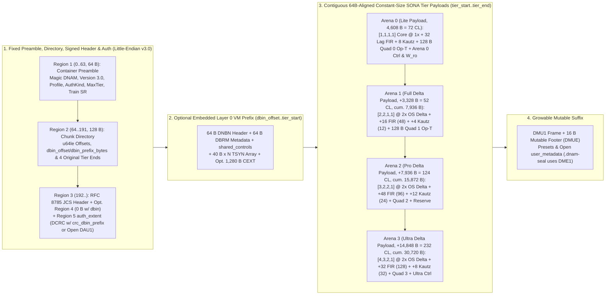

# `.dnam` Hybrid Binary Container & < 50 ns Zero-Copy Hardware Loader

DNAM defines five companion 64 B cache-line and SIMD-aligned v3.0 (`"architecture": "sona"`) binary container formats across a three-layer stack using declarative little-endian binary records. Together these containers satisfy [REQ-5.1, REQ-5.6](../../requirements/system_goals_and_requirements.md#6-goal-5--single-run-slimmable-multi-tier-architecture-lite--full--pro--ultra), [REQ-8.1, REQ-8.8](../../requirements/system_goals_and_requirements.md#9-goal-8--model-provenance-hardware-drm-forensic-watermarking--marketplace-security), [ADR-0007](../../adr/0007-exact-integer-control-bus-and-tempo-inversion.md), [ADR-0009](../../adr/0009-jcs-prefix-signing-hpke-and-preview-containment.md), [ADR-0020](../../adr/0020-modular-monorepo-and-dnam-proj-container.md), and [ADR-0022](../../adr/0022-sona-state-space-operator-and-webgpu-architecture.md).

---

## 1. Hybrid Binary Container Wire Framing & < 50 ns Zero-JSON Hardware Fast-Path

`r[container.dnam.wire-framing]`

Every v3.0 container enforces declarative little-endian framing, strict 64 B alignment at every binary region boundary, and fail-closed validation prior to audio rendering. Real-time virtual machines load bare `.dnam-bin` images (`"DNBN"`) or zero-copy embedded slices inside `.dnam` wrappers into L1D-resident memory in < 50 ns without executing a JSON parser on the audio thread.

### 1.1 Companion v3.0 Container Formats

`r[container.dnam.formats]`

All five companion v3.0 formats use packed little-endian binary record layouts with fixed 64 B region alignment and explicit byte offsets across the three-layer architecture (Layer 0 `.dnam-bin`, Layer 1 `.dnam` / `.dnam-seal` / `.dnam-prev`, and Layer 2 `.dnam-proj`).

Loaders validate header fields fail-closed and reject any container with `version_major != 3`, `version_minor != 0`, or a non-`"sona"` architecture using `UnsupportedVersion`.

| Container Format | Magic / Kind | Version & Architecture | Primary Role & Payload Summary | Canonical Cross-Reference |
| :--- | :--- | :--- | :--- | :--- |
| `.dnam-bin` | `"DNBN"` | v3.0, `"sona"` | Layer 0 zero-JSON VM binary carrying 64 B `"DNBN"` header, 64 B `"DBRM"` runtime metadata, `shared_controls`, `"TSYN"` tempo array, optional `"CEXT"` dispatch, and nested Arena 0..3 payloads (`§1.4`) | This specification (`§1.4`) |
| `.dnam` | `"DNAM"` | v3.0, `"sona"` | Layer 1 runtime shell wrapping verbatim embedded `.dnam-bin` (at `dbin_offset`, `Region 4 == 0 B`) alongside 64 B preamble, 128 B directory, RFC 8785 JCS header, Region 5 `auth_extent`, and `DMU1` + `DMUE` suffix | This specification (`§1.2–§1.3`) |
| `.dnam-proj` | `"DNPJ"` | v3.0, `"sona"` | Layer 2 cloud-ready Capture Vault front-loading a 64 B preamble, SHA-256 chunk directory, and JCS manifest alongside `CALB`, `SPCM`, `INPC`/`STMC` 2.0–2.5 s fp32 capsules, `STAT`, `WGHT`, and `AUTH` | [project_container_format.md](project_container_format.md) |
| `.dnam-seal` | `"DNSL"` | v3.0 | Opaque 64 B-aligned OEM hardware-enclave wrapper using `EnclaveSealed`, `DSA1` manifest, optional verbatim `dbin_prefix` inside `logical_prefix` (`DAI1`-signed), and `DME1` + `DMUE` suffix | [provenance_and_enclave_drm.md §3](../security/provenance_and_enclave_drm.md#3-pillar-2-hardware-enclave--oem-drm-oemdevicecertificate-attestation--dnam-seal-dnsl-wrapper) |
| `.dnam-prev` | `container_kind: "preview"` | v3.0, `"sona"` | Lite-only storefront auditioning container that physically omits Full, Pro, and Ultra payloads while retaining Arena 0 control descriptors and Lite `CP1`/`W_readout` slices | [watermarking_and_marketplace.md §3](../security/watermarking_and_marketplace.md#3-commercial-storefront-platform-auditioning-royalty-splits--storefront-metadata) |

When a `.dnam` wrapper embeds an aligned `.dnam-bin` prefix (`dbin_prefix_bytes > 0` after Region 5), Region 4 (`shared_extent`) has zero length so control tables reside once inside `dbin_prefix`. When absent, Region 4 stores the `P` × 64 B descriptor table plus any overflow `CP1` stream.

Region 5 (`auth_extent`) holds a 64-byte `DCRC` Authentication Record (`"DCRC"`) storing `crc_dbin_prefix` at bytes 32..36 when an embedded Layer 0 prefix is active.

Authentication flags in the `DCRC` record track creator signatures (`FLAG_HAS_SIGNATURES`) and ChaCha20 encryption over `[tier_start..retained_end]` (`FLAG_ENCRYPTED_ARENA`); Open containers may instead use `DAU1`.

The four nested fixed-shape tier payloads obey Lite ⊂ Full ⊂ Pro ⊂ Ultra. Arena 0 carries 1×-calibrated Lite weights within 4,608 B, while Arena 1..3 store 2×-OS incremental deltas at cumulative 64 B-aligned wire boundaries of 4,608 / 7,936 / 15,872 / 30,720 B (actual L1D `ActiveHot` of 4,544 / 7,552 / 11,200 / 14,656 B within 4,608 / 7,936 / 15,872 / 28,672 B ceilings).



```text
+-----------------------------------------------------------------------+ 0x0000 (Byte 0, 64B-aligned)
| 1. Container Preamble (64 B, 64-byte aligned, little-endian)          |
|    • 0..4:   magic = "DNAM" (.dnam-seal uses DNSL Outer Preamble)     |
|    • 4..8:   version_major = 3 (u16le), version_minor = 0 (u16le)     |
|    • 8..12:  protection_profile(u8), auth_kind(u8), maximum_tier(u8)  |
|    • 12..16: sample_rate_train_hz = 48000 (u32le) | 16..64: zero(48B) |
+-----------------------------------------------------------------------+ 0x0040 (Byte 64, 64B-aligned)
| 2. Chunk Directory (128 B, 1-byte aligned, little-endian u64 offsets) |
|    • 0..16:  immutable_header_offset = 192, immutable_header_length   |
|    • 16..32: shared_binary_offset, shared_binary_length (0 w/ dbin)   |
|    • 32..48: authentication_envelope_offset, auth_envelope_length     |
|    • 48..64: dbin_offset (u64le), dbin_prefix_bytes (u64le, % 64==0)  |
|    • 64..104: tier_start (u64le) + original_tier_ends[4] (Lite..Ultra)|
+-----------------------------------------------------------------------+ 0x00C0 (Byte 192, 64B-aligned)
| 3. Canonical RFC 8785 JCS Immutable JSON Header ("sona") + Zero Pad   |
+-----------------------------------------------------------------------+ shared_binary_offset (64B-aligned)
| 4. Shared Binary Descriptors (0 B when dbin_prefix_bytes > 0; else    |
|    P * 64 B Descriptors + Overflow CP1 Stream) + Zero Pad to 64 B     |
+-----------------------------------------------------------------------+ authentication_envelope_offset (64B)
| 5. Region 5 auth_extent (64 B DCRC or Open DAU1) + Zero Pad to 64 B   |
+-----------------------------------------------------------------------+ dbin_offset (optional, 64B-aligned)
| 5B. Optional Verbatim Layer 0 .dnam-bin Prefix [dbin_offset..tier_start)
|     ("DNBN" + "DBRM" + shared_controls + "TSYN" + opt. "CEXT")        |
|     -> Zero-copy slice [dbin_offset..retained_tier_end] is .dnam-bin! |
+=======================================================================+ tier_start (64B-aligned)
| 6A. Arena 0: Lite Payload [tier_start .. lite_end]                    | <- Lite strip boundary
|     (Includes self-contained Lite controls, CP1, U_int, W_ctrl & RO)  |
+-----------------------------------------------------------------------+ original_tier_ends[0] (64B-aligned)
| 6B. Arena 1: Full Delta Payload [lite_end .. full_end]                | <- Full strip boundary
+-----------------------------------------------------------------------+ original_tier_ends[1] (64B-aligned)
| 6C. Arena 2: Pro Delta Payload [full_end .. pro_end]                  | <- Pro strip boundary
+-----------------------------------------------------------------------+ original_tier_ends[2] (64B-aligned)
| 6D. Arena 3: Ultra Delta Payload [pro_end .. ultra_end]               | <- Ultra strip boundary
+=======================================================================+ retained_tier_end (64B-aligned)
| 7. Growable DMU1 Mutable Frame (.dnam-seal uses DME1 HPKE) + 16-Byte  |
|    Mutable Footer (magic "DMUE" + u64le frame_len + u32le reserved=0) |
+-----------------------------------------------------------------------+ EOF
```

### 1.2 Preamble & Directory Invariants

`r[container.dnam.preamble-directory]`

All multi-byte integer and IEEE-754 floating-point wire fields are encoded strictly in little-endian byte order (`u16le`, `u32le`, `u64le`, `f32le`, `f64le`) inside packed binary records.

Loaders MUST verify exact record sizes, field monotonicities, and 64 B region alignments fail-closed before exposing runtime views, without unaligned-trap assumptions or unvalidated pointer aliasing.

Every region offset (`shared_binary_offset`, `authentication_envelope_offset`, `dbin_offset`, `tier_start`, and each issued `original_tier_ends` entry) is 64 B-aligned, strictly ordered, and checked against 64-bit unsigned overflow before allocation using zero-allocation bounds validation.

When `dbin_prefix_bytes > 0`, `shared_binary_length` equals 0 and `[dbin_offset .. tier_start)` carries the verbatim `.dnam-bin` prefix immediately after `auth_extent`, allowing zero-copy extraction of `[dbin_offset .. retained_tier_end]`.

When absent (`dbin_prefix_bytes == 0`), Region 4 (`shared_extent`) packs the `P` × 64 B Control Clamp Descriptor table followed by any overflow `CP1` stream ([ADR-0007](../../adr/0007-exact-integer-control-bus-and-tempo-inversion.md)).

Header offsets in `slimmable_tiers` and `tensor_directory` remain relative to `tier_start` so lower-tier issuances retain the creator-signed header verbatim.

**1. Container Preamble (64 B, 64-byte aligned, file offset 0..64):**

| Offset | Bytes | LE Wire Type | Field Name | Clean-Room Validation Invariant |
| :---: | :---: | :--- | :--- | :--- |
| 0..4 | 4 | `u8[4]` | `magic` | Exact `"DNAM"` (`.dnam-seal` uses the `DNSL` Outer Preamble defined in [provenance_and_enclave_drm.md §3](../security/provenance_and_enclave_drm.md#3-pillar-2-hardware-enclave--oem-drm-oemdevicecertificate-attestation--dnam-seal-dnsl-wrapper)) |
| 4..6 | 2 | `u16le` | `version_major` | Must equal 3 |
| 6..8 | 2 | `u16le` | `version_minor` | Must equal 0 |
| 8..9 | 1 | `u8` | `protection_profile` | 0 = Open, 1 = DeviceAllowlisted, 2 = EnclaveSealed; > 2 rejected |
| 9..10 | 1 | `u8` | `auth_kind` | 0 = CreatorOnly, 1 = CreatorAndMarketplace; > 1 rejected |
| 10..11 | 1 | `u8` | `maximum_tier` | 0 = Lite, 1 = Full, 2 = Pro, 3 = Ultra; > 3 rejected |
| 11..12 | 1 | `u8` | `reserved_flag` | Must equal 0 |
| 12..16 | 4 | `u32le` | `sample_rate_train_hz` | Must equal 48,000 |
| 16..64 | 48 | `u8[48]` | `reserved_pad` | All 48 bytes must equal `0x00` |

**2. Chunk Directory (128 B, 1-byte aligned, file offset 64..192):**

| Offset | Bytes | LE Wire Type | Field Name | Clean-Room Validation Invariant |
| :---: | :---: | :--- | :--- | :--- |
| 0..8 | 8 | `u64le` | `immutable_header_offset` | Must equal 192 (64 + 128) |
| 8..16 | 8 | `u64le` | `immutable_header_length` | Unpadded UTF-8 RFC 8785 JCS JSON byte length (> 0) |
| 16..24 | 8 | `u64le` | `shared_binary_offset` | 64 B-aligned, `>= align64(immutable_header_offset + immutable_header_length)` |
| 24..32 | 8 | `u64le` | `shared_binary_length` | Equals 0 when `dbin_prefix_bytes > 0`; else unpadded byte span of `P` × 64 B descriptors + `CP1` stream |
| 32..40 | 8 | `u64le` | `authentication_envelope_offset` | 64 B-aligned, `>= align64(shared_binary_offset + shared_binary_length)` |
| 40..48 | 8 | `u64le` | `authentication_envelope_length` | Byte span of Region 5 `auth_extent`: 64 B `DCRC` Authentication Record (`magic = "DCRC"`), or exclusively for Open (`protection_profile == 0`) a binary `DAU1` envelope |
| 48..56 | 8 | `u64le` | `dbin_offset` | Equals 0 when absent; else 64 B-aligned offset immediately after `auth_extent` (`>= align64(auth_offset + auth_len)`) |
| 56..64 | 8 | `u64le` | `dbin_prefix_bytes` | Equals 0 when absent; else > 0 and 64 B-aligned (`dbin_prefix_bytes % 64 == 0`), matching the byte span `[dbin_offset .. tier_start)` |
| 64..72 | 8 | `u64le` | `tier_start` | 64 B-aligned start of Arena 0 (`>= align64(auth_offset + auth_len)` when `dbin_prefix_bytes == 0`, else `== align64(dbin_offset + dbin_prefix_bytes)`) |
| 72..104 | 32 | `u64le[4]` | `original_tier_ends` | `[lite_end, full_end, pro_end, ultra_end]`, 64 B-aligned (`end[t] - tier_start == ARENA_*_BYTES` through `maximum_tier`, monotone `end[t] <= end[t+1]`) |
| 104..128 | 24 | `u8[24]` | `reserved_tail` | All 24 bytes must equal `0x00` |

**3. 64-byte `DCRC` Authentication Record (64 B, 1-byte aligned, Region 5 `auth_extent`) & In-Memory `FLAG_*` Bitmask:**

Region 5 (`auth_extent`) holds a 64-byte `DCRC` Authentication Record (`"DCRC"`) for Open and DeviceAllowlisted containers, tracking `FLAG_HAS_SIGNATURES` when signed and `FLAG_ENCRYPTED_ARENA` when `[tier_start..retained_end]` is ChaCha20-encrypted. Exclusively for Open containers, Region 5 may instead hold a binary `DAU1` envelope binding any non-empty `dbin_prefix`.

| Offset | Bytes | LE Wire Type | Field Name | Clean-Room Validation Invariant |
| :---: | :---: | :--- | :--- | :--- |
| 0..4 | 4 | `u8[4]` | `magic` | Exact `"DCRC"` |
| 4..8 | 4 | `u32le` | `crc_prefix` | Castagnoli CRC-32C over container bytes `[0..authentication_envelope_offset]` |
| 8..24 | 16 | `u32le[4]` | `crc_tiers` | Cumulative CRC-32C over `[tier_start..original_tier_ends[t]]`; unretained tiers above `retained_tier` repeat `last_crc` (`slimmable_tiers.*.prefix_crc32c`) |
| 24..26 | 2 | `u16le` | `num_controls` | Total control count `P` (length of `controls_schema`) |
| 26..28 | 2 | `u16le` | `flags_hint` | Runtime `FLAG_*` bitmask (`1<<0` `LITE`, `1<<1` `FULL_DELTA`, `1<<2` `PRO_DELTA`, `1<<3` `ULTRA_DELTA`, `1<<9` `STEREO_OUT`, `1<<10` `HAS_SIGNATURES`, `1<<11` `ENCRYPTED_ARENA`; no dedicated Freeze bits) |
| 28..32 | 4 | `u32le` | `tail_time_ms_bits` | IEEE-754 binary32 bit representation of `io_config.tail_time_ms` |
| 32..36 | 4 | `u32le` | `crc_dbin_prefix` | Castagnoli CRC-32C over `[dbin_offset..tier_start)` when `dbin_prefix_bytes > 0` (0 when absent); verified fail-closed on load and tier strip |
| 36..64 | 28 | `u8[28]` | `reserved_pad` | All 28 bytes must equal `0x00` |

**4. Control Clamp Descriptor (64 B, 1-byte aligned, repeated `P` times in `shared_extent`) & Conditional Clamp Rule (8 B):**

| Offset | Bytes | LE Wire Type | Field Name | Clean-Room Validation Invariant |
| :---: | :---: | :--- | :--- | :--- |
| 0..1 | 1 | `u8` | `ctrl_kind` | `0 = Range`, `1 = Switch`, `0xFF = UnusedSlot` (`2 = BilinearCrossTerm` appears only in `CP1` contributor records; see §2.4) |
| 1..2 | 1 | `u8` | `lobatto_degree` | Lobatto degree `k` (`Range`), or `num_declared_options - 1` (`Switch`) |
| 2..4 | 2 | `u16le` | `active_options_mask` | Observed/active switch option bitmask |
| 4..8 | 4 | `f32le` | `default_val` | Default physical value (`Range`) or option index (`Switch`) |
| 8..12 | 4 | `f32le` | `safe_min_base` | Unconditional base lower physical bound |
| 12..16 | 4 | `f32le` | `safe_max_base` | Unconditional base upper physical bound |
| 16..20 | 4 | `f32le` | `scale_norm` | Pre-inverted normalization scale `2.0 / (x_decl_max - x_decl_min)` over `declared_range` so `x_norm = clamp(x_clamped * scale_norm + offset_norm, -1.0, +1.0)` maps `[x_decl_min, x_decl_max]` linearly into `[-1.0, +1.0]` |
| 20..24 | 4 | `f32le` | `offset_norm` | Normalization offset `-(x_decl_max + x_decl_min) / (x_decl_max - x_decl_min)` pairing with `scale_norm` over `declared_range` `[x_decl_min, x_decl_max]` |
| 24..36 | 12 | `f32le[3]` | `anchor_nodes_norm` | Normalized Lobatto anchor coordinates `t` in `[-1, +1]` |
| 36..40 | 4 | `u32le` | `_reserved` | Must equal 0 |
| 40..64 | 24 | `8-byte rule[3]` | `cond_rules` | Up to 3 conditional bound slots (8 B each: +0..2 `switch_ctrl_idx: u16le`, +2 `switch_opt_idx: u8`, +3 `rule_op: u8` (`0=none, 1=max_ceil, 2=min_floor, 3=and_prefix, 5=and_max_keep, 6=and_min_end`), +4..8 `bound_val: f32le`); header compilation fails closed if `conditional_bounds` require > 3 wire slots |

Conditional clamp evaluation initializes `eff_min = safe_min_base`, `eff_max = safe_max_base`, and `conj_active = true`, then scans the three `cond_rules` slots in order.

Operation 0 or reserved codes such as 4 reset `conj_active = true` with no bound update, while `3 = and_prefix` updates `conj_active = conj_active && (active_switch_options[switch_ctrl_idx] == switch_opt_idx)`.

Operations `1 = max_ceil`, `2 = min_floor`, and trailing `6 = and_min_end` tighten `eff_max = min(eff_max, bound_val)` (code 1) or `eff_min = max(eff_min, bound_val)` (codes 2 and 6) whenever `conj_active` and the switch match hold, then reset `conj_active = true`.

Operation `5 = and_max_keep` updates `eff_max` identically when active and matching while setting `conj_active = hit` (`conj_active && match`) for the trailing slot. After all three slots, clamping enforces `eff_max = eff_min` whenever `eff_max < eff_min`.

### 1.3 Open `.dnam` Structural Layout

`r[container.dnam.open-layout]`

The fixed 64 B Container Preamble (`[0..64)`) and 128 B Chunk Directory (`[64..192)`) enforce `version_major = 3`, `version_minor = 0`, `protection_profile = 0` for Open, and `auth_kind = 0` (creator-only) or 1 (creator plus buyer).

Stripping a container to tier `T` retains the original preamble, directory, immutable header, shared binary, authentication envelope, optional `dbin_prefix`, and tier payloads through `original_tier_ends[T]`. Full Arena 0 controls remain intact even when stripping to Lite, and the mutable frame plus 16-byte `DMUE` Footer sit immediately after `original_tier_ends[T]` without re-signing.

#### Open Mutable Frame

`r[container.dnam.mutable-frame]`

Immediately after the retained tier boundary, every Open container places a growable `DMU1` frame (16-byte `DMU1` Header) followed by a 16-byte `DMUE` Footer (packed little-endian):

| Region / Record | Offset (rel. frame) | Bytes | LE Wire Type | Field & Invariant |
| :--- | :---: | :---: | :--- | :--- |
| `DMU1` Header (16 B) | 0..4 | 4 | `u8[4]` | `magic`: ASCII `"DMU1"` |
| `DMU1` Header | 4..8 | 4 | `u32le` | `crc32c`: Castagnoli CRC-32C (`poly 0x82F63B78`, init/XOR `0xFFFFFFFF`; `"{}"` = `0xA1CCB48F`, `"123456789"` = `0xE3069283`) over `"DMU1" \|\| u64le(json_len) \|\| JSON` |
| `DMU1` Header | 8..16 | 8 | `u64le` | `json_len`: Unpadded UTF-8 RFC 8259 JSON object byte length `N` (`N >= 2`) |
| JSON Payload | 16..16+N | `N` | `u8[N]` | UTF-8 RFC 8259 JSON object (no BOM, no duplicate keys) |
| Zero Pad | 16+N..EOF-16 | `pad` | `u8[pad]` | Optional zero-filled `0x00` padding |
| `DMUE` Footer (16 B) | EOF-16..EOF-12 | 4 | `u8[4]` | `magic`: ASCII `"DMUE"` |
| `DMUE` Footer | EOF-12..EOF-4 | 8 | `u64le` | `frame_len`: Byte span of the mutable frame immediately preceding this footer |
| `DMUE` Footer | EOF-4..EOF | 4 | `u32le` | `reserved`: Must equal 0 |

Enclave-sealed containers replace `DMU1` with the HPKE-wrapped `DME1` frame using the same 16-byte `DMUE` Footer ([provenance_and_enclave_drm.md §3.3](../security/provenance_and_enclave_drm.md#encrypted-mutable-suffix)), whereas standard `.dnam` files use `DMU1` and reject `DME1` outside sealed `DNPL` context.

#### Mutable JSON Members

`r[container.dnam.mutable-json]`

| Member | Type & Specification |
| :--- | :--- |
| `version` | Optional mutable envelope version (1 when present; omitted defaults to 1). |
| `presets` | Array of preset objects (`id`, `name`, `controls: map<string, f64 \| string>`, optional `description`, `user_metadata`). |
| `user_metadata` | Open JSON object for model-level catalog tags and host data. |
| `control_user_metadata` | Object mapping signed `control_id` strings to open metadata objects. |
| `stem_user_metadata` | Object mapping signed `stem_id` strings to open metadata objects. |

On container load, the loader validates `DMU1`/`DME1` header CRC-32C and `DMUE` footer framing via zero-copy bounds validation and overlays mutable metadata onto the immutable header view without modifying authenticated prefix bytes. Loading a partial preset restores signed defaults for omitted controls at the effective tier before overlaying preset assignments and applying whole-batch conditional clamping ([parametric_control_bus.md](../dsp/parametric_control_bus.md#242-conditional-batch-safety)).

### 1.4 Bare Deterministic VM Binary Container (`.dnam-bin` / `"DNBN"`)

`r[container.dnam.vm-binary]`

The bare `.dnam-bin` (`"DNBN"`) Layer 0 format carries a complete, strictly numeric, 64 B-aligned VM register program with zero JSON, zero strings, zero dynamic memory allocation requirements, and zero dedicated freeze flags. Real-time virtual machines load standalone `.dnam-bin` files or zero-copy embedded `[dbin_offset..retained_tier_end]` slices extracted from `.dnam` wrappers in < 50 ns.

Every `.dnam-bin` payload begins with a fixed 64 B **VM Binary Header** (`"DNBN"`, bytes 0..64) immediately followed by a fixed 64 B **VM Runtime Metadata Record** (`"DBRM"`, bytes 64..128), aligned `shared_controls`, `TSYN` tempo entries, optional `CEXT` matrices, and Arena 0..3 payloads.

Stripping `.dnam-bin` to tier `t` per `REQ-5.6` slices raw file bytes directly to `[0..tier_end_offsets[t]]` with zero mutation to any header byte.

**1. VM Binary Header (`"DNBN"`, 64 B at offset 0..64) & VM Runtime Metadata Record (`"DBRM"`, 64 B at offset 64..128):**

The following 64 B `"DNBN"` Header (bytes 0..64), 64 B `"DBRM"` Runtime Metadata Record (bytes 64..128), 40 B `TSYN` entry, and 1,280 B `CEXT` matrix define the normative wire contract:

| Record & Offset | Bytes | LE Wire Type | Field Name | Clean-Room Validation Invariant |
| :--- | :---: | :--- | :--- | :--- |
| `DNBN` 0..4 | 4 | `u8[4]` | `magic` | Exact `"DNBN"` |
| `DNBN` 4..8 | 4 | `2 × u16le` | `version_major`, `version_minor` | Must equal 3 and 0 |
| `DNBN` 8..9 | 1 | `u8` | `max_present_tier` | Original emitted ceiling in 0..=3 (Lite..Ultra; never mutated on `REQ-5.6` strip) |
| `DNBN` 9..10 | 1 | `u8` | `reserved0` | Must equal 0 |
| `DNBN` 10..12 | 2 | `u16le` | `flags` | Bits 0..3 `HAS_LITE..HAS_ULTRA_DELTA`; bit 4 `SINGLE_INPUT`; bits 5..6 strictly 0 (Freeze evicted); bit 7 `WET_POLARITY_INV`; bit 8 `AUTO_UNITY_ENABLED`; bit 9 `STEREO_OUT`; bits 10..15 strictly 0 |
| `DNBN` 12..14 | 2 | `u16le` | `num_controls` | Total physical controls `P` (`0..=255`) |
| `DNBN` 14..16 | 2 | `u16le` | `tsyn_count` | Count of 40 B `TSYN` rows (`tsyn_len == tsyn_count * 40`) |
| `DNBN` 16..20 | 4 | `u32le` | `reference_sample_rate_hz` | Strictly in `[44,100..=96,000]` |
| `DNBN` 20..24 | 4 | `u32le` | `prefix_crc32c` | Castagnoli CRC-32C over `[0..20) \|\| [24..arena0_offset)` (excludes itself; covers Header + `DBRM` + `shared_controls` + `TSYN` + `CEXT` + 64 B pad) |
| `DNBN` 24..28 | 4 | `u32le` | `arena0_offset` | Relative 64 B-aligned Arena 0 start (`>= 128`, `arena0_offset % 64 == 0`, relative to byte 0 of `.dnam-bin`) |
| `DNBN` 28..44 | 16 | `u32le[4]` | `tier_end_offsets` | `arena0_offset + [4,608, 7,936, 15,872, 30,720][t]` for `t <= max_present_tier`, else 0; immutable under `REQ-5.6` truncation |
| `DNBN` 44..60 | 16 | `u32le[4]` | `tier_arena_crc32c` | Castagnoli CRC-32C over `[arena0_offset..tier_end_offsets[t])` for `t <= max_present_tier`, else 0 |
| `DNBN` 60..62 | 2 | `u16le` | `runtime_meta_bytes` | Must equal 64 |
| `DNBN` 62..64 | 2 | `u16le` | `reserved_flags_hi` | Must equal 0 |
| `DBRM` 0..4 | 4 | `u8[4]` | `magic` | Exact `"DBRM"` (at file offset 64..68) |
| `DBRM` 4..12 | 8 | `2 × u32le` | `shared_controls_offset`, `shared_controls_len` | `offset == 0` iff `len == 0`, else `>= 128 && % 64 == 0`; `len == num_controls * 64 + cp1_overflow_bytes` (`cp1_overflow_bytes` is 0 or `>= 8`) |
| `DBRM` 12..20 | 8 | `2 × u32le` | `tsyn_offset`, `tsyn_len` | `offset == 0` iff `len == 0`, else `% 64 == 0 && >= max(128, align64(shared_controls_end))`; `len == tsyn_count * 40` |
| `DBRM` 20..28 | 8 | `2 × u32le` | `cext_offset`, `cext_len` | `offset == 0` iff `len == 0`, else `% 64 == 0 && >= max(128, align64(shared_controls_end), align64(tsyn_end))`; `len` strictly 0 or 1,280 B |
| `DBRM` 28..31 | 3 | `3 × u8` | `ext_ring_pow2_frames`, `ext_ring_lines`, `ext_ring_format` | `pow2`: 0 (inline only) or 7..=18 (`2^k` in `[128..=262,144]`); `lines`: `0..=16`; `format`: `0 = fp16`, `1 = f32` (> 1 rejected) |
| `DBRM` 31..32 | 1 | `u8` | `reserved0` | Must equal 0 |
| `DBRM` 32..36 | 4 | `u32le` | `declared_max_delay_48k` | Declared 48 kHz Tank delay ceiling (`<= 48,000`) |
| `DBRM` 36..48 | 12 | `3 × f32le` | `dc_blocker_pole_5hz`, `tail_time_ms`, `r_ac_default` | Finite 5 Hz pole (`[0.0, 1.0)`), tail (`>= 0.0`), and default anti-creep AC pole (`[0.0, 1.0)`) |
| `DBRM` 48..50 | 2 | `u16le` | `switch_xfade_samples` | Switch transition crossfade duration in samples |
| `DBRM` 50..52 | 2 | `u16le` | `reserved_cond_zero` | Must equal 0 (conditional clamp rules occupy the 3 inline slots inside each 64 B descriptor) |
| `DBRM` 52..60 | 8 | `u8[8]` | `content_hash_prefix` | First 8 B of SHA-256 of canonical JCS header when exported with `.dnam`, else SHA-256 of `"DNAM-BIN-CONTENT-V3\0" \|\| arena_0_lite` |
| `DBRM` 60..64 | 4 | `u32le` | `cp1_overflow_bytes` | Exact `"CP1\0"` trailing byte length inside `shared_controls` (0 when inline-only, else `>= 8`) |

All `.dnam-bin` region offsets are relative to byte 0 of the `.dnam-bin` slice (identical standalone or extracted at `dbin_offset`), zero-padded to 64 B alignment, and strictly ordered `128 <= shared_controls <= TSYN <= CEXT <= arena0_offset`.

Retained tier `T` on load or zero-mutation `REQ-5.6` truncation is uniquely determined by matching `bytes.len() == tier_end_offsets[T]` for `T` in `0..=max_present_tier`, validating `prefix_crc32c` over the full prefix and `tier_arena_crc32c[T]` over `[arena0_offset..bytes.len())`.

**2. `TSYN` Physical Tempo-Sync Array (40 B × `tsyn_count`, `tsyn_offset % 64 == 0`) & Unwatermarked `CEXT` Matrix (1,280 B):**

| Record & Offset | Bytes | LE Wire Type | Field Name | Clean-Room Validation Invariant |
| :--- | :---: | :--- | :--- | :--- |
| `TSYN` 0..4 | 4 | `2 × u16le` | `ctrl_idx`, `switch_ctrl_idx` | Target control index `< num_controls`, optional switch condition control index |
| `TSYN` 4..8 | 4 | `4 × u8` | `switch_opt_idx`, `has_switch_cond`, `mode`, `default_subdiv` | Active switch option, condition flag (`0 \| 1`), physical unit mode (`0 = PeriodMs`, `1 = FrequencyHz`), default subdivision (0..11) |
| `TSYN` 8..12 | 4 | `u32le` | `flags` | Bit 0 `tempo_clamp_inward`; bits 1..=31 strictly 0 (fail closed on nonzero) |
| `TSYN` 12..20 | 8 | `2 × f32le` | `div_ratio`, `bpm_factor` | Precomputed rational subdivision ratio and finite unit scaling factor |
| `TSYN` 20..32 | 12 | `f32le[3]` | `lobatto_anchors` | Physical anchor values `[v_min, v_mid, v_max]` for zero-JSON tempo inversion (multi-row per conditional rule) |
| `TSYN` 32..40 | 8 | `2 × f32le` | `declared_min`, `declared_max` | Finite declared physical control interval `[min, max]` |
| `CEXT` 0..1,024 | 1,024 | `f32le[16][16]` | `w_ctrl_ext` | Unwatermarked 3 kHz extended dispatch weights mapping `q16` to `stage_targets[16..32]` |
| `CEXT` 1,024..1,280 | 256 | `f32le[16][4]` | `w_ctrl_ultra_ext` | Ultra 3 kHz extended dispatch delta mapping `qu` to `stage_targets[16..32]` (defaults to +0.0 when `cext_len == 0`) |

---

## 2. Tier-Prefix Hardware Loading

### 2.1 Lower-Block-Triangular Tier Payloads

`r[container.dnam.tier-prefix]`

Every tier's runtime topology is locked to fixed nested tier capacities (Lite ⊂ Full ⊂ Pro ⊂ Ultra) with zero capture-time tier resizing (`ref[arch.tiers.maximize-quality-within-budget]`).

This yields constant-size arena payloads aligned strictly to 64 B cache lines: `ARENA_LITE_BYTES` is 4,608 B (72 CL), `ARENA_FULL_BYTES` is 7,936 B (124 CL), `ARENA_PRO_BYTES` is 15,872 B (248 CL), and `ARENA_ULTRA_BYTES` is 30,720 B (480 CL).

The Arena 0 Lite payload (Arena 0, 0..4,608 B, 72 CL) is 100% self-contained and stores the 1×-calibrated 48 kHz Lite `[1,1,1,1]` base parameters. It packs the Crossbar Block, 32 Cabinet Bank early FIR taps, 8 Kautz pairs, Quad 0 Op-T tank (4 lanes), Lite VarPro Readout, and self-contained base control tables (Arena 0 Control Plane), so extracting or running Lite never reads Arena 1..3 (REQ-5.6).

Arena 1..3 Delta payloads (4,608..30,720 B) store causally nested 2×-OS calibrated state deltas for Full (`[2,2,1,1]`, +3,328 B / 52 CL), Pro (`[3,2,2,1]`, +7,936 B / 124 CL), and Ultra (`[4,3,2,1]`, +14,848 B / 232 CL). They hold incremental Cabinet Bank FIR/Kautz blocks, Op-T quads, per-tier VarPro readout deltas, and the Arena 3 Control Plane (REQ-5.1, REQ-5.2), while analytical ZOH adapts both 1× Arena 0 and 2×-OS Arena 1..3 models to host sample rates across 44.1–384 kHz.

All alignment reserve ranges remain strictly zeroed (`0x00`) in unwatermarked `.dnam` containers and are populated only in Tardos Role B watermarked copies. Those ranges are Pro SONA Core Delta `reserve` (9,856..12,544), `tank_pro[1]` (13,440..13,568), Ultra SONA Core Delta `reserve` (20,096..22,528), `tank_ultra[1]` (23,168..23,296), and Arena 3 Control Plane `reserve` (30,144..30,720).

### 2.2 Model-Declared Delay Histories (`delay_histories`)

`r[container.dnam.delay-histories]`

The signed immutable JSON header declares all required `Op-T` delay and all-pass histories in `delay_histories` (`"owner": "spatial_tank" | "crossbar"`). Each entry specifies `sample_format` (`"fp16"` for 2 B inline/cold storage on Lite and Full, or optional `"fp16"` / `"f32"` for 4 B cold `ext_lines` on Pro and Ultra to support 30 s shimmer tails):

```json
{
  "id": "tank.quad0.line0",
  "owner": "spatial_tank",
  "kind": "fractional",
  "introduced_tier": "lite",
  "sample_format": "fp16",
  "reference_samples": { "lite": "432000" }
}
```

Each `reference_samples` entry is canonical ASCII decimal text parsed as a nonzero `u64` (avoiding IEEE-754 binary64 integer precision limits) and admitted against the host memory ceiling on the cold path ([op_t_transport.md](../dsp/op_t_transport.md)).

### 2.3 Pre-Packed SIMD Data, Cell Descriptors & Load-Time Validation

`r[container.dnam.load-validation]`

Loaders validate all binary record headers, tensor offsets, 64 B alignments, shapes, finite coefficients, and cell descriptor commitments (SONA Cell Descriptor) before initializing runtime state memory. Recursive `TPT-SVF`, `ParaLRU`, and `Op-T` states initialize to exact resting zero equilibrium ([op_n_paralru_and_polyadaa.md](../dsp/op_n_paralru_and_polyadaa.md)).

#### Constant-Size Tier Arena Slice Directory

`r[container.dnam.tensor-directory]`

Every slice declared in `tensor_directory` has a 64 B-aligned `byte_offset` relative to `tier_start` (`byte_offset % 64 == 0`) and a `byte_length` bounded by `original_tier_ends[t] - tier_start` (4,608 / 7,936 / 15,872 / 30,720 B, or 72 / 124 / 248 / 480 CL across Lite..Ultra).

Active working memory (`ActiveHot`) fits strictly inside each tier ceiling (4,544 / 7,552 / 11,200 / 14,656 B actual vs. 4,608 / 7,936 / 15,872 / 28,672 B ceilings), and each slice maps directly onto the packed 1-byte-aligned binary blocks listed below.

| Slice Identifier | Arena Offset (rel. `tier_start`) | Bytes (64 B CL) | Binary Block & Canonical Contents |
| :--- | :---: | :---: | :--- |
| `router_and_crossbar` | 0..256 (Arena 0) | 256 B (4 CL) | Crossbar Block: `s_router`, SONA Meta fields, Oversampling, 3-Basis Carrier & Op-N[Pre] Base, Cell Descriptor & Phasors (SONA Cell Descriptor + 4× Q0.32 + gate/crossbar) |
| `sona_core_lite` | 256..1,408 (Arena 0) | 1,152 B (18 CL) | Lite SONA Core: `groups` (4 × 192 B SONA Group Blocks = 768 B) + `tiles` (3 × 128 B Inter-Block Tile Pairs = 384 B) |
| `cabinet_fir_lite` | 1,408..1,664 (Arena 0) | 256 B (4 CL) | Cabinet Early FIR (32): 32 L + 32 R `f32le` taps (`CABINET_EARLY_FIR_BASES[0] = 1,408`) |
| `cabinet_kautz_lite` | 1,664..1,920 (Arena 0) | 256 B (4 CL) | 2 × Kautz SoA Blocks: 8 pairs = 16 poles (`CABINET_KAUTZ_BASES[0] = 1,664`) |
| `spatial_tank_lite` | 1,920..2,048 (Arena 0) | 128 B (2 CL) | Spatial Tank Quad: Quad 0 (lanes 0..4, 128 B orthogonal descriptor, LFO/ramp offsets, VCA, Schroeder, `ext_f32`; 128-frame / 1,024 B `fp16[128][4]` inline ring in 224 B active hot state memory; `TANK_DELAY_BASES[0] = 1,920`) |
| `varpro_readout_lite` | 2,048..2,688 (Arena 0) | 640 B (10 CL) | Lite VarPro Readout: M/S gains + `stage_latent_mods_fp16[96]` + `w_ro_fp16[208]` (`VARPRO_READOUT_BASES[0] = 2,048`) |
| `control_bus_lite` | 2,688..4,608 (Arena 0) | 1,920 B (30 CL) | Arena 0 Control Plane: `lfo/drift/env`, `cp1_dir`, `u_int_base`, `cp1_base`, `w_ctrl`, `rho_head_and_ctrl_tail` (`ARENA_LITE_BYTES = 4,608`) |
| `sona_core_full` | 4,608..6,528 (Arena 1) | 1,920 B (30 CL) | Full SONA Core Delta: `groups[2]` (384 B) + `tiles[10]` (1,280 B) + SONA Crossbar Coupling Block (256 B) |
| `cabinet_fir_full` | 6,528..6,656 (Arena 1) | 128 B (2 CL) | Cabinet Early FIR (16): +16 L/R taps (48 cum., `CABINET_EARLY_FIR_BASES[1] = 6,528`) |
| `cabinet_kautz_full` | 6,656..6,784 (Arena 1) | 128 B (2 CL) | 1 × Kautz SoA Block: +4 pairs (12 cum., `CABINET_KAUTZ_BASES[1] = 6,656`) |
| `spatial_tank_full` | 6,784..6,912 (Arena 1) | 128 B (2 CL) | Spatial Tank Quad: Quad 1 (lanes 4..8, 8 cum. lanes; `TANK_DELAY_BASES[1] = 6,784`) |
| `varpro_readout_full` | 6,912..7,936 (Arena 1) | 1,024 B (16 CL) | Full VarPro Readout: Full Cabinet Prefix Override (192 B) + `w_ro_and_mods_fp16[416]` (`ARENA_FULL_BYTES = 7,936`) |
| `sona_core_pro` | 7,936..12,544 (Arena 2) | 4,608 B (72 CL) | Pro SONA Core Delta: `groups[2]` (384 B) + `tiles[10]` (1,280 B) + `crossbar_pro` (256 B) + `reserve: u8[2,688]` (`0x00` unless Tardos Role B watermarked) |
| `cabinet_fir_pro` | 12,544..12,928 (Arena 2) | 384 B (6 CL) | Cabinet Early FIR (48): +48 L/R taps (96 cum., `CABINET_EARLY_FIR_BASES[2] = 12,544`) |
| `cabinet_kautz_pro` | 12,928..13,312 (Arena 2) | 384 B (6 CL) | 3 × Kautz SoA Blocks: +12 pairs (24 cum., `CABINET_KAUTZ_BASES[2] = 12,928`) |
| `spatial_tank_pro` | 13,312..13,568 (Arena 2) | 256 B (4 CL) | 2 × Spatial Tank Quads: `[0]` = Quad 2 (lanes 8..12, 12 cum. lanes), `[1]` = 128 B `reserve` (`0x00` unless Tardos Role B watermarked; `TANK_DELAY_BASES[2] = 13,312`) |
| `varpro_readout_pro` | 13,568..15,872 (Arena 2) | 2,304 B (36 CL) | Pro VarPro Readout: Pro Cabinet Prefix Override (384 B) + `w_ro_and_mods_fp16[960]` (`ARENA_PRO_BYTES = 15,872`) |
| `sona_core_ultra` | 15,872..22,528 (Arena 3) | 6,656 B (104 CL) | Ultra SONA Core Delta: `groups[2]` + `tiles[12]` + `crossbar_ultra` + `stage_latent_core_mods_fp16[1,024]` (0 unless `SONA_META_CORE_MODS_PRESENT`) + `reserve[2,432]` (`0x00` unless Tardos Role B watermarked) |
| `cabinet_fir_ultra` | 22,528..22,784 (Arena 3) | 256 B (4 CL) | Cabinet Early FIR (32): +32 L/R taps (128 cum., `CABINET_EARLY_FIR_BASES[3] = 22,528`) |
| `cabinet_kautz_ultra` | 22,784..23,040 (Arena 3) | 256 B (4 CL) | 2 × Kautz SoA Blocks: +8 pairs (32 cum., `CABINET_KAUTZ_BASES[3] = 22,784`) |
| `spatial_tank_ultra` | 23,040..23,296 (Arena 3) | 256 B (4 CL) | 2 × Spatial Tank Quads: `[0]` = Quad 3 (lanes 12..16, 16 cum. lanes, 8-stage diffuser), `[1]` = 128 B `reserve` (`0x00` unless Tardos Role B watermarked; preserves Quads 0..2 and `ref[dsp.head.tier-equivalence]`; `TANK_DELAY_BASES[3] = 23,040`) |
| `varpro_readout_ultra` | 23,296..26,880 (Arena 3) | 3,584 B (56 CL) | Ultra VarPro Readout: Ultra Cabinet Prefix Override (576 B) + `w_ro_and_mods_fp16[1,504]` |
| `control_bus_ultra_delta` | 26,880..30,720 (Arena 3) | 3,840 B (60 CL) | Arena 3 Control Plane: `w_ctrl_ultra` + `u_int_ultra` + `cp1_ultra` + `stage_latent_ctrl_ultra_fp16[256]` + `reserve[576]` (`0x00` unless Tardos Role B watermarked; `ARENA_ULTRA_BYTES = 30,720`) |

**1. Crossbar Block (256 B, Arena 0, bytes 0..256):**

| Arena Offset | Block Member (Bytes) | LE Wire Type | Clean-Room Sub-Fields & Bit Flags |
| :---: | :--- | :--- | :--- |
| 0..64 | `s_router` (64 B) | `f32le[4][4]` | 4-port `S_router` (`S_{ret->send} == 0`). |
| 64..68 | `meta.pipeline_flags` (4 B) | `u32le` | `ARENA0_PIPELINE_FLAGS_OFFSET = 64`; upper half `PIPE_MAGIC_HI = 0x444E_0000` (`PIPE_MAGIC_MASK = 0xFFFF_0000`); bits 0–2 reserved 0; `1<<3` `PIPE_FLAG_CABINET_EXT`; `1<<4` `PIPE_FLAG_TANK_EXT`; `1<<5` `PIPE_FLAG_UNIFIED_W_CTRL`; `1<<6` `PIPE_FLAG_V3_MATRYOSHKA`; `1<<7` `PIPE_FLAG_SONA` (`PIPE_FLAG_ALL_SONA = 0x00F8`). |
| 68..84 | `meta.tier_gain_trim` (16 B) | `f32le[4]` | `ARENA0_TIER_GAIN_TRIM_OFFSET = 68`; `[Lite, Full, Pro, Ultra]` output trim (<= 0.05 LU). |
| 84..88 | `meta.sona_meta_flags` (4 B) | `u32le` | `ARENA0_SONA_META_OFFSET = 84` (mirrored identically in SONA Cell Descriptor `cell_flags` at 204..208): bits 0–3 `tier_os2x[0..4]`; bit 4 (`0x10`) `SONA_META_OS2X`; bit 5 (`0x20`) reserved 0; bit 6 (`0x40`) `SONA_META_TIER_OS_EXPLICIT`; bit 7 (`0x80`) `SONA_META_CABINET_PREFIX_OVERRIDES`; bit 8 (`0x100`) `SONA_META_OS_EXT_PRESENT`; bit 9 (`0x200`) `SONA_META_CORE_MODS_PRESENT`; bits 16–20 (`1<<16` `SONA_META_TANK_TAP_GAINS`, `1<<17` `SONA_META_ROUTER_EXT`, `1<<18` reserved 0, `1<<19` reserved 0, `1<<20` `SONA_META_TANK_LFO`). |
| 88..128 | `meta` scalars & mix (40 B) | `f32le` fields | 88..92 `dry_wet_mix`, 92..96 `r_ac`, 96..104 `router_gain: f32le[2]`, 104..120 `router_mix_matrix: f32le[2][2]`, 120..124 `reserved_120_124` (0.0), 124..128 `anti_zipper_ramp_scale`. |
| 128..192 | `os_and_front_ext` (64 B) | `f32le[7]` + `u16le[3][4]` + `f32le[3]` | `ARENA0_OS_PARAMS_OFFSET = 128`: 128..156 `os_up_quad_coeff`, `os_dec_c_prev1`, `os_dec_c0`, `os_up_pre_emph`, `os_dec_aa_mix`, `os_up_aa_mix`, `os_up_zoh_mix` (`dec_c1 = 1.0 - os_dec_c_prev1 - os_dec_c0`); 156..180 `carrier_basis_w_fp16: u16le[3][4]` (`[hi*cos, hq*sin, sin]` carrier projection); 180..192 Op-N[Pre] Base Record (`gamma_bc: f32le`, `zoh_hold_depth: f32le` encoding `1.0 - rho_zoh` in `[0.0, 0.9999]` so zero-init decodes ZOH bypass, `beta_q: f32le`). |
| 192..208 | `cell_phasors.cell_desc` (16 B) | `SONA Cell Descriptor` | +0..4 `magic = "SONA"`, +4..6 `version_major = 3 (u16le)`, +6..8 `version_minor = 0 (u16le)`, +8..10 `tier_flags: u16le` (`0x01=Lite`, `0x03=Full`, `0x07=Pro`, `0x0F=Ultra`), +10..12 `oversample_factor: u16le` (`1 \| 2`), +12..16 `cell_flags: u32le` (mirrors `sona_meta_flags`). |
| 208..240 | `cell_phasors` clocks (32 B) | `f32le[4]`, `u32le[4]` | 208..224 `phasor_freq_hz: f32le[4]`, 224..240 `phasor_init_phase_q32: u32le[4]`. |
| 240..256 | `cell_phasors.gate_and_crossbar_fp16` (16 B) | `u16le[8]` | IEEE-754 binary16 RNE: `[0] gate_thresh`, `[1] gate_hyst`, `[2] gate_inv_knee`, `[3] gate_floor`, `[4] gate_atk_beta`, `[5] gate_rel_beta`, `[6] op_p_crossbar_gain`, `[7] op_t_crossbar_gain`. |

The following table defines the flag-gated decoding rules for `sona_meta_flags` (offset 84, mirrored at bytes 204..208):

| Flag Constant | Bit | Behavior When Set (1) | Behavior When Clear (0) |
| :--- | :---: | :--- | :--- |
| `SONA_META_TIER_OS_EXPLICIT` | 6 | Bits 0–3 authoritatively specify `tier_os2x[0..4]` verbatim so disabling 2× OS on any tier round-trips without default tier fallback | Loaders OR bits 0–3 with `[false, true, true, true]` |
| `SONA_META_CABINET_PREFIX_OVERRIDES` | 7 | Set iff any packed tier `t` in 1–3 overrides its preceding Cabinet prefix by > 1e-7; decoders apply Cabinet Prefix Override (`f32`) plus VarPro Readout `fp16` Cabinet override slots (`[296..352]` Full, `[392..452]` Pro, `[488..656]` Ultra, trailing words `0x0000`) | Decoders retain inherited `f32` Cabinet Early FIR and Kautz SoA weights verbatim |
| `SONA_META_OS_EXT_PRESENT` | 8 | Guards the 64 B Oversampling & Router Extension slice (bytes 128..192); decodes the 7 `f32le` oversampler scalars (128..156), `u16le[3][4]` `carrier_basis_w_fp16` (156..180), and 3 `f32le` Op-N[Pre] Base Record scalars (180..192) verbatim even when `os_up_quad_coeff == 0.0` and `os_dec_c0 == 0.0` | Legacy fallback behavior without extended oversampling/router fields |
| `SONA_META_CORE_MODS_PRESENT` | 9 | Guards Arena 3 Ultra SONA Core Delta `stage_latent_core_mods_fp16[0..1024]` (bytes 18,048..20,096 rel. `tier_start`) for Ultra per-lane modulation | All 1,024 `u16le` entries (2,048 B) are `0x0000` and runtime skips them with 0 MAC overhead |

**2. SONA Core Element & Delta Binary Blocks (Arena 0..3):**

| Binary Block | Bytes (1-byte aligned) | Exact Relative Field Offsets & Types |
| :--- | :---: | :--- |
| SONA Group Block (4 lanes) | 192 B | 0..16 `svf_g f32le[4]`, 16..32 `svf_k f32le[4]`, 32..48 `lru_alpha_rel f32le[4]`, 48..64 `lru_alpha_atk f32le[4]`, 64..80 `lru_kappa f32le[4]`, 80..96 `adaa_drive f32le[4]`, 96..112 `lru_bias_drive f32le[4]`, 112..128 `in_x_weight f32le[4]`, 128..136 `tone_lp_fp16 u16le[4]`, 136..144 `tone_bp_fp16 u16le[4]`, 144..152 `tone_hp_fp16 u16le[4]`, 152..160 `tone_ap_fp16 u16le[4]`, 160..168 `tone_dir_fp16 u16le[4]`, 168..176 `sag_depth_fp16 u16le[4]`, 176..184 `wavefolder_mix_fp16 u16le[4]`, 184..192 `rect_sign_fp16 u16le[4]` |
| Inter-Block Tile Pair | 128 B | 0..64 `w_odd_4x4 f32le[4][4]`, 64..96 `w_even_4x4_fp16 u16le[4][4]`, 96..128 `w_lru_4x4_fp16 u16le[4][4]` |
| SONA Crossbar Coupling Block | 256 B | 0..80 `op_p_to_group_fp16 u16le[10][4]`, 80..160 `phasor_to_group_fp16 u16le[10][4]`, 160..224 `opt_to_lr_fp16 u16le[16][2]`, 224..240 `phasor_stereo_phase_fp16 u16le[8]`, 240..256 `crossbar_reserved_fp16 u16le[8]` |
| Lite SONA Core (Arena 0: 256..1,408) | 1,152 B | 0..768 `groups[4]` (groups 0..4, 4 × 192 B SONA Group Blocks), 768..1,152 `tiles[3]` (tiles 0..3, 3 × 128 B Inter-Block Tile Pairs) |
| Full SONA Core Delta (Arena 1: 4,608..6,528) | 1,920 B | 0..384 `groups[2]` (4..6), 384..1,664 `tiles[10]` (3..13), 1,664..1,920 `crossbar` (256 B SONA Crossbar Coupling Block) |
| Pro SONA Core Delta (Arena 2: 7,936..12,544) | 4,608 B | 0..384 `groups[2]` (6..8), 384..1,664 `tiles[10]` (13..23), 1,664..1,920 `crossbar_pro` (256 B SONA Crossbar Coupling Block), 1,920..4,608 `reserve u8[2,688]` (`0x00` in unwatermarked `.dnam`; populated only in Tardos Role B watermarked copies) |
| Ultra SONA Core Delta (Arena 3: 15,872..22,528) | 6,656 B | 0..384 `groups[2]` (8..10), 384..1,920 `tiles[12]` (23..35), 1,920..2,176 `crossbar_ultra` (256 B SONA Crossbar Coupling Block), 2,176..4,224 `stage_latent_core_mods_fp16 u16le[1,024]` (row-major `[k in 0..8][col in 0..128]`; zeroed unless `SONA_META_CORE_MODS_PRESENT`), 4,224..6,656 `reserve u8[2,432]` (`0x00` in unwatermarked `.dnam`; populated only in Tardos Role B watermarked copies) |

In the Ultra SONA Core Delta, `stage_latent_core_mods_fp16[0..1024]` occupies 2,048 B at bytes 2,176..4,224 (18,048..20,096 rel. `tier_start`) using row-major layout `[k][col]` for `k` in 0..8 and `col` in 0..128.

It is indexed strictly by unrotated stage latents `z_stage[0..8]` (concatenating `ctrl_basis_4[0..4]` and `z_stage_ultra[0..4]`), preserving 0-ULP invariance under `SO(4)` gauge `Q_buyer` on `z_head[0..4]`.

Tardos Role B watermarking never embeds into these 1,024 slots; Role B carriers reside exclusively in the disjoint linear and reserve ranges documented in [watermarking_and_marketplace.md](../security/watermarking_and_marketplace.md).

When `SONA_META_CORE_MODS_PRESENT` (`0x0000_0200`) is set in Ultra mode (`D_s = 8`), each 3 kHz control boundary accumulates three per-lane shifts for global lane `l` in 0..40:

| Column Slice (`col`) | Target Parameter | Accumulation & Clamp Law |
| :--- | :--- | :--- |
| `col = l` (0..40) | `svf_g[l]` octave shift | Adds `sum_{k=0..7} fp16(k, l) * z_stage[k]` to global `svf_g_oct`, exponentiated via `exp2` and clamped to `[-3.0, +3.0]` oct total |
| `col = 40 + l` (40..80) | `svf_k[l]` damping shift | Adds `sum_{k=0..7} fp16(k, 40 + l) * z_stage[k]` to `svf_k_delta`, clamped to `[0.0, 8.0]` total |
| `col = 80 + l` (80..120) | `wavefolder_mix[l]` delta | Adds `sum_{k=0..7} fp16(k, 80 + l) * z_stage[k]` onto `wavefolder_mix[l]`, clamped to `[0.0, 1.0]` |
| `col` in 120..128 | Reserved | Must equal `0x0000` |

**3. Cabinet Bank, Spatial Tank & VarPro Readout Binary Blocks (Arena 0..3):**

| Binary Block | Bytes (1-byte aligned) | Exact Relative Field Offsets & Arena 0 Crossbar Sub-Slots |
| :--- | :---: | :--- |
| Cabinet Early FIR (16 / 32 / 48) | 128 / 256 / 384 B | `fir_l: f32le[N]` followed by `fir_r: f32le[N]` for `N` in `{16, 32, 48}` (`CABINET_EARLY_FIR_BASES = [1,408, 6,528, 12,544, 22,528]`) |
| Kautz SoA Block (4 shared pairs) | 128 B | 0..16 `r_low`, 16..32 `dr`, 32..48 `theta`, 48..64 `b_gamma`, 64..80 `c_re_l`, 80..96 `c_im_l`, 96..112 `c_re_r`, 112..128 `c_im_r` (all `f32le[4]`; `CABINET_KAUTZ_BASES = [1,664, 6,656, 12,928, 22,784]`, `CABINET_KAUTZ_BLOCKS_PER_TIER = [2, 1, 3, 2]`, `CABINET_KAUTZ_TIER_CHANNEL_BASE = [0, 8, 12, 24]`) |
| Spatial Tank Quad (4 `Op-T` lanes) | 128 B | 0..16 `delay_samples f32le[4]`, 16..32 `ramp_spans_samples f32le[4]`, 32..56 `g_loop`, `r_dc`, `damp_pole`, `lfo_rate_hz`, `ramp_rate_hz`, `vca_pole` (`6 × f32le`), 56..64 `lfo_depths_fp16 u16le[4]`, 64..72 `lfo_phase_off_q16 u16le[4]`, 72..80 `ramp_phase_off_q16 u16le[4]`, 80..88 `input_gains_fp16 u16le[4]`, 88..96 `wet_tap_l_fp16 u16le[4]`, 96..104 `wet_tap_r_fp16 u16le[4]`, 104..112 `allpass_g_fp16 u16le[4]`, 112..122 `fb_psi_fp16`, `sigma_knee_fp16`, `dry_mix_fp16`, `window_depth_fp16`, `vca_sens_fp16` (`5 × u16le`), 122..126 `allpass_delays u8[4]` (`<= 255` at 48 kHz; cold Schroeder scales to 384 kHz), 126 `flags u8` (`bit 0 = schroeder_enable`, `bit 1 = ext_f32`, bits 2..7 = 0; zero `M` or Freeze bits), 127 `reserved u8` (0; `TANK_DELAY_BASES = [1,920, 6,784, 13,312, 23,040]`) |
| Full Cabinet Prefix Override | 192 B | 0..64 `fir_l f32le[16]`, 64..128 `fir_r f32le[16]`, 128..144 `c_re_l f32le[4]`, 144..160 `c_im_l f32le[4]`, 160..176 `c_re_r f32le[4]`, 176..192 `c_im_r f32le[4]` (`VARPRO_READOUT_BASES[1] = 6,912`) |
| Pro Cabinet Prefix Override | 384 B | 0..128 `fir_l f32le[32]`, 128..256 `fir_r f32le[32]`, 256..288 `c_re_l f32le[8]`, 288..320 `c_im_l f32le[8]`, 320..352 `c_re_r f32le[8]`, 352..384 `c_im_r f32le[8]` (`VARPRO_READOUT_BASES[2] = 13,568`) |
| Ultra Cabinet Prefix Override | 576 B | 0..192 `fir_l f32le[48]`, 192..384 `fir_r f32le[48]`, 384..432 `c_re_l f32le[12]`, 432..480 `c_im_l f32le[12]`, 480..528 `c_re_r f32le[12]`, 528..576 `c_im_r f32le[12]` (`VARPRO_READOUT_BASES[3] = 23,296`) |
| Lite VarPro Readout (Arena 0: 2,048..2,688) | 640 B | 0..8 `pre_cab_u_gain f32le[2]`, 8..16 `pre_cab_hp_gain f32le[2]`, 16..24 `direct_s2_u_gain f32le[2]`, 24..32 `direct_s2_hp_gain f32le[2]`, 32..224 `stage_latent_mods_fp16 u16le[96]`, 224..640 `w_ro_fp16 u16le[208]` |
| Full VarPro Readout (Arena 1: 6,912..7,936) | 1,024 B | 0..192 `prefix_override`, 192..1,024 `w_ro_and_mods_fp16 u16le[416]` (`ARENA_FULL_BYTES = 7,936`) |
| Pro VarPro Readout (Arena 2: 13,568..15,872) | 2,304 B | 0..384 `prefix_override`, 384..2,304 `w_ro_and_mods_fp16 u16le[960]` (`ARENA_PRO_BYTES = 15,872`) |
| Ultra VarPro Readout (Arena 3: 23,296..26,880) | 3,584 B | 0..576 `prefix_override`, 576..3,584 `w_ro_and_mods_fp16 u16le[1,504]` |

The Lite, Full, Pro, and Ultra VarPro Readout blocks store a single static base readout matrix `W_ro,0` (16×12, 24×12, 32×12, or 40×12), while 3 kHz latent sensitivity enters through `stage_latent_mods_fp16`, `stage_latent_ctrl_ultra_fp16`, and `W_ctrl`.

Because buyer SO(4) gauge `Q_buyer` rotates only `z_head[0..4]` (plus columns 0..4 of `main_base`, `u_int_base`, `w_ctrl`, and `u_int_ultra` Block 0), every `stage_latent_*` sensitivity table indexes strictly unrotated `z_stage[0..D_s]`.

Here `D_s = 4` covers `ctrl_basis_4[0..4]` across Lite through Pro, and `D_s = 8` concatenates `[ctrl_basis_4[0..4], z_stage_ultra[0..4]]` on Ultra.

The table below gives the exact `fp16` index partitions inside the Lite VarPro Readout (`stage_latent_mods_fp16[0..96]` and `w_ro_fp16[0..208]`):

| Sub-Array Slice | Elements | Exact Clean-Room Slot Layout |
| :--- | :---: | :--- |
| `stage_latent_mods_fp16[0..8]` | 8 | `default_knobs[8]` in `[0.0, 1.0]^8` for standalone Arena 0 audit inspection (0.0 additive runtime delta at `StarCenter`) |
| `stage_latent_mods_fp16[8..48]` | 40 | Five 8-element `z_stage[k]` vectors: `[8..16]` `w_svf_g_oct[8]`, `[16..24]` `w_svf_k_delta[8]`, `[24..32]` `w_kautz_oct[8]`, `[32..40]` `w_kautz_damp[8]`, `[40..48]` `w_tank_psi[8]` |
| `stage_latent_mods_fp16[48..80]` | 32 | Lite..Pro per-block `[4][4]` matrices `w_adaa_drive_scale` (`[48..64]`) and `w_lru_bias_shift` (`[64..80]`) across `(k in 0..4, b in 0..4)`; superseded on Ultra by `stage_latent_ctrl_ultra_fp16[0..160]` |
| `stage_latent_mods_fp16[80..96]` | 16 | Row-major `op_p_to_group[0..4][0..4]` |
| `w_ro_fp16[0..192]` | 192 | 16 lanes × 12 weights; per lane `l` at `12 * l .. 12 * l + 12`: `[pre_cab_odd_l, pre_cab_odd_r, pre_cab_even_l, pre_cab_even_r, pre_cab_lru_l, pre_cab_lru_r, direct_odd_l, direct_odd_r, direct_even_l, direct_even_r, direct_lru_l, direct_lru_r]` |
| `w_ro_fp16[192..208]` | 16 | Row-major `phasor_to_group[0..4][0..4]` |

In the Full, Pro, and Ultra VarPro Readout blocks (`w_ro_and_mods_fp16`), the first `12 * L_t` slots follow the exact 12-slot per-lane readout order defined above, followed by M/S gains (`[pre_cab_u_ms[2], pre_cab_hp_ms[2], direct_s2_u_ms[2], direct_s2_hp_ms[2]]`), planar extra FIR deltas (`fir_l` taps then `fir_r` taps), `kautz_b_gamma` slots, and interleaved `[c_re_l, c_im_l, c_re_r, c_im_r]` extra `kautz_c` slots:

| Readout Tier Block | Readout `W_ro,0` | M/S Gains (8) | Planar Extra FIR | `kautz_b_gamma` | Interleaved `kautz_c` | Zero-Filled Tail |
| :--- | :---: | :---: | :---: | :---: | :---: | :---: |
| Full VarPro Readout | `[0..288]` (24×12) | `[288..296]` | `[296..328]` (taps 16..32) | `[328..336]` (8) | `[336..352]` (poles 4..8) | `[352..416]` |
| Pro VarPro Readout | `[0..384]` (32×12) | `[384..392]` | `[392..424]` (taps 32..48) | `[424..436]` (12) | `[436..452]` (poles 8..12) | `[452..960]` |
| Ultra VarPro Readout | `[0..480]` (40×12) | `[480..488]` | `[488..584]` (taps 48..96) | `[584..608]` (24) | `[608..656]` (poles 12..24) | `[656..1,504]` |

---

### 2.4 Tier-Local Projection & Cabinet Bank Slice Layout

#### Cabinet Bank Separate 64B-Aligned Early FIR & Kautz Modal Slices

`r[container.dnam.cabinet-slices]`

Each tier stores its Cabinet Bank early FIR taps and shared-pole Kautz modal blocks in separate, non-overlapping 64 B-aligned slices ([op_m_modal_kautz.md](../dsp/op_m_modal_kautz.md)).

The early FIR slice (32 / 48 / 96 / 128 cumulative taps/ch) packs Left `f32` taps followed by Right `f32` taps (+32 taps/ch = 256 B in Lite, +16 = 128 B in Full, +48 = 384 B in Pro, +32 = 256 B in Ultra; 1,024 B total).

The Kautz modal slice (8 / 12 / 24 / 32 cumulative pairs) packs 4 shared pole pairs per 128 B block (`[r_low, dr, theta, b_gamma, c_re_l, c_im_l, c_re_r, c_im_r]`).

```text
+-----------------------------------------------------------------------------------+
| CABINET BANK 64B-ALIGNED SLICE LAYOUT ACROSS ARENA 0..3 (SONA v3.0)               |
+-----------------------------------------------------------------------------------+
|  Tier    | New Pairs | Early FIR Slice      | Kautz Modal Slice (8-Vec SoA) | Sum |
|  Lite    |     8     | +32 taps/ch = 256 B  |  2 blocks = 256 B (4 CL)      | 512 |
|  Full    |     4     | +16 taps/ch = 128 B  |  1 block  = 128 B (2 CL)      | 256 |
|  Pro     |    12     | +48 taps/ch = 384 B  |  3 blocks = 384 B (6 CL)      | 768 |
|  Ultra   |     8     | +32 taps/ch = 256 B  |  2 blocks = 256 B (4 CL)      | 512 |
|  Total   |    32     | 128 taps/ch = 1,024B |  8 blocks = 1,024 B (16 CL)   |2,048|
+-----------------------------------------------------------------------------------+
```

Canonical relative tier array bases (`rel. tier_start`) are `CABINET_EARLY_FIR_BASES = [1_408, 6_528, 12_544, 22_528]`, `CABINET_KAUTZ_BASES = [1_664, 6_656, 12_928, 22_784]`, `TANK_DELAY_BASES = [1_920, 6_784, 13_312, 23_040]`, `VARPRO_READOUT_BASES = [2_048, 6_912, 13_568, 23_296]`, and `ARENA{1,2,3}_CABINET_PREFIX_OVERRIDE_OFFSET = VARPRO_READOUT_BASES[1..3]`.

#### Packed Control Projection Profile

`r[container.dnam.cp1-profile]`

The `CP1` profile places all Lite..Pro base control descriptors, `CP1` contributor streams, `U_int`, `W_ctrl`, `opt_to_lr[0..4]`, and Lite `W_readout` inside Arena 0 (Arena 0 Lite payload).

Stripping to Lite preserves full parametric controls without reading Arena 1..3 or `shared_extent` (REQ-5.6).

Contributors follow `controls_schema` order: each `range` with `lobatto_degree = k > 0` emits one `k`-lane record (`k = 0` emits none), and each option in `represented_switch_options` emits one 1-lane record.

When contributors exceed 8 slots or 576 B, an overflow `"CP1\0"` binary stream (stored inside `.dnam-bin` `shared_controls` when `dbin_prefix_bytes > 0` with `Region 4 == 0 B`, or in Region 4 `shared_extent` when `dbin_prefix_bytes == 0`) takes canonical precedence whenever non-empty:

| Stream Offset | Bytes | LE Wire Type | Field Name & Clean-Room Encoding |
| :--- | :---: | :--- | :--- |
| 0..4 | 4 | `u8[4]` | `magic`: Exact `"CP1\0"` |
| 4..6 | 2 | `u16le` | `count`: Contributor slot count `C` |
| 6..7 | 1 | `u8` | `flags`: Bit 0 = `has_ultra`; remaining bits 0 |
| 7..8 | 1 | `u8` | `reserved`: Must equal 0 |
| 8..8+4*C | `4 * C` | `4-byte entry[C]` | Packed 4 B directory per slot `s`: +0..2 `control_idx: u16le`, +2 `raw_kl: u8` (`((ctrl_kind & 3) << 2) \| (lanes & 3)`), +3 `aux: u8` (`partner_control_id` when `ctrl_kind == 2`, else `option_idx`) |
| `8+4*C..` | var | `f32le[...]` | Concatenated `base_bytes` records (`4 * (9k + 4)` B each: `main_base[k][8] \|\| emb[k] \|\| v_base[4]`), followed when `(flags & 1) != 0` by `ultra_bytes` records (`4 * (8k + 4)` B each: `main_ultra[k][8] \|\| v_ultra[4]`) |

Inside Arena 0 (Arena 0 Control Plane, 1,920 B at 2,688..4,608) and Arena 3 (Arena 3 Control Plane, 3,840 B at 26,880..30,720), control tables occupy fixed cache-line offsets:

| Arena Block & Offset (rel. `tier_start`) | Relative Block Offset | Bytes | LE Wire Type | Field Name & Sub-Slot Assignment |
| :--- | :---: | :---: | :--- | :--- |
| Arena 0 Control Plane (2,688..4,608) | 0..36 | 36 | `9 × f32le` | `lfo_dphi_train[2]`, `sigma_drift`, `rho_drift_train` (0.999), `env_poles[3]`, `dither_snr_scale`, `trust_radius_mh` (2.5 at 2,720..2,724, canonical trust radius mirrored by `rho_head_and_ctrl_tail[0]`) |
| Arena 0 Control Plane (2,724) | 36..64 | 28 | `Inline CP1 Directory` | `cp1_dir` (`ARENA0_CP1_DIR_OFFSET = 2,724`): +0..2 `cp1_dir_count: u16le` (0–8), +2..4 `flags: u16le = 0`, +4..28 `entries: u8[8][3]` packing `[ctrl_idx, kind_and_lanes, aux]` (`kind = (b1 >> 4) & 0x0F`, `lanes = b1 & 0x0F`) |
| Arena 0 Control Plane (2,752) | 64..192 | 128 | `f32le[4][8]` | `u_int_base` (`ARENA0_UINT_BASE_OFFSET = 2,752`) |
| Arena 0 Control Plane (2,880) | 192..768 | 576 | `u8[576]` | `cp1_base` (`ARENA0_CP1_BASE_OFFSET = 2,880`, end 3,456); overridden by non-empty `"CP1\0"` stream in `shared_controls` / `shared_extent` |
| Arena 0 Control Plane (3,456) | 768..1,792 | 1,024 | `f32le[16][16]` | `w_ctrl` (`ARENA0_W_CTRL_OFFSET = 3,456`, end 4,480) |
| Arena 0 Control Plane (4,480) | 1,792..1,920 | 128 | `f32le[32]` | `rho_head_and_ctrl_tail` (`ARENA0_RHO_HEAD_OFFSET = 4,480`; `[0]` mirrors `trust_radius_mh` 2,720..2,724, `[24..32] = opt_to_lr[0..4][0..2]`) |
| Arena 3 Control Plane (26,880..30,720) | 0..256 | 256 | `f32le[16][4]` | `w_ctrl_ultra` (`ARENA3_W_CTRL_ULTRA_OFFSET = 26,880`; row-major `[16][4]` mapping `qu` to `stage_targets[0..16]`) |
| Arena 3 Control Plane (27,136) | 256..640 | 384 | `f32le[3][4][8]` | `u_int_ultra` (`ARENA3_UINT_ULTRA_OFFSET = 27,136`; Block 0 maps `z_fm^(4..7) -> Δz_raw[0..8]`, matching [parametric_control_bus.md](../dsp/parametric_control_bus.md); Block 1: `z_fm_base -> z_raw[8..16]`; Block 2: `z_fm_ultra -> z_raw[8..16]`) |
| Arena 3 Control Plane (27,520) | 640..2,752 | 2,112 | `u8[2,112]` | `cp1_ultra` (`ARENA3_CP1_ULTRA_OFFSET = 27,520`, end 29,632) |
| Arena 3 Control Plane (29,632) | 2,752..3,264 | 512 | `u16le[256]` | `stage_latent_ctrl_ultra_fp16` (`[0..80]` row-major `[8][10]` `w_adaa_drive_scale`, `[80..160]` row-major `[8][10]` `w_lru_bias_shift`, `[160..256]` reserved 0; supersedes Arena 0 `[48..80]` on Ultra) |
| Arena 3 Control Plane (30,144) | 3,264..3,840 | 576 | `u8[576]` | `reserve` (`0x00` pad to 30,720 B in unwatermarked `.dnam`; non-zero only in Tardos Role B watermarked copies) |

When Ultra (`D_s = 8`, Arena 3 loaded) is active, the Arena 3 Control Plane `stage_latent_ctrl_ultra_fp16[0..160]` replaces rather than adds to Arena 0's 4×4 subset in the Lite VarPro Readout `stage_latent_mods_fp16[48..80]`.

It computes `group_adaa_oct[g]` and `group_lru_bias[g]` directly across all 10 SONA groups `g` in 0..10 from `stage_targets[2 + block_of(g)]` and `stage_targets[6 + block_of(g)]` plus the unrotated inner product over `z_stage[0..8]`, where `block_of` maps groups {0,4,6,8}->0, {1,5,9}->1, {2,7}->2, and {3}->3.

The Arena 0 Inline `CP1` Directory (`cp1_dir`) supports up to 8 inline contributors fitting inside `cp1_base` (such as 8 single-lane records at 52 B each = 416 B or 4 three-lane records at 124 B each = 496 B). Whenever fewer than two distinct physical controls carry contributors, both `u_int_base` and `u_int_ultra` are zeroed.

Each 3 B entry `[ctrl_idx, kind_and_lanes, aux]` encodes `kind` in {0, 1, 2} in the high nibble, `lanes` in {1, 2, 3} in the low nibble, and `aux` as `option_idx` for kind 1, `partner_control_id` for kind 2, or `0xFF` for kind 0.

#### Conditional Control Rules

`r[container.dnam.conditional-rules]`

Conditional safety bounds (`conditional_bounds`) and multi-range physical calibration (`calibration.conditional_physical_anchors`) use structured switch conjunctions (`when: [{"control_id": "...", "option_id": "..."}]`) ordered by `controls_schema` rather than delimiter-joined strings:

```json
{
  "conditional_bounds": [
    {
      "when": [
        { "control_id": "range", "option_id": "long" },
        { "control_id": "voicing", "option_id": "lead" }
      ],
      "min": 0.2,
      "max": 0.8
    }
  ],
  "calibration": {
    "conditional_physical_anchors": [
      {
        "when": [{ "control_id": "range", "option_id": "long" }],
        "anchors": [10.0, 100.0, 1000.0]
      }
    ]
  }
}
```

All matching `conditional_bounds` entries are intersected via inward `f32` rounding before ranking. For physical calibration, the matching rule with the greatest selector specificity is chosen, and any specificity tie is rejected as ambiguous.

---

## 3. Essential Metadata, Provenance, Presets, `ui_hints` & Open `user_metadata`

`r[container.dnam.metadata-ui-hints]`

Standardized `metadata` records attribution (`name`, `author`, `description`, `license`, `created_at`, `input_reference_dbfs`) alongside per-tier `slimmable_tiers` telemetry.

Per-tier telemetry tracks `loudness_lufs`, `output_trim_db`, and `validation_esr_db`, while content-addressed `provenance` pins `dataset_manifest_sha256`, `config_recipe_sha256`, and `epochs_trained`.

Model-level `io_config.capabilities` and `io_config.leveling` declare host parallel blend, wet polarity inversion, trails, tempo sync, and `rms_dbfs` or `k_weighted_lufs` auto-unity leveling (with zero dedicated freeze flags or freeze routing modes).

Each control entry may include physical `calibration` (`role`, `lobatto_physical_anchors`, `conditional_physical_anchors`, `tempo_sync_default_subdivision`) paired with intrinsic `ui_hints` for host rendering.

Host layout hints expose `section`, `order`, `size`, `color_hex`, `widget`, and `polarity`.

Scale and detent hints expose `detents`, `step`, `decimals`, `scale_labels`, `option_labels`, and `midpoint`.

When `midpoint` is present, host gesture coordinate `t` in `[0.0, 1.0]` maps to and from physical value `x` via the midpoint-anchored power-skew law:
$$\gamma_{\text{skew}} = \frac{\ln(0.5)}{\ln\left(\frac{x_{\text{mid}} - x_{\min}}{x_{\max} - x_{\min}}\right)}, \qquad x(t) = x_{\min} + (x_{\max} - x_{\min}) t^{1 / \gamma_{\text{skew}}}, \qquad t(x) = \left(\frac{x - x_{\min}}{x_{\max} - x_{\min}}\right)^{\gamma_{\text{skew}}}$$

---

## 4. Training Sample-Rate Anchoring & Continuous-Time ZOH Cross-Reference

`r[container.dnam.sample-rate-anchor]`

All v3.0 `.dnam` models serialize discrete-time parameters at the canonical reference rate `sample_rate_train_hz = 48000`, including the Cabinet Bank's 16-sample modal onset. Source captures recorded at other rates are converted to aligned 48 kHz working copies during training while preserving source PCM provenance. At runtime, hosts operating at 44.1–192 kHz or 4× offline bounce apply analytical bilinear frequency prewarping (`TPT-SVF`) and continuous-time ZOH transformations per [router_and_crossbar_topology.md](../dsp/router_and_crossbar_topology.md).

---

## 5. Canonical `.dnam` JSON Header Schema

`r[container.dnam.jcs-header-schema]`

The RFC 8785 JCS immutable header locks the canonical v3.0 `"sona"` JSON schema in snake_case. Encoders must emit UTF-8 without a BOM, forbid duplicate keys, ensure all floating-point numbers are finite IEEE-754 binary64 values, and omit `null` or absent optional members prior to canonicalization so clean-room decoders across languages compute identical `immutable_header_sha256` digests.

Top-level optional `presets`, `user_metadata`, and `stem_user_metadata` — alongside `metadata.signatures`, `controls_schema[*].user_metadata`, `stems_registry[*].user_metadata`, and `slimmable_tiers.{lite,full,pro,ultra}.prefix_crc32c` — are stripped before hashing `immutable_header_sha256`.

At runtime, mutable suffix entries from `DMU1` or `DME1` (§1.3) overlay these stripped fields without altering the authenticated prefix.

**1. Top-Level JSON Header (`header`) & `ModelMetadata`:**

| Schema Object / Key | JSON Type | Default / Constraint | Normative Specification |
| :--- | :--- | :--- | :--- |
| `header.version` | `string` | Default `"3.0.0"` | Exact v3.0 container schema semver |
| `header.container_kind` | `string` | Default `"dnam"` (`"dnam" \| "preview"`) | Runtime model vs. storefront preview container |
| `header.architecture` | `string` | Default `"sona"` | Universal SONA state-space operator architecture |
| `header.sample_rate_train_hz` | `u32` | Default 48,000 | Canonical training grid sample rate in Hz |
| `header.metadata` | `ModelMetadata` | Required | Attribution, provenance, policy, and leveling metadata |
| `header.user_metadata` | `map<string, JSON value>` | Optional (default `{}`; JCS-stripped) | Open model-level metadata dictionary overlaid from `DMU1`/`DME1` |
| `header.stem_user_metadata` | `map<string, JSON value>` | Optional (omitted when empty; JCS-stripped) | Open per-stem metadata dictionary merged from `DMU1`/`DME1` |
| `header.io_config` | `IoConfig` | Required | Channel topology, PDC latency, tail decay, capabilities, leveling |
| `header.slimmable_tiers` | `SlimmableTiersConfig` | Required | Per-tier dimensions, offsets, calibration, and certification metrics |
| `header.controls_schema` | `ControlDescriptorJson[]` | Optional (default `[]`; max 255) | Ordered `range`/`switch` control descriptors |
| `header.presets` | `PresetDef[]` | Optional (default `[]`; JCS-stripped) | Creator factory presets (0–64) overlaid from `DMU1`/`DME1` |
| `header.control_bus` | `ControlBusConfig` | Optional (defaults populated) | 3 kHz control-plane dimensions, `CP1` count, and trust radius |
| `header.io_router` | `IoRouterConfig` | Optional (defaults populated) | I/O Router topology, crossover/pre-emphasis, and OS policy |
| `header.cabinet` | `CabinetKautzConfig` | Optional (defaults populated) | Cabinet early FIR + shared conjugate Kautz modal bank metadata |
| `header.spatial_tank` | `SpatialTankConfig` | Optional (defaults populated) | Spatial Tank delay quads, stability ceilings, and hold-ramp invariants |
| `header.delay_histories` | `DelayHistoryEntry[]` | Optional (omitted when empty; default `[]`) | Cold/inline delay history allocations (`owner: "spatial_tank" \| "crossbar"`) |
| `header.tensor_directory` | `map<string, TensorSliceEntry>` | Optional (default `{}`) | Canonical 64 B-aligned slice directory (`§2.3`) |
| `ModelMetadata.name` | `string` | Required, non-empty | Human-readable model name |
| `ModelMetadata.author` | `string \| null` | Optional (default `null`) | Creator or studio display name |
| `ModelMetadata.description` | `string \| null` | Optional (default `null`) | Notes describing modeled hardware rig |
| `ModelMetadata.license` | `string \| null` | Optional (default `null`) | SPDX or custom license identifier |
| `ModelMetadata.created_at` | `string` | Required | ISO-8601 / RFC 3339 UTC creation timestamp |
| `ModelMetadata.input_reference_dbfs` | `f32` | Default -20.5 | Calibrated `1 dBu` (`0.869 Vrms`) reference level in dBFS |
| `ModelMetadata.provenance` | `DatasetProvenance` | Optional (defaults empty / 0) | `{ dataset_manifest_sha256: string, config_recipe_sha256: string \| null, epochs_trained: u32 }` |
| `ModelMetadata.distribution_policy` | `DistributionPolicy` | Optional (omitted when `null`) | `{ allowed_protection_profiles: ("open" \| "device_allowlisted" \| "enclave_sealed")[], allowed_oem_vendors: string[] }` |
| `ModelMetadata.signatures` | `ModelSignatures \| null` | Optional (default `null`; JCS-stripped) | JSON signature & `DeviceAllowlisted` CEK-wrap envelope excluded from `immutable_header_sha256` (below) |

**1b. `ModelSignatures`, `CreatorSignature`, `MarketplaceReceipt`, `AuthorizedDevice` & `RoyaltySplit` (`header.metadata.signatures`):**

| Schema Object / Key | JSON Type | Default / Constraint | Normative Specification |
| :--- | :--- | :--- | :--- |
| `ModelSignatures.immutable_header_sha256` | `string` | Required (64 hex chars) | Lowercase hex SHA-256 of the JCS-canonicalized projected header |
| `ModelSignatures.master_arena_sha256` | `string` | Required (64 hex chars) | Lowercase hex SHA-256 of the unwatermarked master Arena 0..3 |
| `ModelSignatures.tier_arena_sha256` | `string[4] \| null` | Optional (omitted when `null`) | Cumulative hex SHA-256 digests `[lite, full, pro, ultra]` for lossless tier stripping |
| `ModelSignatures.creator_signature` | `CreatorSignature` | Required | `{ signer_id: string, pubkey_ed25519: string (64 hex), sig_ed25519: string (128 hex) }` |
| `ModelSignatures.marketplace_receipt` | `MarketplaceReceipt \| null` | Optional (default `null`) | Marketplace counter-signature binding `master_arena_sha256` to `buyer_arena_sha256` |
| `MarketplaceReceipt.marketplace_id` / `license_id` | `string` / `string` | Required | Marketplace domain identifier and unique UUIDv7 license identifier |
| `MarketplaceReceipt.buyer_hash` / `license_tier` / `issued_at` | `string` | Required | Hex SHA-256 buyer identity, tier string (`"free" \| "personal" \| "commercial_studio" \| "oem_bundle"`), and ISO-8601 UTC timestamp |
| `MarketplaceReceipt.buyer_arena_sha256` / `buyer_tier_arena_sha256` | `string` / `string[4] \| null` | Required / Optional | Hex SHA-256 digest(s) of the decrypted plaintext buyer arena(s) |
| `MarketplaceReceipt.encryption_mode` | `string` | Default `"none"` | `"none"` (plaintext) or `"x25519_chacha20_arena"` (`DeviceAllowlisted` encrypted arena) |
| `MarketplaceReceipt.arena_nonce_96` / `ephemeral_pubkey_x25519` | `string \| null` | Required if encrypted | 24-hex ChaCha20 nonce (12 B) and 64-hex ephemeral X25519 public key (32 B) |
| `MarketplaceReceipt.authorized_devices` | `AuthorizedDevice[]` | Optional (default `[]`) | `[{ oem_vendor: string, model_code: string, device_id_hash: string, wrapped_cek: string \| null }]` (`wrapped_cek`: 96 hex = 48 B ciphertext + Poly1305 tag) |
| `MarketplaceReceipt.royalty_splits` / `receipt_sig_ed25519` | `RoyaltySplit[]` / `string` | Optional `[]` / Required (128 hex) | `[{ recipient_id: string, role: string, share_bps: u16 }]` (`sum == 10000`) and Ed25519 signature over `"DNAM-BUYER-RECEIPT-V1"` |

**2. `IoConfig`, `ModelCapabilities`, `LevelingConfig` & `SlimmableTiersConfig`:**

| Schema Object & Key | JSON Type | Default / Constraint | Normative Specification |
| :--- | :--- | :--- | :--- |
| `IoConfig.inputs` | `u8` | Default 2 (`1 \| 2`) | Input channel count (1 = mono, 2 = stereo/dual-port) |
| `IoConfig.output_mode` | `string` | Default `"stereo"` (`"stereo" \| "mono"`) | Output channel topology (`1->1`, `1->2`, `2->1`, `2->2`) |
| `IoConfig.latency_samples` | `u32` | Default 0 (always 0) | Algorithmic lookahead PDC latency in samples |
| `IoConfig.tail_time_ms` | `f32` | Default 0.0 (`>= 0.0`) | Decay tail duration in milliseconds (matches 64-byte `DCRC` `tail_time_ms_bits`) |
| `IoConfig.capabilities.blend_mode` | `string` | Default `"none"` (`"none" \| "host_parallel" \| "modeled_control"`) | Host parallel dry/wet blend exposure mode (`ModelCapabilities`) |
| `IoConfig.capabilities.default_blend` | `f32` | Default 1.0 (`[0.0, 1.0]`) | Default wet mix ratio when `blend_mode == "host_parallel"` |
| `IoConfig.capabilities.wet_polarity_inverted` | `bool` | Default `false` | True if modeled hardware inverts signal polarity relative to dry input |
| `IoConfig.capabilities.supports_trails` | `bool` | Default `false` | True if spillover bypass trails are supported |
| `IoConfig.capabilities.tempo_sync_capable` | `bool` | Default `false` | True if any control carries `delay_time_ms`, `grain_size_ms`, or `lfo_rate_hz` calibration |
| `IoConfig.leveling.auto_unity_enabled` | `bool` | Default `true` | Enables auto-unity gain trim anchored at default control settings (`LevelingConfig`) |
| `IoConfig.leveling.leveling_metric` | `string` | Default `"rms_dbfs"` (`"rms_dbfs" \| "k_weighted_lufs"`) | Loudness metric used to compute `unity_gain_offset_db` |
| `IoConfig.leveling.reference_input_level_db` | `f32` | Default -20.5 | Measured dry excitation reference level in dB |
| `IoConfig.leveling.measured_default_output_level_db` | `f32` | Default -20.5 | Measured wet output level in dB at default controls (`u = 0`) |
| `IoConfig.leveling.unity_gain_offset_db` | `f32` | Default 0.0 | `reference_input_level_db - measured_default_output_level_db` |
| `IoConfig.leveling.target_gain_db` | `f32` | Default 0.0 | Creator-configured target offset relative to unity (e.g., +3.0 dB boost) |
| `IoConfig.leveling.calibrated_trim_db` | `f32` | Default 0.0 | Total trim applied (`unity_gain_offset_db + target_gain_db` if `auto_unity_enabled`, else `target_gain_db`) |
| `SlimmableTiersConfig.{lite,full,pro,ultra}` | `TierProfile` | `lite`, `full`, `ultra` required; `pro` defaults to canonical Pro profile | `{ feature_bus_dim: u16 (64..256), channels: u8 (16..40), early_fir_taps: u8 (32..128), kautz_modes: u8 (8..32), tank_lines: u8 (4..16), head_svd_rank: u8 (4 \| 8), loudness_lufs: f32, output_trim_db: f32, validation_esr_db: f32, arena_end_byte_offset: u32, prefix_crc32c: u32 }`; `prefix_crc32c` is stripped prior to JCS digest |

**3. `controls_schema[*]` (`ControlDescriptorJson`), `conditional_bounds`, `calibration`, `ui_hints` & `presets[*]`:**

| Schema Object & Key | JSON Type | Default / Constraint | Normative Specification |
| :--- | :--- | :--- | :--- |
| `ControlDescriptorJson.id` / `name` | `string` | Required | Machine-readable control ID and human-readable display label |
| `ControlDescriptorJson.type` | `string` | Required (`"range" \| "switch"`) | Continuous Lobatto knob (`"range"`) or discrete selector (`"switch"`) |
| `ControlDescriptorJson.unit` | `string \| null` | Optional (default `null`) | Physical unit string (e.g., `"dB"`, `"%"`, `"Hz"`, `"ms"`) |
| `ControlDescriptorJson.lobatto_degree` | `u8 \| null` | Optional (`range` only; 0–3, default `null` -> 2) | Node-Anchored Lobatto polynomial degree `K_p` |
| `ControlDescriptorJson.anchor_nodes_norm` | `f32[] \| null` | Optional (`range` only; default `null`) | Normalized Lobatto anchor coordinates in `[-1.0, +1.0]` |
| `ControlDescriptorJson.declared_range` | `[f32, f32] \| null` | Required for `range` (`min < max`) | Full physical dial interval `[x_decl_min, x_decl_max]` |
| `ControlDescriptorJson.safe_clamped_range` | `[f32, f32] \| null` | Optional (`range` only; default `null`) | Phase-1 `[CLAMP-RANGE]` interval `[x_safe_min, x_safe_max]` |
| `ControlDescriptorJson.default` | `f64 \| string` | Required | Finite numeric default for `range`, or declared option ID string for `switch` |
| `ControlDescriptorJson.conditional_bounds` | `StructuredConditionalBound[]` | Optional (omitted when empty; default `[]`) | Array of `{ when: { control_id: string, option_id: string }[], min?: f64, max?: f64 }` (ordered by `controls_schema`; <= 3 compiled wire slots) |
| `ControlDescriptorJson.represented_switch_options` | `u8[]` | Optional (`switch` only; omitted when `null`) | Explicit switch option indices represented in `CP1` when `Switch` has `>= 2` options |
| `ControlDescriptorJson.declared_options` | `string[] \| null` | Required for `switch` (1–16 entries) | Ordered declared option IDs |
| `ControlDescriptorJson.active_options` | `string[] \| null` | Optional (`switch` only; default `null`) | Observed option IDs enabled by `[CLAMP-SWITCH]` |
| `ControlDescriptorJson.clamp_warning` | `string \| null` | Optional (default `null`) | Non-blocking badge warning string when clamped |
| `ControlDescriptorJson.calibration` | `ControlCalibration` | Optional (omitted when `null`) | Physical semantic calibration and MIDI tempo-sync metadata (below) |
| `ControlDescriptorJson.ui_hints` | `ControlUiHints` | Optional (default `{}`) | Visual rendering and power-skew gesture mapping hints (below) |
| `ControlDescriptorJson.user_metadata` | `map<string, JSON value>` | Optional (default `{}`; JCS-stripped) | Open per-control dictionary excluded from `immutable_header_sha256` |
| `ControlCalibration.role` | `string` | Required inside `calibration` | One of 10 enumerated string values: `"delay_time_ms"`, `"lfo_rate_hz"`, `"feedback"`, `"mix"`, `"crossover_hz"`, `"stereo_mode"`, `"stereo_width"`, `"grain_size_ms"`, `"grain_pitch_semitones"`, `"grain_spray"` |
| `ControlCalibration.lobatto_physical_anchors` | `[f32, f32, f32]` | Optional (omitted when `null`) | Physical anchor values `[v_min, v_mid, v_max]` at `u` in `{-1, 0, +1}` |
| `ControlCalibration.conditional_physical_anchors` | `StructuredConditionalCurve[]` | Optional (omitted when empty; default `[]`) | Array of `{ when: { control_id: string, option_id: string }[], anchors: [f64, f64, f64] }` |
| `ControlCalibration.tempo_sync_default_subdivision` | `string` | Optional (omitted when `null`) | Default musical subdivision (`"1/2."`, `"1/2"`, `"1/2T"`, `"1/4."`, `"1/4"`, `"1/4T"`, `"1/8."`, `"1/8"`, `"1/8T"`, `"1/16."`, `"1/16"`, `"1/16T"`) |
| `ControlUiHints` | `object` | All fields optional | `section: string \| null`, `order: i32` (0), `widget: string \| null`, `size: string \| null`, `polarity: string \| null`, `midpoint: f32 \| null`, `detents: f32[]` (`[]`), `step: f32 \| null`, `decimals: u8 \| null`, `scale_labels: map<string, string>` (`{}`), `option_labels: map<string, string>` (`{}`), `color_hex: string \| null` |
| `PresetDef` (`presets[*]`) | `object` | JCS-stripped top-level array | `{ id: string, name: string, description: string \| null, controls: map<string, f64 \| string>, user_metadata: map<string, JSON value> }` |

**4. `ControlBusConfig`, `IoRouterConfig`, `CabinetKautzConfig`, `SpatialTankConfig`, `DelayHistoryEntry` & `TensorSliceEntry`:**

| Schema Object (`header` Key) | Required / Canonical Fields & Defaults | Normative Invariant |
| :--- | :--- | :--- |
| `ControlBusConfig` (`"control_bus"`) | `envelopes: u8` (4), `lfo_oscillators: u8` (2), `lfo_harmonics: u8` (4), `fm_interaction_rank: u8` (4), `modulation_bus_dim: u8` (16 or 32), `head_trust_region_radius: f32` (2.5) | Declares 4 envelope bands, 2×4 harmonic LFOs, Rank-4 FM interaction, 16 base + optional 16 `CEXT` modulation slots, and outward trust-clip radius `M_h` |
| `IoRouterConfig` (`"io_router"`) | `input_ports: u8` (4), `output_ports: u8` (4), `sub_crossover_hz: f32` (200.0) | Declares 4×4 I/O port geometry (`S_{ret->send} == 0`) and nominal sub crossover metadata; numeric crossbar weights live in `router_and_crossbar` |
| `CabinetKautzConfig` (`"cabinet"`) | `fir_taps: u8` (32), `kautz_modals: u8` (8) | Base Lite early FIR tap count and shared Kautz modal pair count; numeric weights live in `cabinet_fir_*` & `cabinet_kautz_*` |
| `SpatialTankConfig` (`"spatial_tank"`) | `delay_storage: string` (`"fp16"`), `interp: string` (`"catmull_rom_cubic"`), `tzf_reference_tap_samples: f32` (64.0), `switch_xfade_samples: u16` (128), `allpass_delays_samples: u16[]` (8 or 16 elements; default `[19, 31, 47, 73, 103, 139, 179, 223, 29, 53, 83, 113, 151, 191, 233, 251]`), `dc_blocker_pole: f32` (0.995), `loop_ceiling: f32` (0.985) | Declares tank delay storage, Catmull-Rom interpolation, TZF tap, crossfade window, Schroeder all-pass primes, 5 Hz DC pole, and loop amplitude ceiling; numeric quad weights live in `spatial_tank_*` |
| `DelayHistoryEntry` (`delay_histories[*]`) | `id: string`, `owner: "spatial_tank" \| "crossbar"`, `kind: "fractional" \| "allpass"`, `introduced_tier: "lite" \| "full" \| "pro" \| "ultra"`, `sample_format: "fp16" \| "f32"` (default `"fp16"`), `reference_samples: map<Tier, string>` | Declares every cold/inline delay buffer (`reference_samples` encoded as canonical nonzero `u64` ASCII decimal text at 48 kHz) |
| `TensorSliceEntry` (`tensor_directory[*]`) | `arena: u8` (0–3), `dtype: "f32" \| "f64"`, `packing?: string`, `feature_dim?: u32`, `packed_len?: u32`, `shape?: u64[]`, `byte_offset: u32`, `byte_length: u32` | `byte_offset` and `byte_length` are 64 B-aligned relative to `tier_start` (`§2.3`) |

---

## 6. Marketplace Security, Signatures & Hardware DRM Cross-Reference

`r[container.dnam.security-crossref]`

| Container Security Mechanism | Wire / Envelope Realization | Canonical Specification |
| :--- | :--- | :--- |
| Preset-Safe Canonical Digest | SHA-256 of the projected RFC 8785 JCS immutable header (`immutable_header_sha256`). | [provenance_and_enclave_drm.md §2.1](../security/provenance_and_enclave_drm.md#21-preset-safe-canonical-header-digest-rfc-8785-jcs) |
| Creator Exclusivity Policy | `metadata.distribution_policy` (`allowed_protection_profiles`, `allowed_oem_vendors`). | [provenance_and_enclave_drm.md §2.2](../security/provenance_and_enclave_drm.md#22-creator-signed-distributionpolicy--protection-profile-exclusivity) |
| 2-Certificate Ed25519 Delegation & 4-Tier Stripping | Binary `DAU1` (Open `.dnam`, binding `dbin_prefix` when present) and `DAI1` (inner `DNPL` / `.dnam-seal` with `logical_prefix` `dbin_prefix`) envelopes plus Region 3 JSON `metadata.signatures` (`DCRC` `crc_dbin_prefix`) binding 4-tier prefix-digest lists + self-contained Arena 0 controls. | [provenance_and_enclave_drm.md §2.3](../security/provenance_and_enclave_drm.md#23-two-certificate-ed25519-delegation-chain--4-tier-cumulative-arena-digests) |
| OEM Hardware Enclave & `.dnam-seal` (`"DNSL"`) | `DSA1` outer manifest + optional `dbin_prefix` after aligned JCS header + RFC 9180 HPKE recipient slots + ChaCha20-Poly1305 tier records (v3.0 little-endian binary). | [provenance_and_enclave_drm.md §3](../security/provenance_and_enclave_drm.md#3-pillar-2-hardware-enclave--oem-drm-oemdevicecertificate-attestation--dnam-seal-dnsl-wrapper) |
| Dual-Mechanism Buyer Watermarking (Arena 0..3) | 0-ULP odd-symmetric SONA (`PolyADAA1`/`ParaLRU`) hidden-lane sign-flip gauge + Cabinet Kautz gauges + EMR-masked Tardos code. | [watermarking_and_marketplace.md §1](../security/watermarking_and_marketplace.md#1-pillar-3-forensic-traitor-tracing--02-ms-dual-mechanism-buyer-watermarking) |
| 3 Container Protection Profiles | Open, `DeviceAllowlisted`, and `EnclaveSealed`. | [provenance_and_enclave_drm.md §4](../security/provenance_and_enclave_drm.md#4-three-container-protection-profiles--loader-auto-detection) |
