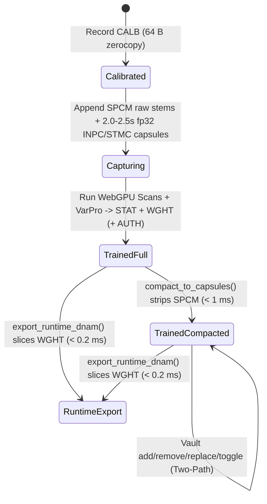

# Single-File Cloud-Ready Project & Capture Vault Container (`.dnam-proj` / `DNPJ`)

This specification defines the **`.dnam-proj` (`b"DNPJ"`, `v3.0`-Only, `"architecture": "sona"`) Project & Capture Vault Binary Format** built from declarative `#[repr(C)]` `zerocopy` wire structs (`ref[repo.code.zerocopy-wire-structs]`) with **zero legacy `v2` or `TORA` backwards compatibility**, owned by [`packages/capture/`](../../../packages/capture/README.md) (`dnam_capture::proj`) and pairing with [`dnam_binary_format.md`](dnam_binary_format.md) and `DNWB` white-box pipe headers (`DnwbHeader64BWire`, `version = 3`) to fulfill [`REQ-3.1`–`REQ-3.3`, `REQ-5.3`, `REQ-8.1`, `REQ-8.2`, `REQ-8.8`](../../requirements/system_goals_and_requirements.md) (see [`../../adr/0020-modular-monorepo-and-dnam-proj-container.md`](../../adr/0020-modular-monorepo-and-dnam-proj-container.md) and [`../../adr/0022-sona-state-space-operator-and-webgpu-architecture.md`](../../adr/0022-sona-state-space-operator-and-webgpu-architecture.md)).

---

## 1. Front-Loaded Cloud-Ready Wire Framing & Chunk Directory



```text
+===================================================================================================+
| .dnam-proj ("DNPJ", v3.0, "sona") FRONT-LOADED 64-BYTE-ALIGNED ZEROCOPY WIRE LAYOUT               |
+===================================================================================================+
| [0 .. 64)                  DnamProjPreambleWire (#[repr(C, align(64))], zerocopy LE)              |
|   [0..4]    magic = b"DNPJ"           | [4..6]   version_major = 3 (U16)| [6..8] version_minor = 0|
|   [8..12]   lifecycle_flags (U32 LE)  | [12..16] chunk_count (N, U32)   | [16..24] chunk_dir_off  |
|   [24..32]  manifest_offset (U64)     | [32..40] manifest_len (U64)     | [40..44] header_crc32c  |
|   [44..64]  reserved = [0u8; 20]      |                                                           |
+---------------------------------------------------------------------------------------------------+
| [64 .. 64 + 64*N)          Chunk Directory: N x ProjChunkDirEntryWire (64 B each, zerocopy)       |
|   [0..4]    kind FourCC ("CALB"|"SPCM"|"INPC"|"STMC"|"STAT"|"WGHT"|"AUTH")                        |
|   [4..8]    chunk_id (U32 LE)         | [8..12]  flags (U32 LE)       | [12..16] crc32c (U32 LE)  |
|   [16..24]  offset (64 B aligned U64) | [24..32] length (exact U64)   | [32..64] sha256 ([u8; 32])|
+---------------------------------------------------------------------------------------------------+
| [manifest_offset .. align64(manifest_offset + manifest_len))  RFC 8785 JCS Manifest + 0x00 pad    |
+---------------------------------------------------------------------------------------------------+
| [Payload Region: 64 B-aligned chunks in contiguous ascending file-offset order]                   |
|   • CALB (64 B CalbChunkWire)          Loopback latency, converter gain, noise-floor profile      |
|   • SPCM (optional raw PCM stems)      Active-session lossless audio (stripped on compaction)     |
|   • INPC (InpcCapsuleHeaderWire+fp32)  Shared 2.0-2.5 s (96k-120k) full-bandwidth fp32 dry capsule|
|   • STMC (StmcCapsuleHeaderWire+fp32)  128 B hdr + R<=36 StmcTrajectoryWindowWire + 4096 B + fp32 |
|   • STAT (cached trajectories + uploU) StarCenter SONA trajectories + f64 uplo='U' const Gram     |
|   • WGHT (canonical v3.0 .dnam bytes)  Complete [STAB-ZERO-DC] "sona" runtime model (< 0.2 ms)    |
|   • AUTH (128 B ProjAuthRecordWire)    Creator signature ("DNPJ-PROJECT-MANIFEST-V3")             |
+===================================================================================================+
```

### 1.1 64B Preamble & Content-Addressed Chunk Directory

`r[container.proj.preamble-and-directory]`

Every `v3.0` `.dnam-proj` container is a declarative, code-execution-free binary file (`REQ-8.8`) parsed via `#[repr(C)]` `zerocopy::byteorder::little_endian::{U16, U32, U64, F32, F64}` structs (`FromBytes, IntoBytes, KnownLayout, Immutable`, `ref[repo.code.zerocopy-wire-structs]`) with zero manual byte slicing, starting with `DnamProjPreambleWire` at byte `0` (`magic = b"DNPJ"`, `version_major = 3`, `version_minor = 0`; any `v1`/`v2` container is rejected fail-fast with `DnamError::UnsupportedVersion`):

1. **Front-Loaded `HTTP Range` Inspectability:** `chunk_dir_offset` must equal `64`, and `manifest_offset` must equal `64 + 64 * chunk_count`, placing the entire Preamble, `ProjChunkDirEntryWire` directory, and JCS Manifest at the front of the file so cloud storage clients (`HTTP Range: bytes=0-65535`) can parse all project metadata and chunk `SHA-256` digests in a single range read (`parse_proj_manifest_range`, or a second exact range read to `align64(manifest_offset + manifest_len)` if the header exceeds `64 KB`) without fetching payload chunks.
2. **Strict `64 B` Alignment & Bounds Validation:** The total file byte length, `manifest_offset`, `align64(manifest_offset + manifest_len)`, and every chunk `offset` must be exact multiples of `64 B`. `header_crc32c` (at bytes `40..44`) covers bytes `0..40` of the preamble concatenated with the `64 * chunk_count` directory bytes and the exact `manifest_len` unpadded JCS manifest bytes, while padding bytes `[manifest_offset + manifest_len .. align64(manifest_offset + manifest_len))` must be `0x00`. Every `ProjChunkDirEntryWire` must specify a known FourCC (`CALB`, `SPCM`, `INPC`, `STMC`, `STAT`, `WGHT`, or `AUTH`), contiguous non-overlapping ascending `64 B`-aligned file bounds, zeroed padding (`0x00`) between `offset + length` and the next `64 B` boundary, and matching `CRC32C` + `SHA-256` digests over its exact `length` bytes. Unknown `lifecycle_flags` bits, non-zero `reserved` bytes (`44..64`), truncated files, or digest mismatches fail fast with `DnamError`.

**Clean-Room Outer Container, Directory, Calibration & Companion IPC Wire Structs (Exact Byte Offsets):**

1. **`DnamProjPreambleWire` / `DnpjPreambleWire` (`64 B`, `#[repr(C, align(64))]`, file offset `0..64`):**

| Offset | Bytes | LE Wire Type | Field Name | Clean-Room Validation Invariant |
| :---: | :---: | :--- | :--- | :--- |
| `0..4` | `4` | `[u8; 4]` | `magic` | Exact `b"DNPJ"` |
| `4..6` | `2` | `u16le` | `version_major` | Must equal `3` |
| `6..8` | `2` | `u16le` | `version_minor` | Must equal `0` |
| `8..12` | `4` | `u32le` | `lifecycle_flags` | `PROJ_FLAG_*`: `1<<0` `HAS_CALIBRATION`, `1<<1` `HAS_RAW_STEMS`, `1<<2` `HAS_CAPSULES`, `1<<3` `HAS_STAT`, `1<<4` `HAS_WGHT`, `1<<5` `HAS_AUTH`, `1<<6` `STEREO_OUT`, `1<<7` `COMPACTED_CAPSULES` (`KNOWN_MASK = 0x00FF`) |
| `12..16` | `4` | `u32le` | `chunk_count` | Number of `64 B` TOC records `N` (`0..=4096 = MAX_PROJ_CHUNKS`) |
| `16..24` | `8` | `u64le` | `chunk_dir_offset` | Must equal `64` |
| `24..32` | `8` | `u64le` | `manifest_offset` | Must equal `64 + 64 * chunk_count` |
| `32..40` | `8` | `u64le` | `manifest_len` | Unpadded UTF-8 RFC 8785 JCS manifest length (`> 0`) |
| `40..44` | `4` | `u32le` | `header_crc32c` | Castagnoli `CRC-32C` over `preamble[0..40] \|\| dir[64 * chunk_count] \|\| manifest[manifest_len]` |
| `44..64` | `20` | `[u8; 20]` | `reserved` | All `20` bytes must equal `0x00` |

2. **`ProjChunkDirEntryWire` (`64 B` TOC entry, repeated `N` times at `64..64+64*N`):**

| Offset | Bytes | LE Wire Type | Field Name | Clean-Room Validation Invariant |
| :---: | :---: | :--- | :--- | :--- |
| `0..4` | `4` | `[u8; 4]` | `fourcc` | `b"CALB"`, `b"SPCM"`, `b"INPC"`, `b"STMC"`, `b"STAT"`, `b"WGHT"`, or `b"AUTH"` |
| `4..8` | `4` | `u32le` | `chunk_id` | `0` for singletons (`CALB/INPC/STAT/WGHT/AUTH`); `stem_index` matching `stems_registry` for `SPCM`/`STMC` |
| `8..12` | `4` | `u32le` | `flags` | Must equal `0` |
| `12..16` | `4` | `u32le` | `crc32c` | Castagnoli `CRC-32C` over `bytes[offset..offset + byte_len]` |
| `16..24` | `8` | `u64le` | `offset` | `64 B`-aligned Region 3 offset (`(offset & 0x3F) == 0`, ascending non-overlapping) |
| `24..32` | `8` | `u64le` | `byte_len` | Unpadded chunk payload byte count (`[offset + byte_len .. align64(offset + byte_len))` all `0x00`) |
| `32..64` | `32` | `[u8; 32]` | `sha256` | SHA-256 digest of `bytes[offset..offset + byte_len]` |

3. **`CALB` (`CalbChunk64B` / `CalbChunkWire`, `64 B`) & `SPCM` (`64 B` Header + Aligned `fp32` Audio):**

| Chunk | Offset | Bytes | LE Wire Type | Field & Invariant |
| :--- | :---: | :---: | :--- | :--- |
| **`CALB` (`64 B`)** | `0..4` | `4` | `[u8; 4]` | `magic`: ASCII `"CALB"` |
| `CALB` | `4..6` | `2` | `u16le` | `version`: Must equal `3` |
| `CALB` | `6..7` | `1` | `u8` | `bit_depth_code`: `0=Int12, 1=Int16, 2=Int24, 3=Int32, 4=Float32` (`> 4` rejected) |
| `CALB` | `7..8` | `1` | `u8` | `polarity_inverted`: `0` or `1` (`> 1` rejected) |
| `CALB` | `8..12` | `4` | `u32le` | `sample_rate_device_hz`: `8_000..=384_000` |
| `CALB` | `12..16` | `4` | `[u8; 4]` | `reserved_pad`: All `0x00` |
| `CALB` | `16..24` | `8` | `f64le` | `loopback_lag_samples`: Finite sub-sample lag at `48 kHz` |
| `CALB` | `24..32` | `8` | `f64le` | `signed_gain`: Finite linear loopback gain |
| `CALB` | `32..36` | `4` | `f32le` | `input_reference_dbfs`: Finite calibration reference level |
| `CALB` | `36..40` | `4` | `f32le` | `noise_floor_dbfs`: Finite quiescent hardware noise floor |
| `CALB` | `40..60` | `20` | `[u8; 20]` | `reserved_tail`: All `0x00` |
| `CALB` | `60..64` | `4` | `u32le` | `crc32c`: Castagnoli `CRC-32C` over `bytes[0..60]` |
| **`SPCM` (`>= 64 B`)** | `0..4` | `4` | `[u8; 4]` | `magic`: ASCII `"SPCM"` (`60 B` header pad `4..64`, stripped in `< 1 ms` by `compact_to_capsules`) |
| `SPCM` | `64..` | `4 * L` | `[f32le; L]` | Aligned raw stem `fp32` PCM samples (`channels * num_frames`) |

4. **`DNWB` White-Box Pipe Wire Protocol (`DnwbHeader64BWire`, `64 B`), `DNPR` Telemetry Seqlock (`256 B`) & WAV `RIFF`/`fmt `/`data` Ingestion:**

| Protocol / Container | Offset | Bytes | LE Wire Type | Field & Clean-Room Invariant |
| :--- | :---: | :---: | :--- | :--- |
| **`DNWB` (`64 B`)** | `0..4` | `4` | `[u8; 4]` | `magic`: `"DNWB"` |
| `DNWB` | `4..6` | `2` | `u16le` | `version`: `1` (wire framing version) |
| `DNWB` | `6..8` | `2` | `u16le` | `command`: `0 = Reset`, `1 = RenderStem`, `2 = RenderFrame` |
| `DNWB` | `8..12` | `4` | `u32le` | `sample_rate_hz`: Supported `8_000..=1_536_000` |
| `DNWB` | `12..16` | `4` | `u32le` | `num_frames`: Sample frame count |
| `DNWB` | `16..26` | `10` | `5 × u16le` | `num_input_channels`, `num_output_channels`, `num_controls`, `num_switches`, `num_internal_nodes` |
| `DNWB` | `26..28` | `2` | `u16le` | `flags`: `1<<0 STRUCTURED_V1`, `1<<1 HAS_TRAJECTORIES`, `1<<2 HAS_FREEZE_WINDOW`, bits `8..11` = `ch_mask` (`popcount(ch_mask)` matches active channels) |
| `DNWB` | `28..36` | `8` | `u64le` | `payload_byte_len`: `<= MAX_DNWB_PAYLOAD_BYTES = 64 MiB` (`67,108,864 B`); followed immediately by request (`u16le stem_id_len \|\| stem_id \|\| f32le[ctrl] \|\| u8[sw] \|\| f32le[ch*frames] \|\| opt. trajs \|\| opt. [u64le;2] freeze`) or response (`u16le stem_id_len \|\| stem_id \|\| f32le[out_ch*frames] \|\| internal_nodes`) |
| `DNWB` | `36..64` | `28` | `[u8; 28]` | `reserved`: All `0x00` |
| **`DNPR` (`256 B`)** | `0..64` | `64` | `16 × u32le` | Words `0..16`: `w[0..7]` (`w[0] seq` odd=writing/even=consistent, `w[1] status\|phase<<8\|tier<<16\|permille<<20`, `w[2] step\|total<<16`, `w[3] stg_step\|stg_total<<16`, `w[4] best_loss f32`, `w[5] mr_iir f32`, `w[6] clamped_ctrls\|vis<<16`), `w[7..11] tier_besr_db[4]`, `w[11..15] tier_ltas_db[4]`, **`w[15..16]` (`w[15]`) = `PROGRESS_MAGIC_DNPR = 0x444E_5052`** |
| `DNPR` | `64..256` | `192` | `48 × u32le` | Words `16..64`: `16..32` `target_wave_i8[64]`, `32..48` `model_wave_i8[64]`, `48..56` `ltas_error_q20_i8[32]` (`0.05 dB`/step, `±6.35 dB`), `56..64` `kautz_poles_q8[16]` (`16 × (r_u8, f_u8)`) |
| **WAV `RIFF`** | `0..12` | `12` | `4+u32le+4` | `b"RIFF" \|\| riff_size u32le (>= 4, <= len-8) \|\| b"WAVE"`, followed by even-padded `(id[4], len u32le, body[len], opt pad0)` chunks |
| **WAV `fmt `** | `0..16+` | `>= 16` | LE fields | `audio_format` (`1 = PCM`, `3 = IEEE Float`, `0xFFFE = WAVE_FORMAT_EXTENSIBLE` `>= 40 B`, `cbSize >= 22`), `channels >= 1`, `sample_rate_hz >= 1`, `avg_bytes_per_sec == sample_rate_hz * block_align`, `block_align == channels * container_bytes`, `bits_per_sample`: `Int12` (`2 B` via `0xFFFE`), `Int16` (`2 B`), `Int24` (`3 B`), `Int32` (`4 B`), `Float32` (`4 B`, `SubFormat` `1`/`3` + `KSDATAFORMAT_SUBTYPE_TAIL`) |
| **WAV `data`** | `0..8+` | `4+u32le+N` | PCM/`f32le` | Must follow `fmt ` chunk; finite `Float32`, exact multiple of `channels * container_bytes` bytes |

**`DNPR` Telemetry Payload Encodings (Words `48..64`):**
- `ltas_error_q20_i8[32]` (`32 × i8`, words `48..56`, bytes `192..224`): `i8` saturated `round(clamp(10 * log10((P_model[b] + floor) / (P_tgt[b] + floor)) * 20, -127, 127))` (`0.05 dB` per step, `±6.35 dB` range).
- `kautz_poles_q8[16]` (`16 × (r_u8, f_u8)`, `32 B`, words `56..64`, bytes `224..256`): `r_u8 = round(clamp((r - 0.5) / 0.5, 0, 1) * 255)` and `f_u8 = round(clamp(ln(clamp(theta * sr / (2 * pi), 20, 20000) / 20) / ln(1000), 0, 1) * 255)`.

### 1.2 RFC 8785 JCS Project Manifest

`r[container.proj.jcs-manifest]`

The manifest slice at `[manifest_offset .. manifest_offset + manifest_len)` stores a strict UTF-8 **RFC 8785 JSON Canonicalization Scheme (`JCS`)** serialization of `DnamProjManifest` (zero-padded with `0x00` to the next `64 B` boundary), rejecting UTF-8 BOMs, duplicate JSON keys, unknown schema fields, and non-canonical key ordering:

| Manifest Section | Required Fields | Normative Invariant |
| :--- | :--- | :--- |
| **Envelope & Nested `base` Header** | `version = "3.0.0"`, `container_kind = "dnam-proj"`, `base` (`DnamJsonHeader` with `base.container_kind = "dnam"`, `base.architecture = "sona"`) | Shares the exact validated `v3.0` `"sona"` `DnamJsonHeader` schema with `dnam-engine` (`ref[container.dnam.jcs-header-schema]`). |
| **`project_meta`, `rig_routing` & `calibration_summary`** | `project_meta.{project_id, rig_notes, updated_at}`, `rig_routing.{sample_rate_device_hz, bit_depth, input_channels, output_channels, reamp_send_channel}`, `calibration_summary` | Tracks project identity, native hardware rate (`8..384 kHz`), bit depth (`int12`, `int16`, `int24`, `int32`, `float32`), and `CalbChunkWire` (`CALB` `v3`) telemetry. |
| **`stems_registry`** | Ordered `StemRegistryEntry` list (`stem_id`, `chunk_id`, `enabled`, `is_star_center`, `controls_meta`, `provenance`, `user_metadata`, `extracted_physics`) | Binds each stem's `chunk_id` (`u16` `STMC` `stem_index`), `SHA-256` dry/wet `<f4` PCM provenance, and `DNAM-GRAM-INPUT-V3` fingerprint (`REQ-3.2`). |
| **`audit_report` & `solver_telemetry`** | `audit_report` (`AuditReportSummary`), `solver_telemetry.{active_stem_count, total_solve_ms, tier_esr_db}` | Persists Phase-1 control-space audit clamps and 4-tier ESR certification metrics across incremental vault edits. |

### 1.3 Lifecycle States, Capsule Compaction & Cloud Range Sync

`r[container.proj.lifecycle-states]`

A `.dnam-proj` container transitions monotonically or non-destructively across valid flag-consistent lifecycle configurations (`PROJ_FLAG_HAS_CALIBRATION`, `PROJ_FLAG_HAS_RAW_STEMS`, `PROJ_FLAG_HAS_CAPSULES`, `PROJ_FLAG_COMPACTED_CAPSULES`, `PROJ_FLAG_HAS_STAT`, `PROJ_FLAG_HAS_WGHT`, `PROJ_FLAG_HAS_AUTH`, `PROJ_FLAG_STEREO_OUT`):

1. **Active Capture (`CALB` + `SPCM` + `INPC`/`STMC`):** Retains lossless raw `SPCM` audio stems alongside extracted `INPC`/`STMC` capsules during active hardware recording.
2. **Trained Full Project (`+ STAT + WGHT`):** Embeds `StarCenter` `uplo='U'` sufficient statistics (`STAT`) and the certified 4-tier `v3.0` `.dnam` runtime model (`WGHT`).
3. **Capsule Compaction (`compact_to_capsules`):** Requires `INPC` and `STMC` capsules whenever `stems_registry` is non-empty, strips all raw `SPCM` chunks in place without re-running solver passes, preserves `PROJ_FLAG_COMPACTED_CAPSULES` across capsule-only vault edits, and shrinks multi-stem projects to compact capsules (`~0.8–2.5 MB`) that still support deterministic full re-pooling and fast runtime `.dnam` export (`REQ-3.1`, `REQ-3.3`).

---

## 2. Capture Capsules & Compositional Sufficient Statistics

### 2.1 Shared Input Coreset Capsule (`INPC`)

`r[container.proj.inpc-capsule]`

The `INPC` chunk (`chunk_id = 0`) stores the shared **`2.0–2.5 s` (`96,000–120,000`-frame at `48 kHz`, `num_frames % 16 == 0`) full-bandwidth (`20 Hz–20 kHz`) `fp32` (`IEEE-754 binary32`)** dry excitation capsule inside a `64 B`-aligned record (`384,640–480,640 B` for mono `C_in = 1`, `768,640–960,640 B` for stereo `C_in = 2`), retaining full `18–20 kHz` HF air and multi-second dynamic envelopes inside `< 20 MB` multi-stem `.dnam-proj` vaults (`REQ-5.4`):

| Offset | Bytes | LE Wire Type | Field Name | Clean-Room Invariant |
| :---: | :---: | :--- | :--- | :--- |
| `0..4` | `4` | `[u8; 4]` | `magic` | Exact `b"INPC"` |
| `4..6` | `2` | `u16le` | `version` | Must equal `3` |
| `6..8` | `2` | `u16le` | `channels` | `1` (mono) or `2` (stereo) |
| `8..12` | `4` | `u32le` | `sample_rate_hz` | Must equal `48_000` |
| `12..16` | `4` | `u32le` | `num_frames` | Coreset frame count (`96_000..=120_000`, divisible by `16`) |
| `16..56` | `40` | `[u8; 40]` | `reserved` | All `40` bytes must equal `0x00` |
| `56..60` | `4` | `u32le` | `rec_len` | Total byte length (`640 + channels * num_frames * 4`) |
| `60..64` | `4` | `u32le` | `crc32c` | Castagnoli `CRC-32C` over `bytes[64..rec_len]` |
| `64..320` | `256` | `[u8; 256]` | `seed_256` | Deterministic PRNG seed (`256 B`) |
| `320..640` | `320` | `[u8; 320]` | `schedule_320` | `AdaptiveStimulusController` schedule (`0..4` `num_carriers u32le`, `4..8` `valid_frames u32le`, `8..12` `active_samples u32le`, `12..16` `reserved_0 u32le`, `16..320` `carrier_bins[0..76] u32le`) |
| `640..rec_len` | `4 * C * N` | `[f32le; C * N]` | `dry_coreset_fp32` | Finite interleaved `fp32` dry stimulus coreset (`384,000 B` mono / `768,000 B` stereo @ `2.0 s`) |

**`INPC` `seed_256` & `schedule_320` Sub-Payloads (`64..640`):**
- `seed_256[256]` (`INPC 64..320`, `256 B`): Deterministic PRNG seed reproducing the shared stimulus excitation sequence.
- `schedule_320[320]` (`INPC 320..640`, `320 B`, offsets relative to `schedule_320` start): `0..4` `num_carriers: u32le`, `4..8` `valid_frames: u32le`, `8..12` `active_samples: u32le`, `12..16` `reserved_0: u32le`, `16..320` `carrier_bins[0..76]: [u32le; 76]` (`304 B`).

### 2.2 Per-Stem Response Coreset Capsule (`STMC`)

`r[container.proj.stmc-capsule]`

Each stem $s$ in `stems_registry` owns a dedicated `STMC` chunk (`chunk_id == stem_index`) of `64 B`-aligned size (`388,800–484,800 B` for mono `C_out = 1`, `772,800–964,800 B` for stereo `C_out = 2`, keeping compacted multi-stem projects strictly `< 20 MB` per `REQ-5.4`):

| Offset | Bytes | LE Wire Type | Field Name | Clean-Room Invariant |
| :---: | :---: | :--- | :--- | :--- |
| `0..4` | `4` | `[u8; 4]` | `magic` | Exact `b"STMC"` |
| `4..6` | `2` | `u16le` | `version` | Must equal `3` |
| `6..8` | `2` | `u16le` | `stem_index` | Matches `StemRegistryEntry::chunk_id` |
| `8..10` | `2` | `u16le` | `flags` | `1<<0 ENABLED`, `1<<1 STAR_CENTER`, `1<<2 MODE_A_SWEEP`, `1<<3 STEREO`, `1<<4 WET_POLARITY_INVERTED` (`KNOWN_MASK = 0x001F`) |
| `10..12` | `2` | `u16le` | `n_windows` | Active trajectory window count `R` (`1..=36 = STMC_MAX_TRAJECTORY_WINDOWS`) |
| `12..16` | `4` | `f32le` | `pad_gain_f32` | Finite hardware input pad gain |
| `16..20` | `4` | `f32le` | `fractional_lag_samples_f32` | Finite sub-sample alignment lag |
| `20..108` | `88` | `[u8; 88]` | `band_psd_summary_88` | Band-energy PSD summary (`0..80`: `4×4 uplo='U'` upper-triangle `10 × f64le` `sqrt(band_power[i]) * sqrt(band_power[j])` for `i <= j`; `80..88`: `total_power f64le`) |
| `108..112` | `4` | `u32le` | `num_frames` | Coreset frame count (`96_000..=120_000`, divisible by `16`) |
| `112..116` | `4` | `u32le` | `n_comb_bins` | Measured comb bin count |
| `116..120` | `4` | `u32le` | `rec_len` | Total byte length (`4_800 + channels * num_frames * 4`) |
| `120..124` | `4` | `u32le` | `body_crc32c` | Castagnoli `CRC-32C` over `bytes[128..rec_len]` |
| `124..128` | `4` | `[u8; 4]` | `reserved` | All `4` bytes must equal `0x00` |
| `128..704` | `576` | `[StmcTrajectoryWindowWire; 36]` | `windows` | `R` entries (`16 B` each: `+0..2` `control_id: u16le`, `+2` `ctrl_kind: u8`, `+3` `active_opt: u8`, `+4..8` `u_phys: f32le`, `+8..12` `window_weight: f32le >= 0`, `+12..16` `emr_velocity: f32le`); unused tail `128+16*R..704` must be `0x00` |
| `704..4,800` | `4,096` | `[u8; 4_096]` | `spectral_summary_4096` | `1,024 × f32le` averaged `2:1` DFT magnitude bins (`0.5 * (\|X[2k]\| + \|X[2k+1]\|) * (2 / N)`) |
| `4,800..rec_len` | `4 * C * N` | `[f32le; C * N]` | `wet_coreset_fp32` | Finite aligned full-bandwidth wet response (`Path 2` WebGPU/CPU re-pooling without raw WAVs) |

**`STMC` `band_psd_summary_88` & `spectral_summary_4096` Sub-Payloads:**
- `band_psd_summary_88[88]` (`STMC 20..108`, `88 B`, offsets relative to `band_psd_summary_88` start): `0..80` holds the `4×4` `uplo='U'` upper-triangle `10 × f64le` entries where entry `(i <= j) = sqrt(band_power[i]) * sqrt(band_power[j])`; `80..88` holds `total_power: f64le`.
- `spectral_summary_4096[4096]` (`STMC 704..4,800`, `4,096 B`): `1,024 × f32le` averaged `2:1` DFT magnitude bins `0.5 * (|X[2k]| + |X[2k+1]|) * (2 / N)`.

### 2.3 Tier-Ordered Upper-Triangular `StarCenter` Statistics (`STAT`)

`r[container.proj.stat-uplo-u]`

The `STAT` chunk (`chunk_id = 0`) stores cached `StarCenter` Stage B `SONA` trajectories paired with fixed compile-time `const` (`LITE_SPEC..ULTRA_SPEC`, `0` capture-time resizing) tier-ordered column-major upper-triangular (`uplo = 'U'`) `IEEE-754 float64` `VarPro` sufficient statistics (`Lite` $\subset$ `Full` $\subset$ `Pro` $\subset$ `Ultra`, `REQ-5.3`):
$$\mathrm{idx}(i, j) = i + \frac{j(j + 1)}{2}, \qquad 0 \le i \le j < D_T$$
At active tier readout dimension $D_T$ (constant per `SonaTierSpec`), `STAT` packs $\frac{D_T(D_T + 1)}{2}$ upper-triangular `f64le` Gram entries ($\mathbf{G}_0$, starting at byte `0`), followed immediately by $2 \times D_T$ `f64le` two-channel cross-correlation entries ($\mathbf{C}_0$, `2 * 8 * D_T = 16 * D_T` bytes), verified on load for exact tier byte size, finite `f64` values, and non-negative diagonal entries $G_{ii} \ge 0$, guaranteeing `< 50 ms` `Path 1` incremental Vault edits with `0-ULP` `StarCenter` invariance:

| Retained Tier (`STAT` Constant) | Dimension `D_T` | Packed `uplo='U'` `G_0` Elements (`u64` idx `<= j(j+1)/2+i`) | `G_0` Bytes (`0..`) | `C_0` Bytes (`16 * D_T`) | Exact Chunk Byte Size |
| :--- | :---: | :---: | :---: | :---: | :---: |
| **`PROJ_STAT_BYTES_LITE`** | `64` | `2,080` (`64 * 65 / 2`) | `16,640 B` | `1,024 B` | **`17,664 B`** (`276 CL`) |
| **`PROJ_STAT_BYTES_FULL`** | `128` | `8,256` (`128 * 129 / 2`) | `66,048 B` | `2,048 B` | **`68,096 B`** (`1,064 CL`) |
| **`PROJ_STAT_BYTES_PRO`** | `192` | `18,528` (`192 * 193 / 2`) | `148,224 B` | `3,072 B` | **`151,296 B`** (`2,364 CL`) |
| **`PROJ_STAT_BYTES_ULTRA`** | `256` | `32,896` (`256 * 257 / 2`) | `263,168 B` | `4,096 B` | **`267,264 B`** (`4,176 CL`) |

---

## 3. Embedded Runtime Model & Provenance Envelope

### 3.1 Embedded Runtime Weights & Zero-Solve `.dnam` Export (`WGHT`)

`r[container.proj.wght-and-export]`

Every trained `v3.0` `.dnam-proj` embeds a complete, self-contained `v3.0` (`"architecture": "sona"`) `.dnam` byte stream inside its `WGHT` chunk (`chunk_id = 0`, `byte_len` = full serialized `.dnam` byte count from `DnamPreambleWire` through `DmueFooterWire`, [`dnam_binary_format.md`](dnam_binary_format.md)):
1. **`[STAB-ZERO-DC]` Hard Invariant (`b_head == 0.0`):** Both container assembly (`build_dnam_proj_container_with_cp1`) and `DnamProjView::from_bytes` verify that `WGHT` passes full `.dnam` `zerocopy` validation and resting-DC invariants across `Arena0LiteWire` (`Lite`) through `Arena3UltraDeltaWire` (`Ultra`) (`b_head == 0.0`, resting DC `<= 1e-5`), rejecting non-zero DC bias payloads immediately.
2. **Zero-Solve Runtime Export (`export_runtime_dnam`, `< 0.2 ms`):** Exporting a deployable `v3.0` `.dnam` file at any target `max_tier` (`Lite`, `Full`, `Pro`, or `Ultra`) validates `DistributionPolicy`, merges mutable `presets`, `user_metadata`, and `controls_schema[*].user_metadata` into the `DMU1` suffix (automatically growing compact `48 B` `DMU1` frames up to the `4,096 B` `DMU1` + `DMUE` trailer ceiling), and applies lossless keyless prefix truncation (`strip_container_to_tier`, `ref[container.dnam.tier-prefix]`, retaining self-contained `1x`-calibrated `Arena 0` control descriptors and `Lite` `CP1`/`W_readout` slices with zero solver recomputation).

### 3.2 Cryptographic Provenance Envelope (`AUTH`)

`r[container.proj.auth-signature]`

When signed (`PROJ_FLAG_HAS_AUTH`), the `AUTH` chunk (`chunk_id = 0`) stores an exact `128 B` (`2`-cache-line) `zerocopy` `ProjAuthRecordWire` (`PROJ_AUTH_RECORD_BYTES = 128`) containing an `Ed25519` signature over the length-prefixed domain-separated message (`encode_domain_field(k, v) = u32le(len(k)) || k || u64le(len(v)) || v`):

| Offset / Segment | Bytes | LE Wire Type | Field & Signing Transcript |
| :--- | :---: | :--- | :--- |
| **`AUTH` `0..4`** | `4` | `[u8; 4]` | `magic`: Exact `b"AUTH"` |
| `AUTH` `4..6` | `2` | `u16le` | `version`: Must equal `3` |
| `AUTH` `6..32` | `26` | `[u8; 26]` | `reserved`: All `26` bytes must equal `0x00` |
| `AUTH` `32..64` | `32` | `[u8; 32]` | `signer_pubkey_ed25519`: Creator `Ed25519` verifying public key |
| `AUTH` `64..128` | `64` | `[u8; 64]` | `signature_ed25519`: `Ed25519` signature over concatenated `encode_domain_field` tuples below |
| **Sign Msg Field 1** | var | UTF-8 + bytes | `encode_domain_field("domain", b"DNPJ-PROJECT-MANIFEST-V3")` |
| **Sign Msg Field 2** | `65` | bytes | `encode_domain_field("signer_pubkey_ed25519", signer_pubkey_ed25519[32])` |
| **Sign Msg Field 3** | `69` | bytes | `encode_domain_field("manifest_immutable_sha256", immutable_jcs_sha256[32])` |
| **Sign Msg Field 4** | `4 + 52 * M` | bytes | `encode_domain_field("chunk_directory_v3", u32le(M) \|\| M × (fourcc[4] \|\| chunk_id u32le \|\| flags u32le \|\| byte_len u64le \|\| sha256[32]))` for all `M` non-`AUTH` chunks |

Any tampering with the immutable manifest fields, chunk directory, `STMC` stem capsules, `STAT` Gram entries, or `WGHT` weights fails fast with `DnamError::CryptoVerificationFailed`.
