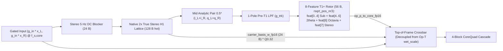

# Op-M: Universal `TPT-SVF` Scan, Symplectic Modal, `Op-P` Hilbert/Tracker & Kautz Operator

This specification defines Op-M (Modal and Linear State-Space) along with the input-only Op-P analytic basis for Dynamic Neural Audio Modeler (DNAM) SONA v4.0. Op-M governs four coupled subsystems across real-time execution and GPU training:

1. Unconditionally passive 2×2 `ZDF` `TPT-SVF` associative scans inside the all-tier 2× `OS2X` 4-block Matryoshka SONA core (with Block 0 Predictor-Corrector passive PHS) across 44.1–384 kHz.
2. Top-of-Frame Causal Crossbar signed `Q0.32` quadrature phasors (spanning `[-0.49 f_s, +0.49 f_s]`, typical audible magnitudes 0.05 Hz–20 kHz) and `Q0.192` contractive control rotors (`Op-M[Ctrl]`).
3. Input-only Op-P v4 analytic basis executing natively at `f_{s,core}` (6-section H1 Hilbert lattice, learned 1-pole pre-T1 LPF `g_trk`, 8-feature T1+ tracker, and decoupled crossbar gates).
4. `ModalConvolver` v4 (Kaiser polyphase high-SR FIR, `ErSparseBank` MIMO early taps, 2-basis `fp16` FIR voicing morph, and shared-pole Kautz banks with per-bank onset/cross-feed).

For requirements and architectural context, see [sona_architecture.md](../architecture/sona_architecture.md) and [REQ-1.2, REQ-1.3, REQ-2.5, REQ-6.2](../../requirements/system_goals_and_requirements.md). For mathematical derivations and counterexamples, see [ADR-0005](../../adr/0005-contractive-rotor-hilbert-and-t1-tracker.md), [ADR-0022](../../adr/0022-sona-state-space-operator-and-webgpu-architecture.md), and [ADR-0024](../../adr/0024-sona-v4-kernel-hb-fir-perimeter-and-control-bus-gra.md).

---

## 1. 4-Lane SIMD Symplectic Complex Recurrence & Algebraic Rotor

### 1.1 Complex State Recurrence & Passive 2x2 ZDF `TPT-SVF` Associative Scan

#### 1.1.1 Symplectic Complex Recurrence & Unconditional `TPT-SVF` Passivity

`r[dsp.op-m.recurrence.symplectic]`

Inside the all-tier 2× `OS2X` (15-tap symmetric linear-phase HB-FIR) 4-block Matryoshka SONA core, resonant and crossover filter quads occupy 4, 6, 8, or 10 `svf_quads` across Lite, Full, Pro, and Ultra with strict `CoreQuad[0..4]` prefix sharing, yielding 16, 24, 32, or 40 scalar TPT-SVF modes (one quad per 4-lane CoreQuad). Block 0 applies 1-step Predictor-Corrector passive PHS (`k_eff[n] = k + k_nl * min(v_1lin[n]², 64.0)`), while Blocks 1..3 run linear passive 2×2 ZDF trapezoidal state-variable filters with zero `FDIV`, `log`, or `exp` instructions in the audio loop.

For a mode with cutoff frequency $f_c[n]$, prewarped ZOH tangent gain $g[n] = \tan(\pi f_c[n] / f_{s,\text{eff}}) > 0$, damping $k[n] = 1/Q[n] \ge 0$, $a_1 = 1 / (1 + g(g + k))$, $a_2 = g a_1$, and $a_3 = g a_2$, the nodal update and state transition follow:

$$v_3[n] = u[n] - s_2[n-1], \qquad v_1[n] = a_1 s_1[n-1] + a_2 v_3[n], \qquad v_2[n] = s_2[n-1] + a_2 s_1[n-1] + a_3 v_3[n]$$
$$\mathbf{s}[n] = \mathbf{A}_{\text{tpt}}[n]\mathbf{s}[n-1] + \mathbf{b}_{\text{tpt}}[n]u[n], \qquad A_{11} = 2a_1 - 1, \quad A_{12} = -2a_2, \quad A_{21} = 2a_2, \quad A_{22} = 1 - 2a_3, \quad \mathbf{b}_{\text{tpt}}[n] = [2a_2, 2a_3]^\top$$
$$s_1[n] = (2a_1 - 1)s_1[n-1] - 2a_2 s_2[n-1] + 2a_2 u[n], \qquad s_2[n] = 2a_2 s_1[n-1] + (1 - 2a_3)s_2[n-1] + 2a_3 u[n]$$
$$\mathrm{LP}[n] = v_2[n], \qquad \mathrm{BP}[n] = v_1[n], \qquad \mathrm{HP}[n] = u[n] - k v_1[n] - v_2[n], \qquad \mathrm{AP}[n] = u[n] - 2 k v_1[n]$$

Because $\Vert \mathbf{A}_{\text{tpt}}[n] \Vert_2 \le 1$, the discrete energy identity $(s_1'[n])^2 + (s_2'[n])^2 = s_1[n-1]^2 + s_2[n-1]^2 - 4 g[n] k[n] v_1[n]^2 \le s_1[n-1]^2 + s_2[n-1]^2$ holds for zero input $u[n] = 0$. Consequently, every matrix prefix product in a $2 \times 2$ Blelloch $O(\log_2 L)$ associative prefix scan (eight `f32` values per mode inside 16 KiB GPU workgroup shared SRAM) stays bounded in 32-bit float under arbitrary audio-rate modulation (`Q = 12` sweeps).

Sample-rate adaptation prepares $g_{\text{host}} = \tan(\pi f_c / f_{s,\text{core}})$ or ZOH $\tan(\rho_{\text{core}}\arctan(g_{\text{ref}}))$ strictly via the math-library-free cold helpers of [router_and_crossbar_topology.md §9.1](router_and_crossbar_topology.md#91-causal-crossbar-sensoryquad-core-tpt-svf--kautz-conversion), while 3 kHz and micro-chunk modulation scales $g_{\text{host}}$ via `exp2_clamped5(g_oct_lane)` without transcendental math or `FDIV`. Simultaneous `(LP, BP, HP, AP)` taps allow optimizer weights to express Linkwitz-Riley crossovers, interactive tone stacks, and multi-pole phasers without device-specific sub-circuits (`REQ-1.9`).

Dedicated 4-lane symplectic complex modal blocks update $z_c[n] = z_{\mathrm{re},c}[n] + i z_{\mathrm{im},c}[n] \in \mathbb{C}$ for lane $c \in \lbrace 0, 1, 2, 3 \rbrace$ using Cartesian products of radius and contractive unit rotation:

$$z_c[n] = a_c[n] z_c[n-1] + \tilde{b}_c[n] x_c[n], \qquad a_c[n] = r_c[n] \cdot u_{\mathrm{rot}, c}[k], \qquad |r_{c,\mathrm{ref}}[n]| \le 0.9995, \quad |u_{\mathrm{rot}, c}| \le 1.000000000000$$

Expanded in real arithmetic, $z_{\mathrm{re},c}[n] = \alpha_{\mathrm{re},c}[n] z_{\mathrm{re},c}[n-1] - \alpha_{\mathrm{im},c}[n] z_{\mathrm{im},c}[n-1] + b_{\mathrm{re},c} x_c[n]$ and $z_{\mathrm{im},c}[n] = \alpha_{\mathrm{im},c}[n] z_{\mathrm{re},c}[n-1] + \alpha_{\mathrm{re},c}[n] z_{\mathrm{im},c}[n-1] + b_{\mathrm{im},c} x_c[n]$, matching 64-bit associative scans within $10^{-13}$.

#### 1.1.2 4-Lane Stereo `TPT-SVF`, Symplectic & Kautz SIMD Recurrence

`r[dsp.op-m.recurrence.stereo-simd]`

Both 4-mode `TPT-SVF` / symplectic modal blocks and `ModalConvolver` 4-pair stereo Kautz slices (2, 3, 6, or 8 blocks across Lite..Ultra) step Left and Right channel states together in 4-lane or 8-lane stereo 32-bit SIMD registers. Inside the core, Quad-Major 4-frame / 8-subsample register-resident execution decodes `fp16` coefficients and tiles once per 8 subsamples (8× fewer coefficient decodes and zero cold spills), while Kautz coefficient vectors stay register-resident across each 4-frame micro-chunk with 0-ULP parity ([ADR-0019](../../adr/0019-simd-kernel-architecture-and-realtime-execution-optimizations.md), [ADR-0024](../../adr/0024-sona-v4-kernel-hb-fir-perimeter-and-control-bus-gra.md)).

---

### 1.2 Contractive Finite-Precision Rotor

`r[dsp.op-m.rotor.contractive]`

To guarantee $|u_{\mathrm{rot}, c}| \le 1.0$ in IEEE-754 `f32` without standard math library calls, `FDIV`, or `FSQRT`, control angles in $(-\pi, \pi)$ are evaluated via quadrant-reduced Taylor polynomials and adaptive ULP contraction, while Top-of-Frame quadrature carriers use 4-lane signed `Q0.32` accumulators across `[-0.49 f_s, +0.49 f_s]` (typical audible magnitudes 0.05 Hz–20 kHz).

```text
+---------------------------------------------------------------------------------------------------+
| QUADRANT-REDUCED CONTRACTIVE ROTOR, 4-LANE Q0.32 AUDIO PHASORS & Q0.192 CTRL LFO                  |
+---------------------------------------------------------------------------------------------------+
|  1. Zero-Increment Hold: If theta == ±0.0 -> return (1.0, 0.0) & hold oscillator state           |
|  2. VM/3kHz/Load Rotor:  Pure-32-bit Cody-Waite pi/2 + f32 deg-13/14 Horner (algebraic_unit_rotor)|
|  3. Host f64 Rotor:      Widen |theta| to f64 -> fold pi/2 & pi/4 for host trainer/ZOH utilities  |
|  4. Adaptive ULP Guard:  If c^2 + s^2 >= 1.0 -> decrement larger |c|,|s| by 1..2 f32 ULP & flush |
|  5. Crossbar Phasors:    4-lane u32 Q0.32 evaluate-then-advance + degree-5 Hermite quadrature     |
+---------------------------------------------------------------------------------------------------+
```

#### 1.2.1 Exact Zero-Increment Hold

`r[dsp.op-m.rotor.zero-hold]`

When $\theta = \pm 0.0$, the rotor immediately returns `(1.0, 0.0)` and bypasses LFO state rotation or stabilization so zero-frequency oscillators hold state bit-for-bit.

#### 1.2.2 Quadrant Reduction to `[0, pi/4]`

`r[dsp.op-m.rotor.quadrant-horner]`

All VM runtime, 3 kHz, and cold-load paths (including Kautz 3 kHz retuning, `Op-T` Givens `psi`, and crossbar `phasor_stereo_phase_fp16`) invoke pure-32-bit Cody-Waite/Horner `algebraic_unit_rotor_f32` (§1.2.4).

The widened `f64` rotor path, reserved strictly for host `f64` trainer and ZOH utilities, uses constants `pi64 = 0x400921FB54442D18`, `half_pi64 = 0x3FF921FB54442D18`, and `quarter_pi64 = 0x3FE921FB54442D18` to fold $|\theta|$ across $\pi/2$ (negating cosine) and $\pi/4$ (swapping sine and cosine) into $x \in [0, \pi/4]$. With $z = \mathrm{RNE}_{f64}(x \cdot x)$, descending Horner evaluation computes:

$$S(x) = x \sum_{j=0}^{6} \frac{(-1)^j z^j}{(2j+1)!}, \qquad C(x) = \sum_{j=0}^{7} \frac{(-1)^j z^j}{(2j)!}$$

#### 1.2.3 Adaptive 1–2 ULP Norm Guard

`r[dsp.op-m.rotor.ulp-guard]`

In the host `f64` rotor utility, after rounding outputs to `f32` $(c, s)$, the rotor checks $q = \mathrm{RNE}_{f64}(c^2 + s^2)$. Whenever $q \ge 1.0$, it decrements the `f32` magnitude bits of $\max(|c|, |s|)$ (choosing $c$ on ties) by 1 ULP, and by a second ULP if the recomputed $q$ remains $\ge 1.0$, guaranteeing $|u_{\mathrm{rot}}|_2 < 1$ with component error under $1.6 \times 10^{-7}$ and angular error under $2.3 \times 10^{-7}$ radians.

#### 1.2.4 `Q0.192` Control LFO & 4-Lane `Q0.32` Crossbar Phasors

`r[dsp.op-m.rotor.q0-192-lfo]`

| Rotor Kernel | Phase Representation | Frequency Range & Precision |
| :--- | :--- | :--- |
| `Op-M[Ctrl]` `Q0.192` LFO | Modulo 2^192 signed accumulator via `3 × u64` limbs | Prevents rounding stalls down to 2^-30 rad/tick |
| 4-Lane `Q0.32` Crossbar Phasors | 4 wrapping `u32` phase accumulators (`i32` crossbar increments) | Signed `[-0.49 f_s, +0.49 f_s]` (typical 0.05 Hz–20 kHz) carriers with `c^2 + s^2` = 1 ± 1e-4 |
| Pure-32-Bit Algebraic Unit Rotor | 3-part Cody-Waite `pi/2` reduction within 65,536 rad (`algebraic_unit_rotor_f32`) | Pure `f32` degree-13/14 Taylor + 2-ULP guard for VM runtime, 3 kHz & cold-load paths |

Cold setup converts finite `lfo_dphi_train[j]` in `[-pi, +pi]` (zeroing non-finite values) in `binary64`, computing `dphi_host` clamped to magnitude `0x4049_0FDA` (largest binary32 value below pi):

$$K = \left\lfloor \frac{2^{256}}{2\pi} \right\rfloor = \text{0x28be60db9391054a7f09d5f47d4d377036d8a5664f10e4107f9458eaf7aef158}, \qquad \Delta P = \mathrm{round}_{\text{even}}\left(\frac{m K}{2^{64 - e}}\right)$$

The increment step decomposes `bits(dphi_host)` into `negative` sign and significand $|d_{\phi}| = m \cdot 2^e$, producing zero increment when the magnitude bits vanish:

```text
Cold/Rate Setup:
  dphi_host = clamp(f64(lfo_dphi_train[j]) * rho_ctrl, -f64(0x4049_0FDA), +f64(0x4049_0FDA)) as f32
  theta_bits = bits(dphi_host); mag_bits = theta_bits & 0x7FFF_FFFF; negative = (theta_bits >> 31) != 0
  if mag_bits == 0: mag = [0, 0, 0]; else mag = round_even((m * K) >> (64 - e))  // 5 x u64 product -> [u64; 3]

Cold Init & reset():
  lfo_phases_q192[j] = [0, 0, 0]; lfo_phasors[j] = [1.0, 0.0]   // q2 resets to [1.0 + beta_0, 0.0, 1.0 + beta_1, 0.0] via lfo_skew_fp16

Per K_ctrl Tick (Pure-32-Bit Rotor, Zero f64 VM Math):
  if mag_bits == 0: hold lfo_phases_q192[j]; (c, s) = lfo_phasors[j]
  else:
    advance lfo_phases_q192[j] modulo 2^192 by (-1 if negative else +1) * mag
    q32 = (lfo_phases_q192[j][2] >> 32) as u32; quad = q32 >> 30
    angle = f32(q32 & 0x3FFF_FFFF) * (f32(pi / 2) * 2^-30)  // 0x30C9_0FDB in f32
    (c0, s0) = algebraic_unit_rotor_f32(angle)
    (c, s) = quad_rotate(quad, c0, s0); lfo_phasors[j] = flush([c, s])
  q2[2*j] = c + beta_j * (2.0 * c * c - 1.0); q2[2*j + 1] = s   // beta_j = lfo_skew_fp16[j] in [-1.0, 1.0]
```

At audio rate inside the Top-of-Frame crossbar, each `Q0.32` carrier computes `cycles = clamp(freq_hz * inv_sr, -0.49, +0.49)` and signed `inc_q32: i32 = round(cycles * 2^32)`. This signed formulation supports negative frequencies and arithmetic `inc_1x >> 1` at 2× `OS2X` ([router_and_crossbar_topology.md §4](router_and_crossbar_topology.md#4-top-of-frame-causal-operator-crossbar)).

By contrast, the unsigned `[0.0, 0.49999994]` (`0x3EFF_FFFE`) bound with `inc_q32 = u32(clamp(cycles * 2^32 + 0.5, 0.0, 2^31))` applies solely to positive-only `u32` `PhasorQ32Bank4` APIs.

On every audio step, `PhasorQ32Bank4` executes **evaluate-then-advance**: it computes quadrature `(cos, sin)` at the current `phase` via `eval(phase)`, then advances `phase = wrapping_add(phase, inc as u32)`.

Both paths extract quadrant `phase >> 30` and quarter-turn residual $u = (\mathrm{phase} \mathbin{\mathrm{and}} \mathrm{0x3FFFFFFF}) \cdot 2^{-30}$, evaluating degree-5 Hermite quadrature (`HERMITE5_C1 = pi/2`, `HERMITE5_C3 = pi - 2.5`, `HERMITE5_C5 = pi/2 - 1.5`):

$$\sin_{\text{q}}(u) = u\big(c_1 + u^2(-c_3 + c_5 u^2)\big), \qquad \cos_{\text{q}}(u) = \sin_{\text{q}}(1 - u)$$

which rotates by quadrant $q \in \lbrace 0, 1, 2, 3 \rbrace$ into $(c, s) \in \lbrace (\cos_q, \sin_q), (-\sin_q, \cos_q), (-\cos_q, -\sin_q), (\sin_q, -\cos_q) \rbrace$.

All VM runtime, 3 kHz, and cold-load rotor evaluations — including Kautz 3 kHz retuning, `Op-T` Givens `psi`, and crossbar `phasor_stereo_phase_fp16` — invoke pure-32-bit `algebraic_unit_rotor_f32` rather than widened `f64` math.

Inside `algebraic_unit_rotor_f32`, pure-32-bit evaluation returns `(1.0, 0.0)` early when `!is_finite(theta) || theta == 0.0 || |theta| > 65536.0`, derives Taylor inverse-factorial coefficients in pure `f32` via `(-1)^m * (1.0_f32 / fact_f32(n))`, and steps through Cody-Waite reduction, degree-13/14 Horner evaluation, quadrant mapping, and a contractive ULP guard:

```text
Early Exit 1: if !is_finite(theta) || theta == 0.0 || |theta| > 65536.0 -> return (1.0, 0.0)
Taylor Coeffs (pure f32 as (-1)^m * (1.0_f32 / fact_f32(n))):
  SIN_C{3,5,7,9,11,13} = [-1/3!, +1/5!, -1/7!, +1/9!, -1/11!, +1/13!]
  COS_C{2,4,6,8,10,12,14} = [-1/2!, +1/4!, -1/6!, +1/8!, -1/10!, +1/12!, -1/14!]
Cody-Waite Reduction (PIO2_1 = 0x3FC9_0000, PIO2_2 = 0x39FD_A000, PIO2_3 = 0x33A2_2169):
  q_f = round_ties_even(theta * (1.0 / (pi / 2))) via BIASED_INT_MAGIC_F32 = 0x4B40_0000
  r   = ((theta - q_f * PIO2_1) - q_f * PIO2_2) - q_f * PIO2_3
Early Exit 2: if !is_finite(r) || |r| > 0.85 -> return (1.0, 0.0)
Horner Grouping (r2 = r * r; unfused IEEE-754 binary32 FP_CONTRACT OFF, zero FMA across all targets):
  sin_r = r + (r * r2) * (SIN_C3 + r2 * (SIN_C5 + r2 * (SIN_C7 + r2 * (SIN_C9 + r2 * (SIN_C11 + r2 * SIN_C13)))))
  cos_r = 1.0 + r2 * (COS_C2 + r2 * (COS_C4 + r2 * (COS_C6 + r2 * (COS_C8 + r2 * (COS_C10 + r2 * (COS_C12 + r2 * COS_C14))))))
Quadrant ((q_f as i32) & 3):
  0 -> (cos_r, sin_r), 1 -> (-sin_r, cos_r), 2 -> (-cos_r, -sin_r), 3 -> (sin_r, -cos_r)
Contractive ULP Guard (<= 2 iterations, unfused binary32 norm2 = (cos_out * cos_out) + (sin_out * sin_out)) & Flush:
  on_axis = ((c_bits & 0x7FFF_FFFF) == 0) || ((s_bits & 0x7FFF_FFFF) == 0)
  while norm2 > 1.0 || (!on_axis && norm2 == 1.0):
    decrement c_bits by 1 if (c_bits & 0x7FFF_FFFF) >= (s_bits & 0x7FFF_FFFF) else decrement s_bits by 1
  return (flush_subnormal_f32(cos_out), flush_subnormal_f32(sin_out))
```

#### 1.2.5 Division-Free Floor Angle Wrapping & Incremental 3 kHz 4-Lane Pole Rotation

`r[dsp.op-m.rotor.angle-wrap-and-retune]`

Arbitrary `f32` angles wrap into $[-\pi, \pi)$ via `k = floor((theta_rad + PI) * INV_TAU)` followed by `theta_rad - k * TAU` with zero `FDIV`, standard math library remainder calls, or loops.

During 3 kHz ModalConvolver modulation, retuning follows §4.3: immediate snaps set `last_oct`, `last_damp`, and `prev_oct` with slew inactive before running the restore-or-step update, while regular ticks skip work when none of the change or slew flags are active.

Fast restore checks `|oct| <= 1e-7 && |damp| <= 1e-7 && |oct - prev_oct_used| <= 1e-7` so step jumps contract for one tick before restoring cached poles via `algebraic_unit_rotor_f32`.

Active ticks set `th_new = 0.0` when `th_host <= 1e-6` or clamp `th_host * freq_scale` inside `[1e-4, pi - 1e-4]`, contract `r_eff = min(r_damped, max(0.9950 - 0.15 * dtheta, 0.25))` when `dtheta > 1e-6`, and rescale orthonormal gains via §4.3 ([ADR-0019](../../adr/0019-simd-kernel-architecture-and-realtime-execution-optimizations.md)).

---

### 1.3 Log-Octave Initialization & H2-Norm Input Scaling

`r[dsp.op-m.init.log-octave-h2]`

Both `TPT-SVF` and Kautz modal poles are initialized logarithmically across 25 Hz–16 kHz, with cold-path $\mathcal{H}_2$ input normalization $\gamma_m = \sqrt{1 - r_{\mathrm{high},m}^2}$ (§4.1).

---

## 2. Family 2: Hilbert SSB Lattice & Carrier Modulation

`r[dsp.op-m.hilbert.lattice]`

Shared across CPU execution and GPU training precomputation as part of the input-only Op-P basis, analytic signal generation cascades six real-coefficient second-order transposed direct-form II all-pass sections per branch (`HILBERT_ALPHA_I_BITS` and `HILBERT_ALPHA_Q_BITS`). Standalone H1 descriptors occupy 248 B (48 B shared `alpha_i[6]`/`alpha_q[6]` plus 200 B L/R $z^{-2}$ and `q_prev` states), whereas the SONA v4.0 active-hot working set packs true-stereo H1 into a 128 B compact hot layout inside the 376 B Op-P / Op-N[Pre] / crossbar hot slice.

$$H_I(z) = \prod_{k=0}^{5} \frac{\alpha_{I,k} - z^{-2}}{1 - \alpha_{I,k} z^{-2}}, \qquad H_Q(z) = z^{-1} \prod_{k=0}^{5} \frac{\alpha_{Q,k} - z^{-2}}{1 - \alpha_{Q,k} z^{-2}}$$

Across 20 Hz–20 kHz, this 12-pole lattice achieves 0.0976 deg (< 0.10 deg) quadrature phase error at 48 kHz, <= 0.19 deg across all 15 table anchors, and <= 0.34 deg across interpolated rates in `[44.1, 96]` and `[176.4, 384]` kHz. Inside the bridged `(96, 176.4)` kHz transition band, error stays <= 0.34 deg for `f >= 30 Hz` and <= 0.67 deg worst-case at 20 Hz near 136.2 kHz.

Each section runs transposed direct-form II updates with zero `FDIV` and subnormal flush per section boundary, applying the 1-sample delay (`q_out = q_prev; q_prev = q_next`) at the **output** of section 5 of $H_Q$:

$$y_k = \mathrm{flush}\big(\alpha_k v_k + s_{1,k}\big), \qquad s_{1,k} \leftarrow s_{0,k}, \qquad s_{0,k} \leftarrow \mathrm{flush}\big(\alpha_k y_k - v_k\big), \qquad v_{k+1} = y_k$$

When $f_s \ne 48$ kHz, the `H1` Hilbert lattice sets L and R coefficients symmetrically via 15-rate `HILBERT-H1-ANCHORS` 128-bit integer ties-to-even rational linear interpolation (§2.1.1) spanning `[44,100 ..= 384,000]` Hz, bridging `[96,000, 176,400]` Hz for intermediate 2× host rates such as 128,000 Hz and clamping out-of-range rates to endpoint rows, while upstream 5 Hz `T1` DC blocking uses ZOH $R_{\mathrm{trk,eff}} = R_{\mathrm{trk,ref}}^{\rho_{\text{sr}}}$.

Inside the Top-of-Frame Crossbar, true-stereo `H1` analytic pairs $(I_L, Q_L, I_R, Q_R)$ combine with the 4-lane `Q0.32` quadrature carriers $(c[n], s[n])$ through the 24 B half-precision 3-basis carrier readout `carrier_basis_w_fp16` (Arena 0 Crossbar bytes 156..180), forming projections `[hi * p_cos, hq * p_sin, p_sin]` for SSB shifting $I c \mp Q s$, ring modulation, and quadrature stereo modulation.

During all-tier 2× oversampled execution (`OS2X` active on Lite through Ultra when `!offline_bounce && 2 * f_{s,vm} <= 384_000`), Op-P (H1, pre-T1 tracking LPF, T1+, and 4× Q0.32 carrier phasors) executes natively at `f_{s,core}` using the 15-rate `HILBERT-H1-ANCHORS` table (44.1–384 kHz). Native 2× H1 execution eliminates -4.6..-15.3 dB midpoint interpolation imaging without storing 1× midpoint history buffers.

In the Top-of-Frame Crossbar, Op-P and Q0.32 phasor crossbar injection gains (`op_p_to_core` and `phasor_to_core`) operate as dedicated crossbar gates decoupled from Op-T `wet_scale` (`stage_targets[15]`), while Q0.32 phasors step at `inc_core` under `OS2X` after optional octave modulation via slot 29 `op_p_phasor_rate_oct`. Because Op-P depends solely on dry input $x[n]$, training pipelines precompute native `f_{s,core}` tracks on CPU in under 0.5 ms before GPU upload.

### 2.1 Hilbert Coefficient Profile `H1`

`r[dsp.op-m.hilbert.h1-anchors]`

The 48,000 Hz row below provides the canonical runtime `HILBERT_ALPHA_I_BITS` and `HILBERT_ALPHA_Q_BITS` anchor coefficients, while off-48 kHz rates interpolate across consecutive rows of the 15-rate table (§2.1.1). The complete reference table stores IEEE-754 `f32` bit patterns (six `I`-branch then six `Q`-branch coefficients; 780 B little-endian payload, SHA-256 `bd236421110a57438536f20286ada3d2d16de8709f418f7322136d80c639c352`) spanning 44,100–384,000 Hz across 1× live, bridged 2× host, and 4× bounce bands:

```text
HILBERT-H1-ANCHORS
 44100 | 3D8EC459 3EE935E1 3F47659D 3F6CCEAA 3F7A0188 3F7E7297 | 3E7B1AD6 3F243369 3F5E97F2 3F752D7D 3F7CCA31 3F7F8A32
 48000 | 3D91BEE6 3EECB8E1 3F48DE0D 3F6D91C9 3F7A5939 3F7E8E9D | 3E80025F 3F25F6B0 3F5FADA1 3F75B332 3F7CFFA1 3F7F92D2
 64000 | 3DA2AF27 3EFE4625 3F4FBDA5 3F70B815 3F7B8289 3F7EE2C7 | 3E8C7CF3 3F2E9DD3 3F647F75 3F77A752 3F7DA785 3F7FAC3E
 80000 | 3DA88500 3F0212AF 3F523110 3F72069B 3F7C1032 3F7F0F58 | 3E90CC38 3F318514 3F665AC6 3F788657 3F7DFC4C 3F7FBA14
 96000 | 3DB073C5 3F05A9C4 3F54E508 3F7343B2 3F7C852B 3F7F30C7 | 3E963AF7 3F34F3ED 3F683FD9 3F794AFF 3F7E3E99 3F7FC438
176400 | 3E0D917D 3F216E28 3F624034 3F77D413 3F7DE528 3F7F8887 | 3ECDF9DC 3F49A494 3F703BD8 3F7BD39E 3F7EF730 3F7FDDFB
192000 | 3E1A79AD 3F2691E2 3F64674D 3F787EBC 3F7E12E1 3F7F9298 | 3ED99328 3F4D2EB7 3F717613 3F7C2D21 3F7F0DA9 3F7FE0D4
208000 | 3E2646E1 3F2A6E87 3F65C7A3 3F78E266 3F7E2EFD 3F7F99AA | 3EE33E4A 3F4F9D5A 3F723264 3F7C621C 3F7F1C5F 3F7FE2ED
224000 | 3E34BA6C 3F2F8A17 3F67DE51 3F798480 3F7E584A 3F7FA231 | 3EEF3412 3F53121B 3F736170 3F7CB521 3F7F3010 3F7FE547
240000 | 3E4151D9 3F33437E 3F693973 3F79E8DF 3F7E72F8 3F7FA845 | 3EF8BC96 3F556DD1 3F741F05 3F7CE93F 3F7F3D5F 3F7FE706
256000 | 3E4CBD88 3F363B81 3F6A3C44 3F7A3322 3F7E877C 3F7FAD32 | 3F006617 3F573C54 3F74AA8C 3F7D1079 3F7F47DE 3F7FE876
288000 | 3E64086E 3F3BDB10 3F6C20CB 3F7ABA23 3F7EABAF 3F7FB5AD | 3F083609 3F5AA15E 3F75ACD3 3F7D5697 3F7F5A2A 3F7FEAEB
320000 | 3E7D6662 3F41DCD7 3F6E3EDD 3F7B5343 3F7ED216 3F7FBDBA | 3F1068CD 3F5E589B 3F76D2C7 3F7DA41A 3F7F6C8B 3F7FED2A
352000 | 3E88E622 3F45A7EB 3F6F6903 3F7BA4C3 3F7EE847 3F7FC310 | 3F163553 3F6082FF 3F776EE6 3F7DCEB5 3F7F77E5 3F7FEEB9
384000 | 3E942913 3F49F3A3 3F70D45F 3F7C094D 3F7F0173 3F7FC869 | 3F1C84D4 3F631031 3F783122 3F7E017B 3F7F8401 3F7FF039
```

#### 2.1.1 Exact Rational Ties-to-Even Interpolation

`r[dsp.op-m.hilbert.ties-to-even]`

Each anchor coefficient equals $A/2^{27}$ with $2^{23} \le A < 2^{27}$, and any finite positive `binary64` effective rate clamps into 44,100..=384,000 Hz as $f = R/2^k$ with $0 \le k \le 37$. Interpolation spans consecutive rows $\ell \le f \le h$ across `[44,100 ..= 384,000]` Hz, bridging `[96,000, 176,400]` Hz so intermediate 2× rates such as 128,000 Hz stay well-defined while out-of-range rates clamp to endpoint rows.

With integer anchors $A, B$, cold setup forms 128-bit unsigned integers $N < D < 2^{80}$, reaching an 80-bit maximum $D = 80{,}400 \cdot 2^{63}$ on `[96_000, 176_400]` Hz and remaining exact in `u128`:

$$N = (h 2^k - R)A + (R - \ell 2^k)B, \qquad D = (h - \ell)2^{k+27}, \qquad \alpha_j(f) = \mathrm{round}_{32,\text{ties-even}}\left(\frac{N}{D}\right)$$

#### 2.1.2 History-Consistent Rate Transitions

`r[dsp.op-m.hilbert.rate-remap]`

For a transposed second-order all-pass section $y[n] = \alpha v[n] + s[n-2]$ with $s[n] = \alpha y[n] - v[n]$, switching coefficient $\alpha \to \beta$ at sample $n$ remaps the two state cells from retained prior outputs $y[n-1], y[n-2]$ (96 B raw per 12-section pair) instead of copying $s$ unmodified:

$$s'[n-i] = s[n-i] + (\beta - \alpha)y[n-i], \qquad i \in \lbrace 1, 2 \rbrace$$

---

## 3. Family 1: Sub-Harmonic Synthesizers, Bistable Dividers & PLL Tracking

### 3.1 Tracker Input Conditioning (`T1`)

`r[dsp.op-m.tracker.t1-dc-blocker]`



The input-only `Op-P` v4 pipeline executes one identical stereo-input analytic chain natively at `f_{s,core}` across real-time audio execution and CPU training precomputation, separating the 24 B stereo 5 Hz `T1` DC blocker, true-stereo `H1` lattice, learned 1-pole pre-`T1` tracking LPF (`g_trk`), 24 B 3-basis carrier readout, and 56 B 8-feature `T1+` sub-harmonic and octave tracker:

| Pipeline Component | Placement, Footprint & Constants | Runtime & ZOH Rate Law |
| :--- | :--- | :--- |
| Stereo `T1` 5 Hz DC Blocker | 24 B stereo 5 Hz 1-pole blocker (`0x3F7F_D51F`, `0x3F7F_EA90`) conditioning L/R before `H1` | Scales `R_trk,eff` cleanly with `f_{s,core}` (`rho_core`); zero duplicate post-`H1` blockers |
| Native 2× True Stereo `H1` Lattice | `H1` state (128 B compact hot layout, shared `alpha_i`/`alpha_q` + L/R TDF-II `z^-2` and `q_prev`) | 15-rate `HILBERT-H1-ANCHORS` 128-bit ties-to-even interpolation at `f_{s,core}` over `[44,100 ..= 384,000]` Hz, endpoint-clamped; 0.0976 deg (< 0.10 deg) @ 48 kHz, <= 0.19 deg all 15 anchors, <= 0.34 deg across `[44.1, 96]` & `[176.4, 384]` kHz |
| 3-Basis Carrier & Phasor Block | 24 B `carrier_basis_w_fp16` (`[hi*p_cos, hq*p_sin, p_sin]`); 48 B 4× `Q0.32` phasors | Native `f_{s,core}` evaluation (`inc_1x >> 1` under `OS2X`), zero midpoint interpolation lag or aliasing |
| Pre-`T1` LPF & 8-Feature `T1+` Rotor | 56 B hot state (`g_trk` LPF, `prev_w1_re`, `prev_w1_im`, `sheet2`, `env_dc`, stereo/2-band state) | Emits `feat[0..8]` (4 sub-harmonic + `2theta` doubler + Octavia/OC-2 + stereo/2-band) via decoupled `op_p_to_core` |

The upstream 5 Hz DC blocker state update and ZOH rate law compute:

$$d[n] = \alpha_{\mathrm{trk}}\big(x[n]-x[n-1]\big)+R_{\mathrm{trk}}d[n-1], \qquad R_{\mathrm{trk,eff}} = \mathrm{clamp}\big(R_{\mathrm{trk,ref}}^{\rho_{\text{sr}}},\ 0.0,\ r_{\max}\big), \qquad \alpha_{\mathrm{trk,eff}} = \frac{1 + R_{\mathrm{trk,eff}}}{2}$$

Reference 5 Hz 160-bit midpoint anchors (`T1-COEFFICIENT-VECTORS` and `T1-MIDPOINT-SEARCH`) specify the normative cold-load selection law across both standalone DSP kernel and virtual-machine runtime initializers over continuous $44{,}100.0 \le f_{s,\mathrm{vm}} \le 384{,}000.0$ Hz. This single monotone search spans the full `[44,100..384,000]` Hz band using unified bracket `(first, last) = (0x00FF_D000, 0x00FF_FBFF)`, resolving intermediate rates in `(96,000, 176,400)` Hz such as 128 kHz directly.

Adjacent `f64` rates `0x40E77045FD955545` and `0x40E77045FD955546` double-round to `0x3F7FD520` under naive 64-bit power calls, whereas outward 160-bit bounds on $S(x) = -\frac{1}{2}\log(x) = \sum_{j=0}^{\infty} z^{2j+1}/(2j+1)$ with $z = (1-x)/(1+x)$ select the exact ties-to-even `f32` pole.

```text
T1-COEFFICIENT-VECTORS (5 Hz Reference Table)
 44100 | 3F7FD155 | 3F7FE8AA
 48000 | 3F7FD51F | 3F7FEA90
 48001 | 3F7FD51F | 3F7FEA90
 88200 | 3F7FE8A9 | 3F7FF454
 96000 | 3F7FEA8F | 3F7FF548
176400 | 3F7FF454 | 3F7FFA2A
192000 | 3F7FF547 | 3F7FFAA4
384000 | 3F7FFAA3 | 3F7FFD52

T1-MIDPOINT-SEARCH
Effective rate (Hz) | First midpoint m | Last midpoint m | Maximum comparisons
  44100.0..384000.0 | 00FFD000         | 00FFFBFF        | 14
```

Initializing `lower = first + 1` and `upper = last` over `(0x00FF_D000, 0x00FF_FBFF)` against discrete 48 kHz reference pole `0x3F7F_D51F` (`mantissa24 = 0x00FF_D51F`), exact bit synthesis decomposes `rate_hz = rate_num / rate_den` from its IEEE-754 significand and runs an 8-term integer `atanh` series in 2^160 fixed point:

```text
atanh_bounds_160bit(num, den):
  z_num = den - num; z_den = den + num
  cur = ((1 << 160) * z_num) / z_den; z2_num = z_num * z_num; z2_den = z_den * z_den
  for idx in 0..8:
    lower += cur / (2 * idx + 1)
    cur = (cur * z2_num) / z2_den
  return (lower, lower + 16)
ref_bounds = atanh_bounds_160bit(0x00FF_D51F, 1 << 24)
while lower < upper:
  candidate = (lower + upper) >> 1
  mid_bounds = atanh_bounds_160bit(2 * candidate + 1, 1 << 25)
  if mid_bounds.lower * rate_num > ref_bounds.upper * (48_000 * rate_den): lower = candidate + 1 else: upper = candidate
num_gain = (1 << 24) + lower; q = num_gain >> 1; rem = num_gain & 1
rounded_gain = q + (rem == 1 && (q & 1) != 0)
pole_bits = 0x3F00_0000 + lower - (1 << 23); gain_bits = 0x3F00_0000 + rounded_gain - (1 << 23)
```

---

### 3.2 Bounded Analytic Envelope, 3-Regime Gate & Normalization

#### 3.2.1 Three-Regime Gate & Mandatory `NR3` Magnitude

`r[dsp.op-m.tracker.envelope-norm]`

After flushing subnormals and sanitizing non-finite inputs, the `T1` sub-harmonic rotor evaluates $r^2 = I_{\text{clean}}^2 + Q_{\text{clean}}^2$ directly in normal 32-bit `f32` with zero exponent-split pre-scaling and selects one of three regimes using **mandatory 3-step `rsqrt_pos_nr3`** normalization across `r2`, half-angle `h1`, and quarter-angle `h2`:

| Regime | Entry Condition | State & Output Behavior |
| :--- | :--- | :--- |
| 1. `SILENCE` | Non-finite `r2` or `r2 < 1.0e-12` (`T1_SILENCE_SQUELCH_R2`) | Set `prev_valid = false`, hold `(sheet, sheet2, prev_w1_re, prev_w1_im)`, emit `[0.0, 0.0, 0.0, 0.0]` |
| 2. `VALID` | `r2 >= 1.0e-12` | Compute `inv_r = rsqrt_pos_nr3(r2)`, unit phasor `u_re = clamp(i_clean * inv_r, -1.0, 1.0)`, `u_im = clamp(q_clean * inv_r, -1.0, 1.0)`, `env_gate = flush(r2 * inv_r)` |
| 3. `HYSTERESIS` | `prev_valid`, `dot = p · u < 0`, `abs(det) <= 2^-18` (`BRANCH_CUT_CHORD_TOL`) | Suppress `sheet`/`sheet2` toggling across near-origin antipodal crossings while updating unit phasors and envelope |

#### 3.2.2 True Stereo `H1` Lattice, Mid `T1` Batching & Pure-`f32` Branch-Cut Guard

`r[dsp.op-m.tracker.stereo-batching]`

True-stereo `H1` lattice stepping updates independent Left and Right quadrature delay histories across all 6 cascaded sections natively at `f_{s,core}`, passing $(i_{\mathrm{mid}}, q_{\mathrm{mid}}) = 0.5(i_L + i_R, q_L + q_R)$ through the learned 1-pole pre-`T1` tracking LPF (`g_trk`) into the 56 B `T1+` rotor without storing 1× midpoint history buffers.

Paired downstream, the `T1` sub-harmonic rotor evaluates its pure 32-bit `f32` branch-cut guard and 3-step `rsqrt_pos_nr3` inverse square root normalization across both stages with zero `f64` instructions across both mono and stereo L/R pairs ([ADR-0019](../../adr/0019-simd-kernel-architecture-and-realtime-execution-optimizations.md), [ADR-0022](../../adr/0022-sona-state-space-operator-and-webgpu-architecture.md), [ADR-0024](../../adr/0024-sona-v4-kernel-hb-fir-perimeter-and-control-bus-gra.md)).

---

### 3.3 2-Stage Algebraic Half/Quarter-Angle Rotor (`cos(theta/2)..sin(theta/4)`)

`r[dsp.op-m.tracker.toggle-sheet]`

The 56 B T1+ sub-harmonic and octave rotor extends the base sub-harmonic core (`prev_w1_re`, `prev_w1_im`, `sheet`/`sheet2`) with the 1-pole pre-T1 `g_trk` LPF, 2theta frequency doubler, Octavia `env_dc`, and stereo/2-band tracking state, cascading two cancellation-free algebraic square-root stages $z \mapsto w_1 = z^{1/2}$ followed by $w_1 \mapsto w_2 = w_1^{1/2} = z^{1/4}$:

**Half-Angle Root** evaluates $w_1 = (\cos(\theta/2), \sin(\theta/2))$. When `!prev_valid`, it initializes `prev_u = u` and skips half-angle branch-cut toggling; otherwise it toggles `sheet` iff `tracker_crosses_branch_cut_f32(prev_u, u)` holds (`dot >= 0 || |D| > 2^-18` with cross-axis crossing), computes `h1 = (1 + |u_re|)/2` and `rho1 = rsqrt_pos_nr3(max(h1, 1e-12))`, and forms cancellation-free `(sub1_cos, sub1_sin) = sheet * half_angle(u)`.

**Quarter-Angle Root** evaluates $w_2 = (\cos(\theta/4), \sin(\theta/4))$. When `!prev_valid`, it initializes `(prev_w1_re, prev_w1_im) = (sub1_cos, sub1_sin)` directly without toggling sheet2; otherwise it toggles sheet2 iff `tracker_crosses_branch_cut_f32(prev_w1, w1)` holds, computes `h2 = (1 + |sub1_cos|)/2` and `rho2 = rsqrt_pos_nr3(max(h2, 1e-12))`, forms `(sub2_cos, sub2_sin) = sheet2 * half_angle(w1)`, and updates `prev_w1 = w1`.

**Smooth Quadrature Output** guarantees zero step aliasing by multiplying all four continuous quadrature channels by `env_gate = flush(r2 * inv_r)` (zero in `SILENCE`):

$$\mathbf{feat}[0..4] = \mathrm{env-gate} \cdot \big[\cos(\theta/2), \sin(\theta/2), \cos(\theta/4), \sin(\theta/4)\big]$$

This quadrature basis feeds the `ControlBus` v4 `GRA` crossbar routing gates (`op_p_to_core` and `phasor_to_core` across active quads, 0-ULP sign-flip compatible across lanes and decoupled from `Op-T` `wet_scale`), stepping unconditionally every sample even when crossbar gains are zero ([router_and_crossbar_topology.md §4](router_and_crossbar_topology.md#4-top-of-frame-causal-operator-crossbar)).

---

### 3.4 Forward-Faithful Training

`r[dsp.op-m.tracker.training]`

Because `Op-P` v4 depends strictly on dry input $x[n]$, training pipelines precompute exact native `f_{s,core}` `H1`, pre-`T1` `g_trk` LPF, and 8-feature `T1+` trajectories on CPU in under 0.5 ms while propagating exact `T1+` adjoint sensitivities with respect to `g_trk`, Octavia/OC-2 blend, and decoupled crossbar gates.

### 3.5 Expanded 8-Feature `T1+` Analytic Basis & Pre-`T1` LPF

`r[dsp.op-m.tracker.t1-plus]`

To model analog octave dividers, upper-octave rectifiers, and ring-modulated tracking cleanly inside the 56 B `T1+` hot state with zero `FDIV` or `FSQRT`, `Op-P` v4 inserts a learned 1-pole pre-`T1` tracking LPF (`pole_trk`, ZOH-rescaled across sample rates at cold load via `pole_trk^rho_core`) ahead of `T1+` normalization and expands the 4-feature vector to 8 features:

| Feature Slice | Mathematical Formulation (Zero `FDIV`, Zero `FSQRT`) | Physical & Spectral Role |
| :--- | :--- | :--- |
| `feat[0..4]` | `env_gate * [cos(theta/2), sin(theta/2), cos(theta/4), sin(theta/4)]` | Smooth half-angle and quarter-angle sub-harmonic quadrature basis |
| `feat[4..6]` | `env_gate * [u_re² - u_im², 2 * u_re * u_im]` (3 FMAs) | Exact 2θ frequency doubler from normalized unit analytic phasor `(u_re, u_im)` |
| `feat[6]` | `alpha_oct * (|x_trk| - env_dc) + beta_oc2 * soft_square(w_1)` | DC-cancelled full-wave Octavia rectifier blended smoothly with soft-square sub-octave shaping |
| `feat[7]` | `feat_stereo_2band` (differential L/R + filtered sub-band tracking) | Captures stereo tracking asymmetry and dual-band octave envelope weighting |

All `Op-P` and `Q0.32` phasor crossbar injection gains (`op_p_to_core` and `phasor_to_core`) apply as dedicated crossbar gates decoupled from `Op-T` `wet_scale` (`stage_targets[15]`), preventing spatial mix automation from muting octave and carrier paths.

---

## 4. Shared-Pole Kautz Modal Bank

### 4.1 `ModalConvolver` Architecture & Tier Allocation

`r[dsp.op-m.kautz.tier-allocation]`

`ModalConvolver` (`modal_convolver`) models speaker early reflections and resonant modal tails (`REQ-1.2`). Single lag-ordered L/R early FIR histories (`[x[n-1], x[n-2], ..., x[n-N]]`) allocate 32, 48, 96, or 128 taps/ch across Lite, Full, Pro, and Ultra, paired with $M_{\mathrm{kautz}} \in \lbrace 8, 12, 24, 32 \rbrace$ complex conjugate pole pairs (16, 24, 48, or 64 real poles) driven at reference onset $K_{\mathrm{tail}} = 16$ samples at 48 kHz:

$$s_{m,a}[n] = \lambda_m[n] s_{m,a}[n-1] + b_{\gamma,m} x_a[n - K_{\mathrm{tail}}], \qquad y_{\mathrm{tail},a}[n] = \sum_{m=1}^{M_{\mathrm{kautz}}} 2\mathrm{Re}\big(c_{m,a} s_{m,a}[n]\big)$$
$$H_{\mathrm{conv},a}(z) = \sum_{k=0}^{K_{\mathrm{early}}-1} b_{\mathrm{early},a}[k] z^{-k} + z^{-K_{\mathrm{tail}}} \sum_{m=1}^{M_{\mathrm{kautz}}} \left(\frac{b_{\gamma,m} c_{m,a}}{1 - \lambda_m z^{-1}} + \frac{b_{\gamma,m} \overline{c_{m,a}}}{1 - \overline{\lambda_m} z^{-1}}\right), \qquad K_{\mathrm{tail}} = 16$$

Container serialization and runtime execution intentionally use distinct SoA layouts. On disk, each 128 B serialized Kautz SoA wire block packs `[r_low, onset_and_cross, theta, b_gamma, c_re_l, c_im_l, c_re_r, c_im_r]` (2, 3, 6, or 8 cumulative blocks across tiers = 256, 384, 768, or 1,024 B), reclaiming the non-Tardos, non-SO(4) bytes 16..32 (`dr` slot, 128 B across 8 blocks) for per-bank Kautz onset delay `onset_delay_samp[4]` (`u16[4]`, 8 B, ZOH-rescaled as `clamp(round(onset_48k / rho_vm), 0, 1023)` replacing fixed `K_tail = 16`) and stereo cross-feed `c_cross_fp16[4]` (8 B).

Deserialization reconstructs `r_base_48k[m] = clamp(r_low[m], 0.0, 0.9995)` (falling back to 0.0 when non-finite), preserving `r_base_48k[m] <= 0.0` as the wire sentinel for inactive slots (`b_gamma_stored[m] <= 0.0` or non-finite). Active ModalConvolver v4 pairs 32..128 early FIR taps with an `ErSparseBank` (8 Lite / 16 Full–Ultra 2×2 MIMO taps on the 1,024-sample extended FIR ring) and a 2-basis `fp16` early-FIR voicing morph (0-ULP StarCenter delta).

Cold synthesis and ZOH rescaling map active poles `(r_base_48k, th_base_48k)` into cached `host_poles[m] = (r_host, th_host)` inside `[0.25, 0.9995] × [0, pi - 1e-4]` after `[0.25, 0.9985]` ZOH pre-clamping per [dnam_binary_format.md §2.3](../containers/dnam_binary_format.md#23-pre-packed-simd-data-cell-descriptors--load-time-validation), while 3 kHz `w_kautz_*` modulation drives `kautz_oct_delta` and `kautz_damp_delta` via §4.3.

Inactive Kautz poles with `r_base_48k[m] <= 0.0` or `b_gamma_stored[m] <= 0.0` keep `host_b_gamma[m] = 0.0` verbatim during cold load and 3 kHz retuning, guaranteeing exact 0.0 modal output even though pole radius state `r_host` clamps inside `[0.25, 0.9995]` instead of coercing to `sqrt(1 - r^2)`.

At runtime, each 16-byte-aligned 4-pair stereo Kautz bank expands a block into eleven 4-lane `f32` vectors totaling 176 B: `[s_re_l, s_im_l, s_re_r, s_im_r, lambda_re, lambda_im, b_gamma, c_re_l, c_im_l, c_re_r, c_im_r]`.

```text
+---------------------------------------------------------------------------------------------------+
| MODALCONVOLVER 64B-ALIGNED EARLY FIR, SERIALIZED KAUTZ (128 B/BLK) & RUNTIME BANK (176 B/BANK) SLICES |
+---------------------------------------------------------------------------------------------------+
|  Tier          | Cum. Early FIR (L/R Taps) | Serialized Kautz (8-Vec)   | Runtime Bank (11-Vec)   |
|  Lite (Arena 0)| 32 taps/ch  ( 256 B taps) | 2 blks /  8 pairs ( 256 B) |  352 B (128 B state)    |
|  Full (Arena 1)| 48 taps/ch  ( 384 B taps) | 3 blks / 12 pairs ( 384 B) |  528 B (192 B state)    |
|  Pro  (Arena 2)| 96 taps/ch  ( 768 B taps) | 6 blks / 24 pairs ( 768 B) | 1,056 B (384 B state)   |
|  Ultra(Arena 3)|128 taps/ch  (1,024 B taps)| 8 blks / 32 pairs (1,024 B)| 1,408 B (512 B state)   |
+---------------------------------------------------------------------------------------------------+
```

Across tiers, incremental slices add 2, 1, 3, and 2 serialized Kautz SoA blocks, while inside each 4-frame host micro-chunk executed post-HB-FIR downsampling at `f_{s,vm}`, all 11 SoA vectors of active 4-pair stereo Kautz banks stay register-resident across 4-frame batches synchronized with batched FIR ring shifts. See [dnam_binary_format.md](../containers/dnam_binary_format.md) for container arena offsets.

---

### 4.2 Dual-Channel State & Per-Tier Prefix Overrides

`r[dsp.op-m.kautz.dual-state]`

Both L/R FIR histories and L/R modal states step on every sample across all I/O topologies (`1 -> 1`, `2 -> 1`, `1 -> 2`, `2 -> 2`). Decoders apply **complete prefix override semantics** over `[0..N_prefix]` when unpacking higher tiers rather than subtractive deltas, preventing cross-tier quantization drift:

| Override Record | Retained FIR Taps | Retained Kautz Residues & Delta Storage |
| :--- | :---: | :--- |
| Full Prefix Override | 16 taps/ch | 4 Kautz residues `c_0..3` plus `fp16` extensions `[296..352]` (taps 16..32, `b_gamma[0..8]`, `c_4..7`) |
| Pro Prefix Override | 32 taps/ch | 8 Kautz residues `c_0..7` plus `fp16` extensions `[392..452]` (taps 32..48, `b_gamma[0..12]`, `c_8..11`) |
| Ultra Prefix Override | 48 taps/ch | 12 Kautz residues `c_0..11` plus `fp16` extensions `[488..656]` (taps 48..96, `b_gamma[0..24]`, `c_12..23`) |

---

### 4.3 Shared Radial Gate, 3 kHz Kautz Retuning & H2 Normalizer

`r[dsp.op-m.kautz.radial-gate]`

At load, continuous-time ZOH pole rescaling converts 48 kHz `(r_base_48k, th_base_48k)` into cached `host_poles[m] = (r_host, th_host)` in `[0.25, 0.9995] × [0, pi - 1e-4]` (clamping directly at 48 kHz `|rho_sr - 1.0| < 1e-12`, else pre-clamping to `[0.25, 0.9985] × [0, pi - 1e-3]`). Any inactive pole with `r_base_48k <= 0.0` or `b_gamma_stored <= 0.0` (or non-finite) sets `host_b_gamma = 0.0` verbatim despite clamped radius state.

Standalone radial-gate validation enforces $0.85 \le r_{\mathrm{low}} \le r_{\mathrm{high}} = r_{\mathrm{low}} + dr \le 0.9995$, $dr \ge 0$, $\theta \in (0, \pi)$, and $\kappa \in [0.5, 2.0]$. Standalone kernels interpolate between `r_low` and `r_low + dr` via `clamp(0.5 + theta_10_mod, 0.0, 1.0)` with $b_\gamma = \kappa \sqrt{\max(1 - r_{\mathrm{high}}^2, 0)}$, whereas ModalConvolver v4 wire blocks reclaim bytes 16..32 (`dr`) for per-bank `onset_delay_samp[4]` and `c_cross_fp16[4]` (§4.1) and wire 3 kHz `w_kautz_oct` / `w_kautz_damp` laws directly onto slots 10 (oct) and 11 (damp).

In real-time execution, 3 kHz Kautz retuning updates active 4-pair stereo banks from cached `host_poles` via slots 10 (`oct`) and 11 (`damp`) clamped to [-1.5, 1.5], governed by the deterministic slew state machine below:

```text
Immediate Snap (init / reset / tier switch):
  prev_oct_used = oct;  slew_active = false
  last_oct = oct;  last_damp = damp;  prev_oct = oct
  execute Restore / Update Branch below with prev_oct = prev_oct_used (dtheta = 0.0, no sweep contraction)

Regular 3 kHz Tick Skip & Restore Guards:
  oct_changed = |oct - last_oct| > 1e-7;  damp_changed = |damp - last_damp| > 1e-7
  settling    = slew_active && (|oct - prev_oct| > 1e-7)
  if !oct_changed && !damp_changed && !settling && !slew_active -> return (0 work)
  prev_oct_used = prev_oct;  slew_active = oct_changed || (|oct - prev_oct| > 1e-7)
  last_oct = oct;  last_damp = damp;  prev_oct = oct
  execute Restore / Update Branch below with prev_oct = prev_oct_used

Restore / Update Branch (common to Immediate Snap and active Regular Tick):
  if |oct| <= 1e-7 && |damp| <= 1e-7 && |oct - prev_oct_used| <= 1e-7:
    restore host_poles (r_host in [0.25, 0.9995], th_host in [0.0, pi - 1e-4]) & host_b_gamma via algebraic_unit_rotor_f32
  else -> execute Steps 1..4 below with prev_oct = prev_oct_used
```

| Step | Formula & Clamped Domain (3 kHz Kautz Retuning) |
| :--- | :--- |
| 1. Frequency Scaling | `freq_scale = 2^clamp(oct, -1.5, +1.5)`, `prev_scale = 2^clamp(prev_oct, -1.5, +1.5)`; if `th_host <= 1e-6`, `th_new = 0.0, dtheta = 0.0`, else `th_new = clamp(th_host * freq_scale, 1e-4, pi - 1e-4)`, `th_prev = clamp(th_host * prev_scale, 1e-4, pi - 1e-4)`, `dtheta = abs(th_new - th_prev)` |
| 2. Damping & Contraction | `damp_scale = 2^clamp(damp, -1.5, +1.5)`; `r_damped = clamp(1.0 - (1.0 - r_host) * damp_scale, 0.25, 0.9995)`; if `dtheta > 1e-6`, `r_eff = min(r_damped, max(0.9950 - 0.15 * dtheta, 0.25))` else `r_damped` |
| 3. Unit Rotor & Pole Matrix | `(cos_th, sin_th)` from contractive rotor at `th_new`; `lambda_re = r_eff * cos_th`, `lambda_im = r_eff * sin_th` |
| 4. Orthonormal Rescaling | `omr2 = max(1 - r_eff^2, 1e-7)`, `ratio_sq = omr2 * host_inv_1mr2[m]`, `ratio = ratio_sq * (ratio_sq)^(-1/2)`, `b_gamma_eff = host_b_gamma[m] * ratio` (0.0 automatically when `r_base_48k <= 0.0` or `b_gamma_stored <= 0.0` since `host_b_gamma[m] == 0.0`) |

Here `2^clamp(x, -1.5, +1.5)` uses the degree-5 `exp2_clamped5` minimax base-2 exponential (`[-1.5, +1.5]` fits inside `[-5.0, +5.0]`), `(cos_th, sin_th)` uses pure-32-bit `algebraic_unit_rotor_f32` (§1.2.4), and `(ratio_sq)^(-1/2)` uses a 3-step Newton inverse square root:

$$b_{\gamma,\mathrm{eff},m} = b_{\gamma,\mathrm{host},m} \sqrt{\frac{\max(1 - r_{\mathrm{eff},m}^2, 10^{-7})}{\max(1 - r_{\mathrm{host},m}^2, 10^{-7})}}$$

Caching `host_inv_1mr2[m]` equal to $1 / \max(1 - r_{\mathrm{host},m}^2, 10^{-7})$ on the cold boundary keeps active 3 kHz retuning down to `omr2`, one 3-step Newton inverse square root, and two multiplications, while inactive poles with `r_base_48k[m] <= 0.0` or `b_gamma_stored[m] <= 0.0` preserve `host_b_gamma[m] = 0.0` and `b_gamma_eff = 0.0` verbatim (producing exact 0.0 modal output despite clamped radius state) without coercing to `sqrt(1 - r^2)`.

---

### 4.4 Effective-Rate Modal & FIR Conversion

`r[dsp.op-m.kautz.rate-convert]`

At rate ratio $\rho = 48000 / f_{s,\mathrm{eff}}$, cold setup clamps deserialized `(r_base_48k, th_base_48k)` into `[0.25, 0.9995] × [0, pi - 1e-4]` when $|\rho - 1| < 10^{-12}$. Otherwise, it pre-clamps $r_{\mathrm{pre}} = \mathrm{clamp}(r_{\mathrm{base,48k}}, 0.25, 0.9985)$ and $\theta_{\mathrm{pre}} = \mathrm{clamp}(\theta_{\mathrm{base,48k}}, 0, \pi - 10^{-3})$, evaluates `r_host = powf_f64(r_pre, rho)` and `th_host = clamp(rho * th_pre, 1e-4, pi - 1e-4)` per [router_and_crossbar_topology.md §9.1](router_and_crossbar_topology.md#91-causal-crossbar-sensoryquad-core-tpt-svf--kautz-conversion), and post-clamps `host_poles[m]` to `[0.25, 0.9995] × [0, pi - 1e-4]`.

Active poles initialize `host_b_gamma[m]` and `host_inv_1mr2[m]` with explicit `f64`/`f32` narrowing and math-library-free `sqrt_f64` and `rcp_nr6_f64`, while inactive poles with non-positive `r_base_48k` or `b_gamma_stored` force zero gain:

```text
rcp_nr6_f64(d): see router_and_crossbar_topology.md §9.1
cold_b_gamma(r)    = f32(sqrt_f64(max(1.0 - f64(r) * f64(r), 1.0e-7)))
ratio              = cold_b_gamma(r_host[m]) * f32(rcp_nr6_f64(f64(cold_b_gamma(clamp(r_base_48k[m], 0.25, 0.9995)))))   // unfused f32 mul
host_b_gamma[m]    = inactive[m] ? 0.0 : (|rho - 1.0| < 1.0e-12 ? b_gamma_stored[m] : (b_gamma_stored[m] * ratio))       // unfused f32 mul
host_inv_1mr2[m]   = f32(rcp_nr6_f64(max(1.0 - f64(r_host[m]) * f64(r_host[m]), 1.0e-7)))
```

For cold $f_{s,\text{vm}} > 48{,}000\text{ Hz}$, including integer multiples $q \cdot 48{,}000\text{ Hz}$ where $q \in \lbrace 2, 4, 8 \rbrace$, ModalConvolver v4 replaces `q = 2` zero-stuffing with cold-load Kaiser-windowed polyphase sinc interpolation over the 48 kHz reference FIR taps, eliminating 0 dB mirror-image spectral leakage while keeping native 48 kHz taps bit-for-bit verbatim. Per-bank Kautz onset delays read the 1,024-sample (`mask = 1,023`) extended FIR history ring at `clamp(round(onset_48k / rho), 0, 1023)` alongside [router_and_crossbar_topology.md §9](router_and_crossbar_topology.md#9-continuous-time-zoh-rate-adaptation).

---

### 4.5 Normalized Coupled-Form State-Space & `Op-M` Matrix Recurrence

`r[dsp.op-m.kautz.coupled-form]`

Under time-varying parameter sweeps with $0 \le r_m[n] \le r_{\max} < 1$ and contractive rotor $|u_{\mathrm{rot},m}| \le 1$, each Kautz mode evolves via the `Op-M` 2×2 scaled rotation $\mathbf{x}_m[n] = r_m[n] \mathbf{R}(\theta_m[n]) \mathbf{x}_m[n-1] + \mathbf{b}_m u[n]$, where $\mathbf{x}_m = [x_{\mathrm{re}}, x_{\mathrm{im}}]^\top$ and $\mathbf{b}_m = [b_{\mathrm{re},m}, b_{\mathrm{im},m}]^\top$:

$$x_{\mathrm{re}}[n] = r_m[n] \big(\cos\theta_m[n] x_{\mathrm{re}}[n-1] - \sin\theta_m[n] x_{\mathrm{im}}[n-1]\big) + b_{\mathrm{re},m} u[n]$$
$$x_{\mathrm{im}}[n] = r_m[n] \big(\sin\theta_m[n] x_{\mathrm{re}}[n-1] + \cos\theta_m[n] x_{\mathrm{im}}[n-1]\big) + b_{\mathrm{im},m} u[n]$$
$$\Vert x[n] \Vert \le r_{\max} \Vert x[n-1] \Vert + \Vert b_m \Vert |u[n]|$$

For a prepared onset filter $u[n] = \sum_j h_j x[n-j]$ with $\ell_1$ sum $H_1 = \sum_j |h_j|$ and bounded input $|x[n]| \le A$, the state stays strictly bounded by $\Vert s_m[n] \Vert \le r_{\max}^{n+1}\Vert s_m[-1]\Vert + |b_{\gamma,m}| H_1 A \frac{1 - r_{\max}^{n+1}}{1 - r_{\max}}$.

---

### 4.6 Dynamic Sweep Contraction Rule

`r[dsp.op-m.kautz.sweep-contraction]`

During rapid formant sweeps with angular step $|\Delta\theta_m|$ per control tick, polar interpolation preserves over 99% of the uncontracted decay proxy $1/(1-r)$ while tightening the post-gate radius. Standalone kernel sweep contraction enforces a 0.9995 ceiling, while 3 kHz runtime slice modulation caps swept modes at 0.9950 whenever $|\Delta\theta_m| > 10^{-6}$:

$$r_{\text{eff}, m} = \min\Big(r_{\mathrm{damped},m}, \max\big(0.25, r_{\mathrm{ceil}} - 0.15 |\Delta\theta_m|\big)\Big)$$

Here $r_{\mathrm{ceil}} = 0.9950$ during 3 kHz runtime retuning and $0.9995$ in standalone sweep contraction.

---

### 4.7 Two-Step Warped Laguerre/Kautz Modal Pole Extraction

`r[dsp.op-m.kautz.pole-extraction]`

Modal extraction first initializes acoustic eigenmode frequencies logarithmically across 40–4,500 Hz via OMP, then refines continuous Kautz radii and angles $(r_m, \theta_m)$ via `i32` Ozaki Gauss-Newton and `L-BFGS` polish beyond dictionary quantization (bESR delta under 0.01 dB/epoch). Shared pole dynamics pair with independent L/R residues $c_{m,L}, c_{m,R}$ while preserving lower-tier prefixes.

---

### 4.8 Sparse Early-Reflection Bank, Voicing Morph & High-SR Polyphase FIR

`r[dsp.op-m.kautz.er-sparse-bank]`

To capture early room reflections spanning 50–1,000 samples (up to 21.3 ms at 48 kHz) without consuming `Op-T` transport lines, `ModalConvolver` v4 maintains an `ErSparseBank` of 8 (Lite) or 16 (Full–Ultra) 2×2 MIMO taps (80 B Lite to 160 B Full–Ultra) reading the 1,024-sample extended FIR ring (`mask = 1,023`) unconditionally at all sample rates including 48 kHz.

Each sparse tap stores a 48 kHz fractional delay index (`[0.0, 1020.0]`) and 2×2 MIMO gain matrix `(g_ll, g_lr, g_rl, g_rr)` scaled via linear sub-sample interpolation under `1 / rho_vm` ZOH rate conversion (FDIV-free). Combined with per-bank `onset_delay_samp[4]` (`u16[4]` in reclaimed `dr` bytes) and `c_cross_fp16[4]` stereo cross-feed, a 2-basis `fp16` early-FIR voicing morph enables parametric cabinet-voicing interpolation with zero StarCenter ULP drift.

For all high sample rates where $f_{s,\text{vm}} > 48{,}000\text{ Hz}$, cold load synthesizes early-FIR taps via Kaiser-windowed polyphase sinc interpolation from the 48 kHz canonical taps instead of zero-stuffing, rejecting Nyquist mirror images while keeping native 48 kHz taps exact.

---

## 5. `Op-M[Ctrl]`: 3 kHz 4-Lane Symplectic Complex & Ballistic Engine

`r[dsp.op-m.ctrl.engine]`

At every 4-frame-aligned `K_ctrl` control boundary (`K_ctrl(44.1 kHz) = 16`, `gcd(16, 4) = 4`), Op-M[Ctrl] steps the two Q0.192 control LFO accumulators with asymmetric inertia slew and live TSYN beat-phase locking via §1.2.4, emitting skewed quadrature `q2` (`lfo_skew_fp16`). At the same boundary it latches 16-sample CIC-boxcar anti-aliased SensoryQuad ParaLRU envelopes into `env_states` (`q3`, zero-initialized when standalone).

Inside ControlBus v4 (`GRA`), bilinear knob-by-modulator gates combine `q2` and `q3` with anchored 1.5-Entmax prototype regimes and SwiGLU + Padé-[1/1] projections. This emits 4-frame micro-ramped `stage_targets[0..32]` (slot 29 phasor rate, slot 30 log-knee VCA bias, slot 31 L/R differential quadrature AM), `z_stage[0..8]`, `z_head[0..8]`, 6 routing gates `g_edge[0..6]`, and per-quad Op-T deltas `op_t_q[0..16]` ([parametric_control_bus.md §1.1](parametric_control_bus.md#11-op-mctrl-3-khz-4-lane-symplectic-complex--ballistic-engine), [router_and_crossbar_topology.md §2.6](router_and_crossbar_topology.md#26-sensoryquad-op-mnsense-sensing-bank--input-vca)).
