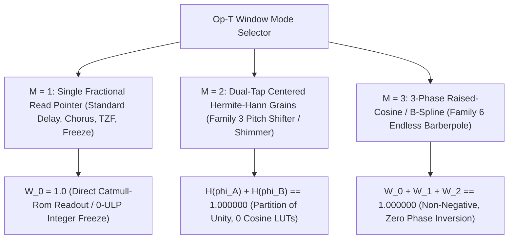

# Op-T: Universal Transport, Granular Windowing & All-Pass Diffusion Operator

This specification defines Op-T (Transport), governing causal top-of-frame fractional delay reads satisfying $\tau[n] \ge 4.0$ samples, pitch-warped granular windows, barberpole phase sweeps, bounded-history coercive feedback loops, 0-ULP integer-lag freeze holds, and partitioned Schroeder all-pass diffusion across Dynamic Neural Audio Modeler (DNAM) SONA v3.0 ([sona_architecture.md](../architecture/sona_architecture.md), [REQ-1.4, REQ-6.2](../../requirements/system_goals_and_requirements.md), [ADR-0006](../../adr/0006-model-declared-delays-and-tank-feedback-guard.md), [ADR-0022](../../adr/0022-sona-state-space-operator-and-webgpu-architecture.md)).

Every SONA Op-T read executes at the Top-of-Frame Causal Operator Crossbar before the 4-block Matryoshka core, while coercive loop writes update delay rings at frame end. This unified placement expresses pre-drive chorus, rotary modulation, and reverb-into-fuzz chains alongside post-core tape/BBD echoes and shimmer tanks strictly via learned weights.

---

## 1. Model-Declared Ring Buffer Addressing & Stateless Catmull-Rom Reader

### 1.1 Exact-Sized Delay Histories and Branchless Wrap

#### 1.1.1 Ring Declaration, Inline Quad 0, Cold External Buffers & Tank Parameters

`r[dsp.op-t.ring.declaration]`

Every active Op-T delay history declares its maximum reference delay $D_{\mathrm{ref}} \in \mathbb{N}^+$, storage stride `sample_format` (`"fp16"` for 2 B or `"f32"` for 4 B in 30 s+ ultra-low-floor tails), tier ownership (Lite through Ultra), and owner metadata covering all admitted delay, granular, and crossfade read paths.

Op-T separates standalone arbitrary-length delay lines with block max-tree feedback guards (§1.1.4 and §1.3) from the compact multi-quad spatial tank, which allocates 1, 2, 3, or 4 quads across Lite..Ultra for 4, 8, 12, or 16 delay lines.

```text
+---------------------------------------------------------------------------------------------------+
| OP-T 64-BYTE-ALIGNED PARTITIONED DELAY & DIFFUSER RING BUFFER                                     |
+---------------------------------------------------------------------------------------------------+
|  [0 .. L_main - 1]: Main Delay Ring (L_main = ceil(D_ref * f_eff / 48000) + 2 samples)            |
|  [L_main .. L_main + D_ap - 1]: Partitioned Schroeder All-Pass Segment (D_ap samples)             |
|  [.. B bytes]: 64-Byte Cache-Line Padding (B = 64 * ceil(a * L / 64), not ring state)             |
+---------------------------------------------------------------------------------------------------+
```

In compact spatial tank quads, Quad 0 places short lines (such as primes `[53, 67, 79, 89]`) inline inside the 64-byte-aligned hot working set as 128 frame-major `fp16` vectors (1,024 B = 16 cache lines), requiring zero heap allocations when `max_delay <= 120` and `max_delay + ceil(lfo_depth) + 6 <= 128`.

Longer lines (up to 48,000 reference samples at 48 kHz and 262,144 power-of-two capacity with 4× bounce headroom) allocate power-of-two cold external delay buffers during load and wrap via bitmask `& (cap - 1)` with zero division.

| Tier Profile | Quads | Delay Lines (M) | Inline Quad 0 (Hot Working Set) | Cold External Buffer Format |
| :--- | :---: | :---: | :--- | :--- |
| Lite | 1 | 4 | 128 frames `fp16` (1,024 B) | Optional `"fp16"` (2 B) power-of-two |
| Full | 2 | 8 | 128 frames `fp16` (1,024 B) | Optional `"fp16"` (2 B) power-of-two |
| Pro | 3 | 12 | 128 frames `fp16` (1,024 B) | Optional `"fp16"` or `"f32"` (2 B or 4 B) |
| Ultra | 4 | 16 | 128 frames `fp16` (1,024 B) | Optional `"fp16"` or `"f32"` (2 B or 4 B) |

Active spatial tank quads clamp runtime parameters at cold load, where `cap` equals 128 inline or the power-of-two external buffer capacity:

| Parameter | Clamped Cold-Load Domain | Notes & Invariants |
| :--- | :--- | :--- |
| `delay_lengths[0..4]` | `[4, 48,000]` samples at 48 kHz | Clamped to `[4.0, max_tau]`, where `max_tau = cap - 3` if modulated else `cap - 2` |
| `tap_gains[0..4]` | `[-2.0, 2.0]` | Per-line wet tap weights |
| `allpass_delays[0..4]` | `[0, 16,384]` samples | Rate-converted integer diffuser lengths (4-lane per-quad Schroeder bank) |
| `allpass_g[0..4]` | `[-0.75, 0.75]` | Per-lane Schroeder all-pass coefficients |
| `g_loop` | `[0.0, MAX_LOOP_GAIN_F32]` | Clamped by `TANK_MAX_G_LIN_BITS` (`0x3F7F_BE76`, 0.9990) |
| `sigma_knee` | `[1.0e-3, 8.0]` | Quiet-feedback knee width; loop saturator ceiling `0x3F7C_28F5` (0.985) |
| `base_psi` | `[-pi, pi]` rad | Givens angle with 3 kHz slew bound `<= 0.25` rad/tick |
| `inject_gain` | `[-2.0, 2.0]` | Input injection gain into 4-line Householder reflection |
| `dry_mix`, `wet_mix` | `[-2.0, 2.0]` | Stereo dry/wet quad blend scalars |
| `r_dc` | `[0.95, 0.9999]` | Base `TANK_DC_BLOCKER_48K_F32` (`0x3F7F_D51F`, 5 Hz at 48 kHz), ZOH `r_dc^rho_sr` |
| `lfo_rate_hz` | `[0.0, 16.0]` Hz | Advances `Q0.32` phase via degree-5 Hermite quadrature sine polynomial |
| `lfo_depth_samples` | `[0.0, 512.0]` samples | Also capped by buffer headroom `floor(cap / 4)` |
| `lfo_stereo_phase` | `[-pi, pi]` rad | Quadrature stereo offset between L and R LFO excursions |

Inside each active spatial tank quad, the `Q0.32` LFO phase $\phi$ advances and evaluates degree-5 Hermite quadrature, evaluating $s_\phi$ at $\phi$ and $c_\phi$ at $\phi + 2^{30}$, to form stereo offsets $\Delta_{\mathrm{lfo},L} = d_{\mathrm{lfo}} s_\phi$ and $\Delta_{\mathrm{lfo},R} = d_{\mathrm{lfo}}(s_\phi \cos\theta_{\mathrm{st}} + c_\phi \sin\theta_{\mathrm{st}})$. Combining with control-bus `tank_delay_mod`, denoted $\Delta_{\mathrm{ctrl}}$, yields per-lane modulated delays clamped inside $[4.0, \tau_{\max}]$:

$$\Delta_{\mathrm{mod}} = \big[+\Delta_{\mathrm{lfo},L} + \Delta_{\mathrm{ctrl}},\ +\Delta_{\mathrm{lfo},R} + \Delta_{\mathrm{ctrl}},\ -\Delta_{\mathrm{lfo},L} + \Delta_{\mathrm{ctrl}},\ -\Delta_{\mathrm{lfo},R} + \Delta_{\mathrm{ctrl}}\big]$$
$$\tau_l[n] = \mathrm{clamp}\big(D_l + \Delta_{\mathrm{mod}, l}, 4.0, \tau_{\max}\big)$$

Here $\tau_{\max} = \mathtt{cap} - 3$ when $d_{\mathrm{lfo}} > 0$ or $|\Delta_{\mathrm{ctrl}}| > 10^{-6}$, and $\tau_{\max} = \mathtt{cap} - 2$ otherwise.

For each lane $\tau_l = D_{\mathrm{int},l} + \mu_l$, modulated Catmull-Rom readout blends linear and cubic interpolation via $\alpha_{\mathrm{cubic}} = \mathrm{clamp}((0.9992 / \max(|g_{\mathrm{loop}}|, 0.5) - 1.0) \cdot 4.0, 0.0, 1.0)$ so near-unity feedback delays preserve linear passivity:

$$y_{\mathrm{lin}} = (1 - \mu)s[0] + \mu s[1], \qquad y_{\mathrm{curv}} = (1 - \mu)\big(2s[0] - s[-1] - s[1]\big) + \mu\big(2s[1] - s[0] - s[2]\big)$$
$$r_{\mathrm{raw},l}[n] = y_{\mathrm{lin}} + 0.5 \alpha_{\mathrm{cubic}} \mu (1 - \mu) y_{\mathrm{curv}}$$

The four parallel per-lane Schroeder all-pass stages execute directly on the raw interpolated read vector **before** tap weighting and loop feedback write, while Ultra additionally supports the 8-stage cascading stereo diffuser bank (§3.1).

Feedback conditioning applies the 0.85 / 0.15 rational knee with a 2-step Newton reciprocal of `1 + (v_read * inv_sigma)^2`, clips via the 0.985 cubic saturator (`TANK_MAX_V_CEIL_BITS = 0x3F7C_28F5`), mixes via pairwise 2×2 Givens `R_block2(psi)` and unitary 4×4 Householder reflection $\mathbf{H}_4(\mathbf{1}) = \mathbf{I}_4 - 0.5\mathbf{1}\mathbf{1}^\top$, blocks loop DC with $\alpha_{\mathrm{dc}} = 0.5(1 + r_{\mathrm{dc}})$, and saturates writes to ±65,504.0:

$$\mathbf{v}_{\mathrm{knee}} = \mathbf{v}_{\mathrm{read}} \cdot g_{\mathrm{loop}} \cdot \big(0.85 + 0.15 \cdot \mathbf{w}_{\mathrm{inv}}\big), \qquad w_{\mathrm{inv},j} = \frac{1}{1 + (v_{\mathrm{read},j} \sigma^{-1})^2}, \qquad \mathbf{v}_{\mathrm{loop}} = \mathcal{S}_{\mathrm{ceil}}\big(\mathbf{v}_{\mathrm{knee}}\big)$$
$$\mathbf{v}_{\mathrm{fb}} = \mathbf{H}_4(\mathbf{1})\mathbf{R}_{\mathrm{block2}}(\psi)\mathbf{v}_{\mathrm{loop}} + g_{\mathrm{inj}} [x_L, x_R, x_L, x_R]^\top, \qquad y_{\mathrm{dc}}[n] = \mathrm{flush}\Big(\alpha_{\mathrm{dc}}\big(v_{\mathrm{fb}}[n] - v_{\mathrm{fb}}[n-1]\big) + r_{\mathrm{dc}} y_{\mathrm{dc}}[n-1]\Big)$$

Here $\mathcal{S}_{\mathrm{ceil}}(u) = \mathrm{clamp}(V_{\mathrm{ceil}} \cdot v(1.5 - 0.5 v^2), -V_{\mathrm{ceil}}, V_{\mathrm{ceil}})$ with $v = \mathrm{clamp}(u \cdot \frac{2}{3 V_{\mathrm{ceil}}}, -1, 1)$ and $V_{\mathrm{ceil}} \approx 0.985$ (`TANK_MAX_V_CEIL_BITS = 0x3F7C_28F5`).

On the wet readout path, weighted taps form stereo sum $y_{\text{raw},L} = g_0 v_0 + g_2 v_2$ and $y_{\text{raw},R} = g_1 v_1 + g_3 v_3$, rotate through unitary 2×2 Givens matrix $\mathbf{R}(\psi)$, pass through a non-recirculating 5 Hz stereo wet DC blocker (`wet_dc_pole`, `wet_dc_alpha`), attenuate via stereo-linked ducking VCA (`abs_sc = 0.5(|in_L| + |in_R|)`), and sum with dry input:

$$y_{\text{wet},L} = \cos(\psi) y_{\text{raw},L} - \sin(\psi) y_{\text{raw},R}, \qquad y_{\text{wet},R} = \sin(\psi) y_{\text{raw},L} + \cos(\psi) y_{\text{raw},R}$$
$$y_{\text{out},L} = g_{\text{dry}} x_L + g_{\text{wet}} y_{\text{duck},L}, \qquad y_{\text{out},R} = g_{\text{dry}} x_R + g_{\text{wet}} y_{\text{duck},R}$$

When captured hardware enables `freeze` (`role == "freeze_latch"`), both main ring writes and per-lane Schroeder all-pass writes lock bit-for-bit while integer-lag pointers wrap modulo `d[l]` via branchless increment with zero `UDIV`, eliminating `fp16` re-quantization noise across 30 s+ infinite holds while live input continues through the SONA core.

#### 1.1.2 Cold-Path Capacity Sizing

`r[dsp.op-t.ring.capacity]`

At effective sample rate $f_{\mathrm{eff}} = M 2^{e-52}$, cold initialization computes exact integer ceiling capacity $D_{\mathrm{eff}}$ in 128-bit unsigned integer arithmetic without floating-point rounding:

$$D_{\mathrm{eff}} = \left\lceil \frac{D_{\mathrm{ref}} f_{\mathrm{eff}}}{48000} \right\rceil, \qquad L = D_{\mathrm{eff}} + 2, \qquad B = 64 \left\lceil \frac{aL}{64} \right\rceil$$

The 2-sample guard preserves the oldest 4-tap Catmull-Rom neighbor while maintaining $\tau[n] \ge 4.0$. Crossbar reads finish across all active heads before end-of-frame writes update the ring.

#### 1.1.3 Host Memory-Ceiling Admission

`r[dsp.op-t.ring.admission]`

Total instance and crossfade buffer requirements must pass host memory ceiling checks on the cold path before activation, returning an explicit error on overflow without truncating delay history or dropping tails.

#### 1.1.4 Forward-Wrap Standalone Delay & Backward-Wrap Tank Quad Addressing

`r[dsp.op-t.ring.branchless-wrap]`

Standalone delay lines and compact spatial tank quads implement complementary division-free ring addressing while preserving identical chronological neighborhood ordering `[s[-1], s[0], s[1], s[2]]` at lags `[D_int - 1, D_int, D_int + 1, D_int + 2]`:

| Mode & Structure | Write Cursor Advance | Read Index Formula | Tap Offset `o` for `s[-1], s[0], s[1], s[2]` | Causal `D_int` Bounds |
| :--- | :--- | :--- | :--- | :--- |
| Forward-Wrap Standalone Delay | `w' = (w + 1) - (L & -[w + 1 == L])` | `i = w - D_int + o; r = i + (L & -[i < 0])` | `[+1, 0, -1, -2]` (newer +1, older -2) | `4 <= D_int <= L - 2` |
| Backward-Wrap Tank Quad | `wr' = (wr - 1) & mask` | `r = (wr + D_int + o) & mask` | `[-1, 0, +1, +2]` (newer -1, older +2) | `4 <= D_int <= cap - 2` (`<= cap - 3` modulated) |

For standalone delay lines with write cursor $0 \le w < L$, integer delay $4 \le d \le L - 2$, and tap offset $o \in \lbrace +1, 0, -1, -2 \rbrace$ yielding signed offset $i = w - d + o \in [-L, L)$:

$$r = i + \big(L \mathbin{\mathrm{AND}} -[i < 0]\big), \qquad w' = (w + 1) - \big(L \mathbin{\mathrm{AND}} -[w + 1 = L]\big)$$

In compact spatial tank quads, decrementing write cursor `wr` by 1 per frame modulo capacity places sample lag $k$ at `(wr + k) & mask`, where `mask = cap - 1`.

Reading `(wr + D_int + o) & mask` maps offsets -1 through +2 to lags `D_int - 1` through `D_int + 2`. Under modulated bounds `4 <= D_int <= cap - 3` no tap hits `wr`, while unmodulated `D_int = cap - 2` forces $\mu = 0$ so tap `o = +2` carries zero Catmull-Rom weight.

#### 1.1.5 Integer-Plus-`Q0.32` Delay Pointer & Causal `[4.0, L - 2.0]` Reader Bounds

`r[dsp.op-t.ring.q0-32-pointer]`

Standalone delay positions store an integer sample lag $D_{\mathrm{int}}$ plus an unsigned `Q0.32` fractional word rather than a single `f32` total delay, preventing sub-sample quantization drift on multi-second lines. Converting only the fractional part via $\mu = \mathtt{f32}(\mathrm{frac}) \cdot 2^{-32} \in [0.0, 1.0)$ carries any rounding overflow 1.0 to $(D_{\mathrm{int}} + 1, 0.0)$ and clamps total lag strictly inside `[4.0, L - 2.0]`.

#### 1.1.6 `fp16` Write Saturation Telemetry

`r[dsp.op-t.ring.fp16-saturation]`

Finite delay writes into 2 B (`fp16`) rings exceeding ±65,504.0 (`±FP16_MAX_FINITE_F32`) saturate to ±65,504.0 (`0x7BFF` / `0xFBFF`) and latch `FP16_SATURATED` ([sona_architecture.md §1.2](../architecture/sona_architecture.md#finite-precision-range-and-saturation-policy)).

---

### 1.2 Stateless 4-Tap Catmull-Rom Hermite Cubic Delay Reader

#### 1.2.1 Horner Cubic Evaluation & Passivity Invariants

`r[dsp.op-t.reader.catmull-rom]`

Executed at the Top-of-Frame Causal Crossbar, standalone Catmull-Rom reading splits $\tau[n] \ge 4.0$ into integer lag $D_{\mathrm{int}}[n] = \lfloor \tau[n] \rfloor$ and fraction $\mu[n] = \tau[n] - D_{\mathrm{int}}[n] \in [0.0, 1.0)$, loading the four neighbor samples `[s[-1], s[0], s[1], s[2]]` before writing frame $n$:

$$s[-1] = \mathrm{ring}\big[\mathrm{addr}(n - D_{\mathrm{int}}[n] + 1)\big], \qquad s[0] = \mathrm{ring}\big[\mathrm{addr}(n - D_{\mathrm{int}}[n])\big]$$
$$s[1] = \mathrm{ring}\big[\mathrm{addr}(n - D_{\mathrm{int}}[n] - 1)\big], \qquad s[2] = \mathrm{ring}\big[\mathrm{addr}(n - D_{\mathrm{int}}[n] - 2)\big]$$

Horner evaluation computes the cubic spline with zero `FDIV` operations:

$$d(\tau[n]) = \big((c_3' \mu[n] + c_2') \mu[n] + c_1'\big) \mu[n] + c_0'$$
$$c_3' = -0.5 s[-1] + 1.5 s[0] - 1.5 s[1] + 0.5 s[2], \qquad c_2' = s[-1] - 2.5 s[0] + 2.0 s[1] - 0.5 s[2]$$
$$c_1' = -0.5 s[-1] + 0.5 s[1], \qquad c_0' = s[0]$$

| Invariant | Mathematical Property |
| :--- | :--- |
| 1. Endpoint Exactness | At `μ = 0`, `d(τ) = s[0]`; at `μ = 1`, `c₃' + c₂' + c₁' + c₀' = s[1]`; at `freeze == true` with integer lag, exact 0-ULP hold |
| 2. C¹ Spline Continuity | Matches first derivative `0.5(s[2] - s[0])` across integer lag steps, giving over 15× lower LFO jerk than Thiran |
| 3. Stationary Energy Passivity | Satisfies `‖H_μ‖_∞ <= 1` for every fixed fractional phase `μ` |
| 4. Bounded Peak Kernel Norm | Instantaneous `L₁` norm is `1 + μ(1 - μ) <= 1.25` (max at `μ = 0.5`); feedback loops enforce decay via §1.3 |

#### 1.2.2 Contiguous 4-Lane Half-to-Single Stereo Fast Path

`r[dsp.op-t.reader.contiguous-fp16x4]`

In partitioned stereo delay lines (with per-channel ring capacity `L_ch = L_ring / 2`), whenever the four Catmull-Rom taps do not straddle ring index 0 (`p_0 >= 2` and `p_0 + 1 < L_ch`), stereo delay reading loads contiguous 4-element `fp16` tuples per channel and converts them via 4-lane half-to-single float vector conversion or portable bit-level decoding. Wrapped per-tap loads execute only on boundary frames, while 4 B `f32` rings use direct 4-lane loads ([ADR-0019](../../adr/0019-simd-kernel-architecture-and-realtime-execution-optimizations.md)).

---

### 1.3 Bounded-History Feedback Guard & Loop Conditioning

#### 1.3.1 Coercive Loop Limiter, Soft-Knee & Cubic Saturator

`r[dsp.op-t.guard.bounded-history]`

Because time-varying Catmull-Rom interpolation can reach 1.25× instantaneous gain, standalone block max-tree guards and compact spatial tank quads enforce strict contractivity (`||G_loop|| < 1`) using complementary loop-conditioning paths (skipping ring overwrites when `freeze == true`):

In standalone delay lines with block max-tree guards, active writes clamp against the live binary max-tree bound $M_n$ and apply a coercive 4-lane cubic loop limiter with division-free reciprocal $r_\sigma = \sigma^{-1}$ computed via a 3-step Newton reciprocal:

$$w_i[n] = x_i[n] + g_i[n] \cdot \mathrm{clamp}\big(v_i[n], -M_n, M_n\big), \qquad 0 \le g_i[n] \le g_{\max} < 1$$
$$v_{\text{knee}} = \mathrm{clamp}\left(\frac{2}{3} x_{\text{finite}} r_\sigma, -1, 1\right), \qquad y_{\text{lim}} = \mathrm{flush}\Big(g \cdot \mathrm{clamp}\big(\sigma v_{\text{knee}}(1.5 - 0.5 v_{\text{knee}}^2), -\sigma, \sigma\big)\Big)$$

In compact spatial tank quads, end-of-frame feedback clamps `g_loop` by `TANK_MAX_G_LIN_BITS` (`0x3F7F_BE76` = 0.9990), applies the 0.85 / 0.15 rational knee with a 2-step Newton reciprocal for arguments `>= 1`, and bounds loop amplitude under `TANK_MAX_V_CEIL_BITS` (`0x3F7C_28F5` = 0.985) via the cubic saturator before Givens/Householder mixing (§1.1.1).

#### 1.3.2 Grouped Max-Tree Tracking

`r[dsp.op-t.guard.max-tree]`

The block max-tree guard partitions standalone delay rings into contiguous blocks of at most $H = 64$ samples, maintaining block maxima in a binary max-tree paired with an active-block running maximum.

#### 1.3.3 Division-Free Incremental `(block_idx, in_block_offset)` Counters

`r[dsp.op-t.guard.incremental-counters]`

To eliminate hardware integer division (`pos / block_size` or `pos % block_size == 0`) on arbitrary ring lengths, the block max-tree guard keeps pre-allocated `block_indices` and `in_block_offsets` counters per line and advances branchlessly (`offset + 1 == block_size` or `pos == 0`, [ADR-0019](../../adr/0019-simd-kernel-architecture-and-realtime-execution-optimizations.md)).

#### 1.3.4 Driven BIBO & Unforced Geometric Decay

`r[dsp.op-t.guard.bibo-decay]`

Under bounded input $|x_i[n]| \le B$, history magnitude stays bounded by $C = \max(M_0, B / (1 - g_{\max}))$; under zero input $x_i[n] = 0$, $M_n$ decays by at least $g_{\max}$ every $L_{\max} + H$ frames regardless of read-head velocity.

#### 1.3.5 Directed `fp16` Decay Rule

`r[dsp.op-t.guard.fp16-decay]`

Capping loop feedback at `0x3F7F_BE76` (`TANK_MAX_G_LIN_BITS`, 0.9990) and rounding `fp16` delay writes toward zero forces subnormal ring contents to decay strictly to zero without nonzero `fp16` limit cycles.

---

### 1.4 Dual-Mode Runtime Delay Transitions (`Range` Slew vs. `Switch` Crossfade)

`r[dsp.op-t.transition.dual-mode]`

| Control Event | Transition Law | Physical & Acoustic Role |
| :--- | :--- | :--- |
| Continuous `range` Knob Sweep | 1-pole exponential delay slew bounded at 0.25 samples/sample | Models smooth analog BBD or tape Doppler pitch glide |
| Discrete `switch` Delay Jump | Hold endpoints and crossfade over `max(16, round(128 / rho_sr))` frames (128 at 48 kHz) | Prevents clicks and unmodeled pitch sweeps on discrete jumps |

For crossfade step $k \in \lbrace 0, \dots, L_{\text{xfade}} - 1 \rbrace$, the precomputed raised-cosine window maps exact endpoints $\alpha_{\text{xf}}[0] = 0.0$ and $\alpha_{\text{xf}}[L_{\text{xfade}} - 1] = 1.0$:

$$w[k] = \frac{k}{L_{\text{xfade}} - 1}, \qquad \alpha_{\text{xf}}[k] = \frac{1}{2}\big(1 - \cos(\pi w[k])\big), \qquad d[n] = \big(1 - \alpha_{\text{xf}}[k]\big) d^{\text{old}}[n] + \alpha_{\text{xf}}[k] d^{\text{new}}[n]$$

While a fade runs, its two endpoints stay frozen and newer accepted delay changes coalesce into one pending target governed by [host automation timing](parametric_control_bus.md#112-host-automation-timing), latching on the first sample after completion while honoring conditional batch bounds ([parametric_control_bus.md §2.4.2](parametric_control_bus.md#242-conditional-batch-safety)).

---

## 2. Partition-of-Unity Windowing (`M in {1, 2, 3}`) & Family 3 / 6

`r[dsp.op-t.window.partition-of-unity]`

Op-T unifies delay lines, granular pitch shifting, and continuous barberpole phasing in the Top-of-Frame Crossbar by selecting window head count $M \in \lbrace 1, 2, 3 \rbrace$ satisfying exact unit partition:

$$\sum_{m=0}^{M-1} W_m(\phi_m[n]) \equiv 1.000000000000, \quad \forall n$$



| Mode | Physical Role | Window Definition & Partition-of-Unity Identity |
| :--- | :--- | :--- |
| `M = 1` | Standard Delay, Chorus, TZF, Freeze | `W_0 = 1.0` single Catmull-Rom read pointer, or 0-ULP locked integer read during `freeze` |
| `M = 2` | Hermite-Hann Pitch Shifter (`Family 3`) | Grain phases `phi_A`, `phi_B = frac(phi_A + 0.5)`, triangle `u_A = 1 - abs(2*phi_A - 1)`, cubic `u_A^2 * (3 - 2*u_A)` |
| `M = 3` | Barberpole Frequency Sweep (`Family 6`) | 3 heads spaced by 1/3 turn using non-negative raised-cosine or quadratic B-spline `B_2` windows |

### 2.1 Mode 1 (`M = 1`): Standard Delay, Chorus & Through-Zero Flanging

`r[dsp.op-t.window.m1-delay]`

With $W_0 \equiv 1.0$, anchoring tap 0 at static reference delay $\tau_{\text{ref}} = 64.0$ samples (1.33 ms at 48 kHz) while sweeping line 1 over $\tau_1[n] \in [16.0, 112.0]$ samples achieves Through-Zero Flanging with deep zero-delay cancellation at $\Delta\tau = 0.0$ ms. When `freeze == true`, ring writes lock and integer-lag pointers preserve steady-state audio at 0 ULP.

### 2.2 Mode 2 (`M = 2`): Centered Hermite-Hann Granular Pitch Shifter (`Family 3`)

`r[dsp.op-t.window.m2-pitch]`

For pitch offset $\Delta p \in [-24, +24]$ semitones, time-warp rate $\nu = 1 - 2^{\Delta p / 12} \in [-3.0, 0.75]$ derives from the [control-bus pitch profile](parametric_control_bus.md#51-pitch-ratio-and-time-warp-profile). Base-delay slew limits (0.25 samples/sample) govern center delay $D_c$ while dual grain heads sweep across even integer grain duration $G$:

$$\phi_A[n] = \mathrm{frac}(n/G), \qquad \phi_B[n] = \mathrm{frac}(\phi_A[n] + 1/2), \qquad \tau_j[n] = D_c + \nu G\big(\phi_j[n] - 1/2\big) \in \big[D_c - |\nu|G/2, D_c + |\nu|G/2\big]$$

Using triangular grain coordinate $u_A = 1 - |2\phi_A - 1| \in [0, 1]$, the dual grain windows satisfy exact sum invariance:

$$H(\phi_A) = u_A^2\big(3 - 2u_A\big), \qquad H(\phi_B) = 1.0 - H(\phi_A), \qquad H(\phi_A) + H(\phi_B) \equiv 1.000000000000$$

For a 100 ms grain at 48 kHz with $G = 4{,}800$ and +24 semitones where $\nu = -3$, satisfying the 4-sample causal floor requires $D_c \ge 7{,}204$ samples and ring capacity $\ge 14{,}404$ samples.

### 2.3 Mode 3 (`M = 3`): Continuous Barberpole Frequency Sweep (`Family 6`)

`r[dsp.op-t.window.m3-barberpole]`

Three heads spaced by $1/3$ cycle apply precomputed raised-cosine or 3-piece cardinal quadratic B-spline windows without runtime `FDIV` or standard math library calls:

$$\sum_{m=0}^2 B_2\big(3 \cdot \mathrm{frac}(\phi + m/3)\big) \equiv 1.000000000000$$

Here $B_2(t) = 0.5 t^2$ on $[0, 1)$, $B_2(t) = -t^2 + 3t - 1.5$ on $[1, 2)$, and $B_2(t) = 0.5(3 - t)^2$ on $[2, 3)$.

---

## 3. Partitioned In-Buffer Schroeder All-Pass Diffusers

### 3.1 Memory Partitioning & Rate-Aware Capacity

`r[dsp.op-t.diffuser.partition]`

Per-lane tank diffusers (4 parallel lanes executed before tap weighting and loop feedback write) and the standalone or Ultra 8-stage cascading stereo diffuser bank occupy dedicated power-of-two or 64-byte-aligned segments with branchless mask wrapping. At effective rate $f_{s,\text{eff}}$, each reference delay rescales via $D_{\text{ap},m}(f_{s,\text{eff}}) = \max(1, \mathrm{round}(D_{\text{ap},m}(48000) / \rho_{\text{sr}}))$ up to 16,384 samples ([router_and_crossbar_topology.md §9](router_and_crossbar_topology.md#9-continuous-time-zoh-rate-adaptation)); 223 samples at 48 kHz scale to 1,784 samples (3,584 B aligned `fp16`) at 384 kHz.

### 3.2 Reference-Length All-Pass Recurrence

`r[dsp.op-t.diffuser.recurrence]`

The 48 kHz reference lengths `[19, 31, 47, 73, 103, 139, 179, 223]` are pairwise coprime; off-48 kHz rates keep the exact rounded lengths above instead of re-selecting nearby primes. Each line $m$ steps fixed converted delay $D_{\text{ap},m}$ and clamped coefficient $a_{\text{diff},m} \in [-0.75, +0.75]$:

$$v_{\text{ap}, m}[n] = x_{\text{in}}[n] - a_{\text{diff}, m} u_{\text{ap}, m}[n - D_{\text{ap}, m}]$$
$$y_{\text{ap}, m}[n] = a_{\text{diff}, m} v_{\text{ap}, m}[n] + u_{\text{ap}, m}[n - D_{\text{ap}, m}], \qquad u_{\text{ap}, m}[n] = v_{\text{ap}, m}[n]$$

For fixed $a_{\text{diff}}$ and $D_{\text{ap}}$, $|H_{\text{ap}}(e^{i\omega})|^2 \equiv 1$ across all frequencies; for bounded $|x_{\text{in}}[n]| \le A$ and $|a_{\text{diff}}| \le 0.75$, impulse peak gain stays bounded by $1 + 2|a_{\text{diff}}| \le 2.5A$ and internal state by $\max(V_0, 4A)$.

---

## 4. 1-Pole Ballistic Envelope Ducking VCA (`Family 4`)

`r[dsp.op-t.ducking.vca]`

The ballistic ducking VCA models sidechain-ducked ambient tails and gated reverbs (`Family 4`) on stereo tank readout outputs after the post-Givens 5 Hz wet DC blocker using cold-clamped parameters (`x_sidechain = 0.5 * (abs(in_l) + abs(in_r))` per spatial tank quad):

| Parameter | Clamped Domain / Floor | Physical Role |
| :--- | :--- | :--- |
| `tau_attack` | >= 0.5 ms (`alpha_att` in `[0.5, 0.9999]`) | Fast attack envelope coefficient on sidechain peaks |
| `tau_release` | >= 20.0 ms (`alpha_rel` in `[0.5, 0.99999]`) | Smooth release envelope recovery coefficient |
| `theta_duck` | `[0.0, 2.0]` | Sidechain ducking threshold |
| `kappa_duck` | `[0.0, 8.0]` | Compression attenuation slope |
| `g_duck_min` | `[0.05, 1.0]` | Minimum wet gain floor preventing total blackout |

$$e_{\text{duck}}[n] = \alpha_{\text{duck}}[n] e_{\text{duck}}[n-1] + (1 - \alpha_{\text{duck}}[n]) |x_{\text{sidechain}}[n]|$$
$$g_{\text{duck}}[n] = \mathrm{clamp}\Big(1.0 - \kappa_{\text{duck}}\big(e_{\text{duck}}[n] - \theta_{\text{duck}}\big), g_{\text{duck,min}}, 1.0\Big), \qquad y_{\text{wet,ducked}}[n] = g_{\text{duck}}[n] \cdot y_{\text{wet}}[n]$$

---

## 5. Strict Zero-`FDIV`, Zero-`FSQRT` & Zero Standard-Math-Library Verification

`r[dsp.op-t.zero-fdiv]`

| Operation | Naive Formulation | SONA Division-Free Factorization |
| :--- | :--- | :--- |
| Ring buffer wrap | `idx = pos % L_ring` (`IDIV`) | Branchless `i + (L & -[i < 0])` (standalone) or `& (cap - 1)` (spatial tank quad) |
| Catmull-Rom read | Recursive Thiran all-pass (`FDIV`) | Stateless Horner cubic polynomial + 4-lane half-to-single / `f32` fast path (§1.2) |
| Infinite freeze | Re-write `fp16` loop every sample | Lock ring writes + 0-ULP integer-lag circular pointers (§1.1.1) |
| Granular windowing | Real-time `cos(pi * phi)` (standard math library) | Cubic Hermite `u^2 * (3 - 2u)` (`M = 2`) and quadratic B-spline `B_2` (`M = 3`) (§2) |
| Schroeder all-pass | Direct-form rational division | Coupled state recurrence `v = x - a*u`, `y = a*v + u` (§3.2) |
| Base-delay slew | Per-sample rate division | Precomputed 1-pole slew capped at 0.25 samples/sample (§1.4) |
| Switch crossfade | Real-time `cos(pi * k / L)` | Cached 6-step `f64` Newton reciprocal of `L_xfade - 1` + minimax cosine polynomial (§1.4) |
| Max-tree block index | `pos / block_size` (`UDIV`) | Incremental `(block_idx, in_block_offset)` counters (§1.3.3) |
