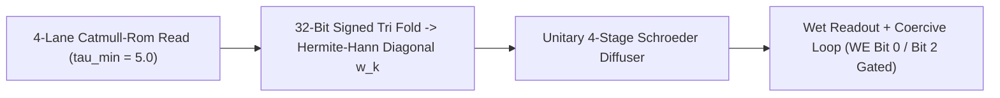

# Op-T: Universal Transport, Granular Windowing & All-Pass Diffusion Operator

This specification defines Op-T (Transport), governing causal top-of-frame fractional delay reads (with $\tau_{\min} = 5.0$ samples across 4-frame crossbar/tank micro-chunks and $\tau[n] \ge 4.0$ on standalone single-sample rings), pitch-warped granular windows, barberpole phase sweeps, bounded-history coercive feedback loops, 0-ULP dual-latch write-enable (`WE`) RAM holds, and partitioned Schroeder all-pass diffusion across Dynamic Neural Audio Modeler (DNAM) SONA v3.0 ([sona_architecture.md](../architecture/sona_architecture.md), [REQ-1.4, REQ-6.2](../../requirements/system_goals_and_requirements.md)).

Every SONA Op-T read executes inside a single unified continuous 4-lane Top-of-Frame Causal Operator Crossbar pipeline before the 4-block Matryoshka core, while coercive loop writes update delay rings at frame end. This unified placement expresses pre-drive chorus, rotary modulation, and reverb-into-fuzz chains alongside post-core tape/BBD echoes, granular pitch shifters, barberpole sweeps, and shimmer holds strictly via learned weights ([ADR-0006](../../adr/0006-model-declared-delays-and-tank-feedback-guard.md), [ADR-0022](../../adr/0022-sona-state-space-operator-and-webgpu-architecture.md)).

---

## 1. Model-Declared Ring Buffer Addressing & Stateless Catmull-Rom Reader

### 1.1 Exact-Sized Delay Histories and Branchless Wrap

#### 1.1.1 Ring Declaration, Unified 4-Lane Quad Wire & Active-Hot State

`r[dsp.op-t.ring.declaration]`

Every active Op-T delay history declares its maximum reference delay $D_{\mathrm{ref}} \in \mathbb{N}^+$, storage stride `sample_format` (`"fp16"` for 2 B or `"f32"` for 4 B in 30 s+ ultra-low-floor tails), tier ownership (Lite through Ultra), and owner metadata covering all admitted delay, granular, and crossfade read paths.

Op-T separates standalone arbitrary-length delay lines with block max-tree feedback guards (§1.1.4 and §1.3) from the unified continuous 4-lane spatial tank quads, which allocate 1, 2, 3, or 4 quads across Lite..Ultra for 4, 8, 12, or 16 delay lines without discrete mode bits or freeze-latch flags.

```text
+---------------------------------------------------------------------------------------------------+
| OP-T 64-BYTE-ALIGNED PARTITIONED DELAY & DIFFUSER RING BUFFER                                     |
+---------------------------------------------------------------------------------------------------+
|  [0 .. L_main - 1]: Main Delay Ring (L_main = ceil(D_ref * f_eff / 48000) + 2 samples)            |
|  [L_main .. L_main + D_ap - 1]: Partitioned Schroeder All-Pass Segment (D_ap samples)             |
|  [.. B bytes]: 64-Byte Cache-Line Padding (B = 64 * ceil(a * L / 64), not ring state)             |
+---------------------------------------------------------------------------------------------------+
```

In compact spatial tank quads, Quad 0 places short lines (such as primes `[53, 67, 79, 89]`) inline inside the 64-byte-aligned hot working set as 128 frame-major `fp16` vectors (1,024 B = 16 cache lines), requiring zero heap allocations when `max_delay <= 120` and `max_delay + ceil(lfo_depth) + 6 <= 128`.

Longer lines (up to 48,000 reference samples at 48 kHz and 524,288 power-of-two capacity covering 8× rate headroom up to 384 kHz) allocate power-of-two cold external delay buffers during load and wrap via bitmask `& (cap - 1)` with zero division.

| Tier Profile | Quads | Delay Lines (M) | Inline Quad 0 (Hot Working Set) | Cold External Buffer Format |
| :--- | :---: | :---: | :--- | :--- |
| Lite | 1 | 4 | 128 frames `fp16` (1,024 B) | Optional `"fp16"` (2 B) power-of-two |
| Full | 2 | 8 | 128 frames `fp16` (1,024 B) | Optional `"fp16"` (2 B) power-of-two |
| Pro | 3 | 12 | 128 frames `fp16` (1,024 B) | Optional `"fp16"` or `"f32"` (2 B or 4 B) |
| Ultra | 4 | 16 | 128 frames `fp16` (1,024 B) | Optional `"fp16"` or `"f32"` (2 B or 4 B) |

Each spatial tank quad is serialized in the tier arena as a 128-byte little-endian descriptor (bytes 0..128) encoding 32-bit float delays and ramp spans (preventing `fp16` overflow at high rates), loop/VCA poles, half-precision modulation gains, 48 kHz Schroeder delays, and mode-free flags:

| Wire Offset | Bytes | LE Type | Field Name | Clean-Room Role & Cold-Load Constraint |
| :---: | :---: | :--- | :--- | :--- |
| 0..16 | 16 | `f32le[4]` | `delay_samples[4]` | 48 kHz base per-lane delays (`[5.0, 48,000.0]` on crossbar/tank quads) |
| 16..32 | 16 | `f32le[4]` | `ramp_spans_samples[4]` | 48 kHz base ramp spans per lane (`f32` avoids `fp16` overflow at 384 kHz) |
| 32..56 | 24 | 6 × `f32le` | `g_loop`, `r_dc`, `damp_pole`, `lfo_rate_hz`, `ramp_rate_hz`, `vca_pole` | Loop feedback, 5 Hz DC pole, HF damp pole, LFO/ramp rates, and Family 4 VCA pole |
| 56..112 | 56 | 7 × `u16le[4]` | `lfo_depths_fp16[4]`, `lfo_phase_off_q16[4]`, `ramp_phase_off_q16[4]`, `input_gains_fp16[4]`, `wet_tap_l_fp16[4]`, `wet_tap_r_fp16[4]`, `allpass_g_fp16[4]` | Per-lane LFO depths/offsets, ramp phase offsets, injection gains, L/R wet tap gains, and Schroeder `allpass_g` in `[-0.75, 0.75]` |
| 112..122 | 10 | 5 × `u16le` | `fb_psi_fp16`, `sigma_knee_fp16`, `dry_mix_fp16`, `window_depth_fp16`, `vca_sens_fp16` | Givens rotation, knee threshold, dry blend, window depth, and Family 4 VCA sensitivity |
| 122..126 | 4 | `u8[4]` | `allpass_delays[4]` | 48 kHz base Schroeder lengths <= 255; expanded into rate-scaled integer host buffers on load up to 16,384 samples at 384 kHz |
| 126..127 | 1 | `u8` | `flags` | Bit 0 = `schroeder_enable`, bit 1 = `ext_f32` (`0 = fp16`, `1 = f32` ring precision for this quad; logical OR sets cold sizing `ext_ring_format`); bits 2..7 strictly 0 (zero discrete mode or freeze bits) |
| 127..128 | 1 | `u8` | `_pad` | Reserved pad byte; must equal `0x00` |

At runtime, each active quad occupies a 224-byte 16-byte-aligned hot state block (bytes 0..224) inside the cache-locked working set using 2-state Direct-Form I DC blockers and non-colliding dual-latch write-enable (`WE`) bits:

| Hot Offset | Bytes | Type | Active-Hot Fields | Runtime Invariant |
| :--- | :---: | :--- | :--- | :--- |
| 0..64 | 64 | 16 × `f32` | `dc_x_prev[4]`, `dc_y_prev[4]`, `damp_state[4]`, `wet_dc_x[2]`, `wet_dc_y[2]` | 2-state Direct-Form I loop DC blockers, per-lane HF damp state, and stereo wet DC blockers |
| 64..96 | 32 | 8 × `f32` | `delay_samples[4]`, `ramp_spans_samples[4]` | Effective-rate base delays and ramp spans |
| 96..152 | 56 | 5 × 32-bit + 9 × `f32` | `write_ptr: u32`, `lfo_phase_q32: u32`, `lfo_inc_q32: u32`, `ramp_phase_q32: u32`, `ramp_inc_q32: i32`, `g_loop`, `r_dc`, `damp_pole`, `current_psi`, `cos_psi`, `sin_psi`, `wet_dc_pole`, `vca_env`, `vca_pole` | Backward write cursor, LFO/ramp accumulators, loop/wet DC and damp poles, cached Givens `(cos, sin)`, and Family 4 VCA envelope/pole |
| 152..224 | 72 | `u16`/`u8` + pad | `we_hold_off[4]: u16` (inline ring hold offset; 32-bit counters in cold external storage when `HAS_EXT`), `lfo_phase_off_q16[4]`, `ramp_phase_off_q16[4]`, `lfo_depths_fp16[4]`, `input_gains_fp16[4]`, `wet_tap_l_fp16[4]`, `wet_tap_r_fp16[4]`, 6 scalar `fp16` (`window_depth_fp16`, `dry_mix_fp16`, `inv_sigma_fp16`, `half_alpha_cubic_fp16`, `base_psi_fp16`, `vca_sens_fp16`), `flags: u8`, `_pad8: u8`, `_pad16: u16` | Hold offsets, per-lane Q16/`fp16` gains, scalar `fp16` params, and `flags` (`bit 0 = WE_HOLD_ACTIVE`, `bit 1 = HAS_EXT`, `bit 2 = HOST_WRITE_LOCK`, `bit 3 = SCHROEDER_ENABLE`, bits 4..7 = 0) |

All active crossbar and spatial tank quads execute at `f_{s,vm}` (`rho_vm = 48_000.0 / f_{s,vm}`) and enforce the causal delay floor `tau_min = 5.0` samples (`delay_int >= 5`) at Top-of-Frame so 4-tap Catmull-Rom accesses remain at least 4 samples behind the newest frame in each 4-frame causal micro-chunk (`i_m1 = write_idx + 1 - delay_int <= write_idx - 4`). This preserves 0-ULP equivalence between 1-frame and 4-frame micro-chunk stepping (`ref[dsp.op-t.ring.q0-32-pointer]`), while standalone single-sample rings allow `tau >= 4.0`.

At rate ratio $\rho_{\mathrm{vm}} = 48{,}000 / f_{s,\mathrm{vm}}$ (`scale = 1.0 / rho_vm`), each active quad $q \in [0, P_Q)$ deterministically computes external buffer selection `has_ext[q]` (hot `flags` bit 1 `HAS_EXT`) and power-of-two ring capacity `cap[q]` from wire fields, `declared_max_delay_48k`, and `ext_ring_pow2_frames`:

```text
req_frames[q] = ceil(max_k((wire_delay_48k[q][k] + 0.5 * abs(wire_ramp_span_48k[q][k]) + wire_lfo_depth_48k[q][k]) * scale)) + 6
dbrm_pow2_cap = (ext_ring_pow2_frames >= 7) ? (1 << ext_ring_pow2_frames) : 0
decl_scaled   = ceil(f64(declared_max_delay_48k) * scale) + 8
has_ext[q]    = (q > 0) || ((quad_wire_flags[0] & 0x02) != 0) || (max_k(wire_delay_48k[0][k] * scale) > 120.0) || (req_frames[0] > 128) || (ext_ring_pow2_frames >= 8)
cap[q]        = !has_ext[q] ? 128 : clamp(next_pow2(max(128, req_frames[q], decl_scaled, dbrm_pow2_cap)), 128, 524_288)
```

When `!has_ext[0]`, Quad 0 uses the 128-frame inline `fp16` hot ring (0 B cold storage). Whenever `has_ext[q]` is true (always for expansion quads `q >= 1` on Full..Ultra, or when Quad 0 exceeds inline limits or selects `ext_f32`), cold load provisions `cap[q]` power-of-two frames in element format `(quad_wire_flags[q] & 0x02) != 0 ? f32 : fp16` (failing closed if caller-provided fixed arenas are undersized).

Active spatial tank quads rescale and clamp runtime parameters at cold load using `rho_vm = 48_000.0 / f_{s,vm}` against each quad's resolved `(has_ext[q], cap[q])`:

| Parameter | Clamped Cold-Load Domain | Notes & Invariants |
| :--- | :--- | :--- |
| `delay_samples[0..4]` | `[5.0, max_tau]` at `f_{s,vm}` (`[4.0, max_tau]` standalone) | ZOH-rescaled by `1 / rho_vm` from 48 kHz `[5.0, 48,000.0]`; `max_tau = cap - 3` if modulated else `cap - 2` |
| `ramp_spans_samples[0..4]` | `[0.0, max_span]` samples | ZOH-rescaled by `1 / rho_vm` on cold load; `max_span = max(0.0, max_tau - 5.0)` |
| `allpass_delays[0..4]` | `[0, 16,384]` samples | 48 kHz `u8 <= 255`; 0 bypasses that lane cleanly (`v_read,k = r_k`) even when `schroeder_enable == 1`; nonzero lengths expand via `max(1, round(D_48k / rho_vm))` |
| `allpass_g_fp16[0..4]` | `[-0.75, 0.75]` | Per-lane Schroeder all-pass coefficients |
| `g_loop` | `[0.0, MAX_LOOP_GAIN_F32]` | Clamped by `TANK_MAX_G_LIN_BITS` (`0x3F7F_BE76`, 0.9990) and pitch-down energy limit (§2) |
| `sigma_knee_fp16` | `[1.0e-3, 8.0]` | Quiet-feedback knee width; loop saturator ceiling `0x3F7C_28F5` (0.985) |
| `base_psi_fp16` | `[-pi, pi]` rad | Base Givens angle; `target_psi = clamp(base_psi + tank_psi_delta, -pi, +pi)` (clamped, never wrapped mod `2*pi`), slewed `<= 0.25` rad/tick via `algebraic_unit_rotor_f32` |
| `input_gains_fp16[0..4]` | `[-2.0, 2.0]` | Per-lane input injection weights into 4-line Householder reflection |
| `wet_tap_l_fp16`, `wet_tap_r_fp16` | `[-2.0, 2.0]` | Stereo per-lane L/R wet tap weights |
| `dry_mix_fp16` | `[-2.0, 2.0]` | Decoded verbatim (`0x0000` yields 0.0; non-finite fallback 1.0 on Quad 0, 0.0 on Quads 1..3); slot 22 adds strictly on Quad 0 |
| `r_dc` | `[0.95, 0.9999]` | Finite inputs clamp to `[0.95, 0.9999]` before ZOH `r_dc^rho_vm`; only non-finite inputs fall back to `0x3F7F_D51F` (5 Hz at 48 kHz) |
| `damp_pole` | `[0.0, 0.9995]` at 48 kHz; `[0.0, 0.99995]` eff | Cold ZOH `(base <= 1e-7) ? 0.0 : clamp(base^rho_vm, 0.0, 0.99995)`; 3 kHz `damp_pole_eff = clamp(damp_pole_zoh + op_t_damp_pole_delta, 0.0, 0.99995)` |
| `vca_pole` | `[0.0, 0.99999]` | Base Family 4 envelope release pole; cold ZOH `clamp(base_vca_pole^rho_vm, 0.0, 0.99999)` (§4) |
| `vca_sens_fp16` | `[-8.0, +8.0]` | Family 4 envelope sensitivity (0.0 bypasses VCA gain at unity 1.0, §4) |
| `lfo_rate_hz`, `ramp_rate_hz` | `[0.0, 16.0]` Hz / `[-16.0, 16.0]` Hz | Advances `u32` `lfo_inc_q32` LFO quadrature and signed `i32` `ramp_inc_q32` ramp accumulator |
| `lfo_depths_fp16[0..4]` | `[0.0, min(512.0, floor(cap / 4) as f32)]` | ZOH-rescales by `1 / rho_vm` on cold load before clamping to `[0.0, min(512.0, floor(cap / 4) as f32)]` |
| `window_depth_fp16` | `[0.0, 1.0]` | Base Hermite-Hann diagonal window blend before boundary-click safety clamp (§2) |

Calling quad hot-state `reset()` restores deterministic zero-state resting equilibrium across all hot and external quad buffers as specified below:

| Quad `reset()` Field | Reset Value | Scope & Lock Semantics |
| :--- | :--- | :--- |
| `dc_x_prev`, `dc_y_prev`, `damp_state` | 0 (`[0.0; 4]`) | Zeroes loop DF-I DC blocker and per-lane HF damping state |
| `wet_dc_x`, `wet_dc_y` | 0 (`[0.0; 2]`) | Zeroes stereo non-recirculating wet DF-I DC blocker state |
| `write_ptr`, `lfo_phase_q32`, `ramp_phase_q32` | 0 | Resets backward write cursor and LFO/ramp phase accumulators |
| `vca_env` | 0.0 | Resets Family 4 ducking envelope state |
| `current_psi` | `base_psi` | Snaps slewed Givens angle directly to `base_psi` |
| `(cos_psi, sin_psi)` | `algebraic_unit_rotor_f32(base_psi)` | Recomputes cached Givens rotor directly from `base_psi` via pure-32-bit `algebraic_unit_rotor_f32` |
| `we_hold_off` | `[0; 4]` | Clears inline/cold hold counters |
| `flags` (`WE_HOLD_ACTIVE` vs `HOST_WRITE_LOCK`) | Clear bit 0 (`WE_HOLD_ACTIVE`) | Preserves bit 2 (`HOST_WRITE_LOCK`) on `reset()`; full VM re-init clears all lock bits |
| Inline, External & Schroeder Rings | 0.0 | Zero-fills main delay ring and Schroeder all-pass buffer (`ap_wr = 0`) |

Inside each active spatial tank quad, `lfo_phase_q32` and `ramp_phase_q32` execute in evaluate-then-advance order, quantizing increments via cold 6-step Newton reciprocal `inv_fs_vm = 1.0 / f_{s,vm}` as `lfo_inc_q32 = (rate <= 0.0 || max_k(lfo_depth_eff[k]) <= 0.0) ? 0 : ((f64(rate) * 2^32 * inv_fs_vm + 0.5) as u64) as u32` and signed `ramp_inc_q32 = round_half_away(f64(ramp_rate) * 2^32 * inv_fs_vm) as i64 as i32`, where `round_half_away(x) = (x >= 0.0) ? floor(x + 0.5) : ceil(x - 0.5)`.

Per-lane LFO output $s_{\phi,k}$ evaluates the zero-at-origin Hermite-5 **sine** curve `q32_smooth_sin(lfo_phase_q32 + (u32(lfo_phase_off_q16[k]) << 16))` (hitting 0.0 at phase 0, +1.0 at `0x4000_0000`, 0.0 at `0x8000_0000`, and -1.0 at `0xC000_0000`), while sawtooth phase $\phi_{\mathrm{ramp},k} \in [0, 1)$ evaluates at `ramp_phase_q32 + (u32(ramp_phase_off_q16[k]) << 16)` ahead of wrapping-adding `lfo_inc_q32` and signed `ramp_inc_q32`.

Each VM frame combines cold ZOH-rescaled `delay_samples[k]`, clamped octave scaling, LFO and ramp sweeps `ramp_spans_samples[k] * (phi_ramp,k - 0.5)`, and `tank_delay_mod` (`stage_targets[12]` in 48 kHz samples converted via `1 / rho_vm`), clamped inside $[5.0, \tau_{\max}]$:

$$\tau_k[n] = \mathrm{clamp}\left(D_k \cdot 2^{\mathrm{clamp}(\Delta_{\mathrm{oct}}, -3.0, +3.0)} + d_{\mathrm{lfo},k} s_{\phi,k} + S_{\mathrm{span},k}\big(\phi_{\mathrm{ramp},k} - 0.5\big) + \Delta_{\mathrm{ctrl,48k}} \cdot \frac{1}{\rho_{\mathrm{vm}}},\ 5.0,\ \tau_{\max}\right)$$

Here $\Delta_{\mathrm{oct}} =$ `stage_targets[17]` (`op_t_delay_scale_oct`) clamps before exponentiation as `2^clamp(stage_targets[17], -3.0, +3.0)`, while $\Delta_{\mathrm{ctrl,48k}} =$ `stage_targets[12]` rescales 48 kHz samples into VM frames. Upper bound $\tau_{\max} = \mathtt{cap} - 3$ applies when modulated (`lfo_depths`, `ramp_spans`, `|stage_targets[17]| > 1.0e-6`, or $|\Delta_{\mathrm{ctrl,48k}}| > 10^{-6}$ nonzero), and $\tau_{\max} = \mathtt{cap} - 2$ otherwise.

For each lane $\tau_k = D_{\mathrm{int},k} + \mu_k$, modulated Catmull-Rom readout blends linear and cubic interpolation via `half_alpha_cubic_fp16`, denoted $\alpha_{\mathrm{half}}[g]$, computed at cold load and 3 kHz ticks from `g_loop,eff` using a 2-step Newton-Raphson reciprocal of `max(|g_loop,eff|, 0.5)` with zero `FDIV` in RT so near-unity feedback delays preserve linear passivity:

$$r_{\mathrm{inv}} = \mathrm{recipNR2}\big(\max(|g_{\mathrm{loop,eff}}|, 0.5)\big), \qquad \alpha_{\mathrm{cubic}} = \mathrm{clamp}\big((0.9992 \cdot r_{\mathrm{inv}} - 1.0) \cdot 4.0, 0.0, 1.0\big), \qquad \alpha_{\mathrm{half}}[g] = 0.5 \alpha_{\mathrm{cubic}}$$
$$y_{\mathrm{lin}} = (1 - \mu)s[0] + \mu s[1], \qquad y_{\mathrm{curv}} = (1 - \mu)\big(2s[0] - s[-1] - s[1]\big) + \mu\big(2s[1] - s[0] - s[2]\big)$$
$$r_{\mathrm{raw},k}[n] = y_{\mathrm{lin}} + \alpha_{\mathrm{half}}[g] \cdot \mu (1 - \mu) y_{\mathrm{curv}}$$

The unified Top-of-Frame 4-lane pipeline then multiplies each lane by its continuous diagonal window gain $w_k \in [0, 1]$ (§2) and steps the four parallel per-lane Schroeder all-pass stages **before** tap weighting and loop feedback write across active Quads 0..3 (up to 4 quads × 4 lanes = 16 stages at Ultra, §3.1). Each lane $k \in \lbrace 0, 1, 2, 3 \rbrace$ bypasses its Schroeder stage cleanly (`v_read,k = r_k`) whenever `schroeder_enable == 0`, `WE` hold `(flags & 0x05) != 0` is active, or `allpass_delays[k] == 0` (even when `schroeder_enable == 1`).

Feedback conditioning applies the 0.85 / 0.15 rational knee with a 2-step Newton reciprocal of `denom = 1 + (v_read * inv_sigma)^2`, clips via the 0.985 cubic saturator (`TANK_MAX_V_CEIL_BITS = 0x3F7C_28F5`), and mixes via pairwise 2×2 Givens `R_block2(psi)` and unitary 4×4 Householder reflection $\mathbf{H}_4(\mathbf{1}) = \mathbf{I}_4 - 0.5\mathbf{1}\mathbf{1}^\top$ plus input injection.

On adjacent 2×2 lane pairs `(0, 1)` and `(2, 3)`, `R_block2(psi)` acts on $\mathbf{v} = [v_0, v_1, v_2, v_3]^\top$ via `v * cos(psi) + [-v_1, v_0, -v_3, v_2] * sin(psi)`:

$$\mathbf{R}_{\mathrm{block2}}(\psi)\mathbf{v} = \big[v_0\cos\psi - v_1\sin\psi,\ v_0\sin\psi + v_1\cos\psi,\ v_2\cos\psi - v_3\sin\psi,\ v_2\sin\psi + v_3\cos\psi\big]^\top$$

Immediately after $\mathbf{v}_{\mathrm{fb}}$ and before the loop DF-I DC blocker, where $\alpha_{\mathrm{dc}} = 0.5(1 + r_{\mathrm{dc}})$, per-lane 1-pole HF damping applies `v_damp[j] = (1 - damp_pole_eff) * v_fb[j] + damp_pole_eff * damp_state[j]` and `damp_state'[j] = flush(v_damp[j])`. Setting `damp_pole_eff == 0.0` yields identity pass-through into `y_dc[n]`, and writes saturate to ±65,504.0:

$$\mathbf{v}_{\mathrm{knee}} = \mathbf{v}_{\mathrm{read}} \cdot g_{\mathrm{loop,eff}} \cdot \big(0.85 + 0.15 \cdot \mathbf{w}_{\mathrm{inv}}\big), \qquad w_{\mathrm{inv},j} = \frac{1}{1 + (v_{\mathrm{read},j} \sigma^{-1})^2}, \qquad \mathbf{v}_{\mathrm{loop}} = \mathcal{S}_{\mathrm{ceil}}\big(\mathbf{v}_{\mathrm{knee}}\big)$$
$$\mathbf{v}_{\mathrm{fb}} = \mathbf{H}_4(\mathbf{1})\mathbf{R}_{\mathrm{block2}}(\psi)\mathbf{v}_{\mathrm{loop}} + \mathbf{g}_{\mathrm{inj}} \odot [x_L, x_R, x_L, x_R]^\top, \qquad \mathbf{v}_{\mathrm{damp}}[n] = (1 - p_{\mathrm{damp}})\mathbf{v}_{\mathrm{fb}}[n] + p_{\mathrm{damp}}\mathbf{d}_{\mathrm{state}}[n-1]$$
$$\mathbf{d}_{\mathrm{state}}[n] = \mathrm{flush}\big(\mathbf{v}_{\mathrm{damp}}[n]\big), \qquad y_{\mathrm{dc}}[n] = \mathrm{flush}\Big(\alpha_{\mathrm{dc}}\big(v_{\mathrm{damp}}[n] - v_{\mathrm{damp}}[n-1]\big) + r_{\mathrm{dc}} y_{\mathrm{dc}}[n-1]\Big)$$

Here $\mathcal{S}_{\mathrm{ceil}}(u) = \mathrm{clamp}(V_{\mathrm{ceil}} \cdot v(1.5 - 0.5 v^2), -V_{\mathrm{ceil}}, V_{\mathrm{ceil}})$ with $v = \mathrm{clamp}(u \cdot \frac{2}{3 V_{\mathrm{ceil}}}, -1, 1)$, $V_{\mathrm{ceil}} \approx 0.985$ (`TANK_MAX_V_CEIL_BITS = 0x3F7C_28F5`), $p_{\mathrm{damp}} =$ `damp_pole_eff`, and $\mathbf{d}_{\mathrm{state}} =$ `damp_state`.

All `P_Q` active spatial tank quads receive `x_tank = (direct_s2_l + cab_l, direct_s2_r + cab_r)` with $x_L = x_{\mathrm{tank},L}$ and $x_R = x_{\mathrm{tank},R}$. On each quad $q \in [0, P_Q)$, weighted taps form stereo sum $y_{\text{raw},L} = \sum_k w_{L,k} v_k$ and $y_{\text{raw},R} = \sum_k w_{R,k} v_k$, rotate through unitary 2×2 Givens matrix $\mathbf{R}(\psi)$, step the 5 Hz stereo wet Direct-Form I DC blocker, and scale via Family 4 VCA (§4) into $y_{\mathrm{duck},q,c}$:

$$p_{\mathrm{wet}} = \mathrm{clamp}\big(p_{\mathrm{dc,base}}^{\rho_{\mathrm{vm}}},\ 10^{-4},\ 0.999995\big), \qquad \alpha_{\mathrm{wet}} = \frac{1 + p_{\mathrm{wet}}}{2}, \qquad y_{\mathrm{wdc},c}[n] = \mathrm{flush}\Big(\alpha_{\mathrm{wet}}\big(y_{\mathrm{wet},c}[n] - y_{\mathrm{wet},c}[n-1]\big) + p_{\mathrm{wet}} y_{\mathrm{wdc},c}[n-1]\Big)$$

Here `wet_dc_pole`, denoted $p_{\mathrm{wet}}$, reads valid metadata `dc_blocker_pole_5hz` in `(0.8, 1.0)` as `p_dc_base` (else `0x3F7F_D51F`) and keeps it verbatim when `|rho_vm - 1.0| < 1e-12`, otherwise evaluating cold `powf_f64` per [router_and_crossbar_topology.md §9.1](router_and_crossbar_topology.md#91-causal-crossbar-core-tpt-svf-prewarping--kautz-modal-conversion).

It then updates `wet_dc_x[c] = flush(y_wet,c[n])` alongside `wet_dc_y[c] = y_wdc,c[n]` before Family 4 VCA gating:

$$y_{\text{wet},L} = \cos(\psi) y_{\text{raw},L} - \sin(\psi) y_{\text{raw},R}, \qquad y_{\text{wet},R} = \sin(\psi) y_{\text{raw},L} + \cos(\psi) y_{\text{raw},R}$$
$$y_{q,c} = g_{\text{dry},q} x_{\text{tank},c} + w_{\text{scale}} y_{\text{duck},q,c}, \qquad y_{\text{tank},c} = \sum_{q=0}^{P_Q - 1} y_{q,c}, \qquad c \in \lbrace L, R \rbrace$$

Each 128 B tank quad record decodes `dry_mix_fp16` verbatim (`0x0000` yields 0.0), falling back only on non-finite values to 1.0 on Quad 0 and 0.0 on Quads 1..3.

`ControlBus` slots 12..14, 16, 17..21, and 23..25 apply uniformly across every active quad (`q in 0..P_Q`), whereas slot 22 (`op_t_dry_mix_mod`) adds strictly on Quad 0 via `dry_mix_eff[0] = clamp(base_dry_mix[0] + t[22], -2.0, +2.0)` while leaving `dry_mix_eff[q] = base_dry_mix[q]` for `q in 1..P_Q`.

The Spatial Tank sums $y_{q,c}$ across all `P_Q` quads before `mono_out` folding, the 48-frame linear tier crossfade (`rem` counting down from 48 to 1 with `a = f32(rem) * (1.0 / 48.0)` per [router_and_crossbar_topology.md §8.1](router_and_crossbar_topology.md#81-canonical-midside-output-head-factorization)), polarity-signed `eff_trim` (`WET_POLARITY_INV`), and post-VM M/S width / ±1.0e9 safety clamping in the host shell.

For Givens angle updates, 3 kHz ticks form `target_psi = clamp(base_psi + tank_psi_delta, -pi, +pi)`, strictly clamped and never wrapped modulo $2\pi$, slew `current_psi` by at most 0.25 rad/tick, and evaluate `(cos_psi, sin_psi)` via pure-32-bit `algebraic_unit_rotor_f32` ([op_m_modal_kautz.md §1.2.4](op_m_modal_kautz.md#124-q0192-control-lfo--4-lane-q032-crossbar-phasors)).

Write-enable (WE) RAM holding uses a race-free dual-latch mask inside `flags` without dedicated freeze flags or control roles. `ControlBus` slot 16 (`op_t_we_drive`) snaps immediately (0 micro-ramping) via `we_eff = clamp(1.0 + t[16], 0.0, 1.0)` through Schmitt hysteresis `(0.45, 0.55)`, setting **only** bit 0 (`WE_HOLD_ACTIVE`) when `we_eff < 0.45` and clearing **only** bit 0 when `we_eff > 0.55`.

Low-level host lock control independently updates **only** bit 2 (`HOST_WRITE_LOCK`). Whenever `(flags & 0x05) != 0`, `lfo_phase_q32` and `ramp_phase_q32` hold with zero increment, while live input processing and wet readout (`wet_tap_l/r`, Givens $\psi$, wet DC, VCA, `g_dry * x_tank`) continue executing:

$$D_k = \mathrm{clamp}\big(\mathrm{round}(D_{\mathrm{delay}}[k]), 5, \mathtt{cap} - 2\big), \qquad \mathrm{lag}_k = \mathrm{select}(o_k < D_k, D_k - o_k, D_k), \qquad o_k' = \mathrm{select}(o_k + 1 \ge D_k, 0, o_k + 1)$$

During WE hold, each lane $k \in \lbrace 0, 1, 2, 3 \rbrace$ computes `D_k = clamp(round(delay_samples[k]), 5, cap - 2)` from $D_{\mathrm{delay}}[k] =$ `delay_samples[k]`, reads `(write_ptr + lag_k) & mask` using `o_k = we_hold_off[k]`, with $w_k = 1.0$ (or cold 32-bit counters when `HAS_EXT` bit 1 is set), and advances $o_k'$ branchlessly. All four `we_hold_off` counters reset to 0 on `reset()` and on the hold-release edge when `(flags & 0x05)` transitions from nonzero to zero.

| WE Hold Operation (`(flags & 0x05) != 0`) | Hold Behavior & Precision Invariant |
| :--- | :--- |
| LFO & Ramp Phase Accumulators | `lfo_phase_q32` and `ramp_phase_q32` hold with zero increment |
| Main Ring Read & Window | Reads `(write_ptr + lag_k) & mask` at `w_k = 1.0`; advances `we_hold_off[k]` branchlessly |
| Schroeder All-Pass Diffuser | Bypasses Schroeder evaluation (`v_read,k = r_frozen,k`); Schroeder buffer and `ap_wr` freeze at 0-ULP |
| Feedback & Ring Writeback | Skips main ring `write_ptr` writes, loop feedback, HF damping (`damp_state`), and loop DC (`dc_x_prev`, `dc_y_prev`) |
| Non-Recirculating Wet Readout | Continues `wet_tap_l/r`, Givens `psi`, wet DC blocker, VCA, and `g_dry * x_tank` |

#### 1.1.2 Cold-Path Capacity Sizing

`r[dsp.op-t.ring.capacity]`

At effective sample rate $f_{\mathrm{eff}} = M 2^{e-52}$, cold initialization computes exact integer ceiling capacity $D_{\mathrm{eff}}$ in 128-bit unsigned integer arithmetic without floating-point rounding:

$$D_{\mathrm{eff}} = \left\lceil \frac{D_{\mathrm{ref}} f_{\mathrm{eff}}}{48000} \right\rceil, \qquad L = D_{\mathrm{eff}} + 2, \qquad B = 64 \left\lceil \frac{aL}{64} \right\rceil$$

The 2-sample guard preserves the oldest 4-tap Catmull-Rom neighbor while maintaining $\tau[n] \ge 5.0$ on Top-of-Frame crossbar/tank quads (and $\tau[n] \ge 4.0$ on standalone single-sample rings). Crossbar reads finish across all active heads before end-of-frame writes update the ring.

#### 1.1.3 Host Memory-Ceiling Admission

`r[dsp.op-t.ring.admission]`

Total instance and crossfade buffer requirements must pass host memory ceiling checks on the cold path before activation, returning an explicit error on overflow without truncating delay history or dropping tails.

#### 1.1.4 Forward-Wrap Standalone Delay & Backward-Wrap Tank Quad Addressing

`r[dsp.op-t.ring.branchless-wrap]`

Standalone delay lines and compact spatial tank quads implement complementary division-free ring addressing while preserving identical chronological neighborhood ordering `[s[-1], s[0], s[1], s[2]]` at lags `[D_int - 1, D_int, D_int + 1, D_int + 2]`:

| Mode & Structure | Write Cursor Advance | Read Index Formula | Tap Offset `o` for `s[-1], s[0], s[1], s[2]` | Causal `D_int` Bounds |
| :--- | :--- | :--- | :--- | :--- |
| Forward-Wrap Standalone Delay | `w' = (w + 1) - (L & -[w + 1 == L])` | `i = w - D_int + o; r = i + (L & -[i < 0])` | `[+1, 0, -1, -2]` (newer +1, older -2) | `4 <= D_int <= L - 2` |
| Backward-Wrap Tank Quad | `ring[wr] = sat_write(y_dc); wr' = (wr - 1) & mask` | `r = (wr + D_int + o) & mask` | `[-1, 0, +1, +2]` (newer -1, older +2) | `D_int in [5, cap - 2]` (`cap - 3` modulated) |

For standalone delay lines with write cursor $0 \le w < L$, integer delay $4 \le d \le L - 2$, and tap offset $o \in \lbrace +1, 0, -1, -2 \rbrace$ yielding signed offset $i = w - d + o \in [-L, L)$:

$$r = i + \big(L \mathbin{\mathrm{AND}} -[i < 0]\big), \qquad w' = (w + 1) - \big(L \mathbin{\mathrm{AND}} -[w + 1 = L]\big)$$

In compact spatial tank quads, the End-of-Frame write `ring[wr] = sat_write(y_dc)` executes strictly *before* decrementing `(wr - 1) & mask`, placing sample lag $k \ge 1$ at `(wr + k) & mask` (`mask = cap - 1`). Reading `(wr + D_int + o) & mask` inside `[5, cap - 3]` keeps every 4-tap Catmull-Rom load at least 4 samples behind the write cursor, preventing 4-frame micro-chunk collisions while unmodulated `D_int = cap - 2` forces zero fraction so tap `o = +2` carries zero weight.

#### 1.1.5 Integer-Plus-`Q0.32` Delay Pointer & Causal Reader Bounds

`r[dsp.op-t.ring.q0-32-pointer]`

Standalone delay positions store an integer sample lag $D_{\mathrm{int}}$ plus an unsigned `Q0.32` fractional word rather than a single `f32` total delay, preventing sub-sample quantization drift on multi-second lines. Converting only the fractional part via $\mu = \mathtt{f32}(\mathrm{frac}) \cdot 2^{-32} \in [0.0, 1.0)$ carries any rounding overflow 1.0 to $(D_{\mathrm{int}} + 1, 0.0)$ and clamps total lag strictly inside `[4.0, L - 2.0]` for standalone rings.

For Top-of-Frame crossbar and spatial tank quads executed in 4-frame causal micro-chunks, clamping `delay_int >= 5` (`tau_min = 5.0`) keeps `i_m1 = write_idx + 1 - delay_int <= write_idx - 4` on every step, preserving exact 0-ULP equivalence between 1-frame and 4-frame micro-chunk stepping.

#### 1.1.6 `fp16` Write Saturation Telemetry

`r[dsp.op-t.ring.fp16-saturation]`

Finite delay writes into 2 B (`fp16`) rings exceeding ±65,504.0 (`±FP16_MAX_FINITE_F32`) saturate to ±65,504.0 (`0x7BFF` / `0xFBFF`) and latch `FP16_SATURATED` ([sona_architecture.md §1.2](../architecture/sona_architecture.md#finite-precision-range-and-saturation-policy)).

---

### 1.2 Stateless 4-Tap Catmull-Rom Hermite Cubic Delay Reader

#### 1.2.1 Horner Cubic Evaluation & Passivity Invariants

`r[dsp.op-t.reader.catmull-rom]`

Executed at the Top-of-Frame Causal Crossbar, standalone Catmull-Rom reading splits $\tau[n] \ge 4.0$ into integer lag $D_{\mathrm{int}}[n] = \lfloor \tau[n] \rfloor$ and fraction $\mu[n] = \tau[n] - D_{\mathrm{int}}[n] \in [0.0, 1.0)$, loading the four neighbor samples `[s[-1], s[0], s[1], s[2]]` before writing frame $n$:

$$s[-1] = \mathrm{ring}\big[\mathrm{addr}(n - D_{\mathrm{int}}[n] + 1)\big], \qquad s[0] = \mathrm{ring}\big[\mathrm{addr}(n - D_{\mathrm{int}}[n])\big]$$
$$s[1] = \mathrm{ring}\big[\mathrm{addr}(n - D_{\mathrm{int}}[n] - 1)\big], \qquad s[2] = \mathrm{ring}\big[\mathrm{addr}(n - D_{\mathrm{int}}[n] - 2)\big]$$

Horner evaluation computes the cubic spline with zero `FDIV` operations:

$$d(\tau[n]) = \big((c_3' \mu[n] + c_2') \mu[n] + c_1'\big) \mu[n] + c_0'$$
$$c_3' = -0.5 s[-1] + 1.5 s[0] - 1.5 s[1] + 0.5 s[2], \qquad c_2' = s[-1] - 2.5 s[0] + 2.0 s[1] - 0.5 s[2]$$
$$c_1' = -0.5 s[-1] + 0.5 s[1], \qquad c_0' = s[0]$$

| Invariant | Mathematical Property |
| :--- | :--- |
| 1. Endpoint Exactness | At `μ = 0`, `d(τ) = s[0]`; at `μ = 1`, `c₃' + c₂' + c₁' + c₀' = s[1]`; when `(flags & 0x05) != 0` with integer lag, exact 0-ULP hold |
| 2. C¹ Spline Continuity | Matches first derivative `0.5(s[2] - s[0])` across integer lag steps, giving over 15× lower LFO jerk than Thiran |
| 3. Stationary Energy Passivity | Satisfies `‖H_μ‖_∞ <= 1` for every fixed fractional phase `μ` |
| 4. Bounded Peak Kernel Norm | Instantaneous `L₁` norm is `1 + μ(1 - μ) <= 1.25` (max at `μ = 0.5`); feedback loops enforce decay via §1.3 |

#### 1.2.2 Contiguous 4-Lane Half-to-Single Stereo Fast Path

`r[dsp.op-t.reader.contiguous-fp16x4]`

In partitioned stereo delay lines (with per-channel ring capacity `L_ch = L_ring / 2`), whenever the four Catmull-Rom taps do not straddle ring index 0 (`p_0 >= 2` and `p_0 + 1 < L_ch`), stereo delay reading loads contiguous 4-element `fp16` tuples per channel and converts them via 4-lane half-to-single float vector conversion or portable bit-level decoding. Wrapped per-tap loads execute only on boundary frames, while 4 B `f32` rings use direct 4-lane loads ([ADR-0019](../../adr/0019-simd-kernel-architecture-and-realtime-execution-optimizations.md)).

---

### 1.3 Bounded-History Feedback Guard & Loop Conditioning

#### 1.3.1 Coercive Loop Limiter, Soft-Knee & Cubic Saturator

`r[dsp.op-t.guard.bounded-history]`

Because time-varying Catmull-Rom interpolation can reach 1.25× instantaneous gain, standalone block max-tree guards and compact spatial tank quads enforce strict contractivity (`||G_loop|| < 1`) using complementary loop-conditioning paths while skipping ring overwrites whenever dual-latch `WE` hold is active (`(flags & 0x05) != 0`):

In standalone delay lines with block max-tree guards, active writes clamp against the live binary max-tree bound $M_n$ and apply a coercive 4-lane cubic loop limiter with division-free reciprocal $r_\sigma = \sigma^{-1}$ computed via a 3-step Newton reciprocal:

$$w_i[n] = x_i[n] + g_i[n] \cdot \mathrm{clamp}\big(v_i[n], -M_n, M_n\big), \qquad 0 \le g_i[n] \le g_{\max} < 1$$
$$v_{\text{knee}} = \mathrm{clamp}\left(\frac{2}{3} x_{\text{finite}} r_\sigma, -1, 1\right), \qquad y_{\text{lim}} = \mathrm{flush}\Big(g \cdot \mathrm{clamp}\big(\sigma v_{\text{knee}}(1.5 - 0.5 v_{\text{knee}}^2), -\sigma, \sigma\big)\Big)$$

In compact spatial tank quads, end-of-frame feedback clamps `g_loop` by `TANK_MAX_G_LIN_BITS` (`0x3F7F_BE76` = 0.9990), applies the 0.85 / 0.15 rational knee with a 2-step Newton reciprocal for arguments `>= 1`, and bounds loop amplitude under `TANK_MAX_V_CEIL_BITS` (`0x3F7C_28F5` = 0.985) via the cubic saturator before Givens/Householder mixing (§1.1.1).

#### 1.3.2 Grouped Max-Tree Tracking

`r[dsp.op-t.guard.max-tree]`

The block max-tree guard partitions standalone delay rings into contiguous blocks of at most $H = 64$ samples, maintaining block maxima in a binary max-tree paired with an active-block running maximum.

#### 1.3.3 Division-Free Incremental `(block_idx, in_block_offset)` Counters

`r[dsp.op-t.guard.incremental-counters]`

To eliminate hardware integer division (`pos / block_size` or `pos % block_size == 0`) on arbitrary ring lengths, the block max-tree guard keeps pre-allocated `block_indices` and `in_block_offsets` counters per line and advances branchlessly (`offset + 1 == block_size` or `pos == 0`, [ADR-0019](../../adr/0019-simd-kernel-architecture-and-realtime-execution-optimizations.md)).

#### 1.3.4 Driven BIBO & Unforced Geometric Decay

`r[dsp.op-t.guard.bibo-decay]`

Under bounded input $|x_i[n]| \le B$, history magnitude stays bounded by $C = \max(M_0, B / (1 - g_{\max}))$; under zero input $x_i[n] = 0$, $M_n$ decays by at least $g_{\max}$ every $L_{\max} + H$ frames regardless of read-head velocity.

#### 1.3.5 Directed `fp16` Decay Rule

`r[dsp.op-t.guard.fp16-decay]`

Capping loop feedback at `0x3F7F_BE76` (`TANK_MAX_G_LIN_BITS`, 0.9990) and rounding `fp16` delay writes toward zero forces subnormal ring contents to decay strictly to zero without nonzero `fp16` limit cycles.

---

### 1.4 Dual-Mode Runtime Delay Transitions (`Range` Slew vs. `Switch` Crossfade)

`r[dsp.op-t.transition.dual-mode]`

| Control Event | Transition Law | Physical & Acoustic Role |
| :--- | :--- | :--- |
| Continuous `range` Knob Sweep | 1-pole exponential delay slew bounded at 0.25 samples/sample | Models smooth analog BBD or tape Doppler pitch glide |
| Discrete `switch` Delay Jump | Hold endpoints and crossfade over `max(16, round(128 / rho_vm))` frames (128 at 48 kHz) | Prevents clicks and unmodeled pitch sweeps on discrete jumps |

For crossfade step $k \in \lbrace 0, \dots, L_{\text{xfade}} - 1 \rbrace$, cold preparation synthesizes `alpha_xf[k]` without `FDIV` or external math libraries using the Cody-Waite degree-13/14 rotor `algebraic_unit_rotor_f32` ([op_m_modal_kautz.md §1.2.4](op_m_modal_kautz.md#124-q0192-control-lfo--4-lane-q032-crossbar-phasors)) and blends endpoints in unfused `binary32` (`FP_CONTRACT OFF`):

```text
inv_denom   = f32(rcp_nr6_f64(f64(L_xfade - 1)))
w[k]        = f32(k) * inv_denom                                         // w[0] == 0.0 -> alpha_xf[0] == 0.0
alpha_xf[k] = 0.5 * (1.0 - algebraic_unit_rotor_f32(w[k] * PI_F32).0)  // PI_F32 = 0x4049_0FDB, FP_CONTRACT OFF
d[n]        = (1.0 - alpha_xf[k]) * d_old[n] + alpha_xf[k] * d_new[n]    // unfused binary32; snaps to d_new once k + 1 >= L_xfade
```

While a fade runs, its two endpoints stay frozen and newer accepted delay changes coalesce into one pending target governed by [host automation timing](parametric_control_bus.md#112-host-automation-timing), latching on the first sample after completion while honoring conditional batch bounds ([parametric_control_bus.md §2.4.2](parametric_control_bus.md#242-conditional-batch-safety)).

---

## 2. Unified Continuous 4-Lane Windowing & Partition-of-Unity Regimes

`r[dsp.op-t.window.partition-of-unity]`

Every Op-T spatial tank quad executes one single Top-of-Frame 4-lane pipeline (`Catmull-Rom -> Diagonal Window w_k -> Unitary 4-Stage Schroeder`) continuously across all lanes without discrete mode selectors or conditional branching. Continuous parameterization spans static delays, chorus, TZF, `WE` RAM holds, dual- or quad-grain Hermite-Hann pitch/shimmer, and staggered barberpole sweeps seamlessly:



For each lane $k \in \lbrace 0, 1, 2, 3 \rbrace$, adding the 16-bit ramp phase offset `ramp_phase_off_q16[k]` shifted into `Q0.32` forms per-lane phase $\phi_k = \mathrm{frac}(\phi_{\mathrm{ramp}} + \Delta\phi_{\mathrm{ramp},k})$. Interpreting the 32-bit unsigned phase word `p` as signed `p_signed` yields a branchless triangle fold identical on CPU SIMD and 32-bit GPU compute shaders:

$$\mathrm{mask} = p_{\mathrm{signed}} \gg 31, \qquad \mathrm{tri} = (p \oplus \mathrm{mask}) -_{\mathrm{u32}} \mathrm{mask}, \qquad u_k = \mathrm{f32}(\mathrm{tri}) \cdot 2^{-31} \in [0, 1]$$
$$h_k = u_k^2\big(3 - 2u_k\big), \qquad w_k = \big(1 - \mu_{\mathrm{win},k}\big) + \mu_{\mathrm{win},k} h_k$$

To eliminate boundary clicks when any nonzero ramp sweep wraps across a nonzero span, cold and 3 kHz setup evaluate per-lane $\mu_{\mathrm{win},k}$ directly in 4-lane registers from scalar `window_depth_fp16` and effective-rate sawtooth wrap jump $S_k$ in samples, where $S_k$ equals `ramp_spans_samples[k]` when $|f_{\mathrm{ramp,eff}}| > 10^{-6}$ Hz and 0.0 otherwise:

$$\mu_{\mathrm{win},k} = \max\Big(\mu_{\mathrm{win,base}},\ \mathrm{clamp}\big((|S_k| - 0.25) \cdot 4.0,\ 0.0,\ 1.0\big)\Big)$$

To prevent energy accumulation under downward pitch time-stretching, downward slope $\nu_{\mathrm{down},k}$ is positive when reading backward or slower to lower pitch and negative before clamping on upward pitch shimmers, leaving `g_loop` unattenuated on pitch-up shimmers:

$$\nu_{\mathrm{down},k} = \mathrm{clamp}\left(\frac{S_{\mathrm{span},k} \cdot f_{\mathrm{ramp,eff}}}{f_{s,\mathrm{vm}}},\ 0.0,\ 0.75\right)$$
$$g_{\mathrm{loop,eff}} = \min\big(g_{\mathrm{loop}},\ \mathtt{0x3F7FBE76}\big) \cdot \min_k \sqrt{\max\big(0.0,\ 1.0 - \min(0.9999,\ \nu_{\mathrm{down},k})\big)}$$

Cold and 3 kHz setup evaluate the square root without audio-loop `FSQRT` or `FDIV` via unfused scalar 2-step Newton inverse square root (`FP_CONTRACT OFF`):

```text
u_safe = max(u, 1.0e-12); h = 0.5 * u_safe; y0 = f32_bits(0x5F37_59DF - (bits(u_safe) >> 1))
y1 = y0 * (1.5 - h * (y0 * y0)); y2 = y1 * (1.5 - h * (y1 * y1))
sqrt_u = (u <= 0.0) ? 0.0 : (u * y2)
```

| Continuous Regime | `ramp_rate_hz` & `ramp_spans_samples` | `ramp_phase_off_q16[4]` & `window_depth` | Partition-of-Unity & Hold Behavior |
| :--- | :--- | :--- | :--- |
| Delay, Chorus, TZF & `WE` Hold | `ramp_rate_hz == 0.0`, `ramp_spans == 0.0` | `window_depth == 0.0` (`S_k == 0.0`) | Diagonal gain `w_k == 1.0` across all 4 lanes; `(flags & 0x05) != 0` bypasses Schroeder (`v_read,k = r_frozen,k`) and locks writes at 0 ULP |
| Hermite-Hann Pitch & Shimmer | Nonzero sweep across grain span `G` | Complementary offsets (`[0, 0.5]` pairs or `[0, 0.25, 0.5, 0.75]`) | Exact `H(phi_A) + H(phi_B) == 1.000000` plus boundary and pitch-down clamps |
| Continuous Barberpole Sweep | Staggered sawtooth `ramp_spans != 0` | Quarter-turn or staggered offsets | Boundary clamp tapers wrap edges to zero; standalone 3-phase `B_2` sum `== 1.0` |

### 2.1 Delay, Chorus, Through-Zero Flanging & `WE` RAM Hold

`r[dsp.op-t.window.m1-delay]`

When `ramp_rate_hz == 0.0`, `ramp_spans_samples == 0.0`, and `window_depth == 0.0`, diagonal window weights simplify to $w_k \equiv 1.0$ with zero cosine LUTs. Anchoring tap 0 at static reference delay $\tau_{\text{ref}} = 64.0$ samples (1.33 ms at 48 kHz) while sweeping line 1 over $\tau_1[n] \in [16.0, 112.0]$ samples achieves Through-Zero Flanging with deep cancellation at $\Delta\tau = 0.0$ ms.

Engaging dual-latch `WE` lock (`(flags & 0x05) != 0`) freezes `lfo_phase_q32`, `ramp_phase_q32`, main ring `write_ptr`, and Schroeder `ap_wr` at 0 ULP while bypassing Schroeder evaluation (`v_read,k = r_frozen,k`).

### 2.2 Centered Hermite-Hann Granular Pitch Shifter (`Family 3`)

`r[dsp.op-t.window.m2-pitch]`

For pitch offset $\Delta p \in [-24, +24]$ semitones, time-warp rate $\nu = 1 - 2^{\Delta p / 12} \in [-3.0, 0.75]$ derives from the [control-bus pitch profile](parametric_control_bus.md#51-pitch-ratio-and-time-warp-profile). Base-delay slew limits (0.25 samples/sample) govern center delay $D_c$ while complementary 2-grain or 4-grain `ramp_phase_off_q16` offsets sweep across even integer grain duration $G$:

$$\phi_A[n] = \mathrm{frac}(n/G), \qquad \phi_B[n] = \mathrm{frac}(\phi_A[n] + 1/2), \qquad \tau_j[n] = D_c + \nu G\big(\phi_j[n] - 1/2\big) \in \big[D_c - |\nu|G/2, D_c + |\nu|G/2\big]$$

Evaluating the branchless 32-bit triangle fold yields $u_A = 1 - |2\phi_A - 1| \in [0, 1]$ and complementary Hermite-Hann windows satisfying exact sum invariance and pitch-down loop contraction $g_{\text{loop,eff}}$:

$$H(\phi_A) = u_A^2\big(3 - 2u_A\big), \qquad H(\phi_B) = 1.0 - H(\phi_A), \qquad H(\phi_A) + H(\phi_B) \equiv 1.000000000000$$

For a 100 ms grain at 48 kHz with $G = 4{,}800$ and +24 semitones where $\nu = -3$, the modulated delay reaches $7{,}205 + 3 \cdot 4{,}800 / 2 = 14{,}405$ samples. Because $\tau_{\max} = \mathtt{cap} - 3$ when modulated, satisfying the 5-sample crossbar causal floor requires $D_c \ge 7{,}205$ samples and ring capacity $\ge 14{,}408$ samples (power-of-two `cap >= 16,384` in tank quads).

### 2.3 Continuous Barberpole Frequency Sweep (`Family 6`)

`r[dsp.op-t.window.m3-barberpole]`

Continuous barberpole modulation drives staggered sawtooth `ramp_spans_samples` across lanes 0..3 with staggered `ramp_phase_off_q16` offsets, where the boundary-click safety clamp automatically forces $\mu_{\mathrm{win},k} \to 1.0$ whenever $|S_k| \ge 0.5$ so wrap boundaries fade smoothly to zero. Standalone 3-head sweeps spaced by $1/3$ cycle apply precomputed raised-cosine or 3-piece cardinal quadratic B-spline windows without runtime `FDIV` or standard math library calls:

$$\sum_{m=0}^2 B_2\big(3 \cdot \mathrm{frac}(\phi + m/3)\big) \equiv 1.000000000000$$

Here $B_2(t) = 0.5 t^2$ on $[0, 1)$, $B_2(t) = -t^2 + 3t - 1.5$ on $[1, 2)$, and $B_2(t) = 0.5(3 - t)^2$ on $[2, 3)$.

---

## 3. Partitioned In-Buffer Schroeder All-Pass Diffusers

### 3.1 Memory Partitioning & Rate-Aware Capacity

`r[dsp.op-t.diffuser.partition]`

Per-lane tank diffusers execute as 4 parallel lanes before tap weighting and loop feedback write across Quads `0..P_Q` (1..4 quads, up to 16 partitioned per-lane Schroeder all-pass stages at Ultra, `|a_diff| <= 0.75`), while standalone all-pass diffusers use 8-length coprime reference cascades (§3.2) inside power-of-two or 64-byte-aligned segments with mask wrapping.

At effective VM rate $f_{s,\text{vm}}$, any lane with `allpass_delays[k] == 0` stays 0 and bypasses Schroeder diffusion cleanly (`v_read,k = r_k`) even when `schroeder_enable == 1`. Nonzero reference delays rescale via $D_{\text{ap},m}(f_{s,\text{vm}}) = \max(1, \mathrm{round}(D_{\text{ap},m}(48000) / \rho_{\text{vm}}))$ up to 16,384 samples ([router_and_crossbar_topology.md §9](router_and_crossbar_topology.md#9-continuous-time-zoh-rate-adaptation)); 223 samples at 48 kHz scale to 1,784 samples (3,584 B aligned `fp16`) at 384 kHz.

### 3.2 Reference-Length All-Pass Recurrence

`r[dsp.op-t.diffuser.recurrence]`

The 48 kHz reference lengths `[19, 31, 47, 73, 103, 139, 179, 223]` are pairwise coprime; off-48 kHz rates keep the exact rounded lengths above instead of re-selecting nearby primes. Each line $m$ steps fixed converted delay $D_{\text{ap},m}$ and clamped coefficient $a_{\text{diff},m} \in [-0.75, +0.75]$:

$$v_{\text{ap}, m}[n] = x_{\text{in}}[n] - a_{\text{diff}, m} u_{\text{ap}, m}[n - D_{\text{ap}, m}]$$
$$y_{\text{ap}, m}[n] = a_{\text{diff}, m} v_{\text{ap}, m}[n] + u_{\text{ap}, m}[n - D_{\text{ap}, m}], \qquad u_{\text{ap}, m}[n] = v_{\text{ap}, m}[n]$$

For fixed $a_{\text{diff}}$ and $D_{\text{ap}}$, $|H_{\text{ap}}(e^{i\omega})|^2 \equiv 1$ across all frequencies; for bounded $|x_{\text{in}}[n]| \le A$ and $|a_{\text{diff}}| \le 0.75$, impulse peak gain stays bounded by $1 + 2|a_{\text{diff}}| \le 2.5A$ and internal state by $\max(V_0, 4A)$.

---

## 4. 1-Pole Ballistic Envelope Ducking VCA (`Family 4`)

`r[dsp.op-t.ducking.vca]`

In the compact 128 B wire / 224 B active-hot spatial tank quad (§1.1.1), Family 4 dynamics use `vca_pole` in `[0.0, 0.99999]` (ZOH-scaled at load as `base_vca_pole^rho_vm`) and `vca_sens` (`vca_sens_fp16` in `[-8.0, +8.0]`, where 0.0 bypasses the VCA at unity 1.0).

| Compact Quad VCA Field | Clamped Domain & ZOH Rule | Runtime Role |
| :--- | :--- | :--- |
| `vca_pole` | `[0.0, 0.99999]`, ZOH `base_vca_pole^rho_vm` | Asymmetric release pole; attack caps at `0.99^rho_vm` |
| `vca_sens` (`vca_sens_fp16`) | `[-8.0, +8.0]` (`0.0 =>` unity bypass) | Negative values duck wet tails; positive values expand (`<= 2.0`) |

$$x_{\mathrm{sc}} = 0.5\big(|x_{\mathrm{tank},L}| + |x_{\mathrm{tank},R}|\big), \qquad \alpha = \mathrm{select}\big(x_{\mathrm{sc}} > e_{\mathrm{vca}},\ \min(p_{\mathrm{vca}},\ 0.99^{\rho_{\mathrm{vm}}}),\ p_{\mathrm{vca}}\big)$$
$$e_{\mathrm{vca}}' = \mathrm{flush}\big(\alpha e_{\mathrm{vca}} + (1 - \alpha) x_{\mathrm{sc}}\big), \qquad g_{\mathrm{vca}} = \mathrm{clamp}\big(1.0 + s_{\mathrm{vca}} e_{\mathrm{vca}}',\ 0.05,\ 2.0\big)$$

Here $e_{\mathrm{vca}} =$ `vca_env`, $p_{\mathrm{vca}} =$ `vca_pole`, and $s_{\mathrm{vca}} =$ `vca_sens`. In each quad $q$, `g_vca` scales `(y_wet_l, y_wet_r)` after the 5 Hz wet DC blocker to produce $y_{\mathrm{duck},q}$.

Each quad combines wet and dry via `y_{q,c} = g_{dry,q} * x_{tank,c} + w_scale * y_{duck,q,c}` before summing directly across all `P_Q` active quads.

Standalone generalized ducking VCA instances instead expose a 5-parameter `(tau_attack, tau_release, theta_duck, kappa_duck, g_duck_min)` formulation over `x_sidechain = 0.5 * (abs(in_l) + abs(in_r))`:

| Standalone Parameter | Clamped Domain / Floor | Physical Role |
| :--- | :--- | :--- |
| `tau_attack` | >= 0.5 ms (`alpha_att` in `[0.5, 0.9999]`) | Fast attack envelope coefficient on sidechain peaks |
| `tau_release` | >= 20.0 ms (`alpha_rel` in `[0.5, 0.99999]`) | Smooth release envelope recovery coefficient |
| `theta_duck` | `[0.0, 2.0]` | Sidechain ducking threshold |
| `kappa_duck` | `[0.0, 8.0]` | Compression attenuation slope |
| `g_duck_min` | `[0.05, 1.0]` | Minimum wet gain floor preventing total blackout |

$$e_{\text{duck}}[n] = \alpha_{\text{duck}}[n] e_{\text{duck}}[n-1] + (1 - \alpha_{\text{duck}}[n]) |x_{\text{sidechain}}[n]|$$
$$g_{\text{duck}}[n] = \mathrm{clamp}\Big(1.0 - \kappa_{\text{duck}}\big(e_{\text{duck}}[n] - \theta_{\text{duck}}\big), g_{\text{duck,min}}, 1.0\Big), \qquad y_{\text{wet,ducked}}[n] = g_{\text{duck}}[n] \cdot y_{\text{wet}}[n]$$

---

## 5. Strict Zero-`FDIV`, Zero-`FSQRT` & Zero Standard-Math-Library Verification

`r[dsp.op-t.zero-fdiv]`

| Operation | Naive Formulation | SONA Division-Free Factorization |
| :--- | :--- | :--- |
| Ring buffer wrap | `idx = pos % L_ring` (`IDIV`) | Branchless `i + (L & -[i < 0])` (standalone) or `& (cap - 1)` (spatial tank quad) |
| Catmull-Rom read | Recursive Thiran all-pass (`FDIV`) | Stateless Horner cubic polynomial + 4-lane half-to-single / `f32` fast path (§1.2) |
| `WE` RAM write hold | Re-write `fp16` loop every sample | Dual-latch `WE` `(flags & 0x05)` locks writes + increments `we_hold_off[4]` at 0 ULP (§1.1.1) |
| Unified 4-lane windowing | Real-time `cos(pi * phi)` + mode branching | Branchless 32-bit signed tri fold + Hermite `u^2 * (3 - 2u)` and B-spline `B_2` (§2) |
| Boundary & pitch-down guards | Per-sample `FDIV` / `FSQRT` | 3 kHz / cold computation of `S_k` safety clamp and `g_loop,eff` (§2) |
| Schroeder all-pass | Direct-form rational division | Coupled state recurrence `v = x - a*u`, `y = a*v + u` (§3.2) |
| Base-delay slew | Per-sample rate division | Precomputed 1-pole slew capped at 0.25 samples/sample (§1.4) |
| Switch crossfade | Real-time `cos(pi * k / L)` | Cached 6-step `f64` Newton reciprocal of `L_xfade - 1` + `algebraic_unit_rotor_f32` cosine rotor (§1.4) |
| Max-tree block index | `pos / block_size` (`UDIV`) | Incremental `(block_idx, in_block_offset)` counters (§1.3.3) |
