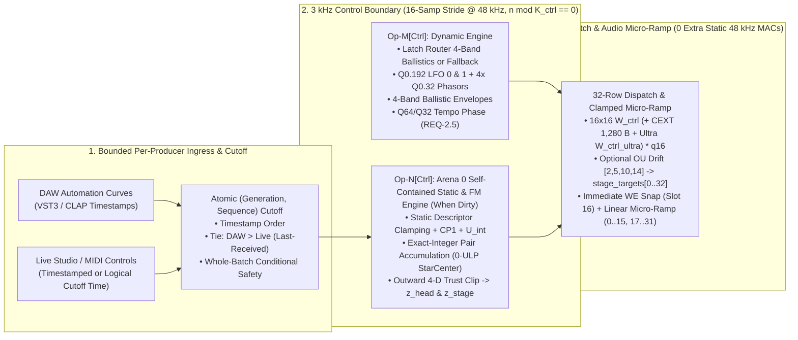

# Self-Similar 3 kHz Dual-Rate Control Plane & Parametric Control Bus

This specification defines the nominal 3 kHz Dual-Rate Control Plane operating on a 16-sample stride at 48 kHz ([sona_architecture.md](../architecture/sona_architecture.md), [REQ-2.4, REQ-2.5, REQ-6.2](../../requirements/system_goals_and_requirements.md)). It establishes self-contained Arena 0 control descriptors (with up to 3 inline 8-byte conditional clamp slots), `CP1` sufficient-statistic projections, interaction matrices `U_int`, dispatch weights `W_ctrl` plus optional 1,280 B `"CEXT"` extensions, pure-binary `"TSYN"` tempo tables, and static `fp16` `W_ro,0` readouts.

Keeping base descriptors inside Arena 0 lets Lite tier stripping retain full parametric conditioning (`REQ-5.6`) with zero extra 48 kHz MACs when static and 0-ULP `StarCenter` invariance.

The specification also covers outward-checked trust clipping, 32-channel dispatch (micro-ramped on slots 0..15 and 17..31, immediately snapped on slot 16 `op_t_we_drive`), and 20–400 BPM tempo sync across 12 subdivisions ([ADR-0007](../../adr/0007-exact-integer-control-bus-and-tempo-inversion.md), [ADR-0015](../../adr/0015-realtime-host-concurrency-spsc-and-telemetry-seqlock.md), [ADR-0019](../../adr/0019-simd-kernel-architecture-and-realtime-execution-optimizations.md), [ADR-0022](../../adr/0022-sona-state-space-operator-and-webgpu-architecture.md)).

---

## 1. Dual-Rate Execution & Self-Similar Kernel Architecture



### 1.1 `Op-M[Ctrl]`: 3 kHz 4-Lane Symplectic Complex & Ballistic Engine

`r[dsp.ctrl.op-m.ballistic-lfo]`

At each control boundary with decimation stride $K_{\text{ctrl}}(f_{s,\mathrm{vm}}) = \max(8, \mathrm{round}(f_{s,\mathrm{vm}} / 3000.0))$ (16 frames at 48 kHz, 15 frames or 2,940 Hz at 44.1 kHz) and tick ratio $\rho_{\text{ctrl}} = \frac{48000 \cdot K_{\text{ctrl}}(f_{s,\mathrm{vm}})}{16 \cdot f_{s,\mathrm{vm}}}$, the 3 kHz control tick runs unconditionally whenever any dynamic source is active.

Across each window, `ControlBus` advances `current_stage_params` per VM frame over `K_ctrl` (snapping slot 16 immediately at the `K_ctrl` boundary), while recursive slews (Kautz `prev_oct`, Op-T `current_psi`, and the WE Schmitt latch) update strictly when `ctrl_sub_counter == 0`.

Hot group, crossbar, `Op-N[Pre]`, and Op-T registers latch `(current_stage_params, z_stage)` strictly when `(sample_tick & 3) == 0 || ctrl_sub_counter == 0`, entering 4-frame micro-chunks only when `(sample_tick & 3) == 0 && rem_frames >= 4 && rem_tick >= 4` and otherwise peeling 1 frame across `(sample_tick & 3) in 1..4` while holding latched registers, so `process(1) * N == process(4) * (N/4) == process(16) * (N/16)` holds at 0 ULP across every sample rate including 44.1 kHz (`K_ctrl = 15`).

Specifically, ticking executes whenever `num_controls > 0`, `tsyn_count > 0`, `has_internal_modulators` is true, control dirty flags are set, or live analog drift is enabled (preserving 0-ULP idle pass-through identity on completely static 0-control models), where cold load sets `has_internal_modulators = ((lfo_angle_bits[0] & 0x7FFF_FFFF) != 0) || ((lfo_angle_bits[1] & 0x7FFF_FFFF) != 0) || any_nonzero_f32_bits(W_ctrl[:, 8..16], W_ctrl_ext[:, 8..16])`. On each active boundary, `Op-M[Ctrl]` finalizes the preceding window before applying new control batches.

At every `K_ctrl` boundary, a full-graph VM passes the per-VM-frame 4-band I/O router ballistic envelopes `[e_0, e_1, e_2, e_3]` ([router_and_crossbar_topology.md §2.6](router_and_crossbar_topology.md#26-4-band-asymmetric-ballistic-envelope-bank--aux-key-detector)) directly into `ControlBus` `env_states[0..4]` with subnormal flushing.

When `ControlBus` executes standalone without router detectors, it falls back to Arena 0 `env_poles[3]` (`pole[b] = wire_env_pole[b]^rho_ctrl`, defaults `[0.95, 0.99, 0.998]`) smoothing window average magnitude `audio_abs_energy` into `env_states[0..3]` with causal onset difference `env_states[3]`:

$$\bar{a}[k] = \frac{1}{K_{\mathrm{ctrl}}} \sum_{m=0}^{K_{\mathrm{ctrl}} - 1} \frac{|\mathrm{in}_L[m]| + |\mathrm{in}_R[m]|}{2}, \qquad e_b[k] = \mathrm{flush}\big(p_b e_b[k-1] + (1 - p_b)\bar{a}[k]\big), \qquad e_3[k] = \max\big(0.0, e_2[k] - e_0[k]\big)$$

Here $b \in \lbrace 0, 1, 2 \rbrace$, $p_b$ denotes `pole[b]`, and $\bar{a}[k]$ denotes `audio_abs_energy`.

Simultaneously, the two `Q0.192` LFO accumulators step ahead of evaluation using `binary64`-scaled `f32` increment `dphi_host` (`<= 0x4049_0FDA`) and project the top 32 bits through `0x30C9_0FDB` plus `algebraic_unit_rotor_f32` into `q2` ([op_m_modal_kautz.md §1.2.4](op_m_modal_kautz.md#124-q0192-control-lfo--4-lane-q032-crossbar-phasors)).

Alongside the 4-lane `Q0.32` crossbar phasors, zero increments hold phase bit-for-bit while refreshing Chebyshev harmonics and cache prior angle words ([ADR-0019](../../adr/0019-simd-kernel-architecture-and-realtime-execution-optimizations.md)).

#### 1.1.1 Single-Rate-Change Window Retiming

`r[dsp.ctrl.op-m.rate-retime]`

On an effective sample-rate transition from $(f_o, K_o)$ to $(f_n, K_n)$ after $c \in \lbrace 0, \dots, K_o - 1 \rbrace$ old-rate samples, the engine preserves partial peaks, LFO phase, and envelope states, closing the mixed window after $d = \mathrm{round}((K_o - c)K_n / K_o)$ new-rate samples with total span $\Delta t = c/f_o + d/f_n$.

#### 1.1.2 Host Automation Timing

`r[dsp.ctrl.op-m.timing]`

Host parameter events follow strict sample-accurate ordering rules across DAW automation, live Studio updates, and MIDI queues:

1. Boundary eligibility: updates timestamped at $n = k K_{\text{ctrl}}$ apply at boundary $k$, while updates in $(k K_{\text{ctrl}}, (k+1)K_{\text{ctrl}}]$ apply at boundary $k+1$ (at most 0.3125 ms latency at 48 kHz).
2. Continuous curves: piecewise-linear host curves (`VST3 IParamValueQueue`) reconstruct in normalized `[0.0, 1.0]` space before mapping to physical ranges.
3. Timestamp precedence: at identical timestamps on one control, DAW automation overrides live Studio/MIDI requests, while ties between live sources favor the most recently accepted request.
4. Late, stale, and untimestamped arrivals: late requests check `(timestamp, source_priority, receipt_order, sub_ordinal)` to skip superseded values; stale presets reject atomically; untimestamped requests lock the next boundary timestamp.

#### 1.1.3 Bounded Per-Producer Ingress & 3-Lane SPSC Control Queue

`r[dsp.ctrl.op-m.spsc-ingress]`

Preallocated single-producer single-consumer queues linearize acceptance via one sequentially consistent `u64` atomic combining a 48-bit generation tag and 16-bit sequence index (< 65,536 slots). In the 64-byte-aligned lock-free SPSC queue ([ADR-0015](../../adr/0015-realtime-host-concurrency-spsc-and-telemetry-seqlock.md)), the producer endpoint validates bounds in an accepted-state shadow table before publishing across three atomic lanes drained by the audio-thread consumer at sub-block entry in deterministic epoch order (`Lane 3` fallback latch -> `Lane 2` 64-slot command ring -> `Lane 1` 32-slot coalescing mailbox).

---

### 1.2 `Op-N[Ctrl]`: 3 kHz Algebraic Polynomial, Hysteresis & `O(1)` Sufficient-Statistic Engine

`r[dsp.ctrl.op-n.engine]`

At every control boundary, `Op-N[Ctrl]` builds 3-D node-anchored Newton/Lobatto basis vectors $\boldsymbol{\psi}_p[k] \in \mathbb{R}^3$, while `Op-M[Ctrl]` applies Chebyshev $T_1..T_4$ waveshaping to LFO cosines. Exact integer accumulators form rank-4 or rank-8 FM interactions over $z_p[k] = \mathbf{w}_{\text{proj},p}^\top \boldsymbol{\psi}_p(u_p[k])$ and clip each 4-D block with smallest positive normal `f32` regularization constant $\epsilon = 2^{-126}$ (single-precision bit pattern `0x0080_0000`):

$$\rho^2 = \Vert\mathbf{z}\Vert_2^2, \qquad \mathbf{z} \leftarrow \mathbf{z} \cdot \min\left(1.0,\ \frac{\rho_{\max}}{\sqrt{\rho^2 + \epsilon}}\right)$$

#### 1.2.1 Outward-Checked Trust-Region Clip

`r[dsp.ctrl.op-n.trust-clip]`

To preserve exact tier stripping, runtime applies outward-checked 4-D trust-region clipping (`trust_clip_outward_4d`) independently to all four 4-D vectors (`z_head`, `ctrl_basis_4`, `z_head_ultra`, and `z_stage_ultra`) instead of coupling the 8-D norm.

Single scalar `trust_radius_mh` (clamped to `[0.01, 16.0]`, default 2.5, falling back to 1.0 when `<= 0.0` or non-finite, stored at Arena 0 offset 2,720 and mirrored at `rho_head_and_ctrl_tail[0]`) governs all four clips.

FTZ-immune bit conversion widens subnormal `f32` inputs (`exp32 == 0`, `frac != 0`) into exact `f64` bit patterns via `leading = 31 - clz32(frac)`, `exponent64 = leading + 874`, and `fraction64 = (frac - (1 << leading)) << (52 - leading)`.

The inverse narrowing path handles subnormal targets (`exponent < -126`) by forming `mantissa = (1 << 52) | fraction64` and right-shifting by `shift = -exponent - 97` with ties-to-even rounding (flushing to signed zero when `shift > 53`) instead of relying on host DAZ/FTZ state.

Outward-rounded verification (`nextup` via bit increment on positive `f64`) forms upper energy bound $S = \mathrm{add}\text{-}\mathrm{up}(\epsilon, \sum_i x_i^2)$ with $\epsilon = 2^{-126}$ and target squared radius $R^2 = \rho_{\max}^2$. A scale $t \in [0, 1]$ with rounded outputs $v_i = \mathrm{RN}_{32}(x_i t)$ passes only when both $\mathrm{mul}\text{-}\mathrm{up}(\mathrm{mul}\text{-}\mathrm{up}(t, t), S) \le R^2$ and $\sum_i v_i^2 \le R^2$.

Six `f64` Newton steps seeded from $y_0 = 2^{-\lfloor (E_s + 2)/2 \rfloor}$, where $E_s = \lfloor \log_2 S \rfloor$ is the unbiased IEEE-754 binary64 exponent of $S$, yield fast candidate $t_{\text{fast}} = \min(1 - 2^{-20}, \rho_{\max} y_6 (1 - 2^{-20}))$, falling back to 32 bisection steps on boundary cases (`rel_err < 1.185e-6 * rho_max`).

#### 1.2.2 Static-Control Basis Skip, 0-ULP `StarCenter` & Interior Trust-Ball Fast Exit

`r[dsp.ctrl.op-n.static-and-interior-fastpath]`

Whenever `is_dirty == false` at a 3 kHz tick, `Op-N[Ctrl]` skips static control-basis evaluation and keeps cached `z_head`, `z_stage`, `ctrl_basis_4`, and `W_ro,0` vectors intact (`REQ-6.1`, [ADR-0019](../../adr/0019-simd-kernel-architecture-and-realtime-execution-optimizations.md)).

Even when static weights are clean, dynamic `Op-M[Ctrl]` modulation and 32-slot dispatch still execute whenever `num_controls > 0`, `tsyn_count > 0`, internal modulators are active, or analog drift is enabled.

At the `StarCenter` anchor, contributor terms vanish to exact +0.0, ensuring 0-ULP equivalence across tiers and after Lite tier stripping. During outward 4-D trust-region clipping, finite vectors satisfying $\sum_{i=0}^3 z_i^2 + 10^{-9} < \rho_{\max}^2$ with $\rho_{\max} > 0$ return unmodified without iteration.

---

## 2. User-Definable Parametric Controls (`Range` & `Switch`)

### 2.1 Fixed Declared-Range Coordinate System & Safe-Interval Clamping

`r[dsp.ctrl.range.normalize-clamp]`

Ordered control clamping evaluates switches (`ctrl_kind == 1`) before dependent continuous controls (`ctrl_kind == 0`). For `ctrl_kind == 1`, loaders validate `lobatto_degree <= 15`, `active_options_mask != 0`, and `(u32(active_options_mask) >> (u32(lobatto_degree) + 1)) == 0`.

Switch clamping validates active option bitmasks (`lobatto_degree <= 15`, `active_options_mask != 0`, and upper mask bits zero) before resolving incoming raw switch values against the fallback chain below:

```text
if is_finite(raw) && floor(max(raw, 0.0) + 0.5) < 16 && (mask & (1 << u8(floor(max(raw, 0.0) + 0.5)))) != 0:
    opt = floor(max(raw, 0.0) + 0.5); return (opt, opt, false)
def_opt = is_finite(default_val) ? min(floor(max(default_val, 0.0) + 0.5), 15) : 0
safe_opt = ((mask & (1 << def_opt)) != 0) ? def_opt : (mask != 0 ? min(tzcnt(mask), 15) : 0)
return (f32(safe_opt), f32(safe_opt), true)
```

Dependent `ctrl_kind == 0` controls sanitize non-finite inputs via `clamp(default_val, eff_min, eff_max)` before normalizing against $x_{\min,p} < x_{\max,p}$:

$$u_p = \mathrm{clamp}\left(2.0 \frac{x_p - x_{\min,p}}{x_{\max,p} - x_{\min,p}} - 1.0,\ -1.0,\ +1.0\right)$$

To avoid subtraction cancellation on narrow intervals such as $2^{30}$ to $2^{30} + 128$, cold setup computes $d = x_{\max,p} - x_{\min,p}$ and $r = 1/d$ in `binary64` and stores `binary32` `(scale_norm, offset_norm)` in the Control Clamp Descriptor. Runtime then evaluates `clamp((x_clamped * scale_norm) + offset_norm, -1.0, +1.0)` directly in unfused IEEE-754 `binary32` (`FP_CONTRACT OFF`, error < 2^-24, zero runtime `binary64`), setting `was_clamped` on non-finite input or diffs > 1e-6.

#### 2.1.1 Binary32 Physical-Coordinate Bounds

`r[dsp.ctrl.range.f32-rank-bounds]`

Cold preparation intersects signed `f64` bounds onto the admissible ordered `f32` physical knob rank space (4,278,190,079 values with gradual underflow or 4,261,412,865 under FTZ/DAZ, mapping signed zeros to +0.0) using at most 32 binary-search comparisons on `[L, U - 1]` and snapping out-of-range finite requests inward toward zero.

---

### 2.2 Cardinality-Bounded Node-Anchored Newton/Lobatto Basis

`r[dsp.ctrl.basis.lobatto]`

For $U_p$ distinct observed normalized coordinates and active degree $K_p = \min(\max(U_p - 1, 0), 3)$ over anchor nodes $a_{p,1}, a_{p,2}, a_{p,3}$ with $a_{p,1}$ pinned to `StarCenter`:

$$\psi_{p,1}(u_p) = u_p - a_{p,1}, \qquad \psi_{p,2}(u_p) = \psi_{p,1}(u_p)(u_p - a_{p,2}), \qquad \psi_{p,3}(u_p) = \psi_{p,2}(u_p)(u_p - a_{p,3})$$

Unused lanes above $K_p$ stay zero, and $K_p = 0$ emits no contributor.

---

### 2.3 `O(1)` Additive Latent Sufficient-Statistic Control Scaling

`r[dsp.ctrl.accum.cp1-scaling]`

$$\hat{y}(\mathbf{u}) = w_0 + \sum_{p=1}^P \mathbf{w}_p^\top \boldsymbol{\psi}_p(u_p) + \frac{1}{2} \sum_{f=1}^R \left[ \left(\sum_{p=1}^P v_{p,f} z_p\right)^2 - \sum_{p=1}^P v_{p,f}^2 z_p^2 \right]$$

All base control descriptors (Control Clamp Descriptors), CP1 slices, `U_int^base`, `W_ctrl^base`, and static `fp16` base matrix `W_ro,0` (Lite VarPro Readout block) reside inside the Arena 0 Lite payload at the cold tail of the hot working set.

Consequently, containers stripped to Lite and `.dnam-prev` previews preserve full control conditioning (`REQ-5.6`) and 0-ULP `StarCenter` equivalence.

```text
+---------------------------------------------------------------------------------------------------+
| SELF-CONTAINED ARENA 0 & ULTRA DELTA 16-D CONTROL ARCHITECTURE (CP1 + fp16 W_readout)             |
+---------------------------------------------------------------------------------------------------+
|  Arena 0 (Lite Payload, Retained by Lite / Full / Pro / Ultra & .dnam-prev):                      |
|    • Control Clamp Descriptors[P] + Static Latent z_ctrl^base in R^8, FM Rank R = 4               |
|    • Per Contributor (k active lanes): W_main[8,k] + w_proj[k] + v[4] = 4(9k + 4) B               |
|    • Inline Dir & Matrices: cp1_dir[28] (inline CP1 dir: u16le count<=8 + u16le flags=0           |
|      + 8x[ctrl_idx, (ctrl_kind<<4)|lanes, aux]) + U_int^base[4,8] (128 B) + W_ctrl[16,16]         |
|      (1,024 B) + static fp16 W_ro,0 & stage_latent_mods_fp16[0..96]                               |
+---------------------------------------------------------------------------------------------------+
|  Arena 1..2 (Full / Pro Deltas):                                                                  |
|    • Tier-replacement fp16 W_ro,0 projections + Full/Pro Cabinet Prefix Override records           |
+---------------------------------------------------------------------------------------------------+
|  Arena 3 (Ultra Delta, Truncated on Tier Stripping):                                              |
|    • Static Latent Delta z_ctrl,Delta^Ultra in R^8 = [z_head^(4..7), z_stage^(4..7)]^T, R = 8     |
|    • Per Contributor (k active lanes): W_main,Delta[8,k] + v_Delta[4] = 4(8k + 4) B               |
|    • Global Matrices: 3 x U_int,Delta[4,8] (384 B) + W_ctrl_ultra[16,4] (256 B) + W_ro,0          |
+---------------------------------------------------------------------------------------------------+
```

| Tier Slice | Head Coordinates (D_h) | Stage Latents (D_s) | Total Static Dim | FM Rank (R) | Contributor Footprint |
| :--- | :---: | :---: | :---: | :---: | :--- |
| Lite / Full / Pro (Arena 0) | 4 (0..3) | 4 (0..3) | 8 | 4 | `4(9k + 4)` B (124 B at `k = 3`; 52 B switch) |
| Ultra (+ Arena 3 Delta) | 8 (0..7) | 8 (0..7) | 16 | 8 | `+ 4(8k + 4)` B (+112 B at `k = 3`; +48 B switch) |

---

### 2.4 Multi-Option Switch Contributors & Exact-Integer Realization

#### 2.4.1 Multi-Option Switch Contributors, Inline Conditional Slots & `CP1` Precedence

`r[dsp.ctrl.switch.option-contributors]`

For discrete switch $q$ with reference option `default_val`, each represented non-reference option $o$ becomes an indicator contributor $\psi_{q,o}(\sigma_q) = \mathbf{1}(\sigma_q = o)$ (0.0 at `default_val`) per the [packed control projection profile](../containers/dnam_binary_format.md#packed-control-projection-profile).

Each 64-byte Control Clamp Descriptor directly embeds up to 3 inline 8-byte conditional clamp slots (24 B inline at descriptor bytes 40..64: `switch_ctrl_idx`, `switch_opt_idx`, `rule_op`, `bound_val`), eliminating any external conditional-clamp rule table and failing closed at container compilation if a control requires more than 3 rules.

Inside the Arena 0 control-bus section (bytes 36..64), the 28-byte `cp1_dir` array encodes the inline CP1 directory (`cp1_dir_count <= 8`, `flags = 0`, entries `[ctrl_idx, (ctrl_kind << 4) | lanes, aux]` with kinds Range = 0, Switch = 1, BilinearCrossTerm = 2) indexing `cp1_base[576]`.

A `BilinearCrossTerm` contributor (`ctrl_kind == 2`) pairs primary control `p = control_idx` with partner `q = aux` across smoothed normalized coordinates.

Every contributor kind emits a 3-lane `lob` vector and a `scalar` value (0 if out of range):

```text
ctrl_kind == 0 (Range):             lob = eval_lobatto_basis(p, u_p),  scalar = u_p
ctrl_kind == 1 (Switch):            lob = [s, 0.0, 0.0],               scalar = s
  def_opt = is_finite(default_val) ? min(u8(floor(max(default_val, 0.0) + 0.5)), 15) : 0
  s = (aux == 0xFF) ? (active_opt != def_opt ? 1.0 : 0.0) : ((active_opt != def_opt && active_opt == aux) ? 1.0 : 0.0)
ctrl_kind == 2 (BilinearCrossTerm): lob = [lob_p[0]*lob_q[0], lob_p[1]*lob_q[0], lob_p[0]*lob_q[1]],  scalar = lob_p[0]*lob_q[0]
```

Across all contributor kinds (0, 1, and 2), latent contribution `z_c` uses the embedded projection whenever any weight satisfies `|slot.emb[e]| > 1.0e-12`: `z_c = ((slot.emb[0] * lob[0]) + (slot.emb[1] * lob[1])) + (slot.emb[2] * lob[2])` in unfused `binary32` (`FP_CONTRACT OFF`), and otherwise falls back to `z_c = scalar`.

Overflow `"CP1\0"` streams (> 8 contributors or > 576 B) reside inside binary container `shared_controls` (`num_controls * 64 + cp1_overflow_bytes` with zeroed `shared_extent` in Region 4 when `dbin_prefix_bytes > 0`, or inside Region 4 otherwise), taking canonical precedence whenever non-empty while stripped Lite containers fall back directly to `cp1_dir` and `cp1_base`.

#### 2.4.2 Conditional Batch Safety

`r[dsp.ctrl.switch.conditional-batch]`

Preset and batch updates validate all affected controls atomically to keep delay crossfades and disjoint switch ranges stable:

1. Whole-candidate evaluation: partial presets restore signed defaults for omitted controls, apply new assignments, update `[CLAMP-SWITCH]` masks, and intersect active conditional rules ([conditional control rules](../containers/dnam_binary_format.md#conditional-control-rules)).
2. Fade-endpoint protection: defer or reject batches whose new safety bounds invalidate an active delay crossfade endpoint.
3. Disjoint-interval two-path blend: when a switch moves a dependent control between disjoint safe intervals, crossfade isolated old and new paths linearly without cross-feeding states.

#### 2.4.3 Centered ANOVA + Rank-R FM Projection

`r[dsp.ctrl.accum.anova-fm]`

$$\mathbf{z}_{\text{main}} = \sum_{p=0}^{P-1} \mathbf{W}_{\text{main},p} \boldsymbol{\psi}_p(u_p) \in \mathbb{R}^D, \qquad z_p = \mathbf{w}_{\text{proj},p}^\top \boldsymbol{\psi}_p(u_p) \in \mathbb{R}$$
$$\mathbf{s}_{vx} = \sum_{p=0}^{P-1} \mathbf{v}_p z_p \in \mathbb{R}^R, \qquad \mathbf{s}_{v2x2} = \sum_{p=0}^{P-1} (\mathbf{v}_p \odot \mathbf{v}_p) z_p^2 \in \mathbb{R}^R, \qquad \mathbf{z}_{\text{fm}} = \frac{1}{2} (\mathbf{s}_{vx} \odot \mathbf{s}_{vx} - \mathbf{s}_{v2x2}) \in \mathbb{R}^R$$
$$\mathbf{z}_{\text{raw}}^{(0..7)} = \mathbf{z}_{\text{main}}^{(0..7)} + \big(\mathbf{U}_{\text{int}}^{\text{base}}\big)^\top \mathbf{z}_{\text{fm}}^{(0..3)} + \big(\mathbf{U}_{\text{int},\Delta}^{(0..7,4..7)}\big)^\top \mathbf{z}_{\text{fm}}^{(4..7)}$$
$$\mathbf{z}_{\text{raw}}^{(8..15)} = \mathbf{z}_{\text{main}}^{(8..15)} + \big(\mathbf{U}_{\text{int},\Delta}^{(8..15,0..3)}\big)^\top \mathbf{z}_{\text{fm}}^{(0..3)} + \big(\mathbf{U}_{\text{int},\Delta}^{(8..15,4..7)}\big)^\top \mathbf{z}_{\text{fm}}^{(4..7)}$$
$$\mathbf{z}_{\text{ctrl}} = \mathrm{clip}_{\text{trust}}(\mathbf{z}_{\text{raw}})$$

Each `[4, 8]` row-major block (`[4][8]`, 4 FM factors by 8 latent coordinates) multiplies 4 FM factors into 8 latent outputs via $\mathbf{U}^\top \mathbf{z}_{\text{fm}}$.

#### 2.4.4 Exact-Integer Sufficient-Statistic Realization (0-ULP `StarCenter`)

`r[dsp.ctrl.accum.exact-int]`

Exact fixed-point accumulators eliminate floating-point drift across repeated closed control sweeps back to `StarCenter`:

- Each materialized contributor decodes from exact `binary32` products to integer $a_p = b_p 2^{-149}$ with $|b_p| < 2^{277}$ inside 9-word `S` and 18-word `D` accumulators alongside 9-word main sums.
- Moving contributor $p$ from $b_o$ to $b_n$ updates `D` via two shifted 24-bit products without wide squaring before clipping via §1.2.1:

$$R = S - b_o, \qquad D_{\text{new}} = D - 2 b_o R + 2 b_n R, \qquad S_{\text{new}} = R + b_n, \qquad z_{\text{fm},f} = D_{\text{new}} \cdot 2^{-299}$$

Per lane `j` and coordinate `d`, main deltas materialize unfused `f32(W_main[j][d] * lob[j])`, and each FM factor `f` materializes `a_p = f32(v[f] * z_c)` with `FP_CONTRACT OFF`.

---

## 3. Autonomous Signal-Driven Modulators

`r[dsp.ctrl.modulators.dynamic]`

Every 3 kHz control boundary combines `Op-M[Ctrl]` and `Op-N[Ctrl]` into `q2 = [lfo0_mix, lfo1_mix, lfo0_cos, lfo0_sin]` (where `lfo{j}_mix = T_1 + 0.35 * T_2` from the Chebyshev harmonics of LFO `j` cosine) and `q3 = [e_low, e_mid, e_high, e_aux]`.

Cold init and `reset()` zero `lfo_phases_q192 = [[0; 3]; 2]`, `lfo_harmonics = [0.0; 8]`, `env_states`, and `ou_drift_state` while setting `lfo_phasors = [[1.0, 0.0], [1.0, 0.0]]`, evaluating static dispatch with `q2 = [0.0, 0.0, 1.0, 0.0]` and q3 zeroed (skipping OU PRNG steps), and snapping `current_stage_params = stage_targets`.

At the cold tail of the hot working set, the Arena 0 control-bus section stores LFO, analog drift, envelope, and trust-radius metadata (36 B) followed by `cp1_dir` (28 B), `u_int_base` (128 B), `cp1_base` (576 B), `w_ctrl` (1,024 B), and `rho_head_and_ctrl_tail` (128 B).

Optional analog drift (`live_analog_drift_enabled`) defaults to `false` and automatically disables during `offline_bounce` to guarantee 0-ULP determinism.

### 3.1 Operator Parameter Dispatch Matrix & Sensitivity Laws

`r[dsp.ctrl.dispatch.matrix]`

Every tier evaluates all 16 base rows `r in 0..16` via `W_ctrl[r][0..16]` unconditionally over $\mathbf{q}_{16} = [\mathbf{z}_{\text{head}}[0..4], \mathbf{c}_{\text{basis}}[0..4], \text{lfo}, \mathbf{e}_{\text{env}}[0..4]]$, adding `W_ctrl_ultra[r][0..4]` over `qu = z_stage_ultra[0..4]` on Ultra:

$$\theta_{\text{op}}^{\text{Lite..Pro}}[r] = \sum_{c=0}^{15} W_{\text{ctrl}}[r][c] q_{16}[c], \qquad \theta_{\text{op}}^{\text{Ultra}}[r] = \theta_{\text{op}}^{\text{Lite..Pro}}[r] + \sum_{c=0}^{3} W_{\text{ctrl,ultra}}[r][c] q_{u}[c] \qquad (r \in \lbrace 0, \dots, 15 \rbrace)$$

When the optional unwatermarked 1,280 B `"CEXT"` extension is present (`w_ctrl_ext[16][16]` = 1,024 B plus `w_ctrl_ultra_ext[16][4]` = 256 B; [dnam_binary_format.md §1.4](../containers/dnam_binary_format.md#14-bare-deterministic-vm-binary-container-dnam-bin--dnbn)), rows `r in 16..32` read `w_ctrl_ext[r - 16][0..16]` and `w_ctrl_ultra_ext[r - 16][0..4]` over $\mathbf{q}_{16}$ and `qu`, defaulting strictly to +0.0 when absent:

$$\theta_{\text{op}}^{\text{Lite..Pro}}[r] = \sum_{c=0}^{15} w_{\text{ctrl,ext}}[r - 16][c] q_{16}[c], \qquad \theta_{\text{op}}^{\text{Ultra}}[r] = \theta_{\text{op}}^{\text{Lite..Pro}}[r] + \sum_{c=0}^{3} w_{\text{ctrl,ultra,ext}}[r - 16][c] q_{u}[c] \qquad (r \in \lbrace 16, \dots, 31 \rbrace)$$

Non-recursive send safety is enforced structurally by $S_{\text{ret}\to\text{send}} = 0$ in `S_router` rather than row-partitioned $\mathbf{q}$ vectors, while all 32 slots in `stage_targets[0..32]` read from the unified $\mathbf{q}_{16}$ vector. Per-sample stepping micro-ramps channels 0..15 and 17..31, while slot 16 (`op_t_we_drive`) snaps immediately without ramping ([§3.2](#32-division-free-linear-micro-ramping)).

```text
// Exact 4-Lane SIMD Evaluation of W_ctrl Rows r in 0..16 and "CEXT" Rows r in 16..32
// q16 = [q0 = z_head[0..4], q1 = ctrl_basis_4[0..4], q2 = lfo[0..4], q3 = env_states[0..4]], qu = z_stage_ultra[0..4]
v = (w_q2 * q2).fma(w_q3, q3)
if any_nonzero(q0) || any_nonzero(q1): v = v.fma(w_q0, q0).fma(w_q1, q1)
if is_ultra && any_nonzero(qu):       v = v.fma(w_qu, qu)
stage_targets[r] = (v[0] + v[1]) + (v[2] + v[3])   // unfused balanced pair reduction (FP_CONTRACT OFF)
```

| `stage_targets` Slice | Target Operator | Modulation Parameter & Domain |
| :--- | :--- | :--- |
| `stage_targets[0]` | Core `TPT-SVF` | `svf_g_oct` in `[-3.0, +3.0]` octaves scaling `svf_g` inside `[1e-5, 64.0]` |
| `stage_targets[1]` | Core `TPT-SVF` | `svf_k_delta` in `[-0.8, +1.5]` offsetting `svf_k` inside `[0.0, 8.0]` |
| `stage_targets[2..6]` | Core `PolyADAA1` | `block_adaa_oct[0..4]` in `[-1.5, +1.5]` octaves across cascade blocks (OU drift on 2 and 5) |
| `stage_targets[6..10]` | Core `ParaLRU` | `block_lru_bias[0..4]` in `[-2.0, +2.0]` bias offsets across cascade blocks |
| `stage_targets[10]` | Cabinet Shared Kautz Bank | `kautz_oct_delta` in `[-1.5, +1.5]` octaves shifting modal angles (OU drift on 10) |
| `stage_targets[11]` | Cabinet Shared Kautz Bank | `kautz_damp_delta` in `[-1.5, +1.5]` modulating radial gate and damping |
| `stage_targets[12]` | Spatial Tank (`Op-T`) | `tank_delay_mod` given in 48 kHz samples, rescaled by `1 / rho_vm` into VM frames inside `[5.0, max_tau]` |
| `stage_targets[13]` | Spatial Tank (`Op-T`) | `tank_gain_mod` added to `base_g[q]`, clamped to `[0.0, 0x3F7F_BE76]` (`TANK_MAX_G_LIN_BITS`) |
| `stage_targets[14]` | Spatial Tank (`Op-T`) | `tank_psi_delta` in `[-pi, +pi]` rad modulating Givens angle (OU drift on 14) |
| `stage_targets[15]` | Crossbar & Stereo Wet Blend | `crossbar_wet_mod` in `[-1.0, +1.0]` forming `wet_scale = clamp(1.0 + mod, 0.0, 2.0)` |
| `stage_targets[16]` | `Op-T` Write-Enable (`"CEXT"`) | `op_t_we_drive`: immediate 3 kHz snap (`delta = 0.0`, no micro-ramp); `we_eff = clamp(1.0 + t[16], 0.0, 1.0)` drives Schmitt `(0.45, 0.55)` on bit 0 `WE_HOLD_ACTIVE` |
| `stage_targets[17]` | `Op-T` Delay Scale (`"CEXT"`) | `op_t_delay_scale_oct` in `[-3.0, +3.0]` octaves scaling nominal quad delays |
| `stage_targets[18]` | `Op-T` Ramp Rate (`"CEXT"`) | `op_t_ramp_rate_hz_delta` offsetting quad `ramp_rate_hz` across `q in 0..P_Q` |
| `stage_targets[19]` | `Op-T` LFO Rate (`"CEXT"`) | `op_t_lfo_rate_hz_delta` offsetting quad `lfo_rate_hz` inside `[0.0, 16.0]` Hz across `q in 0..P_Q` |
| `stage_targets[20]` | `Op-T` LFO Depth (`"CEXT"`) | `op_t_lfo_depth_scale` scaling quad `lfo_depths_fp16` within headroom across `q in 0..P_Q` |
| `stage_targets[21]` | `Op-T` Damp Pole (`"CEXT"`) | `op_t_damp_pole_delta` offsetting ZOH-scaled `damp_pole_zoh` inside `[0.0, 0.99995]` across `q in 0..P_Q` |
| `stage_targets[22]` | Quad 0 `Op-T` Dry Mix (`"CEXT"`) | `op_t_dry_mix_mod` modulating strictly Quad 0 `dry_mix` inside `[-2.0, 2.0]` (`q >= 1` unchanged) |
| `stage_targets[23]` | `Op-T` Input Gain (`"CEXT"`) | `op_t_input_gain_mod` scaling quad `input_gains_fp16` |
| `stage_targets[24]` | `Op-T` Window Depth (`"CEXT"`) | `op_t_window_depth_delta` offsetting quad `window_depth` inside `[0.0, 1.0]` |
| `stage_targets[25]` | `Op-T` Schroeder Gain (`"CEXT"`) | `op_t_allpass_g_delta` offsetting per-lane `allpass_g` inside `[-0.75, 0.75]` |
| `stage_targets[26]` | `Op-N[Pre]` Blend (`"CEXT"`) | `op_n_pre_gamma_bc_delta` offsetting `Op-N[Pre]` wet bitcrush blend `gamma_bc` inside `[0.0, 1.0]` |
| `stage_targets[27]` | `Op-N[Pre]` ZOH Hold (`"CEXT"`) | `op_n_pre_zoh_hold_delta` offsetting `zoh_hold_depth` inside `[0.0, 0.9999]` |
| `stage_targets[28]` | `Op-N[Pre]` Quantizer (`"CEXT"`) | `op_n_pre_beta_q_delta` offsetting `Op-N[Pre]` log2 quantizer bit-depth `beta_q` inside `[0.0, 16.0]` |
| `stage_targets[29]` | Crossbar Phasors (`"CEXT"`) | `op_p_phasor_rate_oct` in `[-4.0, +4.0]` octaves scaling 4× `Q0.32` carrier frequencies |
| `stage_targets[30]` | I/O Router Gate (`"CEXT"`) | `router_gate_thresh_delta` offsetting `io_router` hysteretic gate threshold `gate_thresh` |
| `stage_targets[31]` | Reserved (`"CEXT"`) | Reserved slot; always +0.0 |

#### 3.1.1 Gauge-Invariant `z_stage` Operator Sensitivity & Static `W_ro,0` Readout Laws

`r[dsp.ctrl.dispatch.modulation-laws]`

At 3 kHz ticks, the control bus updates all 32 targets (0..16 base plus 16..32 `"CEXT"`) without division, square roots, or static-mode 48 kHz MACs while keeping `SO(4)` buyer-watermark invariance. Specifically, `Q_buyer` rotates only `z_head[0..4]`, whereas `z_stage[0..D_s]` spanning `ctrl_basis_4[0..4]` plus `z_stage_ultra[0..4]` remains unrotated.

Each tier VarPro Readout block (paired with its Cabinet Prefix Override record) stores one static `fp16` base matrix `W_ro,0` (16×12 to 40×12 across tiers) unpacked directly into pre-cabinet and direct accumulators, while all `stage_latent_*` tables index unrotated `z_stage`.

Inside the Lite VarPro Readout section, `stage_latent_mods_fp16` spans 96 words: slices `[0..80]` open with `default_knobs[8]` (0.5 macro defaults for standalone Arena 0 audit inspection; additive `z_stage` deltas vanish at StarCenter) followed by global sensitivities and Lite..Pro `[4][4]` block scales, while `[80..96]` stores Lite's `op_p_to_group[0..4][0..4]`.

Indices 8..48 store global sensitivity vectors `w_svf_g_oct`, `w_svf_k_delta`, `w_kautz_oct`, `w_kautz_damp`, and `w_tank_psi`, combining with `stage_targets[0..32]` as follows:

| Modulation Law | Exact Combining Equation (`dot_s = sum_{k=0..D_s-1} fp16_to_f32(w[k]) * z_stage[k]` sequentially from +0.0, `FP_CONTRACT OFF`) |
| :--- | :--- |
| `svf_g_oct` | `clamp(stage_targets[0] + dot_s(w_svf_g_oct), -3.0, 3.0)` multiplying group `svf_g` via `exp2_clamped5(...)` inside `[1e-5, 64.0]` |
| `svf_k_delta` | `clamp(stage_targets[1] + dot_s(w_svf_k_delta), -0.8, 1.5)` offsetting group `svf_k` inside `[0.0, 8.0]` |
| `kautz_oct_delta` | `clamp(stage_targets[10] + dot_s(w_kautz_oct), -1.5, 1.5)` driving 3 kHz Kautz modal angle retuning |
| `kautz_damp_delta` | `clamp(stage_targets[11] + dot_s(w_kautz_damp), -1.5, 1.5)` driving radial gate and damping |
| `tank_delay_mod` & `op_t_delay_scale_oct` | Across `q in 0..P_Q`: `delay_samples[q][l] * exp2_clamped5(clamp(stage_targets[17], -3.0, 3.0)) + lfo_mod[q][l] + ramp_mod[q][l] + stage_targets[12] / rho_vm`, clamped `[5.0, max_tau]` |
| `tank_gain_mod` | Across `q in 0..P_Q`: `quad[q].g_loop = clamp(base_tank_g_loop[q] + stage_targets[13], 0.0, 0x3F7F_BE76)` before pitch-down clamp |
| `tank_psi_delta` | Across `q in 0..P_Q`: `tank_psi_delta = clamp(stage_targets[14] + dot_s(w_tank_psi), -pi, +pi)` with `target_psi[q] = clamp(base_psi[q] + tank_psi_delta, -pi, +pi)`, slewed at `<= 0.25` rad/tick |
| `crossbar_wet_mod` | `wet_scale = clamp(1.0 + clamp(stage_targets[15], -1.0, 1.0), 0.0, 2.0)` scaling `op_p_gain`, `op_t_gain`, per-phasor stereo 3-basis carrier `car_L/R[0..4]`, and each active tank quad's wet output `w_scale * y_{duck,q}` |
| `op_t_we_drive` (slot 16) | Across `q in 0..P_Q`: `we_eff = clamp(1.0 + stage_targets[16], 0.0, 1.0)` snapped immediately at 3 kHz tick; Schmitt `(0.45, 0.55)` sets/clears bit 0 `WE_HOLD_ACTIVE` |
| `op_t_ramp_rate_hz_delta` (slot 18) | Across `q in 0..P_Q`: `ramp_rate_hz_eff[q] = clamp(base_ramp_rate_hz[q] + t[18], -16.0, +16.0)` mapped to signed `i32` `ramp_inc_q32[q]` |
| `op_t_lfo_rate_hz_delta` (slot 19) | Across `q in 0..P_Q`: `lfo_rate_hz_eff[q] = clamp(base_lfo_rate_hz[q] + t[19], 0.0, 16.0)` mapped to unsigned `u32` `lfo_inc_q32[q]` |
| `op_t_lfo_depth_scale` (slot 20) | Across `q in 0..P_Q`: `lfo_depth_eff[q][k] = clamp(base_lfo_depth[q][k] * exp2_clamped5(clamp(t[20], -4.0, +4.0)), 0.0, min(512.0, floor(cap / 4) as f32))` (`base_lfo_depth` ZOH-rescaled by `1 / rho_vm`) |
| `op_t_damp_pole_delta` (slot 21) | Across `q in 0..P_Q`: `damp_pole_eff[q] = clamp(damp_pole_zoh[q] + t[21], 0.0, 0.99995)` from 48 kHz wire `[0.0, 0.9995]` |
| `op_t_dry_mix_mod` (slot 22) | Strictly Quad 0: `dry_mix_eff[0] = clamp(base_dry_mix[0] + t[22], -2.0, +2.0)`; `dry_mix_eff[q] = base_dry_mix[q]` for `q >= 1` |
| `op_t_input_gain_mod` (slot 23) | Across `q in 0..P_Q`: `input_gain_eff[q][k] = clamp(base_input_gain[q][k] * exp2_clamped5(clamp(t[23], -4.0, +4.0)), -4.0, +4.0)` |
| `op_t_window_depth_delta` (slot 24) | Across `q in 0..P_Q`: `window_depth_eff[q] = clamp(base_window_depth[q] + t[24], 0.0, 1.0)` ahead of per-lane `mu_win,k` boundary safety clamp |
| `op_t_allpass_g_delta` (slot 25) | Across `q in 0..P_Q`: `allpass_g_eff[q][k] = clamp(base_allpass_g[q][k] + t[25], -0.75, +0.75)` |
| `op_n_pre_*` (slots 26..28) | `gamma_bc = clamp(base_gamma_bc + t[26], 0.0, 1.0)`, `zoh_hold_depth = clamp(base_zoh_hold_depth + t[27], 0.0, 0.9999)`, `beta_q = clamp(base_beta_q + t[28], 0.0, 16.0)` ([op_n_paralru_and_polyadaa.md §2.3.1](op_n_paralru_and_polyadaa.md#231-continuous-op-npre-front-end-zero-init-safety--uniform-nearest-step-quantizer)) |
| `op_p_phasor_rate_oct` (slot 29) & `router_gate_thresh_delta` (slot 30) | `exp2_clamped5(clamp(stage_targets[29], -4.0, 4.0))` scaling 4× `Q0.32` phasors (< Nyquist); additive delta on router `gate_thresh` |

Slots 12..14, 16, 17..21, and 23..25 apply across all `P_Q` active quads (`q in 0..P_Q`), whereas slot 22 (`op_t_dry_mix_mod`) modulates strictly Quad 0: `dry_mix_eff[0] = clamp(base_dry_mix[0] + t[22], -2.0, +2.0)` with `dry_mix_eff[q] = base_dry_mix[q]` unchanged for `q >= 1`.

Using precomputed 6-step `f64` reciprocal `inv_fs_vm` of effective rate $f_{s,\mathrm{vm}}$, signed `ramp_inc_q32 = round_half_away(f64(ramp_rate_hz_eff) * 2^32 * inv_fs_vm) as i64 as i32` evaluates `round_half_away(x) = (x >= 0.0) ? floor(x + 0.5) : ceil(x - 0.5)`, matching [op_t_transport.md §1.1.1](op_t_transport.md#111-ring-declaration-unified-4-lane-quad-wire--active-hot-state) and [router_and_crossbar_topology.md §9.5](router_and_crossbar_topology.md#95-control-bus-decimation-stride-tick-ratio--micro-ramp-step). Unsigned `lfo_inc_q32` returns 0 when `(lfo_rate_hz_eff <= 0.0 || max_k(lfo_depth_eff[k]) <= 0.0)` and otherwise computes `((f64(lfo_rate_hz_eff) * 2^32 * inv_fs_vm + 0.5) as u64) as u32`.

For per-block `ADAA` and `ParaLRU` scaling across targets `[2..10]`, Lite..Pro (`D_s = 4`) read `stage_latent_mods_fp16[48..80]` (`w_adaa_drive_scale[4][4]` and `w_lru_bias_shift[4][4]` shared across groups inside block $b$ without per-group expansion):

$$\theta_{\mathrm{adaa}}[b] = \mathrm{clamp}\left(\theta_{\mathrm{op}}[2 + b] + \sum_{k=0}^{3} w_{\text{adaa}}[k][b] z_{\text{stage}}[k], -1.5, +1.5\right)$$
$$\theta_{\mathrm{lru}}[b] = \mathrm{clamp}\left(\theta_{\mathrm{op}}[6 + b] + \sum_{k=0}^{3} w_{\text{lru}}[k][b] z_{\text{stage}}[k], -2.0, +2.0\right)$$

On Ultra (`D_s = 8`, Arena 3 present), the Arena 3 control-bus delta field `stage_latent_ctrl_ultra_fp16[0..256]` (`w_adaa_drive_scale[8][10]` and `w_lru_bias_shift[8][10]`, with `[160..256]` zeroed) supersedes Arena 0's `[4][4]` slice to emit per-group laws across all 10 SONA groups `g`:

$$\theta_{\mathrm{adaa}}[g] = \mathrm{clamp}\left(\theta_{\mathrm{op}}[2 + \mathrm{block}(g)] + \sum_{k=0}^{7} w_{\text{adaa}}[k][g] z_{\text{stage}}[k], -1.5, +1.5\right)$$
$$\theta_{\mathrm{lru}}[g] = \mathrm{clamp}\left(\theta_{\mathrm{op}}[6 + \mathrm{block}(g)] + \sum_{k=0}^{7} w_{\text{lru}}[k][g] z_{\text{stage}}[k], -2.0, +2.0\right)$$

Across every block or group, the clamped targets drive core `PolyADAA1` pre-activation scaling via `d_adaa_eff = clamp(base_adaa_drive, -32.0, 32.0) * exp2_clamped5(theta_adaa)` ([op_n_paralru_and_polyadaa.md §1.2](op_n_paralru_and_polyadaa.md#12-pure-f32-division-free-primitives--midpoint-factorization), which also governs every `exp2_clamped5` octave law in §3.1) and `ParaLRU` bias injection via `b_lru_eff` (`lru_bias_eff`, with $s_{\mathrm{rect}}$ denoting `rect_sign` and $b_{\mathrm{lru,base}}$ denoting `base_lru_bias_drive`):

$$b_{\mathrm{lru,eff}} = \mathrm{clamp}\big(b_{\mathrm{lru,base}} + s_{\mathrm{rect}} \cdot \theta_{\mathrm{lru}}, -16.0, +16.0\big)$$

Because Mechanism A2 watermarking flips both `b_lru_base` and `rect_sign` by lane sign $s \in \lbrace -1, +1 \rbrace$ while dynamic `theta_lru` (`z_stage`-derived) stays unflipped, multiplying only `theta_lru` by `rect_sign` guarantees $b_{\mathrm{lru,eff}}' = s \cdot b_{\mathrm{lru,eff}}$ and $r_{\mathrm{curr}}' = s \cdot r_{\mathrm{curr}}$ at 0 ULP across static and modulated states ([op_n_paralru_and_polyadaa.md §1.1](op_n_paralru_and_polyadaa.md#11-pre-activation-clamping-core-sag-scaling--standalone-reference), [§4](op_n_paralru_and_polyadaa.md#4-4-block-matryoshka-sona-core-tpt-svf-paralru--polyadaa1)).

When `SONA_META_CORE_MODS_PRESENT` (`0x0000_0200`) is active on Ultra, the Arena 3 Ultra core delta field `stage_latent_core_mods_fp16[0..1024]` (`[8][128]` row-major, columns 120..128 reserved `0x0000`) adds per-lane deltas across lanes `l = 0..40`.

For each lane `l`, `g_oct_lane[l] = clamp(svf_g_oct + sum_k core_mods[k][l]*z_stage[k], -3.0, +3.0)` scales `svf_g[l]` by `exp2_clamped5(g_oct_lane[l])` inside [1e-5, 64.0], `svf_k_eff[l] = clamp(svf_k[l] + svf_k_delta + sum_k core_mods[k][40+l]*z_stage[k], 0.0, 8.0)`, and `wf_mix_eff[l] = clamp(wavefolder_mix[l] + sum_k core_mods[k][80+l]*z_stage[k], 0.0, 1.0)`. When `SONA_META_CORE_MODS_PRESENT == 0`, these 1,024 words are skipped.

---

### 3.2 Division-Free Linear Micro-Ramping

`r[dsp.ctrl.dispatch.micro-ramp]`

Cold setup reads `anti_zipper_ramp_scale` from `Arena0[124..128]` (using default $1.0 / 16.0 = 0.0625$ when `<= 1.0e-7` or non-finite, clamped to `(0.0, 1.0]`) and sets `alpha_ramp(f_{s,vm}) = clamp(anti_zipper_ramp_scale * (16.0 / K_ctrl(f_{s,vm})), 0.0, 1.0)`, equaling `1.0 / K_ctrl` at default 0.0625:

$$\alpha_{\text{ramp}}(f_{s,\text{vm}}) = \mathrm{clamp}\left(s_{\text{ramp}} \cdot \frac{16.0}{K_{\text{ctrl}}(f_{s,\text{vm}})}, 0.0, 1.0\right)$$

Here $s_{\text{ramp}}$ denotes `anti_zipper_ramp_scale`, and every audio sample advances across ramped channels 0..15 and 17..31:

$$\Delta\boldsymbol{\theta}[k] = \big(\boldsymbol{\theta}_{\text{op}}[k+1] - \boldsymbol{\theta}_{\text{op}}[k]\big) \times \alpha_{\text{ramp}}(f_{s,\text{vm}}), \qquad \boldsymbol{\theta}_{\text{op}}[n] = \boldsymbol{\theta}_{\text{op}}[n-1] + \Delta\boldsymbol{\theta}[k]$$

Slot 16 (`op_t_we_drive`) skips micro-ramping explicitly (`step_delta[16] = 0.0`), snapping immediately at the `K_ctrl` boundary so Schmitt hysteresis updates `WE_HOLD_ACTIVE` cleanly without ramp lag. Every ramped value clamps within `[min(theta[k], theta[k+1]), max(theta[k], theta[k+1])]` to block overshoot, snapping strictly to `theta_op[k+1]` when `ctrl_sub_counter + 1 >= K_ctrl`.

Accordingly, `ControlBus` linearly micro-ramps `current_stage_params` per VM frame across `K_ctrl(f_{s,vm}) = max(8, round(f_{s,vm} / 3_000.0))` (snapping slot 16 immediately at `K_ctrl`), while recursive slews (Kautz `prev_oct`, Op-T `current_psi`, and the WE Schmitt latch) update strictly when `ctrl_sub_counter == 0`.

Hot group, crossbar, `Op-N[Pre]`, and Op-T registers latch `(current_stage_params, z_stage)` strictly when `(sample_tick & 3) == 0 || ctrl_sub_counter == 0`. Execution enters 4-frame micro-chunks only when `(sample_tick & 3) == 0 && rem_frames >= 4 && rem_tick >= 4` and otherwise peels 1 frame while holding latched registers across `(sample_tick & 3) in 1..4`, making `process(1) * N == process(4) * (N/4) == process(16) * (N/16)` hold at 0 ULP across every sample rate including 44.1 kHz (`K_ctrl = 15`) even under active sweeps.

#### 3.2.1 Sparse `W_ctrl` Column Skipping & Full 32-Channel Micro-Ramping

`r[dsp.ctrl.dispatch.sparse-and-active-ramps]`

During modulation evaluation, the control bus always accumulates dynamic blocks $\mathbf{q}_2, \mathbf{q}_3$ and skips $\mathbf{q}_0, \mathbf{q}_1$ FMA accumulation whenever `z_head` and `ctrl_basis_4` are all exact zeros. It likewise skips `W_ctrl_ultra` and `w_ctrl_ultra_ext` when Ultra is inactive or `z_stage_ultra` is all exact zeros.

When `cext_len == 0`, `"CEXT"` rows 16..32 are skipped cleanly (leaving `stage_targets[16..32] == +0.0`). Active evaluation ramps channels 0..15 and 17..31 across eight 4-lane 32-bit float SIMD vectors ([ADR-0019](../../adr/0019-simd-kernel-architecture-and-realtime-execution-optimizations.md)) and updates optional OU analog drift via `xorshift64*`:

```text
seed = 0x853C_49E6_748F_EA9B when drift_prng_state == 0
x ^= x >> 12; x ^= x << 25; x ^= x >> 27; drift_prng_state = x
rand_u32 = ((x.wrapping_mul(0x2545_F491_4F6C_DD1D)) >> 32) as u32
xi = ((rand_u32 >> 8) as f32) * 2^-23 - 1.0
ou[d] = flush(rho * ou[d] + sigma_drift * (1.0 - rho) * xi)
```

Strictly when `live_analog_drift_enabled && !offline_bounce && sigma_drift > 0.0`, cold setup sets `rho_drift_host = clamp(f32(powf_f64(f64(rho_drift_train), rho_ctrl)), 0.0, 0.9999)` via [router_and_crossbar_topology.md §9.1](router_and_crossbar_topology.md#91-causal-crossbar-core-tpt-svf-prewarping--kautz-modal-conversion), and the generator steps `ou[0..4]` with `rho = rho_drift_host` and adds `[1.0, 1.0, 0.25, 0.25]` weights into `stage_targets` slots `[2, 5, 10, 14]`; otherwise `ou` resets to zero.

Companion field `dither_snr_scale` (Arena 0 offset 2,716) is host-shell metadata and remains 0.0 during deterministic VM execution.

---

## 4. Control-Space Calibration: Order-Statistic Optimal Transport & Physical Variance Gating

`r[dsp.ctrl.calib.variance-gating]`

Before Epoch 1, optimal-transport sorting aligns delay times $\tau_{0,m}$ and modal frequencies across captures to avoid double-echo crossfading, while physical variance gating locks $u_p \to \tau_{0,m}$ and $u_p \to f_{\text{lfo},j}$ weights to 0.0 whenever stem variance falls below 0.2 samples, using threshold $\tau_{\text{var}} = 0.5$, before downstream dispatch. Calibration remains 100% heuristic-free without inspecting English control names (`REQ-1.6`, `REQ-1.9`), allowing sustained/held hardware actuators to calibrate directly from observed stem variance onto `stage_targets[16]` (`op_t_we_drive`) without special freeze control roles:

| Calibration Role (`role`) | Control Type | Physical & Audit Behavior |
| :--- | :---: | :--- |
| `"delay_time_ms"` | `range` | Maps `[v_min, v_mid, v_max]` delay anchors in ms for 12-subdivision Tempo Sync |
| `"lfo_rate_hz"` | `range` | Maps modulation oscillator rate in Hz for Tempo Sync |
| `"feedback"` / `"mix"` / `"crossover_hz"` | `range` | Loop feedback, dry/wet blend, or crossover cutoff |
| `"stereo_mode"` / `"stereo_width"` | `switch` / `range` | Stereo routing selector or width calibration |
| `"grain_size_ms"` / `"grain_pitch_semitones"` / `"grain_spray"` | `range` | Granular duration, ±24 st pitch shift, and spray jitter |

---

## 5. Strict Zero-`FDIV`, Zero-`FSQRT` & Zero Standard-Math-Library Verification

### 5.1 Pitch-Ratio and Time-Warp Profile

`r[dsp.ctrl.math.pitch-profile]`

For finite `f32` semitone shift $p \in [-24, 24]$, widen $p$ to `f64`, multiply by `0x3FAD9303FEA2F7EA` equal to $\ln(2)/12$, and evaluate degree-14 Horner Taylor series $d = x \sum_{j=1}^{14} x^{j-1}/j!$ in `RNE` `f64`:

$$R = \mathrm{RNE}_{f32}(1 + d), \qquad \nu = \mathrm{RNE}_{f32}(-d)$$

Computing $\nu$ directly from $-d$ rather than $1 - R$ preserves tiny warps (`ratio_err < 6.2e-8`, `warp_err < 1.2e-7`, exact at -24, -12, 0, +12, +24 st).

### 5.2 Monotone `f32` Log-Envelope Lookup Profile

`r[dsp.ctrl.math.log2-lut]`

The 129-entry read-only `f32` lookup table $T_j = \mathrm{RNE}_{f32}(\log_2(1 + j/128))$ (516 B, SHA-256 `4d0d7c0ec194dd9d761bfe2982ca4847001f333c58a3f12f423ed2053de3a5f1`) decomposes positive finite $x = 2^E(1 + m/2^{23})$ with subnormal normalization into $j = m \gg 16$ and $a = \mathrm{f32}(m \mathbin{\mathrm{and}} \text{0xFFFF}) \cdot 2^{-16}$ (`error < 1.9e-5`):

$$d = \mathrm{RNE}_{f32}(T_{j+1} - T_j), \qquad p = \min\Big(T_{j+1},\ \mathrm{RNE}_{f32}\big(T_j + \mathrm{RNE}_{f32}(a d)\big)\Big), \qquad \widehat{\log_2(x)} = \mathrm{RNE}_{f32}(E + p)$$

---

## 6. Architectural Memory & Compute Ledgers

`r[dsp.ctrl.ledger.memory-compute]`

```text
+---------------------------------------------------------------------------------------------------+
| CONTROL BUS ARENA 0 SELF-CONTAINED PAYLOAD, CEXT, TSYN & SUFFICIENT-STATISTIC LEDGER              |
+---------------------------------------------------------------------------------------------------+
|  .dnam-bin Prefix (64 B-Aligned Ahead of Arena 0; Embedded Verbatim at dbin_offset when in .dnam): |
|    • shared_controls (P * 64 B Descriptors w/ 3x8 B Inline Cond Rules + opt. "CP1\0" Overflow)    |
|    • "TSYN" Pure-Binary Tempo Array (40 B x tsyn_count) + Opt. Unwatermarked "CEXT" (1,280 B)     |
|  Arena 0 (Lite Payload, Retained by Lite..Ultra & .dnam-prev; Cold Tail of Hot Working Set):      |
|    • cp1_dir[28] (<= 8 inline entries), U_int^base 128 B, cp1_base 576 B, W_ctrl 16x16 (1,024 B)  |
|    • Static fp16 W_ro,0 + stage_latent_mods_fp16[0..96]; 0 extra 48 kHz MACs when static          |
|  Arena 1..2 (Full / Pro Deltas): Tier-replacement fp16 W_ro,0 + Full/Pro Prefix Overrides         |
|  Arena 3 (Ultra Delta): Per slot 4(8k+4) B | 3xU_int,D 384 B | W_ctrl_ultra 256 B | W_ro,0        |
|  Exact-Integer Accumulator: 9-word S + 18-word D per factor (108 B/factor) + 9-word main sums     |
+---------------------------------------------------------------------------------------------------+
```

---

## 7. Host, MIDI, and Tap Tempo Synchronization (`REQ-2.5`)

`r[dsp.tempo.subdivisions]`

Tempo sync locks Op-T delay taps, granular windows, and Op-M LFOs (including Top-of-Frame 4-lane `Q0.32` carriers) across 20–400 BPM (144,000 down to 7,200 samples per quarter note at 48 kHz; 9 s dotted-half to 25 ms 1/16T) for DAW host transport, 24 PPQN MIDI clock (`0xF8`), and tap tempo over all 12 subdivisions.

Pure-binary virtual machine initialization reads tempo mappings strictly from the 64-byte-aligned `"TSYN"` table inside `.dnam-bin` (40 B × `tsyn_count` at `tsyn_offset` with `tsyn_len == tsyn_count * 40`), supporting multi-row switch-conditional physical anchors with zero JSON or string parsing:

| `"TSYN"` Offset | Bytes | LE Type | Field Name | Binary Validation & Runtime Invariant |
| :---: | :---: | :--- | :--- | :--- |
| 0..2 | 2 | `u16le` | `ctrl_idx` | Target control index `< num_controls` |
| 2..4 | 2 | `u16le` | `switch_ctrl_idx` | Conditioning switch control index when `has_switch_cond == 1` |
| 4..5 | 1 | `u8` | `switch_opt_idx` | Conditioning switch option index |
| 5..6 | 1 | `u8` | `has_switch_cond` | 0 = unconditional row, 1 = multi-row switch-conditional entry |
| 6..7 | 1 | `u8` | `mode` | Physical unit mode: 0 = `PeriodMs`, 1 = `FrequencyHz` (> 1 rejected) |
| 7..8 | 1 | `u8` | `default_subdiv` | Default rhythmic subdivision index (0..11) |
| 8..12 | 4 | `u32le` | `flags` | Bit 0: 0 = `OCTAVE_FOLD`, 1 = `CLAMP_ONLY` (`tempo_clamp_inward`); bits 1..31 strictly 0 |
| 12..16 | 4 | `f32le` | `div_ratio` | Precomputed rational subdivision ratio (finite > 0.0; fails closed otherwise) |
| 16..20 | 4 | `f32le` | `bpm_factor` | Finite unit scaling factor (finite > 0.0; fails closed otherwise) |
| 20..32 | 12 | `f32le[3]` | `lobatto_anchors` | Physical anchor values `[v_min, v_mid, v_max]` for binary inversion (all three finite; fails closed otherwise) |
| 32..36 | 4 | `f32le` | `declared_min` | Finite lower bound (`declared_min <= declared_max`; fails closed otherwise) |
| 36..40 | 4 | `f32le` | `declared_max` | Finite upper bound (`declared_min <= declared_max`; fails closed otherwise) |

Before binary inversion (§7.3), each active `"TSYN"` row converts host BPM (`bpm_safe = clamp(BPM, 20.0, 400.0)`) into raw target `t_raw` for `PeriodMs` (mode 0) or `FrequencyHz` (mode 1) via `rcp_nr6_f64` ([router_and_crossbar_topology.md §9.1](router_and_crossbar_topology.md#91-causal-crossbar-core-tpt-svf-prewarping--kautz-modal-conversion)), then bounds onto validated declared limits without `FDIV` or math libraries:

```text
// Zero-FDIV / Zero-libm TSYN Rate & Octave-Fold Evaluation (validated is_finite(declared_min, declared_max) && declared_min <= declared_max)
if mode == 0: t_raw = f32((60_000.0 * rcp_nr6_f64(f64(bpm_safe) * f64(bpm_factor))) * f64(div_ratio))
else:         t_raw = f32((f64(bpm_safe) * f64(bpm_factor)) * rcp_nr6_f64(60.0 * f64(div_ratio)))

if !is_finite(t_raw):
    t = declared_min;
else if (flags & 1) == 1 || !(t_raw > 1.0e-6 && declared_min > 1.0e-6 && declared_max > declared_min) { // CLAMP_ONLY or non-positive octave guard
    t = clamp(t_raw, declared_min, declared_max);
} else { // OCTAVE_FOLD (bit 0 == 0, bounded <= 16 octaves, 0 FDIV, 0 libm)
    t_fold = f64(t_raw);
    for _ in 0..16 {
        if t_fold > f64(declared_max)      { t_fold *= 0.5; }
        else if t_fold < f64(declared_min) { t_fold *= 2.0; }
        else                               { break; }
    }
    if !(f64(declared_min) <= t_fold && t_fold <= f64(declared_max)) {
        t_fold = f64(t_raw);
    }
    t = clamp(f32(t_fold), declared_min, declared_max);
}
```

| Subdivision Index | 0 | 1 | 2 | 3 | 4 | 5 | 6 | 7 | 8 | 9 | 10 | 11 |
| :--- | :---: | :---: | :---: | :---: | :---: | :---: | :---: | :---: | :---: | :---: | :---: | :---: |
| Musical Subdivision | 1/2. | 1/2 | 1/2T | 1/4. | 1/4 | 1/4T | 1/8. | 1/8 | 1/8T | 1/16. | 1/16 | 1/16T |
| Period Ratio `r_sub` | 3/1 | 2/1 | 4/3 | 3/2 | 1/1 | 2/3 | 3/4 | 1/2 | 1/3 | 3/8 | 1/4 | 1/6 |
| Rate Ratio `r_sub^-1` | 1/3 | 1/2 | 3/4 | 2/3 | 1/1 | 3/2 | 4/3 | 2/1 | 3/1 | 8/3 | 4/1 | 6/1 |

### 7.1 Division-Free `Q32` Subdivision Target & `Q64` Beat Accumulator

`r[dsp.tempo.q64-q32-phase]`

A `u64` fractional beat, `u64` increment, and modulo-12 beat counter $N \bmod 12$ (`beat_mod12`) keep 24-hour drift under 4 ps at 120 BPM. For subdivision period ratio $(a_s, b_s)$ from `CANONICAL_SUBDIVISION_RATIOS` (`r_sub = a_s / b_s`), $Q = 2^{32}$, within-beat fraction $F = \lfloor f Q \rfloor$ (`within_beat_q32`), and phase offset $O = \lfloor \mathrm{frac}(\phi_0) Q \rfloor$:

$$q = \left(\left\lfloor \frac{b_s((N \bmod a_s)Q + F)}{a_s} \right\rfloor + O\right) \bmod Q$$

With `u64` product $P_{\text{u64}} = b_s ((N \bmod a_s) Q + F)$, low word $\ell = P_{\text{u64}} \mathbin{\mathrm{and}} \mathrm{0xFFFFFFFF}$, and remainder $r = (P_{\text{u64}} \gg 32) \bmod 3$ (`REM3_TABLE_24`), factors $a_s = 3$ avoid division via $p = r \cdot \mathtt{0x55555555} + (((\ell + r) \cdot \mathtt{0xAAAAAAAB}) \gg 33)$. Splitting quadrant `j = q >> 30` and residual `n = q & 0x3FFFFFFF` multiplies by `0x30C9_0FDB` for pure-32-bit `algebraic_unit_rotor_f32` ([op_m_modal_kautz.md §1.2.4](op_m_modal_kautz.md#124-q0192-control-lfo--4-lane-q032-crossbar-phasors), `err < 4e-7` rad).

### 7.2 Rate-Independent `Q64` Host-Frame Timebase & Event-Rate-Aware Tracker

`r[dsp.tempo.event-tracker]`

MIDI clock and tap arrivals carry timestamps from the monotonic `Q64` seconds counter with per-frame increment $\Delta_h = \mathrm{round}_{\text{even}}(2^{64}/f_h)$ and subframe steps $\mathrm{round}_{\text{even}}(j\Delta_h/4)$, tracking event period $P_p$ and event time $\hat t_p$ via rate-aware gain $g_p = 1 - e^{-P_{p-1}/\tau}$:

$$P_p = P_{p-1} + g_p\big((t_p - t_{p-1}) - P_{p-1}\big), \qquad \hat t_p = \hat t_{p-1} + P_{p-1} + g_p\big(t_p - \hat t_{p-1} - P_{p-1}\big)$$

### 7.3 Reachable Physical `f32` Calibration Inversion & Multi-Range Selection

`r[dsp.tempo.physical-inversion]`

Given target $t$ prepared via the deterministic `flags` rule (§7) and `[v_min, v_mid, v_max]` from `"TSYN"` `lobatto_anchors` on $u \in [-1, +1]$, inversion solves for normalized `u` using math-library-free `rcp_nr6_f64` and `sqrt_f64` ([router_and_crossbar_topology.md §9.1](router_and_crossbar_topology.md#91-causal-crossbar-core-tpt-svf-prewarping--kautz-modal-conversion)):

```text
lo = min(v_min, v_max); hi = max(v_min, v_max); ascending = (v_max >= v_min)
if t <= lo: u = ascending ? -1.0 : +1.0
else if t >= hi: u = ascending ? +1.0 : -1.0
else:
  c1 = 0.5 * (v_max - v_min); c2 = 0.5 * (v_max + v_min) - v_mid
  if |c2| <= 1e-7 * max(|c1|, 1.0):
    if |c1| <= 1e-12: u = 0.0
    else:
      inv_c1 = (c1 >= 0.0 ? 1.0 : -1.0) * rcp_nr6_f64(|c1|)
      u = clamp(f32((t - v_mid) * inv_c1), -1.0, +1.0)
  else:
    disc = max(0.0, c1 * c1 - 4.0 * c2 * (v_mid - t)); root = sqrt_f64(disc)
    inv_2c2 = (c2 >= 0.0 ? 1.0 : -1.0) * rcp_nr6_f64(|2.0 * c2|)
    r1 = (-c1 + root) * inv_2c2; r2 = (-c1 - root) * inv_2c2
    in1 = (-1.0001 <= r1 && r1 <= +1.0001); in2 = (-1.0001 <= r2 && r2 <= +1.0001)
    u = clamp(f32((in1 && !in2) ? r1 : ((in2 && !in1) ? r2 : (c1 >= 0.0 ? r1 : r2))), -1.0, +1.0)
```

Normalized `u` on `[-1.0, +1.0]` then maps deterministically to physical control input `x_phys = declared_min + 0.5 * (u + 1.0) * (declared_max - declared_min)` in unfused `binary32` (`FP_CONTRACT OFF`), which passes through the active conditional `ControlClampDescriptor` clamp (§2.1).

### 7.4 Co-Prime FDN Modal Ratios (`alpha_m = P_m / P_ref`)

`r[dsp.tempo.coprime-fdn]`

All 144 `(idx_L, idx_R)` stereo subdivision pairs retain distinct coprime delay ratios (`Theorem 7.3`).

### 7.5 Transport Start and In-Play Jump Policy

`r[dsp.tempo.transport-jump]`

| Transport Event | Required Phase & Delay Behavior |
| :--- | :--- |
| Start from Stop / Bounce Start | Initialize synchronized generators to `psi_s(P_0)` before frame 0 |
| `SmoothRelock` (Default Jump) | Apply shortest-arc phase slew (negative half-cycle tie) while keeping Op-T delay histories continuous |
| `ImmediatePhaseLock` | Snap generator phase to `psi_s(P_0)` at control boundary and micro-ramp via [§3.2](#32-division-free-linear-micro-ramping) |
