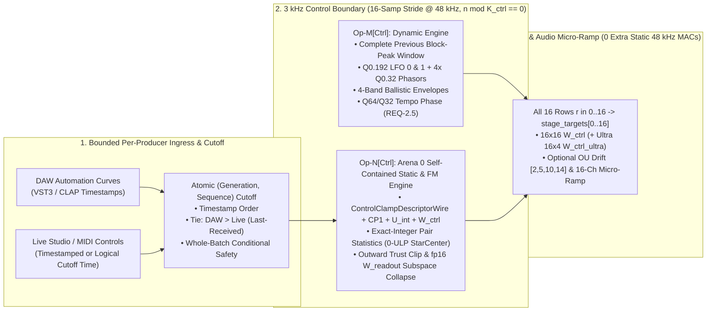

# Self-Similar 3 kHz Dual-Rate Control Plane & Parametric Control Bus

This specification defines the **nominal 3 kHz Dual-Rate Control Plane** (`16`-sample stride at `48 kHz`; [`packages/engine/src/control/`](../../../packages/engine/README.md), [`packages/capture/src/`](../../../packages/capture/README.md)), **self-contained `Arena 0` (`Arena0LiteWire`) `ControlClampDescriptorWire`, `CP1`, `U_int`, `W_ctrl`, and `fp16` `W_readout` (`VarProReadoutLiteWire`, extended in higher tiers by `VarProReadout{Full,Pro,Ultra}Wire`) subspace** (ensuring `strip_container_to_tier(Lite)` retains full parametric conditioning per `REQ-5.6` with `0` extra `48 kHz` MACs when static and `0-ULP` `StarCenter` invariance), exact-integer sufficient-statistic accumulation, outward-checked trust-region clipping, tier-aware `16 × 16` + `16 × 4` stage dispatch, division-free linear micro-ramping, and `20–400 BPM` tempo synchronization across 12 rhythmic subdivisions ([`sona_architecture.md`](../architecture/sona_architecture.md), [`REQ-2.5`](../../requirements/system_goals_and_requirements.md)). For R&D counterexamples and derivations, see [`../../adr/0007-exact-integer-control-bus-and-tempo-inversion.md`](../../adr/0007-exact-integer-control-bus-and-tempo-inversion.md), [`../../adr/0015-realtime-host-concurrency-spsc-and-telemetry-seqlock.md`](../../adr/0015-realtime-host-concurrency-spsc-and-telemetry-seqlock.md), and [`../../adr/0022-sona-state-space-operator-and-webgpu-architecture.md`](../../adr/0022-sona-state-space-operator-and-webgpu-architecture.md).

---

## 1. Dual-Rate Execution & Self-Similar Kernel Architecture



### 1.1 `Op-M[Ctrl]`: 3 kHz 4-Lane Symplectic Complex & Ballistic Engine

`r[dsp.ctrl.op-m.ballistic-lfo]`

At each control boundary (decimation stride $K_{\text{ctrl}}(f_{s,\text{eff}}) = \max(8, \mathrm{round}(f_{s,\text{eff}} / 3000.0))$, equal to `16` samples at `48 kHz` and `15` samples / `2,940 Hz` at `44.1 kHz` with tick ratio $\rho_{\text{ctrl}} = \frac{48000 \cdot K_{\text{ctrl}}(f_{s,\text{eff}})}{16 \cdot f_{s,\text{eff}}}$), `Op-M[Ctrl]` completes the preceding detector block before applying new host control batches:

1. **Completed-Block 4-Band Asymmetric Ballistic Envelope Bank:** Collect rectified band peaks $|x_b[k]| = \max_{0 \le m < K_{\text{ctrl}}} |x_b[K_{\text{ctrl}}k + m]|$ over the completed block ($b \in \lbrace \text{Low}, \text{Mid}, \text{High}, \text{Aux Key} \rbrace$) and update:
   $$e_b[k] = \alpha_b[k] e_b[k-1] + (1 - \alpha_b[k]) |x_b[k]|, \qquad \alpha_b[k] = \mathrm{select}\big(|x_b[k]| > e_b[k-1],\ \alpha_{\text{att},b},\ \alpha_{\text{rel},b}\big)$$
2. **Quadrature LFO 0 & 1 Rotors:** Advance the two independent `Q0.192` LFO phase accumulators by the previous window's effective increment and map their top 32 bits to unit phasors via the quadrant-reduced contractive rotor ([`op_m_modal_kautz.md` §1.2](op_m_modal_kautz.md#12-contractive-finite-precision-rotor)) alongside the Top-of-Frame `4`-lane `Q0.32` quadrature phasors (`0.05 Hz..20 kHz`). Zero increments hold oscillator state bit-for-bit, and `ControlBus<B>` caches the converted signed 3-word `u64` `Q0.192` increment (`lfo_cached_angle_bits: [u32; 2]`, `lfo_cached_q192_inc: [Option<(bool, [u64; 3])>; 2]`) so `q0_192_phase_increment_from_f32_bits` is skipped whenever an LFO's frequency increment `lfo_angle_bits` is unchanged (`ADR-0019`).
3. `r[dsp.ctrl.op-m.rate-retime]` **Single-Rate-Change Window Retiming:** On an admitted effective-rate transition from $(f_o, K_o)$ to $(f_n, K_n)$ after $c \in \lbrace 0, \dots, K_o - 1 \rbrace$ old-rate samples, retain partial band peaks, LFO phases, and envelope states, completing the first mixed window after $d = \mathrm{round}((K_o - c)K_n / K_o)$ new-rate samples with actual duration $\Delta t = c/f_o + d/f_n$.

#### Host Automation Timing

`r[dsp.ctrl.op-m.timing]`

1. **Control-Boundary Eligibility:** Timestamped host parameter updates at frame $n = k K_{\text{ctrl}}$ apply at boundary $k$; updates strictly inside $(k K_{\text{ctrl}}, (k+1)K_{\text{ctrl}}]$ apply at boundary $k+1$ (maximum fixed-rate wait $K_{\text{ctrl}} - 1$ samples, `0.3125 ms` at `48 kHz`).
2. **Continuous Host Curves (`VST3 IParamValueQueue`):** Reconstruct piecewise-linear normalized curves in normalized space before mapping to physical coordinates.
3. **Timestamp Arbitration & Tie Precedence:** Order eligible events by timestamp. At an exact timestamp tie for the same parameter, **DAW automation wins over live Studio/MIDI requests**; between live Studio and MIDI requests at an exact tie, **the most recently received accepted request wins**.
4. **Late, Stale & Untimestamped Requests:** Compare late ordinary requests against each control's last published ordering key `(timestamp, source_priority, receipt_order, sub_ordinal)` and apply at the next boundary only if not superseded. Reject stale presets as a whole. Untimestamped live Studio/MIDI requests receive the first eligible cutoff's signal-time timestamp as their immutable logical scheduled time.
5. `r[dsp.ctrl.op-m.spsc-ingress]` **Bounded Per-Producer Ingress Protocol & 3-Lane `SpscControlRing` (`dnam_engine::host`):** Preallocated SPSC lanes linearize acceptance and boundary cutoffs via a single sequentially consistent `u64` atomic (`high 48 bits = generation`, `low 16 bits = sequence`, total slots `< 65,536`). In `dnam_engine::host::SpscControlRing` (`#[repr(align(64))]`, `#[forbid(unsafe_code)]`, `ADR-0015`), `ControlProducer` validates indices/bounds and updates `AcceptedStateShadow` synchronously before publishing to three pure-atomic lanes drained by `ControlConsumer::drain_into(&mut DynamicDnamEngine)` at every sub-block entry in deterministic causal epoch order (`Lane 3 FallbackLatch -> Lane 2 64-slot SPSC command ring -> Lane 1 32-slot coalescing parameter mailbox` packing `(epoch_u29, mode_u2, kind_u1, payload_u32)`).

### 1.2 `Op-N[Ctrl]`: 3 kHz Algebraic Polynomial, Hysteresis & $O(1)$ Sufficient-Statistic Engine

`r[dsp.ctrl.op-n.engine]`

At each control boundary, `Op-N[Ctrl]` evaluates:
1. **Node-Anchored Newton/Lobatto Basis:** $\boldsymbol{\psi}_p[k] = [\psi_{p,1}(u_p[k]), \psi_{p,2}(u_p[k]), \psi_{p,3}(u_p[k]), s_{p,\mathrm{sw}}[k]]^\top \in \mathbb{R}^4$.
2. **Chebyshev LFO Waveshaping:** $T_1(x) = x$, $T_2(x) = 2x^2 - 1$, $T_3(x) = 4x^3 - 3x$, $T_4(x) = 8x^4 - 8x^2 + 1$.
3. **Rank-4 / Rank-8 Factorization Machine (FM) Interaction:** Evaluates cross-control bilinear interactions from scalar embeddings $z_p[k] = \mathbf{w}_{\text{proj},p}^\top \boldsymbol{\psi}_p(u_p[k])$.
4. **Groupwise Trust-Region Clipping:** Independently bounds $\mathbf{z}_{\mathrm{head}} \in \mathbb{R}^{D_h}$ and $\mathbf{z}_{\mathrm{stage}} \in \mathbb{R}^{D_s}$ ($D_h = D_s = 4$ in `Lite..Pro`, $D_h = D_s = 8$ in `Ultra`):
   $$\rho^2 = \Vert\mathbf{z}\Vert_2^2, \qquad \mathbf{z} \leftarrow \mathbf{z} \cdot \min\left(1.0\mathrm{f32},\ \frac{\rho_{\max}}{\sqrt{\rho^2 + \epsilon}}\right)$$

#### Outward-Checked Trust-Region Clip

`r[dsp.ctrl.op-n.trust-clip]`

To prevent `f32` rounding from placing clipped vectors outside the exact Euclidean ball $\Vert \mathbf{z} \Vert_2 \le \rho_{\max}$ or flushing subnormal coordinates under FTZ/DAZ:
1. **Bit-Preserving `f32 <-> f64` Conversion:** Widen `f32` bit patterns (including subnormals via leading-zero shift `p + 874`) directly to IEEE-754 `f64` bits without executing hardware `f32` instructions subject to FTZ/DAZ, and round `f64` outputs back to `f32` bits using integer significand shifts (`M >> 29` for normals, `M >> (-E - 97)` for subnormals, ties-to-even).
2. **Outward-Rounded Energy & Output Check:** Using `nextup` (`bits + 1` on positive `f64`), form outward denominator bound $S = \mathrm{add-up}(\epsilon, \sum_i x_i^2)$ and exact $R^2 = \rho_{\max}^2$. Accept scale $t \in [0, 1]$ with rounded `f32` output $v_i = \mathrm{RN}_{32}(x_i t)$ only when both $\mathrm{mul-up}(\mathrm{mul-up}(t, t), S) \le R^2$ and $\sum_i v_i^2 \le R^2$.
3. **6-Step Newton Fast Path & 32-Step Bisection Fallback:** Seed $y_0 = 2^{-\lfloor (E_s + 2)/2 \rfloor}$ from the unbiased exponent $E_s$ of $S$, iterate $y_{k+1} = \mathrm{fl}_{64}(y_k(1.5 - 0.5 S y_k^2))$ six times, and test $t_{\text{fast}} = \min(1 - 2^{-20}, \rho_{\max} y_6 (1 - 2^{-20}))$. If accepted, return $v_i$; otherwise bisect `32` times over $[0, \min(1, 2^{E_r + 1 - E})]$. For normal radii, relative scale contraction is $< 9.57 \times 10^{-7}$ and vector error is $< 1.185 \times 10^{-6} \rho_{\max}$.
4. `r[dsp.ctrl.op-n.static-and-interior-fastpath]` **Static-Control Basis Skip (`0` Extra `48 kHz` MACs), `0-ULP` `StarCenter` & Interior Trust-Ball Fast Exit ([`ADR-0019`](../../adr/0019-simd-kernel-architecture-and-realtime-execution-optimizations.md)):** When `is_dirty == false` at a `3 kHz` boundary (`0` user controls moved during the completed sub-block), `ControlBus<B>::tick_3khz_with_detectors` skips `evaluate_static_control_basis` (Lobatto basis, contributor deltas, FM projection, and `W_ctrl` / `z_stage` sensitivity dispatch), retaining the cached `z_head`, `z_stage`, `ctrl_basis_4`, and static `W_ro,0` direct readout vectors (`0` extra `48 kHz` MACs, `REQ-6.1`). When resting at `StarCenter` (`Mode-0` exact anchor), contributor outputs are identically `+0.0f32`, preserving **`0-ULP` `StarCenter` invariance** across all parameter schedules and after `strip_container_to_tier(Lite)`. When `trust_clip_outward_4d` is invoked and the `f64` squared norm satisfies $\sum_{i=0}^3 z_i^2 + 10^{-9} < \rho_{\max}^2$ (with finite norm and $\rho_{\max} > 0$), it returns `z` immediately without executing `trust_clip_outward_checked_bits::<4>` Newton/bisection iterations.

---

## 2. User-Definable Parametric Controls (`Range` & `Switch`)

### 2.1 Fixed Declared-Range Coordinate System & Safe-Interval Clamping

`r[dsp.ctrl.range.normalize-clamp]`

Clamp physical host values to the active safe interval (sanitizing non-finite/`NaN` scalar inputs first via `default_val.clamp(eff_min, eff_max)` so `NaN` never propagates downstream, and using two-pass evaluation `ctrl_kind == 1` switches before `ctrl_kind == 0` dependent continuous ranges in `clamp_and_normalize_all` / `clamp_and_normalize` with `active_options_mask` fallback) and normalize against the declared endpoints $x_{\min,p} < x_{\max,p}$:
$$u_p = \mathrm{clamp}\left(2.0 \frac{x_p - x_{\min,p}}{x_{\max,p} - x_{\min,p}} - 1.0,\ -1.0,\ +1.0\right)$$
To prevent catastrophic cancellation on closely spaced `f32` endpoints (such as $2^{30}$ and $2^{30} + 128$) or overflow on wide spans, widen endpoints to `binary64` on the cold path, precompute $d = x_{\max,p} - x_{\min,p}$ and $r = 1/d$ in `f64`, store `(scale_norm, offset_norm)` in `ControlClampDescriptorWire`, evaluate `RN32(clamp(x_clamped * scale_norm + offset_norm, -1.0, 1.0))` at the control boundary (`error < 2^-24`), and set the `was_clamped` flag whenever `!raw.is_finite()` or `|clamped - raw| > 1e-6`.

#### Binary32 Physical-Coordinate Bounds

`r[dsp.ctrl.range.f32-rank-bounds]`

Intersect signed `binary64` safety bounds onto the ordered set of admissible `f32` physical knob values (`4,278,190,079` values under gradual underflow or `4,261,412,865` under FTZ/DAZ, with signed zero unified as `+0.0f32`) using inward integer rank bounds (`[L, U - 1]`, at most `32` binary-search comparisons on the cold path). Map any out-of-range finite request to the nearest admissible physical value (ties toward zero).

### 2.2 Cardinality-Bounded Node-Anchored Newton/Lobatto Basis

`r[dsp.ctrl.basis.lobatto]`

For $U_p$ distinct observed normalized coordinates and active degree $K_p = \min(\max(U_p - 1, 0), 3)$ with persisted anchor nodes $a_{p,1}, a_{p,2}, a_{p,3}$ (anchoring $a_{p,1}$ at `StarCenter` so $\psi_{p,j}(u_{p,\text{star}}) = 0.0$):
$$\psi_{p,1}(u_p) = u_p - a_{p,1}, \qquad \psi_{p,2}(u_p) = \psi_{p,1}(u_p)(u_p - a_{p,2}), \qquad \psi_{p,3}(u_p) = \psi_{p,2}(u_p)(u_p - a_{p,3})$$
Lanes above $K_p$ are zero (`K_p = 0` emits no latent contributor).

### 2.3 O(1) Additive Latent Sufficient-Statistic Control Scaling

`r[dsp.ctrl.accum.cp1-scaling]`

$$\hat{y}(\mathbf{u}) = w_0 + \sum_{p=1}^P \mathbf{w}_p^\top \boldsymbol{\psi}_p(u_p) + \frac{1}{2} \sum_{f=1}^R \left[ \left(\sum_{p=1}^P v_{p,f} z_p\right)^2 - \sum_{p=1}^P v_{p,f}^2 z_p^2 \right]$$

In `SONA` `v3.0`, **all base control descriptors (`ControlClampDescriptorWire`), `CP1` projections, `U_int^base`, `W_ctrl^base`, and `Lite` `fp16` `W_readout` (`VarProReadoutLiteWire`) reside self-contained inside `Arena 0` (`Arena0LiteWire`)** at the cold tail of `SonaHotSlab` (rather than in `Arena 1`). Calling `strip_container_to_tier(Lite)`—including for `.dnam-prev` storefront previews—therefore preserves full parametric conditioning (`REQ-5.6`) and `0-ULP` `StarCenter` baseline equivalence.

```text
+---------------------------------------------------------------------------------------------------+
| SELF-CONTAINED ARENA 0 & ULTRA DELTA 16-D CONTROL ARCHITECTURE (CP1 + fp16 W_readout)             |
+---------------------------------------------------------------------------------------------------+
|  Arena 0 (Arena0LiteWire, Retained by Lite / Full / Pro / Ultra & .dnam-prev):                    |
|    • ControlClampDescriptorWire[P] + Static Latent z_ctrl^base in R^8, FM Rank R = 4              |
|    • Per Contributor (k active lanes): W_main[8,k] + w_proj[k] + v[4] = 4(9k + 4) B               |
|    • Inline Dir & Matrices: cp1_dir[28] (Cp1InlineDirWire: u16le count<=8 + u16le flags=0         |
|      + 8x[ctrl_idx, (ctrl_kind<<4)|lanes, aux]) + U_int^base[8,4] (128 B) + W_ctrl[16,16]        |
|      (1,024 B) + static fp16 W_ro,0 & stage_latent_mods_fp16[0..80]                               |
+---------------------------------------------------------------------------------------------------+
|  Arena 1..2 (Full / Pro Deltas):                                                                  |
|    • Incremental fp16 W_readout,Delta projections for added Full/Pro core & Stage III blocks      |
+---------------------------------------------------------------------------------------------------+
|  Arena 3 (Ultra Delta, Truncated on Tier Stripping):                                              |
|    • Static Latent Delta z_ctrl,Delta^Ultra in R^8 = [z_head^(4..7), z_stage^(4..7)]^T, R = 8     |
|    • Per Contributor (k active lanes): W_main,Delta[8,k] + v_Delta[4] = 4(8k + 4) B               |
|    • Global Matrices: 3 x U_int,Delta[8,4] (384 B) + W_ctrl_ultra[16,4] (256 B) + W_ro,D          |
+---------------------------------------------------------------------------------------------------+
```

| Tier Profile | Head Coordinates (`D_h`) | Stage Coordinates (`D_s`) | Total Static Dim (`D`) | FM Rank (`R`) | Active Contributor Slice (`k` lanes) |
| :--- | :---: | :---: | :---: | :---: | :--- |
| **`Lite` / `Full` / `Pro` (`Arena 0`)** | `4` (`0..3`) | `4` (`0..3`) | `8` | `4` | `4(9k + 4) B` (`124 B` for `k=3`, `52 B` for switch `k=1`) |
| **`Ultra` (`+ Arena 3` Delta)** | `8` (`0..7`) | `8` (`0..7`) | `16` | `8` | `+ 4(8k + 4) B` (`+112 B` for `k=3`, `+48 B` for switch `k=1`) |

### 2.4 Multi-Option Switch Contributors & Exact-Integer Realization

#### 2.4.1 Multi-Option Switch Contributors & Conditional Batch Safety

`r[dsp.ctrl.switch.option-contributors]`

For a discrete switch $q$ with declared default reference option (`default_val`), each represented non-reference option $o$ is a separate `k = 1` contributor $\psi_{q,o}(\sigma_q) = \mathbf{1}(\sigma_q = o)$ (`0.0` at the reference option) per `ref[container.dnam.cp1-profile]` ([packed control projection profile](../containers/dnam_binary_format.md#packed-control-projection-profile)).

**Inline `Arena 0` `cp1_dir[28]` (`Cp1InlineDirWire`) & `shared_extent` `"CP1\0"` Precedence:** Inside `Arena0ControlBusWire` (offset `36..64`), `cp1_dir: [u8; 28]` is the exact `28 B` `Cp1InlineDirWire`: `cp1_dir_count: u16le` (`in 0..=8`), `flags: u16le = 0`, and `entries: [[u8; 3]; 8]` (`[ctrl_idx, (ctrl_kind << 4) | lanes, aux]`, where `ctrl_kind in {0 = Range, 1 = Switch, 2 = BilinearCrossTerm}`), indexing `cp1_base[576]`. Non-empty Region 4 `shared_extent` `"CP1\0"` takes precedence on overflow (arbitrary $P$ / `> 8` contributors); when `"CP1\0"` is absent in `shared_extent` or after `strip_container_to_tier(Lite)`, loaders read the self-contained `Arena 0` `cp1_dir[28]` + `cp1_base[576]` directly.

##### Conditional Batch Safety

`r[dsp.ctrl.switch.conditional-batch]`

1. **Whole-Candidate Preset & Event Evaluation:** Loading a partial preset restores signed defaults for all omitted controls at the effective tier, overlays the preset's assignments, resolves `[CLAMP-SWITCH]` active masks, and intersects all matching structured conditional bounds ([conditional control rules](../containers/dnam_binary_format.md#conditional-control-rules)).
2. **Active-Fade Endpoint Protection:** Validate candidate switches against all still-live delay and transition reads; defer or reject the entire batch if a new bound would invalidate an active crossfade endpoint.
3. **Disjoint-Interval Two-Path Blend:** When a switch change moves a dependent continuous control between disjoint safe intervals, step isolated old and new paths under their respective safe states and crossfade their outputs $y = (1 - \alpha)y_{\text{old}} + \alpha y_{\text{new}}$ without feeding the blend back into either state.

#### 2.4.2 Centered ANOVA + Rank-$R$ FM & Exact-Integer Accumulator

`r[dsp.ctrl.accum.anova-fm]`

$$\mathbf{z}_{\text{main}} = \sum_{p=0}^{P-1} \mathbf{W}_{\text{main},p} \boldsymbol{\psi}_p(u_p) \in \mathbb{R}^D, \qquad z_p = \mathbf{w}_{\text{proj},p}^\top \boldsymbol{\psi}_p(u_p) \in \mathbb{R}$$
$$\mathbf{s}_{vx} = \sum_{p=0}^{P-1} \mathbf{v}_p z_p \in \mathbb{R}^R, \qquad \mathbf{s}_{v2x2} = \sum_{p=0}^{P-1} (\mathbf{v}_p \odot \mathbf{v}_p) z_p^2 \in \mathbb{R}^R, \qquad \mathbf{z}_{\text{fm}} = \frac{1}{2} (\mathbf{s}_{vx} \odot \mathbf{s}_{vx} - \mathbf{s}_{v2x2}) \in \mathbb{R}^R$$
$$\mathbf{z}_{\text{raw}}^{(0..7)} = \mathbf{z}_{\text{main}}^{(0..7)} + \mathbf{U}_{\text{int}}^{\text{base}}\mathbf{z}_{\text{fm}}^{(0..3)} + \mathbf{U}_{\text{int},\Delta}^{(0..7,4..7)}\mathbf{z}_{\text{fm}}^{(4..7)}, \qquad \mathbf{z}_{\text{raw}}^{(8..15)} = \mathbf{z}_{\text{main}}^{(8..15)} + \mathbf{U}_{\text{int},\Delta}^{(8..15,0..3)}\mathbf{z}_{\text{fm}}^{(0..3)} + \mathbf{U}_{\text{int},\Delta}^{(8..15,4..7)}\mathbf{z}_{\text{fm}}^{(4..7)}$$
$$\mathbf{z}_{\text{ctrl}} = \mathrm{clip}_{\text{trust}}(\mathbf{z}_{\text{raw}})$$

`r[dsp.ctrl.accum.exact-int]` **Exact-Integer Sufficient-Statistic Realization (`0-ULP` `StarCenter`):**
- Decode each finite materialized `f32` factor contribution as $a_p = b_p 2^{-149}$ ($|b_p| < 2^{277}$) and maintain exact fixed-width signed integers $S = \sum_p b_p$ (9 `u32` words) and $D = S^2 - \sum_p b_p^2 = 2 \sum_{p<q} b_p b_q$ (18 `u32` words), along with 9-word exact main sums (`0` drift across closed control cycles and `0-ULP` exactness when returning to `StarCenter`).
- When contributor $p$ changes from $b_o$ to $b_n$, update $D$ using two shifted 24-bit significand products without wide squaring:
  $$R = S - b_o, \qquad D_{\text{new}} = D - 2 b_o R + 2 b_n R, \qquad S_{\text{new}} = R + b_n, \qquad z_{\text{fm},f} = D_{\text{new}} \cdot 2^{-299}$$
- Feed the resulting exact-real mixed coordinates into the outward-checked trust-region clip (`ref[dsp.ctrl.op-n.trust-clip]`) before narrowing to `f32`.

---

## 3. Autonomous Signal-Driven Modulators ($\mathbf{m}_{\text{dyn}}[k] \in \mathbb{R}^8$)

`r[dsp.ctrl.modulators.dynamic]`

At each control boundary, `Op-M[Ctrl]` and `Op-N[Ctrl]` emit the dynamic modulators feeding `q2 = [lfo0_mix, lfo1_mix, lfo0_cos, lfo0_sin]` and `q3 = env_states[0..4] = [e_low, e_mid, e_high, e_aux]`. The `Arena0ControlBusWire` control slice at the cold tail of `SonaHotSlab` stores `[lfo_dphi_train[2], sigma_drift, rho_drift_train, env_poles[3], dither_snr_scale, trust_radius_mh]` (`36 B`), followed by `cp1_dir[28]` (`Cp1InlineDirWire`: `cp1_dir_count: u16le in 0..=8`, `flags: u16le = 0`, `entries: [[u8; 3]; 8]`, with non-empty `shared_extent` `"CP1\0"` taking precedence on overflow), `u_int_base` (`128 B`), `cp1_base` (`576 B`), `w_ctrl` (`16 × 16`, `1,024 B`), and `rho_head_and_ctrl_tail` (`128 B`); `live_analog_drift_enabled` defaults to `false` (`set_live_analog_drift(bool)`) and is automatically suppressed when `offline_bounce == true` to guarantee deterministic `0.000000 ULP` runtime, bounce, and training parity unless explicitly enabled for live auditioning.

### 3.1 Stage Parameter Dispatch Matrix $\mathbf{W}_{\text{ctrl}}$

`r[dsp.ctrl.dispatch.matrix]`

`SONA` `v3.0` executes **one unconditional `16 × 16` `W_ctrl` (+ `16 × 4` `W_ctrl_ultra` on `Ultra`) stage-dispatch path** evaluating **all `16` rows `r in 0..16`** over $\mathbf{q}_{16}[k] = [\mathbf{q}_0^\top, \mathbf{q}_1^\top, \mathbf{q}_2^\top, \mathbf{q}_3^\top]^\top \in \mathbb{R}^{16}$, where `q0 = z_head[0..4]`, `q1 = ctrl_basis_4[0..4]` (`z_stage[0..4]`), `q2 = [lfo0_mix, lfo1_mix, lfo0_cos, lfo0_sin]`, and `q3 = env_states[0..4]` (with send-safe inputs masking return-derived detectors for `q_send`, and `qu = z_stage_ultra[0..4]` contracted via `16 × 4` `W_ctrl_ultra` on `Ultra`):
$$\boldsymbol{\theta}_{\text{stage}}^{\text{Lite..Pro}}[k+1] = \mathbf{W}_{\text{ctrl}} \mathbf{q}_{16}[k] \in \mathbb{R}^{16}, \qquad \boldsymbol{\theta}_{\text{stage}}^{\text{Ultra}}[k+1] = \mathbf{W}_{\text{ctrl}} \mathbf{q}_{16}[k] + \mathbf{W}_{\text{ctrl,ultra}} \mathbf{q}_{u}[k] \in \mathbb{R}^{16}$$

| `stage_targets` Index | Target Stage | Physical Parameter Role & Clamped Range |
| :--- | :--- | :--- |
| **`[0]`** | `4`-Block `SONA` Core `TPT-SVF` | `svf_g_oct` (`[-3.0, +3.0]` octaves; `exp2(svf_g_oct)` scaling `svf_g` clamped to `[1e-5, 64.0]`) |
| **`[1]`** | `4`-Block `SONA` Core `TPT-SVF` | `svf_k_delta` (`[-0.8, +1.5]`, offsetting `svf_k` clamped to `[0.0, 8.0]`) |
| **`[2..6]`** | `4`-Block `SONA` Core `PolyADAA1` | `block_adaa_oct[0..4]` (`[-1.5, +1.5]` octaves across Blocks `0..3`; optional OU drift on `[2, 5]`) |
| **`[6..10]`** | `4`-Block `SONA` Core `ParaLRU` | `block_lru_bias[0..4]` (`[-2.0, +2.0]`, per-block `ParaLRU` bias shift across Blocks `0..3`) |
| **`[10]`** | Stage III `KautzModalBank` | `kautz_oct_delta` (`[-1.5, +1.5]` octaves, shifting modal pole angles; optional OU drift on `[10]`) |
| **`[11]`** | Stage III `KautzModalBank` | `kautz_damp_delta` (`[-1.5, +1.5]`, modulating radial gate / damping `(1 - r_m) * 2^delta`) |
| **`[12]`** | Stage IV Coercive `Op-T` Tank | `tank_delay_mod` (samples, modulating fractional delay read pointer inside `[4.0, max_tau]`) |
| **`[13]`** | Stage IV Coercive `Op-T` Tank | `tank_gain_mod` (clamped `<= MAX_LOOP_GAIN_F32` = `0x3F7F_BE76`, `≤ 0.9990`) |
| **`[14]`** | Stage IV Coercive `Op-T` Tank | `tank_psi_delta` (`[-pi, +pi]` rad, modulating Givens angle `psi`; optional OU drift on `[14]`) |
| **`[15]`** | Crossbar & Stereo Wet Readout | `crossbar_wet_mod` (`[-1.0, +1.0]`, modulating crossbar / wet output blend) |

`r[dsp.ctrl.dispatch.stage-laws]` **Closed-Form `SONA` `v3.0` Gauge-Invariant `z_stage` Sensitivity, `stage_targets[0..16]` & Static `W_ro,0` Readout Laws (`ADR-0022`):**
At each `3 kHz` tick, `ControlBus` updates all `16` modulation coordinates (`0 FDIV`, `0 FSQRT`, `0` extra `48 kHz` MACs when controls are static) while preserving **`0-ULP` `SO(4)` buyer-watermark invariance**: `SO(4)` buyer gauge `Q_buyer` rotates ONLY `z_head[0..4]` (plus `cols 0..4` of `main_base`, `u_int_base`, `w_ctrl`, and `u_int_ultra` Block `0`), whereas **`z_stage[0..D_s]`** (`D_s = 4` `ctrl_basis_4[0..4]` for `Lite..Pro`; `D_s = 8` `[ctrl_basis_4[0..4], z_stage_ultra[0..4]]` for `Ultra`) is unrotated (`cols 4..8` / `u_int_ultra` Blocks `1..2`):
1. **Static Base `VarPro` Readout Matrix (`W_ro,0` in `VarProReadout*Wire`):** `VarProReadout*Wire` (`VarProReadoutLiteWire..VarProReadoutUltraWire`) stores **ONLY one static `fp16` base matrix `W_ro,0`** (`16×12` / `24×12` / `32×12` / `40×12`, decoded via `fp16_to_f32` into direct-register `pre_cab` `[pre_cab_w_odd/even/lru, pre_cab_u_gain, pre_cab_hp_gain]` and `direct` `[direct_w_odd/even/lru, direct_s2_u_gain, direct_s2_hp_gain]` accumulators, `ref[dsp.op-n.commuted.project-then-filter]`). There are **zero** per-latent `W_{ro,1..D_h}` wire matrices or `b_a` bias tables in `VarProReadout*Wire`; instead, `z_head` (`[z_head[0..4], z_head_ultra[0..4]]`) remains strictly inside `W_ctrl` (`f32`), while all `stage_latent_*` `fp16` additive sensitivity tables index strictly unrotated `z_stage[0..D_s]` (`0-ULP` `SO(4)` buyer-watermark invariance).
2. **Unconditional `16 × 16` (+ `16 × 4` `Ultra`) `W_ctrl` + Additive `z_stage` Sensitivity Tables:**
   - First, every row $r \in [0, 15]$ contracts `[q0 = z_head[0..4], q1 = ctrl_basis_4[0..4], q2 = [lfo0_mix, lfo1_mix, lfo0_cos, lfo0_sin], q3 = env_states[0..4]]` against `16 × 16` `W_ctrl[r]` (plus `qu = z_stage_ultra[0..4]` against `16 × 4` `W_ctrl_ultra[r]` in `Ultra`; when `live_analog_drift_enabled && !offline_bounce && sigma_drift > 0.0`, OU drift adds to slots `[2, 5, 10, 14]`).
   - Inside `VarProReadoutLiteWire.stage_latent_mods_fp16[0..80]`, `[0..8]` stores `default_knobs[8]` (resting physical control defaults in `[0.0, 1.0]^8` for standalone `Arena 0` preset/audit inspection; `z_stage == 0` at `StarCenter`, adding `0.0` at runtime), `[8..48]` stores global scalar sensitivities (`w_svf_g_oct[8]`, `w_svf_k_delta[8]`, `w_kautz_oct[8]`, `w_kautz_damp[8]`, `w_tank_psi[8]`), and `[48..80]` stores `w_adaa_drive_scale[4][4]` and `w_lru_bias_shift[4][4]`:
     - **`[0]` `svf_g_oct`:** `svf_g_oct = clamp(stage_targets[0] + sum_{k=0..D_s-1} w_svf_g_oct[k] * z_stage[k], -3.0, +3.0)` $\to$ `g_scale = 2^{svf_g_oct}` multiplying group `svf_g` clamped to `[1e-5, 64.0]`.
     - **`[1]` `svf_k_delta`:** `svf_k_delta = clamp(stage_targets[1] + sum_{k=0..D_s-1} w_svf_k_delta[k] * z_stage[k], -0.8, +1.5)` offsetting group `svf_k` clamped to `[0.0, 8.0]`.
     - **`[10]` `kautz_oct_delta`:** `kautz_oct_delta = clamp(stage_targets[10] + sum_{k=0..D_s-1} w_kautz_oct[k] * z_stage[k], -1.5, +1.5)` shifting Stage III `Kautz` pole angles (`theta_m`).
     - **`[11]` `kautz_damp_delta`:** `kautz_damp_delta = clamp(stage_targets[11] + sum_{k=0..D_s-1} w_kautz_damp[k] * z_stage[k], -1.5, +1.5)` modulating Stage III shared radial gate / damping.
     - **`[12]` `tank_delay_mod` (samples):** modulating Stage IV `Op-T` read delay clamped to `[4.0, max_tau]`.
     - **`[13]` `tank_gain_mod` (`<= MAX_LOOP_GAIN_F32`):** modulating Stage IV coercive feedback gain clamped strictly to `[0.0, 0x3F7F_BE76]`.
     - **`[14]` `tank_psi_delta`:** `tank_psi_delta = clamp(stage_targets[14] + sum_{k=0..D_s-1} w_tank_psi[k] * z_stage[k], -pi, +pi)` modulating Stage IV unitary $2\times 2$ Givens angle $\psi$ (`|Delta psi| <= 0.25 rad/tick`).
     - **`[15]` `crossbar_wet_mod` (`[-1.0, +1.0]`):** modulating crossbar / stereo wet output blend.
   - **Per-Block / Per-Group `ADAA` & `ParaLRU` Sensitivities (`[2..10]` Superseding Law):**
     - *`Lite..Pro` (`D_s = 4`, no `Arena 3` dispatch):* `VarProReadoutLiteWire.stage_latent_mods_fp16[48..80]` provides `w_adaa_drive_scale[0..4][0..4]` and `w_lru_bias_shift[0..4][0..4]` indexed by `(k in 0..4, b in 0..4)` for the `4` cascade blocks `b in 0..4`:
       `block_adaa_oct[b] = clamp(stage_targets[2 + b] + sum_{k=0..3} w_adaa_drive_scale[k][b] * z_stage[k], -1.5, +1.5)` and
       `block_lru_bias[b] = clamp(stage_targets[6 + b] + sum_{k=0..3} w_lru_bias_shift[k][b] * z_stage[k], -2.0, +2.0)` (all groups `g` within block `b` share `block_*[b]`).
     - *`Ultra` (`D_s = 8`, `Arena 3` present):* `Arena3ControlBusWire.stage_latent_ctrl_ultra_fp16[0..160]` (`w_adaa_drive_scale[8][10]` at `[0..80]` + `w_lru_bias_shift[8][10]` at `[80..160]`; `[160..256]` reserved `0`) **supersedes (replaces, never adds to)** `Arena 0`'s `[4][4]` subset, computing per-group `group_adaa_oct[g]` and `group_lru_bias[g]` for each of the `10` `SONA` groups `g in 0..10` (`block_of(g) = SONA_GROUP_BLOCK_AND_LOCAL[g].0`: `{0, 4, 6, 8} -> 0`, `{1, 5, 9} -> 1`, `{2, 7} -> 2`, `{3} -> 3`):
       `group_adaa_oct[g] = clamp(stage_targets[2 + block_of(g)] + sum_{k=0..7} w_adaa_drive_scale[k][g] * z_stage[k], -1.5, +1.5)` and
       `group_lru_bias[g] = clamp(stage_targets[6 + block_of(g)] + sum_{k=0..7} w_lru_bias_shift[k][g] * z_stage[k], -2.0, +2.0)`.
   - **Per-Lane `SonaCoreUltraDeltaWire.stage_latent_core_mods_fp16[0..1024]` (`V3_META_CORE_MODS_PRESENT` = `0x0000_0200`):** Organized row-major as `[k in 0..8][col in 0..128]`. When `V3_META_CORE_MODS_PRESENT == 1` on `Ultra` (`D_s = 8`), for each lane `l in 0..40`:
     - `delta_g_oct[l] = sum_{k=0..7} core_mods[k][l] * z_stage[k]`, combined with global `svf_g_oct`: `g_oct_lane[l] = clamp(svf_g_oct + delta_g_oct[l], -3.0, +3.0)` $\to$ `g_scale[l] = 2^{g_oct_lane[l]}` multiplying base `svf_g[l]` clamped to `[1e-5, 64.0]`;
     - `delta_k[l] = sum_{k=0..7} core_mods[k][40 + l] * z_stage[k]`, combined with global `svf_k_delta`: `svf_k_eff[l] = clamp(svf_k[l] + svf_k_delta + delta_k[l], 0.0, 8.0)`;
     - `delta_wf[l] = sum_{k=0..7} core_mods[k][80 + l] * z_stage[k]`, yielding `wf_mix_eff[l] = clamp(wavefolder_mix[l] + delta_wf[l], 0.0, 1.0)`;
     - `col in 120..128` is reserved `0x0000`.
     When `V3_META_CORE_MODS_PRESENT == 0`, skip `[0..1024]` (`0` MACs).

### 3.2 Division-Free Linear Micro-Ramping (`0.0625f32` at $48\text{ kHz}$, $\alpha_{\text{ramp}} = 1 / K_{\text{ctrl}}$ under ZOH)

`r[dsp.ctrl.dispatch.micro-ramp]`

Using $\alpha_{\text{ramp}}(f_{s,\text{eff}}) = 1.0 / K_{\text{ctrl}}(f_{s,\text{eff}})$ precomputed in cold `set_sample_rate()` (`1.0 / 16 = 0.0625f32` at `48 kHz`):
$$\Delta\boldsymbol{\theta}[k] = \big(\boldsymbol{\theta}_{\text{stage}}[k+1] - \boldsymbol{\theta}_{\text{stage}}[k]\big) \times \alpha_{\text{ramp}}(f_{s,\text{eff}}), \qquad \boldsymbol{\theta}_{\text{stage}}[n] = \boldsymbol{\theta}_{\text{stage}}[n-1] + \Delta\boldsymbol{\theta}[k]$$
Clamp every ramped sample inside the closed interval `[min(theta[k], theta[k+1]), max(theta[k], theta[k+1])]` across **all `16` channels `stage_targets[0..16]`** so overshoot never escapes stability limits, and snap the final sample of the window to `theta_stage[k+1]` (`step_micro_ramp_16` + endpoint sync in `engine/process.rs`).

`r[dsp.ctrl.dispatch.sparse-and-active-ramps]` **Sparse `W_ctrl` Column Skipping & Full `16`-Channel Micro-Ramping ([`ADR-0019`](../../adr/0019-simd-kernel-architecture-and-realtime-execution-optimizations.md)):** At each `3 kHz` control boundary, `ControlBus<B>` skips any `q_16` (or `q_u`) input column whose magnitude is $\le 10^{-12}$ while unconditionally evaluating **all `16` rows `r in 0..16`** of `W_ctrl` (`+ W_ctrl_ultra` on `Ultra`), adding optional OU drift only to slots `[2, 5, 10, 14]` when `live_analog_drift_enabled && !offline_bounce && sigma_drift > 0.0`, and micro-ramping **all `16` channels `0..16`** via `4 × B::Vec4` (`step_micro_ramp_16`) per `48 kHz` audio sample.

---

## 4. Step 0: Order-Statistic Optimal Transport & Physical Variance Gating

`r[dsp.ctrl.step0.variance-gating]`

1. **Step-0 Order-Statistic Transport:** Extracts and sorts physical delay times $\tau_{0,m}$ and modal frequencies across stems before Epoch 1 to fit smooth control trajectories without double-echo crossfading.
2. **Step-0 Physical Variance Gating ($\mathbf{G}_p \in \lbrace 0, 1 \rbrace^{\dim(\boldsymbol{\theta})}$):** Hard-locks $u_p \to \tau_{0,m}$ and $u_p \to f_{\text{lfo},j}$ weights to `0.0` whenever stem variance is $< 0.2\text{ samples}$ ($\tau_{\text{var}} = 0.5$).

| Calibration Role (`role`) | Control Type | Physical & Audit Behavior |
| :--- | :---: | :--- |
| **`"delay_time_ms"`** | `range` | Maps `[v_min, v_mid, v_max]` delay anchors (ms) for 12-subdivision Tempo Sync |
| **`"lfo_rate_hz"`** | `range` | Maps modulation oscillator frequency (Hz) for Tempo Sync |
| **`"feedback"` / `"mix"` / `"crossover_hz"`** | `range` | Loop regeneration, wet/dry blend, or filter crossover frequency |
| **`"stereo_mode"` / `"stereo_width"`** | `switch` / `range` | Stereo routing or width calibration |
| **`"freeze_latch"`** | `switch` / `range` | Modeled hardware freeze control (`0-ULP` integer-lag ring-write lock; unobserved options remain clamped) |
| **`"grain_size_ms"` / `"grain_pitch_semitones"` / `"grain_spray"`** | `range` | Granular duration, pitch shift `[-24, +24]` st, and onset jitter |

---

## 5. Strict Zero-`FDIV`, Zero-`FSQRT` & Zero-`libm` Verification

#### Pitch-Ratio and Time-Warp Profile

`r[dsp.ctrl.math.pitch-profile]`

For finite `f32` semitone shift $p \in [-24, 24]$, widen $p$ to `f64`, multiply by `0x3FAD9303FEA2F7EA` ($\ln(2)/12$), and evaluate the degree-14 Horner Taylor polynomial $d = x \sum_{j=1}^{14} x^{j-1}/j!$ in `RNE` `f64`:
$$R = \mathrm{RNE}_{f32}(1 + d), \qquad \nu = \mathrm{RNE}_{f32}(-d)$$
Evaluating $\nu$ directly from $-d$ (rather than $1 - R$) preserves small nonzero warps (`relative ratio error < 6.2e-8`, `time-warp error < 1.2e-7`, exact at `-24, -12, 0, 12, 24` st).

#### Monotone `f32` Log-Envelope Lookup Profile

`r[dsp.ctrl.math.log2-lut]`

Use the 129-entry read-only `f32` lookup table $T_j = \mathrm{RNE}_{f32}(\log_2(1 + j/128))$ (`516 B`, SHA-256 `4d0d7c0ec194dd9d761bfe2982ca4847001f333c58a3f12f423ed2053de3a5f1`). Decompose positive finite $x = 2^E(1 + m/2^{23})$ (using leading-zero normalization on subnormals), set $j = m \gg 16$ and $a = \mathrm{f32}(m \mathbin{\mathrm{and}} \text{0xFFFF}) \cdot 2^{-16}$, and evaluate monotone interpolation (`error < 1.9e-5`):
$$d = \mathrm{RNE}_{f32}(T_{j+1} - T_j), \qquad p = \min\Big(T_{j+1},\ \mathrm{RNE}_{f32}\big(T_j + \mathrm{RNE}_{f32}(a d)\big)\Big), \qquad \widehat{\log_2(x)} = \mathrm{RNE}_{f32}(E + p)$$

---

## 6. Architectural Memory & Compute Ledgers (ASCII Diagrams)

`r[dsp.ctrl.ledger.memory-compute]`

```text
+---------------------------------------------------------------------------------------------------+
| CONTROL BUS ARENA 0 SELF-CONTAINED PAYLOAD & SUFFICIENT-STATISTIC LEDGER                          |
+---------------------------------------------------------------------------------------------------+
|  Arena 0 (Arena0LiteWire, Retained by Lite..Ultra & .dnam-prev; Cold Tail of SonaHotSlab):       |
|    • ControlClampDescriptorWire[P], cp1_dir[28] (Cp1InlineDirWire <= 8 entries; shared_extent |
|      "CP1\0" precedence on overflow), U_int^base 128 B, W_ctrl 16x16 (1,024 B)                  |
|    • Static fp16 W_ro,0 + stage_latent_mods_fp16[0..80]; 0 extra 48 kHz MACs when static        |
|  Arena 1..2 (Full / Pro Deltas): Incremental fp16 W_readout,Delta slices                          |
|  Arena 3 (Ultra Delta): Per contributor 4(8k + 4) B | 3xU_int,D 384 B | W_ctrl_ultra 256B | W_ro,D  |
|  Exact-Integer Accumulator: 9-word S + 18-word D per factor (108 B/factor) + 9-word main sums     |
+---------------------------------------------------------------------------------------------------+
```

---

## 7. Host, MIDI, and Tap Tempo Synchronization (`REQ-2.5`)

`r[dsp.tempo.subdivisions]`

Synchronizes delay taps (`Op-T`), granular windows, and modulation LFOs (`Op-M`, including the Top-of-Frame `4`-lane `Q0.32` quadrature phasors) across **20–400 BPM** inclusive (`144,000..7,200` samples per quarter note at `48 kHz`; `9 s` dotted-half to `25 ms` `1/16T`) for host DAW transport, `24 PPQN` MIDI clock (`0xF8`), and tap tempo across all **12 canonical rhythmic subdivisions**:

| Subdivision Index (`idx`) | `0` | `1` | `2` | `3` | `4` | `5` | `6` | `7` | `8` | `9` | `10` | `11` |
| :--- | :---: | :---: | :---: | :---: | :---: | :---: | :---: | :---: | :---: | :---: | :---: | :---: |
| **Musical Subdivision** | `1/2.` | `1/2` | `1/2T` | `1/4.` | `1/4` | `1/4T` | `1/8.` | `1/8` | `1/8T` | `1/16.` | `1/16` | `1/16T` |
| **Period Ratio `r_sub[idx] = a_s / b_s`** | `3/1` | `2/1` | `4/3` | `3/2` | `1/1` | `2/3` | `3/4` | `1/2` | `1/3` | `3/8` | `1/4` | `1/6` |
| **Rate Ratio `r_sub⁻¹[idx] = b_s / a_s`** | `1/3` | `1/2` | `3/4` | `2/3` | `1/1` | `3/2` | `4/3` | `2/1` | `3/1` | `8/3` | `4/1` | `6/1` |

1. `r[dsp.tempo.q64-q32-phase]` **Division-Free `Q32` Subdivision Target & `Q64` Beat Accumulator:** Maintain a `u64` fractional beat, `u64` increment, and modulo-12 beat counter $N \bmod 12$ (`< 4 ps` drift over 24 hours at `120 BPM`). With $Q = 2^{32}$, $F = \lfloor f Q \rfloor$, and offset $O = \lfloor \mathrm{frac}(\phi_0) Q \rfloor$:
   $$q = \left(\left\lfloor \frac{b_s((N \bmod a_s)Q + F)}{a_s} \right\rfloor + O\right) \bmod Q$$
   Evaluate $a_s = 3$ quotients without division via $p = r \cdot \mathtt{0x55555555} + (((\ell + r) \cdot \mathtt{0xAAAAAAAB}) \gg 33)$, and map $q$ into a unit phasor (`< 4e-7 rad` total error) by splitting quadrant `j = q >> 30` and residual `n = q & 0x3FFFFFFF`, multiplying by `0x30C90FDB` ($2\pi/Q$), and applying the contractive rotor.
2. `r[dsp.tempo.event-tracker]` **Rate-Independent `Q64` Host-Frame Timebase & Event-Rate-Aware Tracker:** Tag MIDI clock and tap events with the monotonic per-instance `Q64` seconds counter ($\Delta_h = \mathrm{round}_{\text{even}}(2^{64}/f_h)$ per host frame, with `4×` subframe offsets $\mathrm{round}_{\text{even}}(j\Delta_h/4)$) so sample-rate transitions never corrupt elapsed intervals. Track event period $P_p$ and event time $\hat t_p$ with rate-aware gain $g_p = 1 - e^{-P_{p-1}/\tau}$:
   $$P_p = P_{p-1} + g_p\big((t_p - t_{p-1}) - P_{p-1}\big), \qquad \hat t_p = \hat t_{p-1} + P_{p-1} + g_p\big(t_p - \hat t_{p-1} - P_{p-1}\big)$$
3. `r[dsp.tempo.physical-inversion]` **Reachable Physical `f32` Calibration Inversion & Multi-Range Selection:** Invert the 3-node calibration $v(u) = v_{\mathrm{mid}} + c_1 u + c_2 u^2$ over the admissible physical `f32` rank set $[L, U - 1]$ of each active, monotone switch option via 32-step rank binary search (ties to lower physical value), optionally octave-folding $v_{\mathrm{target}} \cdot 2^k$ when enabled.
4. `r[dsp.tempo.coprime-fdn]` **Co-Prime FDN Modal Ratios ($\alpha_m = P_m / P_{\mathrm{ref}}$):** Preserve distinct prime delay ratios across all 144 `(idx_L, idx_R)` stereo subdivision pairs (`Theorem 7.3`).

#### Transport Start and In-Play Jump Policy

`r[dsp.tempo.transport-jump]`

| Transport Event | Required Phase & Delay Behavior |
| :--- | :--- |
| **Start from Stop / Offline Bounce Start** | Initialize each synchronized generator to target phase `ψ_s(P₀)` before frame `0`. |
| **In-Play Jump: `SmoothRelock` (Default)** | Apply bounded shortest-arc circular phase correction (negative tie-break at half-cycle) while preserving continuous `Op-T` delay histories. |
| **In-Play Jump: `ImmediatePhaseLock`** | Snap generator phase to `ψ_s(P₀)` at the control boundary and micro-ramp affected audio parameters via §3.2. |
