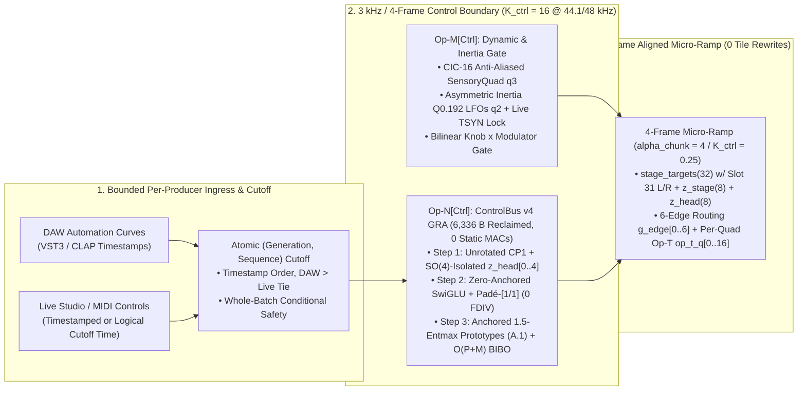

# Self-Similar 3 kHz Dual-Rate Control Plane & Parametric Control Bus

This specification defines the SONA v4.0 nominal 3 kHz Dual-Rate Control Plane (`ControlBus` v4 `GRA` — Gated Rational Attention) operating on a 4-frame-aligned stride (`K_ctrl(44.1 kHz) = K_ctrl(48 kHz) = 16`, `gcd(16, 4) = 4`) within the reclaimed 6,336 B non-Tardos, non-`SO(4)` budget (`<= 9,280 B`, zero static MACs) ([sona_architecture.md](../architecture/sona_architecture.md), [REQ-2.4, REQ-2.5, REQ-6.2](../../requirements/system_goals_and_requirements.md)).

Keeping base descriptors, `ExactIntMainAccumulator` on SO(4)-isolated `z_head[0..4]`, unrotated CP1, Zero-Anchored SwiGLU + Padé-[1/1], and anchored 1.5-Entmax prototypes (`A.1`) inside Arena 0 lets Lite tier stripping retain full parametric conditioning (`REQ-5.6`) with zero static 48 kHz MACs, 0-ULP StarCenter invariance, and O(P + M) global BIBO stability.

The specification also covers outward-checked trust clipping, 4-frame aligned micro-ramped dispatch over `[stage_targets(32), z_stage(8), z_head(8), g_edge(6), op_t_q(16)]` (including `slot 31 L/R` stereo differential quadrature AM, `g_edge[0..6]` 6-edge soft routing, and `op_t_q[0..16]` per-quad `Op-T` deltas), bilinear dynamic/inertia gates, live `TSYN` `Q32`/`Q64` locking across 20–400 BPM ([ADR-0007](../../adr/0007-exact-integer-control-bus-and-tempo-inversion.md), [ADR-0015](../../adr/0015-realtime-host-concurrency-spsc-and-telemetry-seqlock.md), [ADR-0019](../../adr/0019-simd-kernel-architecture-and-realtime-execution-optimizations.md), [ADR-0022](../../adr/0022-sona-state-space-operator-and-webgpu-architecture.md), [ADR-0024](../../adr/0024-sona-v4-kernel-hb-fir-perimeter-and-control-bus-gra.md), [ADR-0025](../../adr/0025-unified-runtime-and-non-causal-trainer-attention.md)).

---

## 1. Dual-Rate Execution & Self-Similar Kernel Architecture



### 1.1 `Op-M[Ctrl]`: 3 kHz 4-Lane Symplectic Complex & Ballistic Engine

`r[dsp.ctrl.op-m.ballistic-lfo]`

At each control boundary with 4-frame aligned stride $K_{\text{ctrl}}(f_{s,\mathrm{vm}}) = 4 \cdot \max(2, \mathrm{round}(f_{s,\mathrm{vm}} / 12{,}000.0))$ (`K_ctrl(44,100) = 16`, `gcd(16, 4) = 4`, 2,756.25 Hz, eliminating 196 Hz beat jitter and discarded ramp steps) and tick ratio $\rho_{\text{ctrl}} = \frac{48000 \cdot K_{\text{ctrl}}(f_{s,\mathrm{vm}})}{16 \cdot f_{s,\mathrm{vm}}}$, the 3 kHz control tick runs whenever any dynamic or dirty source is active.

Across each control window, `ControlBus` v4 micro-ramps `[stage_targets(32), z_stage(8), z_head(8), g_edge(6), op_t_q(16)]` **once per 4-frame microchunk** (`alpha_chunk = 4 / K_ctrl = 0.25`), while recursive slews (Kautz `prev_oct` and Op-T `current_psi`) update strictly when `ctrl_sub_counter == 0`. Under normal 4-frame aligned `K_ctrl`, execution runs strictly in 4-frame microchunk latches with zero 1-frame peeling, preserving 0-ULP equivalence `process(1) * N == process(4) * (N/4) == process(16) * (N/16)` across 44.1–384 kHz.

Ticking is gated cleanly on `is_dirty || ramp_chunks_remaining > 0 || has_internal_modulators || is_analog_drift_active()`, yielding zero static CPU control MACs when idle while keeping `static_z_stage` separate from runtime `eff_z_stage` and preserving 0-ULP `StarCenter` pass-through identity.

At every `K_ctrl` boundary, a full-graph VM latches the **16-sample CIC-boxcar anti-aliased** SensoryQuad ParaLRU rectifier outputs `[e_0, e_1, e_2, e_3]` ([router_and_crossbar_topology.md §2.6](router_and_crossbar_topology.md#26-sensoryquad-op-mnsense-sensing-bank--input-vca)) into ControlBus `env_states[0..4]` (`q3`).

Simultaneously, the two Q0.192 LFO accumulators apply **asymmetric inertia slew** (`alpha_up` vs `alpha_dn`) on knob-modulated LFO rates and **live `TSYN` Q32/Q64 phase locking** across ControlBus LFOs, Op-T LFOs/ramps, and Op-P Q0.32 phasors, projecting skewed quadrature `q2` via `algebraic_unit_rotor_f32` ([op_m_modal_kautz.md §1.2.4](op_m_modal_kautz.md#124-q0192-control-lfo--4-lane-q032-crossbar-phasors)).

#### 1.1.1 Single-Rate-Change Window Retiming

`r[dsp.ctrl.op-m.rate-retime]`

On an effective sample-rate transition from $(f_o, K_o)$ to $(f_n, K_n)$ after $c \in \lbrace 0, \dots, K_o - 1 \rbrace$ old-rate samples, the engine preserves partial peaks, LFO phase, and envelope states, closing the mixed window after $d = \mathrm{round}((K_o - c)K_n / K_o)$ new-rate samples with total span $\Delta t = c/f_o + d/f_n$.

#### 1.1.2 Host Automation Timing

`r[dsp.ctrl.op-m.timing]`

Host parameter events follow strict sample-accurate ordering rules across DAW automation, live Studio updates, and MIDI queues:

1. Boundary eligibility: updates timestamped at $n = k K_{\text{ctrl}}$ apply at boundary $k$, while updates in $(k K_{\text{ctrl}}, (k+1)K_{\text{ctrl}}]$ apply at boundary $k+1$ (at most 0.3125 ms latency at 48 kHz).
2. Continuous curves: piecewise-linear host curves (`VST3 IParamValueQueue`) reconstruct in normalized `[0.0, 1.0]` space before mapping to physical ranges.
3. Timestamp precedence: at identical timestamps on one control, DAW automation overrides live Studio/MIDI requests, while ties between live sources favor the most recently accepted request.
4. Late, stale, and untimestamped arrivals: late requests check `(timestamp, source_priority, receipt_order, sub_ordinal)` to skip superseded values; stale presets reject atomically; untimestamped requests lock the next boundary timestamp.

#### 1.1.3 Bounded Per-Producer Ingress & 3-Lane SPSC Control Queue

`r[dsp.ctrl.op-m.spsc-ingress]`

Preallocated single-producer single-consumer queues linearize acceptance via one sequentially consistent `u64` atomic combining a 48-bit generation tag and 16-bit sequence index (< 65,536 slots). In the 64-byte-aligned lock-free SPSC queue ([ADR-0015](../../adr/0015-realtime-host-concurrency-spsc-and-telemetry-seqlock.md)), the producer endpoint validates bounds in an accepted-state shadow table before publishing across three atomic lanes drained by the audio-thread consumer at sub-block entry in deterministic epoch order (`Lane 3` fallback latch -> `Lane 2` 64-slot command ring -> `Lane 1` 32-slot coalescing mailbox).

---

### 1.2 `Op-N[Ctrl]`: 3 kHz Algebraic Polynomial, Hysteresis & `O(1)` Sufficient-Statistic Engine

`r[dsp.ctrl.op-n.engine]`

At every control boundary, `Op-N[Ctrl]` builds 3-D node-anchored Newton/Lobatto basis vectors $\boldsymbol{\psi}_p[k] \in \mathbb{R}^3$, while `Op-M[Ctrl]` evaluates skewed quadrature LFO waveshaping (`lfo_skew_fp16`). Exact integer accumulators form rank-4 or rank-8 FM interactions over $z_p[k] = \mathbf{w}_{\text{proj},p}^\top \boldsymbol{\psi}_p(u_p[k])$ and clip each 4-D block with smallest positive normal `f32` regularization constant $\epsilon = 2^{-126}$ (single-precision bit pattern `0x0080_0000`):

$$\rho^2 = \Vert\mathbf{z}\Vert_2^2, \qquad \mathbf{z} \leftarrow \mathbf{z} \cdot \min\left(1.0,\ \frac{\rho_{\max}}{\sqrt{\rho^2 + \epsilon}}\right)$$

#### 1.2.1 Outward-Checked Trust-Region Clip

`r[dsp.ctrl.op-n.trust-clip]`

To preserve exact tier stripping and SO(4) buyer-watermark isolation, runtime applies outward-checked 4-D trust-region clipping (`trust_clip_outward_4d`) independently to SO(4)-rotated `z_head[0..4]` and each 4-D slice of the unrotated GRA hidden vector `h_1` (D = 8 Lite–Pro or D = 16 Ultra, `||h_1||_2 <= R_trust`) instead of coupling norms across watermarked and unrotated spaces.

Single scalar `trust_radius_mh` (clamped to `[0.01, 16.0]`, default 2.5, falling back to 1.0 when `<= 0.0` or non-finite, stored at Arena 0 offset 2,720 and mirrored at `rho_head_and_ctrl_tail[0]`) governs these clips.

FTZ-immune bit conversion widens subnormal `f32` inputs (`exp32 == 0`, `frac != 0`) into exact `f64` bit patterns via `leading = 31 - clz32(frac)`, `exponent64 = leading + 874`, and `fraction64 = (frac - (1 << leading)) << (52 - leading)`.

The inverse narrowing path handles subnormal targets (`exponent < -126`) by forming `mantissa = (1 << 52) | fraction64` and right-shifting by `shift = -exponent - 97` with ties-to-even rounding (flushing to signed zero when `shift > 53`) instead of relying on host DAZ/FTZ state.

Outward-rounded verification (`nextup` via bit increment on positive `f64`) forms upper energy bound $S = \mathrm{add}\text{-}\mathrm{up}(\epsilon, \sum_i x_i^2)$ with $\epsilon = 2^{-126}$ and target squared radius $R^2 = \rho_{\max}^2$. A scale $t \in [0, 1]$ with rounded outputs $v_i = \mathrm{RN}_{32}(x_i t)$ passes only when both $\mathrm{mul}\text{-}\mathrm{up}(\mathrm{mul}\text{-}\mathrm{up}(t, t), S) \le R^2$ and $\sum_i v_i^2 \le R^2$.

Six `f64` Newton steps seeded from $y_0 = 2^{-\lfloor (E_s + 2)/2 \rfloor}$, where $E_s = \lfloor \log_2 S \rfloor$ is the unbiased IEEE-754 binary64 exponent of $S$, yield fast candidate $t_{\text{fast}} = \min(1 - 2^{-20}, \rho_{\max} y_6 (1 - 2^{-20}))$, falling back to 32 bisection steps on boundary cases (`rel_err < 1.185e-6 * rho_max`).

#### 1.2.2 Static-Control Basis Skip, 0-ULP `StarCenter` & Idle Zero-MAC Fast Exit

`r[dsp.ctrl.op-n.static-and-interior-fastpath]`

Control-bus ticking gates strictly on `is_dirty || ramp_chunks_remaining > 0 || has_internal_modulators || is_analog_drift_active()`, yielding zero static control MACs when controls and modulators are idle (`REQ-6.1`, [ADR-0019](../../adr/0019-simd-kernel-architecture-and-realtime-execution-optimizations.md), [ADR-0024](../../adr/0024-sona-v4-kernel-hb-fir-perimeter-and-control-bus-gra.md)).

When `is_dirty == false`, Op-N[Ctrl] skips static CP1 and GRA evaluation and retains cached `z_head`, `z_stage`, `g_edge`, `op_t_q`, and `W_ro_head` vectors intact, stepping only active dynamic gates when modulators or ramp chunks remain active.

At the StarCenter anchor, CP1 accumulators vanish to exact +0.0 (`xi === +0.0`), GRA hits the `k* == 1` fast-exit with `V_0 = 0`, and `trust_clip_outward_4d` returns interior vectors satisfying $\sum_{i=0}^3 z_i^2 + 10^{-9} < \rho_{\max}^2$ unmodified, preserving 0-ULP StarCenter equivalence across tiers and after Lite stripping.

---

## 2. User-Definable Parametric Controls (`Range` & `Switch`)

### 2.1 Fixed Declared-Range Coordinate System & Safe-Interval Clamping

`r[dsp.ctrl.range.normalize-clamp]`

Ordered control clamping evaluates switches (`ctrl_kind == 1`) before dependent continuous controls (`ctrl_kind == 0`). For `ctrl_kind == 1`, loaders validate `lobatto_degree <= 15`, `active_options_mask != 0`, and `(u32(active_options_mask) >> (u32(lobatto_degree) + 1)) == 0`.

Switch clamping validates active option bitmasks (`lobatto_degree <= 15`, `active_options_mask != 0`, and upper mask bits zero) before resolving incoming raw switch values against the fallback chain below:

```text
if is_finite(raw) && floor(max(raw, 0.0) + 0.5) < 16 && (mask & (1 << u8(floor(max(raw, 0.0) + 0.5)))) != 0:
    opt = floor(max(raw, 0.0) + 0.5); return (opt, opt, false)
def_opt = is_finite(default_val) ? min(floor(max(default_val, 0.0) + 0.5), 15) : 0
safe_opt = ((mask & (1 << def_opt)) != 0) ? def_opt : (mask != 0 ? min(tzcnt(mask), 15) : 0)
return (f32(safe_opt), f32(safe_opt), true)
```

Dependent `ctrl_kind == 0` controls sanitize non-finite inputs via `clamp(default_val, eff_min, eff_max)` before normalizing against $x_{\min,p} < x_{\max,p}$:

$$u_p = \mathrm{clamp}\left(2.0 \frac{x_p - x_{\min,p}}{x_{\max,p} - x_{\min,p}} - 1.0,\ -1.0,\ +1.0\right)$$

To avoid subtraction cancellation on narrow intervals such as $2^{30}$ to $2^{30} + 128$, cold setup computes $d = x_{\max,p} - x_{\min,p}$ and $r = 1/d$ in `binary64` and stores `binary32` `(scale_norm, offset_norm)` in the Control Clamp Descriptor. Runtime then evaluates `clamp((x_clamped * scale_norm) + offset_norm, -1.0, +1.0)` directly in unfused IEEE-754 `binary32` (`FP_CONTRACT OFF`, error < 2^-24, zero runtime `binary64`), setting `was_clamped` on non-finite input or diffs > 1e-6.

#### 2.1.1 Binary32 Physical-Coordinate Bounds

`r[dsp.ctrl.range.f32-rank-bounds]`

Cold preparation intersects signed `f64` bounds onto the admissible ordered `f32` physical knob rank space (4,278,190,079 values with gradual underflow or 4,261,412,865 under FTZ/DAZ, mapping signed zeros to +0.0) using at most 32 binary-search comparisons on `[L, U - 1]` and snapping out-of-range finite requests inward toward zero.

---

### 2.2 Cardinality-Bounded Node-Anchored Newton/Lobatto Basis

`r[dsp.ctrl.basis.lobatto]`

For $U_p$ distinct observed normalized coordinates and active degree $K_p = \min(\max(U_p - 1, 0), 3)$ over anchor nodes $a_{p,1}, a_{p,2}, a_{p,3}$ with $a_{p,1}$ pinned to `StarCenter`:

$$\psi_{p,1}(u_p) = u_p - a_{p,1}, \qquad \psi_{p,2}(u_p) = \psi_{p,1}(u_p)(u_p - a_{p,2}), \qquad \psi_{p,3}(u_p) = \psi_{p,2}(u_p)(u_p - a_{p,3})$$

Unused lanes above $K_p$ stay zero, and $K_p = 0$ emits no contributor.

---

### 2.3 `O(1)` Additive Latent Sufficient-Statistic Control Scaling

`r[dsp.ctrl.accum.cp1-scaling]`

$$\hat{y}(\mathbf{u}) = w_0 + \sum_{p=1}^P \mathbf{w}_p^\top \boldsymbol{\psi}_p(u_p) + \frac{1}{2} \sum_{f=1}^R \left[ \left(\sum_{p=1}^P v_{p,f} z_p\right)^2 - \sum_{p=1}^P v_{p,f}^2 z_p^2 \right]$$

All base control descriptors, `ExactIntMainAccumulator` on SO(4)-isolated `z_head[0..4]`, ControlBus v4 GRA weights (SwiGLU, Padé-[1/1], anchored 1.5-Entmax), and static `fp16` `W_ro,0` reside inside Arena 0.

Reclaiming 6,336 B of strictly non-Tardos, non-SO(4) regions (`cp1_base` 576 B + `u_int_base` 64 B + CEXT 1,280 B + `u_int_ultra` 256 B + `cp1_ultra` 2,112 B + `stage_latent_core_mods` 2,048 B) fits GRA within the <= 9,280 B control footprint while leaving `z_head[0..4]` and Tardos watermark carriers untouched ([dnam_binary_format.md](../containers/dnam_binary_format.md)).

```text
+---------------------------------------------------------------------------------------------------+
| ARENA 0 & ULTRA CONTROL ARCHITECTURE: 6,336 B RECLAIMED FOR CONTROLBUS v4 GRA (<= 9,280 B TOTAL)  |
+---------------------------------------------------------------------------------------------------+
|  Preserved SO(4) & Watermark Carriers (Untouched):                                                |
|    • ExactIntMainAccumulator on SO(4)-rotated z_head[0..4] + U_int^base[:,0..4] + Role A/B Tardos |
|  Reclaimed Non-Tardos, Non-SO(4) Bytes (6,336 B Total = 0 B ControlBus Growth):                   |
|    • cp1_base (576 B) + u_int_base[:,4..8] (64 B) + CEXT (1,280 B)                                |
|    • u_int_ultra[1..3] (256 B) + cp1_ultra (2,112 B) + stage_latent_core_mods_fp16 (2,048 B)      |
|  ControlBus v4 GRA Allocation inside Reclaimed Space:                                             |
|    • Unrotated CP1 (W_in) + Zero-Anchored SwiGLU (H=8 Lite / 16 Ultra) + Padé-[1/1]               |
|    • Anchored 1.5-Entmax Prototypes (M=8 Lite..Pro / 16 Ultra, m=0 StarCenter) + Bilinear Gates   |
+---------------------------------------------------------------------------------------------------+
```

| Tier Slice | `GRA` Hidden Dim (`D = H`) | `1.5-Entmax` Prototypes (`M`) | `SO(4)` Gauge Isolation | Control Footprint vs 9,280 B Budget |
| :--- | :---: | :---: | :--- | :--- |
| Lite / Full / Pro (Arena 0) | 8 | 8 (`m = 0` anchor + 7) | `z_head[0..4]` isolated in `ExactIntMainAccumulator` | Self-contained in Arena 0 (zero growth) |
| Ultra (+ Arena 3 Delta) | 16 | 16 (`m = 0` anchor + 15) | `z_head[0..4]` isolated; `z_stage[0..8]` unrotated | <= 9,280 B total (6,336 B reclaimed) |

---

### 2.4 Multi-Option Switch Contributors & Exact-Integer Realization

#### 2.4.1 Multi-Option Switch Contributors, Inline Conditional Slots & `CP1` Precedence

`r[dsp.ctrl.switch.option-contributors]`

For discrete switch $q$ with reference option `default_val`, each represented non-reference option $o$ becomes an indicator contributor $\psi_{q,o}(\sigma_q) = \mathbf{1}(\sigma_q = o)$ (0.0 at `default_val`) per the [packed control projection profile](../containers/dnam_binary_format.md#packed-control-projection-profile).

Each 64-byte Control Clamp Descriptor directly embeds up to 3 inline 8-byte conditional clamp slots (24 B inline at descriptor bytes 40..64: `switch_ctrl_idx`, `switch_opt_idx`, `rule_op`, `bound_val`), with zero external conditional-clamp rule tables, failing closed at container compilation if a control requires more than 3 rules.

Inside the Arena 0 control-bus section (bytes 36..64), the 28-byte `cp1_dir` array encodes the inline CP1 directory (`cp1_dir_count <= 8`, `flags = 0`, entries `[ctrl_idx, (ctrl_kind << 4) | lanes, aux]` with kinds Range = 0, Switch = 1, BilinearCrossTerm = 2) routing contributors into `ExactIntMainAccumulator` (`z_head[0..4]`) and the unrotated GRA input `h_0 = W_in * xi` within the reclaimed 6,336 B GRA budget.

A `BilinearCrossTerm` contributor (`ctrl_kind == 2`) pairs primary control `p = control_idx` with partner `q = aux` across smoothed normalized coordinates.

Every contributor kind emits a 3-lane `lob` vector and a `scalar` value (0 if out of range):

```text
ctrl_kind == 0 (Range):             lob = eval_lobatto_basis(p, u_p),  scalar = u_p
ctrl_kind == 1 (Switch):            lob = [s, 0.0, 0.0],               scalar = s
  def_opt = is_finite(default_val) ? min(u8(floor(max(default_val, 0.0) + 0.5)), 15) : 0
  s = (aux == 0xFF) ? (active_opt != def_opt ? 1.0 : 0.0) : ((active_opt != def_opt && active_opt == aux) ? 1.0 : 0.0)
ctrl_kind == 2 (BilinearCrossTerm): lob = [lob_p[0]*lob_q[0], lob_p[1]*lob_q[0], lob_p[0]*lob_q[1]],  scalar = lob_p[0]*lob_q[0]
```

Across all contributor kinds (0, 1, and 2), latent contribution `z_c` uses the embedded projection whenever any weight satisfies `|slot.emb[e]| > 1.0e-12`: `z_c = ((slot.emb[0] * lob[0]) + (slot.emb[1] * lob[1])) + (slot.emb[2] * lob[2])` in unfused `binary32` (`FP_CONTRACT OFF`), and otherwise falls back to `z_c = scalar`.

Overflow `"CP1\0"` streams (> 8 contributors) reside inside binary container `shared_controls` (`num_controls * 64 + cp1_overflow_bytes` with zeroed `shared_extent` in Region 4 when `dbin_prefix_bytes > 0`, or inside Region 4 otherwise), taking canonical precedence whenever non-empty while stripped Lite containers fall back directly to `cp1_dir` and Arena 0 `GRA` weights (legacy `cp1_base` slab reclaimed).

#### 2.4.2 Conditional Batch Safety

`r[dsp.ctrl.switch.conditional-batch]`

Preset and batch updates validate all affected controls atomically to keep delay crossfades and disjoint switch ranges stable:

1. Whole-candidate evaluation: partial presets restore signed defaults for omitted controls, apply new assignments, update `[CLAMP-SWITCH]` masks, and intersect active conditional rules ([conditional control rules](../containers/dnam_binary_format.md#conditional-control-rules)).
2. Fade-endpoint protection: defer or reject batches whose new safety bounds invalidate an active delay crossfade endpoint.
3. Disjoint-interval two-path blend: when a switch moves a dependent control between disjoint safe intervals, crossfade isolated old and new paths linearly without cross-feeding states.

#### 2.4.3 Centered ANOVA + Rank-R FM Projection

`r[dsp.ctrl.accum.anova-fm]`

$$\mathbf{z}_{\text{main}} = \sum_{p=0}^{P-1} \mathbf{W}_{\text{main},p} \boldsymbol{\psi}_p(u_p) \in \mathbb{R}^4, \qquad z_p = \mathbf{w}_{\text{proj},p}^\top \boldsymbol{\psi}_p(u_p) \in \mathbb{R}$$
$$\mathbf{s}_{vx} = \sum_{p=0}^{P-1} \mathbf{v}_p z_p \in \mathbb{R}^4, \qquad \mathbf{s}_{v2x2} = \sum_{p=0}^{P-1} (\mathbf{v}_p \odot \mathbf{v}_p) z_p^2 \in \mathbb{R}^4, \qquad \mathbf{z}_{\text{fm}} = \frac{1}{2} (\mathbf{s}_{vx} \odot \mathbf{s}_{vx} - \mathbf{s}_{v2x2}) \in \mathbb{R}^4$$
$$\mathbf{z}_{\text{head}}^{(0..3)} = \mathrm{clip}_{\text{trust}}\Big(\mathbf{z}_{\text{main}}^{(0..3)} + \big(\mathbf{U}_{\text{int}}^{\text{base},(0..3,0..3)}\big)^\top \mathbf{z}_{\text{fm}}^{(0..3)}\Big)$$
$$\big[\mathbf{z}_{\text{head}}^{(4..7)},\ \mathbf{z}_{\text{stage}}^{(0..7)},\ \mathbf{g}_{\text{edge}}^{(0..5)},\ \mathbf{q}_{\text{op-t}}^{(0..15)},\ \Delta\boldsymbol{\theta}_{\text{stage}}\big] = \mathcal{G}_{\text{GRA}}\big(\mathbf{h}_0\big), \qquad \mathbf{h}_0 = \mathbf{W}_{\text{in}}\boldsymbol{\xi} \in \mathbb{R}^D$$

The preserved 4×4 block of `U_int^base[:,0..4]` maps the 4 SO(4)-isolated FM factors into `z_head[0..4]`, whereas `z_head[4..8]`, `z_stage[0..8]`, `g_edge[0..6]`, `op_t_q[0..16]`, and `stage_targets[0..32]` evaluate via the unrotated SwiGLU + Padé-[1/1] + Anchored 1.5-Entmax pipeline inside reclaimed u_int_base[:,4..8] and u_int_ultra[1..3] space.

#### 2.4.4 Exact-Integer Sufficient-Statistic Realization (0-ULP `StarCenter`)

`r[dsp.ctrl.accum.exact-int]`

Exact fixed-point accumulators eliminate floating-point drift across repeated closed control sweeps back to `StarCenter`:

- Each materialized contributor decodes from exact `binary32` products to integer $a_p = b_p 2^{-149}$ with $|b_p| < 2^{277}$ inside 9-word `S` and 18-word `D` accumulators alongside 9-word main sums.
- Moving contributor $p$ from $b_o$ to $b_n$ updates `D` via two shifted 24-bit products without wide squaring before clipping via §1.2.1:

$$R = S - b_o, \qquad D_{\text{new}} = D - 2 b_o R + 2 b_n R, \qquad S_{\text{new}} = R + b_n, \qquad z_{\text{fm},f} = D_{\text{new}} \cdot 2^{-299}$$

Per lane `j` and coordinate `d`, main deltas materialize unfused `f32(W_main[j][d] * lob[j])`, and each FM factor `f` materializes `a_p = f32(v[f] * z_c)` with `FP_CONTRACT OFF`.

---

## 3. Autonomous Signal-Driven Modulators & Bilinear Dynamic Gate

`r[dsp.ctrl.modulators.dynamic]`

Every 3 kHz control boundary combines Op-M[Ctrl] and Op-N[Ctrl] into skewed LFO quadrature `q2` (`lfo_skew_fp16`) and 16-sample CIC-boxcar SensoryQuad envelopes `q3`, coupled through a **bilinear dynamic gate** (Knob × LFO with asymmetric `alpha_up` / `alpha_dn`, plus Knob × Padé/Log-Knee Env) driving `stage_targets` and `z_stage_dyn`.

Cold init and reset zero `lfo_phases_q192`, `env_states`, and `ou_drift_state`, set `lfo_phasors` to unity cosine identity, evaluate static dispatch with q3 zeroed, and snap `current_stage_params`. Analog drift (`live_analog_drift_enabled`) defaults to false and disables during offline bounce for 0-ULP determinism.

### 3.1 Operator Parameter Dispatch Matrix & Sensitivity Laws

`r[dsp.ctrl.dispatch.matrix]`

Every tier evaluates ControlBus v4 GRA over CP1 (`z_head[0..4]` + unrotated `h_0`), SwiGLU + Padé-[1/1], anchored 1.5-Entmax, and the bilinear gate to emit 4-frame micro-ramped `stage_targets[0..32]` (`slot 31 L/R` stereo AM), `z_stage`, `z_head`, `g_edge[0..6]`, and `op_t_q[0..16]`.

Non-recursive send safety is enforced structurally by $S_{\text{ret}\to\text{send}} = 0$ in the host-shell patchbay, while all ramped targets (`stage_targets[0..32]`, `z_stage[0..8]`, `z_head[0..8]`, `g_edge[0..6]`, and `op_t_q[0..16]`) update once per 4-frame microchunk (`alpha_chunk = 4 / K_ctrl = 0.25`, [§3.2](#32-division-free-linear-micro-ramping)).

| `stage_targets` Slice | Target Operator | Modulation Parameter & Domain |
| :--- | :--- | :--- |
| `stage_targets[0]` | Core `TPT-SVF` | `svf_g_oct` in `[-3.0, +3.0]` octaves scaling `svf_g` inside `[1e-5, 64.0]` |
| `stage_targets[1]` | Core `TPT-SVF` | `svf_k_delta` in `[-0.8, +1.5]` offsetting `svf_k` inside `[0.0, 8.0]` |
| `stage_targets[2..6]` | Core `AlgADAA1` | `block_adaa_oct[0..4]` in `[-1.5, +1.5]` octaves across cascade blocks 0..3 |
| `stage_targets[6..10]` | Core `ParaLRU` | `block_lru_bias[0..4]` in `[-2.0, +2.0]` bias offsets across cascade blocks 0..3 |
| `stage_targets[10]` | `ModalConvolver` Kautz Bank | `kautz_oct_delta` in `[-1.5, +1.5]` octaves shifting modal angles (`w_kautz_oct`) |
| `stage_targets[11]` | `ModalConvolver` Kautz Bank | `kautz_damp_delta` in `[-1.5, +1.5]` modulating radial damping (`w_kautz_damp`) |
| `stage_targets[12]` | `Transport` (`Op-T`) | `tank_delay_mod` in 48 kHz samples (`[-(48,000 - delay_floor), +48,000]`), rescaled by `1 / rho_vm` into `[5.0, max_tau]` |
| `stage_targets[13]` | `Transport` (`Op-T`) | `tank_gain_mod` (`[-1.998, +1.998]`) added to `base_g[q]`, clamped to bipolar `[-0.9990, +0.9990]` (`±0x3F7F_BE76`) |
| `stage_targets[14]` | `Transport` (`Op-T`) | `tank_psi_delta` in `[-pi, +pi]` rad modulating Givens angle |
| `stage_targets[15]` | `Transport` Wet Mix | `crossbar_wet_mod` in `[-1.0, +1.0]` forming `wet_scale = clamp(1.0 + mod, 0.0, 2.0)` (decoupled from `Op-P`/`phasor` gates) |
| `stage_targets[16]` | `Op-T` Freeze Mix | `op_t_freeze_mix_delta` in `[-1.0, +1.0]`: uniformly micro-ramped `mu_freeze = clamp(base_freeze_mix[q] + t[16], 0.0, 1.0)` |
| `stage_targets[17]` | `Op-T` Delay Scale | `op_t_delay_scale_oct` in `[-3.0, +3.0]` octaves scaling nominal quad delays (plus per-quad `delay_oct[q]`) |
| `stage_targets[18]` | `Op-T` Ramp Rate | `op_t_ramp_rate_hz_delta` in `[-64.0, +64.0]` Hz offsetting quad `ramp_rate_hz` inside `[-64.0, +64.0]` Hz |
| `stage_targets[19]` | `Op-T` LFO Rate | `op_t_lfo_rate_hz_delta` in `[-16.0, +16.0]` offsetting quad `lfo_rate_hz` inside `[0.0, 16.0]` Hz (plus per-quad `lfo_rate_delta[q]`) |
| `stage_targets[20]` | `Op-T` LFO Depth | `op_t_lfo_depth_scale` in `[-4.0, +4.0]` octaves scaling quad `lfo_depths_fp16` via `2^t[20]` (plus `lfo_depth_scale[q]`) |
| `stage_targets[21]` | `Op-T` Damp Pole | `op_t_damp_pole_delta` in `[-1.0, +0.99995]` offsetting `damp_pole_zoh` inside `[0.0, 0.99995]` (plus `damp_delta[q]`) |
| `stage_targets[22]` | `Transport` Stage Dry Mix | `op_t_dry_mix_mod` modulating stage-level `tank_dry_mix_eff` inside `[-2.0, 2.0]` |
| `stage_targets[23]` | `Op-T` Input Gain | `op_t_input_gain_mod` in `[-4.0, +4.0]` octaves scaling quad `input_gains_fp16` via `2^t[23]` |
| `stage_targets[24]` | `Op-T` Window Depth | `op_t_window_depth_delta` in `[-1.0, +1.0]` offsetting quad `window_depth` inside `[0.0, 1.0]` |
| `stage_targets[25]` | `Op-T` Schroeder Gain | `op_t_allpass_g_delta` in `[-0.75, +0.75]` offsetting `allpass_g` inside `[-0.75, 0.75]` ahead of `(1 - mu_freeze)` |
| `stage_targets[26]` | `Op-N[Pre]` Blend | `op_n_pre_gamma_bc_delta` in `[-1.0, +1.0]` offsetting wet bitcrush blend `gamma_bc` inside `[0.0, 1.0]` |
| `stage_targets[27]` | `Op-N[Pre]` ZOH Hold | `op_n_pre_zoh_hold_delta` in `[-1.0, +0.9999]` offsetting `zoh_hold_depth` inside `[0.0, 0.9999]` |
| `stage_targets[28]` | `Op-N[Pre]` Quantizer | `op_n_pre_beta_q_delta` in `[-16.0, +16.0]` offsetting log2 quantizer scale `beta_q` inside `[0.0, 16.0]` |
| `stage_targets[29]` | Crossbar Phasors | `op_p_phasor_rate_oct` in `[-4.0, +4.0]` octaves scaling 4× `Q0.32` carrier frequencies |
| `stage_targets[30]` | `SensoryQuad` VCA | `sense_vca_log_bias_delta` offsetting log-knee VCA threshold/makeup bias across `[-5.0, +4.0]` octaves (`-30..+24 dB`) |
| `stage_targets[31]` | Stereo Diff Gain (`L/R`) | `slot 31 L/R` differential stereo quadrature AM output gain (rotary speaker amplitude modulation) |

#### 3.1.1 Gauge-Invariant `eff_z_stage` Operator Sensitivity & Split `W_ro_head` Readout Laws

`r[dsp.ctrl.dispatch.modulation-laws]`

At 4-frame control ticks, ControlBus v4 updates `stage_targets[0..32]`, `z_stage`, `z_head`, `g_edge[0..6]`, and `op_t_q[0..16]` (including `m_tap` and per-quad Op-T deltas) without FDIV, FSQRT, or static 48 kHz MACs while keeping SO(4) buyer-watermark invariance on `z_head[0..4]`.

Each tier LinearReadout block stores static base `W_ro,0` plus additive split `W_ro_head` (odd and even_lru deltas) unpacked into `pre_conv` and `direct_s2` stereo accumulators. Mechanism A2 flips `b_lru_base`, `rect_sign_mask` (u16), and `W_ro_head_odd` cleanly so StarCenter-muted lanes activate without bias drift (~1e-6 f32 invariance; [op_n_paralru_and_polyadaa.md §4](op_n_paralru_and_polyadaa.md#4-4-block-matryoshka-corequad-stack-tpt-svf-selective-duhem-paralru-polyadaa1--glu)).

| Modulation Law | Exact Combining Equation (`dot_s = sum_{k=0..D_s-1} fp16_to_f32(w[k]) * eff_z_stage[k]`, `FP_CONTRACT OFF`) |
| :--- | :--- |
| `svf_g_oct` & `svf_k_delta` | `clamp(t[0] + dot_s(w_svf_g_oct), -3.0, 3.0)` via `exp2_clamped5` inside `[1e-5, 64.0]`; `clamp(t[1] + dot_s(w_svf_k_delta), -0.8, 1.5)` inside `[0.0, 8.0]` |
| `kautz_oct_delta` & `kautz_damp_delta` | `clamp(t[10] + dot_s(w_kautz_oct), -1.5, 1.5)` and `clamp(t[11] + dot_s(w_kautz_damp), -1.5, 1.5)` driving 3 kHz Kautz retuning |
| `tank_delay_mod` & `op_t_delay_scale_oct` | Per-quad `q`: `delay_samples[q][l] * exp2_clamped5(clamp(t[17] + delay_oct[q], -3.0, 3.0)) + lfo + ramp + t[12] / rho_vm`, clamped `[5.0, max_tau]` |
| `tank_gain_mod` & `op_t_ramp_rate_hz_delta` | Per-quad `q`: `g_loop = clamp(base_g[q] + t[13] + g_loop_delta[q], -0.9990, +0.9990)`; `ramp_rate = clamp(base_ramp[q] + t[18], -64.0, +64.0)` Hz |
| `crossbar_wet_mod` & `Op-P` Isolation | `wet_scale = clamp(1.0 + clamp(t[15], -1.0, 1.0), 0.0, 2.0)` scales `Op-T` wet outputs only; `op_p_to_core` & `phasor_to_core` are decoupled |
| `sense_vca_log_bias_delta` (slot 30) & `slot 31 L/R` | Slot 30 shifts `SensoryQuad` log-knee VCA makeup/threshold (`[-5.0, +4.0]` oct); `slot 31 L/R` applies differential stereo quadrature AM gain |
| `g_edge[0..6]` & `op_t_q[0..16]` | 6 scalar block-pair routing gates on `CoreQuad` tile sums (zero tile rewrites); per-quad `Op-T` deltas + `m_tap[q][0..4]` tap attention |

#### 3.1.2 `ControlBus` v4 Gated Rational Attention (`GRA`) Pipeline

`r[dsp.ctrl.gra.rational-and-entmax]`

Inside the 6,336 B reclaimed non-Tardos, non-`SO(4)` budget (<= 9,280 B, 0 B growth), `ControlBus` v4 evaluates five deterministic steps on active control ticks (zero static MACs when idle):

- **Step 1 (Unrotated Input & Isolation):** ExactIntMainAccumulator maintains SO(4)-rotated `z_head[0..4]`, while unrotated `h_0 = W_in * xi` in $\mathbb{R}^D$, where $D = 8$ Lite or $16$ Full–Ultra, equals +0.0 at StarCenter.
- **Step 2 (Zero-Anchored SwiGLU + Padé-[1/1]):** SwiGLU, with $H = 8$ Lite or $16$ Full–Ultra, and Padé-[1/1] rational projections (`1.0 + d_r >= 0.25`) evaluate via `recip_nr3_pos_vec4` with zero FDIV.
- **Step 3 (Anchored 1.5-Entmax Prototypes, A.1):** Over $M = 8$ Lite–Pro or $M = 16$ Ultra prototypes (`m = 0` StarCenter anchor, `V_0 = 0`), a branchless sorting network and `k* == 1` fast-exit emit sparse regime deltas.
- **Step 4 (Bilinear Dynamic Gate, Inertia & TSYN):** Couples Knob × LFO (asymmetric `alpha_up` / `alpha_dn`), Knob × q3_eff, `slot 31 L/R` differential AM, and live `TSYN` Q32/Q64 beat-phase locking.
- **Step 5 (4-Frame Micro-Ramp & Zero-Cost Idle):** Micro-ramps `[stage_targets, z_stage, z_head, g_edge, op_t_q]` (`K_ctrl = 16`, `alpha_chunk = 0.25`) skip with 0 MACs unless `is_dirty || ramp_chunks > 0 || modulators || drift`.

In Step 2, $g = W_g h_0$, $v = W_v h_0$, $a = v \odot (g \sigma_{\text{poly}}(g))$, $h_1 = \mathrm{trust-clip}(h_0 + W_o a)$, $d_r = \mathrm{clamp}(W_{\text{den}}[r] \cdot h_1, -0.75, +7.0)$, $\rho_r = \mathrm{recip-nr3-pos-vec4}(1.0 + d_r)$, and $y_{\text{rat},m} = (W_{\text{num}}[m] \cdot h_1) \rho_{r(m)}$. In Step 3, the compile-time `INV_K` exact Welford scan uses 1 `rsqrt_pos_nr3` call and emits deltas onto `stage_targets`, `z_stage`, `g_edge[0..6]`, and `op_t_q[0..16]`:

$$g = W_g h_0, \qquad v = W_v h_0, \qquad a = v \odot \big(g \sigma_{\text{poly}}(g)\big), \qquad h_1 = \mathrm{trust-clip}(h_0 + W_o a)$$
$$d_r = \mathrm{clamp}(W_{\text{den}}[r] \cdot h_1, -0.75, +7.0), \qquad \rho_r = \mathrm{recip-nr3-pos-vec4}(1.0 + d_r), \qquad y_{\text{rat},m} = (W_{\text{num}}[m] \cdot h_1) \rho_{r(m)}$$

#### 3.1.3 Global O(P + M) Convex-Hull BIBO Stability

`r[dsp.ctrl.gra.bibo-convex-hull]`

To certify all $3^P$ control-space corners without exponential corner enumeration, `ControlBus` v4 (`GRA`) enforces global stability analytically in $O(P + M)$ time (< 5 µs):

Because `h_1` is outward-clipped to $\Vert \mathbf{h}_1 \Vert_2 \le R_{\text{trust}}$ and the `Padé-[1/1]` denominator satisfies $1 + d_r \ge 0.25$ identically, so $\rho_r \le 4.0$, Cauchy-Schwarz bounds every rational score $|y_{\text{rat},m}| \le 4.0 \cdot \Vert W_{\text{num}}[m] \Vert_2 \cdot R_{\text{trust}} < \infty$ across all inputs.

Downstream, anchored `1.5-Entmax` weights satisfy $p_m \ge 0$, $\sum_{m=0}^{M-1} p_m = 1$, and $V_0 = 0$, guaranteeing the exact convex-hull enclosure $\min_m V_{m,r} \le \delta_{\text{attn},r} \le \max_m V_{m,r}$ identically across every corner of $[-1, +1]^P$ (`REQ-7.2`).

---

### 3.2 Division-Free Linear Micro-Ramping

`r[dsp.ctrl.dispatch.micro-ramp]`

Across all sample rates, `ControlBus` v4 aligns its control decimation stride to 4-frame microchunk boundaries via $K_{\text{ctrl}}(f_{s,\text{vm}}) = 4 \cdot \max(2, \mathrm{round}(f_{s,\text{vm}} / 12{,}000.0))$ (`K_ctrl(44.1 kHz) = K_ctrl(48 kHz) = 16`, `gcd(16, 4) = 4`, zero discarded steps, zero scalar peeling, and zero 196 Hz beat jitter). Cold setup computes $\alpha_{\text{chunk}}(f_{s,\text{vm}}) = \mathrm{clamp}(4.0 / K_{\text{ctrl}}(f_{s,\text{vm}}), 0.0, 1.0)$ (0.25 at 44.1/48 kHz):

$$\Delta\boldsymbol{\theta}_{\text{chunk}}[k] = \big(\boldsymbol{\theta}_{\text{target}}[k+1] - \boldsymbol{\theta}_{\text{curr}}[k]\big) \cdot \alpha_{\text{chunk}}, \qquad \boldsymbol{\theta}_{\text{curr}}[c+1] = \boldsymbol{\theta}_{\text{curr}}[c] + \Delta\boldsymbol{\theta}_{\text{chunk}}[k]$$

Once per 4-frame microchunk (`(sample_tick & 3) == 0`), ControlBus advances its compact ramped targets (`stage_targets`, `z_stage`, `z_head`, g_edge, op_t_q), folding `ou_to_z_stage` into `z_stage` and snapping when `ctrl_sub_counter + 4 >= K_ctrl`. Recursive slews update at control boundaries, while out_gain and `g_edge[0..6]` scale directly without rewriting InterBlockTiles.

#### 3.2.1 Sparse Fast-Path, 4-Frame Micro-Ramp & `eff_z_stage` Drift

`r[dsp.ctrl.dispatch.sparse-and-active-ramps]`

When `is_dirty == false && ramp_chunks_remaining == 0 && !has_internal_modulators && !is_analog_drift_active()`, control evaluation exits immediately with zero static MACs.

Active ticks accumulate `stage_targets`, `z_stage`, `z_head`, `g_edge`, and `op_t_q` in 4-lane SIMD vectors ([ADR-0019](../../adr/0019-simd-kernel-architecture-and-realtime-execution-optimizations.md)) and step optional OU analog drift via `xorshift64*`:

```text
seed = 0x853C_49E6_748F_EA9B when drift_prng_state == 0
x ^= x >> 12; x ^= x << 25; x ^= x >> 27; drift_prng_state = x
rand_u32 = ((x.wrapping_mul(0x2545_F491_4F6C_DD1D)) >> 32) as u32
xi = ((rand_u32 >> 8) as f32) * 2^-23 - 1.0
ou[d] = flush(rho * ou[d] + sigma_drift * (1.0 - rho) * xi)
```

Strictly when `live_analog_drift_enabled && !offline_bounce && sigma_drift > 0.0`, cold setup sets `rho_drift_host = clamp(f32(powf_f64(f64(rho_drift_train), rho_ctrl)), 0.0, 0.9999)` via [router_and_crossbar_topology.md §9.1](router_and_crossbar_topology.md#91-causal-crossbar-sensoryquad-core-tpt-svf--kautz-conversion), and the generator steps `ou[0..4]` with `rho = rho_drift_host`, projecting through `ou_to_z_stage_fp16[8]` across `z_stage[0..8]` into runtime `eff_z_stage = static_z_stage + w_ou * ou` at 4-frame micro-ramp boundaries (§3.2); otherwise `ou` resets to zero.

---

## 4. Control-Space Calibration: Order-Statistic Optimal Transport & Physical Variance Gating

`r[dsp.ctrl.calib.variance-gating]`

Before Epoch 1, optimal-transport sorting aligns delay times $\tau_{0,m}$ and modal frequencies across captures to avoid double-echo crossfading, while physical variance gating zeroes slot 12 (`tank_delay_mod`) targets across all Pass-4 sample rows whenever their population variance falls below 0.2 samples² (`(1 / N_samp) * sum_k (t_12(u_k) - mean_12)^2 < 0.2`) before downstream dispatch. Calibration remains 100% heuristic-free without inspecting English control names (REQ-1.6, REQ-1.9), allowing sustained hardware actuators to calibrate directly onto `stage_targets[16]` (`op_t_freeze_mix_delta`) without special freeze control roles:

| Calibration Role (`role`) | Control Type | Physical & Audit Behavior |
| :--- | :---: | :--- |
| `"delay_time_ms"` | `range` | Maps `[v_min, v_mid, v_max]` delay anchors in ms for 12-subdivision Tempo Sync |
| `"lfo_rate_hz"` | `range` | Maps modulation oscillator rate in Hz for Tempo Sync |
| `"feedback"` / `"mix"` / `"crossover_hz"` | `range` | Loop feedback, dry/wet blend, or crossover cutoff |
| `"stereo_mode"` / `"stereo_width"` | `switch` / `range` | Stereo routing selector or width calibration |
| `"grain_size_ms"` / `"grain_pitch_semitones"` / `"grain_spray"` | `range` | Granular duration, ±24 st pitch shift, and spray jitter |

---

## 5. Strict Zero-`FDIV`, Zero-`FSQRT` & Zero Standard-Math-Library Verification

### 5.1 Pitch-Ratio and Time-Warp Profile

`r[dsp.ctrl.math.pitch-profile]`

For finite `f32` semitone shift $p \in [-24, 24]$, widen $p$ to `f64`, multiply by `0x3FAD9303FEA2F7EA` equal to $\ln(2)/12$, and evaluate degree-14 Horner Taylor series $d = x \sum_{j=1}^{14} x^{j-1}/j!$ in `RNE` `f64`:

$$R = \mathrm{RNE}_{f32}(1 + d), \qquad \nu = \mathrm{RNE}_{f32}(-d)$$

Computing $\nu$ directly from $-d$ rather than $1 - R$ preserves tiny warps (`ratio_err < 6.2e-8`, `warp_err < 1.2e-7`, exact at -24, -12, 0, +12, +24 st).

### 5.2 Monotone `f32` Log-Envelope Lookup Profile

`r[dsp.ctrl.math.log2-lut]`

The 129-entry read-only `f32` lookup table $T_j = \mathrm{RNE}_{f32}(\log_2(1 + j/128))$ (516 B, SHA-256 `4d0d7c0ec194dd9d761bfe2982ca4847001f333c58a3f12f423ed2053de3a5f1`) decomposes positive finite $x = 2^E(1 + m/2^{23})$ with subnormal normalization into $j = m \gg 16$ and $a = \mathrm{f32}(m \mathbin{\mathrm{and}} \text{0xFFFF}) \cdot 2^{-16}$ (`error < 1.9e-5`):

$$d = \mathrm{RNE}_{f32}(T_{j+1} - T_j), \qquad p = \min\Big(T_{j+1},\ \mathrm{RNE}_{f32}\big(T_j + \mathrm{RNE}_{f32}(a d)\big)\Big), \qquad \widehat{\log_2(x)} = \mathrm{RNE}_{f32}(E + p)$$

---

## 6. Architectural Memory & Compute Ledgers

`r[dsp.ctrl.ledger.memory-compute]`

```text
+---------------------------------------------------------------------------------------------------+
| CONTROLBUS v4 (GRA) ARENA 0 + RECLAIMED 6,336 B, TSYN & SUFFICIENT-STATISTIC LEDGER (<= 9,280 B)  |
+---------------------------------------------------------------------------------------------------+
|  .dnam-bin Prefix (64 B-Aligned Ahead of Arena 0; Embedded Verbatim at dbin_offset when in .dnam): |
|    • shared_controls (P * 64 B Descriptors w/ 3x8 B Inline Cond Rules + opt. "CP1\0" Overflow)    |
|    • "TSYN" Pure-Binary Tempo Array (40 B x tsyn_count)                                           |
|  Preserved SO(4) & Tardos Control Regions (Untouched):                                            |
|    • ExactIntMainAccumulator on SO(4)-rotated z_head[0..4], U_int^base[:,0..4], Role A/B Tardos   |
|  Reclaimed Non-Tardos, Non-SO(4) Bytes (6,336 B = 0 B ControlBus Growth, 0 Static MACs):          |
|    • cp1_base (576 B) + u_int_base[:,4..8] (64 B) + CEXT (1,280 B) + u_int_ultra[1..3] (256 B)    |
|    • + cp1_ultra (2,112 B) + stage_latent_core_mods_fp16 (2,048 B) = 6,336 B for GRA Tensors      |
|  GRA Tensor Shapes inside Reclaimed Space:                                                        |
|    • W_in, Zero-Anchored SwiGLU (W_g, W_v, W_o, H=8/16), Padé-[1/1] (W_num, W_den)                |
|    • Anchored 1.5-Entmax Prototypes (M=8/16, m=0 StarCenter, V_m) + Bilinear Dynamic Gates        |
+---------------------------------------------------------------------------------------------------+
```

---

## 7. Host, MIDI, and Tap Tempo Synchronization (`REQ-2.5`)

`r[dsp.tempo.subdivisions]`

Tempo sync locks Op-T delay taps, granular windows, and Op-M LFOs (including Top-of-Frame 4-lane `Q0.32` carriers) across 20–400 BPM (144,000 down to 7,200 samples per quarter note at 48 kHz; 9 s dotted-half to 25 ms 1/16T) for DAW host transport, 24 PPQN MIDI clock (`0xF8`), and tap tempo over all 12 subdivisions.

Pure-binary virtual machine initialization reads tempo mappings strictly from the 64-byte-aligned `"TSYN"` table inside `.dnam-bin` (40 B × `tsyn_count` at `tsyn_offset` with `tsyn_len == tsyn_count * 40`), supporting multi-row switch-conditional physical anchors with zero JSON or string parsing:

| `"TSYN"` Offset | Bytes | LE Type | Field Name | Binary Validation & Runtime Invariant |
| :---: | :---: | :--- | :--- | :--- |
| 0..2 | 2 | `u16le` | `ctrl_idx` | Target control index `< num_controls` |
| 2..4 | 2 | `u16le` | `switch_ctrl_idx` | Conditioning switch control index when `has_switch_cond == 1` |
| 4..5 | 1 | `u8` | `switch_opt_idx` | Conditioning switch option index |
| 5..6 | 1 | `u8` | `has_switch_cond` | 0 = unconditional row, 1 = multi-row switch-conditional entry |
| 6..7 | 1 | `u8` | `mode` | Physical unit mode: 0 = `PeriodMs`, 1 = `FrequencyHz` (> 1 rejected) |
| 7..8 | 1 | `u8` | `default_subdiv` | Default rhythmic subdivision index (0..11) |
| 8..12 | 4 | `u32le` | `flags` | Bit 0: 0 = `OCTAVE_FOLD`, 1 = `CLAMP_ONLY` (`tempo_clamp_inward`); bits 1..31 strictly 0 |
| 12..16 | 4 | `f32le` | `div_ratio` | Precomputed rational subdivision ratio (finite > 0.0; fails closed otherwise) |
| 16..20 | 4 | `f32le` | `bpm_factor` | Finite unit scaling factor (finite > 0.0; fails closed otherwise) |
| 20..32 | 12 | `f32le[3]` | `lobatto_anchors` | Physical anchor values `[v_min, v_mid, v_max]` for binary inversion (all three finite; fails closed otherwise) |
| 32..36 | 4 | `f32le` | `declared_min` | Finite lower bound (`declared_min <= declared_max`; fails closed otherwise) |
| 36..40 | 4 | `f32le` | `declared_max` | Finite upper bound (`declared_min <= declared_max`; fails closed otherwise) |

Before binary inversion (§7.3), each active `"TSYN"` row converts host BPM (`bpm_safe = clamp(BPM, 20.0, 400.0)`) into raw target `t_raw` for `PeriodMs` (mode 0) or `FrequencyHz` (mode 1) via `rcp_nr6_f64` ([router_and_crossbar_topology.md §9.1](router_and_crossbar_topology.md#91-causal-crossbar-sensoryquad-core-tpt-svf--kautz-conversion)), then bounds onto validated declared limits without `FDIV` or math libraries:

```text
// Zero-FDIV / Zero-libm TSYN Rate & Octave-Fold Evaluation (validated is_finite(declared_min, declared_max) && declared_min <= declared_max)
if mode == 0: t_raw = f32((60_000.0 * rcp_nr6_f64(f64(bpm_safe) * f64(bpm_factor))) * f64(div_ratio))
else:         t_raw = f32((f64(bpm_safe) * f64(bpm_factor)) * rcp_nr6_f64(60.0 * f64(div_ratio)))

if !is_finite(t_raw):
    t = declared_min;
else if (flags & 1) == 1 || !(t_raw > 1.0e-6 && declared_min > 1.0e-6 && declared_max > declared_min) { // CLAMP_ONLY or non-positive octave guard
    t = clamp(t_raw, declared_min, declared_max);
} else { // OCTAVE_FOLD (bit 0 == 0, bounded <= 16 octaves, 0 FDIV, 0 libm)
    t_fold = f64(t_raw);
    for _ in 0..16 {
        if t_fold > f64(declared_max)      { t_fold *= 0.5; }
        else if t_fold < f64(declared_min) { t_fold *= 2.0; }
        else                               { break; }
    }
    if !(f64(declared_min) <= t_fold && t_fold <= f64(declared_max)) {
        t_fold = f64(t_raw);
    }
    t = clamp(f32(t_fold), declared_min, declared_max);
}
```

| Subdivision Index | 0 | 1 | 2 | 3 | 4 | 5 | 6 | 7 | 8 | 9 | 10 | 11 |
| :--- | :---: | :---: | :---: | :---: | :---: | :---: | :---: | :---: | :---: | :---: | :---: | :---: |
| Musical Subdivision | 1/2. | 1/2 | 1/2T | 1/4. | 1/4 | 1/4T | 1/8. | 1/8 | 1/8T | 1/16. | 1/16 | 1/16T |
| Period Ratio `r_sub` | 3/1 | 2/1 | 4/3 | 3/2 | 1/1 | 2/3 | 3/4 | 1/2 | 1/3 | 3/8 | 1/4 | 1/6 |
| Rate Ratio `r_sub^-1` | 1/3 | 1/2 | 3/4 | 2/3 | 1/1 | 3/2 | 4/3 | 2/1 | 3/1 | 8/3 | 4/1 | 6/1 |

### 7.1 Division-Free `Q32` Subdivision Target & `Q64` Beat Accumulator

`r[dsp.tempo.q64-q32-phase]`

A `u64` fractional beat, `u64` increment, and modulo-12 beat counter $N \bmod 12$ (`beat_mod12`) keep 24-hour drift under 4 ps at 120 BPM. For subdivision period ratio $(a_s, b_s)$ from `CANONICAL_SUBDIVISION_RATIOS` (`r_sub = a_s / b_s`), $Q = 2^{32}$, within-beat fraction $F = \lfloor f Q \rfloor$ (`within_beat_q32`), and phase offset $O = \lfloor \mathrm{frac}(\phi_0) Q \rfloor$:

$$q = \left(\left\lfloor \frac{b_s((N \bmod a_s)Q + F)}{a_s} \right\rfloor + O\right) \bmod Q$$

With `u64` product $P_{\text{u64}} = b_s ((N \bmod a_s) Q + F)$, low word $\ell = P_{\text{u64}} \mathbin{\mathrm{and}} \mathrm{0xFFFFFFFF}$, and remainder $r = (P_{\text{u64}} \gg 32) \bmod 3$ (`REM3_TABLE_24`), factors $a_s = 3$ avoid division via $p = r \cdot \mathtt{0x55555555} + (((\ell + r) \cdot \mathtt{0xAAAAAAAB}) \gg 33)$. Splitting quadrant `j = q >> 30` and residual `n = q & 0x3FFFFFFF` multiplies by `0x30C9_0FDB` for pure-32-bit `algebraic_unit_rotor_f32` ([op_m_modal_kautz.md §1.2.4](op_m_modal_kautz.md#124-q0192-control-lfo--4-lane-q032-crossbar-phasors), `err < 4e-7` rad).

Live `Q32`/`Q64` beat-phase locking propagates synchronously from this accumulator to `ControlBus` LFOs, `Op-T` LFOs and granular ramps, and `Op-P` `Q0.32` crossbar phasors, honoring `subdivision_override` cleanly even on bare `.dnam-bin` virtual machine loads.

### 7.2 Rate-Independent `Q64` Host-Frame Timebase & Event-Rate-Aware Tracker

`r[dsp.tempo.event-tracker]`

MIDI clock and tap arrivals carry timestamps from the monotonic `Q64` seconds counter with per-frame increment $\Delta_h = \mathrm{round}_{\text{even}}(2^{64}/f_h)$ and subframe steps $\mathrm{round}_{\text{even}}(j\Delta_h/4)$, tracking event period $P_p$ and event time $\hat t_p$ via rate-aware gain $g_p = 1 - e^{-P_{p-1}/\tau}$:

$$P_p = P_{p-1} + g_p\big((t_p - t_{p-1}) - P_{p-1}\big), \qquad \hat t_p = \hat t_{p-1} + P_{p-1} + g_p\big(t_p - \hat t_{p-1} - P_{p-1}\big)$$

### 7.3 Reachable Physical `f32` Calibration Inversion & Multi-Range Selection

`r[dsp.tempo.physical-inversion]`

Given target $t$ prepared via the deterministic `flags` rule (§7) and `[v_min, v_mid, v_max]` from `"TSYN"` `lobatto_anchors` on $u \in [-1, +1]$, inversion solves for normalized `u` using math-library-free `rcp_nr6_f64` and `sqrt_f64` ([router_and_crossbar_topology.md §9.1](router_and_crossbar_topology.md#91-causal-crossbar-sensoryquad-core-tpt-svf--kautz-conversion)):

```text
lo = min(v_min, v_max); hi = max(v_min, v_max); ascending = (v_max >= v_min)
if t <= lo: u = ascending ? -1.0 : +1.0
else if t >= hi: u = ascending ? +1.0 : -1.0
else:
  c1 = 0.5 * (v_max - v_min); c2 = 0.5 * (v_max + v_min) - v_mid
  if |c2| <= 1e-7 * max(|c1|, 1.0):
    if |c1| <= 1e-12: u = 0.0
    else:
      inv_c1 = (c1 >= 0.0 ? 1.0 : -1.0) * rcp_nr6_f64(|c1|)
      u = clamp(f32((t - v_mid) * inv_c1), -1.0, +1.0)
  else:
    disc = max(0.0, c1 * c1 - 4.0 * c2 * (v_mid - t)); root = sqrt_f64(disc)
    inv_2c2 = (c2 >= 0.0 ? 1.0 : -1.0) * rcp_nr6_f64(|2.0 * c2|)
    r1 = (-c1 + root) * inv_2c2; r2 = (-c1 - root) * inv_2c2
    in1 = (-1.0001 <= r1 && r1 <= +1.0001); in2 = (-1.0001 <= r2 && r2 <= +1.0001)
    u = clamp(f32((in1 && !in2) ? r1 : ((in2 && !in1) ? r2 : (c1 >= 0.0 ? r1 : r2))), -1.0, +1.0)
```

Normalized `u` on `[-1.0, +1.0]` then maps deterministically to physical control input `x_phys = declared_min + 0.5 * (u + 1.0) * (declared_max - declared_min)` in unfused `binary32` (`FP_CONTRACT OFF`), which passes through the active conditional `ControlClampDescriptor` clamp (§2.1).

### 7.4 Co-Prime FDN Modal Ratios (`alpha_m = P_m / P_ref`)

`r[dsp.tempo.coprime-fdn]`

All 144 `(idx_L, idx_R)` stereo subdivision pairs retain distinct coprime delay ratios (`Theorem 7.3`).

### 7.5 Transport Start and In-Play Jump Policy

`r[dsp.tempo.transport-jump]`

| Transport Event | Required Phase & Delay Behavior |
| :--- | :--- |
| Start from Stop / Bounce Start | Initialize synchronized generators to `psi_s(P_0)` before frame 0 |
| `SmoothRelock` (Default Jump) | Apply shortest-arc phase slew (negative half-cycle tie) while keeping Op-T delay histories continuous |
| `ImmediatePhaseLock` | Snap generator phase to `psi_s(P_0)` at control boundary and micro-ramp via [§3.2](#32-division-free-linear-micro-ramping) |
