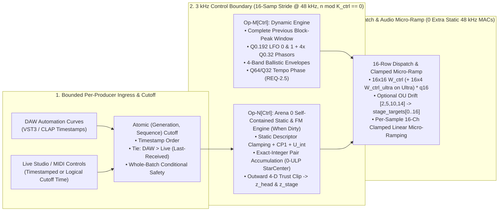

# Self-Similar 3 kHz Dual-Rate Control Plane & Parametric Control Bus

This specification defines the nominal 3 kHz Dual-Rate Control Plane operating on a 16-sample stride at 48 kHz ([sona_architecture.md](../architecture/sona_architecture.md), [REQ-2.4, REQ-2.5, REQ-6.2](../../requirements/system_goals_and_requirements.md)). It establishes self-contained Arena 0 control descriptors, `CP1` sufficient-statistic projections, interaction matrices `U_int`, dispatch weights `W_ctrl`, and static `fp16` `W_ro,0` readouts across the four tier readout blocks.

Keeping base descriptors inside Arena 0 lets Lite tier stripping retain full parametric conditioning (`REQ-5.6`) with zero extra 48 kHz MACs when static and 0-ULP `StarCenter` invariance. The specification also covers outward-checked trust clipping, 16-channel linear micro-ramping, and 20–400 BPM tempo sync across 12 subdivisions ([ADR-0007](../../adr/0007-exact-integer-control-bus-and-tempo-inversion.md), [ADR-0015](../../adr/0015-realtime-host-concurrency-spsc-and-telemetry-seqlock.md), [ADR-0019](../../adr/0019-simd-kernel-architecture-and-realtime-execution-optimizations.md), [ADR-0022](../../adr/0022-sona-state-space-operator-and-webgpu-architecture.md)).

---

## 1. Dual-Rate Execution & Self-Similar Kernel Architecture



### 1.1 `Op-M[Ctrl]`: 3 kHz 4-Lane Symplectic Complex & Ballistic Engine

`r[dsp.ctrl.op-m.ballistic-lfo]`

At each control boundary with decimation stride $K_{\text{ctrl}}(f_{s,\text{eff}}) = \max(8, \mathrm{round}(f_{s,\text{eff}} / 3000.0))$ (16 samples at 48 kHz, 15 samples or 2,940 Hz at 44.1 kHz) and tick ratio $\rho_{\text{ctrl}} = \frac{48000 \cdot K_{\text{ctrl}}(f_{s,\text{eff}})}{16 \cdot f_{s,\text{eff}}}$, `Op-M[Ctrl]` finalizes the preceding window before applying new control batches.

Over the completed block, the 4-band envelope detector gathers rectified peaks $|x_b[k]| = \max_{0 \le m < K_{\text{ctrl}}} |x_b[K_{\text{ctrl}}k + m]|$ across Low, Mid, High, and Aux Key bands:

$$e_b[k] = \alpha_b[k] e_b[k-1] + (1 - \alpha_b[k]) |x_b[k]|, \qquad \alpha_b[k] = \mathrm{select}\big(|x_b[k]| > e_b[k-1],\ \alpha_{\text{att},b},\ \alpha_{\text{rel},b}\big)$$

Simultaneously, the two `Q0.192` quadrature LFO accumulators step by the prior window's increment and project their top 32 bits through the contractive rotor ([op_m_modal_kautz.md §1.2](op_m_modal_kautz.md#12-contractive-finite-precision-rotor)) alongside the 4-lane `Q0.32` crossbar phasors (0.05 Hz–20 kHz). Zero increments freeze oscillator state bit-for-bit, and the control bus caches the prior frequency word and `Q0.192` increment per LFO to skip phase-increment recomputation whenever frequency words stay unchanged ([ADR-0019](../../adr/0019-simd-kernel-architecture-and-realtime-execution-optimizations.md)).

#### 1.1.1 Single-Rate-Change Window Retiming

`r[dsp.ctrl.op-m.rate-retime]`

On an effective sample-rate transition from $(f_o, K_o)$ to $(f_n, K_n)$ after $c \in \lbrace 0, \dots, K_o - 1 \rbrace$ old-rate samples, the engine preserves partial peaks, LFO phase, and envelope states, closing the mixed window after $d = \mathrm{round}((K_o - c)K_n / K_o)$ new-rate samples with total span $\Delta t = c/f_o + d/f_n$.

#### 1.1.2 Host Automation Timing

`r[dsp.ctrl.op-m.timing]`

Host parameter events follow strict sample-accurate ordering rules across DAW automation, live Studio updates, and MIDI queues:

1. Boundary eligibility: updates timestamped at $n = k K_{\text{ctrl}}$ apply at boundary $k$, while updates in $(k K_{\text{ctrl}}, (k+1)K_{\text{ctrl}}]$ apply at boundary $k+1$ (at most 0.3125 ms latency at 48 kHz).
2. Continuous curves: piecewise-linear host curves (`VST3 IParamValueQueue`) reconstruct in normalized `[0.0, 1.0]` space before mapping to physical ranges.
3. Timestamp precedence: at identical timestamps on one control, DAW automation overrides live Studio/MIDI requests, while ties between live sources favor the most recently accepted request.
4. Late, stale, and untimestamped arrivals: late requests check `(timestamp, source_priority, receipt_order, sub_ordinal)` to skip superseded values; stale presets reject atomically; untimestamped requests lock the next boundary timestamp.

#### 1.1.3 Bounded Per-Producer Ingress & 3-Lane SPSC Control Queue

`r[dsp.ctrl.op-m.spsc-ingress]`

Preallocated single-producer single-consumer queues linearize acceptance via one sequentially consistent `u64` atomic combining a 48-bit generation tag and 16-bit sequence index (< 65,536 slots). In the 64-byte-aligned lock-free SPSC queue ([ADR-0015](../../adr/0015-realtime-host-concurrency-spsc-and-telemetry-seqlock.md)), the producer endpoint validates bounds in an accepted-state shadow table before publishing across three atomic lanes drained by the audio-thread consumer at sub-block entry in deterministic epoch order (`Lane 3` fallback latch -> `Lane 2` 64-slot command ring -> `Lane 1` 32-slot coalescing mailbox).

---

### 1.2 `Op-N[Ctrl]`: 3 kHz Algebraic Polynomial, Hysteresis & `O(1)` Sufficient-Statistic Engine

`r[dsp.ctrl.op-n.engine]`

At every control boundary, `Op-N[Ctrl]` builds 3-D node-anchored Newton/Lobatto basis vectors $\boldsymbol{\psi}_p[k] \in \mathbb{R}^3$, while `Op-M[Ctrl]` applies Chebyshev $T_1..T_4$ waveshaping to LFO cosines. Exact integer accumulators form rank-4 or rank-8 FM interactions over $z_p[k] = \mathbf{w}_{\text{proj},p}^\top \boldsymbol{\psi}_p(u_p[k])$ and clip each 4-D block with smallest positive normal `f32` regularization constant $\epsilon = 2^{-126}$ (single-precision bit pattern `0x0080_0000`):

$$\rho^2 = \Vert\mathbf{z}\Vert_2^2, \qquad \mathbf{z} \leftarrow \mathbf{z} \cdot \min\left(1.0,\ \frac{\rho_{\max}}{\sqrt{\rho^2 + \epsilon}}\right)$$

#### 1.2.1 Outward-Checked Trust-Region Clip

`r[dsp.ctrl.op-n.trust-clip]`

To preserve exact tier stripping, runtime applies outward-checked 4-D trust-region clipping independently to each 4-D base and Ultra delta block (`z_head[0..4]`, `z_head_ultra[0..4]`, `z_mod[0..4]`, and `z_mod_ultra[0..4]`) instead of coupling the 8-D norm.

Bit-level widening converts `f32` bit patterns (normalizing subnormals via `p + 874` shift) into `f64` bits free of host FTZ/DAZ interference, and rounds back to `f32` ties-to-even bits.

Outward-rounded verification (`nextup` via bit increment on positive `f64`) forms upper energy bound $S = \mathrm{add}\text{-}\mathrm{up}(\epsilon, \sum_i x_i^2)$ with $\epsilon = 2^{-126}$ and target squared radius $R^2 = \rho_{\max}^2$. A scale $t \in [0, 1]$ with rounded outputs $v_i = \mathrm{RN}_{32}(x_i t)$ passes only when both $\mathrm{mul}\text{-}\mathrm{up}(\mathrm{mul}\text{-}\mathrm{up}(t, t), S) \le R^2$ and $\sum_i v_i^2 \le R^2$.

Six `f64` Newton steps seeded from $y_0 = 2^{-\lfloor (E_s + 2)/2 \rfloor}$, where $E_s = \lfloor \log_2 S \rfloor$ is the unbiased IEEE-754 binary64 exponent of $S$, yield fast candidate $t_{\text{fast}} = \min(1 - 2^{-20}, \rho_{\max} y_6 (1 - 2^{-20}))$, falling back to 32 bisection steps on boundary cases (`rel_err < 1.185e-6 * rho_max`).

#### 1.2.2 Static-Control Basis Skip, 0-ULP `StarCenter` & Interior Trust-Ball Fast Exit

`r[dsp.ctrl.op-n.static-and-interior-fastpath]`

Whenever `is_dirty == false` at a 3 kHz tick, the control bus skips static control-basis evaluation and keeps cached `z_head`, `z_stage`, `ctrl_basis_4`, and `W_ro,0` vectors intact (`REQ-6.1`, [ADR-0019](../../adr/0019-simd-kernel-architecture-and-realtime-execution-optimizations.md)).

At the `StarCenter` anchor, contributor terms vanish to exact +0.0, ensuring 0-ULP equivalence across tiers and after Lite tier stripping. During outward 4-D trust-region clipping, finite vectors satisfying $\sum_{i=0}^3 z_i^2 + 10^{-9} < \rho_{\max}^2$ with $\rho_{\max} > 0$ return unmodified without iteration.

---

## 2. User-Definable Parametric Controls (`Range` & `Switch`)

### 2.1 Fixed Declared-Range Coordinate System & Safe-Interval Clamping

`r[dsp.ctrl.range.normalize-clamp]`

Ordered control clamping and normalization evaluates discrete switches (`ctrl_kind == 1`) before dependent continuous controls (`ctrl_kind == 0`) with `active_options_mask` fallback, sanitizing `NaN` via `clamp(default_val, eff_min, eff_max)` before normalizing against declared endpoints $x_{\min,p} < x_{\max,p}$:

$$u_p = \mathrm{clamp}\left(2.0 \frac{x_p - x_{\min,p}}{x_{\max,p} - x_{\min,p}} - 1.0,\ -1.0,\ +1.0\right)$$

To avoid subtraction cancellation on narrow intervals such as $2^{30}$ to $2^{30} + 128$, cold setup computes $d = x_{\max,p} - x_{\min,p}$ and $r = 1/d$ in `binary64` and stores `(scale_norm, offset_norm)` inside the Control Clamp Descriptor, evaluating `RN32(clamp(x_clamped * scale_norm + offset_norm, -1.0, 1.0))` (`error < 2^-24`) and setting `was_clamped` if inputs are non-finite or differ by over `1e-6`.

#### 2.1.1 Binary32 Physical-Coordinate Bounds

`r[dsp.ctrl.range.f32-rank-bounds]`

Cold preparation intersects signed `f64` bounds onto the admissible ordered `f32` physical knob rank space (4,278,190,079 values with gradual underflow or 4,261,412,865 under FTZ/DAZ, mapping signed zeros to +0.0) using at most 32 binary-search comparisons on `[L, U - 1]` and snapping out-of-range finite requests inward toward zero.

---

### 2.2 Cardinality-Bounded Node-Anchored Newton/Lobatto Basis

`r[dsp.ctrl.basis.lobatto]`

For $U_p$ distinct observed normalized coordinates and active degree $K_p = \min(\max(U_p - 1, 0), 3)$ over anchor nodes $a_{p,1}, a_{p,2}, a_{p,3}$ with $a_{p,1}$ pinned to `StarCenter`:

$$\psi_{p,1}(u_p) = u_p - a_{p,1}, \qquad \psi_{p,2}(u_p) = \psi_{p,1}(u_p)(u_p - a_{p,2}), \qquad \psi_{p,3}(u_p) = \psi_{p,2}(u_p)(u_p - a_{p,3})$$

Unused lanes above $K_p$ stay zero, and $K_p = 0$ emits no contributor.

---

### 2.3 `O(1)` Additive Latent Sufficient-Statistic Control Scaling

`r[dsp.ctrl.accum.cp1-scaling]`

$$\hat{y}(\mathbf{u}) = w_0 + \sum_{p=1}^P \mathbf{w}_p^\top \boldsymbol{\psi}_p(u_p) + \frac{1}{2} \sum_{f=1}^R \left[ \left(\sum_{p=1}^P v_{p,f} z_p\right)^2 - \sum_{p=1}^P v_{p,f}^2 z_p^2 \right]$$

All base control descriptors (Control Clamp Descriptors), CP1 slices, `U_int^base`, `W_ctrl^base`, and static `fp16` base matrix `W_ro,0` (Lite VarPro Readout block) reside inside the Arena 0 Lite payload at the cold tail of the hot working set.

Consequently, containers stripped to Lite and `.dnam-prev` previews preserve full control conditioning (`REQ-5.6`) and 0-ULP `StarCenter` equivalence.

```text
+---------------------------------------------------------------------------------------------------+
| SELF-CONTAINED ARENA 0 & ULTRA DELTA 16-D CONTROL ARCHITECTURE (CP1 + fp16 W_readout)             |
+---------------------------------------------------------------------------------------------------+
|  Arena 0 (Lite Payload, Retained by Lite / Full / Pro / Ultra & .dnam-prev):                      |
|    • Control Clamp Descriptors[P] + Static Latent z_ctrl^base in R^8, FM Rank R = 4               |
|    • Per Contributor (k active lanes): W_main[8,k] + w_proj[k] + v[4] = 4(9k + 4) B               |
|    • Inline Dir & Matrices: cp1_dir[28] (inline CP1 dir: u16le count<=8 + u16le flags=0           |
|      + 8x[ctrl_idx, (ctrl_kind<<4)|lanes, aux]) + U_int^base[8,4] (128 B) + W_ctrl[16,16]        |
|      (1,024 B) + static fp16 W_ro,0 & stage_latent_mods_fp16[0..96]                               |
+---------------------------------------------------------------------------------------------------+
|  Arena 1..2 (Full / Pro Deltas):                                                                  |
|    • Incremental fp16 W_readout,Delta projections + Full/Pro Cabinet Prefix Override records       |
+---------------------------------------------------------------------------------------------------+
|  Arena 3 (Ultra Delta, Truncated on Tier Stripping):                                              |
|    • Static Latent Delta z_ctrl,Delta^Ultra in R^8 = [z_head^(4..7), z_stage^(4..7)]^T, R = 8     |
|    • Per Contributor (k active lanes): W_main,Delta[8,k] + v_Delta[4] = 4(8k + 4) B               |
|    • Global Matrices: 3 x U_int,Delta[8,4] (384 B) + W_ctrl_ultra[16,4] (256 B) + W_ro,D          |
+---------------------------------------------------------------------------------------------------+
```

| Tier Slice | Head Coordinates (D_h) | Stage Latents (D_s) | Total Static Dim | FM Rank (R) | Contributor Footprint |
| :--- | :---: | :---: | :---: | :---: | :--- |
| Lite / Full / Pro (Arena 0) | 4 (0..3) | 4 (0..3) | 8 | 4 | `4(9k + 4)` B (124 B at `k = 3`; 52 B switch) |
| Ultra (+ Arena 3 Delta) | 8 (0..7) | 8 (0..7) | 16 | 8 | `+ 4(8k + 4)` B (+112 B at `k = 3`; +48 B switch) |

---

### 2.4 Multi-Option Switch Contributors & Exact-Integer Realization

#### 2.4.1 Multi-Option Switch Contributors & Inline `CP1` Precedence

`r[dsp.ctrl.switch.option-contributors]`

For discrete switch $q$ with reference option `default_val`, each represented non-reference option $o$ becomes an indicator contributor $\psi_{q,o}(\sigma_q) = \mathbf{1}(\sigma_q = o)$ (0.0 at `default_val`) per the [packed control projection profile](../containers/dnam_binary_format.md#packed-control-projection-profile).

Inside the Arena 0 control-bus section (bytes 36..64), the 28-byte `cp1_dir` array encodes the inline CP1 directory (`cp1_dir_count <= 8`, `flags = 0`, entries `[ctrl_idx, (ctrl_kind << 4) | lanes, aux]` with kinds Range = 0, Switch = 1, BilinearCrossTerm = 2) indexing `cp1_base[576]`.

Region 4 `shared_extent` `"CP1\0"` overrides on overflow (> 8 contributors), while stripped Lite containers fall back directly to `cp1_dir` and `cp1_base`.

#### 2.4.2 Conditional Batch Safety

`r[dsp.ctrl.switch.conditional-batch]`

Preset and batch updates validate all affected controls atomically to keep delay crossfades and disjoint switch ranges stable:

1. Whole-candidate evaluation: partial presets restore signed defaults for omitted controls, apply new assignments, update `[CLAMP-SWITCH]` masks, and intersect active conditional rules ([conditional control rules](../containers/dnam_binary_format.md#conditional-control-rules)).
2. Fade-endpoint protection: defer or reject batches whose new safety bounds invalidate an active delay crossfade endpoint.
3. Disjoint-interval two-path blend: when a switch moves a dependent control between disjoint safe intervals, crossfade isolated old and new paths linearly without cross-feeding states.

#### 2.4.3 Centered ANOVA + Rank-R FM Projection

`r[dsp.ctrl.accum.anova-fm]`

$$\mathbf{z}_{\text{main}} = \sum_{p=0}^{P-1} \mathbf{W}_{\text{main},p} \boldsymbol{\psi}_p(u_p) \in \mathbb{R}^D, \qquad z_p = \mathbf{w}_{\text{proj},p}^\top \boldsymbol{\psi}_p(u_p) \in \mathbb{R}$$
$$\mathbf{s}_{vx} = \sum_{p=0}^{P-1} \mathbf{v}_p z_p \in \mathbb{R}^R, \qquad \mathbf{s}_{v2x2} = \sum_{p=0}^{P-1} (\mathbf{v}_p \odot \mathbf{v}_p) z_p^2 \in \mathbb{R}^R, \qquad \mathbf{z}_{\text{fm}} = \frac{1}{2} (\mathbf{s}_{vx} \odot \mathbf{s}_{vx} - \mathbf{s}_{v2x2}) \in \mathbb{R}^R$$
$$\mathbf{z}_{\text{raw}}^{(0..7)} = \mathbf{z}_{\text{main}}^{(0..7)} + \mathbf{U}_{\text{int}}^{\text{base}}\mathbf{z}_{\text{fm}}^{(0..3)} + \mathbf{U}_{\text{int},\Delta}^{(0..7,4..7)}\mathbf{z}_{\text{fm}}^{(4..7)}, \qquad \mathbf{z}_{\text{raw}}^{(8..15)} = \mathbf{z}_{\text{main}}^{(8..15)} + \mathbf{U}_{\text{int},\Delta}^{(8..15,0..3)}\mathbf{z}_{\text{fm}}^{(0..3)} + \mathbf{U}_{\text{int},\Delta}^{(8..15,4..7)}\mathbf{z}_{\text{fm}}^{(4..7)}$$
$$\mathbf{z}_{\text{ctrl}} = \mathrm{clip}_{\text{trust}}(\mathbf{z}_{\text{raw}})$$

#### 2.4.4 Exact-Integer Sufficient-Statistic Realization (0-ULP `StarCenter`)

`r[dsp.ctrl.accum.exact-int]`

Exact fixed-point accumulators eliminate floating-point drift across repeated closed control sweeps back to `StarCenter`:

- Each finite materialized `f32` contribution decodes to exact integer $a_p = b_p 2^{-149}$ with $|b_p| < 2^{277}$ inside 9-word `S` and 18-word `D` accumulators alongside 9-word main sums.
- Moving contributor $p$ from $b_o$ to $b_n$ updates `D` via two shifted 24-bit products without wide squaring before clipping via §1.2.1:

$$R = S - b_o, \qquad D_{\text{new}} = D - 2 b_o R + 2 b_n R, \qquad S_{\text{new}} = R + b_n, \qquad z_{\text{fm},f} = D_{\text{new}} \cdot 2^{-299}$$

---

## 3. Autonomous Signal-Driven Modulators

`r[dsp.ctrl.modulators.dynamic]`

Every 3 kHz control boundary combines `Op-M[Ctrl]` and `Op-N[Ctrl]` into `q2 = [lfo0_mix, lfo1_mix, lfo0_cos, lfo0_sin]` (where `lfo{j}_mix = T_1 + 0.35 * T_2` from the Chebyshev harmonics of LFO `j` cosine) and `q3 = [e_low, e_mid, e_high, e_aux]`.

At the cold tail of the hot working set, the Arena 0 control-bus section stores LFO, analog drift, envelope, and trust-radius metadata (36 B) followed by `cp1_dir` (28 B), `u_int_base` (128 B), `cp1_base` (576 B), `w_ctrl` (1,024 B), and `rho_head_and_ctrl_tail` (128 B).

Optional analog drift (`live_analog_drift_enabled`) defaults to `false` and automatically disables during `offline_bounce` to guarantee 0-ULP determinism.

### 3.1 Operator Parameter Dispatch Matrix & Sensitivity Laws

`r[dsp.ctrl.dispatch.matrix]`

Every tier evaluates all 16 rows of the 16×16 matrix `W_ctrl` unconditionally over the single shared state vector $\mathbf{q}_{16} = [\mathbf{z}_{\text{head}}[0..4], \mathbf{c}_{\text{basis}}[0..4], \text{lfo}, \mathbf{e}_{\text{env}}[0..4]]$ (plus the 16×4 extension matrix `W_ctrl_ultra` over `qu = z_stage_ultra[0..4]` on Ultra, [dnam_binary_format.md](../containers/dnam_binary_format.md)):

$$\theta_{\text{op}}^{\text{Lite..Pro}}[r] = \sum_{c=0}^{15} W_{\text{ctrl}}[r][c] q_{16}[c], \qquad \theta_{\text{op}}^{\text{Ultra}}[r] = \theta_{\text{op}}^{\text{Lite..Pro}}[r] + \sum_{c=0}^{3} W_{\text{ctrl,ultra}}[r][c] q_{u}[c]$$

Non-recursive send safety is enforced structurally by $S_{\text{ret}\to\text{send}} = 0$ in `S_router` rather than row-partitioned $\mathbf{q}$ vectors, while all 16 `stage_targets` channels read from the unified $\mathbf{q}_{16}$ vector. Per-sample stepping linearly ramps and clamps the 16 target parameters from the 3 kHz target increments across each sub-block (`0..K_ctrl`) per [§3.2](#32-division-free-linear-micro-ramping).

| `stage_targets` Slice | Target Operator | Modulation Parameter & Domain |
| :--- | :--- | :--- |
| `stage_targets[0]` | Core `TPT-SVF` | `svf_g_oct` in `[-3.0, +3.0]` octaves scaling `svf_g` inside `[1e-5, 64.0]` |
| `stage_targets[1]` | Core `TPT-SVF` | `svf_k_delta` in `[-0.8, +1.5]` offsetting `svf_k` inside `[0.0, 8.0]` |
| `stage_targets[2..6]` | Core `PolyADAA1` | `block_adaa_oct[0..4]` in `[-1.5, +1.5]` octaves across cascade blocks (OU drift on 2 and 5) |
| `stage_targets[6..10]` | Core `ParaLRU` | `block_lru_bias[0..4]` in `[-2.0, +2.0]` bias offsets across cascade blocks |
| `stage_targets[10]` | Cabinet Shared Kautz Bank | `kautz_oct_delta` in `[-1.5, +1.5]` octaves shifting modal angles (OU drift on 10) |
| `stage_targets[11]` | Cabinet Shared Kautz Bank | `kautz_damp_delta` in `[-1.5, +1.5]` modulating radial gate and damping |
| `stage_targets[12]` | Spatial Tank (`Op-T`) | `tank_delay_mod` in host samples added per quad delay lane inside `[4.0, max_tau]` |
| `stage_targets[13]` | Spatial Tank (`Op-T`) | `tank_gain_mod` added to `base_g[q]`, clamped to `[0.0, 0x3F7F_BE76]` (`TANK_MAX_G_LIN_BITS`) |
| `stage_targets[14]` | Spatial Tank (`Op-T`) | `tank_psi_delta` in `[-pi, +pi]` rad modulating Givens angle (OU drift on 14) |
| `stage_targets[15]` | Crossbar & Stereo Wet Blend | `crossbar_wet_mod` in `[-1.0, +1.0]` forming `wet_scale = clamp(1.0 + mod, 0.0, 2.0)` |

#### 3.1.1 Gauge-Invariant `z_stage` Operator Sensitivity & Static `W_ro,0` Readout Laws

`r[dsp.ctrl.dispatch.modulation-laws]`

At 3 kHz ticks, the control bus updates all 16 targets without division, square roots, or static-mode 48 kHz MACs while keeping `SO(4)` buyer-watermark invariance. Specifically, `Q_buyer` rotates only `z_head[0..4]`, whereas `z_stage[0..D_s]` spanning `ctrl_basis_4[0..4]` plus `z_stage_ultra[0..4]` remains unrotated.

Each tier VarPro Readout block (paired with its Cabinet Prefix Override record) stores one static `fp16` base matrix `W_ro,0` (16×12 to 40×12 across tiers) unpacked directly into pre-cabinet and direct accumulators, while all `stage_latent_*` tables index unrotated `z_stage`.

Inside the Lite VarPro Readout section, `stage_latent_mods_fp16` spans 96 words: slices `[0..80]` open with `default_knobs[8]` (0.5 macro defaults for standalone Arena 0 audit inspection; additive `z_stage` deltas vanish at StarCenter) followed by global sensitivities and Lite..Pro `[4][4]` block scales, while `[80..96]` stores Lite's `op_p_to_group[0..4][0..4]`.

Indices 8..48 store global sensitivity vectors `w_svf_g_oct`, `w_svf_k_delta`, `w_kautz_oct`, `w_kautz_damp`, and `w_tank_psi`, combining with `stage_targets` as follows:

| Modulation Law | Exact Combining Equation (`dot_s = sum_{k=0..D_s-1} w[k] * z_stage[k]`) |
| :--- | :--- |
| `svf_g_oct` | `clamp(stage_targets[0] + dot_s(w_svf_g_oct), -3.0, 3.0)` multiplying group `svf_g` inside `[1e-5, 64.0]` |
| `svf_k_delta` | `clamp(stage_targets[1] + dot_s(w_svf_k_delta), -0.8, 1.5)` offsetting group `svf_k` inside `[0.0, 8.0]` |
| `kautz_oct_delta` | `clamp(stage_targets[10] + dot_s(w_kautz_oct), -1.5, 1.5)` driving 3 kHz Kautz modal angle retuning |
| `kautz_damp_delta` | `clamp(stage_targets[11] + dot_s(w_kautz_damp), -1.5, 1.5)` driving radial gate and damping |
| `tank_delay_mod` | Added in host samples per quad lane `delay_lengths[l] + lfo_mod[l] + stage_targets[12]`, clamped `[4.0, max_tau]` |
| `tank_gain_mod` | `quad.g_loop = clamp(base_tank_g_loop[q] + stage_targets[13], 0.0, 0x3F7F_BE76)` per active quad `q` |
| `tank_psi_delta` | `clamp(stage_targets[14] + dot_s(w_tank_psi), -pi, pi)` slewed at `<= 0.25` rad/tick for quad Givens `psi` |
| `crossbar_wet_mod` | `wet_scale = clamp(1.0 + clamp(stage_targets[15], -1.0, 1.0), 0.0, 2.0)` scaling `op_p_gain`, `op_t_gain`, `ssb_l`, `ssb_r`, and `quad.wet_mix = fp16(base_tank_wet_mix[q] * wet_scale)` |

For per-block `ADAA` and `ParaLRU` scaling across targets `[2..10]`, Lite..Pro (`D_s = 4`) read `stage_latent_mods_fp16[48..80]` (`w_adaa_drive_scale[4][4]` and `w_lru_bias_shift[4][4]` shared across groups inside block $b$ without per-group expansion):

$$\theta_{\mathrm{adaa}}[b] = \mathrm{clamp}\left(\theta_{\mathrm{op}}[2 + b] + \sum_{k=0}^{3} w_{\text{adaa}}[k][b] z_{\text{stage}}[k], -1.5, +1.5\right)$$
$$\theta_{\mathrm{lru}}[b] = \mathrm{clamp}\left(\theta_{\mathrm{op}}[6 + b] + \sum_{k=0}^{3} w_{\text{lru}}[k][b] z_{\text{stage}}[k], -2.0, +2.0\right)$$

On Ultra (`D_s = 8`, Arena 3 present), the Arena 3 control-bus delta field `stage_latent_ctrl_ultra_fp16[0..256]` (`w_adaa_drive_scale[8][10]` and `w_lru_bias_shift[8][10]`, with `[160..256]` zeroed) supersedes Arena 0's `[4][4]` slice to emit per-group laws across all 10 SONA groups `g`:

$$\theta_{\mathrm{adaa}}[g] = \mathrm{clamp}\left(\theta_{\mathrm{op}}[2 + \mathrm{block}(g)] + \sum_{k=0}^{7} w_{\text{adaa}}[k][g] z_{\text{stage}}[k], -1.5, +1.5\right)$$
$$\theta_{\mathrm{lru}}[g] = \mathrm{clamp}\left(\theta_{\mathrm{op}}[6 + \mathrm{block}(g)] + \sum_{k=0}^{7} w_{\text{lru}}[k][g] z_{\text{stage}}[k], -2.0, +2.0\right)$$

When `SONA_META_CORE_MODS_PRESENT` (`0x0000_0200`) is active on Ultra, the Arena 3 Ultra core delta field `stage_latent_core_mods_fp16[0..1024]` (`[8][128]` row-major, columns 120..128 reserved `0x0000`) adds per-lane deltas across lanes `l = 0..40`.

For each lane `l`, `g_oct_lane[l] = clamp(svf_g_oct + sum_k core_mods[k][l]*z_stage[k], -3.0, +3.0)` scales `svf_g[l]` inside `[1e-5, 64.0]`, `svf_k_eff[l] = clamp(svf_k[l] + svf_k_delta + sum_k core_mods[k][40+l]*z_stage[k], 0.0, 8.0)`, and `wf_mix_eff[l] = clamp(wavefolder_mix[l] + sum_k core_mods[k][80+l]*z_stage[k], 0.0, 1.0)`. When `SONA_META_CORE_MODS_PRESENT == 0`, these 1,024 words are skipped.

---

### 3.2 Division-Free Linear Micro-Ramping

`r[dsp.ctrl.dispatch.micro-ramp]`

Using cold-prepared $\alpha_{\text{ramp}}(f_{s,\text{eff}}) = 1.0 / K_{\text{ctrl}}(f_{s,\text{eff}})$ (0.0625 at 48 kHz), every audio sample advances across all 16 channels:

$$\Delta\boldsymbol{\theta}[k] = \big(\boldsymbol{\theta}_{\text{op}}[k+1] - \boldsymbol{\theta}_{\text{op}}[k]\big) \times \alpha_{\text{ramp}}(f_{s,\text{eff}}), \qquad \boldsymbol{\theta}_{\text{op}}[n] = \boldsymbol{\theta}_{\text{op}}[n-1] + \Delta\boldsymbol{\theta}[k]$$

Each ramped value clamps within `[min(theta[k], theta[k+1]), max(theta[k], theta[k+1])]` to block overshoot, snapping strictly to `theta_op[k+1]` when `sample_idx + 1 >= K_ctrl`, alongside un-clamped 16-channel accumulator stepping.

#### 3.2.1 Sparse `W_ctrl` Column Skipping & Full 16-Channel Micro-Ramping

`r[dsp.ctrl.dispatch.sparse-and-active-ramps]`

During tank modulation evaluation, the control bus always accumulates dynamic blocks $\mathbf{q}_2, \mathbf{q}_3$, skips $\mathbf{q}_0, \mathbf{q}_1$ FMA accumulation when all elements of `z_head` and `ctrl_basis_4` are exact 0.0, skips `W_ctrl_ultra` when Ultra is inactive or `z_stage_ultra` is all exact 0.0, adds analog drift only at `[2, 5, 10, 14]`, and ramps all 16 channels via four 4-lane 32-bit float SIMD vectors ([ADR-0019](../../adr/0019-simd-kernel-architecture-and-realtime-execution-optimizations.md)).

---

## 4. Control-Space Calibration: Order-Statistic Optimal Transport & Physical Variance Gating

`r[dsp.ctrl.calib.variance-gating]`

Before Epoch 1, optimal-transport sorting aligns delay times $\tau_{0,m}$ and modal frequencies across captures to avoid double-echo crossfading, while physical variance gating locks $u_p \to \tau_{0,m}$ and $u_p \to f_{\text{lfo},j}$ weights to 0.0 whenever stem variance falls below 0.2 samples, using threshold $\tau_{\text{var}} = 0.5$, before downstream dispatch:

| Calibration Role (`role`) | Control Type | Physical & Audit Behavior |
| :--- | :---: | :--- |
| `"delay_time_ms"` | `range` | Maps `[v_min, v_mid, v_max]` delay anchors in ms for 12-subdivision Tempo Sync |
| `"lfo_rate_hz"` | `range` | Maps modulation oscillator rate in Hz for Tempo Sync |
| `"feedback"` / `"mix"` / `"crossover_hz"` | `range` | Loop feedback, dry/wet blend, or crossover cutoff |
| `"stereo_mode"` / `"stereo_width"` | `switch` / `range` | Stereo routing selector or width calibration |
| `"freeze_latch"` | `switch` / `range` | Captured freeze latch (0-ULP write lock; unobserved options clamped) |
| `"grain_size_ms"` / `"grain_pitch_semitones"` / `"grain_spray"` | `range` | Granular duration, ±24 st pitch shift, and spray jitter |

---

## 5. Strict Zero-`FDIV`, Zero-`FSQRT` & Zero Standard-Math-Library Verification

### 5.1 Pitch-Ratio and Time-Warp Profile

`r[dsp.ctrl.math.pitch-profile]`

For finite `f32` semitone shift $p \in [-24, 24]$, widen $p$ to `f64`, multiply by `0x3FAD9303FEA2F7EA` equal to $\ln(2)/12$, and evaluate degree-14 Horner Taylor series $d = x \sum_{j=1}^{14} x^{j-1}/j!$ in `RNE` `f64`:

$$R = \mathrm{RNE}_{f32}(1 + d), \qquad \nu = \mathrm{RNE}_{f32}(-d)$$

Computing $\nu$ directly from $-d$ rather than $1 - R$ preserves tiny warps (`ratio_err < 6.2e-8`, `warp_err < 1.2e-7`, exact at -24, -12, 0, +12, +24 st).

### 5.2 Monotone `f32` Log-Envelope Lookup Profile

`r[dsp.ctrl.math.log2-lut]`

The 129-entry read-only `f32` lookup table $T_j = \mathrm{RNE}_{f32}(\log_2(1 + j/128))$ (516 B, SHA-256 `4d0d7c0ec194dd9d761bfe2982ca4847001f333c58a3f12f423ed2053de3a5f1`) decomposes positive finite $x = 2^E(1 + m/2^{23})$ with subnormal normalization into $j = m \gg 16$ and $a = \mathrm{f32}(m \mathbin{\mathrm{and}} \text{0xFFFF}) \cdot 2^{-16}$ (`error < 1.9e-5`):

$$d = \mathrm{RNE}_{f32}(T_{j+1} - T_j), \qquad p = \min\Big(T_{j+1},\ \mathrm{RNE}_{f32}\big(T_j + \mathrm{RNE}_{f32}(a d)\big)\Big), \qquad \widehat{\log_2(x)} = \mathrm{RNE}_{f32}(E + p)$$

---

## 6. Architectural Memory & Compute Ledgers

`r[dsp.ctrl.ledger.memory-compute]`

```text
+---------------------------------------------------------------------------------------------------+
| CONTROL BUS ARENA 0 SELF-CONTAINED PAYLOAD & SUFFICIENT-STATISTIC LEDGER                          |
+---------------------------------------------------------------------------------------------------+
|  Arena 0 (Lite Payload, Retained by Lite..Ultra & .dnam-prev; Cold Tail of Hot Working Set):      |
|    • Control Clamp Descriptors[P], cp1_dir[28] (inline CP1 dir <= 8 entries; shared_extent        |
|      "CP1\0" precedence on overflow), U_int^base 128 B, W_ctrl 16x16 (1,024 B)                  |
|    • Static fp16 W_ro,0 + stage_latent_mods_fp16[0..96]; 0 extra 48 kHz MACs when static        |
|  Arena 1..2 (Full / Pro Deltas): Incremental fp16 W_readout,Delta + Full/Pro Prefix Overrides     |
|  Arena 3 (Ultra Delta): Per contributor 4(8k + 4) B | 3xU_int,D 384 B | W_ctrl_ultra 256B | W_ro,D  |
|  Exact-Integer Accumulator: 9-word S + 18-word D per factor (108 B/factor) + 9-word main sums     |
+---------------------------------------------------------------------------------------------------+
```

---

## 7. Host, MIDI, and Tap Tempo Synchronization (`REQ-2.5`)

`r[dsp.tempo.subdivisions]`

Tempo sync locks Op-T delay taps, granular windows, and Op-M LFOs (including Top-of-Frame 4-lane `Q0.32` carriers) across 20–400 BPM (144,000 down to 7,200 samples per quarter note at 48 kHz; 9 s dotted-half to 25 ms `1/16T`) for DAW host transport, 24 PPQN MIDI clock (`0xF8`), and tap tempo over all 12 subdivisions:

| Subdivision Index | 0 | 1 | 2 | 3 | 4 | 5 | 6 | 7 | 8 | 9 | 10 | 11 |
| :--- | :---: | :---: | :---: | :---: | :---: | :---: | :---: | :---: | :---: | :---: | :---: | :---: |
| Musical Subdivision | 1/2. | 1/2 | 1/2T | 1/4. | 1/4 | 1/4T | 1/8. | 1/8 | 1/8T | 1/16. | 1/16 | 1/16T |
| Period Ratio `r_sub` | 3/1 | 2/1 | 4/3 | 3/2 | 1/1 | 2/3 | 3/4 | 1/2 | 1/3 | 3/8 | 1/4 | 1/6 |
| Rate Ratio `r_sub^-1` | 1/3 | 1/2 | 3/4 | 2/3 | 1/1 | 3/2 | 4/3 | 2/1 | 3/1 | 8/3 | 4/1 | 6/1 |

### 7.1 Division-Free `Q32` Subdivision Target & `Q64` Beat Accumulator

`r[dsp.tempo.q64-q32-phase]`

A `u64` fractional beat, `u64` increment, and modulo-12 beat counter $N \bmod 12$ (`beat_mod12`) keep 24-hour drift under 4 ps at 120 BPM. For subdivision period ratio $(a_s, b_s)$ from `CANONICAL_SUBDIVISION_RATIOS` (`r_sub = a_s / b_s`), $Q = 2^{32}$, within-beat fraction $F = \lfloor f Q \rfloor$ (`within_beat_q32`), and phase offset $O = \lfloor \mathrm{frac}(\phi_0) Q \rfloor$:

$$q = \left(\left\lfloor \frac{b_s((N \bmod a_s)Q + F)}{a_s} \right\rfloor + O\right) \bmod Q$$

With `u64` product $P_{\text{u64}} = b_s ((N \bmod a_s) Q + F)$, low word $\ell = P_{\text{u64}} \mathbin{\mathrm{and}} \mathrm{0xFFFFFFFF}$, and remainder $r = (P_{\text{u64}} \gg 32) \bmod 3$ (`REM3_TABLE_24`), factors $a_s = 3$ avoid division via $p = r \cdot \mathtt{0x55555555} + (((\ell + r) \cdot \mathtt{0xAAAAAAAB}) \gg 33)$. Splitting quadrant `j = q >> 30` and residual `n = q & 0x3FFFFFFF` multiplies by single-precision bit pattern `0x30C9_0FDB`, which approximates $2\pi / Q$, for the contractive rotor (`err < 4e-7` rad).

### 7.2 Rate-Independent `Q64` Host-Frame Timebase & Event-Rate-Aware Tracker

`r[dsp.tempo.event-tracker]`

MIDI clock and tap arrivals carry timestamps from the monotonic `Q64` seconds counter with per-frame increment $\Delta_h = \mathrm{round}_{\text{even}}(2^{64}/f_h)$ and subframe steps $\mathrm{round}_{\text{even}}(j\Delta_h/4)$, tracking event period $P_p$ and event time $\hat t_p$ via rate-aware gain $g_p = 1 - e^{-P_{p-1}/\tau}$:

$$P_p = P_{p-1} + g_p\big((t_p - t_{p-1}) - P_{p-1}\big), \qquad \hat t_p = \hat t_{p-1} + P_{p-1} + g_p\big(t_p - \hat t_{p-1} - P_{p-1}\big)$$

### 7.3 Reachable Physical `f32` Calibration Inversion & Multi-Range Selection

`r[dsp.tempo.physical-inversion]`

Inversion searches the reachable `f32` physical rank range `[L, U - 1]` of each monotone switch option via 32-step binary search on $v(u) = v_{\mathrm{mid}} + c_1 u + c_2 u^2$ with ties toward lower values and optional $2^k$ octave folding.

### 7.4 Co-Prime FDN Modal Ratios (`alpha_m = P_m / P_ref`)

`r[dsp.tempo.coprime-fdn]`

All 144 `(idx_L, idx_R)` stereo subdivision pairs retain distinct coprime delay ratios (`Theorem 7.3`).

### 7.5 Transport Start and In-Play Jump Policy

`r[dsp.tempo.transport-jump]`

| Transport Event | Required Phase & Delay Behavior |
| :--- | :--- |
| Start from Stop / Bounce Start | Initialize synchronized generators to `psi_s(P_0)` before frame 0 |
| `SmoothRelock` (Default Jump) | Apply shortest-arc phase slew (negative half-cycle tie) while keeping Op-T delay histories continuous |
| `ImmediatePhaseLock` | Snap generator phase to `psi_s(P_0)` at control boundary and micro-ramp via [§3.2](#32-division-free-linear-micro-ramping) |
