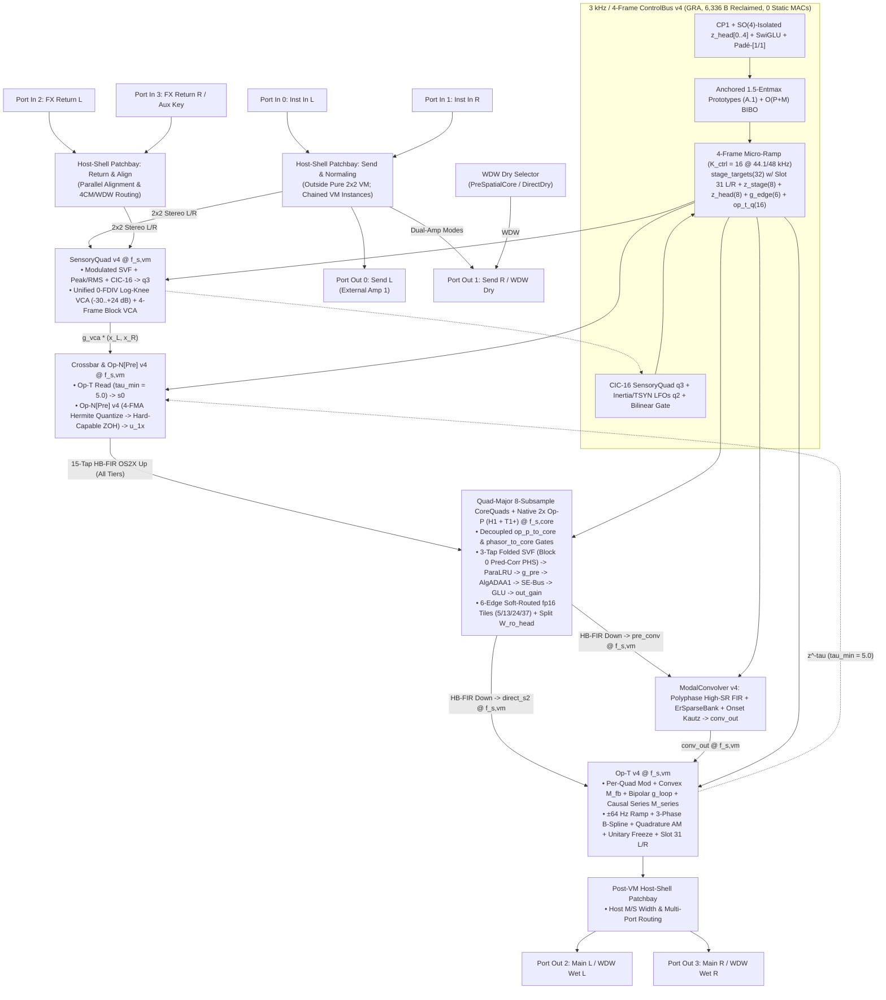

# Pure 2×2 VM Boundary, `SensoryQuad`, Causal Crossbar, SONA Signal Graph & ZOH Rate Adaptation

This specification defines the clean boundary between the outer Host-Shell 8-Port Patchbay (4CM, WDW, parallel latency alignment, M/S output width) and the SONA v4.0 pure 2-in / 2-out DSP virtual machine: SensoryQuad v4 (Unified 0-FDIV Log-Knee VCA, modulated SVF, Peak/RMS, 16-sample CIC, 4-frame block VCA), Top-of-Frame Causal Operator Crossbar (`Op-P` native 2× H1 + T1+ with decoupled gates, `Op-N[Pre]` v4, 4× Q0.32 phasors, Op-T reads), all-tier 2× 15-tap linear-phase HB-FIR OS2X, and the Quad-Major 8-subsample `CoreQuad` stack inside a cache-compact active-hot working set (4,432 B Lite 2× true-hot L1D, zero cold spills).

It also specifies ModalConvolver v4 (ErSparseBank MIMO early taps, reclaimed onset Kautz, 2-basis FIR morph, Kaiser polyphase high-SR FIR), Op-T v4 (QuadCtrlRoute, convex `M_fb`, bipolar `g_loop`, `M_series`, ±64 Hz ramp, 3-phase B-spline, quadrature AM, unitary freeze), split `W_ro_head` readout, ControlBus v4 (`GRA`), and continuous-time Zero-Order Hold (ZOH) rate adaptation across 44.1–384 kHz.

For architectural background and derivations, see [sona_architecture.md](../architecture/sona_architecture.md), [REQ-7.4](../../requirements/system_goals_and_requirements.md), [ADR-0006](../../adr/0006-model-declared-delays-and-tank-feedback-guard.md), [ADR-0019](../../adr/0019-simd-kernel-architecture-and-realtime-execution-optimizations.md), [ADR-0022](../../adr/0022-sona-state-space-operator-and-webgpu-architecture.md), [ADR-0024](../../adr/0024-sona-v4-kernel-hb-fir-perimeter-and-control-bus-gra.md), and [ADR-0025](../../adr/0025-unified-runtime-and-non-causal-trainer-attention.md).

---

## 1. Signal Graph Overview

`r[dsp.router.signal-flow]`



SONA v4.0 executes a two-rate pure 2-in / 2-out virtual machine loop separating perimeter stages at `f_{s,vm}` from all-tier 2× oversampled core stages at `f_{s,core}`, wrapped externally by the host shell's multi-port patchbay and stereo M/S width control. In live execution across 44.1–384 kHz, `f_{s,vm} = f_{s,host}`; in 4× offline bounce, an outer polyphase oversampler sets `f_{s,vm} = 4 * f_{s,host}` and disables internal `OS2X`.

Rate ratios follow `rho_vm = 48_000.0 / f_{s,vm}` and 4-frame aligned `K_ctrl(f_{s,vm}) = 4 * max(2, round(f_{s,vm} / 12_000.0))` (`K_ctrl(44,100) = 16`, `gcd(16, 4) = 4`). All four tiers run native 2× 15-tap symmetric linear-phase HB-FIR oversampling iff `os2x_active = !offline_bounce && (2.0 * f_{s,vm} <= 384_000.0)`, setting `f_{s,core} = 2 * f_{s,vm}` when active (else `f_{s,vm}`) and `rho_core = 48_000.0 / f_{s,core}`. Every VM frame executes strictly in the order below:

| Step | Stage & Rate | Exact Per-VM-Frame Operation |
| :---: | :--- | :--- |
| 1 | `ControlBus` v4 (`f_{s,vm}`) | Run `GRA` tick when active (`K_ctrl = 16` at 44.1/48 kHz, zero static MACs when idle), latching CIC-16 `q3` and inertia/TSYN `q2`, and advance `[stage_targets(32), z_stage(8), z_head(8), g_edge(6), op_t_q(16)]` once per 4-frame microchunk (`alpha_chunk = 0.25`) |
| 2 | `SensoryQuad` v4 (`f_{s,vm}`) | Mix `(x_L, x_R)` via `sense_in_l/r`, step 4-lane modulated `TPT-SVF` (`sense_svf_g_oct`), Peak/RMS + `ParaLRU` -> CIC-16 `e[0..4]`, Unified 0-FDIV Log-Knee VCA (-30..+24 dB), and 4-frame per-block `block_vca_gain[0..4]` |
| 3 | `Op-T` Read (`f_{s,vm}`) | Read Top-of-Frame `Op-T` delays `v_read` at `tau_min = 5.0` VM frames (64-frame inline Quad 0 ring or external ring) |
| 4 | `Op-T` Crossbar Tap (`f_{s,vm}`) | Form `(s0_L, s0_R) = g_vca * (x_L, x_R) + op_t_gain * sum_line(opt_to_lr * v_read)` ahead of `Op-N[Pre]` v4 |
| 5 | `Op-N[Pre]` v4 (`f_{s,vm}`) | Step `quantize -> ZOH`: 4-FMA C¹ Hermite staircase quantizer -> wet blend -> decoupled hard-capable `Q0.32` phase-wrap ZOH (`log2_rho_zoh`, `kappa_h`) -> `u_1x` |
| 6 | `OS2X` Upsample (`f_{s,vm} -> f_{s,core}`) | Upsample `u_1x` 2× across ALL 4 tiers via 15-tap symmetric linear-phase HB-FIR (4 FMAs/samp, 0.000° dispersion) when `os2x_active`, else `u_c = u_1x` |
| 7 | `Op-P` v4 & Quad-Major Core (`f_{s,core}`) | Step native 2× `Op-P` (`H1`, `g_trk` LPF, 8-feat `T1+`, `Q0.32` phasors) with decoupled crossbar gates; run Quad-Major 8-subsample `CoreQuad`s (3-tap SVF / Pred-Corr PHS -> `ParaLRU` -> `g_pre` -> `AlgADAA1` -> `SE-Bus` -> `GLU` -> `out_gain`) + 6-edge `g_edge[0..6]` tiles + split `W_ro_head` |
| 8 | `OS2X` Downsample (`f_{s,core} -> f_{s,vm}`) | Decimate `(pre_conv, direct_s2)` via 15-tap HB-FIR (4 FMAs/samp, exact 7 1×-samp = 0.146 ms delay) when `os2x_active`, else pass through |
| 9 | `ModalConvolver` v4 (`f_{s,vm}`) | Run Kaiser polyphase high-SR FIR, `ErSparseBank` (8/16 MIMO taps on 1,024-samp ring), 2-basis `fp16` morph, and per-bank onset Kautz on `pre_conv` -> `conv_out` |
| 10 | `Op-T` v4 & Output (`f_{s,vm}`) | Feed `x_tank = (direct_s2 + conv_out)` into per-quad `Op-T` v4 (`M_fb`, bipolar `g_loop`, `M_series`, `alpha_sum_fb`, ±64 Hz ramp, 3-phase B-spline, quad AM, shimmer, unitary freeze), apply `slot 31 L/R` stereo diff gain, `mono_out`, 48-fr crossfade, `eff_trim`, and ±1.0e9 clamp |

---

## 2. Outer Host-Shell 8-Port Patchbay, `SensoryQuad` & Pure 2×2 VM Coupling

Multi-port hardware routing (4CM/7CM send/return matrices, `ParallelAlignLine`, `WDW` tapping, and post-VM M/S output width) resides cleanly in the outer host engine shell composing pure 2-in / 2-out VM instances, while per-instance dynamics sensing and stereo coupling run unconditionally inside the VM via `SensoryQuad` and `CoreQuad` Mid/Side projection.

### 2.1 Port Allocation & Physical Signal Roles

`r[dsp.router.ports]`

| Port Identifier | Signal Variable | Physical & Logical Host-Shell Role |
| :--- | :--- | :--- |
| Port In 0 (Inst In L) | `x_inst,L[n]` | Primary mono or Left instrument input into the outer patchbay |
| Port In 1 (Inst In R) | `x_inst,R[n]` | Secondary Right input; normaled to Port In 0 when unplugged |
| Port In 2 (FX Return L) | `x_ret,L[n]` | External amplifier effects return for Amp 1 / Left channel |
| Port In 3 (FX Return R / Aux Key) | `x_ret,R[n]` or `x_aux[n]` | External return for Amp 2 / Right or host sidechain key; normaled to Port In 2 |
| Port Out 0 (Send L) | `y_send,L[n]` | Pre-loop preamp send driving Amp 1 or optional mono WDW send |
| Port Out 1 (Send R / WDW Dry) | `y_send,R[n]` or `y_dry[n]` | Right send in dual-amp rigs or center dry feed in WDW (`PreSpatialCore` / `DirectDry`) |
| Port Out 2 (Main Out L) | `y_out,L[n]` or `y_wet,L[n]` | Main Left output, or wet-only Left in WDW mode |
| Port Out 3 (Main Out R) | `y_out,R[n]` or `y_wet,R[n]` | Main Right output, or wet-only Right in WDW mode |

### 2.2 Host-Shell 4×4 Scattering Matrix & Return-to-Send Isolation

`r[dsp.router.return-to-send-isolation]`

```text
                  [ S_00  S_01 |   0     0   ]   [ S_{inst->send}    0_{2x2}    ]
S_router =        [ S_10  S_11 |   0     0   ] = [                              ]
                  [------------+-------------]   [                              ]
                  [ S_20  S_21 | S_22  S_23  ]   [ S_{inst->down}  S_ret->down  ]
                  [ S_30  S_31 | S_32  S_33  ]
```

$$\mathbf{y}_{\mathrm{send}}[n] = \mathbf{S}_{\mathrm{inst} \to \mathrm{send}} \mathbf{x}_{\mathrm{inst}}[n], \qquad \mathbf{u}_{\mathrm{down}}[n] = \mathbf{S}_{\mathrm{inst} \to \mathrm{down}} \mathbf{x}_{\mathrm{inst}}[n] + \mathbf{S}_{\mathrm{ret} \to \mathrm{down}} \mathbf{x}_{\mathrm{ret, aligned}}[n]$$

Zeroing $\mathbf{S}_{\mathrm{ret} \to \mathrm{send}} \equiv \mathbf{0}_{2 \times 2}$ in the host-shell patchbay guarantees open-loop return ratio $\mathbf{T}_{\mathrm{loop}}(z) = \mathbf{S}_{\mathrm{ret} \to \mathrm{send}} \mathbf{H}_{\mathrm{amp}}(z) \equiv \mathbf{0}_{2 \times 2}$ and $\det(\mathbf{I} - \mathbf{T}_{\mathrm{loop}}(z)) \equiv 1$, eliminating external feedback loops through hardware effects loops while each wrapped VM receives clean stereo `(in_L, in_R)` (`stage_targets[0..32]` fed uniformly by $\mathbf{q}_{16}$; [parametric_control_bus.md §3.1](parametric_control_bus.md#31-operator-parameter-dispatch-matrix--sensitivity-laws)).

### 2.3 Drive-Invariant Voltage-Normalized Mid/Side Coupling (`CoreQuad` & `REQ-7.4`)

`r[dsp.router.mid-side-input]`

To maintain exact 0.00 dB drive-threshold parity between mono (1 → 2) and centered stereo (2 → 2) routing where $x_L = x_R = x$ (`REQ-7.4`), SONA uses voltage-normalized Mid/Side decomposition (`x_mid = 0.5*(L + R)`, `x_side = 0.5*(L - R)`) both at `CoreQuad` input coupling and in post-VM host stereo width:

$$u_{\mathrm{mid}}[n] = \frac{1}{2}\big(u_L[n] + u_R[n]\big), \qquad u_{\mathrm{side}}[n] = \frac{1}{2}\big(u_L[n] - u_R[n]\big), \qquad u_L[n] = u_{\mathrm{mid}}[n] + u_{\mathrm{side}}[n], \qquad u_R[n] = u_{\mathrm{mid}}[n] - u_{\mathrm{side}}[n]$$

Each `CoreQuad` $g$ projects `(u_mid, u_side)` across dual 4-lane weights (`in_mid_weight_fp16`, `in_side_weight_fp16`), guaranteeing exact 0.00 dB parity when `u_side == 0.0` while recovering independent L/R when `w_side == w_mid` or learning full elliptical M/S filtering and M/S saturation directly from data.

### 2.4 Topology-Adaptive Even/Odd SIMD Lane Partitioning

`r[dsp.router.topology-dispatch]`

| Feature | Mono (1 → 1) | Stereo-to-Mono (2 → 1) | Mono-to-Stereo (1 → 2) | True Stereo (2 → 2) |
| :--- | :---: | :---: | :---: | :---: |
| Channel Topology | `1 -> 1` | `2 -> 1` | `1 -> 2` | `2 -> 2` |
| `SensoryQuad`, Crossbar & `CoreQuad`s | Normaled L/R paths & 4×4 coupling retained | Full stereo L/R paths, `w_in_l/r` keying & M/S coupling | Normaled L/R paths & 4×4 coupling retained | Full stereo L/R paths & M/S coupling |
| `ModalConvolver` FIR & Kautz | Both L/R histories & modes advance | Both L/R histories & modes advance | Both L/R histories & modes advance | Both L/R histories & modes advance |
| Output Finalization | Mono fold `0.5*(y_L + y_R)` inside VM | Mono fold `0.5*(y_L + y_R)` inside VM | Stereo output (host-shell M/S width `(y_L, y_R)`) | Stereo output (host-shell M/S width `(y_L, y_R)`) |

### 2.5 Stereo-Linked Dynamics Imaging (`SensoryQuad` VCA & `ParaLRU` Link)

`r[dsp.router.stereo-link-detector]`

To prevent stereo image drift (REQ-7.4), both the learned SensoryQuad pre-core input VCA `g_in[n]` (shared scalar gain applied uniformly to `(x_L, x_R)`) and audio-rate CoreQuad ParaLRU stereo linking, where $\lambda_i \in [0, 1]$ mixes channel state toward `v_mid = 0.5*(v_L + v_R)` inside `sag_gain` and `lru_bias_drive`, eliminate unlinked dual-mono pan shifts without fixed peak-detector constants:

$$e_{\mathrm{link}}[n] = \max\big(|x_L[n]|, |x_R[n]|\big), \qquad e_{\mathrm{key}}[n] = |x_{\mathrm{aux}}[n]|, \qquad v_{\mathrm{eff},c,i}[n] = v_{c,i}[n] + \lambda_i\big(v_{\mathrm{mid},i}[n] - v_{c,i}[n]\big)$$

With shared positive gain $G[n] > 0$ (`g_in[n]` on normal binary32 inputs with roundoff $u = 2^{-24}$ ), stereo image angle drift obeys:

$$\Vert\widehat{\mathbf{y}} - G\mathbf{x}\Vert_2 \le u\Vert G\mathbf{x}\Vert_2, \qquad |\sin(\Delta\theta)| \le \frac{u}{1 - u}, \qquad |\Delta\theta| < 0.00000342^\circ$$

### 2.6 `SensoryQuad` (`Op-M/N[Sense]`) Sensing Bank & Input VCA

`r[dsp.router.ballistic-envelope-bank]`

At input, `SensoryQuad` v4 runs four modulated sensing lanes at $f_{s,\mathrm{vm}}$ using 2×2 `ZDF` `TPT-SVF` (`sense_svf_g_oct`), Peak/RMS dual-branch rectification, contractive `ParaLRU`, and 16-sample CIC accumulation inside 64 B hot state (`env_state` + `cic_acc` + SVF + LRU), feeding Unified 0-FDIV Log-Knee VCA and 4-frame `block_vca_gain[0..4]`:

| Step | SensoryQuad v4 Operation (`k` in 0..4 @ `f_{s,vm}`) | Clamped Wire Domain & ZOH Law |
| :--- | :--- | :--- |
| 1. Stereo Key Mix | `u_sense,k = w_in_L,k * x_L + w_in_R,k * x_R` | `sense_in_l_fp16`, `sense_in_r_fp16` in `[-4.0, 4.0]` (0.0 default; expresses Mid, Side, or R-channel aux key with zero mode bits) |
| 2. Modulated `TPT-SVF` | `g_k = g0,k * exp2(clamp(mod_k, -4, 4))`, `s_k = c_lp*LP + c_bp*BP + c_hp*HP` | `sense_svf_g` `[1e-5, 64.0]` (`rescale_tpt_svf_g_zoh`); `sense_svf_k` `[0.0, 8.0]`; `sense_tone_{lp,bp,hp}` `[-16.0, 16.0]`; `sense_svf_g_oct[0..4]` |
| 3. Peak/RMS + `ParaLRU` | Mix `abs(s_k)` and `s_k^2`, step `ParaLRU`, integrate CIC-16 `cic_acc[0..4]` | `sense_lru_alpha_rel` (`^rho_vm`), `sense_lru_alpha_atk`, `sense_lru_kappa`; CIC-16 normalized via bit-shift/reciprocal at `K_ctrl` tick into `q3` |
| 4. Unified Log-Knee VCA | `g_vca(e) = exp2(clamp(b_makeup - s * max(fast_log2(max(e - theta_lin, 0) + c_knee) - l_scale, 0), -5.0, +4.0))` | Unified 0-FDIV law spanning optical hyperbolic (`s=1, c_knee=1/k`) and power-law VCA (`theta_lin=0, c_knee=eps`) across `[-30 dB, +24 dB]` (`0-ULP 1.0` when idle); per-block `block_vca_gain[0..4]` updated once per 4 frames |

$$g_{\mathrm{vca}}(e) = \exp_2\Big(\mathrm{clamp}\big(b_{\mathrm{makeup}} - s \cdot \max(\mathrm{fastLog2}(\max(e - \theta_{\mathrm{lin}},\ 0) + c_{\mathrm{knee}}) - \ell_{\mathrm{scale}},\ 0),\ -5.0,\ +4.0\big)\Big)$$

Crossbar `SONA_META_SENSORY_QUAD` decodes all `SensoryQuad` v4 wire fields unconditionally even when zeroed, because zero weights yield `e_k == 0.0`, `g_vca == 1.0`, `block_vca_gain == 1.0`, and exact 0-ULP identity pass-through. Standalone `ControlBus` invocations without `SensoryQuad` initialize `env_states = [0.0; 4]` deterministically.

### 2.7 Tier-Aware Static & Dynamic Modulation Routing

`r[dsp.router.modulation-bus]`

$$\mathbf{z}_{\mathrm{in}}[k] = \big[\mathbf{z}_{\mathrm{ctl}}^\top,\ \mathbf{q}_1^\top,\ \mathbf{q}_2^\top,\ \mathbf{q}_3^\top,\ \mathbf{c}_{\mathrm{user}}^\top\big]^\top \in \mathbb{R}^{20}$$

In SONA v4.0, `ControlBus` v4 (`GRA`, 2,048 B arena) replaces the legacy 16×16 static `W_ctrl` + CEXT split with unified gated rational activation (`SwiGLU` + `Padé-[1/1]` + anchored 1.5-Entmax convex hull over `M` user prototypes), producing `[stage_targets(32), z_stage(8), z_head(8), g_edge(6), op_t_q(16)]` ([parametric_control_bus.md §3.1](parametric_control_bus.md#31-operator-parameter-dispatch-matrix--sensitivity-laws)).

Optional Ornstein-Uhlenbeck drift injects bounded thermal wobble into `eff_z_stage = static_z_stage + w_ou * ou_drift_state` whenever `live_analog_drift_enabled && !offline_bounce`, and `ControlBus` v4 routes slot-31 L/R differential AM modulation (`slot 31 L/R`), 6 edge-tile weights `g_edge[0..6]`, and 16 per-quad `Op-T` slots `op_t_q[0..16]` alongside core targets 0..31 at 4-frame micro-ramp boundaries.

Autonomous modulators $\mathbf{m}_{\text{dyn}} \in \mathbb{R}^8$ supply learned 2nd-harmonic skewed quadrature oscillators `q2 = [cos(phi_0) + beta_0*(2*cos^2(phi_0) - 1), sin(phi_0), cos(phi_1) + beta_1*(2*cos^2(phi_1) - 1), sin(phi_1)]` (`beta_j = lfo_skew_fp16[j] in [-1, 1]`) paired with CIC-16 `SensoryQuad` envelopes `env_states[0..4]` in `q3`.

---

## 3. Host-Shell Parallel Alignment, WDW & Smooth Crossbar Entry

### 3.1 Host-Shell WDW Dry-Tap and Wet-Output Contract

`r[dsp.router.wdw-contract]`

| WDW Dry-Tap Mode | Center Dry on Port Out 1 | Wet-Only L/R on Ports Out 2/3 | Host-Shell Applicability |
| :--- | :--- | :--- | :--- |
| `PreSpatialCore` | Mid `m_c` of Crossbar + `CoreQuad`s + `ModalConvolver` | Coercive Op-T `Transport` output `m_w ± alpha*s_w` | Full-rig host chaining (`DirectDry` around wet VM instance) |
| `DirectDry` | Voltage-normalized Mid `0.5*(x_L + x_R)` input or aligned return | Effect-only VM response relative to direct source | Wet effects or external center rigs in host patchbay |

For `PreSpatialCore`, partitioning the non-recirculating core $(m_c, s_c)$ from spatial `Transport` contribution $(m_w, s_w)$ with host-shell stereo width $\alpha$ satisfies:

$$y_L = m_c + m_w + \alpha(s_c + s_w), \qquad y_R = m_c + m_w - \alpha(s_c + s_w)$$
$$y_{\text{dry}} = m_c, \qquad y_{\text{wet},L} = m_w + \alpha s_w, \qquad y_{\text{wet},R} = m_w - \alpha s_w$$

### 3.2 Host-Shell Parallel-Path Sub-Sample Alignment

`r[dsp.router.parallel-alignment]`

| Alignment Mode | Interpolation Kernel | Host Center Offset (G) | Selection & Offline Bounce Rule |
| :--- | :--- | :---: | :--- |
| `FullBand64Tap` | 64-tap Kaiser windowed sinc (beta = 8.6) | 31 samples (0.65 ms at 48 kHz) | Default for full-band 4CM/WDW in host shell, training, and 4× bounce |
| `LowLatency16Tap` | 16-tap Kaiser windowed sinc (beta = 6.5) | 7 samples (0.15 ms at 48 kHz) | Selectable low-latency live monitoring |
| `MinLatency4Tap` | Centered 4-tap Catmull-Rom cubic Hermite | 1 sample (0.021 ms at 48 kHz) | Low-band alignment or minimum-latency monitoring |

For $K \in \lbrace 16, 64 \rbrace$ with $G = (K - 2)/2$, $R = K/2$, and $s_k = k - G - \mu$, cold setup normalizes zero-ended Kaiser sinc weights:

$$w_{\beta}(s) = \frac{I_0\big(\beta\sqrt{1 - (s/R)^2}\big) - 1}{I_0(\beta) - 1} \quad (|s| \le R), \qquad h_k(\mu) = \frac{\mathrm{sinc}(s_k) w_{\beta}(s_k)}{\sum_{j=0}^{K-1}\mathrm{sinc}(s_j) w_{\beta}(s_j)}$$

Given oversampling factor $M \in \lbrace 1, 4 \rbrace$, arrivals $a_i$, $A = \max_i a_i$, and optional common pad $p \ge 0$, setting $\Delta_i = A - a_i + M p$, $J_i = \lfloor \Delta_i \rfloor$, $\mu_i = \Delta_i - J_i$, and $B = (M - 1)G$ aligns channels via:

$$y_i[n] = \sum_{k=0}^{K-1} h_k(\mu_i) x_i[n - B - J_i - k], \qquad d_{\mathrm{eff},i} = M G + \Delta_i$$

At 4× bounce, `FullBand64Tap` uses $B = 93$ plus its 31-sample center to hold the 31-host-sample alignment offset (43 host samples nominal combined PDC with the 12-sample oversampler, needing at least 157 effective-rate samples of history per channel). Because SONA v4.0's internal 15-tap `HB-FIR` `OS2X` imposes exact integer group delay of 7 1×-samples with 0.000° phase dispersion across DC..Nyquist, parallel VM dry/wet summation exhibits 0.00 dB comb-filtering error. `MinLatency4Tap` with $G = 1$ uses 4-tap Catmull-Rom with exact 0.00 dB DC sum $\sum_{k=-1}^2 c_k(\mu) \equiv 1.0$:

$$c_{-1}(\mu) = -0.5\mu(1 - \mu)^2, \quad c_0(\mu) = 1 - 0.5\mu^2(5 - 3\mu), \quad c_1(\mu) = 0.5\mu(1 + 4\mu - 3\mu^2), \quad c_2(\mu) = 0.5\mu^2(\mu - 1)$$

### 3.3 Continuous Pre-Core Input VCA & Zero-Crossover Boundary

`r[dsp.router.lr4-crossover]`

SONA v4.0 contains no fixed runtime crossover or discrete hysteretic noise gate inside the pure 2×2 VM. `SensoryQuad` v4 (§2.6) computes `(g_vca * x_L, g_vca * x_R)` via the Unified 0-FDIV Log-Knee VCA (`-30..+24 dB`) and feeds 4-frame `block_vca_gain[0..4]` directly into `CoreQuad` blocks, while `CoreQuad` Block 0->1 implements multi-band crossovers purely via partial-fraction 2-block `LR4` coupling.

Crossbar `anti_zipper_ramp_scale` defaults to 0.25 (exact 4-frame microchunk step `4 / K_ctrl = 0.25` when `K_ctrl = 16` at 44.1/48 kHz) whenever non-finite or at most `1.0e-7`.

Multi-band compression, gating, ducking, and sidechain keying are learned directly from continuous weights across `sense_in_l/r`, `sense_svf_g/k`, `sense_tone_*`, `sense_svf_g_oct`, and `sense_lru_*` / `sense_vca_*`, with zero hardcoded frequency constants.

---

## 4. Top-of-Frame Causal Operator Crossbar

`r[dsp.crossbar.top-of-frame]`

| Crossbar Kernel | State Allocation | Operational Modes & Physical Roles |
| :--- | :--- | :--- |
| `SensoryQuad` v4 (`Op-M/N[Sense]`) | 64 B hot state | Learned 4-lane modulated `TPT-SVF` + Peak/RMS + `ParaLRU` + CIC-16 `q3` + Log-Knee VCA `g_vca` + `block_vca_gain[0..4]` |
| `Op-T` v4 (`tau_min = 5.0`) | Inline `fp16` Quad 0 (512 B, 64 frames) + 512 B hot state + cold ext buffers | Per-quad 4-lane delay/chorus/TZF, convex `M_fb`, bipolar `g_loop`, causal `M_series`, ±64 Hz ramp, 3-phase B-spline, quad AM, shimmer, unitary freeze |
| `Op-P` v4 (`H1` + `T1+` @ `f_{s,core}`) | Native 2× stereo `H1` (128 B) + stereo 5 Hz `T1` DC (24 B) + `T1+` (56 B) + 3-basis (24 B) | <= 0.128° Hilbert quadrature across 20 Hz..Nyquist at native 2× `f_{s,core}`, 1-pole pre-`T1` LPF (`g_trk`), 8-feature `T1+`, decoupled crossbar gates |
| 4× `Q0.32` Quadrature Phasors | 4-lane `u32` phase + Hermite-5 sin/cos (`[-0.49 * fs, +0.49 * fs]`) | Chorus/rotary LFOs, live `TSYN` tempo lock (`REQ-2.5`), AM/ring-mod carriers (stepped natively at `f_{s,core}`; decoupled `phasor_to_core`) |
| `Op-N[Pre]` v4 (Front-End) | 28 B hot state (`quantize -> ZOH`, zero 64-bit RT ints) | 4-FMA C¹ Hermite staircase quantizer -> wet blend -> decoupled hard-capable `Q0.32` phase-wrap ZOH (`log2_rho_zoh`, `kappa_h`) at `f_{s,vm}` |

On every VM frame at $f_{s,\mathrm{vm}}$, the Top-of-Frame Crossbar executes sequentially before OS2X and the 4-block CoreQuad stack. First SensoryQuad v4 steps on `(x_L, x_R)` to compute `e[0..4]`, `g_vca`, and `block_vca_gain[0..4]`; next Op-T reads causal delays $v_{\mathrm{read}}$ with $\tau_{\min} = 5.0$ VM frames (`s0 = g_vca * x + op_t_gain * sum_line(opt_to_lr * v_read)`).

Immediately after that crossbar addition at $f_{s,\mathrm{vm}}$, Op-N[Pre] v4 steps `quantize -> ZOH` on `(s0_L, s0_R)` into core input `u_1x` ahead of OS2X, while native 2× Op-P v4 steps directly at $f_{s,\mathrm{core}}$ on oversampled `(u_c,L, u_c,R)` with `op_p_to_core` and `phasor_to_core` decoupled from `Op-T` `wet_scale`.

Cold initialization sets the Op-P T1+ tracker to `prev_w1_re = 1.0`, `prev_w1_im = 0.0`, `sheet = +1`, `sheet2 = +1`, `prev_valid = false`, and `(prev_re, prev_im) = (1.0, 0.0)`, with SensoryQuad, `g_trk` LPF, 5 Hz DC blocker, and H1 states zeroed. At control ticks, slot 29 `op_p_phasor_rate_oct` scales each phasor:

$$f_{\mathrm{eff}} = \mathrm{clamp}\big(f_{\mathrm{base}} \cdot 2^{\mathrm{clamp}(t_{29},\ -4.0,\ +4.0)},\ -0.49 f_{s,\mathrm{vm}},\ +0.49 f_{s,\mathrm{vm}}\big)$$

Converting $f_{\mathrm{eff}}$ to signed `Q0.32` integer increment `inc_core = round_half_away((f_eff * 2^32) / f_{s,core})` using symmetric `round_half_away(x)` supports negative and positive carrier frequencies without +0.5 floor bias, while offline 4× bounce sets $f_{s,\mathrm{vm}} = 4 f_{s,\mathrm{host}}$ (`os2x_active = false`, `f_{s,core} = f_{s,vm}`) and scales increments by $1 / f_{s,\mathrm{core}}$.

Each `PhasorQ32Bank4` step executes in evaluate-then-advance order (`eval(phase)` first, then `phase = wrapping_add(phase, inc as u32)`), stepping at `inc_core = inc_vm >> 1` (arithmetic right shift) under `OS2X` and `inc_vm` otherwise.

In Crossbar Coupling Block bytes 224..240, `phasor_stereo_phase_fp16[0..4]` encodes right-minus-left relative stereo phase offsets in radians clamped to $[-\pi, +\pi]$ (Lite defaults `[0.0; 4]`), while slots 4..8 at 232..240 are reserved `0x0000`.

Pure-32-bit `algebraic_unit_rotor_f32` ([op_m_modal_kautz.md §1.2.4](op_m_modal_kautz.md#124-q0192-control-lfo--4-lane-q032-crossbar-phasors)) converts `phasor_stereo_phase_fp16[0..4]` (radians) into `(c_st, s_st)`, rotating Right rotor state from Left via `cos_R = cos_L * c_st - sin_L * s_st` and `sin_R = sin_L * c_st + cos_L * s_st`. `carrier_basis_w_fp16` `[w0[4], w1[4], w2[4]]` drives stereo projection for $c \in \lbrace L, R \rbrace$:

$$\mathrm{car}_c[p] = w_0[p] I_c \cos_c[p] + w_1[p] Q_c \sin_c[p] + w_2[p] \sin_c[p]$$

Crucially, `op_p_gain`, `op_p_to_core`, and `phasor_to_core` are completely decoupled from Op-T `wet_scale` (slot 15 scales only `op_t_gain` and Op-T tank wet sum). Per-lane injection adds `w_opP[g][l]` and `w_ph[g][l]` into CoreQuad g:

$$u_{g,c}[l] \mathrel{+}= w_{\mathrm{opP}}[g][l] \cdot \big(g_{\mathrm{opP}} \cdot T_1[l]\big) + w_{\mathrm{ph}}[g][l] \cdot \mathrm{car}_c[l], \qquad c \in \lbrace L, R \rbrace, \quad l \in \lbrace 0, 1, 2, 3 \rbrace$$

Sequential execution at $f_{s,\mathrm{vm}}$ first performs Op-T crossbar tap addition `s0_L = g_vca * x_L + op_t_gain * sum_line(opt_to_lr_L[line] * v_read[line])` and `s0_R = g_vca * x_R + op_t_gain * sum_line(opt_to_lr_R[line] * v_read[line])`, passes `(s0_L, s0_R)` through Op-N[Pre] v4 (`u_1x`) ahead of OS2X, and then steps native 2× Op-P v4 at $f_{s,\mathrm{core}}$.

---

## 5. 4-Block Matryoshka SONA Core

`r[dsp.core.matryoshka-cascade]`

The 4-block Matryoshka core connects `Block 0 -> Block 1 -> Block 2 -> Block 3` across 10 logical 4-lane `CoreQuad`s sorted in `SONA_CORE_QUAD_BLOCK_AND_LOCAL = [(0,0), (1,0), (2,0), (3,0), (0,1), (1,1), (2,1), (3,1), (0,2), (1,2)]` and 37 causal lower-triangular 4×4 inter-block tiles with at most `MAX_OUTGOING_PER_QUAD = 7` outgoing tiles per quad ([op_n_paralru_and_polyadaa.md §3–§4](op_n_paralru_and_polyadaa.md#3-exact-lti-basis-commutativity-theorem-theorem-1)).

Runtime Quad-Major execution (`SONA_BLOCK_QUAD_SLOTS = [[0, 4, 8, -], [1, 5, 9, -], [2, 6, -, -], [3, 7, -, -]]`) advances each active quad across all 8 subsamples of a 4-frame 2× micro-chunk before touching the next quad, traversing sequence [0, 4, 8, 1, 5, 9, 2, 6, 3, 7] (`SE-Bus` Slot 8 pooled across Blocks 0..3):

| SONA Block | Global `CoreQuad` Indices (`-` = unused) | Active Tiers |
| :---: | :--- | :--- |
| Block 0 | 0, 4, 8, - | Lite (0), Full (+4), Ultra (+8) |
| Block 1 | 1, 5, 9, - | Lite (1), Full (+5), Ultra (+9) |
| Block 2 | 2, 6, -, - | Lite (2), Pro (+6) |
| Block 3 | 3, 7, -, - | Lite (3), Pro (+7) |

| Tier Profile | `CoreQuad`s & Lanes | Inter-Block Tiles | Core Rate | `TPT-SVF` Modes | Active-Hot L1D / Ceiling |
| :--- | :---: | :---: | :---: | :---: | :---: |
| Lite `[1, 1, 1, 1]` | 4 quads (16 lanes) | 5 (6 edge weights) | 2× HB-FIR `OS2X` | 4 quads (16 modes) | 4,432 B <= 4,608 B (14× = 60.59 KiB <= 64 KiB) |
| Full `[2, 2, 1, 1]` | 6 quads (24 lanes) | 13 (6 edge weights) | 2× HB-FIR `OS2X` | 6 quads (24 modes) | <= 8,192 B (1×/2× core up to 384 kHz) |
| Pro `[2, 2, 2, 2]` | 8 quads (32 lanes) | 24 (6 edge weights) | 2× HB-FIR `OS2X` | 8 quads (32 modes) | <= 16,384 B (1×/2× core up to 384 kHz) |
| Ultra `[3, 3, 2, 2]` | 10 quads (40 lanes) | 37 (`MAX_OUTGOING_PER_QUAD = 7`) | 2× HB-FIR (4× Bounce) | 10 quads (40 modes) | <= 32,768 B (1×/2×/4× Bounce) |

Cold init and reset clear dynamic modulator state (`lfo_phases_q192`, `env_states`, `ou_drift_state`, skipping OU PRNG steps) with skewed unity cosine q2, keep `z_ctl` separate from `eff_z_stage`, evaluate static dispatch ahead of frame 0, and snap `current_stage_params` to `stage_targets`:

```text
Init/Reset: lfo_phases_q192 = [[0; 3]; 2], lfo_phasors = [[1.0, 0.0], [1.0, 0.0]], env_states = [0.0; 4], ou_drift_state = [0.0; 4]
Dispatch:   q2 = [1.0 + beta_0, 0.0, 1.0 + beta_1, 0.0], q3 = [0.0; 4] -> GRA -> stage_targets[0..32], g_edge[0..6], op_t_q[0..16]
Activity:   has_internal_modulators = ((lfo_angle_bits[0] & 0x7FFF_FFFF) != 0) || ((lfo_angle_bits[1] & 0x7FFF_FFFF) != 0) || any_nonzero_gra_q2_q3_path
```

At frame 0 and every `K_ctrl` (`4 * max(2, round(f_{s,vm} / 12_000.0))`, giving 16 at 44.1/48 kHz) VM frames (`ctrl_sub_counter == 0`), ControlBus v4 runs GRA when active (skipping with 0 static MACs when idle). Because `gcd(K_ctrl, 4) == 4` at every sample rate, 4-frame microchunk boundaries synchronize cleanly.

Every 4-frame micro-ramp steps `current_stage_params` via `param += (target - param) * alpha_chunk` (`alpha_chunk = 4.0 / K_ctrl = 0.25` at 44.1/48 kHz), avoiding tile weight rewrites per frame by scaling the 6 inter-block edge groups directly with scalar `g_edge[0..6]` and updating split `W_ro_head` gains cleanly. Recursive slew states (`prev_oct` and `current_psi` capped at 0.25 rad/tick) update strictly at `ctrl_sub_counter == 0`.

All CoreQuad, crossbar, Op-N[Pre], and Op-T hot registers latch `current_stage_params` strictly when `(sample_tick & 3) == 0 || ctrl_sub_counter == 0`, skipped when unchanged. The callback enters a 4-frame micro-chunk strictly when `(sample_tick & 3) == 0 && rem_frames >= 4 && rem_tick >= 4`, executing Quad-Major 8-subsample CoreQuad blocks under active OS2X (`2 * K_ctrl` sub-frames per control tick).

Because every active `Op-T` tap enforces $\tau_{\min} = 5.0$ (`i_m1 = write_idx + 1 - delay_int <= write_idx - 4`), every Catmull-Rom read stays strictly older than all 4 VM frames in the micro-chunk. Output therefore depends exclusively on monotonic `sample_tick`, guaranteeing 0-ULP `process(1) x N == process(4) x (N/4) == process(16) x (N/16)` across arbitrary caller buffer splits.

Non-finite samples set `INVALID_NONFINITE` and flush to 0.0, while finite inputs exceeding `max(certified_limit, CERTIFIED_INPUT_ENVELOPE_MIN_F32)` (±100.0 / +40 dBFS) set `OUTSIDE_CERTIFIED_INPUT` telemetry and pass unclipped; only magnitudes exceeding `SAFETY_CEILING_F32` (±1.0e9) clamp to `[-SAFETY_CEILING_F32, SAFETY_CEILING_F32]` with `INPUT_SATURATED`, `INTERNAL_SATURATED`, or `OUTPUT_SATURATED`.

Across all four tiers (Lite, Full, Pro, Ultra), real-time 2× OS2X replaces legacy 9th-order elliptic all-pass (HB-IIR) and poly3 interpolation whenever `os2x_active = !offline_bounce && (2.0 * f_{s,vm} <= 384_000.0)` using one fixed, unparameterized 15-tap symmetric linear-phase half-band FIR (center tap 0.5 plus 4 nonzero symmetric odd pairs `h[±1], h[±3], h[±5], h[±7]`, zero `warm_seed`):

$$H_{\mathrm{HB15}}(z) = 0.5 z^{-7} + \sum_{k \in \lbrace 1, 3, 5, 7 \rbrace} h_k \big(z^{-(7-k)} + z^{-(7+k)}\big), \qquad h_1 + h_3 + h_5 + h_7 = 0.5$$

Both upsampling (`u_1x -> u_c`) and downsampling (`pre_conv, direct_s2 -> f_{s,vm}`) execute only 4 FMAs per sample per channel inside 192 B stereo delay history, imposing exact integer delay of 7 1×-samples (0.146 ms at 48 kHz), 0.000° phase dispersion, -48.31 dB alias parity vs 4× bounce, and 0-ULP tier-switch continuity (`tier_gain_trim` in [0.0625, 16.0] without `warm_seed` transients).

On isolated 4× offline bounce, $f_{s,\mathrm{vm}} = 4 f_{s,\mathrm{host}}$ and internal `OS2X` is bypassed so $f_{s,\mathrm{core}} = f_{s,\mathrm{vm}}$. The 4× polyphase oversampler wraps the VM and cascades two linear-phase dyadic-rational half-band FIR stages: a 19-tap 1×/2× filter (`K_1 = 5`, `HB_2X_TAPS = [35, -405, 2268, -8820, 39690] / 65536`, 9 high-rate delay) and an 11-tap 2×/4× filter (`K_2 = 3`, `HB_4X_TAPS = [3, -25, 150] / 256`, 5 high-rate delay), yielding `OFFLINE_BOUNCE_PDC_SAMPLES = 12` host samples (43 combined PDC with `FullBand64Tap`):

$$y_{\uparrow}[2n] = \sum_{m=0}^{K-1} w_m \Big(x[n - m] + x[n - (2K - 1 - m)]\Big), \qquad y_{\uparrow}[2n + 1] = x[n - (K - 1)]$$
$$x_{\downarrow}[n] = 0.5 y[2n - (2K - 1)] + \frac{1}{2} \sum_{m=0}^{K-1} w_m \Big(y[2n - 2m] + y[2n - 2(2K - 1 - m)]\Big)$$

Across all tiers, passive `TPT-SVF` with $\Vert\mathbf{A}_{\text{tpt}}\Vert_2 \le 1$, contractive `ParaLRU` satisfying $J_i \in [0, r_{\max}]$, and `AlgADAA1(4096)` maintain analytical 0.000000 DC equilibrium (`h_eq == +0.0`), while linear `pre_conv` and `direct_s2` readouts carry ±100.0 (+40 dBFS) unclipped range (`REQ-7.1`).

---

## 6. `ModalConvolver`: Early FIR, `ErSparseBank` & Shared Kautz Bank

`r[dsp.cabinet.fir-kautz-bank]`

ModalConvolver v4 (`modal_convolver`) executes between 15-tap HB-FIR OS2X decimation and the end-of-frame Op-T stage. It unifies independent L/R early FIR slices (32, 48, 96, or 128 taps/ch) with 2-basis `fp16` voicing morphing, a sparse early-reflection 2×2 MIMO tap bank (`ErSparseBank`: 8 Lite / 16 Full–Ultra taps across 1,024 samples), and shared-pole 4-pair stereo Kautz conjugate banks (8, 12, 24, or 32 pairs with per-bank `onset_delay_samp[4]` and cross-feed `c_cross_fp16[4]` in reclaimed `dr` fields; [op_m_modal_kautz.md §4](op_m_modal_kautz.md#4-shared-pole-kautz-modal-bank)).

### 6.1 Contiguous FIR Ring, Polyphase High-SR & Batched Shift

`r[dsp.cabinet.mirrored-fir-simd]`

Each channel stores one contiguous 1,024-sample linear history ring `[x[n-1], ..., x[n-1024]]` (or cold extension ring), reading early FIR taps, 2-basis morph deltas, `ErSparseBank` integer/interpolated delays, and per-bank `onset_delay_samp[4]` lookbacks directly without double-mirroring, and shifting in a single batched block once per 4 frames ([ADR-0024](../../adr/0024-sona-v4-kernel-hb-fir-perimeter-and-control-bus-gra.md)).

When `f_{s,vm} > 48,000` Hz (high-SR live or 4× bounce), cold load synthesizes native-rate `f_{s,vm}` FIR coefficients via Kaiser-windowed polyphase sinc (`beta = 8.6`) without modifying 48 kHz native taps, whereas `44,100 <= f_{s,vm} < 48,000` Hz uses the 64-tap bounded difference plus Catmull-Rom tail (§9.6); across all non-48 kHz rates, cold setup interpolates `ErSparseBank` sub-sample positions and converts `onset_delay_samp[4]` by `f_{s,vm} / 48_000.0`.

---

## 7. Coercive `Op-T` v4 Symmetric `Transport` Stage

`r[dsp.tank.feedback-loop]`

| Transport Stage Component (`transport`) | Architectural & Mathematical Specification |
| :--- | :--- |
| Inline Ring & Per-Quad Routing | `M = 4 * P_Q` lines (`P_Q` in `{1..4}`) read at Crossbar (`tau_min = 5.0`, 4-frame micro-chunks) and written at frame end using 64-frame (512 B) `fp16` inline Quad 0 (`has_ext[0]` if `delay > 56.0` or `req_frames[0] > 64`) plus `QuadCtrlRoute` (`op_t_q[0..16]`) and per-tap Hermite-5 / ±64 Hz ramp attention ([op_t_transport.md §1.1](op_t_transport.md#11-exact-sized-delay-histories-and-branchless-wrap)) |
| Partitioned Schroeder Diffusers | `4 quads × 4 lanes = 16` Schroeder all-pass stages inside passive `SO(4)` `Q(scat_psi)` (`abs(a_diff) <= 0.75`), stepped before tap weight and loop write with `(1 - mu_freeze)` tapering of `allpass_g` and `scat_psi` ([op_t_transport.md §3.1](op_t_transport.md#31-memory-partitioning--rate-aware-capacity)) |
| Convex `M_fb`, `M_series` & Shimmer | Passive norm-contractive cross-quad feedback matrix `M_fb(alpha, beta)` (`‖M_fb‖₂ <= 1`, convex hull of orthogonal `H_4(1)` and `cos(beta) I_4 + sin(beta) J_{2×2}`), causal `M_series`, `alpha_sum_fb`, quadrature stereo AM (`lfo_rate_ratio_fp16[4]`), and `eta_even` octave shimmer with `V_ceil = 4.0` |
| Bipolar Loop Limiter & Unitary Freeze | Bipolar feedback slope `g_loop` in `[-0.9990, +0.9990]`, unified `sigma_sat` cubic limiter (`||G_loop|| < 1`), wired 3-phase B-spline modulation, and passive unitary `H_4(1)` `freeze_mix` hold with 0.25 delay slew |

On each quadrant $u \in [0, 1]$, $P(u) = c_1 u - c_3 u^3 + c_5 u^5$ satisfies $c_1 = \pi/2$, $c_3 = \pi - 5/2$, $c_5 = \pi/2 - 3/2$. Cold external Quad 0 allocation activates iff `q > 0 || (quad_wire_flags[0] & 0x02) != 0 || max_k(wire_delay_48k[0][k] * scale) > 56.0 || ceil(max_k((delay + 0.5 * abs(ramp_span) + lfo_depth) * scale)) + 6 > 64 || ext_ring_pow2_frames >= 7` ([op_t_transport.md §1.1.1](op_t_transport.md#111-ring-declaration-unified-4-lane-quad-wire--active-hot-state)), keeping audio paths purely branchless bitmasks (`& (cap - 1)`).

### 7.1 Continuous Passive `freeze_mix` & Host Write Lock

`r[dsp.tank.captured-freeze]`

Sustained hold transitions captured in training stems ([capture_and_alignment.md §1.3](../training/capture_and_alignment.md#sustain-hold-and-write-enable-transition-capture)) calibrate naturally onto uniformly micro-ramped `ControlBus` slot 16 (`op_t_freeze_mix_delta`), while unobserved actuator ranges or options clamp via non-stop 3-phase auditing ([control_space_audit.md](../training/control_space_audit.md)) with zero dedicated container freeze flags and zero host freeze APIs.

Each quad forms effective recirculation ratio `mu_freeze = clamp(base_freeze_mix[q] + t[16], 0.0, 1.0)` (forced to 1.0 whenever host `QUAD_FLAG_HOST_WRITE_LOCK` bit 2 is set), tapers `half_alpha_cubic`, `lfo_depths`, `ramp_spans`, Schroeder `allpass_g`, and `scat_psi` by 1 - mu_freeze, and writes passive blend w_ring = (1 - mu_freeze) * y_dc + mu_freeze * r_win into both fp16 and f32 rings. At mu_freeze >= 1.0 - 1.0e-6, `we_hold_off` holds ring addresses bit-for-bit at 0 ULP with zero re-quantization hiss while Crossbar, CoreQuads, ModalConvolver, and non-recirculating readouts continue processing live audio.

### 7.2 `Transport` Passband-Normalized DC Blocker

`r[dsp.tank.dc-blocker]`

For pole $0 \le R_{\text{dc}} < 1$, the passband-normalized DC blocker protects both loop feedback injection and non-recirculating stereo readouts:

$$H_{\text{dc}}(z) = \frac{\alpha_{\text{dc}}(1 - z^{-1})}{1 - R_{\text{dc}}z^{-1}}, \qquad \alpha_{\text{dc}} = \frac{1 + R_{\text{dc}}}{2}, \qquad R_{\text{dc,ref}}(48\text{ kHz}) = \frac{\cos(2\pi \cdot 5 / 48000)}{1 + \sin(2\pi \cdot 5 / 48000)} \approx \mathtt{0x3F7FD51F}$$

Off-48 kHz sample rates compute $R_{\text{dc}}(f_{s,\text{vm}}) = R_{\text{dc,ref}}^{\rho_{\text{vm}}}$ on the cold path (§9).

### 7.3 Unified `sigma_sat` Cubic Loop Saturator

`r[dsp.tank.loop-saturator]`

With ceiling $\sigma_{\text{sat}} = \mathrm{clamp}(\sigma_{\text{knee}}, 10^{-3}, 4.0)$ (`TANK_MAX_SIGMA_SAT_FP16 = 0x4400`, non-finite defaulting to 4.0, lifted to preserve passive shimmer headroom), `V_ceil = 4.0` (`TANK_MAX_V_CEIL_BITS = 0x4080_0000`), slope $|g_{\text{lin}}| \le 0.9990$ (`TANK_MAX_G_LIN_BITS = 0x3F7F_BE76`), and cold-precomputed `inv_sigma_23` equal to $2 / (3 \sigma_{\text{sat}})$, each `TransportQuad` evaluates one memoryless unity-slope cubic saturator with zero feedback-loop division or reciprocal steps:

$$v = \mathrm{clamp}\big(u \cdot \mathrm{inv-sigma-23}, -1, 1\big), \qquad S(u) = \mathrm{clamp}\Big(g_{\text{lin}} \sigma_{\text{sat}} v(1.5 - 0.5 v^2), -V_{\text{ceil}}, V_{\text{ceil}}\Big)$$

The outer $\pm V_{\text{ceil}}$ clamp ensures intermediate rounding preserves passive contraction $\Vert G_{\text{loop}} \Vert < 1$ with unity small-signal gain $g_{\text{lin}}$.

### 7.4 Generalized Quiet-Feedback Knee Law

`r[dsp.tank.quiet-feedback-knee]`

Standalone operators and analytical audits additionally support the parameterized rational feedback knee with slope $0 \le g_{\text{lin}} \le 0.9990$ (`TANK_MAX_G_LIN_BITS = 0x3F7F_BE76`), blend $\alpha \in [0, 1]$, and knee scale $\sigma \in [10^{-3}, 8.0]$:

$$K(u) = g_{\text{lin}} u \left((1 - \alpha) + \frac{\alpha}{1 + (u/\sigma)^2}\right), \qquad K'(0) = g_{\text{lin}}, \qquad |K(u)| \le g_{\text{lin}}|u|$$

In compact `TransportQuad` instances, feedback normalization sets $\alpha = 0$ (linear small-signal slope $g_{\text{lin}}$ into the unified $\sigma_{\text{sat}}$ cubic limiter of §7.3 with zero feedback `NR2` reciprocal), whereas standalone kernels support arbitrary $\alpha \in [0, 1]$ using a 2-step Newton reciprocal of `1 + (u * inv_sigma)^2` (or 6-step `f64` Newton reciprocals with `rel_err < 2^-40` on single-line paths).

### 7.5 4-Lane SIMD Loop Conditioning, Saturation & Orthogonal Mixing

`r[dsp.tank.simd-loop]`

Inside 4-lane 32-bit float SIMD registers ([ADR-0019](../../adr/0019-simd-kernel-architecture-and-realtime-execution-optimizations.md)), each `TransportQuad` updates 4-lane loop DC blockers with recursive subnormal flushing and evaluates the unified $\sigma_{\text{sat}}$ cubic saturator using cold-precomputed `inv_sigma_23` (`TANK_MAX_SIGMA_SAT_FP16 = 0x4400`, `V_ceil = 4.0`, zero loop reciprocal).

Whenever the slewed Givens angle stays stationary (`abs(target_psi - current_psi) <= 1e-7`), the quad reuses cached `(cos_psi, sin_psi)` (otherwise recomputed via pure-32-bit `algebraic_unit_rotor_f32`), rotates pairwise via lane swap-and-negate, and applies 4×4 Householder reflection via horizontal lane reduction and fused multiply-add.

---

## 8. Direct-Register `LinearReadout`

`r[dsp.head.direct-register-readout]`

SONA v4.0 accumulates `pre_conv` and `direct_s2` readout sums directly in SIMD registers ([ADR-0024](../../adr/0024-sona-v4-kernel-hb-fir-perimeter-and-control-bus-gra.md)) via split `W_ro_head` (`odd` + `even_lru` additive deltas) inside a Quad-Major active-hot L1D working set (4,432 B Lite 2× OS2X including 192 B HB-FIR history, 14× = 60.59 KiB <= 64 KiB, zero `cold.hoisted_core`):

| Tier Profile | SONA Core (`TPT-SVF` @ Rate) | `ModalConvolver` v4 (FIR + `ErSparse` + Kautz) | `TransportQuad` (`Op-T` v4) | Active-Hot L1D / Ceiling |
| :--- | :---: | :---: | :---: | :---: |
| Lite | `[1, 1, 1, 1]` (4 `CoreQuad`s / 16 lanes @ 2×) | 32 taps + 8 ErSparse + 8 Kautz pairs | 1 quad (512 B + 512 B inline) | 4,432 B <= 4,608 B (14× = 60.59 KiB <= 64 KiB) |
| Full | `[2, 2, 1, 1]` (6 `CoreQuad`s / 24 lanes @ 2×) | 48 taps + 16 ErSparse + 12 pairs | 2 quads + `M_fb`/`M_series` + Schroeder | <= 8,192 B (1×/2× core up to 384 kHz) |
| Pro | `[2, 2, 2, 2]` (8 `CoreQuad`s / 32 lanes @ 2×) | 96 taps + 16 ErSparse + 24 pairs | 3 quads + `M_fb`/`M_series` + shimmer | <= 16,384 B (1×/2× core up to 384 kHz) |
| Ultra | `[3, 3, 2, 2]` (10 `CoreQuad`s / 40 lanes @ 2×/4×) | 128 taps + 16 ErSparse + 32 pairs | 4 quads (16 Schroeder stages + freeze) | <= 32,768 B (2× RT / 4× Offline Bounce) |

### 8.1 Canonical Mid/Side Output Head Factorization

`r[dsp.head.mid-side-factorization]`

At load and tier switch, the tier LinearReadout block unpacks compact `fp16` base matrix `W_ro,0` (`REQ-8.5`) storing Left and Right channel readout vectors $\mathbf{w}_{L,0}$ and $\mathbf{w}_{R,0}$, paired with additive split `W_ro_head` (`odd` + `even_lru`) updated cleanly by ControlBus v4 `z_head[0..8]` across 4-frame micro-ramps (`alpha_chunk = 0.25`, zero tile rewrites).

The active-hot slab allocates 12 B (three 32-bit floats) for 1-pole tilt/shelf readout conditioning via `hp_lp_pole` and stereo `hp_lp_state[2]`. Cold setup decodes `ro_pole_48k` ([0.0, 0x3F7F_FFAC]) via ZOH scaling (`p_ro = 0.0` when `ro_pole_48k <= 0.0`, else `clamp(ro_pole_48k^rho_core, 0.0, 0.99999)`).

Input `u_c` for $c \in \lbrace L, R \rbrace$ is the core input sample after `Op-N[Pre]` and `HB-FIR` `OS2X` upsampling when active, feeding `ro_gains_fp16[8]` (gains rg 0..8); because $\mathrm{LP}_p(u) = u - \mathrm{HP}_p(u)$, $\lbrace u, \mathrm{HP}_p(u) \rbrace$ spans all 1st-order low-shelf, high-shelf, tilt, and all-pass blends:

$$\mathrm{lp}_c' = \mathrm{flush}\big(\mathrm{lp}_c + (1 - p_{\mathrm{ro}})(u_c - \mathrm{lp}_c)\big), \qquad \mathrm{hp}_c = u_c - \mathrm{lp}_c'$$
$$\mathrm{pre}_L = \mathrm{pre}_L + \big((rg_0 u_L) + (rg_2 \mathrm{hp}_L)\big), \qquad \mathrm{pre}_R = \mathrm{pre}_R + \big((rg_1 u_R) + (rg_3 \mathrm{hp}_R)\big)$$
$$\mathrm{dir}_L = \mathrm{dir}_L + \big((rg_4 u_L) + (rg_6 \mathrm{hp}_L)\big), \qquad \mathrm{dir}_R = \mathrm{dir}_R + \big((rg_5 u_R) + (rg_7 \mathrm{hp}_R)\big)$$

Following paired horizontal reduction of `pre_conv_acc` and `dir_acc`, those direct `u` and `hp` sums evaluate in unfused IEEE-754 `binary32` (`FP_CONTRACT OFF`).

After HB-FIR OS2X decimates `(pre_conv, direct_s2)` back to $f_{s,\mathrm{vm}}$ when active, ModalConvolver v4 evaluates `pre_conv` at $f_{s,\mathrm{vm}}$ to emit `(conv_l, conv_r)` and feeds `x_tank = (direct_s2_l + conv_l, direct_s2_r + conv_r)` into Op-T v4 combining `tank_dry_mix_eff`, per-quad wet outputs scaled by `w_scale`, and `slot 31 L/R` differential AM gain (`g_stereo,c`):

$$g_{\mathrm{dry,eff}} = \mathrm{clamp}\big(\mathrm{tank-dry-mix} + t_{22}, -2.0, +2.0\big), \qquad y_{\mathrm{tank},c} = g_{\mathrm{stereo},c} \left(g_{\mathrm{dry,eff}} x_{\mathrm{tank},c} + w_{\mathrm{scale}} \sum_{q=0}^{P_Q - 1} y_{\mathrm{wet},q,c}\right)$$

Stage-level `tank_dry_mix_fp16` in the Arena 0 Control Plane decodes `0x0000` verbatim as 0.0 and falls back to 1.0 on non-finite values, yielding `y_tank,c` directly before `mono_out` folding.

```text
Tier Crossfade (init/reset: prev = (0.0, 0.0), xfade_rem = 0; tier switch sets xfade_rem = 48; unfused binary32 FP_CONTRACT OFF):
  Per output frame:
    if xfade_rem > 0:
      a = f32(xfade_rem) * (1.0 / 48.0);  prev_mid = 0.5 * (prev_L + prev_R)
      if mono_out: out_L = prev_mid * a + out_L * (1.0 - a);  out_R = out_L
      else:        out_c = prev_c * a + out_c * (1.0 - a)
      xfade_rem -= 1
    if xfade_rem == 0:
      prev = (out_L, out_R)   // O(1) sub-block equivalent: update prev = (out_L[len - 1], out_R[len - 1]) iff post-loop xfade_rem == 0 && len > 0
```

Right after `mono_out` and tier crossfade, the pure 2×2 VM multiplies by polarity-signed trim `eff_trim = (wet_polarity_inv ? -1.0 : +1.0) * clamp(tier_gain_trim[tier], 0.0625, 16.0)` controlled by `WET_POLARITY_INV` and applies ±1.0e9 safety clamping on `(y_L[n], y_R[n])`. Outer host-shell post-VM M/S width adjusts stereo spread on `(y_L[n], y_R[n])` after VM exit:

$$y_{\mathrm{mid}}[n] = \frac{1}{2}\big(y_L[n] + y_R[n]\big), \qquad y_{\mathrm{side}}[n] = \frac{1}{2}\big(y_L[n] - y_R[n]\big)$$
$$y_L'[n] = y_{\mathrm{mid}}[n] + \alpha_{\mathrm{width}}[n] y_{\mathrm{side}}[n], \qquad y_R'[n] = y_{\mathrm{mid}}[n] - \alpha_{\mathrm{width}}[n] y_{\mathrm{side}}[n]$$

Mono graphs (1 → 1 and 2 → 1) fold `0.5 * (y_L + y_R)` inside the VM while keeping internal dual-mic and ping-pong state active and bounding Mid error by $|m - \hat{m}| \le 2\mathrm{ulp}(M) + 2F_{\min}$ for $M = \max(|y_{\mathrm{mid}}|, |\alpha_{\mathrm{width}} y_{\mathrm{side}}|)$.

### 8.2 Effective-Tier Equivalence

`r[dsp.head.tier-equivalence]`

For identical external inputs, controls, initial tier state, and execution target, a container stripped to tier `T` produces bit-identical SONA core states, L/R FIR histories, and readout outputs to the full container executed at tier `T` with higher-tier weights gated off and Arena 0 controls preserved.

### 8.3 Block-Diagonal Lower-Triangular Staging

`r[dsp.head.lower-triangular]`

```text
W_head = [ W_lite           0             0             0           ]
         [ W_full,lite     W_full,delta  0             0           ]
         [ W_pro,lite      W_pro,full    W_pro,delta   0           ]
         [ W_ultra,lite    W_ultra,full  W_ultra,pro   W_ultra,delta ]
```

### 8.4 Contiguous Hot Working Set, Quad-Major Fusion & 4-Frame Micro-Ramp

`r[dsp.head.precollapse-and-zerocopy]`

Hot weights and audio states pack contiguously inside the 64-byte-aligned active-hot working set (4,432 B Lite 2× including the 192 B `HB-FIR` stereo delay history, with 0 B transient heap allocation and zero `cold.hoisted_core`), keeping control definitions, `GRA` arena, `"TSYN"`, and compact `fp16` `W_ro,0` at the cold tail ([ADR-0024](../../adr/0024-sona-v4-kernel-hb-fir-perimeter-and-control-bus-gra.md)).

Quad-Major 8-subsample fusion advances each active `CoreQuad` across all 8 subsamples of a 4-frame 2× micro-chunk while holding `CoreQuad`, `g_edge[0..6]`, and split `W_ro_head` gains strictly in registers. Across 4-frame micro-ramps (`alpha_chunk = 0.25` at 44.1/48 kHz), only `g_edge[0..6]` and `W_ro_head` scale, completely eliminating per-frame matrix tile rewrites.

At every `K_ctrl` control boundary when active (`num_controls > 0`, `tsyn_count > 0`, active modulators, dirty controls, or drift enabled), ControlBus v4 evaluates GRA to update `stage_targets`, `z_stage`, z_head, g_edge, and op_t_q with zero `f_{s,vm}` static MACs when idle.

---

## 9. Continuous-Time ZOH Rate Adaptation

Containers anchor parameters at $f_{s,\mathrm{train}} = 48{,}000$ Hz. For host sample rate $f_{s,\mathrm{host}} \in [44{,}100, 384{,}000]$ Hz, VM perimeter blocks step at `f_{s,vm}` (`f_{s,host}` live, or `4 * f_{s,host}` in 4× offline bounce where internal OS2X is bypassed), giving `rho_vm = 48_000.0 / f_{s,vm}`.

Internal 15-tap linear-phase HB-FIR OS2X wraps Op-P v4 (H1, T1+, Q0.32 phasors) and the 4-Block SONA Core across all four tiers (Lite, Full, Pro, Ultra) iff `os2x_active = !offline_bounce && (2.0 * f_{s,vm} <= 384_000.0)` (`f_{s,core} = 2 * f_{s,vm}`, else `f_{s,core} = f_{s,vm}`), giving `rho_core = 48_000.0 / f_{s,core}`.

### 9.1 Causal Crossbar, `SensoryQuad`, Core `TPT-SVF` & Kautz Conversion

`r[dsp.zoh.op-m-poles]`

$$g_{\text{core}} = \tan\left(\frac{\pi f_c}{f_{s,\text{core}}}\right), \qquad r_c(f_{s,\text{vm}}) = \big(r_{\text{ref},c}\big)^{\rho_{\text{vm}}} \in \big[0.25^{\rho_{\text{vm}}},\ 0.9995^{\rho_{\text{vm}}}\big], \qquad \theta_c(f_{s,\text{vm}}) = \mathrm{clamp}\Big(\rho_{\text{vm}} \theta_c(f_{s,\text{train}}),\ 10^{-4},\ \pi - 10^{-4}\Big)$$

Native 2× Op-P v4 (H1, pre-T1 `g_trk` LPF, T1+, Q0.32 phasors) and Core TPT-SVF prewarp at $f_{s,\mathrm{core}}$, whereas SensoryQuad v4 (§2.6), Op-N[Pre] v4 (`inc_q32` scaled by $48000 / f_{s,\mathrm{vm}}$ + `log2_rho_zoh`), and ModalConvolver v4 Kautz poles adapt at $f_{s,\mathrm{vm}}$. At 48 kHz 1×, stored parameters run directly; at `K_ctrl` ticks, all blocks retune dynamically with 0-FDIV / 0-libm arithmetic.

All cold setup and ZOH rate conversions across host alignment, SensoryQuad, TPT-SVF, ParaLRU, `Op-N[Pre]`, `Op-T`, `ro_pole_48k`, Kautz poles, and ControlBus execute deterministic math-library-free 64-bit and 32-bit routines without FDIV or FSQRT:

```text
// Cold-Boundary Math-Library-Free Transcendental Reference (FP_CONTRACT OFF, 0 FDIV, 0 FSQRT)
rcp_nr6_f64(d > 0):
  inv = f64_from_bits((bits(d) & (1<<63)) | (u64(clamp(1022 - (i32((bits(d)>>52) & 0x7FF) - 1023), 1, 2046)) << 52))
  repeat 6 times: inv = inv * (2.0 - d * inv)
  rcp_signed_f64(x) = (x >= 0.0) ? rcp_nr6_f64(max(x, 1.0e-15)) : -rcp_nr6_f64(max(-x, 1.0e-15))

sqrt_f64(x):
  if x.is_nan(): return NaN; if x <= 0.0: return 0.0; if x == +inf: return +inf
  (sx, s_out) = (x < f64_from_bits(0x0010_0000_0000_0000)) ? (x * 2^54, 2^-27) : (x, 1.0)
  z = f64_from_bits(0x5FE6_EB50_C7B5_37A9 - (bits(sx) >> 1))
  repeat 6 times: z = z * (1.5 - 0.5 * sx * z * z)
  y = sx * z; return (y + 0.5 * (sx - y * y) * z) * s_out

ln_f64(x > 0):
  k = i64((bits(x) >> 52) & 0x7FF) - 1023
  m = f64_from_bits((bits(x) & 0x000F_FFFF_FFFF_FFFF) | (1023 << 52))
  if m > SQRT_2 (0x3FF6_A09E_667F_3BCD): m *= 0.5; k += 1
  u = (m - 1.0) * rcp_nr6_f64(m + 1.0); u2 = u * u; term = u; sum = u
  for n in [3, 5, 7, 9, 11, 13, 15, 17, 19, 21]: term *= u2; sum += term * (1.0 / f64(n))
  return 2.0 * sum + f64(k) * LN_2 (0x3FE6_2E42_FEFA_39EF)

exp_f64(x):
  if x < -708.0: return 0.0; if x > 709.0: return +inf
  k = i64(round_half_away(x * LOG2_E (0x3FF7_1547_652B_82FE))); r = x - f64(k) * LN_2
  term = 1.0; sum = 1.0
  for i in 1..=14: term *= r * (1.0 / f64(i)); sum += term
  return sum * f64_from_bits(u64(k + 1023) << 52)

powf_f64(b, e):
  if b <= 0.0: return 0.0
  if |e - 1.0| < 1.0e-15: return b
  if |e| < 1.0e-15: return 1.0
  return exp_f64(e * ln_f64(b))
  // ZOH real poles clamp input/output to [1e-4, 0.999995] (or operator bounds) via f32(powf_f64(f64(p), rho))
  // ParaLRU ratios evaluate (1 - a_atk^rho) / (1 - a_atk) in f64 via powf_f64 + rcp_nr6_f64 (returning f32(rho) if |1 - a_atk| <= 1e-12)

cold_atan_pos_f64(g > 0):
  quad_sin_cos(x): k = i64(round_half_away(x * 2/pi)); r = x - f64(k) * (pi/2)
    s_loc = sum_{j=0..10} (-1)^j r^(2j+1)/(2j+1)! ; c_loc = sum_{j=0..10} (-1)^j r^(2j)/(2j)!
    rotate by (k & 3) mod 4 -> (s, c)
  [lo, hi] = [0.0, pi/2 - 1e-7]
  repeat 52 times: mid = 0.5 * (lo + hi); (s, c) = quad_sin_cos(mid); if s < g * c: lo = mid else: hi = mid
  return 0.5 * (lo + hi)

prewarp_tan_pi_f_over_fs_f32(r):
  rc = clamp(r, 1e-5, 0.495); t = (rc <= 0.25) ? rc : (0.5 - rc); x = PI_F32 * t; x2 = x * x
  s = x * (1 + x2 * (-1/6 + x2 * (1/120 + x2 * (-1/5040 + x2 * (1/362880 - x2 * (1/39916800))))))
  c = 1 + x2 * (-0.5 + x2 * (1/24 + x2 * (-1/720 + x2 * (1/40320 - x2 * (1/3628800)))))
  rcp_nr3(d) = seed(0x7EEF_FFFF - bits(d)) then 3x inv = inv * (2.0 - d * inv)
  return (rc <= 0.25) ? (s * rcp_nr3(c)) : (c * rcp_nr3(s))

rescale_tpt_svf_g_zoh(g_ref, rho_sr):
  g_pos = is_finite(g_ref) ? clamp(g_ref, 1e-5, 64.0) : 0.1
  if |rho_sr - 1.0| <= 1e-9: return g_pos
  r_eff = f32(clamp(cold_atan_pos_f64(f64(g_pos)) * (1/pi) * rho_sr, 1e-5, 0.495))   // tan(0.495*pi) = 63.6567 <= 64.0; avoids > pi/2 wrap at 44.1 kHz
  return prewarp_tan_pi_f_over_fs_f32(r_eff)

kaiser_sinc (all 1/k! and INV_M_SQ[m] = 1/(m*m) are compile-time f64 constants for host alignment, 0 runtime FDIV):
  Kaiser I0(z): h2 = 0.25 * z * z; term = 1.0; sum = 1.0; for m in 1..=28: term *= h2 * INV_M_SQ[m]; sum += term
  Sinc(x): if |x| < 1e-12: return 1.0
           k = i64(round_half_away(x)); u = pi * (x - f64(k)); u2 = u * u
           sin_u = u * (1.0 - u2 * (1/6 - u2 * (1/120 - u2 * (1/5040 - u2 * (1/362880 - u2 * (1/39916800))))))
           return ((-1)^k * sin_u) * rcp_signed_f64(pi * x)
```

### 9.2 Host-Shell Alignment Latency, CIC-16 & `SensoryQuad` Poles

`r[dsp.zoh.router-detector]`

$$\delta_{\text{align},ch}^{\text{samples}}(f_{s,\text{vm}}) = \frac{\delta_{\text{align},ch}^{\text{samples}}(f_{s,\text{train}})}{\rho_{\text{vm}}}, \qquad \alpha_{\text{rel},k}' = \mathrm{clamp}\big(\alpha_{\text{rel},k}^{\rho_{\text{vm}}}, 0, r_{\max}\big), \qquad g_{\text{sense},k}' = \tan\big(\rho_{\text{vm}}\arctan(g_{\text{sense},k})\big)$$

`SensoryQuad` v4 additionally averages `e[0..4]` through a 16-sample CIC integrator before latching `ControlBus` `q3` at every `K_ctrl` boundary (`K_ctrl = 16` at 44.1/48 kHz) and dynamically rescales `sense_svf_g_oct[0..4]` with 0-FDIV clamping inside `[-4.0, +4.0]` octaves.

### 9.3 4-Block Matryoshka Core `TPT-SVF`, `Op-P` v4 & `ParaLRU` ZOH Adaptation

`r[dsp.zoh.core-paralru]`

For each `ParaLRU` lane at $f_{s,\mathrm{core}}$ with $\beta = 1 - \alpha_{\text{atk}}$, $a_{\text{atk}} = \alpha_{\text{rel}}(1 - \kappa\beta)$, and continuous-time `ComplementLog` decay $\lambda_{\mathrm{ct}}$ (`lambda' = rho_core * lambda_ct`):

$$\alpha_{\text{rel}}' = \mathrm{clamp}\big(\alpha_{\text{rel}}^{\rho_{\text{core}}}, 0, r_{\max}\big), \qquad \beta' = \mathrm{clamp}\left(\beta \frac{1 - a_{\text{atk}}^{\rho_{\text{core}}}}{1 - a_{\text{atk}}}, 0, 1\right), \qquad \alpha_{\text{atk}}' = 1 - \beta'$$
$$\kappa' = \mathrm{clamp}\left(\frac{1 - (1 - \kappa\beta)^{\rho_{\text{core}}}}{\beta'}, 0, 1\right) \ (\beta' > 10^{-12}, \text{ else } \kappa), \qquad R_{\text{ac}}(f_{s,\text{core}}) = \big(R_{\text{ac}}(f_{s,\text{train}})\big)^{\rho_{\text{core}}}$$

Core `TPT-SVF` modes rescale via tangent prewarping $g_{\mathrm{core}} = \tan(\pi f_c / f_{s,\mathrm{core}})$, and `LinearReadout` conditioning adapts `ro_pole_48k` via $\rho_{\mathrm{core}}$. Native 2× `Op-P` v4 adapts its upstream 5 Hz DC blocker and 50 Hz pre-`T1` `g_trk` LPF (`1 - exp(-2*pi*50 / f_{s,core})`) directly at $f_{s,\mathrm{core}}$, while `T1+` phase-difference features run rate-invariantly across 44.1–384 kHz.

### 9.4 `Op-T` Delays, All-Pass Diffusers, Crossfades & DC Blocker

`r[dsp.zoh.op-t-delays]`

$$\tau_{0,m}^{\text{samples}}(f_{s,\text{vm}}) = \max\left(\tau_{\min},\ \frac{\tau_{0,m}^{\text{samples}}(f_{s,\text{train}})}{\rho_{\text{vm}}}\right), \qquad D_{\text{ap},m}(f_{s,\text{vm}}) = \max\left(1,\ \mathrm{round}\left(\frac{D_{\text{ap},m}(f_{s,\text{train}})}{\rho_{\text{vm}}}\right)\right)$$
$$L_{\text{xfade}}(f_{s,\text{vm}}) = \max\left(16,\ \mathrm{round}\left(\frac{L_{\text{xfade}}(f_{s,\text{train}})}{\rho_{\text{vm}}}\right)\right), \qquad R_{\text{dc}}(f_{s,\text{vm}}) = \big(R_{\text{dc}}(f_{s,\text{train}})\big)^{\rho_{\text{vm}}}$$

Here $\tau_{\min} = 5.0$ for Top-of-Frame crossbar and `Transport` quads stepped in 4-frame causal micro-chunks, or $\tau_{\min} = 4.0$ on standalone single-sample rings. Fields `ramp_spans_samples`, `lfo_depths_fp16`, and 48 kHz `tank_delay_mod` (`stage_targets[12]`) rescale identically by `1 / rho_vm` into VM frames, while 48 kHz `u8` Schroeder delays `allpass_delays[4]` expand up to 16,384 samples at 384 kHz cleanly without bypass.

### 9.5 Control-Bus Decimation Stride, 4-Frame Micro-Ramp & `TSYN`

`r[dsp.zoh.ctrl-stride]`

$$K_{\mathrm{ctrl}}(f_{s,\mathrm{vm}}) = 4 \max\left(2,\ \mathrm{round}\left(\frac{f_{s,\mathrm{vm}}}{12{,}000.0}\right)\right), \qquad \rho_{\mathrm{ctrl}} = \frac{f_{s,\mathrm{train}} \cdot K_{\mathrm{ctrl}}(f_{s,\mathrm{vm}})}{f_{s,\mathrm{vm}} \cdot K_{\mathrm{ctrl}}(f_{s,\mathrm{train}})}$$
$$\alpha_{\mathrm{chunk}}(f_{s,\mathrm{vm}}) = \frac{4.0}{K_{\mathrm{ctrl}}(f_{s,\mathrm{vm}})}, \qquad \Delta\phi_{\mathrm{lfo},j}(f_{s,\text{vm}}) = \rho_{\mathrm{ctrl}} \Delta\phi_{\mathrm{lfo},j}(f_{s,\mathrm{train}})$$

Because $K_{\mathrm{ctrl}}$ is a strict multiple of 4 (`K_ctrl = 16` at both 44.1 kHz and 48 kHz), 4-frame microchunk boundaries synchronize cleanly (`gcd(K_ctrl, 4) = 4`), stepping `alpha_chunk = 0.25` at 44.1/48 kHz ([parametric_control_bus.md §3.2](parametric_control_bus.md#32-division-free-linear-micro-ramping)).

During full-graph VM execution, `ControlBus` v4 (`GRA`) samples `SensoryQuad` CIC-16 envelopes `[e_0..e_3]` (§2.6) directly at each `K_ctrl` tick with inertia slew and optional live `TSYN` lock (`inc_q32` when unlocked; exact phase reset/scale when locked), executing with zero static MACs when idle.

### 9.6 `ModalConvolver` FIR, `ErSparseBank` & Modal Onset Conversion

`r[dsp.zoh.cabinet-fir-onset]`

`ModalConvolver` v4 FIR, `ErSparseBank`, and modal onset conversion execute at `f_{s,vm}` across three priority rate domains without `q * k` high-rate zero-stuffing:

| Case | Rate Domain (`f_{s,vm}`) | FIR, `ErSparseBank` & Onset Rule |
| :--- | :--- | :--- |
| Native 48 kHz | `f_{s,vm} == 48,000 Hz` | Native `fp16`/decoded taps (32/48/96/128), integer `ErSparseBank` taps, and per-bank `onset_delay_samp[4]` directly ([op_m_modal_kautz.md §4.1](op_m_modal_kautz.md#41-modalconvolver-architecture--tier-allocation)) |
| Sub-48 kHz Live | `44,100 <= f_{s,vm} < 48,000 Hz` | 64-tap bounded difference `y_{tap1}[n]` + Case (d) Catmull-Rom tail, interpolated `ErSparseBank`, and `round(onset_48k / rho_vm)` |
| High-SR & 4× Bounce | `f_{s,vm} > 48,000 Hz` (or non-48k Catmull-Rom fallback) | Cold-load Kaiser-windowed polyphase sinc (`beta = 8.6`) FIR synthesis without zero-stuffing, interpolated `ErSparseBank`, and `round(onset_48k / rho_vm)` |

At 44.1–<48 kHz live rates, cold preparation computes $\lambda = (48{,}000 - f_{s,\mathrm{vm}}) / 3{,}900$ and prefix sums $p_0 = t_0$, $p_j = (\sum_{i=0}^j t_i) - 1.0$ over $j = 1 \dots 62$ from `GAIN_BOUNDED_FIRST_TAP_64_BITS[0..64]` (`b_0 * x[n] + b_1 * y_{tap1}[n] + sum_k b_out[k] * x[n-k]`, tap-1 complex error < 0.0177 through 20 kHz), while `[0.0, 0.0, b_2..b_{N-1}, 0.0]` resamples via DC-normalized Catmull-Rom.

```text
GAIN_BOUNDED_FIRST_TAP_64_BITS[0..64] = [
  0x3d6c9268, 0x3f83725f, 0xbdf0a4f1, 0x3dadb502, 0xbd9da17d, 0x3d95380c, 0xbd949c5f, 0x3d91792e,
  0xbd91ce40, 0x3d8dd068, 0xbd8beae0, 0x3d853dac, 0xbd80189f, 0x3d6c7fa0, 0xbd5ba083, 0x3d4231cb,
  0xbd2bf99b, 0x3d0e88f9, 0xbcea4a93, 0x3cac58c1, 0xbc714876, 0x3bf4c5f0, 0xbae22743, 0xbb962d07,
  0x3c1634d0, 0xbc65add4, 0x3c8b7e54, 0xbca4d3dc, 0x3caf0e76, 0xbcb982b1, 0x3cb5d3c2, 0xbcb2e27a,
  0x3ca3932b, 0xbc963f77, 0x3c7dc51e, 0xbc565369, 0x3c1fd21c, 0xbbe7f768, 0x3b775394, 0xbaa98a21,
  0xbacf4513, 0x3b66e3c0, 0xbbbaaf04, 0x3be253a0, 0xbc0770ed, 0x3c0ea839, 0xbc181cd3, 0x3c14420d,
  0xbc133bf5, 0x3c074843, 0xbbfe526f, 0x3bdd6c26, 0xbbc62d29, 0x3ba31dc4, 0xbb8b1039, 0x3b568017,
  0xbb2d823b, 0x3af63e3f, 0xbabad495, 0x3a6ae4c8, 0xba231f37, 0x39a60fed, 0xb943301a, 0x386dc990
]
```

All 64 little-endian words in `GAIN_BOUNDED_FIRST_TAP_64_BITS[0..64]` (ending with `0x386dc990` at index 63) have SHA-256 `befa94d57b6450d5533034cb06c7b4d1b7c96fd738eca0cc6ab35586845250d5` and `f32` accumulator sum `0x3f80_0002`. Difference-coefficient synthesis consumes prefixes 0..63 over indices 0..62, whose leading 63 `u32le` words have SHA-256 `44744b3b9f80f8bc9ff88a98e298485916368b0370ab7153d8d0fda0c4cca4e4`.

In high-SR and 4× offline bounce domains where $f_{s,\mathrm{vm}} > 48{,}000$ Hz, cold load replaces legacy integer-multiple zero-stuffing with Kaiser-windowed polyphase sinc interpolation with $\beta = 8.6$ over native 48 kHz impulse taps `b[0..N_48k]` up to 1,024 history slots:

$$b_{\mathrm{out}}[n] = m_{\mathrm{dc}} \cdot \rho_{\mathrm{vm}} \sum_{m=0}^{N_{48\mathrm{k}}-1} b_{48\mathrm{k}}[m] \mathrm{sinc}(n \rho_{\mathrm{vm}} - m) w_{\beta}(n \rho_{\mathrm{vm}} - m)$$

Sub-sample `ErSparseBank` taps and per-bank Kautz `onset_delay_samp[4]` scale smoothly via $\tau_{\mathrm{eff}} = \tau_{48\mathrm{k}} / \rho_{\mathrm{vm}}$ (`round(onset_48k / rho_vm)`), while non-48 kHz Catmull-Rom rescaling keeps exact DC sum preservation (`|S_out| > 1e-9`) and Case (b) bounds 44.1–<48 kHz tap-1 error under 0.0177 across 20 Hz..20 kHz.
