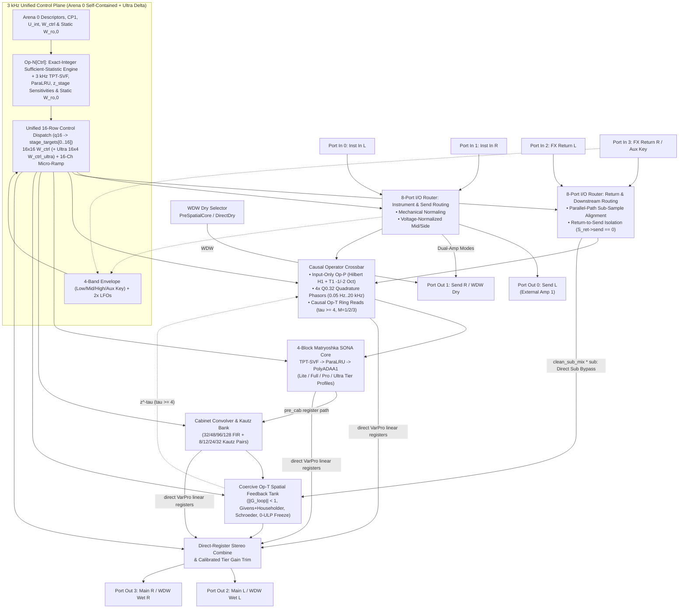

# 8-Port I/O Router, Causal Operator Crossbar, SONA Signal Graph & ZOH Rate Adaptation

This specification defines the 8-Port I/O Matrix Router (`"io_router"`), the Top-of-Frame Causal Operator Crossbar, and the 4-Block Matryoshka SONA Core executing across 16-frame register-hoisted sub-blocks over a cache-compact hot working set (4,608 to 28,672 B across the four tier profiles).

It also specifies the Cabinet Convolver and Shared Kautz Bank, the coercive Op-T Spatial Feedback Tank (`"spatial_tank"`), direct-register VarPro Left/Right readouts with stereo output Mid/Side finalization, and continuous-time Zero-Order Hold (ZOH) sample-rate adaptation across 44.1–384 kHz.

For architectural background and derivations, see [sona_architecture.md](../architecture/sona_architecture.md), [REQ-7.4](../../requirements/system_goals_and_requirements.md), [ADR-0006](../../adr/0006-model-declared-delays-and-tank-feedback-guard.md), [ADR-0019](../../adr/0019-simd-kernel-architecture-and-realtime-execution-optimizations.md), and [ADR-0022](../../adr/0022-sona-state-space-operator-and-webgpu-architecture.md).

---

## 1. Signal Graph Overview

`r[dsp.router.signal-flow]`



---

## 2. 8-Port I/O Matrix Router

### 2.1 Port Allocation & Physical Signal Roles

`r[dsp.router.ports]`

| Port Identifier | Signal Variable | Physical & Logical Routing Role |
| :--- | :--- | :--- |
| Port In 0 (Inst In L) | `x_inst,L[n]` | Primary mono or Left instrument input |
| Port In 1 (Inst In R) | `x_inst,R[n]` | Secondary Right input; normaled to Port In 0 when unplugged |
| Port In 2 (FX Return L) | `x_ret,L[n]` | External amplifier effects return for Amp 1 / Left channel |
| Port In 3 (FX Return R / Aux Key) | `x_ret,R[n]` or `x_aux[n]` | External return for Amp 2 / Right or sidechain key; normaled to Port In 2 |
| Port Out 0 (Send L) | `y_send,L[n]` | Pre-loop preamp send driving Amp 1 or optional mono WDW send |
| Port Out 1 (Send R / WDW Dry) | `y_send,R[n]` or `y_dry[n]` | Right send in dual-amp rigs or center dry feed in WDW (`PreSpatialCore` / `DirectDry`) |
| Port Out 2 (Main Out L) | `y_out,L[n]` or `y_wet,L[n]` | Main Left output, or wet-only Left in WDW mode |
| Port Out 3 (Main Out R) | `y_out,R[n]` or `y_wet,R[n]` | Main Right output, or wet-only Right in WDW mode |

### 2.2 4×4 Scattering Matrix & Return-to-Send Isolation

`r[dsp.router.return-to-send-isolation]`

```text
                  [ S_00  S_01 |   0     0   ]   [ S_{inst->send}    0_{2x2}    ]
S_router =        [ S_10  S_11 |   0     0   ] = [                              ]
                  [------------+-------------]   [                              ]
                  [ S_20  S_21 | S_22  S_23  ]   [ S_{inst->down}  S_ret->down  ]
                  [ S_30  S_31 | S_32  S_33  ]
```

$$\mathbf{y}_{\mathrm{send}}[n] = \mathbf{S}_{\mathrm{inst} \to \mathrm{send}} \mathbf{x}_{\mathrm{inst}}[n], \qquad \mathbf{u}_{\mathrm{down}}[n] = \mathbf{S}_{\mathrm{inst} \to \mathrm{down}} \mathbf{x}_{\mathrm{inst}}[n] + \mathbf{S}_{\mathrm{ret} \to \mathrm{down}} \mathbf{x}_{\mathrm{ret, aligned}}[n]$$

Zeroing $\mathbf{S}_{\mathrm{ret} \to \mathrm{send}} \equiv \mathbf{0}_{2 \times 2}$ guarantees open-loop return ratio $\mathbf{T}_{\mathrm{loop}}(z) = \mathbf{S}_{\mathrm{ret} \to \mathrm{send}} \mathbf{H}_{\mathrm{amp}}(z) \equiv \mathbf{0}_{2 \times 2}$ and $\det(\mathbf{I} - \mathbf{T}_{\mathrm{loop}}(z)) \equiv 1$, eliminating external feedback loops through hardware effects loops.

Return-free send paths obey the strict structural routing constraint $S_{\text{ret}\to\text{send}} = 0$ in `S_router`, ensuring crossbar sends depend only on dry inputs, static controls, and input-only Op-P signals while all 16 target channels in `stage_targets[0..16]` consume the unified $\mathbf{q}_{16}$ dispatch vector ([parametric_control_bus.md §3.1](parametric_control_bus.md#31-operator-parameter-dispatch-matrix--sensitivity-laws)).

### 2.3 Drive-Invariant Voltage-Normalized Mid/Side Input Transformation

`r[dsp.router.mid-side-input]`

To maintain exact 0.00 dB drive-threshold parity between mono (1 → 2) and centered stereo (2 → 2) routing where $x_L = x_R = x$ (`REQ-7.4`), `"io_router"` uses voltage-normalized Mid/Side encoding instead of $1/\sqrt{2}$ power scaling:

$$x_{\mathrm{mid}}[n] = \frac{1}{2}\big(x_L[n] + x_R[n]\big), \qquad x_{\mathrm{side}}[n] = \frac{1}{2}\big(x_L[n] - x_R[n]\big), \qquad x_L[n] = x_{\mathrm{mid}}[n] + x_{\mathrm{side}}[n], \qquad x_R[n] = x_{\mathrm{mid}}[n] - x_{\mathrm{side}}[n]$$

### 2.4 Topology-Adaptive Even/Odd SIMD Lane Partitioning

`r[dsp.router.topology-dispatch]`

| Feature | Mono (1 → 1) | Stereo-to-Mono (2 → 1) | Mono-to-Stereo (1 → 2) | True Stereo (2 → 2) |
| :--- | :---: | :---: | :---: | :---: |
| Channel Topology | `1 -> 1` | `2 -> 1` | `1 -> 2` | `2 -> 2` |
| Crossbar & Core | Normaled L/R paths & 4×4 coupling retained | Full stereo L/R paths & coupling | Normaled L/R paths & 4×4 coupling retained | Full stereo L/R paths & coupling |
| Cabinet FIR & Kautz | Both L/R histories & modes advance | Both L/R histories & modes advance | Both L/R histories & modes advance | Both L/R histories & modes advance |
| Output Finalization | Mono fold `0.5*(y_L + y_R)` | Mono fold `0.5*(y_L + y_R)` | Stereo Mid/Side width `(y_L, y_R)` | Stereo Mid/Side width `(y_L, y_R)` |

### 2.5 Programmable Stereo-Linked & Aux-Key Sidechain Envelope Detector

`r[dsp.router.stereo-link-detector]`

The sidechain detector blends peak-linked stereo detection with $\alpha_{\mathrm{link}} \in [0.0, 1.0]$ and external auxiliary keying with $\beta_{\mathrm{key}} \in [0.0, 1.0]$ without the -6.02 dB hard-panned peak drop:

$$e_{\mathrm{link}}[n] = \max\big(|x_L[n]|, |x_R[n]|\big), \qquad e_{\mathrm{key}}[n] = |x_{\mathrm{aux}}[n]|$$
$$e_{\mathrm{det}, c}[n] = (1 - \beta_{\mathrm{key}})\Big((1 - \alpha_{\mathrm{link}})|x_c[n]| + \alpha_{\mathrm{link}} e_{\mathrm{link}}[n]\Big) + \beta_{\mathrm{key}} e_{\mathrm{key}}[n], \qquad c \in \lbrace L, R \rbrace$$

With full link $\alpha_{\mathrm{link}} = 1.0$, shared positive gain $G[n] > 0$, and normal `binary32` unit roundoff $u = 2^{-24}$, stereo image angle drift satisfies:

$$\Vert\widehat{\mathbf{y}} - G\mathbf{x}\Vert_2 \le u\Vert G\mathbf{x}\Vert_2, \qquad |\sin(\Delta\theta)| \le \frac{u}{1 - u}, \qquad |\Delta\theta| < 0.00000342^\circ$$

Envelope smoothing prepares $\alpha_{\mathrm{att}} = 1 - \exp(-1/(f_s\tau_{\mathrm{att}}))$ and $\alpha_{\mathrm{rel}} = 1 - \exp(-1/(f_s\tau_{\mathrm{rel}}))$ on the cold path and steps $v_{\mathrm{env},c}[n] = v_{\mathrm{env},c}[n-1] + \mathrm{select}(\Delta e_c[n] > 0, \alpha_{\mathrm{att}}, \alpha_{\mathrm{rel}})\Delta e_c[n]$ branchlessly.

### 2.6 4-Band Asymmetric Ballistic Envelope Bank & Aux Key Detector

`r[dsp.router.ballistic-envelope-bank]`

| Band ID | Frequency Range | Attack (tau_att) | Release (tau_rel) | Physical Circuit Role |
| :--- | :--- | :---: | :---: | :--- |
| Band 0 (Low) | < 250 Hz | 10.0 ms | 150.0 ms | Power supply B+ sag, cone excursion pumping, transformer saturation |
| Band 1 (Mid) | 250–2,000 Hz | 2.0 ms | 40.0 ms | Dynamic auto-wah envelope, speech formant modulation, optical compression |
| Band 2 (High) | > 2,000 Hz | 0.2 ms | 15.0 ms | Pick transient detection, noise gate onset, sizzle ducking |
| Band 3 (Aux Key) | Wideband / Sidechain | 0.5 ms | 50.0 ms | Driven from Port In 3 (Aux Key) or stereo-linked instrument sum |

### 2.7 Tier-Aware Static & Dynamic Modulation Routing

`r[dsp.router.modulation-bus]`

$$\mathbf{q}_{16}[k] = \big[\mathbf{q}_0^\top,\ \mathbf{q}_1^\top,\ \mathbf{q}_2^\top,\ \mathbf{q}_3^\top\big]^\top \in \mathbb{R}^{16}$$

Every tier evaluates all 16 rows of the 16×16 dispatch matrix `W_ctrl` unconditionally over `[q0 = z_head[0..4], q1 = ctrl_basis_4[0..4], q2 = [lfo0_mix, lfo1_mix, lfo0_cos, lfo0_sin], q3 = env_states[0..4]]` (plus `qu = z_stage_ultra[0..4]` through 16×4 `W_ctrl_ultra` in Arena 3 on Ultra). Optional Ornstein-Uhlenbeck drift injects into indices `[2, 5, 10, 14]` when `live_analog_drift_enabled && !offline_bounce`.

All 16 control rows micro-ramp across `stage_targets[0..16]`: SVF cutoff/damping (`svf_g_oct`, `svf_k_delta`), per-block drive/bias, Kautz formant/damping, Tank delay/gain/angle, and `crossbar_wet_mod` ([parametric_control_bus.md §3.1](parametric_control_bus.md#31-operator-parameter-dispatch-matrix--sensitivity-laws)).

Autonomous modulators $\mathbf{m}_{\text{dyn}} \in \mathbb{R}^8$ supply Chebyshev-shaped `lfo0_mix` and `lfo1_mix` plus quadrature rotors in `q2`, paired with the 4-band envelope vector `env_states[0..4]` in `q3`.

---

## 3. Multi-Port Parallel Alignment, LR4 Crossover & WDW

### 3.1 WDW Dry-Tap and Wet-Output Contract

`r[dsp.router.wdw-contract]`

| WDW Dry-Tap Mode | Center Dry on Port Out 1 | Wet-Only L/R on Ports Out 2/3 | Default Applicability |
| :--- | :--- | :--- | :--- |
| `PreSpatialCore` | Mid `m_c` of Crossbar + SONA Core + Cabinet | Coercive Op-T Spatial Tank output `m_w ± alpha*s_w` | Default for WDW-capable full-rig models |
| `DirectDry` | Voltage-normalized Mid `0.5*(x_L + x_R)` input or aligned return | Effect-only model response relative to direct source | Default for wet effects or external center rigs |

For `PreSpatialCore`, partitioning the non-recirculating core $(m_c, s_c)$ from spatial tank contribution $(m_w, s_w)$ with stereo width $\alpha$ satisfies:

$$y_L = m_c + m_w + \alpha(s_c + s_w), \qquad y_R = m_c + m_w - \alpha(s_c + s_w)$$
$$y_{\text{dry}} = m_c, \qquad y_{\text{wet},L} = m_w + \alpha s_w, \qquad y_{\text{wet},R} = m_w - \alpha s_w$$

### 3.2 Parallel-Path Sub-Sample Alignment

`r[dsp.router.parallel-alignment]`

| Alignment Mode | Interpolation Kernel | Host Center Offset (G) | Selection & Offline Bounce Rule |
| :--- | :--- | :---: | :--- |
| `FullBand64Tap` | 64-tap Kaiser windowed sinc (beta = 8.6) | 31 samples (0.65 ms at 48 kHz) | Default for full-band 4CM/WDW, training, and 4× bounce |
| `LowLatency16Tap` | 16-tap Kaiser windowed sinc (beta = 6.5) | 7 samples (0.15 ms at 48 kHz) | Selectable low-latency live monitoring |
| `MinLatency4Tap` | Centered 4-tap Catmull-Rom cubic Hermite | 1 sample (0.021 ms at 48 kHz) | Low-band alignment or minimum-latency monitoring |

For $K \in \lbrace 16, 64 \rbrace$ with $G = (K - 2)/2$, $R = K/2$, and $s_k = k - G - \mu$, cold setup normalizes zero-ended Kaiser sinc weights:

$$w_{\beta}(s) = \frac{I_0\big(\beta\sqrt{1 - (s/R)^2}\big) - 1}{I_0(\beta) - 1} \quad (|s| \le R), \qquad h_k(\mu) = \frac{\mathrm{sinc}(s_k) w_{\beta}(s_k)}{\sum_{j=0}^{K-1}\mathrm{sinc}(s_j) w_{\beta}(s_j)}$$

Given oversampling factor $M \in \lbrace 1, 4 \rbrace$, arrivals $a_i$, $A = \max_i a_i$, and optional common pad $p \ge 0$, setting $\Delta_i = A - a_i + M p$, $J_i = \lfloor \Delta_i \rfloor$, $\mu_i = \Delta_i - J_i$, and $B = (M - 1)G$ aligns channels via:

$$y_i[n] = \sum_{k=0}^{K-1} h_k(\mu_i) x_i[n - B - J_i - k], \qquad d_{\mathrm{eff},i} = M G + \Delta_i$$

At 4× bounce, `FullBand64Tap` uses $B = 93$ plus its 31-sample center to hold the 31-host-sample alignment offset (43 host samples nominal combined PDC with the 12-sample oversampler, needing at least 157 effective-rate samples of history per channel). `MinLatency4Tap` with $G = 1$ uses 4-tap Catmull-Rom with exact 0.00 dB DC sum $\sum_{k=-1}^2 c_k(\mu) \equiv 1.0$:

$$c_{-1}(\mu) = -0.5\mu(1 - \mu)^2, \quad c_0(\mu) = 1 - 0.5\mu^2(5 - 3\mu), \quad c_1(\mu) = 0.5\mu(1 + 4\mu - 3\mu^2), \quad c_2(\mu) = 0.5\mu^2(\mu - 1)$$

### 3.3 I/O Router LR4 Clean/Drive Crossover

`r[dsp.router.lr4-crossover]`

Preceding the crossover, the router preprocessor applies channel trims `gain[0..2]` in `[0.0, 4.0]` and 2×2 `mix_matrix` in `[-2.0, 2.0]`, then drives a hysteretic noise gate (`gate_thresh`, `gate_hyst`, `gate_inv_knee`, `gate_floor`).

The 4th-order TPT Linkwitz-Riley (`LR4`) crossover implements a 200 Hz default cascade (clamped 20–2,000 Hz) via two $Q = 1/\sqrt{2}$ `TPT-SVF` sections preparing coefficients in `f64` and stepping in `f32`:

$$g = \tan\left(\frac{\pi f_c}{f_{s,\text{eff}}}\right), \qquad k = \sqrt{2}, \qquad a_1 = \frac{1}{1 + g(g + k)}, \qquad a_2 = g a_1, \qquad a_3 = g a_2$$
$$v_3 = x - s_2, \qquad v_1 = a_1 s_1 + a_2 v_3, \qquad v_2 = s_2 + a_2 s_1 + a_3 v_3$$
$$\ell = v_2, \qquad h = x - k v_1 - v_2, \qquad s_1' = 2 v_1 - s_1, \qquad s_2' = 2 v_2 - s_2$$

The 4-stage bilinear clean crossover prepares `POLE_200HZ_48K = 0.941568` (`f32` constant widened to `f64`, with `base_pole = 0.941568` when $|f_c - 200.0| < 10^{-4}$, else `clamp(0.941568^(f_c / 200.0), 0.5, 0.9995)`), applies continuous-time ZOH real-pole rescaling using $p = \mathrm{clamp}(p_{\text{base}}^{\rho_{\text{sr}}}, 10^{-4}, 0.999995)$, and runs a 4-stage 1st-order bilinear cascade $g = 0.5(1 - p)$ storing each stage's prior input $u_i[n-1]$ (`x_hist[i]`) and prior output $y_i[n-1]$ with recursive subnormal flush:

$$y_i[n] = \mathrm{flush}\big(p y_i[n-1] + g(u_i[n] + u_i[n-1])\big), \qquad H(z) = \left(\frac{0.5(1 - p)(1 + z^{-1})}{1 - p z^{-1}}\right)^4$$

From low-band output $s_{\text{sub}}$ and high band $s_{\text{high}} = x_{\text{gated}} - s_{\text{sub}}$, the hot path forms $x_{\text{xo}} = g_{\text{xo,low}} s_{\text{sub}} + g_{\text{xo,high}} s_{\text{high}}$ feeding Crossbar, SONA Core, and Cabinet.

Meanwhile, parallel clean sub output $x_{\text{clean}} = g_{\text{clean,sub}} s_{\text{sub}}$ (`clean_sub_mix`) bypasses **both** Core and Cabinet directly into `"spatial_tank"` input (`tank_in = dir + cab_out + clean_sub`). In full-band mode where `xo_low_gain = xo_high_gain = 1.0` and `clean_sub_mix = 0.0`, phase-complementary reconstruction `|L_4 + H_4| = 1` holds with -6.02 dB crossover sum.

---

## 4. Top-of-Frame Causal Operator Crossbar

`r[dsp.crossbar.top-of-frame]`

| Crossbar Kernel | State Allocation | Operational Modes & Physical Roles |
| :--- | :--- | :--- |
| `Op-T[Crossbar]` (`tau >= 4`) | Inline hot-set `fp16` Quad 0 plus cold external buffers | `M = 1` delay/chorus/TZF/freeze; `M = 2` pitch grains ±24 st; `M = 3` barberpole sweep feeding SONA Core |
| `Op-P` (`Hilbert` + `T1`) | 6-section `H1` Hilbert lattice + pure `f32` `T1` tracker | 6-section `H1` quadrature SSB and `T1` sub-octave divider (`f_0/2`, `f_0/4`), CPU-precomputed under 0.5 ms |
| 4× `Q0.32` Quadrature Phasors | 4-lane `u32` phase + Hermite-5 sin/cos (0.05 Hz–20 kHz) | Slow chorus/rotary LFOs, polyrhythmic tempo sync (`REQ-2.5`), and AM / ring-mod carriers |
| `Op-N[Pre]` (Dynamics & ZOH) | Fixed-Hz integer ZOH quantizer (`0 FDIV`) | Gate, swell, bitcrusher (`Family 5`), and pre-core linear feeds into Block 0 and direct readouts |

On every stereo frame, the Top-of-Frame Crossbar executes unconditionally before the 4-block SONA core, mixing dry router inputs, causal `Op-T` taps with $\tau \ge 4.0$, `Op-P` analytic/sub-harmonic channels, and 4-lane `Q0.32` carriers into Block 0 and the direct VarPro accumulators (§8).

---

## 5. 4-Block Matryoshka SONA Core

`r[dsp.core.matryoshka-cascade]`

The 4-block Matryoshka core connects `Block 0 -> Block 1 -> Block 2 -> Block 3` across 10 logical 4-lane groups sorted in `SONA_GROUP_BLOCK_AND_LOCAL = [(0,0), (1,0), (2,0), (3,0), (0,1), (1,1), (0,2), (2,1), (0,3), (1,2)]` and 35 causal lower-triangular 4×4 inter-block tiles ([op_n_paralru_and_polyadaa.md §3–§4](op_n_paralru_and_polyadaa.md#3-exact-lti-basis-commutativity-theorem-theorem-1)).

| Tier Profile | Groups & Lanes | Inter-Block Tiles | Core Rate | `TPT-SVF` Modes | Hot Working Budget |
| :--- | :---: | :---: | :---: | :---: | :---: |
| Lite `[1, 1, 1, 1]` | 4 groups (16 lanes) | 3 | 1× `PolyADAA1` | 4 quads (16 modes) | <= 4,608 B (<= 1,000 ns A76) |
| Full `[2, 2, 1, 1]` | 6 groups (24 lanes) | 13 | 2× OS (96 kHz) | 6 quads (24 modes) | <= 7,936 B |
| Pro `[3, 2, 2, 1]` | 8 groups (32 lanes) | 23 | 2× OS (96 kHz) | 8 quads (32 modes) | <= 15,872 B |
| Ultra `[4, 3, 2, 1]` | 10 groups (40 lanes) | 35 | 2× OS (4× Bounce) | 10 quads (40 modes) | <= 28,672 B |

Hot callbacks iterate in 16-frame sub-blocks (`min(total - off, 16)`), stepping per sample whenever causal `Op-T` crossbar feedback is active (`abs(op_t_crossbar_gain) > 1e-7`). Every 3 kHz tick (`(sample_tick & 15) == 0`) refreshes the control plane and hoists group parameters, inter-block tiles, Cabinet poles, and Tank constants into 8-lane stereo or interleaved 4-lane SIMD registers without spills.

Runtime tier transitions preserve state via `tier_gain_trim` in `[0.0625, 16.0]` and warm-seed the 2× oversampler states from the last input and direct residual using exact inverse steady-state all-pass gains.

Non-finite samples set `INVALID_NONFINITE` and flush to 0.0, while finite inputs exceeding `max(certified_limit, CERTIFIED_INPUT_ENVELOPE_MIN_F32)` (±100.0 / +40 dBFS) set `OUTSIDE_CERTIFIED_INPUT` telemetry and pass unclipped; only magnitudes exceeding `SAFETY_CEILING_F32` (±1.0e9) clamp to `[-SAFETY_CEILING_F32, SAFETY_CEILING_F32]` with `INPUT_SATURATED`, `INTERNAL_SATURATED`, or `OUTPUT_SATURATED`.

On real-time 2× oversampling (Full through Ultra), the 2× stereo half-band oversampler cascades a 9th-order elliptic half-band all-pass filter (`HB_A0` and `HB_A1`) over clamped weights (`[up_quad_coeff, dec_c_prev1, dec_c0, dec_c1, up_pre_emph]`):

$$A_\alpha(z) = \frac{\alpha + z^{-1}}{1 + \alpha z^{-1}}, \qquad H_{\mathrm{HB}}(z) = \frac{1}{2}\Big(A_{\alpha_{0,0}}(z^2) A_{\alpha_{0,1}}(z^2) + z^{-1} A_{\alpha_{1,0}}(z^2) A_{\alpha_{1,1}}(z^2)\Big)$$

Specifically, the half-band filters fix `HB_A0 = [0.079866426, 0.54535365]` and `HB_A1 = [0.28382934, 0.8344119]`.

Oversampler parameters clamp `up_quad_coeff` inside [-0.20, 0.05], `dec_c_prev1` inside [0.0, 0.28], and `dec_c0` inside [0.0, 0.55].

They also derive `dec_c1 = 1 - dec_c_prev1 - dec_c0` and clamp `up_pre_emph` inside [-0.28, 1.0].

Upsampling (1× to 2×) emits even and odd half-band phases blended via `up_aa_mix` and `up_zoh_mix` alongside the causal quadratic/pre-emphasis interpolator and zero-order hold; decimation (2× to 1×) blends the half-band average $x_{\mathrm{hb}}[n] = 0.5(v_0[n] + v_1[n])$ via $\alpha_{\mathrm{aa}} =$ `dec_aa_mix` with the unity-DC 3-tap `poly3` FIR:

$$x_{\mathrm{poly}}[n] = c_{\mathrm{prev1}} y[2n - 1] + c_0 y[2n] + c_1 y[2n + 1], \qquad x_{\mathrm{out}}[n] = (1 - \alpha_{\mathrm{aa}}) x_{\mathrm{poly}}[n] + \alpha_{\mathrm{aa}} x_{\mathrm{hb}}[n]$$

On isolated 4× offline bounce, 4× polyphase oversampling cascades two linear-phase dyadic-rational half-band FIR stages: a 19-tap 1×/2× filter (`K_1 = 5`, `HB_2X_TAPS = [35, -405, 2268, -8820, 39690] / 65536`, 9 high-rate delay) and an 11-tap 2×/4× filter (`K_2 = 3`, `HB_4X_TAPS = [3, -25, 150] / 256`, 5 high-rate delay), yielding `OFFLINE_BOUNCE_PDC_SAMPLES = 12` host samples (43 combined PDC with `FullBand64Tap`):

$$y_{\uparrow}[2n] = \sum_{m=0}^{K-1} w_m \Big(x[n - m] + x[n - (2K - 1 - m)]\Big), \qquad y_{\uparrow}[2n + 1] = x[n - (K - 1)]$$
$$x_{\downarrow}[n] = 0.5 y[2n - (2K - 1)] + \frac{1}{2} \sum_{m=0}^{K-1} w_m \Big(y[2n - 2m] + y[2n - 2(2K - 1 - m)]\Big)$$

Across all tiers, passive `TPT-SVF` with $\Vert\mathbf{A}_{\text{tpt}}\Vert_2 \le 1$, contractive `ParaLRU` satisfying $J_i \in [0, r_{\max}]$, and fast-path `PolyADAA1` maintain analytical 0.000000 DC equilibrium (`h_eq == +0.0`), while linear `pre_cab` and `direct` readouts carry ±100.0 (+40 dBFS) unclipped range (`REQ-7.1`).

---

## 6. Cabinet Convolver & Shared Kautz Bank

`r[dsp.cabinet.fir-kautz-bank]`

The Cabinet Convolver and Shared Kautz Bank (`"cabinet"`) executes between the SONA core and end-of-frame Op-T writes. It pairs independent L/R early FIR slices (32, 48, 96, or 128 taps/ch) with shared-pole 4-pair stereo Kautz conjugate pairs (8, 12, 24, or 32 pairs = 16, 24, 48, or 64 real poles, driven at $x_a[n-16]$ at 48 kHz) hoisted across 16-frame sub-blocks ([op_m_modal_kautz.md §4](op_m_modal_kautz.md#4-shared-pole-kautz-modal-bank)).

### 6.1 Double-Mirrored Reverse-Order FIR History & Contiguous 16-Tap Evaluation

`r[dsp.cabinet.mirrored-fir-simd]`

Each channel eliminates per-tap modulo arithmetic inside the hot working set using decremented write pointer `pos = (fir_write_pos - 1) & mask`. Lite (<= 32 taps) mirrors incoming L/R samples at `pos` and `pos + 32` (`mask = 31`), whereas Full (48 taps) writes once at `pos & 63` and wraps segment offsets `& 63`.

For 96 or 128 taps, Pro and Ultra mirror incoming L/R samples into extended Left and Right FIR history rings at `pos` and `pos + 128` (`mask = 127`).

Because every 16-tap segment lies contiguous in memory (or wraps cleanly `& 63` on Full), 16-tap segment convolution loads 4-lane SIMD vectors directly and reduces both channels via paired horizontal lane reductions ([ADR-0019](../../adr/0019-simd-kernel-architecture-and-realtime-execution-optimizations.md)).

---

## 7. Coercive Op-T Spatial Feedback Tank

`r[dsp.tank.feedback-loop]`

| Spatial Tank Component (`"spatial_tank"`) | Architectural & Mathematical Specification |
| :--- | :--- |
| Physical Structure & Causal Feedback | `M = 4 * P_Q` lines (`P_Q` in `{1, 2, 3, 4}`) read at Crossbar (`tau >= 4`) and written back at frame end per spatial tank quad using 128-frame `fp16` inline Quad 0 (1,024 B) or power-of-two cold external buffers, Hermite-5 `Q0.32` LFO (`lfo_depth_samples <= 512.0`), Catmull-Rom interpolation, and bounded-history feedback ([op_t_transport.md §1.1](op_t_transport.md#11-exact-sized-delay-histories-and-branchless-wrap)) |
| Partitioned Schroeder Diffusers | 4-lane per-quad Schroeder banks executed before tap weight & loop write, plus Ultra 8-stage cascading stereo Schroeder diffuser bank up to 16,384 samples with `abs(a_diff) <= 0.75` ([op_t_transport.md §3.1](op_t_transport.md#31-memory-partitioning--rate-aware-capacity)) |
| Multi-Quad Givens + Householder `H_4(1)` | Each quad applies pairwise 2×2 Givens `R(psi)` (`abs(d_psi) <= 0.25 rad/tick`) and 4×4 Householder `H_4(1) = I_4 - 0.5*1*1^T`, then sums all `P_Q` stereo wet pairs |
| Input & Readout DC Conditioning | Passband-normalized 5 Hz DC blocker (`0x3F7F_D51F` at 48 kHz) at loop write and non-recirculating stereo wet readout (§7.2) |
| Feedback Knee & Loop Saturator | Blended 0.85/0.15 knee (`sigma_knee in [1.0e-3, 8.0]`, `TANK_MAX_G_LIN_BITS = 0x3F7F_BE76`, 0.9990) + cubic saturator (`TANK_MAX_V_CEIL_BITS = 0x3F7C_28F5`, 0.9850) ensuring `‖G_loop‖ < 1` (§7.3–§7.4) |

On each quadrant $u \in [0, 1]$, the unique odd polynomial $P(u) = c_1 u - c_3 u^3 + c_5 u^5$ satisfying $P(0) = 0$, $P'(0) = \pi/2$, $P''(0) = 0$, $P(1) = 1$, and $P'(1) = 0$ solves analytically to $c_1 = \pi/2$, $c_3 = \pi - 5/2$, and $c_5 = \pi/2 - 3/2$. Cold external buffer sizing accommodates `!is_quad0 || max_delay > 120 || max_delay + ceil(lfo_depth) + 6 > 128` during container load so audio paths use only bitmask `& (cap - 1)` with zero division or standard math library calls.

### 7.1 Captured Freeze and Modeled Controls

`r[dsp.tank.captured-freeze]`

Hardware freeze is modeled when present in training stems ([capture_and_alignment.md §1.3](../training/capture_and_alignment.md#freeze-transition-capture)), while unobserved freeze flags clamp via phase-1 switch clamping ([control_space_audit.md](../training/control_space_audit.md)). When active (`freeze == true`), ring and Schroeder writes lock bit-for-bit at 0 ULP with zero `fp16` re-quantization hiss while Crossbar, SONA core, Cabinet, and non-recirculating readouts continue processing live instrument audio.

### 7.2 Spatial Feedback Tank Passband-Normalized DC Blocker

`r[dsp.tank.dc-blocker]`

For pole $0 \le R_{\text{dc}} < 1$, the passband-normalized DC blocker protects both loop feedback injection and non-recirculating stereo readouts:

$$H_{\text{dc}}(z) = \frac{\alpha_{\text{dc}}(1 - z^{-1})}{1 - R_{\text{dc}}z^{-1}}, \qquad \alpha_{\text{dc}} = \frac{1 + R_{\text{dc}}}{2}, \qquad R_{\text{dc,ref}}(48\text{ kHz}) = \frac{\cos(2\pi \cdot 5 / 48000)}{1 + \sin(2\pi \cdot 5 / 48000)} \approx \mathtt{0x3F7FD51F}$$

Off-48 kHz sample rates compute $R_{\text{dc}}(f_{s,\text{eff}}) = R_{\text{dc,ref}}^{\rho_{\text{sr}}}$ on the cold path (§9).

### 7.3 Spatial Feedback Tank Normalized Loop Saturator

`r[dsp.tank.loop-saturator]`

With ceiling $0 < V_{\text{ceil}} \le 0.985$ (`TANK_MAX_V_CEIL_BITS = 0x3F7C_28F5`, the largest IEEE-754 single-precision float `<= 0.985`, preventing `0x3F7C_28F6 > 0.985`), the memoryless unity-slope cubic saturator evaluates:

$$v = \mathrm{clamp}\left(\frac{2u}{3V_{\text{ceil}}}, -1, 1\right), \qquad S(u) = \mathrm{clamp}\Big(V_{\text{ceil}} v(1.5 - 0.5 v^2), -V_{\text{ceil}}, V_{\text{ceil}}\Big)$$

The outer $\pm V_{\text{ceil}}$ clamp ensures `f32` intermediate rounding cannot cross `0x3F7C_28F5`.

### 7.4 Spatial Feedback Tank Blended Quiet-Feedback Knee

`r[dsp.tank.quiet-feedback-knee]`

Each loop line passes through the blended feedback knee with slope $0 \le g_{\text{lin}} \le 0.9990$ (`TANK_MAX_G_LIN_BITS = 0x3F7F_BE76`), blend $\alpha \in [0, 1]$, and knee scale $\sigma \in [10^{-3}, 8.0]$:

$$K(u) = g_{\text{lin}} u \left((1 - \alpha) + \frac{\alpha}{1 + (u/\sigma)^2}\right), \qquad K'(0) = g_{\text{lin}}, \qquad |K(u)| \le g_{\text{lin}}|u|$$

Here $\alpha = 0$ is purely linear, $\alpha = 1$ is purely rational $g_{\text{lin}} u / (1 + (u/\sigma)^2)$, and $\alpha = 0.15$ yields the blended rational knee (`0.85 + 0.15 / (1 + (u / sigma)^2)`) used in compact spatial tank quads. Cold setup prepares $\sigma^{-1}$, while hot SIMD evaluation avoids division via a 2-step Newton reciprocal of `1 + (u * inv_sigma)^2` (or 6-step `f64` Newton reciprocals with `rel_err < 2^-40` on single-line paths).

### 7.5 4-Lane SIMD Loop Conditioning, Saturation & Orthogonal Mixing

`r[dsp.tank.simd-loop]`

Inside 4-lane 32-bit float SIMD registers ([ADR-0019](../../adr/0019-simd-kernel-architecture-and-realtime-execution-optimizations.md)), each spatial tank quad updates 4-lane loop DC blockers with recursive subnormal flushing and evaluates the rational feedback knee and cubic saturator (`TANK_MAX_V_CEIL_BITS`).

Whenever the slewed Givens angle stays stationary (`abs(target_psi - current_psi) <= 1e-7`), the quad reuses cached `(cos_psi, sin_psi)`, rotates pairwise via lane swap-and-negate, and applies 4×4 Householder reflection via horizontal lane reduction and fused multiply-add.

---

## 8. Direct-Register VarPro Readout

`r[dsp.head.direct-register-readout]`

SONA v3.0 eliminates intermediate scratch feature-bus buffers ([ADR-0022](../../adr/0022-sona-state-space-operator-and-webgpu-architecture.md)), accumulating `pre_cab` and `direct` VarPro linear readouts inline in SIMD registers inside a tier-compact, zero-spill hot working set (`N × HotBytes <= 64 KiB` L1D footprint):

| Tier Profile | SONA Core (`TPT-SVF` @ Rate) | Cabinet Kautz & FIR | Op-T Tank Quads | Hot Working Budget |
| :--- | :---: | :---: | :---: | :---: |
| Lite | `[1, 1, 1, 1]` (16 lanes @ 1×) | 8 pairs (256 B wire) + 32 taps (256 B) | 1 quad (`M = 4` inline + cold ext) | <= 4,608 B (`14× <= 64,512 B`) |
| Full | `[2, 2, 1, 1]` (24 lanes @ 2× OS) | 12 pairs (384 B wire) + 48 taps (384 B) | 2 quads (`M = 8` + Schroeder) | <= 7,936 B (`8× <= 63,488 B`) |
| Pro | `[3, 2, 2, 1]` (32 lanes @ 2× OS) | 24 pairs (768 B wire) + 96 taps (768 B) | 3 quads (`M = 12` + `fp16/f32`) | <= 15,872 B (`4× <= 63,488 B`) |
| Ultra | `[4, 3, 2, 1]` (40 lanes @ 2× / 4×) | 32 pairs (1,024 B wire) + 128 taps (1,024 B) | 4 quads (`M = 16` + 8-stage diffuser) | <= 28,672 B (`2× <= 57,344 B`) |

### 8.1 Canonical Mid/Side Output Head Factorization

`r[dsp.head.mid-side-factorization]`

At load and tier switch, the tier VarPro Readout block unpacks static `fp16` base matrix `W_ro,0` (16×12, 24×12, 32×12, or 40×12 across tiers) storing Left and Right channel readout vectors $\mathbf{w}_{L,0}$ and $\mathbf{w}_{R,0}$. At 3 kHz control boundaries, these Left and Right channel vectors hoist directly into stereo register pairs and accumulate directly into Left and Right pre-cabinet and direct outputs over SONA state $\boldsymbol{\Phi}[n]$ (not pre-collapsed into Mid/Side vectors at 3 kHz boundaries).

Whereas `z_head` stays inside `W_ctrl`, operator sensitivity tables (`stage_latent_mods_fp16`, `stage_latent_ctrl_ultra_fp16`, and optional `SONA_META_CORE_MODS_PRESENT` `stage_latent_core_mods_fp16`) index strictly unrotated `z_stage`, preserving 0-ULP `SO(4)` invariance ([parametric_control_bus.md §3.1](parametric_control_bus.md#31-operator-parameter-dispatch-matrix--sensitivity-laws)).

At stereo output finalization, Mid/Side decomposition $y_{\mathrm{mid}} = \frac{1}{2}(y_L + y_R)$, $y_{\mathrm{side}} = \frac{1}{2}(y_L - y_R)$ and stereo width scaling $\alpha_{\mathrm{width}} \in [0, 2]$ operate directly on the finalized Left and Right outputs $(y_L[n], y_R[n])$:

$$y_{\mathrm{mid}}[n] = \frac{1}{2}\big(y_L[n] + y_R[n]\big), \qquad y_{\mathrm{side}}[n] = \frac{1}{2}\big(y_L[n] - y_R[n]\big)$$
$$y_L'[n] = y_{\mathrm{mid}}[n] + \alpha_{\mathrm{width}}[n] y_{\mathrm{side}}[n], \qquad y_R'[n] = y_{\mathrm{mid}}[n] - \alpha_{\mathrm{width}}[n] y_{\mathrm{side}}[n]$$

Mono graphs (1 → 1 and 2 → 1) fold `0.5 * (y_L + y_R)` at the mono output boundary while keeping internal dual-mic and ping-pong state active and bounding Mid error by $|m - \hat{m}| \le 2\mathrm{ulp}(M) + 2F_{\min}$ for $M = \max(|y_{\mathrm{mid}}|, |\alpha_{\mathrm{width}} y_{\mathrm{side}}|)$.

### 8.2 Effective-Tier Equivalence

`r[dsp.head.tier-equivalence]`

For identical external inputs, controls, initial tier state, and execution target, a container stripped to tier `T` produces bit-identical SONA core states, L/R FIR histories, and readout outputs to the full container executed at tier `T` with higher-tier weights gated off and Arena 0 controls preserved.

### 8.3 Block-Diagonal Lower-Triangular Staging

`r[dsp.head.lower-triangular]`

```text
W_head = [ W_lite           0             0             0           ]
         [ W_full,lite     W_full,delta  0             0           ]
         [ W_pro,lite      W_pro,full    W_pro,delta   0           ]
         [ W_ultra,lite    W_ultra,full  W_ultra,pro   W_ultra,delta ]
```

### 8.4 Contiguous Hot Working Set, Register Hoisting & 3 kHz Readout Collapse

`r[dsp.head.precollapse-and-zerocopy]`

Hot weights and audio states pack contiguously across `[0..ActiveHotBytes)` inside the 64-byte-aligned hot working set (4,608 to 28,672 B with 0 B transient heap allocation), keeping `P` control definitions, Arena 0 and Arena 3 control-bus sections, and static `W_ro,0` at the cold tail ([ADR-0019](../../adr/0019-simd-kernel-architecture-and-realtime-execution-optimizations.md), [ADR-0022](../../adr/0022-sona-state-space-operator-and-webgpu-architecture.md)).

Inside 16-frame sub-blocks (32 at 2× OS), all `TPT-SVF`, `ParaLRU`, FIR, and 4-pair stereo Kautz constants stay hoisted in SIMD registers. Whenever controls or modulators mark a 3 kHz tick dirty, the control bus evaluates `stage_targets[0..16]` and `SONA_META_CORE_MODS_PRESENT` / unrotated `z_stage` sensitivity tables without extra 48 kHz MACs when static.

---

## 9. Continuous-Time ZOH Rate Adaptation

Containers anchor parameters at $f_{s,\text{train}} = 48{,}000$ Hz. For host sample rate $f_{s,\text{host}} \in [44{,}100, 192{,}000]$ Hz and oversampling factor $M_{\text{os}} \in \lbrace 1, 2, 4 \rbrace$ satisfying $M_{\text{os}} f_{s,\text{host}} \le 384{,}000$ Hz (44.1–96 kHz uses 2× RT and 4× bounce, 176.4–192 kHz runs 1×/2× up to 384 kHz, and Lite always runs 1×), let $f_{s,\text{eff}} = M_{\text{os}} f_{s,\text{host}}$ and $\rho_{\text{sr}} = 48000 / f_{s,\text{eff}}$.

### 9.1 Causal Crossbar, Core `TPT-SVF` Prewarping & Kautz Modal Conversion

`r[dsp.zoh.op-m-poles]`

$$g_{\text{host}} = \tan\left(\frac{\pi f_c}{f_{s,\text{eff}}}\right), \qquad r_c(f_{s,\text{eff}}) = \big(r_{\text{ref},c}\big)^{\rho_{\text{sr}}} \in \big[0.25^{\rho_{\text{sr}}},\ 0.9995^{\rho_{\text{sr}}}\big], \qquad \theta_c(f_{s,\text{eff}}) = \mathrm{clamp}\Big(\rho_{\text{sr}} \theta_c(f_{s,\text{train}}),\ 10^{-4},\ \pi - 10^{-4}\Big)$$

At $f_{s,\text{eff}} = 48{,}000$ Hz, stored parameters run directly; at 3 kHz ticks, `TPT-SVF`, Kautz, Spatial Tank, and `crossbar_wet_mod` parameters retune dynamically without division or standard math library calls.

### 9.2 I/O Router Relative Alignment Latency & Detector Poles

`r[dsp.zoh.router-detector]`

$$\delta_{\text{align},ch}^{\text{samples}}(f_{s,\text{eff}}) = \frac{\delta_{\text{align},ch}^{\text{samples}}(f_{s,\text{train}})}{\rho_{\text{sr}}}, \qquad p_{\text{det},b}(f_{s,\text{eff}}) = \big(p_{\text{det},b}(f_{s,\text{train}})\big)^{\rho_{\text{sr}}}$$

### 9.3 4-Block Matryoshka Core `TPT-SVF` & `ParaLRU` ZOH Adaptation

`r[dsp.zoh.core-paralru]`

For each `ParaLRU` lane with $\beta = 1 - \alpha_{\text{atk}}$, $a_{\text{atk}} = \alpha_{\text{rel}}(1 - \kappa\beta)$, and $r_{\max} =$ `MAX_PARALRU_R_F32` (`0x3F7F_FFAC`):

$$\alpha_{\text{rel}}' = \mathrm{clamp}\big(\alpha_{\text{rel}}^{\rho_{\text{sr}}}, 0, r_{\max}\big), \qquad \beta' = \mathrm{clamp}\left(\beta \frac{1 - a_{\text{atk}}^{\rho_{\text{sr}}}}{1 - a_{\text{atk}}}, 0, 1\right), \qquad \alpha_{\text{atk}}' = 1 - \beta'$$
$$\kappa' = \mathrm{clamp}\left(\frac{1 - (1 - \kappa\beta)^{\rho_{\text{sr}}}}{\beta'}, 0, 1\right) \ (\beta' > 10^{-12}, \text{ else } \kappa), \qquad R_{\text{ac}}(f_{s,\text{eff}}) = \big(R_{\text{ac}}(f_{s,\text{train}})\big)^{\rho_{\text{sr}}}$$

`TPT-SVF` modes rescale via analytical tangent prewarping $g_{\text{host}} = \tan(\pi f_c / f_{s,\text{eff}})$. Real-pole ZOH rescaling pre-clamps inputs to `[1.0e-4, 0.999995]`, returning `p_clamped` unchanged when $|\rho_{\text{sr}} - 1| < 10^{-12}$ and otherwise returning `clamp(p_clamped^rho_sr, 1.0e-4, 0.999995)`, preserving sub-5 Hz AC blockers through 384 kHz alongside difference scaling $\Delta s_{\text{re}}[n] = \rho_{\text{sr}}^{-1}(s_{\text{re}}[n] - s_{\text{re}}[n-1])$.

### 9.4 `Op-T` Delays, All-Pass Diffusers, Crossfades & DC Blocker

`r[dsp.zoh.op-t-delays]`

$$\tau_{0,m}^{\text{samples}}(f_{s,\text{eff}}) = \max\left(4.0,\ \frac{\tau_{0,m}^{\text{samples}}(f_{s,\text{train}})}{\rho_{\text{sr}}}\right), \qquad D_{\text{ap},m}(f_{s,\text{eff}}) = \max\left(1,\ \mathrm{round}\left(\frac{D_{\text{ap},m}(f_{s,\text{train}})}{\rho_{\text{sr}}}\right)\right)$$
$$L_{\text{xfade}}(f_{s,\text{eff}}) = \max\left(16,\ \mathrm{round}\left(\frac{L_{\text{xfade}}(f_{s,\text{train}})}{\rho_{\text{sr}}}\right)\right), \qquad R_{\text{dc}}(f_{s,\text{eff}}) = \big(R_{\text{dc}}(f_{s,\text{train}})\big)^{\rho_{\text{sr}}}$$

### 9.5 Control-Bus Decimation Stride, Tick Ratio & Micro-Ramp Step

`r[dsp.zoh.ctrl-stride]`

$$K_{\text{ctrl}}(f_{s,\text{eff}}) = \max\left(8,\ \mathrm{round}\left(\frac{f_{s,\text{eff}}}{3000.0}\right)\right), \qquad \rho_{\text{ctrl}} = \frac{f_{s,\text{train}} \cdot K_{\text{ctrl}}(f_{s,\text{eff}})}{f_{s,\text{eff}} \cdot K_{\text{ctrl}}(f_{s,\text{train}})}, \qquad \alpha_{\text{ramp}}(f_{s,\text{eff}}) = \frac{1.0}{K_{\text{ctrl}}(f_{s,\text{eff}})}$$
$$\Delta\phi_{\text{lfo},j}(f_{s,\text{eff}}) = \rho_{\text{ctrl}} \Delta\phi_{\text{lfo},j}(f_{s,\text{train}}), \qquad R_{\text{env},b}(f_{s,\text{eff}}) = \big(R_{\text{env},b}(f_{s,\text{train}})\big)^{\rho_{\text{ctrl}}}$$

### 9.6 Cabinet Convolver FIR & Modal Onset Conversion

`r[dsp.zoh.cabinet-fir-onset]`

Cabinet FIR and modal onset conversion runs within an 8-host-sample budget in four mutually exclusive priority cases:

| Case | Rate Domain | FIR Tap & Onset Rule |
| :--- | :--- | :--- |
| Case (a) | Integer multiples `q * 48,000 Hz`, `q in {1, 2, 4, 8}` | Sparse delays `x_a[n - q * k]` for `k = 16t + j` and modal onset `16 * q` ([op_m_modal_kautz.md §4.1](op_m_modal_kautz.md#41-cabinet-architecture--tier-allocation)) |
| Case (b) | Live 1× `M_os = 1`, `44,100 <= f_{s,eff} < 48,000` | Direct `b_0 * x[n]`, 64-tap tap-1 difference filter, cold FIR tap rescaling on remaining taps |
| Case (c) | 4× offline bounce `M_os = 4`, 176,400–384,000 Hz | Causal 6-point Lagrange difference mapping (192 and 384 kHz match Case (a) identically) |
| Case (d) | All remaining pairs including 2× 88.2 kHz | DC-normalized 4-tap Catmull-Rom FIR tap rescaling and modal onset `round(16 / rho_sr)` |

In Case (a), tap index $k = 16t + j$ steps across 16-tap SIMD segment index $t \in \lbrace 0, \dots, N_{\text{fir}}/16 - 1 \rbrace$ and intra-segment offset $j \in \lbrace 0, \dots, 15 \rbrace$.

In Case (b), cold live first-tap difference preparation computes $\lambda = (48{,}000 - f_{s,\text{eff}}) / 3{,}900$ and prefix sums $p_0 = t_0$, $p_j = (\sum_{i=0}^j t_i) - 1.0$ over $j = 1 \dots 62$ from widened `f64` constants in `GAIN_BOUNDED_FIRST_TAP_64_BITS[0..64]`, then rounds $\widetilde p_j = \mathrm{RN}_{32}(\lambda p_j)$ to `f32` and evaluates $y_{\text{tap1}}[n] = x[n-1] + \sum_{j=0}^{62} \widetilde p_j (x[n-j] - x[n-j-1])$.

Remaining Case (b) taps evaluate via cold FIR tap rescaling over `[0.0, 0.0, b_2..b_{N-1}, 0.0]` (`N in {32, 48, 96, 128}`), keeping tap-1 complex error under 0.0177 through 20 kHz with 0-ULP unit DC gain:

```text
GAIN_BOUNDED_FIRST_TAP_64_BITS[0..64] = [
  0x3d6c9268, 0x3f83725f, 0xbdf0a4f1, 0x3dadb502, 0xbd9da17d, 0x3d95380c, 0xbd949c5f, 0x3d91792e,
  0xbd91ce40, 0x3d8dd068, 0xbd8beae0, 0x3d853dac, 0xbd80189f, 0x3d6c7fa0, 0xbd5ba083, 0x3d4231cb,
  0xbd2bf99b, 0x3d0e88f9, 0xbcea4a93, 0x3cac58c1, 0xbc714876, 0x3bf4c5f0, 0xbae22743, 0xbb962d07,
  0x3c1634d0, 0xbc65add4, 0x3c8b7e54, 0xbca4d3dc, 0x3caf0e76, 0xbcb982b1, 0x3cb5d3c2, 0xbcb2e27a,
  0x3ca3932b, 0xbc963f77, 0x3c7dc51e, 0xbc565369, 0x3c1fd21c, 0xbbe7f768, 0x3b775394, 0xbaa98a21,
  0xbacf4513, 0x3b66e3c0, 0xbbbaaf04, 0x3be253a0, 0xbc0770ed, 0x3c0ea839, 0xbc181cd3, 0x3c14420d,
  0xbc133bf5, 0x3c074843, 0xbbfe526f, 0x3bdd6c26, 0xbbc62d29, 0x3ba31dc4, 0xbb8b1039, 0x3b568017,
  0xbb2d823b, 0x3af63e3f, 0xbabad495, 0x3a6ae4c8, 0xba231f37, 0x39a60fed, 0xb943301a, 0x386dc990
]
```

In Case (c), for tap $k \ge 1$ with exact integer decomposition $d = k f / 48000 = m + \mu$ where $m = \lfloor d \rfloor \ge 3$ and $\mu = r/D$, anchor at $a = 2$ when $\mu \le 1/2$ or $a = 3$ when $\mu > 1/2$ with scales $c_i = (-1, 5, -10, 10, -5, 1)$ at nodes $v_i = (-2, -1, 0, 1, 2, 3)$, $f = M 2^{e-52}$, $D = 48000 \cdot 2^{52-e}$, and $k M = m D + r$:

$$y_{\text{tap},k}[n] = x[n - m - a + 2] + \sum_{j=0}^4 p_j \big(x[n - m + 2 - j] - x[n - m + 1 - j]\big)$$
$$Q_j = \sum_{i=0}^j c_i \prod_{\ell \ne i}(r - v_\ell D) - 120 D^5 \mathbf{1}_{j \ge a}, \qquad p_j = \mathrm{RN}_{32}\left(\frac{Q_j}{120 D^5}\right)$$

This 6-point kernel bounds complex error below 0.00064 through 20 kHz with max ring lookback 251, 379, 763, and 1,019 samples/ch across Lite..Ultra (252, 380, 764, and 1,020 history slots).
