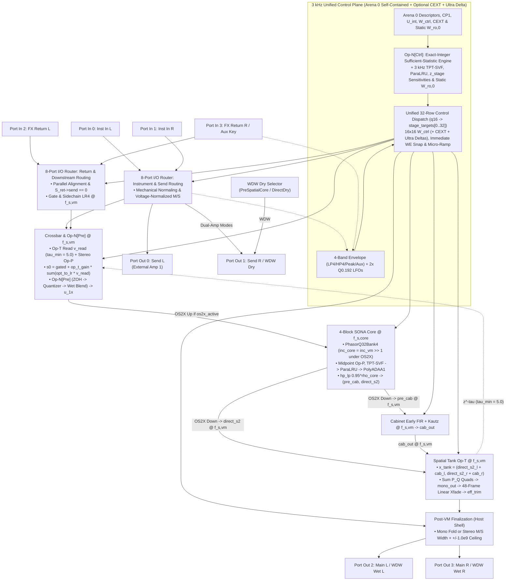

# 8-Port I/O Router, Causal Operator Crossbar, SONA Signal Graph & ZOH Rate Adaptation

This specification defines the 8-Port I/O Matrix Router (`"io_router"`), the Top-of-Frame Causal Operator Crossbar, and the 4-Block Matryoshka SONA Core executing in 4-frame causal micro-chunks inside 16-frame register-hoisted sub-blocks over a cache-compact active-hot working set (4,544 to 14,656 B inside 4,608 to 28,672 B L1D ceilings across the four tier profiles).

It also specifies the Cabinet Convolver and Shared Kautz Bank, the coercive Op-T Spatial Feedback Tank (`"spatial_tank"`), direct-register VarPro Left/Right readouts with stereo output Mid/Side finalization, and continuous-time Zero-Order Hold (ZOH) sample-rate adaptation across 44.1–384 kHz.

For architectural background and derivations, see [sona_architecture.md](../architecture/sona_architecture.md), [REQ-7.4](../../requirements/system_goals_and_requirements.md), [ADR-0006](../../adr/0006-model-declared-delays-and-tank-feedback-guard.md), [ADR-0019](../../adr/0019-simd-kernel-architecture-and-realtime-execution-optimizations.md), and [ADR-0022](../../adr/0022-sona-state-space-operator-and-webgpu-architecture.md).

---

## 1. Signal Graph Overview

`r[dsp.router.signal-flow]`



SONA executes a two-rate virtual machine loop separating perimeter stages at `f_{s,vm}` from oversampled core stages at `f_{s,core}`. In live real-time execution across 44.1–384 kHz, `f_{s,vm} = f_{s,host}`; in 4× offline bounce, an outer polyphase oversampler sets `f_{s,vm} = 4 * f_{s,host}` and disables internal `OS2X`.

Rate ratios follow `rho_vm = 48_000.0 / f_{s,vm}` and `K_ctrl(f_{s,vm}) = max(8, round(f_{s,vm} / 3_000.0))` (half-away-from-zero `floor(x + 0.5)`). Runtime core oversampling engages iff `os2x_active = (tier > 0) && !offline_bounce && tier_os2x[tier] && (2.0 * f_{s,vm} <= 384_000.0)`, setting `f_{s,core} = 2 * f_{s,vm}` when active (else `f_{s,vm}`) and `rho_core = 48_000.0 / f_{s,core}`. Every VM frame executes strictly in the order below:

| Step | Stage & Rate | Exact Per-VM-Frame Operation |
| :---: | :--- | :--- |
| 1 | `ControlBus` (`f_{s,vm}`) | Run `tick_3khz()` strictly at `ctrl_sub_counter == 0`; snap slot 16, step `r != 16` by `delta[r]` per VM frame, and latch registers when `(sample_tick & 3) == 0` or `ctrl_sub_counter == 0` |
| 2 | `IoRouter` (`f_{s,vm}`) | Compute 200 Hz sidechain `LR4`, stereo-linked detector, and 4-band envelopes on raw pre-trim inputs; apply `gain[0..2]`, 2×2 `mix_matrix`, and hysteretic noise gate at `f_{s,vm}` |
| 3 | `Op-T` Read & `Op-P` (`f_{s,vm}`) | Read Top-of-Frame `Op-T` delays `v_read` at `tau_min = 5.0` VM frames and step stereo `Op-P` (`HilbertH1StereoKernel`, stereo 5 Hz `T1` DC, mid `T1`) |
| 4 | `Op-T` Crossbar Tap (`f_{s,vm}`) | Add crossbar taps `(s0_L, s0_R) = (gated_l, gated_r) + op_t_gain * sum_line(opt_to_lr * v_read)` ahead of `Op-N[Pre]` |
| 5 | `Op-N[Pre]` (`f_{s,vm}`) | Step `ZOH -> Nearest-Step Quantizer -> Wet Blend` on `(s0_L, s0_R)` at `f_{s,vm}` ahead of `OS2X`, emitting core input `u_1x = (ux_l, ux_r)` |
| 6 | `OS2X` Upsample (`f_{s,vm} -> f_{s,core}`) | Upsample `u_1x` 2× for the 4-Block Core only when `os2x_active` is true; otherwise bypass via `u_c = u_1x` |
| 7 | 4-Block SONA Core (`f_{s,core}`) | Step `PhasorQ32Bank4` at `inc_core = inc_vm >> 1` under `OS2X` else `inc_vm`, midpoint `Op-P` `(I_L, Q_L, I_R, Q_R)` & `T1[0..4]`, `d_adaa_eff`, `b_lru_eff`, and `hp_lp` `0.95^rho_core` readout into `(pre_cab, direct_s2)` |
| 8 | `OS2X` Downsample (`f_{s,core} -> f_{s,vm}`) | Decimate `(pre_cab, direct_s2)` back to `f_{s,vm}` when `os2x_active` is true, or pass through unchanged |
| 9 | `Cabinet` (`f_{s,vm}`) | Run lag-ordered `Early FIR` and shared-pole Kautz bank on `pre_cab` at `f_{s,vm}`, producing `cab_out` |
| 10 | `Spatial Tank` & Output (`f_{s,vm}`) | Feed `x_tank = (direct_s2_l + cab_l, direct_s2_r + cab_r)` into End-of-Frame `Spatial Tank Op-T` summing `P_Q` quads, apply `mono_out`, 48-frame linear tier crossfade, and polarity-signed `eff_trim`, then post-VM M/S width + ±1.0e9 safety ceiling in the host shell |

---

## 2. 8-Port I/O Matrix Router

### 2.1 Port Allocation & Physical Signal Roles

`r[dsp.router.ports]`

| Port Identifier | Signal Variable | Physical & Logical Routing Role |
| :--- | :--- | :--- |
| Port In 0 (Inst In L) | `x_inst,L[n]` | Primary mono or Left instrument input |
| Port In 1 (Inst In R) | `x_inst,R[n]` | Secondary Right input; normaled to Port In 0 when unplugged |
| Port In 2 (FX Return L) | `x_ret,L[n]` | External amplifier effects return for Amp 1 / Left channel |
| Port In 3 (FX Return R / Aux Key) | `x_ret,R[n]` or `x_aux[n]` | External return for Amp 2 / Right or sidechain key; normaled to Port In 2 |
| Port Out 0 (Send L) | `y_send,L[n]` | Pre-loop preamp send driving Amp 1 or optional mono WDW send |
| Port Out 1 (Send R / WDW Dry) | `y_send,R[n]` or `y_dry[n]` | Right send in dual-amp rigs or center dry feed in WDW (`PreSpatialCore` / `DirectDry`) |
| Port Out 2 (Main Out L) | `y_out,L[n]` or `y_wet,L[n]` | Main Left output, or wet-only Left in WDW mode |
| Port Out 3 (Main Out R) | `y_out,R[n]` or `y_wet,R[n]` | Main Right output, or wet-only Right in WDW mode |

### 2.2 4×4 Scattering Matrix & Return-to-Send Isolation

`r[dsp.router.return-to-send-isolation]`

```text
                  [ S_00  S_01 |   0     0   ]   [ S_{inst->send}    0_{2x2}    ]
S_router =        [ S_10  S_11 |   0     0   ] = [                              ]
                  [------------+-------------]   [                              ]
                  [ S_20  S_21 | S_22  S_23  ]   [ S_{inst->down}  S_ret->down  ]
                  [ S_30  S_31 | S_32  S_33  ]
```

$$\mathbf{y}_{\mathrm{send}}[n] = \mathbf{S}_{\mathrm{inst} \to \mathrm{send}} \mathbf{x}_{\mathrm{inst}}[n], \qquad \mathbf{u}_{\mathrm{down}}[n] = \mathbf{S}_{\mathrm{inst} \to \mathrm{down}} \mathbf{x}_{\mathrm{inst}}[n] + \mathbf{S}_{\mathrm{ret} \to \mathrm{down}} \mathbf{x}_{\mathrm{ret, aligned}}[n]$$

Zeroing $\mathbf{S}_{\mathrm{ret} \to \mathrm{send}} \equiv \mathbf{0}_{2 \times 2}$ guarantees open-loop return ratio $\mathbf{T}_{\mathrm{loop}}(z) = \mathbf{S}_{\mathrm{ret} \to \mathrm{send}} \mathbf{H}_{\mathrm{amp}}(z) \equiv \mathbf{0}_{2 \times 2}$ and $\det(\mathbf{I} - \mathbf{T}_{\mathrm{loop}}(z)) \equiv 1$, eliminating external feedback loops through hardware effects loops.

Return-free send paths obey $S_{\text{ret}\to\text{send}} = 0$ in `s_router` during 4-port (`4CM`, `WDW`, or Sidechain) frame stepping (computing `y_send` and mixing aligned `x_ret`), whereas standard 2-port stereo execution routes `(in_L, in_R)` directly through `router_gain -> router_mix_matrix -> gate`, keeping all 32 targets in `stage_targets[0..32]` fed by $\mathbf{q}_{16}$ ([parametric_control_bus.md §3.1](parametric_control_bus.md#31-operator-parameter-dispatch-matrix--sensitivity-laws)).

### 2.3 Drive-Invariant Voltage-Normalized Mid/Side Input Transformation

`r[dsp.router.mid-side-input]`

To maintain exact 0.00 dB drive-threshold parity between mono (1 → 2) and centered stereo (2 → 2) routing where $x_L = x_R = x$ (`REQ-7.4`), `"io_router"` uses voltage-normalized Mid/Side encoding instead of $1/\sqrt{2}$ power scaling:

$$x_{\mathrm{mid}}[n] = \frac{1}{2}\big(x_L[n] + x_R[n]\big), \qquad x_{\mathrm{side}}[n] = \frac{1}{2}\big(x_L[n] - x_R[n]\big), \qquad x_L[n] = x_{\mathrm{mid}}[n] + x_{\mathrm{side}}[n], \qquad x_R[n] = x_{\mathrm{mid}}[n] - x_{\mathrm{side}}[n]$$

### 2.4 Topology-Adaptive Even/Odd SIMD Lane Partitioning

`r[dsp.router.topology-dispatch]`

| Feature | Mono (1 → 1) | Stereo-to-Mono (2 → 1) | Mono-to-Stereo (1 → 2) | True Stereo (2 → 2) |
| :--- | :---: | :---: | :---: | :---: |
| Channel Topology | `1 -> 1` | `2 -> 1` | `1 -> 2` | `2 -> 2` |
| Crossbar & Core | Normaled L/R paths & 4×4 coupling retained | Full stereo L/R paths & coupling | Normaled L/R paths & 4×4 coupling retained | Full stereo L/R paths & coupling |
| Cabinet FIR & Kautz | Both L/R histories & modes advance | Both L/R histories & modes advance | Both L/R histories & modes advance | Both L/R histories & modes advance |
| Output Finalization | Mono fold `0.5*(y_L + y_R)` | Mono fold `0.5*(y_L + y_R)` | Stereo Mid/Side width `(y_L, y_R)` | Stereo Mid/Side width `(y_L, y_R)` |

### 2.5 Programmable Stereo-Linked & Aux-Key Sidechain Envelope Detector

`r[dsp.router.stereo-link-detector]`

The sidechain detector blends peak-linked stereo detection with $\alpha_{\mathrm{link}} \in [0.0, 1.0]$ and external auxiliary keying with $\beta_{\mathrm{key}} \in [0.0, 1.0]$ without the -6.02 dB hard-panned peak drop:

$$e_{\mathrm{link}}[n] = \max\big(|x_L[n]|, |x_R[n]|\big), \qquad e_{\mathrm{key}}[n] = |x_{\mathrm{aux}}[n]|$$
$$e_{\mathrm{det}, c}[n] = (1 - \beta_{\mathrm{key}})\Big((1 - \alpha_{\mathrm{link}})|x_c[n]| + \alpha_{\mathrm{link}} e_{\mathrm{link}}[n]\Big) + \beta_{\mathrm{key}} e_{\mathrm{key}}[n], \qquad c \in \lbrace L, R \rbrace$$

With full link $\alpha_{\mathrm{link}} = 1.0$, shared positive gain $G[n] > 0$, and normal `binary32` unit roundoff $u = 2^{-24}$, stereo image angle drift satisfies:

$$\Vert\widehat{\mathbf{y}} - G\mathbf{x}\Vert_2 \le u\Vert G\mathbf{x}\Vert_2, \qquad |\sin(\Delta\theta)| \le \frac{u}{1 - u}, \qquad |\Delta\theta| < 0.00000342^\circ$$

Function `eval_stereo_linked_aux_detector` computes `(det_L, det_R)` directly from the raw pre-trim router inputs `(inst_L, inst_R)` and aligned auxiliary return `0.5 * (ret_L_aligned + ret_R_aligned)` using fixed VM defaults $f_c = 200.0$ Hz, $\alpha_{\mathrm{link}} = 1.0$, and $\beta_{\mathrm{key}} = 0.0$ (overridable by the host shell on the cold path with zero binary wire fields), supplying Band 2 input `u_2 = 0.5 * (det_L + det_R)` directly.

### 2.6 4-Band Asymmetric Ballistic Envelope Bank & Aux Key Detector

`r[dsp.router.ballistic-envelope-bank]`

| Band ID | Detector Input & Frequency Scope | Attack (`tau_att`) | Release (`tau_rel`) | Physical Circuit Role |
| :--- | :--- | :---: | :---: | :--- |
| Band 0 (Low) | `u_0 = 0.5 * (\|LP4_L\| + \|LP4_R\|)` (< 200 Hz `LR4` on raw `inst`) | 10.0 ms | 150.0 ms | Power supply B+ sag, cone excursion pumping, transformer saturation |
| Band 1 (Mid/High) | `u_1 = 0.5 * (\|HP4_L\| + \|HP4_R\|)` (> 200 Hz `LR4` on raw `inst`) | 2.0 ms | 40.0 ms | Dynamic auto-wah envelope, speech formant modulation, optical compression |
| Band 2 (Broadband Peak) | `u_2 = 0.5 * (det_L + det_R)` (raw `inst` + aligned aux) | 0.2 ms | 15.0 ms | Pick transient detection, noise gate onset, sizzle ducking |
| Band 3 (Aux Return) | `u_3 = 0.5 * (\|ret_L\| + \|ret_R\|)` (Port In 2..3) | 0.5 ms | 50.0 ms | Driven from external FX Return / Aux Key stereo input |

Cold initialization prepares `att_a[b]` and `rel_a[b]` per band `b` in 0..4 at `f_{s,vm}` from canonical time constants `tau_att_sec = [0.0100, 0.0020, 0.0002, 0.0005]` s and `tau_rel_sec = [0.1500, 0.0400, 0.0150, 0.0500]` s, resetting all four envelope states `e_b` to 0.0:

$$a_{\mathrm{att}}[b] = 1 - \exp\left(-\frac{1}{f_{s,\mathrm{vm}} \tau_{\mathrm{att}}[b]}\right), \qquad a_{\mathrm{rel}}[b] = 1 - \exp\left(-\frac{1}{f_{s,\mathrm{vm}} \tau_{\mathrm{rel}}[b]}\right)$$
$$e_b[n] = \mathrm{flush}\Big(e_b[n-1] + a_{\mathrm{att}}[b] \max\big(u_b[n] - e_b[n-1],\ 0\big) + a_{\mathrm{rel}}[b] \min\big(u_b[n] - e_b[n-1],\ 0\big)\Big)$$

During full-graph VM execution with active `IoRouter` sidechain detectors, `ControlBus` samples those four per-VM-frame envelopes `[e_0, e_1, e_2, e_3]` directly into `env_states[0..4]` at each `K_ctrl` boundary.

The Arena 0 ControlBus wire record `env_poles[3]` (defaults `[0.95, 0.99, 0.998]`, clamped `[0.0, 0.99995]`, cold ZOH `pole[b] = wire_env_pole[b]^rho_ctrl`) runs solely when `ControlBus` is invoked standalone without router detector envelopes, smoothing window-mean amplitude `audio_abs_energy` into `env_states[0..3]`:

$$E_{\mathrm{abs}}[k] = \frac{1}{K_{\mathrm{ctrl}}} \sum_{m=0}^{K_{\mathrm{ctrl}} - 1} \frac{1}{2}\big(|\mathrm{in}_L[m]| + |\mathrm{in}_R[m]|\big), \qquad e_{\mathrm{env},3}[k] = \max\big(0.0,\ e_{\mathrm{env},2}[k] - e_{\mathrm{env},0}[k]\big)$$

Here $E_{\mathrm{abs}}[k]$ is `audio_abs_energy` and $e_{\mathrm{env},3}[k]$ sets `env_states[3]` from `max(0.0, env_states[2] - env_states[0])`.

### 2.7 Tier-Aware Static & Dynamic Modulation Routing

`r[dsp.router.modulation-bus]`

$$\mathbf{q}_{16}[k] = \big[\mathbf{q}_0^\top,\ \mathbf{q}_1^\top,\ \mathbf{q}_2^\top,\ \mathbf{q}_3^\top\big]^\top \in \mathbb{R}^{16}$$

Every tier evaluates base rows 0..15 of the 16×16 matrix `W_ctrl` unconditionally over `[q0 = z_head[0..4], q1 = ctrl_basis_4[0..4], q2 = [lfo0_mix, lfo1_mix, lfo0_cos, lfo0_sin], q3 = env_states[0..4]]` (plus `qu = z_stage_ultra[0..4]` through 16×4 `W_ctrl_ultra` in Arena 3 on Ultra), and evaluates optional unwatermarked `"CEXT"` rows 16..31 when present (defaulting to +0.0 otherwise). Optional Ornstein-Uhlenbeck drift injects into indices `[2, 5, 10, 14]` when `live_analog_drift_enabled && !offline_bounce`.

Control slots 0..15 and 17..31 micro-ramp across `stage_targets[0..32]` (`svf_g_oct`, `svf_k_delta`, per-block drive/bias, Kautz formant/damping, Tank delay/gain/angle, `crossbar_wet_mod`, continuous Op-T / Op-N[Pre] / Op-P parameters, and slot 30 `router_gate_thresh_delta`), whereas slot 16 (`op_t_we_drive`) snaps immediately without micro-ramping ([parametric_control_bus.md §3.1](parametric_control_bus.md#31-operator-parameter-dispatch-matrix--sensitivity-laws)).

Autonomous modulators $\mathbf{m}_{\text{dyn}} \in \mathbb{R}^8$ supply Chebyshev-shaped `lfo0_mix` and `lfo1_mix` plus quadrature rotors in `q2`, paired with the 4-band envelope vector `env_states[0..4]` in `q3`.

---

## 3. Multi-Port Parallel Alignment, LR4 Crossover & WDW

### 3.1 WDW Dry-Tap and Wet-Output Contract

`r[dsp.router.wdw-contract]`

| WDW Dry-Tap Mode | Center Dry on Port Out 1 | Wet-Only L/R on Ports Out 2/3 | Default Applicability |
| :--- | :--- | :--- | :--- |
| `PreSpatialCore` | Mid `m_c` of Crossbar + SONA Core + Cabinet | Coercive Op-T Spatial Tank output `m_w ± alpha*s_w` | Default for WDW-capable full-rig models |
| `DirectDry` | Voltage-normalized Mid `0.5*(x_L + x_R)` input or aligned return | Effect-only model response relative to direct source | Default for wet effects or external center rigs |

For `PreSpatialCore`, partitioning the non-recirculating core $(m_c, s_c)$ from spatial tank contribution $(m_w, s_w)$ with stereo width $\alpha$ satisfies:

$$y_L = m_c + m_w + \alpha(s_c + s_w), \qquad y_R = m_c + m_w - \alpha(s_c + s_w)$$
$$y_{\text{dry}} = m_c, \qquad y_{\text{wet},L} = m_w + \alpha s_w, \qquad y_{\text{wet},R} = m_w - \alpha s_w$$

### 3.2 Parallel-Path Sub-Sample Alignment

`r[dsp.router.parallel-alignment]`

| Alignment Mode | Interpolation Kernel | Host Center Offset (G) | Selection & Offline Bounce Rule |
| :--- | :--- | :---: | :--- |
| `FullBand64Tap` | 64-tap Kaiser windowed sinc (beta = 8.6) | 31 samples (0.65 ms at 48 kHz) | Default for full-band 4CM/WDW, training, and 4× bounce |
| `LowLatency16Tap` | 16-tap Kaiser windowed sinc (beta = 6.5) | 7 samples (0.15 ms at 48 kHz) | Selectable low-latency live monitoring |
| `MinLatency4Tap` | Centered 4-tap Catmull-Rom cubic Hermite | 1 sample (0.021 ms at 48 kHz) | Low-band alignment or minimum-latency monitoring |

For $K \in \lbrace 16, 64 \rbrace$ with $G = (K - 2)/2$, $R = K/2$, and $s_k = k - G - \mu$, cold setup normalizes zero-ended Kaiser sinc weights:

$$w_{\beta}(s) = \frac{I_0\big(\beta\sqrt{1 - (s/R)^2}\big) - 1}{I_0(\beta) - 1} \quad (|s| \le R), \qquad h_k(\mu) = \frac{\mathrm{sinc}(s_k) w_{\beta}(s_k)}{\sum_{j=0}^{K-1}\mathrm{sinc}(s_j) w_{\beta}(s_j)}$$

Given oversampling factor $M \in \lbrace 1, 4 \rbrace$, arrivals $a_i$, $A = \max_i a_i$, and optional common pad $p \ge 0$, setting $\Delta_i = A - a_i + M p$, $J_i = \lfloor \Delta_i \rfloor$, $\mu_i = \Delta_i - J_i$, and $B = (M - 1)G$ aligns channels via:

$$y_i[n] = \sum_{k=0}^{K-1} h_k(\mu_i) x_i[n - B - J_i - k], \qquad d_{\mathrm{eff},i} = M G + \Delta_i$$

At 4× bounce, `FullBand64Tap` uses $B = 93$ plus its 31-sample center to hold the 31-host-sample alignment offset (43 host samples nominal combined PDC with the 12-sample oversampler, needing at least 157 effective-rate samples of history per channel). `MinLatency4Tap` with $G = 1$ uses 4-tap Catmull-Rom with exact 0.00 dB DC sum $\sum_{k=-1}^2 c_k(\mu) \equiv 1.0$:

$$c_{-1}(\mu) = -0.5\mu(1 - \mu)^2, \quad c_0(\mu) = 1 - 0.5\mu^2(5 - 3\mu), \quad c_1(\mu) = 0.5\mu(1 + 4\mu - 3\mu^2), \quad c_2(\mu) = 0.5\mu^2(\mu - 1)$$

### 3.3 I/O Router Preprocessor, Hysteretic Gate & Sidechain LR4 Crossover

`r[dsp.router.lr4-crossover]`

SONA v3.0 has no runtime clean crossover or clean sub bypass. In 2-port stereo execution, `s_router` stays inactive (4-port adds `s_router` per §2.2), so the router preprocessor steps at `f_{s,vm}` across input trims `gain[0..2]` in `[0.0, 4.0]`, 2×2 `mix_matrix`, and the hysteretic noise gate into `(gated_l, gated_r)`.

The noise gate steps at `f_{s,vm}` using `rho_vm = 48_000.0 / f_{s,vm}` and initializes or resets `(gate_env, gate_gain) = (0.0, 1.0)`. Crossbar bytes 124..128 store `anti_zipper_ramp_scale` as the 48 kHz reference per-sample micro-ramp step fraction in `(0.0, 1.0]`, defaulting to `1.0 / 16.0 = 0.0625` when `<= 1.0e-7` or non-finite.

When `SONA_META_ROUTER_EXT` (bit 17) is clear, decoders substitute pass-through router trims `router_gain = [1.0, 1.0]` and `router_mix_matrix = I_2` instead of reading wire header trims.

When bit 17 is clear, the noise gate also substitutes defaults `gate_thresh = 0.0`, `gate_hyst = 0.0`, `gate_inv_knee = 0.0`, `gate_floor = 1.0`, `gate_atk_beta = 0.05`, and `gate_rel_beta = 0.002`.

| Gate Parameter | Clamped Domain | ZOH Rate Adaptation (`rho_vm = 48_000.0 / f_{s,vm}`) |
| :--- | :--- | :--- |
| `gate_thresh` | `[0.0, 0.5]` | Static 48 kHz base; modulated by slot 30 `router_gate_thresh_delta` |
| `gate_hyst` | `[0.0, 0.25]` | Static hysteresis width subtracted via `gate_hyst * gate_gain` |
| `gate_inv_knee` | `[0.0, 2000.0]` | Static inverse knee slope |
| `gate_floor` | `[0.0, 1.0]` | Static minimum linear gate gain floor |
| `gate_atk_beta` | `[1e-5, 0.5]` | `clamp(1 - (1 - gate_atk_beta)^rho_vm, 1e-5, 0.5)` |
| `gate_rel_beta` | `[1e-5, 0.2]` | `clamp(1 - (1 - gate_rel_beta)^rho_vm, 1e-5, 0.2)` |

Applying `mix_matrix` to `[xl, xr]` yields `(ml, mr)`. Each VM frame computes `peak = 0.5 * (|xl| + |xr|)` and selects `beta = (peak > gate_env) ? gate_atk_beta : gate_rel_beta`, stepping the envelope and gain states with recursive flush and dynamic slot-30 `"CEXT"` threshold to emit `gate_gain' * (ml, mr)`:

$$e_{\mathrm{gate}}' = \mathrm{flush}\big(e_{\mathrm{gate}} + \beta(\mathrm{peak} - e_{\mathrm{gate}})\big), \qquad \mathrm{thr} = \mathrm{clamp}\big(\theta_{\mathrm{base}} + \Delta_{\mathrm{gate,30}},\ 0.0,\ 0.5\big) - h_{\mathrm{gate}} g_{\mathrm{gate}}$$
$$g_{\mathrm{target}} = \mathrm{clamp}\big((e_{\mathrm{gate}}' - \mathrm{thr}) k_{\mathrm{inv}} + g_{\mathrm{floor}},\ 0.0,\ 1.0\big), \qquad g_{\mathrm{gate}}' = \mathrm{flush}\big(g_{\mathrm{gate}} + \beta(g_{\mathrm{target}} - g_{\mathrm{gate}})\big)$$

Here $e_{\mathrm{gate}} =$ `gate_env`, $g_{\mathrm{gate}} =$ `gate_gain`, $\theta_{\mathrm{base}} =$ `gate_thresh`, $\Delta_{\mathrm{gate,30}} =$ `router_gate_thresh_delta`, $h_{\mathrm{gate}} =$ `gate_hyst`, $k_{\mathrm{inv}} =$ `gate_inv_knee`, and $g_{\mathrm{floor}} =$ `gate_floor`.

Separately from the audio path, the router's 200 Hz (clamped 20–2,000 Hz) TPT Linkwitz–Riley 4th-order (`LR4`) crossover runs at `f_{s,vm}` on the raw pre-trim stereo inputs `(inst_L, inst_R)` solely to drive the 4-band sidechain envelope detector (§2.6), never splitting, attenuating, or bypassing audio. Two cascaded $Q = 1/\sqrt{2}$ `TPT-SVF` sections prepare `f64` coefficients and step in `f32`:

$$g = \tan\left(\frac{\pi f_c}{f_{s,\mathrm{vm}}}\right), \qquad k = \sqrt{2}, \qquad a_1 = \frac{1}{1 + g(g + k)}, \qquad a_2 = g a_1, \qquad a_3 = g a_2$$

For each channel `x = inst_c` with $c \in \lbrace L, R \rbrace$, Section 1 with states $(s_{1,0}, s_{2,0})$ emits `(LP2, HP2)`. Section 2 Lowpass with states $(s_{1,\mathrm{lp}}, s_{2,\mathrm{lp}})$ runs on $\mathrm{LP2}$ to emit `LP4`, and Section 2 Highpass with states $(s_{1,\mathrm{hp}}, s_{2,\mathrm{hp}})$ runs on $\mathrm{HP2}$ to emit `HP4`:

$$v_{3,0} = x - s_{2,0}, \quad v_{1,0} = a_1 s_{1,0} + a_2 v_{3,0}, \quad \mathrm{LP2} = s_{2,0} + a_2 s_{1,0} + a_3 v_{3,0}, \quad \mathrm{HP2} = x - k v_{1,0} - \mathrm{LP2}$$
$$s_{1,0}' = 2 v_{1,0} - s_{1,0}, \qquad s_{2,0}' = 2 \mathrm{LP2} - s_{2,0}$$
$$v_{3,\mathrm{lp}} = \mathrm{LP2} - s_{2,\mathrm{lp}}, \quad v_{1,\mathrm{lp}} = a_1 s_{1,\mathrm{lp}} + a_2 v_{3,\mathrm{lp}}, \quad \mathrm{LP4} = s_{2,\mathrm{lp}} + a_2 s_{1,\mathrm{lp}} + a_3 v_{3,\mathrm{lp}}$$
$$s_{1,\mathrm{lp}}' = 2 v_{1,\mathrm{lp}} - s_{1,\mathrm{lp}}, \qquad s_{2,\mathrm{lp}}' = 2 \mathrm{LP4} - s_{2,\mathrm{lp}}$$
$$v_{3,\mathrm{hp}} = \mathrm{HP2} - s_{2,\mathrm{hp}}, \quad v_{1,\mathrm{hp}} = a_1 s_{1,\mathrm{hp}} + a_2 v_{3,\mathrm{hp}}, \quad v_{2,\mathrm{hp}} = s_{2,\mathrm{hp}} + a_2 s_{1,\mathrm{hp}} + a_3 v_{3,\mathrm{hp}}, \quad \mathrm{HP4} = \mathrm{HP2} - k v_{1,\mathrm{hp}} - v_{2,\mathrm{hp}}$$
$$s_{1,\mathrm{hp}}' = 2 v_{1,\mathrm{hp}} - s_{1,\mathrm{hp}}, \qquad s_{2,\mathrm{hp}}' = 2 v_{2,\mathrm{hp}} - s_{2,\mathrm{hp}}$$

The four detector inputs are `u_0 = 0.5 * (|LP4_L| + |LP4_R|)` (Low < 200 Hz from `(LP4_L, LP4_R)`), `u_1 = 0.5 * (|HP4_L| + |HP4_R|)` (Mid/High > 200 Hz from `(HP4_L, HP4_R)`), `u_2 = 0.5 * (det_L + det_R)` (broadband detector over raw pre-trim inputs and aligned aux return from §2.5), and `u_3 = 0.5 * (|ret_L| + |ret_R|)` (Aux return).

---

## 4. Top-of-Frame Causal Operator Crossbar

`r[dsp.crossbar.top-of-frame]`

| Crossbar Kernel | State Allocation | Operational Modes & Physical Roles |
| :--- | :--- | :--- |
| `Op-T[Crossbar]` (`tau_min = 5.0`) | Inline `fp16` Quad 0 (1,024 B) + 224 B hot state + cold ext buffers | Unified 4-lane delay, chorus, TZF, `WE` hold, ±24 st Hermite-Hann grains, and barberpole sweeps at `f_{s,vm}` |
| `Op-P` (`Hilbert` + 3-Basis + `T1`) | True-stereo `H1` (248 B) + stereo 5 Hz `T1` DC (24 B) + mid `T1` (28 B) + 24 B 3-basis | < 0.10 deg (0.0976 deg) at 48 kHz; <= 0.19 deg at 15 anchors; <= 0.34 deg in [44.1, 96] & [176.4, 384] kHz and `f >= 30 Hz` in (96, 176.4) kHz (<= 0.67 deg at 20 Hz near 136.2 kHz); SSB/carrier, T1, and 2× `OS2X` midpoint interp |
| 4× `Q0.32` Quadrature Phasors | 4-lane `u32` phase + Hermite-5 sin/cos (0.05 Hz–20 kHz) | Chorus/rotary LFOs, tempo sync (`REQ-2.5`), AM/ring-mod carriers (`inc_core = inc_vm >> 1` under `OS2X` else `inc_vm`; slot 29 oct mod) |
| `Op-N[Pre]` (Front-End Pre-Core) | 12 B wire (`Crossbar[180..192)`) + 24 B hot state (0 64-bit RT ints) | `ZOH -> Nearest-Step Quantizer -> Wet Blend` at `f_{s,vm}` ahead of `OS2X` (`gamma_bc`, `zoh_hold_depth = 1.0 - rho_zoh`, `beta_q`) |

On every VM frame at $f_{s,\mathrm{vm}}$, the Top-of-Frame Crossbar executes sequentially before `OS2X` and the 4-block SONA core. First it computes `Op-T` delay reads $v_{\mathrm{read}}$, with $\tau_{\min} = 5.0$ VM frames, and stereo `Op-P` features (`HilbertH1StereoKernel`, stereo 5 Hz T1 DC, and mid T1).

Next, `Op-T` crossbar taps add into the gated router signal to form `(s0_L, s0_R)`. Immediately after that addition at $f_{s,\mathrm{vm}}$, `Op-N[Pre]` processes `(s0_L, s0_R)` into core input `u_1x` ahead of `OS2X`.

Cold initialization sets the `Op-P` tracker to `q_1 = +1`, `q_2 = +1`, `s_sheet = +1`, `prev_valid = false`, and `(prev_x, prev_re, prev_im) = (0.0, 1.0, 0.0)`, with 5 Hz DC blocker and `H1` states zeroed. At 3 kHz ticks, slot 29 `op_p_phasor_rate_oct` scales each phasor:

$$f_{\mathrm{eff}} = \mathrm{clamp}\big(f_{\mathrm{base}} \cdot 2^{\mathrm{clamp}(t_{29},\ -4.0,\ +4.0)},\ -0.49 f_{s,\mathrm{vm}},\ +0.49 f_{s,\mathrm{vm}}\big)$$

Converting $f_{\mathrm{eff}}$ to signed `Q0.32` `i32` `inc_vm = round_half_away((f64(f_eff) * 2^32) * inv_fs_vm) as i64 as i32` using symmetric `round_half_away(x) = (x >= 0.0) ? floor(x + 0.5) : ceil(x - 0.5)` supports negative and positive carrier frequencies without +0.5 floor bias. Offline 4× bounce sets $f_{s,\mathrm{vm}} = 4 f_{s,\mathrm{host}}$ and disables internal oversampling, scaling phase increments automatically by $1 / f_{s,\mathrm{vm}}$.

Each `PhasorQ32Bank4` step executes in evaluate-then-advance order (`eval(phase)` first, then `phase = wrapping_add(phase, inc as u32)`), stepping at `inc_core = inc_vm >> 1` (arithmetic right shift) under `OS2X` and `inc_vm` otherwise.

In Crossbar Coupling Block bytes 224..240, `phasor_stereo_phase_fp16[0..4]` encodes right-minus-left relative stereo phase offsets in radians clamped to $[-\pi, +\pi]$ (Lite defaults `[0.0; 4]`), while slots 4..8 at 232..240 are reserved `0x0000`.

Pure-32-bit `algebraic_unit_rotor_f32` ([op_m_modal_kautz.md §1.2.4](op_m_modal_kautz.md#124-q0192-control-lfo--4-lane-q032-crossbar-phasors)) converts `phasor_stereo_phase_fp16[0..4]` (radians) into `(c_st, s_st)`, rotating Right rotor state from Left via `cos_R = cos_L * c_st - sin_L * s_st` and `sin_R = sin_L * c_st + cos_L * s_st`. Bytes 156..180 store `carrier_basis_w_fp16` as `[w0[4], w1[4], w2[4]]`, driving stereo projection for $c \in \lbrace L, R \rbrace$:

$$\mathrm{car}_c[p] = w_{\mathrm{scale}} \big(w_0[p] I_c \cos_c[p] + w_1[p] Q_c \sin_c[p] + w_2[p] \sin_c[p]\big)$$

Here $w_{\mathrm{scale}} = \mathrm{clamp}(1.0 + \mathrm{clamp}(t_{15}, -1.0, 1.0), 0.0, 2.0)$, `op_p_gain = base_op_p_gain * wet_scale`, and `op_t_gain = base_op_t_gain * wet_scale`. Elementwise per-lane `l` in 0..4 crossbar injection adds `w_opP[g][l] = op_p_to_group[g][l]` and `w_ph[g][l] = phasor_to_group[g][l]` into group `g`:

$$u_{g,c}[l] \mathrel{+}= w_{\mathrm{opP}}[g][l] \cdot \big(g_{\mathrm{opP}} \cdot T_1[l]\big) + w_{\mathrm{ph}}[g][l] \cdot \mathrm{car}_c[l], \qquad c \in \lbrace L, R \rbrace, \quad l \in \lbrace 0, 1, 2, 3 \rbrace$$

Sequential execution at $f_{s,\mathrm{vm}}$ first performs Op-T crossbar tap addition `s0_L = gated_l + op_t_gain * sum_line(opt_to_lr_L[line] * v_read[line])` and `s0_R = gated_r + op_t_gain * sum_line(opt_to_lr_R[line] * v_read[line])`. It then passes `(s0_L, s0_R)` through `Op-N[Pre]` (`ZOH -> Nearest-Step Quantizer -> Wet Blend`) to produce `u_1x` ahead of `OS2X`.

---

## 5. 4-Block Matryoshka SONA Core

`r[dsp.core.matryoshka-cascade]`

The 4-block Matryoshka core connects `Block 0 -> Block 1 -> Block 2 -> Block 3` across 10 logical 4-lane groups sorted in `SONA_GROUP_BLOCK_AND_LOCAL = [(0,0), (1,0), (2,0), (3,0), (0,1), (1,1), (0,2), (2,1), (0,3), (1,2)]` and 35 causal lower-triangular 4×4 inter-block tiles ([op_n_paralru_and_polyadaa.md §3–§4](op_n_paralru_and_polyadaa.md#3-exact-lti-basis-commutativity-theorem-theorem-1)).

While binary `W_ro,0` stores lane `l = 4 * g + local_lane` indexed by tier-introduction global group `g` in `0..N_g` (unpacked per group `g`), runtime block-major execution (`SONA_BLOCK_GROUP_SLOTS = [[0, 4, 6, 8], [1, 5, 9, -], [2, 7, -, -], [3, -, -, -]]`, where `-` denotes unused slots) traverses those active global groups `g` and accumulates readout at Ultra strictly in sequence [0, 4, 6, 8, 1, 5, 9, 2, 7, 3]:

| SONA Block | Global Group Indices (`-` = unused) | Active Tiers |
| :---: | :--- | :--- |
| Block 0 | 0, 4, 6, 8 | Lite (0), Full (+4), Pro (+6), Ultra (+8) |
| Block 1 | 1, 5, 9, - | Lite (1), Full (+5), Ultra (+9) |
| Block 2 | 2, 7, -, - | Lite (2), Pro (+7) |
| Block 3 | 3, -, -, - | Lite (3) |

| Tier Profile | Groups & Lanes | Inter-Block Tiles | Core Rate | `TPT-SVF` Modes | Active-Hot / Ceiling (Wire Arena) |
| :--- | :---: | :---: | :---: | :---: | :---: |
| Lite `[1, 1, 1, 1]` | 4 groups (16 lanes) | 3 | 1× `PolyADAA1` | 4 quads (16 modes) | 4,544 B <= 4,608 B (4,608 B wire) |
| Full `[2, 2, 1, 1]` | 6 groups (24 lanes) | 13 | 2× OS (96 kHz) | 6 quads (24 modes) | 7,552 B <= 7,936 B (7,936 B wire) |
| Pro `[3, 2, 2, 1]` | 8 groups (32 lanes) | 23 | 2× OS (96 kHz) | 8 quads (32 modes) | 11,200 B <= 15,872 B (15,872 B wire) |
| Ultra `[4, 3, 2, 1]` | 10 groups (40 lanes) | 35 | 2× OS (4× Bounce) | 10 quads (40 modes) | 14,656 B <= 28,672 B (30,720 B wire) |

Cold init and `reset()` clear dynamic modulator state (`lfo_phases_q192`, `lfo_harmonics`, `env_states`, `ou_drift_state`, skipping OU PRNG steps) with unity cosine `lfo_phasors`, evaluate static dispatch ahead of frame 0 (`ctrl_sub_counter = 0`), and snap `current_stage_params = stage_targets` with zero deltas:

```text
Init/Reset: lfo_phases_q192 = [[0; 3]; 2], lfo_phasors = [[1.0, 0.0], [1.0, 0.0]], lfo_harmonics = [0.0; 8], env_states = [0.0; 4], ou_drift_state = [0.0; 4]
Dispatch:   q2 = [0.0, 0.0, 1.0, 0.0], q3 = [0.0; 4] -> stage_targets[0..32], current_stage_params = stage_targets, deltas = [0.0; 32]
Activity:   has_internal_modulators = ((lfo_angle_bits[0] & 0x7FFF_FFFF) != 0) || ((lfo_angle_bits[1] & 0x7FFF_FFFF) != 0) || any_nonzero_f32_bits(W_ctrl[:, 8..16], W_ctrl_ext[:, 8..16])
```

At frame 0 and every `K_ctrl = max(8, round(f_{s,vm} / 3_000.0))` VM frames (`ctrl_sub_counter == 0`), `ControlBus` runs `tick_3khz()`.

On each `K_ctrl` tick, slot 16 snaps `current_stage_params[16] = stage_targets[16]` (`delta[16] = 0.0`), while slots `r != 16` compute `delta[r] = (stage_targets[r] - current_stage_params[r]) * alpha_ramp(f_{s,vm})`.

Every VM frame advances `current_stage_params[r]` (`r != 16`) by `1 * delta[r]`, clamping inside `[min(prev, target), max(prev, target)]` and snapping to `stage_targets[r]` when `ctrl_sub_counter + 1 >= K_ctrl`.

Recursive slew states—the Kautz 3 kHz formant `prev_oct`, Op-T `current_psi` slew capped at 0.25 rad/tick, and the WE Schmitt latch on slot 16—update strictly at `ctrl_sub_counter == 0`.

All remaining modulated group, crossbar, `Op-N[Pre]`, and Op-T hot registers latch `current_stage_params` and `z_stage` strictly when `(sample_tick & 3) == 0 || ctrl_sub_counter == 0`, skipped when `deltas == 0 && !dirty`.

The audio callback enters a 4-frame causal micro-chunk strictly when `(sample_tick & 3) == 0 && rem_frames >= 4 && rem_tick >= 4`, peeling 1 frame at a time otherwise while holding latched registers across `(sample_tick & 3)` in 1..4. Under active `OS2X`, each 4-frame VM micro-chunk executes 8 core sub-frames (`2 * K_ctrl` sub-frames per control tick).

Because every active Op-T tap enforces $\tau_{\min} = 5.0$ (`i_m1 = write_idx + 1 - delay_int <= write_idx - 4`), every Catmull-Rom read stays strictly older than all 4 VM frames in the micro-chunk. Output therefore depends exclusively on monotonic `sample_tick`, guaranteeing 0-ULP `process(1) x N == process(4) x (N/4) == process(16) x (N/16)` across arbitrary caller buffer splits.

When `os2x_active` is true on Full through Ultra, where $f_{s,\mathrm{core}} = 2 f_{s,\mathrm{vm}}$, a 256 B common oversampler hot block (32 B params, 144 B 2× state, 16 B `op_p_prev_iq_lr`, 16 B `op_p_prev_feat`, 48 B pad) lets `Op-P` compute perimeter features once per VM frame and midpoint-interpolate `0.5 * (prev + curr)` on sub-frame 0 and curr on sub-frame 1. When `os2x_active` is false—including Lite, live perimeter rates above 192 kHz, or 4× offline bounce—`u_c = u_1x` enters the Core directly.

Runtime tier transitions preserve state via `tier_gain_trim` in [0.0625, 16.0] and execute `warm_seed` on a 1×-to-2× switch, initializing the 2× upsampler and decimator to exact DC steady state with zero runtime `FDIV`:

$$u_{\mathrm{raw,prev}} = u_{\mathrm{prev1}} = u_{\mathrm{prev2}} = x_{\mathrm{last}}, \qquad s_{\mathrm{up},j}[c] = x_{\mathrm{pair}}[c] \cdot \mathrm{INV}_{\mathrm{up},j}[c] \quad (j \in \lbrace 0, 1 \rbrace)$$
$$d_{\mathrm{prev1}} = r_{\mathrm{last}}, \qquad s_{\mathrm{dec}}[\mathrm{st}][c] = r_{\mathrm{last}}[c] \cdot \mathrm{INV}_{\mathrm{dec}}[\mathrm{st}]$$

Here `in_pair = [last_in[0], last_in[1], last_in[0], last_in[1]]` pairs with `HB_A0` for c in 0..2 and `HB_A1` for c in 2..4, while `last_s2_dir = [pre_cab_L, pre_cab_R, direct_s2_L, direct_s2_R]` sets `dec_prev1 = last_s2_dir` alongside `up_raw_prev = up_prev1 = up_prev2 = last_in`.

State initialization multiplies exclusively by compile-time `f32` inverse constants: `INV_UP_HB_S0[c] = 1.0 / (1.0 + HB_A*[0])`, `INV_UP_HB_S1[c] = 1.0 / (1.0 + HB_A*[1])`, and `INV_DEC_HB[st] = 1.0 / (1.0 + [HB_A0[0], HB_A0[1], HB_A1[0], HB_A1[1]][st])`.

Non-finite samples set `INVALID_NONFINITE` and flush to 0.0, while finite inputs exceeding `max(certified_limit, CERTIFIED_INPUT_ENVELOPE_MIN_F32)` (±100.0 / +40 dBFS) set `OUTSIDE_CERTIFIED_INPUT` telemetry and pass unclipped; only magnitudes exceeding `SAFETY_CEILING_F32` (±1.0e9) clamp to `[-SAFETY_CEILING_F32, SAFETY_CEILING_F32]` with `INPUT_SATURATED`, `INTERNAL_SATURATED`, or `OUTPUT_SATURATED`.

On real-time 2× oversampling (Full through Ultra), the 2× stereo half-band oversampler cascades a 9th-order elliptic half-band all-pass filter (`HB_A0` and `HB_A1`) over clamped weights (`[up_quad_coeff, dec_c_prev1, dec_c0, dec_c1, up_pre_emph]`):

$$A_\alpha(z) = \frac{\alpha + z^{-1}}{1 + \alpha z^{-1}}, \qquad H_{\mathrm{HB}}(z) = \frac{1}{2}\Big(A_{\alpha_{0,0}}(z^2) A_{\alpha_{0,1}}(z^2) + z^{-1} A_{\alpha_{1,0}}(z^2) A_{\alpha_{1,1}}(z^2)\Big)$$

Specifically, the half-band filters fix `HB_A0 = [0.079866426, 0.54535365]` and `HB_A1 = [0.28382934, 0.8344119]`.

Oversampler parameters clamp `up_quad_coeff` inside [-0.20, 0.05], `dec_c_prev1` inside [0.0, 0.28], `dec_c0` inside [0.0, 0.55], `up_pre_emph` inside [-0.28, 1.0], and `[dec_aa_mix, up_aa_mix, up_zoh_mix]` inside [0.0, 1.0], deriving `dec_c1 = 1 - dec_c_prev1 - dec_c0`.

| Oversampler Field | Clamped Domain | Default When `SONA_META_OS_EXT_PRESENT == 0` |
| :--- | :---: | :---: |
| `up_quad_coeff` | `[-0.20, 0.05]` | -0.125 |
| `dec_c_prev1`, `dec_c0`, `dec_c1` | `[0.0, 0.28]`, `[0.0, 0.55]`, `1 - dec_c_prev1 - dec_c0` | 0.15, 0.50, 0.35 |
| `up_pre_emph` | `[-0.28, 1.0]` | 0.0 |
| `dec_aa_mix`, `up_aa_mix`, `up_zoh_mix` | `[0.0, 1.0]` | 0.0, 0.0, 0.0 |

When `SONA_META_OS_EXT_PRESENT == 0`, decoders apply the oversampler defaults above and also force `carrier_basis_w_fp16 = [0; 12]` and `Op-N[Pre]` `(gamma_bc, zoh_hold_depth, beta_q) = (0.0, 0.0, 0.0)` to bypass both stages cleanly.

Upsampling (`1× -> 2×` on `u_1x` after `Op-N[Pre]`) computes pre-emphasized $x_p$ (`up_raw_prev' = x`), second difference $d_2$, ZOH blend $c_{p1}$, polynomial midpoint $x_{0,\mathrm{poly}}$, and $x_{1,\mathrm{poly}} = x_p$, updating `up_prev2' = up_prev1` and `up_prev1' = x_p`:

$$x_p = (1 - p_{\mathrm{pre}}) x + p_{\mathrm{pre}} x_{\mathrm{prev}}, \qquad d_2 = x_p - 2 x_1 + x_2, \qquad c_{p1} = 0.5(1 - \mu_{\mathrm{zoh}})$$
$$x_{0,\mathrm{poly}} = (1 - c_{p1}) x_p + c_{p1} x_1 + q_{\mathrm{up}} d_2, \qquad x_{1,\mathrm{poly}} = x_p$$

Here $x_{\mathrm{prev}} =$ `up_raw_prev`, $(x_1, x_2) =$ `(up_prev1, up_prev2)`, $p_{\mathrm{pre}} =$ `up_pre_emph`, $\mu_{\mathrm{zoh}} =$ `up_zoh_mix`, and $q_{\mathrm{up}} =$ `up_quad_coeff`.

Both upsampling and decimation step 2-stage all-pass cascades via `s_new = flush(u - alpha * s_old)` and `y = flush(alpha * s_new + s_old)` (`s_old' = s_new`). In upsampling, `HB_A0` steps on $x_p$ using `s_even` state to emit $x_{0,\mathrm{hb}} = \mathrm{HB}_{A0}(x_p)$, and `HB_A1` steps on $x_p$ using `s_odd` state to emit $x_{1,\mathrm{hb}} = \mathrm{HB}_{A1}(x_p)$, blending via $\mu_{\mathrm{up,aa}} =$ `up_aa_mix`:

$$s_{\mathrm{new}} = \mathrm{flush}(u - \alpha s_{\mathrm{old}}), \qquad y = \mathrm{flush}(\alpha s_{\mathrm{new}} + s_{\mathrm{old}})$$
$$x_{0,\mathrm{out}} = x_{0,\mathrm{poly}} + \mu_{\mathrm{up,aa}} (x_{0,\mathrm{hb}} - x_{0,\mathrm{poly}}), \qquad x_{1,\mathrm{out}} = x_{1,\mathrm{poly}} + \mu_{\mathrm{up,aa}} (x_{1,\mathrm{hb}} - x_{1,\mathrm{poly}})$$

Decimation from 2× to 1× returns `(pre_cab, direct_s2)` back to $f_{s,\mathrm{vm}}$; it steps `HB_A0` on `y[2n + 1]` and `HB_A1` on `y[2n]` to form $x_{\mathrm{hb}}[n] = \mathrm{flush}(0.5(b_0 + b_1))$ and blends via $\alpha_{\mathrm{aa}} =$ `dec_aa_mix` with the unity-DC 3-tap `poly3` FIR:

$$x_{\mathrm{poly}}[n] = c_{\mathrm{prev1}} y[2n - 1] + c_0 y[2n] + c_1 y[2n + 1], \qquad x_{\mathrm{out}}[n] = x_{\mathrm{poly}}[n] + \alpha_{\mathrm{aa}} \big(x_{\mathrm{hb}}[n] - x_{\mathrm{poly}}[n]\big)$$

On isolated 4× offline bounce, $f_{s,\mathrm{vm}} = 4 f_{s,\mathrm{host}}$ and internal `OS2X` is bypassed so $f_{s,\mathrm{core}} = f_{s,\mathrm{vm}}$. The 4× polyphase oversampler wraps the VM and cascades two linear-phase dyadic-rational half-band FIR stages: a 19-tap 1×/2× filter (`K_1 = 5`, `HB_2X_TAPS = [35, -405, 2268, -8820, 39690] / 65536`, 9 high-rate delay) and an 11-tap 2×/4× filter (`K_2 = 3`, `HB_4X_TAPS = [3, -25, 150] / 256`, 5 high-rate delay), yielding `OFFLINE_BOUNCE_PDC_SAMPLES = 12` host samples (43 combined PDC with `FullBand64Tap`):

$$y_{\uparrow}[2n] = \sum_{m=0}^{K-1} w_m \Big(x[n - m] + x[n - (2K - 1 - m)]\Big), \qquad y_{\uparrow}[2n + 1] = x[n - (K - 1)]$$
$$x_{\downarrow}[n] = 0.5 y[2n - (2K - 1)] + \frac{1}{2} \sum_{m=0}^{K-1} w_m \Big(y[2n - 2m] + y[2n - 2(2K - 1 - m)]\Big)$$

Across all tiers, passive `TPT-SVF` with $\Vert\mathbf{A}_{\text{tpt}}\Vert_2 \le 1$, contractive `ParaLRU` satisfying $J_i \in [0, r_{\max}]$, and fast-path `PolyADAA1` maintain analytical 0.000000 DC equilibrium (`h_eq == +0.0`), while linear `pre_cab` and `direct` readouts carry ±100.0 (+40 dBFS) unclipped range (`REQ-7.1`).

---

## 6. Cabinet Convolver & Shared Kautz Bank

`r[dsp.cabinet.fir-kautz-bank]`

The Cabinet Convolver and Shared Kautz Bank (`"cabinet"`) executes between the SONA core and end-of-frame Op-T writes. It pairs independent L/R early FIR slices (32, 48, 96, or 128 taps/ch) with shared-pole 4-pair stereo Kautz conjugate pairs (8, 12, 24, or 32 pairs = 16, 24, 48, or 64 real poles, driven at $x_a[n-16]$ at 48 kHz) hoisted across 4-frame micro-chunks ([op_m_modal_kautz.md §4](op_m_modal_kautz.md#4-shared-pole-kautz-modal-bank)).

### 6.1 Lag-Ordered Early FIR History & Contiguous Micro-Chunk Evaluation

`r[dsp.cabinet.mirrored-fir-simd]`

When `f_{s,vm} == 48,000` Hz, each channel stores single-copy lag-ordered history `[x[n-1], x[n-2], ..., x[n-N]]` directly in the hot working set (32, 48, 96, or 128 taps/ch: 256 B Lite, +128 B Full, +384 B Pro, +256 B Ultra across L and R). On every 4-frame micro-chunk, it copies those `N` samples plus 4 incoming frames onto stack scratch `work[N + 4]` (at most 528 B/ch at Ultra) for branchless SIMD convolution and one shift back ([ADR-0019](../../adr/0019-simd-kernel-architecture-and-realtime-execution-optimizations.md)).

Whenever `f_{s,vm} != 48,000` Hz (live off-48 kHz or 4× bounce), execution activates the cold 1,024-frame double-mirrored extension ring (2,048 floats per channel, `mask = 1,023`) for both FIR convolution and `onset_delay_samples` lookback, while tier upgrades zero-fill newly unlocked `[N_old..N_new)` history slots.

---

## 7. Coercive Op-T Spatial Feedback Tank

`r[dsp.tank.feedback-loop]`

| Spatial Tank Component (`"spatial_tank"`) | Architectural & Mathematical Specification |
| :--- | :--- |
| Physical Structure & Causal Feedback | `M = 4 * P_Q` lines (`P_Q` in `{1, 2, 3, 4}`) read at Crossbar (`tau_min = 5.0`, 4-frame micro-chunks) and written back at frame end per 128 B serialized / 224 B active-hot quad using 128-frame `fp16` inline Quad 0 (1,024 B) or power-of-two cold external buffers, Hermite-5 `Q0.32` LFO (`lfo_depth_samples <= 512.0`), unified ramp/windowing, Catmull-Rom interpolation, and bounded feedback ([op_t_transport.md §1.1](op_t_transport.md#11-exact-sized-delay-histories-and-branchless-wrap)) |
| Partitioned Schroeder Diffusers | `4 quads × 4 lanes = 16` partitioned per-lane Schroeder all-pass stages across Quads 0..3 (up to 16,384 samples at 384 kHz, `|a_diff| <= 0.75`), stepped before tap weight & loop write ([op_t_transport.md §3.1](op_t_transport.md#31-memory-partitioning--rate-aware-capacity)) |
| Multi-Quad Givens + Householder `H_4(1)` | Each quad applies pairwise 2×2 Givens `R(psi)` (`abs(d_psi) <= 0.25 rad/tick`) and 4×4 Householder `H_4(1) = I_4 - 0.5*1*1^T`, then sums `y_{q,c} = g_{dry,q} * x_{tank,c} + w_scale * y_{duck,q,c}` across `P_Q` active quads |
| Input & Readout DC Conditioning | Passband-normalized 5 Hz DC blocker (`0x3F7F_D51F` at 48 kHz) at loop write and non-recirculating stereo wet readout (§7.2) |
| Feedback Knee & Loop Saturator | Blended 0.85/0.15 knee (`sigma_knee in [1.0e-3, 8.0]`, `TANK_MAX_G_LIN_BITS = 0x3F7F_BE76`, 0.9990) + cubic saturator (`TANK_MAX_V_CEIL_BITS = 0x3F7C_28F5`, 0.9850) ensuring `‖G_loop‖ < 1` (§7.3–§7.4) |

On each quadrant $u \in [0, 1]$, the unique odd polynomial $P(u) = c_1 u - c_3 u^3 + c_5 u^5$ satisfying $P(0) = 0$, $P'(0) = \pi/2$, $P''(0) = 0$, $P(1) = 1$, and $P'(1) = 0$ solves analytically to $c_1 = \pi/2$, $c_3 = \pi - 5/2$, and $c_5 = \pi/2 - 3/2$. Cold external buffer sizing activates when `q > 0 || (quad_wire_flags[0] & 0x02) != 0 || max_k(wire_delay_48k[0][k] * scale) > 120.0 || ceil(max_k((delay + 0.5 * abs(ramp_span) + lfo_depth) * scale)) + 6 > 128 || ext_ring_pow2_frames >= 8` ([op_t_transport.md §1.1.1](op_t_transport.md#111-ring-declaration-unified-4-lane-quad-wire--active-hot-state)) so audio paths use only bitmask `& (cap - 1)` with zero division or standard math library calls.

### 7.1 Dual-Latch Write-Enable (`WE`) RAM Hold & Captured Transitions

`r[dsp.tank.captured-freeze]`

Sustained hold transitions captured in training stems ([capture_and_alignment.md §1.3](../training/capture_and_alignment.md#freeze-transition-capture)) calibrate naturally onto `ControlBus` slot 16 (`op_t_we_drive`), while unobserved actuator ranges or options clamp via non-stop 3-phase auditing ([control_space_audit.md](../training/control_space_audit.md)) with zero dedicated container freeze flags, zero host freeze APIs, and zero legacy hold-latch control roles.

Race-free dual-latch write-enable control partitions `flags` bit 0 (`WE_HOLD_ACTIVE`, driven strictly by un-ramped slot 16 through Schmitt hysteresis `(0.45, 0.55)` over `we_eff = clamp(1.0 + t[16], 0.0, 1.0)`) from bit 2 (`HOST_WRITE_LOCK`, driven strictly by low-level host `WE` lock control). Whenever `(flags & 0x05) != 0`, main ring writes and per-lane Schroeder all-pass writes lock bit-for-bit at 0 ULP with zero `fp16` re-quantization hiss while Crossbar, SONA core, Cabinet, and non-recirculating readouts continue processing live instrument audio.

### 7.2 Spatial Feedback Tank Passband-Normalized DC Blocker

`r[dsp.tank.dc-blocker]`

For pole $0 \le R_{\text{dc}} < 1$, the passband-normalized DC blocker protects both loop feedback injection and non-recirculating stereo readouts:

$$H_{\text{dc}}(z) = \frac{\alpha_{\text{dc}}(1 - z^{-1})}{1 - R_{\text{dc}}z^{-1}}, \qquad \alpha_{\text{dc}} = \frac{1 + R_{\text{dc}}}{2}, \qquad R_{\text{dc,ref}}(48\text{ kHz}) = \frac{\cos(2\pi \cdot 5 / 48000)}{1 + \sin(2\pi \cdot 5 / 48000)} \approx \mathtt{0x3F7FD51F}$$

Off-48 kHz sample rates compute $R_{\text{dc}}(f_{s,\text{vm}}) = R_{\text{dc,ref}}^{\rho_{\text{vm}}}$ on the cold path (§9).

### 7.3 Spatial Feedback Tank Normalized Loop Saturator

`r[dsp.tank.loop-saturator]`

With ceiling $0 < V_{\text{ceil}} \le 0.985$ (`TANK_MAX_V_CEIL_BITS = 0x3F7C_28F5`, the largest IEEE-754 single-precision float `<= 0.985`, preventing `0x3F7C_28F6 > 0.985`), the memoryless unity-slope cubic saturator evaluates:

$$v = \mathrm{clamp}\left(\frac{2u}{3V_{\text{ceil}}}, -1, 1\right), \qquad S(u) = \mathrm{clamp}\Big(V_{\text{ceil}} v(1.5 - 0.5 v^2), -V_{\text{ceil}}, V_{\text{ceil}}\Big)$$

The outer $\pm V_{\text{ceil}}$ clamp ensures `f32` intermediate rounding cannot cross `0x3F7C_28F5`.

### 7.4 Spatial Feedback Tank Blended Quiet-Feedback Knee

`r[dsp.tank.quiet-feedback-knee]`

Each loop line passes through the blended feedback knee with slope $0 \le g_{\text{lin}} \le 0.9990$ (`TANK_MAX_G_LIN_BITS = 0x3F7F_BE76`), blend $\alpha \in [0, 1]$, and knee scale $\sigma \in [10^{-3}, 8.0]$:

$$K(u) = g_{\text{lin}} u \left((1 - \alpha) + \frac{\alpha}{1 + (u/\sigma)^2}\right), \qquad K'(0) = g_{\text{lin}}, \qquad |K(u)| \le g_{\text{lin}}|u|$$

Here $\alpha = 0$ is purely linear, $\alpha = 1$ is purely rational $g_{\text{lin}} u / (1 + (u/\sigma)^2)$, and $\alpha = 0.15$ yields the blended rational knee (`0.85 + 0.15 / (1 + (u / sigma)^2)`) used in compact spatial tank quads. Cold setup prepares $\sigma^{-1}$, while hot SIMD evaluation avoids division via a 2-step Newton reciprocal of `1 + (u * inv_sigma)^2` (or 6-step `f64` Newton reciprocals with `rel_err < 2^-40` on single-line paths).

### 7.5 4-Lane SIMD Loop Conditioning, Saturation & Orthogonal Mixing

`r[dsp.tank.simd-loop]`

Inside 4-lane 32-bit float SIMD registers ([ADR-0019](../../adr/0019-simd-kernel-architecture-and-realtime-execution-optimizations.md)), each spatial tank quad updates 4-lane loop DC blockers with recursive subnormal flushing and evaluates the rational feedback knee and cubic saturator (`TANK_MAX_V_CEIL_BITS`).

Whenever the slewed Givens angle stays stationary (`abs(target_psi - current_psi) <= 1e-7`), the quad reuses cached `(cos_psi, sin_psi)` (otherwise recomputed via pure-32-bit `algebraic_unit_rotor_f32`), rotates pairwise via lane swap-and-negate, and applies 4×4 Householder reflection via horizontal lane reduction and fused multiply-add.

---

## 8. Direct-Register VarPro Readout

`r[dsp.head.direct-register-readout]`

SONA v3.0 eliminates intermediate scratch feature-bus buffers ([ADR-0022](../../adr/0022-sona-state-space-operator-and-webgpu-architecture.md)), accumulating `pre_cab` and `direct` VarPro linear readouts via packed `[u16; 8]` half-precision readout gains (16 B) inline in SIMD registers inside an execution-ordered active-hot L1D working set (`N × ActiveHot <= 64 KiB` plus the shared 256 B = 4 CL `OS2X` hot block on Full through Ultra):

| Tier Profile | SONA Core (`TPT-SVF` @ Rate) | Cabinet Kautz & Lag FIR | Op-T Tank Quads | Active-Hot L1D vs Ceiling (`N× <= 64 KiB` & Wire) |
| :--- | :---: | :---: | :---: | :---: |
| Lite | `[1, 1, 1, 1]` (16 lanes @ 1×) | 8 pairs (256 B wire) + 32 taps (256 B) | 1 quad (224 B + 1,024 B inline + ext) | 4,544 B (71 CL <= 4,608 B; 14× = 63,616 B; 4,608 B wire) |
| Full | `[2, 2, 1, 1]` (24 lanes @ 2× OS) | 12 pairs (384 B wire) + 48 taps (384 B) | 2 quads + Schroeder | 7,552 B (118 CL <= 7,936 B; 8× = 60,416 B; 7,936 B wire) |
| Pro | `[3, 2, 2, 1]` (32 lanes @ 2× OS) | 24 pairs (768 B wire) + 96 taps (768 B) | 3 quads + `fp16`/`f32` | 11,200 B (175 CL <= 15,872 B; 4× = 44,800 B; 15,872 B wire) |
| Ultra | `[4, 3, 2, 1]` (40 lanes @ 2× / 4×) | 32 pairs (1,024 B wire) + 128 taps (1,024 B) | 4 quads (4 × 4 = 16 Schroeder stages) | 14,656 B (229 CL <= 28,672 B; 2× = 29,312 B; 30,720 B wire) |

### 8.1 Canonical Mid/Side Output Head Factorization

`r[dsp.head.mid-side-factorization]`

At load and tier switch, the tier VarPro Readout block unpacks static `fp16` base matrix `W_ro,0` (16×12, 24×12, 32×12, or 40×12 across tiers) storing Left and Right channel readout vectors $\mathbf{w}_{L,0}$ and $\mathbf{w}_{R,0}$. At 3 kHz control boundaries, these Left and Right channel vectors hoist directly into stereo register pairs and accumulate directly into Left and Right pre-cabinet and direct outputs over SONA state $\boldsymbol{\Phi}[n]$ (not pre-collapsed into Mid/Side vectors at 3 kHz boundaries).

The active-hot slab allocates 12 B (three 32-bit floats) for 1-pole high-pass readout conditioning via `hp_lp_pole` and stereo `hp_lp_state[2]`. At runtime, `hp_lp_pole` adapts 0.95 via `0.95^rho_core` in [1e-4, 0.999995] using $\rho_{\mathrm{core}} = 48000 / f_{s,\mathrm{core}}$, while `u_c` for $c \in \lbrace L, R \rbrace$ is the core input sample after `Op-N[Pre]` and `OS2X` upsampling when active, feeding `ro_gains_fp16[8]` (rg 0..8):

$$\mathrm{lp}_c' = \mathrm{flush}\big(\mathrm{lp}_c + (1 - p_{\mathrm{hp}})(u_c - \mathrm{lp}_c)\big), \qquad \mathrm{hp}_c = u_c - \mathrm{lp}_c'$$
$$\mathrm{pre}_L = \mathrm{pre}_L + \big((rg_0 u_L) + (rg_2 \mathrm{hp}_L)\big), \qquad \mathrm{pre}_R = \mathrm{pre}_R + \big((rg_1 u_R) + (rg_3 \mathrm{hp}_R)\big)$$
$$\mathrm{dir}_L = \mathrm{dir}_L + \big((rg_4 u_L) + (rg_6 \mathrm{hp}_L)\big), \qquad \mathrm{dir}_R = \mathrm{dir}_R + \big((rg_5 u_R) + (rg_7 \mathrm{hp}_R)\big)$$

Following paired horizontal reduction of `pre_cab_acc` and `dir_acc`, those direct `u` and `hp` sums evaluate in unfused IEEE-754 `binary32` (`FP_CONTRACT OFF`).

Meanwhile `z_head` stays inside `W_ctrl` while stage sensitivity tables (`stage_latent_mods_fp16`, `stage_latent_ctrl_ultra_fp16`, `stage_latent_core_mods_fp16`) index strictly `z_stage` for 0-ULP `SO(4)` invariance ([parametric_control_bus.md §3.1](parametric_control_bus.md#31-operator-parameter-dispatch-matrix--sensitivity-laws)).

After `OS2X` decimates `(pre_cab, direct_s2)` back to $f_{s,\mathrm{vm}}$ when active, Cabinet evaluates `pre_cab` at $f_{s,\mathrm{vm}}$ to emit `cab_out` and feeds `x_tank = (direct_s2_l + cab_l, direct_s2_r + cab_r)` into all `P_Q` active tank quads:

$$y_{q,c} = g_{\mathrm{dry},q} x_{\mathrm{tank},c} + w_{\mathrm{scale}} y_{\mathrm{duck},q,c}, \qquad y_{\mathrm{tank},c} = \sum_{q=0}^{P_Q - 1} y_{q,c}, \qquad c \in \lbrace L, R \rbrace$$

Each quad decodes `dry_mix_fp16` verbatim (`0x0000` yields 0.0; non-finite falls back to 1.0 on Quad 0, 0.0 on Quads 1..3), summing $y_{q,c}$ across active quads before `mono_out` folding.

```text
Tier Crossfade (init/reset: prev = (0.0, 0.0), xfade_rem = 0; tier switch sets xfade_rem = 48; unfused binary32 FP_CONTRACT OFF):
  Per output frame:
    if xfade_rem > 0:
      a = f32(xfade_rem) * (1.0 / 48.0);  prev_mid = 0.5 * (prev_L + prev_R)
      if mono_out: out_L = prev_mid * a + out_L * (1.0 - a);  out_R = out_L
      else:        out_c = prev_c * a + out_c * (1.0 - a)
      xfade_rem -= 1
    if xfade_rem == 0:
      prev = (out_L, out_R)   // O(1) sub-block equivalent: update prev = (out_L[len - 1], out_R[len - 1]) iff post-loop xfade_rem == 0 && len > 0
```

Right after `mono_out` and tier crossfade, the VM multiplies by polarity-signed trim `eff_trim = (wet_polarity_inv ? -1.0 : +1.0) * clamp(tier_gain_trim[tier], 0.0625, 16.0)` controlled by `WET_POLARITY_INV`, ahead of host-shell M/S width and ±1.0e9 safety clamping on $(y_L[n], y_R[n])$:

$$y_{\mathrm{mid}}[n] = \frac{1}{2}\big(y_L[n] + y_R[n]\big), \qquad y_{\mathrm{side}}[n] = \frac{1}{2}\big(y_L[n] - y_R[n]\big)$$
$$y_L'[n] = y_{\mathrm{mid}}[n] + \alpha_{\mathrm{width}}[n] y_{\mathrm{side}}[n], \qquad y_R'[n] = y_{\mathrm{mid}}[n] - \alpha_{\mathrm{width}}[n] y_{\mathrm{side}}[n]$$

Mono graphs (1 → 1 and 2 → 1) fold `0.5 * (y_L + y_R)` at the mono output boundary while keeping internal dual-mic and ping-pong state active and bounding Mid error by $|m - \hat{m}| \le 2\mathrm{ulp}(M) + 2F_{\min}$ for $M = \max(|y_{\mathrm{mid}}|, |\alpha_{\mathrm{width}} y_{\mathrm{side}}|)$.

### 8.2 Effective-Tier Equivalence

`r[dsp.head.tier-equivalence]`

For identical external inputs, controls, initial tier state, and execution target, a container stripped to tier `T` produces bit-identical SONA core states, L/R FIR histories, and readout outputs to the full container executed at tier `T` with higher-tier weights gated off and Arena 0 controls preserved.

### 8.3 Block-Diagonal Lower-Triangular Staging

`r[dsp.head.lower-triangular]`

```text
W_head = [ W_lite           0             0             0           ]
         [ W_full,lite     W_full,delta  0             0           ]
         [ W_pro,lite      W_pro,full    W_pro,delta   0           ]
         [ W_ultra,lite    W_ultra,full  W_ultra,pro   W_ultra,delta ]
```

### 8.4 Contiguous Hot Working Set, Register Hoisting & 3 kHz Readout Collapse

`r[dsp.head.precollapse-and-zerocopy]`

Hot weights and audio states pack contiguously across `[0..ActiveHotBytes)` inside the 64-byte-aligned hot working set (4,544 / 7,552 / 11,200 / 14,656 B actual inside 4,608 / 7,936 / 15,872 / 28,672 B ceilings, including the 256 B `OS2X` block on Full+ and 16 B half-precision `ro_gains_fp16[8]` with 0 B transient heap allocation), keeping `P` control definitions, Arena 0 and Arena 3 control-bus sections, `"TSYN"`, optional `"CEXT"`, and static `W_ro,0` at the cold tail ([ADR-0019](../../adr/0019-simd-kernel-architecture-and-realtime-execution-optimizations.md), [ADR-0022](../../adr/0022-sona-state-space-operator-and-webgpu-architecture.md)).

Modulated hot registers refresh strictly when `(sample_tick & 3) == 0 || ctrl_sub_counter == 0` (holding latched registers across 1-frame peels while 4-frame causal micro-chunks execute 8 sub-frames under active `OS2X`), keeping all `TPT-SVF`, `ParaLRU`, FIR, and 4-pair stereo Kautz constants hoisted in SIMD registers.

At every `K_ctrl` control boundary when active (`num_controls > 0`, `tsyn_count > 0`, active modulators, dirty controls, or drift enabled), the control bus evaluates `stage_targets[0..32]` (32 single-precision base plus `"CEXT"` targets) and `SONA_META_CORE_MODS_PRESENT` / unrotated `z_stage` sensitivity tables without extra `f_{s,vm}` MACs when static.

---

## 9. Continuous-Time ZOH Rate Adaptation

Containers anchor parameters at $f_{s,\mathrm{train}} = 48{,}000$ Hz. For host sample rate $f_{s,\mathrm{host}} \in [44{,}100, 384{,}000]$ Hz, VM perimeter blocks step at `f_{s,vm}` (`f_{s,host}` live, or `4 * f_{s,host}` in 4× offline bounce where internal `OS2X` is bypassed), giving `rho_vm = 48_000.0 / f_{s,vm}`.

Internal 2× oversampling wraps only the 4-Block SONA Core iff `os2x_active = (tier > 0) && !offline_bounce && tier_os2x[tier] && (2.0 * f_{s,vm} <= 384_000.0)` (`f_{s,core} = 2 * f_{s,vm}`, else `f_{s,core} = f_{s,vm}`), giving `rho_core = 48_000.0 / f_{s,core}`. Live 44.1–96 kHz runs 2× RT on Full+ or 4× bounce, live 96.001–192 kHz runs 1× or 2× up to a 384 kHz core ceiling, live > 192–384 kHz runs 1×, and Lite always runs 1×.

### 9.1 Causal Crossbar, Core `TPT-SVF` Prewarping & Kautz Modal Conversion

`r[dsp.zoh.op-m-poles]`

$$g_{\text{core}} = \tan\left(\frac{\pi f_c}{f_{s,\text{core}}}\right), \qquad r_c(f_{s,\text{vm}}) = \big(r_{\text{ref},c}\big)^{\rho_{\text{vm}}} \in \big[0.25^{\rho_{\text{vm}}},\ 0.9995^{\rho_{\text{vm}}}\big], \qquad \theta_c(f_{s,\text{vm}}) = \mathrm{clamp}\Big(\rho_{\text{vm}} \theta_c(f_{s,\text{train}}),\ 10^{-4},\ \pi - 10^{-4}\Big)$$

Core `TPT-SVF` prewarps at $f_{s,\mathrm{core}}$, whereas sidechain `LR4` (§3.3) and Cabinet Kautz poles adapt at $f_{s,\mathrm{vm}}$. At 48 kHz 1×, where $f_{s,\mathrm{vm}} = f_{s,\mathrm{core}} = 48{,}000$ Hz, stored parameters run directly; at `K_ctrl` ticks, `TPT-SVF`, Kautz, Spatial Tank, and `crossbar_wet_mod` parameters retune dynamically without division or standard math library calls.

All cold setup and ZOH rate conversions across I/O routing, ballistic detectors, Kaiser-Sinc, `TPT-SVF`, `ParaLRU`, Kautz poles, `Op-T`, and `ControlBus` execute deterministic math-library-free 64-bit and 32-bit routines without `FDIV` or `FSQRT`:

```text
// Cold-Boundary Math-Library-Free Transcendental Reference (FP_CONTRACT OFF, 0 FDIV, 0 FSQRT)
rcp_nr6_f64(d > 0):
  inv = f64_from_bits((bits(d) & (1<<63)) | (u64(clamp(1022 - (i32((bits(d)>>52) & 0x7FF) - 1023), 1, 2046)) << 52))
  repeat 6 times: inv = inv * (2.0 - d * inv)
  rcp_signed_f64(x) = (x >= 0.0) ? rcp_nr6_f64(max(x, 1.0e-15)) : -rcp_nr6_f64(max(-x, 1.0e-15))

sqrt_f64(x):
  if x.is_nan(): return NaN; if x <= 0.0: return 0.0; if x == +inf: return +inf
  (sx, s_out) = (x < f64_from_bits(0x0010_0000_0000_0000)) ? (x * 2^54, 2^-27) : (x, 1.0)
  z = f64_from_bits(0x5FE6_EB50_C7B5_37A9 - (bits(sx) >> 1))
  repeat 6 times: z = z * (1.5 - 0.5 * sx * z * z)
  y = sx * z; return (y + 0.5 * (sx - y * y) * z) * s_out

ln_f64(x > 0):
  k = i64((bits(x) >> 52) & 0x7FF) - 1023
  m = f64_from_bits((bits(x) & 0x000F_FFFF_FFFF_FFFF) | (1023 << 52))
  if m > SQRT_2 (0x3FF6_A09E_667F_3BCD): m *= 0.5; k += 1
  u = (m - 1.0) * rcp_nr6_f64(m + 1.0); u2 = u * u; term = u; sum = u
  for n in [3, 5, 7, 9, 11, 13, 15, 17, 19, 21]: term *= u2; sum += term * (1.0 / f64(n))
  return 2.0 * sum + f64(k) * LN_2 (0x3FE6_2E42_FEFA_39EF)

exp_f64(x):
  if x < -708.0: return 0.0; if x > 709.0: return +inf
  k = i64(round_half_away(x * LOG2_E (0x3FF7_1547_652B_82FE))); r = x - f64(k) * LN_2
  term = 1.0; sum = 1.0
  for i in 1..=14: term *= r * (1.0 / f64(i)); sum += term
  return sum * f64_from_bits(u64(k + 1023) << 52)

powf_f64(b, e):
  if b <= 0.0: return 0.0
  if |e - 1.0| < 1.0e-15: return b
  if |e| < 1.0e-15: return 1.0
  return exp_f64(e * ln_f64(b))
  // ZOH real poles clamp input/output to [1e-4, 0.999995] (or operator bounds) via f32(powf_f64(f64(p), rho))
  // Ballistic detector alphas: f32(1.0 - exp_f64(-rcp_nr6_f64(rate_hz * tau_sec)))
  // ParaLRU ratios evaluate (1 - a_atk^rho_core) / (1 - a_atk) in f64 via powf_f64 + rcp_nr6_f64 (returning f32(rho_core) if |1 - a_atk| <= 1e-12)

cold_atan_pos_f64(g > 0):
  quad_sin_cos(x): k = i64(round_half_away(x * 2/pi)); r = x - f64(k) * (pi/2)
    s_loc = sum_{j=0..10} (-1)^j r^(2j+1)/(2j+1)! ; c_loc = sum_{j=0..10} (-1)^j r^(2j)/(2j)!
    rotate by (k & 3) mod 4 -> (s, c)
  [lo, hi] = [0.0, pi/2 - 1e-7]
  repeat 52 times: mid = 0.5 * (lo + hi); (s, c) = quad_sin_cos(mid); if s < g * c: lo = mid else: hi = mid
  return 0.5 * (lo + hi)

prewarp_tan_pi_f_over_fs_f32(r):
  rc = clamp(r, 1e-5, 0.495); t = (rc <= 0.25) ? rc : (0.5 - rc); x = PI_F32 * t; x2 = x * x
  s = x * (1 + x2 * (-1/6 + x2 * (1/120 + x2 * (-1/5040 + x2 * (1/362880 - x2 * (1/39916800))))))
  c = 1 + x2 * (-0.5 + x2 * (1/24 + x2 * (-1/720 + x2 * (1/40320 - x2 * (1/3628800)))))
  rcp_nr3(d) = seed(0x7EEF_FFFF - bits(d)) then 3x inv = inv * (2.0 - d * inv)
  return (rc <= 0.25) ? (s * rcp_nr3(c)) : (c * rcp_nr3(s))

rescale_tpt_svf_g_zoh(g_ref, rho_sr):
  g_pos = is_finite(g_ref) ? clamp(g_ref, 1e-5, 64.0) : 0.1
  if |rho_sr - 1.0| <= 1e-9: return g_pos
  r_eff = f32(clamp(cold_atan_pos_f64(f64(g_pos)) * (1/pi) * rho_sr, 1e-5, 0.495))   // tan(0.495*pi) = 63.6567 <= 64.0; avoids > pi/2 wrap at 44.1 kHz
  return prewarp_tan_pi_f_over_fs_f32(r_eff)

io_router_lr4_tan(fc, fs) & kaiser_sinc (all 1/k! and INV_M_SQ[m] = 1/(m*m) are compile-time f64 constants, 0 runtime FDIV):
  LR4: a = clamp(pi * fc * rcp_nr6_f64(max(fs, 1.0)), 1e-5, 1.4); u2 = a * a
       sin_a = a * (1.0 - u2 * (1/6 - u2 * (1/120 - u2 * (1/5040 - u2 * (1/362880)))))
       cos_a = 1.0 - u2 * (0.5 - u2 * (1/24 - u2 * (1/720 - u2 * (1/40320))))
       g = sin_a * rcp_nr6_f64(cos_a); a1 = rcp_nr6_f64(1.0 + g * (g + SQRT_2)); a2 = g * a1; a3 = g * a2   // narrow (a1, a2, a3) to f32
  Kaiser I0(z): h2 = 0.25 * z * z; term = 1.0; sum = 1.0; for m in 1..=28: term *= h2 * INV_M_SQ[m]; sum += term
  Sinc(x): if |x| < 1e-12: return 1.0
           k = i64(round_half_away(x)); u = pi * (x - f64(k)); u2 = u * u
           sin_u = u * (1.0 - u2 * (1/6 - u2 * (1/120 - u2 * (1/5040 - u2 * (1/362880 - u2 * (1/39916800))))))
           return ((-1)^k * sin_u) * rcp_signed_f64(pi * x)
```

### 9.2 I/O Router Relative Alignment Latency & Detector Poles

`r[dsp.zoh.router-detector]`

$$\delta_{\text{align},ch}^{\text{samples}}(f_{s,\text{vm}}) = \frac{\delta_{\text{align},ch}^{\text{samples}}(f_{s,\text{train}})}{\rho_{\text{vm}}}, \qquad p_{\text{det},b}(f_{s,\text{vm}}) = \big(p_{\text{det},b}(f_{s,\text{train}})\big)^{\rho_{\text{vm}}}$$

### 9.3 4-Block Matryoshka Core `TPT-SVF` & `ParaLRU` ZOH Adaptation

`r[dsp.zoh.core-paralru]`

For each `ParaLRU` lane at $f_{s,\mathrm{core}}$ with $\beta = 1 - \alpha_{\text{atk}}$, $a_{\text{atk}} = \alpha_{\text{rel}}(1 - \kappa\beta)$, and $r_{\max} =$ `MAX_PARALRU_R_F32` (`0x3F7F_FFAC`):

$$\alpha_{\text{rel}}' = \mathrm{clamp}\big(\alpha_{\text{rel}}^{\rho_{\text{core}}}, 0, r_{\max}\big), \qquad \beta' = \mathrm{clamp}\left(\beta \frac{1 - a_{\text{atk}}^{\rho_{\text{core}}}}{1 - a_{\text{atk}}}, 0, 1\right), \qquad \alpha_{\text{atk}}' = 1 - \beta'$$
$$\kappa' = \mathrm{clamp}\left(\frac{1 - (1 - \kappa\beta)^{\rho_{\text{core}}}}{\beta'}, 0, 1\right) \ (\beta' > 10^{-12}, \text{ else } \kappa), \qquad R_{\text{ac}}(f_{s,\text{core}}) = \big(R_{\text{ac}}(f_{s,\text{train}})\big)^{\rho_{\text{core}}}$$

Core `TPT-SVF` modes rescale via analytical tangent prewarping $g_{\mathrm{core}} = \tan(\pi f_c / f_{s,\mathrm{core}})$, and Core readout conditioning adapts `hp_lp_pole` via `0.95^rho_core`. Real-pole ZOH rescaling pre-clamps inputs to `[1.0e-4, 0.999995]`, returning `p_clamped` unchanged when $|\rho - 1| < 10^{-12}$ and otherwise returning `clamp(p_clamped^rho, 1.0e-4, 0.999995)`.

This preserves sub-5 Hz AC blockers across 44.1–384 kHz, including the upstream 5 Hz `T1` DC blocker in `Op-P`, while the `T1` tracker itself is rate-invariant because it computes half-angle features directly from instantaneous normalized phasor components `(u_re, u_im)` at $f_{s,\mathrm{vm}}$.

### 9.4 `Op-T` Delays, All-Pass Diffusers, Crossfades & DC Blocker

`r[dsp.zoh.op-t-delays]`

$$\tau_{0,m}^{\text{samples}}(f_{s,\text{vm}}) = \max\left(\tau_{\min},\ \frac{\tau_{0,m}^{\text{samples}}(f_{s,\text{train}})}{\rho_{\text{vm}}}\right), \qquad D_{\text{ap},m}(f_{s,\text{vm}}) = \max\left(1,\ \mathrm{round}\left(\frac{D_{\text{ap},m}(f_{s,\text{train}})}{\rho_{\text{vm}}}\right)\right)$$
$$L_{\text{xfade}}(f_{s,\text{vm}}) = \max\left(16,\ \mathrm{round}\left(\frac{L_{\text{xfade}}(f_{s,\text{train}})}{\rho_{\text{vm}}}\right)\right), \qquad R_{\text{dc}}(f_{s,\text{vm}}) = \big(R_{\text{dc}}(f_{s,\text{train}})\big)^{\rho_{\text{vm}}}$$

Here $\tau_{\min} = 5.0$ for Top-of-Frame crossbar and spatial tank quads stepped in 4-frame causal micro-chunks, or $\tau_{\min} = 4.0$ on standalone single-sample rings. Fields `ramp_spans_samples`, `lfo_depths_fp16`, and 48 kHz `tank_delay_mod` (`stage_targets[12]`) rescale identically by `1 / rho_vm` into VM frames, while 48 kHz `u8` Schroeder delays `allpass_delays[4]` expand up to 16,384 samples at 384 kHz with zero bypassing cleanly.

### 9.5 Control-Bus Decimation Stride, Tick Ratio & Micro-Ramp Step

`r[dsp.zoh.ctrl-stride]`

$$K_{\mathrm{ctrl}}(f_{s,\mathrm{vm}}) = \max\left(8,\ \mathrm{round}\left(\frac{f_{s,\mathrm{vm}}}{3000.0}\right)\right), \qquad \rho_{\mathrm{ctrl}} = \frac{f_{s,\mathrm{train}} \cdot K_{\mathrm{ctrl}}(f_{s,\mathrm{vm}})}{f_{s,\mathrm{vm}} \cdot K_{\mathrm{ctrl}}(f_{s,\mathrm{train}})}$$
$$\alpha_{\mathrm{ramp}}(f_{s,\mathrm{vm}}) = \mathrm{clamp}\left(s_{\mathrm{ramp}} \cdot \frac{16.0}{K_{\mathrm{ctrl}}(f_{s,\mathrm{vm}})},\ 0.0,\ 1.0\right), \qquad \Delta\phi_{\mathrm{lfo},j}(f_{s,\mathrm{vm}}) = \rho_{\mathrm{ctrl}} \Delta\phi_{\mathrm{lfo},j}(f_{s,\mathrm{train}})$$

Here $\mathrm{round}(x)$ denotes symmetric half-away-from-zero rounding `round_half_away(x) = (x >= 0.0) ? floor(x + 0.5) : ceil(x - 0.5)`, which avoids +0.5 floor bias on negative values while matching `floor(x + 0.5)` on positive `round(f_{s,vm} / 3_000.0)` (16 at 48 kHz and 15 at 44.1 kHz). Also $s_{\mathrm{ramp}} =$ `anti_zipper_ramp_scale` defaults to 0.0625 when `<= 1.0e-7` or non-finite per [parametric_control_bus.md §3.2](parametric_control_bus.md#32-division-free-linear-micro-ramping).

During full-graph VM execution, the 3 kHz `ControlBus` samples the four per-VM-frame `IoRouter` detector envelopes `[e_0, e_1, e_2, e_3]` (§2.6) directly at each `K_ctrl` boundary; standalone invocations without router detectors rescale `env_poles[3]` via $p_{\mathrm{env},b}(f_{s,\mathrm{vm}}) = p_{\mathrm{env},b}(f_{s,\mathrm{train}})^{\rho_{\mathrm{ctrl}}}$.

At `f_{s,vm}`, `tick_3khz()` runs strictly when `ctrl_sub_counter == 0` whenever `num_controls > 0`, `tsyn_count > 0`, internal modulators/LFOs are active, controls are dirty, or analog drift is enabled, stepping `current_stage_params` on every VM frame and latching registers strictly at `(sample_tick & 3) == 0 || ctrl_sub_counter == 0`.

### 9.6 Cabinet Convolver FIR & Modal Onset Conversion

`r[dsp.zoh.cabinet-fir-onset]`

Cabinet FIR and modal onset conversion executes at `f_{s,vm}` within an 8-host-sample budget in four mutually exclusive priority cases:

| Case | Rate Domain (`f_{s,vm}`) | FIR Tap & Onset Rule |
| :--- | :--- | :--- |
| Case (a) | Integer multiples `q * 48,000 Hz`, `q in {1, 2, 4, 8}` | Sparse delays `x_a[n - q * k]` for `k = 16t + j` and modal onset `16 * q` ([op_m_modal_kautz.md §4.1](op_m_modal_kautz.md#41-cabinet-architecture--tier-allocation)) |
| Case (b) | Live 1× `M_os = 1`, 44,100 <= `f_{s,vm}` < 48,000 | Evaluates `b_0 * x[n] + b_1 * y_{tap1}[n] + sum_{k=0}^{out_len - 1} b_out[k] * x[n - k]` with 64-tap fractional difference filter using 63 adjacent difference terms; tail taps `b[2..active_base]` resample via Case (d) Catmull-Rom |
| Case (c) | 4× offline bounce `M_os = 4`, `f_{s,vm}` in 176,400–384,000 Hz | Causal 6-point Lagrange difference mapping (192 and 384 kHz match Case (a) identically) |
| Case (d) | All remaining pairs including 88.2 kHz | DC-normalized 4-tap Catmull-Rom FIR tap rescaling and modal onset `round(16 / rho_vm)` |

In Case (a), tap index $k = 16t + j$ steps across 16-tap SIMD segment index $t \in \lbrace 0, \dots, N_{\text{fir}}/16 - 1 \rbrace$ and intra-segment offset $j \in \lbrace 0, \dots, 15 \rbrace$.

In Case (b), cold live first-tap difference preparation computes $\lambda = (48{,}000 - f_{s,\text{vm}}) / 3{,}900$ and prefix sums $p_0 = t_0$, $p_j = (\sum_{i=0}^j t_i) - 1.0$ over $j = 1 \dots 62$ from widened `f64` constants in `GAIN_BOUNDED_FIRST_TAP_64_BITS[0..64]`, then rounds $\widetilde p_j = \mathrm{RN}_{32}(\lambda p_j)$ to `f32` and evaluates $y_{\text{tap1}}[n] = x[n-1] + \sum_{j=0}^{62} \widetilde p_j (x[n-j] - x[n-j-1])$.

Thus Case (b) evaluates `b_0 * x[n] + b_1 * y_{tap1}[n] + sum_{k=0}^{out_len - 1} b_out[k] * x[n - k]` (tap-1 complex error under 0.0177 through 20 kHz), where `b_1` scales the 64-tap fractional difference filter `y_{tap1}[n]` using 63 adjacent difference terms over `x[n]..x[n - 63]`.

Base taps `b[2..active_base]` masked as `[0.0, 0.0, b_2..b_{N-1}, 0.0]` of length `active_base + 1` run Case (d) with `out_len = active_base` to emit `b_out[0..out_len]`, retaining `b_out[0] * x[n]` and nonzero `b_out[1] * x[n - 1]` from $k = 0$ so Case (d) DC normalization $S_{\mathrm{out}}$ is preserved:

```text
GAIN_BOUNDED_FIRST_TAP_64_BITS[0..64] = [
  0x3d6c9268, 0x3f83725f, 0xbdf0a4f1, 0x3dadb502, 0xbd9da17d, 0x3d95380c, 0xbd949c5f, 0x3d91792e,
  0xbd91ce40, 0x3d8dd068, 0xbd8beae0, 0x3d853dac, 0xbd80189f, 0x3d6c7fa0, 0xbd5ba083, 0x3d4231cb,
  0xbd2bf99b, 0x3d0e88f9, 0xbcea4a93, 0x3cac58c1, 0xbc714876, 0x3bf4c5f0, 0xbae22743, 0xbb962d07,
  0x3c1634d0, 0xbc65add4, 0x3c8b7e54, 0xbca4d3dc, 0x3caf0e76, 0xbcb982b1, 0x3cb5d3c2, 0xbcb2e27a,
  0x3ca3932b, 0xbc963f77, 0x3c7dc51e, 0xbc565369, 0x3c1fd21c, 0xbbe7f768, 0x3b775394, 0xbaa98a21,
  0xbacf4513, 0x3b66e3c0, 0xbbbaaf04, 0x3be253a0, 0xbc0770ed, 0x3c0ea839, 0xbc181cd3, 0x3c14420d,
  0xbc133bf5, 0x3c074843, 0xbbfe526f, 0x3bdd6c26, 0xbbc62d29, 0x3ba31dc4, 0xbb8b1039, 0x3b568017,
  0xbb2d823b, 0x3af63e3f, 0xbabad495, 0x3a6ae4c8, 0xba231f37, 0x39a60fed, 0xb943301a, 0x386dc990
]
```

All 64 little-endian words in `GAIN_BOUNDED_FIRST_TAP_64_BITS[0..64]` (ending with `0x386dc990` at index 63) have SHA-256 `befa94d57b6450d5533034cb06c7b4d1b7c96fd738eca0cc6ab35586845250d5` and `f32` accumulator sum `0x3f80_0002`. Difference-coefficient synthesis consumes prefixes 0..63 over indices 0..62, whose leading 63 `u32le` words have SHA-256 `44744b3b9f80f8bc9ff88a98e298485916368b0370ab7153d8d0fda0c4cca4e4`.

In Case (d), cold FIR rescaling computes `out_len = clamp(ceil(active_base / rho_vm), active_base, 1024)`, or `out_len = active_base` in Case (b) over `[0.0, 0.0, b_2..b_{N-1}, 0.0]` of length `in_len = active_base + 1`. For each output tap index $n \in [0, L_{\mathrm{out}})$:

$$u = n \rho_{\mathrm{vm}}, \qquad i = \lfloor u \rfloor, \qquad a = \mathrm{f32}(u - i)$$
$$w_{-1} = -0.5 a^3 + a^2 - 0.5 a, \qquad w_0 = 1.5 a^3 - 2.5 a^2 + 1.0$$
$$w_1 = -1.5 a^3 + 2.0 a^2 + 0.5 a, \qquad w_2 = 0.5 a^3 - 0.5 a^2$$
$$\widetilde{b}_{\mathrm{out}}[n] = \rho_{\mathrm{vm}} \sum_{k=-1}^{2} w_k \cdot b_{\mathrm{in}}\big[\mathrm{clamp}(i + k,\ 0,\ L_{\mathrm{in}} - 1)\big]$$
$$m_{\mathrm{dc}} = \frac{S_{\mathrm{in}} \cdot \mathrm{sign}(S_{\mathrm{out}})}{|S_{\mathrm{out}}|}, \qquad b_{\mathrm{out}}[n] = m_{\mathrm{dc}} \widetilde{b}_{\mathrm{out}}[n] \quad (|S_{\mathrm{out}}| > 10^{-9} \text{ and } |S_{\mathrm{in}}| > 10^{-9})$$

Here $L_{\mathrm{out}} =$ `out_len`, $L_{\mathrm{in}} =$ `in_len`, $S_{\mathrm{in}} = \sum_m b_{\mathrm{in}}[m]$, and $S_{\mathrm{out}} = \sum_n \widetilde{b}_{\mathrm{out}}[n]$.

In Case (c), for tap $k \ge 1$ with exact integer decomposition $d = k f / 48000 = m + \mu$ where $m = \lfloor d \rfloor \ge 3$ and $\mu = r/D$, anchor at $a = 2$ when $\mu \le 1/2$ or $a = 3$ when $\mu > 1/2$ with scales $c_i = (-1, 5, -10, 10, -5, 1)$ at nodes $v_i = (-2, -1, 0, 1, 2, 3)$, $f = M 2^{e-52}$, $D = 48000 \cdot 2^{52-e}$, and $k M = m D + r$:

$$y_{\text{tap},k}[n] = x[n - m - a + 2] + \sum_{j=0}^4 p_j \big(x[n - m + 2 - j] - x[n - m + 1 - j]\big)$$
$$Q_j = \sum_{i=0}^j c_i \prod_{\ell \ne i}(r - v_\ell D) - 120 D^5 \mathbf{1}_{j \ge a}, \qquad p_j = \mathrm{RN}_{32}\left(\frac{Q_j}{120 D^5}\right)$$

This 6-point kernel bounds complex error below 0.00064 through 20 kHz with max ring lookback 251, 379, 763, and 1,019 samples/ch across Lite..Ultra (252, 380, 764, and 1,020 history slots).
