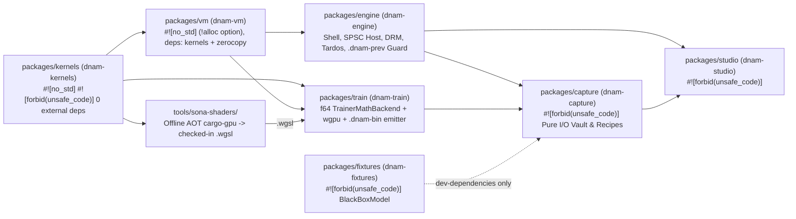

# Rust Implementation, 5-Crate Diamond, Deterministic `dnam-vm`, Shared `no_std` Kernels & C-ABI Specification

This specification defines the normative Rust implementation contracts for **Dynamic Neural Audio Modeler (DNAM)** across the 5-crate workspace diamond: the [shared kernels crate](../../../packages/kernels/README.md) (`dnam-kernels`), the deterministic DSP virtual machine (`dnam-vm`), the [shell and host engine crate](../../../packages/engine/README.md) (`dnam-engine`), the solver and trainer crate (`dnam-train`), and the [pure-I/O capture crate](../../../packages/capture/README.md) (`dnam-capture`), paired with offline AOT shader generation (`tools/sona-shaders/`).

It concretizes the implementation-agnostic [SONA architecture](../architecture/sona_architecture.md), [repository quality rules](../architecture/project_and_documentation_quality.md), and binary container formats under [system goals and requirements](../../requirements/system_goals_and_requirements.md) (REQ-1.6, REQ-1.9, REQ-4.1, REQ-4.2, REQ-6.1–REQ-6.3, REQ-8.8). Architectural rationales appear in [ADR-0015](../../adr/0015-realtime-host-concurrency-spsc-and-telemetry-seqlock.md), [ADR-0018](../../adr/0018-signal-chain-fixtures-crate-and-whitebox-distillation.md), [ADR-0019](../../adr/0019-simd-kernel-architecture-and-realtime-execution-optimizations.md), [ADR-0020](../../adr/0020-modular-monorepo-and-dnam-proj-container.md), and [ADR-0022](../../adr/0022-sona-state-space-operator-and-webgpu-architecture.md).

---

## 1. 5-Crate Diamond DAG, `#![no_std]` / `!alloc` & Safe-Rust Boundaries

`r[sdk.rust.safe-rust-and-boundaries]`

Workspace Rust crates enforce a strict acyclic 5-crate diamond where `dnam-kernels` feeds `dnam-vm`, which splits into sibling `dnam-engine` and `dnam-train`, which rejoin in `dnam-capture`.

Pure-Rust `dnam-kernels`, `dnam-fixtures`, `dnam-capture`, and `dnam-studio` enforce `#![forbid(unsafe_code)]` across every library and binary target.

The VM crate (`dnam-vm`) compiles cleanly as `#![no_std]` with optional std and alloc feature gates, depending strictly on `dnam-kernels` and `zerocopy`. Under `--no-default-features`, `dnam-vm` drops all heap imports by borrowing caller-owned storage:

| Borrowed `#![no_std]` / `!alloc` Surface | Stack / Caller-Owned Representation in `dnam-vm` |
| :--- | :--- |
| **Extended `ModalConvolver` FIR & Delay Tails** | `ColdBuf<'a, T>` on `ConvolverHighSrFirExt<'a>`, `TransportExtStorage::Borrowed*`, and `&'a mut [f32]` `PartitionedSchroederBank` |
| **Control Bus Parameters & Rules** | Inlined `SonaControlBusParams` inside `SonaColdTail<'a>` plus `ControlBusBacking<'a>` over caller-owned descriptor, contributor, and `CP1` overflow slices |
| **Arena Slab Backing** | `ArenaStorage::Borrowed` slice bindings paired with fixed active-hot cache-line slabs |

`dnam-vm` enforces zero JSON parsing, zero cryptography, and zero 64-bit trainer math, operating strictly as a pure 2-in / 2-out binary DSP register machine (1→1, 2→1, 1→2, 2→2 across `SensoryQuad`, `CoreQuad`, `ModalConvolver`, `LinearReadout`, symmetric `TransportQuad`, and `ControlBus`) with zero clean-path crossovers, host freeze flags, or multi-port patchbay state.

`SonaVm::open_dnam_bin` opens bare `.dnam-bin` (`"DNBN"`) images in under 50 ns via zero-copy `zerocopy` borrows.

`dnam-engine` (`packages/engine`) wraps `SonaVm` over `extract_dnam_bin(bytes)` as the outer Host-Shell 8-Port Patchbay (4CM/WDW, `S_router`, `ParallelAlignLine`, post-VM `ms_width`), .dnam / .dnam-seal / .dnam-prev shell, SPSC host, Ed25519 / ChaCha20 DRM layer, Tardos watermarker, and C-ABI boundary.

It forbids dependencies on `dnam-train`, `dnam-capture`, `dnam-fixtures`, or trainer math backends, exposing zero clean-path crossovers, host freeze methods, or string heuristics.

`dnam-train` sits as an independent sibling to `dnam-engine`, depending on `dnam-kernels`, `dnam-vm`, and optional `wgpu`.

It owns `TrainerMathBackend`, persistent `GpuTrainArena` pooling, CPU and checked-in `.wgsl` forward/adjoint runners, and `.dnam-bin` emission without depending on `dnam-engine` or `dnam-fixtures`.

Training solves run full-subspace AdamW, L-SSBroyden (m = 16..32, < 64 MiB WASM CPU worker), VarPro, and CP1 fitting with 3-phase register clamping.

Sibling `dnam-capture` executes solely over pure in-memory audio and container buffers without Python, PyTorch, CUDA, clap, cpal, or external linear-algebra dependencies (`REQ-1.6`, `REQ-1.9`, [ADR-0020](../../adr/0020-modular-monorepo-and-dnam-proj-container.md)), passing full-coreset `Pass1ProbeResult` physics once across passes without duplicate probing.

Ground-truth fixtures (`dnam-fixtures`) remain confined to `[dev-dependencies]` and never appear in `dnam-kernels`, `dnam-vm`, `dnam-engine`, `dnam-train`, or non-test capture sources (`ref[repo.code.universal-black-box]`).

`dnam-vm`, `dnam-engine`, and `dnam-train` set `#![deny(unsafe_code)]` at crate root while pinning `#![forbid(unsafe_code)]` across `.dnam-bin` `zerocopy` parsing, `SonaVm`, containers, operators, graph, host concurrency, provenance, and schemas:

| Permitted `#[allow(unsafe_code)]` Scope | Normative Boundary & Proof Requirement |
| :--- | :--- |
| **`f32` SIMD Intrinsics (`dnam-vm::math`)** | Bounded 32-bit hardware intrinsics (`aarch64`, `x86_64`, `wasm32`) implementing `SimdVec4` and `MathBackend` with `target_os = "linux"` gated `mrs` and safe `!std` fallbacks. |
| **Hardware FP CSR (`dnam-vm::types`)** | `FtzDazGuard` inline assembly saving and restoring `FPCR` on `aarch64` or `MXCSR` on `x86_64` at audio block entry and exit. |
| **`f64` Trainer SIMD (`dnam-train::math`)** | Bounded 64-bit vector intrinsics implementing `TrainerMathBackend` (`aarch64` NEON/SVE2/SME, `x86_64` AVX2+FMA, `wasm32` f64) isolated out of `dnam-vm` and `dnam-engine`. |
| **HW SHA-256 & C-ABI (`dnam-engine`)** | `dnam_engine::provenance::sha256_hw` SHA intrinsics plus `#[unsafe(no_mangle)] extern "C"` entrypoints in `dnam_engine::ffi` with null, length, and aliasing checks plus `// SAFETY:` proofs. |

---

## 2. Hierarchical Rust Layout, `const_eval` & Property Testing

`r[sdk.rust.modular-layout-and-proptest]`

All Rust crates follow the Rust 2018+ nested module tree (`src/<module>.rs` to `src/<module>/<sub_aspect>.rs` to `src/<module>/<sub_aspect>/<leaf>.rs`) with zero `mod.rs` files anywhere under `packages/` (`ref[repo.code.modular-decomposition-and-tests]`). Every `.rs` source and test file stays strictly below 900 lines, targeting 250–650 lines per cohesive submodule.

Compile-time constant evaluators (`pub const fn`) live in `dnam_kernels::simd::const_eval` and `dnam_vm::math::const_eval`. Derived trigonometric poles, IEEE-754 seeds, passband ceilings, and 64 B wire offsets are verified with `const _: () = assert!(...)` assertions (`ref[repo.code.constant-eval-and-derivations]`).

Leaf unit tests and `proptest!` suites live inside inline `#[cfg(test)] mod tests { ... }` blocks at the bottom of each production module, with zero production code following test blocks inside `packages/kernels/src/` and `packages/vm/src/`.

Standalone unit-test files, external test module declarations inside crate sources, and grab-bag `*_coverage.rs` integration files are prohibited. Shared helper utilities belong strictly in `test_support.rs`, `test_utils.rs`, or `testing.rs`.

---

## 3. Single-Source `#![no_std]` Shared Kernels & Checked-In AOT WGSL Pipeline

`r[sdk.rust.shared-nostd-kernels]`

All shared 32-bit SONA operator math lives in `dnam-kernels` under `packages/kernels/` with `#![no_std]`, `#![forbid(unsafe_code)]`, and zero external crate dependencies (REQ-4.1, REQ-4.2, [ADR-0022](../../adr/0022-sona-state-space-operator-and-webgpu-architecture.md)). Non-test kernel code forbids 64-bit floats (`f64`) and 64/128-bit integer scalar types outside host-only non-SPIR-V items.

| Shared `dnam-kernels` Module | Normative 32-Bit Primitives & Traits | Target Compilation & Parity |
| :--- | :--- | :--- |
| **SIMD, Constants & Codecs (`simd`)** | `KernelVec4`, `GpuVec4`, `StereoVec8`, `const_eval` (`SonaTierSpec`, `LITE_SPEC`..`ULTRA_SPEC`), `OS2X` midpoint helpers, software `fp16` codecs, and subnormal flushing | Identical LLVM CPU vector and `spirv-unknown-naga-wgsl` lowering; zero `f64`/`u64` runtime ops |
| **SONA Core & Scans (`sona_core`)** | `SensoryQuad`, passive 2×2 & Block 0 PHS `TPT-SVF` (`step_tpt_svf_phs_stereo8`, `CoreQuadParamsStereo4` 24 fields / `25 × Vec4` shader ABI, `TptScanElem`, `TptAdjointElem`), Selective-Duhem ParaLRU + `lru_stereo_link` (`LinearScanElem`), pure `f32` PolyADAA1 + branchless C² wavefolder (`wavefolder_mix_fp16` bit-15 `rect_sign`) + bounded cross-lane `GLU` + smooth raised-cosine/Fourier `Op-N[Pre]` + `KernelVec4::rcp_pos_quad_nr2` | Exact 0-ULP same-FMA-class CPU ParaLRU forward parity (8-lane stereo == interleaved 4-lane == lane-0 tile); <= 1.5 ULP/step FMA vs non-FMA CPU/WGSL parity |
| **Modal & Transport (`modal_and_transport`)** | `KautzQuadState`, `ComplexModalScanElem`, `PhasorQ32Bank4`, orthogonal pure-wet 4-lane `Op-T` + continuous `freeze_mix` + WGSL-safe triangle fold (`((p as i32) >> 31) as u32`) + unified `sigma_sat` `coercive_loop_limit_vec4` + fused `SO(4)` `R_odd`/`R_even` scattering rotor primitives, stereo 6-pair Elliptic `HilbertH1StereoKernel` (248 B stereo kernel in `SonaLiteHotPrefix`), mono `HilbertH1Kernel`, `T1DcBlockerStereo` (24 B), and 2-stage `rsqrt_pos_nr3` `T1SubHarmonicKernel` (28 B) | Shared CPU and GPU physics evaluation (<= 1e-4 * max(1.0, peak) on 256-wide linear scans; 0-ULP `process(1) == process(4) == process(16)`) |
| **Ozaki Integer Slices (`ozaki_i32`)** | `pow2_ceil_fp32`, `round_ties_even_f32`, `slice_f32_mantissa_i8x3`, `accum_ozaki_chunk_i32`, and host `reconstruct_ozaki_dot_f64` | Exact 0-ULP 32-bit `i32` Ozaki contraction parity across WebGPU drivers (REQ-4.2) |

Under the Shared no_std Kernels and Checked-In AOT WGSL pipeline, `tools/sona-shaders/` compiles `dnam-kernels` offline via `cargo-gpu` targeting `spirv-unknown-naga-wgsl` and checks in validated `.wgsl` artifacts for `dnam-train`.

The AOT WGSL shader suite defines seven compute kernels: `prescreen_population`, `fused_core_scan_256`, `adjoint_scan_256`, `tile_mix_fwd_adj`, `gabor_bezout_grad`, `ozaki_gram_rhs_i32`, and `inner_opt_step`.

Workgroup SRAM (`var<workgroup>`) is capped at 15,872 B (15.5 KiB) to reserve at least 512 B for driver scratch: forward `fused_core_scan_256` (15,360 B) steps two sequential 128-frame sub-tiles concurrently across 4 lanes in lane-major scalar shared storage, while backward `adjoint_scan_256` (14,848 B) launches parallel tile workgroups stepping per-lane 256-wide Hillis-Steele suffix scans.

Persistent `GpuTrainArena` pooling runs 16,384-frame streamed 2× time-blocks via double-buffered `(RW)` `exit_adj_boundary` (<= 128 MiB binding, < 256 MiB browser / < 512 MiB desktop) alongside `(1, num_candidates, 1)` `inner_opt_step` (`m <= 32`) and 2D split-64 Ozaki reductions (<= 1.2 MiB Ultra readback, 0 KB shader bloat in `dnam.wasm`).

---

## 4. Tiered Serialization & Declarative `zerocopy` Wire / Arena Structs

`r[sdk.rust.zerocopy-wire-structs]`

DNAM partitions persistence, canonical manifests, cross-language RPCs, and internal Rust IPC across four normative serialization mechanisms ([ADR-0023](../../adr/0023-tiered-serialization-and-ipc-formats.md), [ADR-0022](../../adr/0022-sona-state-space-operator-and-webgpu-architecture.md)):

| Use Case in DNAM | Canonical Format / Crate | Normative Boundary Scope |
| :--- | :--- | :--- |
| **Fixed binary headers, descriptors, arenas & seqlocks** | **`zerocopy 0.8`** (`FromBytes` / `IntoBytes` + `little_endian::*`) | Fixed-layout `.dnam-bin`, `.dnam`, `.dnam-seal`, `.dnam-prev`, `.dnam-proj`, `Arena0..3`, `DNPR` lock-free telemetry packets, `DnwbHeader64BWire` sample frame preambles, and WAV headers (`#![forbid(unsafe_code)]`, `!alloc` compatible). |
| **Container manifests & presets** | **`serde_json` + RFC 8785 JCS** | `.dnam` immutable JSON header, `DMU1`/`DME1` mutable presets and catalog metadata, and `.dnam-proj` RFC 8785 JCS project manifests for deterministic cryptographic hashing. |
| **Binary RPC / APIs** | **`buffa` (Protobuf Editions)** | Schema-evolving binary service RPCs and cross-language structured protocol messages requiring forward/backward field evolution. |
| **Closed, ephemeral `#![no_std]` Rust ↔ Rust IPC** | **`postcard`** (or **`zerocopy 0.8`** on latency/throughput hot paths) | Compact variable-length local control messages exchanged exclusively between coupled Rust endpoints built from the same workspace revision (e.g., `DNWB` white-box subprocess control handshakes); fixed `zerocopy 0.8` wire structs remain permitted whenever `postcard` cannot meet latency or throughput requirements (e.g., lock-free `DNPR` seqlocks, streaming `DnwbHeader64BWire` audio frames, or hot-path IPC buffers). |

Every fixed-size binary preamble, directory, `.dnam-bin` header, tier arena, descriptor, project vault chunk, fixed IPC/seqlock frame header, and audio file header uses declarative `#[repr(C)]` `zerocopy` little-endian structs under `#![forbid(unsafe_code)]` (REQ-8.8, [ADR-0022](../../adr/0022-sona-state-space-operator-and-webgpu-architecture.md), [ADR-0023](../../adr/0023-tiered-serialization-and-ipc-formats.md)). Wire fields must use `zerocopy::byteorder::little_endian` scalar types or fixed `[u8; N]` arrays rather than untyped slices.

Every fixed wire struct derives `FromBytes`, `IntoBytes`, `KnownLayout`, and `Immutable`, adding `Unaligned` wherever cast from arbitrary byte slices. Compile-time `core::mem::size_of`, `align_of`, and `offset_of!` assertions verify every struct's exact footprint and alignment.

All parsing and serialization of fixed binary wire structs execute exclusively via safe `zerocopy` operations (`ref_from_bytes`, `read_from_prefix`, `write_to_prefix`, and `as_bytes`). Manual `from_le_bytes` or `to_le_bytes` byte-offset slicing is prohibited across wire, container, and arena modules.

| Container / Protocol Domain | Canonical `zerocopy` Wire Structs | Normative Layout Specification |
| :--- | :--- | :--- |
| **Layer 0 `.dnam-bin` (`dnam-vm`)** | `DnamBinHeaderWire` (64 B `[0..64)` `"DNBN"`, `Unaligned`, `max_present_tier`, `flags`, `num_controls`, `tsyn_count`, `reference_sample_rate_hz`, `prefix_crc32c`, `arena0_offset`, `tier_end_offsets[4]`, `tier_arena_crc32c[4]`), `DnamBinRuntimeMetaWire` (64 B `[64..128)` `"DBRM"`, `Unaligned`, `shared_controls_{offset,len}`, `tsyn_{offset,len}`, `cext_{offset,len}`, `ext_ring_{pow2_frames,lines,format}`, `content_hash_prefix: [u8; 8]`, `cp1_overflow_bytes`, `ro_pole_48k` at bytes 44..48), `TempoSyncEntryWire` (40 B, `Unaligned`, `PeriodMs`/`FrequencyHz` + Lobatto anchors + switch cond) | [dnam_binary_format.md §1](../containers/dnam_binary_format.md#1-hybrid-binary-container-wire-framing---50-ns-zero-json-hardware-fast-path) |
| **Layer 1 `.dnam` & Descriptors** | `DnamPreambleWire`, `DnamDirectoryWire` (`dbin_offset`, `dbin_prefix_bytes`, `shared_binary_length == 0` when `dbin_prefix_bytes > 0`), `Dmu1HeaderWire`, `Dme1HeaderWire`, `DmueFooterWire`, `DcrcAuthRecordWire` (`[32..36)` `crc_dbin_prefix`), `ControlClampDescriptorWire`, `ConditionalClampRuleWire` | [dnam_binary_format.md §1](../containers/dnam_binary_format.md#1-hybrid-binary-container-wire-framing---50-ns-zero-json-hardware-fast-path) |
| **SONA Nested Arenas (0..3)** | `SonaCellDescWire`, `CrossbarWire` (256 B with `SensoryQuad`, `crossbar_op_gains_fp16` at `[120..124)`, and `OpNPreBaseWire` 12 B at `[180..192)`), `CoreQuadWire` (192 B, `wavefolder_mix_fp16` bit-15 `rect_sign` at `[128..136)` + `svf_k_nl_fp16` at `[136..144)` Block 0 only), `Arena0LiteWire`..`Arena3UltraDeltaWire`, `ConvolverFir16Wire`..`ConvolverFir48Wire`, `KautzSoaBlockWire`, `TransportQuadWire` (128 B, `align(1)`, `Unaligned`, `delay_samples[4]`, `ramp_spans_samples[4]`, `reserved_52_56`, `freeze_mix_fp16`, `sigma_knee_fp16 <= 0x3BE0`, `scat_psi_fp16` at `[120..122)`), `LinearReadoutLiteWire`..`LinearReadoutUltraWire`, `Arena0ControlBusWire` (`[16..32)` `{ lfo_skew_fp16, tank_dry_mix_fp16, reserved_ctrl_fp16, ou_to_z_stage_fp16 }`), `Arena3ControlBusWire` (`ou_to_z_stage_ultra_fp16[4]` at `[160..164]`) | [dnam_binary_format.md §2](../containers/dnam_binary_format.md#2-tier-prefix-hardware-loading) |
| **`.dnam-seal` (`DNSL`) DRM** | `DnslPreambleWire`, `DnslDirectoryWire`, `DnplPreambleWire`, `InnerDirectoryWire`, `Dsa1ManifestHeaderWire`, `HpkeSlotWire`, `RecordDirEntryWire` | [provenance_and_enclave_drm.md §3](../security/provenance_and_enclave_drm.md#3-pillar-2-hardware-enclave--oem-drm-oemdevicecertificate-attestation--dnam-seal-dnsl-wrapper) |
| **Layer 2 `.dnam-proj`, `DNWB` & WAV** | `DnamProjPreambleWire`, `ProjChunkDirEntryWire`, `CalbChunkWire`, `InpcCapsuleHeaderWire`, `StmcCapsuleHeaderWire`, `StmcTrajectoryWindowWire`, `ProjAuthRecordWire`, `DnwbHeader64BWire`, `DnprProgressWire` (256 B seqlock telemetry), and WAV `RIFF`/`fmt `/`data` headers | [project_container_format.md §1–§3](../containers/project_container_format.md#1-front-loaded-cloud-ready-wire-framing--chunk-directory) |

In `.dnam-bin`, `shared_controls` at `shared_controls_offset` packs `ControlClampDescriptorWire` (carrying up to 3 inline `ConditionalClampRuleWire` slots, failing closed above 3 rules) and optional `"CP1\0"` overflow bytes padded to 64 B.

Bare `TempoSyncEntryWire` entries and unwatermarked `"CEXT"` (0 or 1,280 B: 1,024 B base plus 256 B Ultra extension) follow directly ahead of `arena0_offset`.

Zero-mutation `REQ-5.6` prefix truncation matches `bytes.len() == tier_end_offsets[t]` (`t <= max_present_tier`), checks `prefix_crc32c`, and validates `tier_arena_crc32c[t]` without mutating headers.

---

## 5. Explicit Two-Level SIMD Traits, `SonaVm`, `ControlBus` & Active-Hot L1D Slab

`r[sdk.rust.explicit-simd-and-coverage]`

CPU vector backends implement a two-level trait hierarchy across `dnam-kernels`, `dnam-vm`, `dnam-train`, and `dnam-engine` (REQ-6.1, [ADR-0019](../../adr/0019-simd-kernel-architecture-and-realtime-execution-optimizations.md)).

Level 1 in `dnam-vm` defines 32-bit `SimdVec4`, `MathBackend`, and `Crc32cBackend` alongside startup capability probing (`CpuSimdLevel`, `detect_cpu_simd_features`, `warm_simd_feature_caches`).

Sibling `dnam-train` owns the offline 64-bit training traits (`TrainerMathBackend` and `Wide192Accum`), isolated out of runtime crates.

Level 2 domain traits extend those primitives without upward dependencies via `ConvolverBackend` and `GraphBackend` under `dnam-vm::graph`, plus `EngineBackend` in `dnam-engine`.

All eight ISA implementations compile into one single library per target architecture with lock-free cached runtime dispatch, gating `aarch64` `mrs` probing under `target_os = "linux"`, using `cpuid` plus `XGETBV` on x86_64, and falling back to compile-time `target_feature` on bare-metal `!std` targets.

Wrapper `macro_rules!` SIMD generators and `coverage(off)` attributes are forbidden under the 95% coverage gate, with cross-ISA parity verified across NEON, SVE2/SME (`engine:test-sve2` and `dnam-vm`), and `x86_64` (`engine:test-x86` Rosetta 2 emulation).

| ISA Backend Implementation | Target Architecture & Verification Gate | Dispatch & Register Model |
| :--- | :--- | :--- |
| `NeonBackend`, `ArmSve2Backend`, `ArmSmeBackend` | `aarch64` (`dnam-vm` + `engine:test-sve2`) | NEON 4-lane, SVE2 8-lane `StereoVec8`, SME vector-pair dispatch via `AtomicU8` cache |
| `X86Sse2Backend`, `X86Sse42Backend`, `X86Avx2FmaBackend` | `x86_64` (`dnam-vm` + `engine:test-x86`) | SSE2/SSE4.2 4-lane and AVX2+FMA 256-bit `StereoVec8` via `cpuid` + `XGETBV` cache |
| `WasmSimd128Backend`, `ScalarBackend` | `wasm32` (`simd128`) & portable scalar fallback | Interleaved 4-lane SIMD128 pairs and scalar reference with 0-ULP `rsqrt_nr2_pair_f32` parity |

To keep `SonaVm` working sets strictly inside the 64 KiB L1D limit across 14×/8×/4×/2× concurrent instances, `dnam-vm` packs hot audio state into `#[repr(C, align(64))]` `SonaHotSlab` prefixes stepped in 4-frame causal micro-chunks and 16-frame 3 kHz ticks with continuous 4-lane crossfading and dual-latch write-enable control:

| `SonaVm` Active-Hot Struct | Verified Footprint & Alignment | Contained Hot State & Causal Micro-Chunk Invariant |
| :--- | :---: | :--- |
| `SonaLiteHotPrefix` | 4,544 B (71 CL <= 4,608 B) | 14 × 4,544 = 63,616 B <= 65,536 B; `hp_lp_pole` + `hp_lp_state` (12 B ahead of `SensoryQuadHotState` 48 B `align(16)` = 0 alignment pad), `HilbertH1StereoKernel` (248 B), `T1DcBlockerStereo` (24 B), 2-stage `T1SubHarmonicKernel` (28 B), `OpNPreHotState` (28 B, `align(4)`), `CoreQuadHot`s, `ro_gains_fp16` (16 B), `carrier_basis_w_fp16` (24 B), `tank_dry_mix_fp16` (2 B), lag-ordered FIR history (32 taps/ch, 256 B), `quad0` (216 B) |
| `SonaOs2xHot` | 256 B (4 CL, `align(64)`) | `SonaOversamplerParams` (32 B) + `SonaStereoOversampler2x` (144 B) + `op_p_prev_iq_lr` (16 B) + `op_p_prev_feat` (16 B) + 48 B pad for linear midpoint 2× interpolation |
| `SonaFullHotDelta` | 2,752 B (cum 7,552 B <= 7,936 B) | Incremental lag-ordered FIR history taps 32..48 (128 B) + Full `CoreQuadHot`/tiles/`ModalConvolver`/Kautz + `quad1` (216 B) |
| `SonaProHotDelta` | 3,584 B (cum 11,136 B <= 15,872 B) | Incremental lag-ordered FIR history taps 48..96 (384 B) + Pro `CoreQuadHot`/tiles/`ModalConvolver`/Kautz + `quad2` (216 B) |
| `SonaUltraHotDelta` | 3,456 B (cum 14,592 B <= 28,672 B) | Incremental lag-ordered FIR history taps 96..128 (256 B) + Ultra `CoreQuadHot`/tiles/`ModalConvolver`/Kautz + `quad3` (216 B) |
| `CoreQuadExtCold` & `CoreQuadReadoutHot` | 48 B/quad (`cold`) / 96 B/quad (`readout`) | `CoreQuadExtCold` holds Block 0 `svf_k_nl_fp16`, Selective-Duhem, stereo-link, `GLU`, and M/S input weights hoisted into `HoistedCoreChunk` via `from_slab` alongside `CoreQuadReadoutHot` |
| `TransportQuadHotCompact` | 216 B (`#[repr(C, align(8))]`) | 64 B DF-I/damp/wet DC states + 32 B `delay_samples`/`ramp_spans_samples` + 48 B scalars + 72 B `we_hold_off`/Q16/`fp16` (`freeze_mix_fp16`, `sigma_sat_fp16 <= 0x3BE0`, `inv_sigma_23_fp16`)/`flags: u8` (`bit 0 = 0` reserved, `bit 1 = QUAD_FLAG_HAS_EXT`, `bit 2 = QUAD_FLAG_HOST_WRITE_LOCK`, bits 3..7 = 0 reserved), paired with lane-major SoA `PartitionedSchroederBank::step_chunk4` cold ring state (`scat_psi_fp16`) |

In `dnam-vm`, `ControlBus` expands `stage_targets` (plus `SonaColdTail.last_stage_targets`, `current_stage_params`, and `stage_ramp_deltas`) to `[f32; 32]`.

Half-open slice `stage_targets[0..16]` (slots 0..=15) retains base stage targets, while `stage_targets[16..32]` (slots 16..=31) maps `"CEXT"` (defaulting to +0.0 when absent), all micro-ramped uniformly across frames:

| `ControlBus` Slot | Target Field | Signal & Control Meaning |
| :---: | :--- | :--- |
| 0..=15 | Base stage targets (`svf_g_oct`..`crossbar_wet_mod`) | `CoreQuad` `TPT-SVF`, `PolyADAA1`, `ParaLRU`, `ModalConvolver` Kautz, `Transport`, and crossbar wet blend |
| 16 | `op_t_freeze_mix_delta` | Uniformly micro-ramped passive recirculation (`mu_freeze` in `[0.0, 1.0]`, pinned 1.0 by `QUAD_FLAG_HOST_WRITE_LOCK`) |
| 17..=21 | `op_t_delay_scale_oct`, `op_t_ramp_rate_hz_delta`, `op_t_lfo_rate_hz_delta`, `op_t_lfo_depth_scale`, `op_t_damp_pole_delta` | `TransportQuad` delay scale, crossfade ramp speed, LFO speed/depth, and damping pole |
| 22..=25 | `op_t_dry_mix_mod`, `op_t_input_gain_mod`, `op_t_window_depth_delta`, `op_t_allpass_g_delta` | Stage-level `tank_dry_mix` blend (`[-2.0, 2.0]`), quad input drive, pitch window depth, and Schroeder allpass feedback |
| 26..=28 | `op_n_pre_{gamma_bc,zoh_hold,beta_q}_delta` | Pre-core bitcrusher wet blend, raised-cosine hold depth, and log2 Fourier staircase bit-depth |
| 29..=31 | `op_p_phasor_rate_oct`, `sense_vca_gain_delta`, `reserved` | Crossbar quadrature carrier octave offset, `SensoryQuad` VCA gain delta (`[-1.0, +1.0]`), and reserved (+0.0) |

`ControlBus` updates execute on every `K_ctrl` boundary whenever controls, tempo entries, internal modulators, dirty state, or analog drift are active.

Slot 16 micro-ramps uniformly into `mu_freeze = clamp(base_freeze_mix + t[16], 0.0, 1.0)`, while `SonaVm::set_quad_write_enable` / `SonaHotSlab::set_op_t_write_enable` updates only bit 2 (`QUAD_FLAG_HOST_WRITE_LOCK`), forcing `mu_freeze = 1.0` and locking delay RAM and Schroeder writes at 0-ULP without a 3 kHz overwrite race.

Hot sub-block, frame-stepping, and control-tick entrypoints carry explicit `#[inline(never)]` markers inside dnam-vm to keep instruction caches compact (`SonaHotSlab::process_tick16_const`, `hoist_core_and_readouts`, `step_frame_sona`, `step_frame_4x_sona`, `step_control_tick_3khz`), while dnam-engine owns multi-port HostShellPatchbay 4CM/WDW routing and post-VM `ms_width`.

Meanwhile `dnam-engine` isolates JSON header parsing (`DnamJsonHeader::from_json_slice`, `DnamJsonHeader::to_json_vec`) out of `dnam-vm`.

---

## 6. Release Binary Disassembly Audit & Source Guardrails

`r[sdk.rust.realtime-disassembly-audit]`

Every `vm:test` and `engine:test` run executes the release-binary disassembly gate (`realtime_disassembly_audit.rs`, REQ-6.2, REQ-6.3, [ADR-0019](../../adr/0019-simd-kernel-architecture-and-realtime-execution-optimizations.md)). It compiles both `libdnam_vm.rlib` and `libdnam_engine.rlib` in `--release`, runs demangled `objdump -dr`, computes the transitive call-graph closure across all real-time roots, and fails on any prohibited instruction or external relocation.

Source-level guardrails additionally forbid float `rem_euclid` and direct float transcendental method calls inside non-test `packages/kernels/src/`, `packages/vm/src/`, and `packages/engine/src/` Rust sources:

| Audited / Prohibited Domain | Tracked Roots, Disallowed Instructions & Relocations |
| :--- | :--- |
| **Audited RT Closure Roots** | `SonaVm` (`process_tick16_const`, `SonaHotSlab`, `ControlBus`, `set_quad_write_enable`, `set_op_t_write_enable`), `SonaInstance`, `DnamEngine`, `DynamicDnamEngine`, `DnamHostHandle`, hot graph/operator entrypoints, and real-time `dnam_engine_*` C-ABI symbols (zero dedicated host freeze exports). |
| **Floating-Point Div / Sqrt** | Hardware `fdiv`, `vdiv*`, `divss`, `divps`, `divsd`, `divpd`, `fsqrt`, `vsqrt*`, `sqrtss`, `sqrtps`, `sqrtsd`, `sqrtpd`. |
| **Integer Div / Remainder** | Hardware `udiv`, `sdiv`, `div`, `divl`, `divq`, `idiv`, `idivl`, `idivq`, and 128-bit helpers `__udivti3`, `__divti3`, `__umodti3`, `__modti3`. |
| **RT Alloc / Uncached Syscall** | Heap symbols `__rust_alloc`, `__rust_dealloc`, `__rust_realloc`, `__rust_alloc_zeroed`, and uncached probes `sysctlbyname`, `getauxval`. |
| **External `libm` Relocation** | Crate-wide relocations to `fmodf`, `fmod`, `sin*`, `cos*`, `tan*`, `exp*`, `log*`, `pow*`, `sqrt*`, `cbrt*`, `hypot*`, `atan*`, `asin*`, `acos*`, `sinh*`, `cosh*`, `tanh*`. |

---

## 7. Real-Time Host Handle, SPSC Ingress, Telemetry Seqlock & C-ABI

`r[sdk.rust.c-abi-and-host-handle]`

Host concurrency primitives under `dnam_engine::host` wrap `SonaVm` over `extract_dnam_bin(bytes)` to decouple real-time audio rendering from UI, MIDI, DAW plugin, and TypeScript worker threads in `#![forbid(unsafe_code)]` Rust (REQ-6.3, [ADR-0015](../../adr/0015-realtime-host-concurrency-spsc-and-telemetry-seqlock.md)).

`dnam_engine::ffi` exposes a null-checked C-ABI surface over `DnamEngineHandle` and `DnamTelemetrySnapshot`. Hardware sustain and infinite-hold controls bind strictly through calibrated `ControlBus` targets (`op_t_freeze_mix_delta` and crossbar wet/dry mix) without dedicated host freeze functions or special freeze enum variants.

| Host / C-ABI Component | Concrete Rust Contract & Real-Time Invariant |
| :--- | :--- |
| **Shell Wrapping & Preview Guard** | `DnamEngine` and `DnamHostHandle` validate `.dnam` / `.dnam-seal` / `.dnam-prev` (`DCRC` `crc_dbin_prefix`, `DAU1`/`DAI1`, `DNSL` `logical_prefix`), apply `PreviewGuardState`, and load `shared_controls` + `"TSYN"` + `"CEXT"` from `dbin_prefix` during both boot and live `reload_model_in_place` (Region 4 = 0 B). |
| **3-Lane SPSC Ingress (`SpscControlRing`)** | `ControlProducer`, `ControlConsumer`, and `AcceptedStateShadow` drain Lane 1 atomic control slots, Lane 2 64-entry discrete ring, and Lane 3 coalescing seqlock latch at sub-block entry (`DEFAULT_HOST_SUBBLOCK_FRAMES = 512`). |
| **29-Word Telemetry Seqlock (`TelemetryReader`)** | 64-byte-aligned `TelemetryCell` (`seq` + 29 `AtomicU64` words) written release/relaxed by `TelemetryWriter` and read wait-free via `TelemetryReader::read_snapshot()` without locking the audio thread. |
| **Ping-Pong Engine Swap (`RealtimeEngineSwap`)** | Pre-warms `Mutex` internals off-RT, polls `try_lock()` on the audio handle without allocating or dropping, and moves displaced engines into an 8-slot retirement array reclaimed non-RT via `reclaim_retired`. |
| **Block FP Environment (`FtzDazGuard`)** | Sets RNE, non-trapping exceptions, and `FPCR.FZ` / conditional `FIZ` (`aarch64`) or `MXCSR` FTZ/DAZ (`x86_64`), restoring prior CSR state on drop, paired with unconditional bitwise/SIMD `NaN`/`±Inf` and subnormal scrubbing on recursive writebacks across all targets. |
| **C/C++ FFI (`dnam_engine_*`)** | Exports `dnam_engine_create_from_bytes`, `dnam_engine_create_with_max_tier`, `dnam_engine_destroy`, `dnam_engine_set_tier`, `dnam_engine_set_max_supported_tier`, `dnam_engine_set_offline_bounce`, `dnam_engine_set_maximize_tier_on_bounce`, `dnam_engine_get_latency_samples`, `dnam_engine_set_sample_rate`, `dnam_engine_set_control_value`, `dnam_engine_set_control_immediate`, `dnam_engine_reset`, `dnam_engine_process_block`, `dnam_engine_process_mono`, and `dnam_engine_get_telemetry` handling null, empty, in-place, and crossed-channel aliasing safely. |
