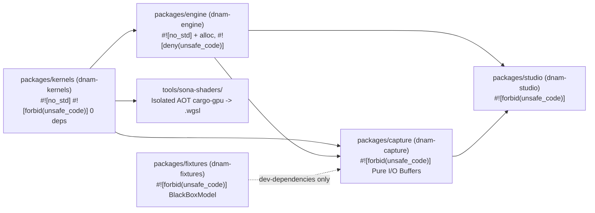

# Rust Implementation, Safe-Rust Engine, Shared `no_std` Kernels & C-ABI Specification

This specification defines the normative Rust implementation contracts for **Dynamic Neural Audio Modeler (DNAM)** across the [shared kernels crate](../../../packages/kernels/README.md) (`dnam-kernels`), the [real-time engine crate](../../../packages/engine/README.md) (`dnam-engine`), the [pure-I/O capture crate](../../../packages/capture/README.md) (`dnam-capture`), and offline AOT shader generation (`tools/sona-shaders/`).

It concretizes the implementation-agnostic [SONA architecture](../architecture/sona_architecture.md), [repository quality rules](../architecture/project_and_documentation_quality.md), and binary container formats under [system goals and requirements](../../requirements/system_goals_and_requirements.md) (REQ-1.6, REQ-1.9, REQ-4.1, REQ-4.2, REQ-6.1–REQ-6.3, REQ-8.8). Architectural rationales appear in [ADR-0015](../../adr/0015-realtime-host-concurrency-spsc-and-telemetry-seqlock.md), [ADR-0018](../../adr/0018-signal-chain-fixtures-crate-and-whitebox-distillation.md), [ADR-0019](../../adr/0019-simd-kernel-architecture-and-realtime-execution-optimizations.md), [ADR-0020](../../adr/0020-modular-monorepo-and-dnam-proj-container.md), and [ADR-0022](../../adr/0022-sona-state-space-operator-and-webgpu-architecture.md).

---

## 1. Crate Dependency DAG, Safe-Rust Boundaries & Isolated Tooling

`r[sdk.rust.safe-rust-and-boundaries]`

Workspace Rust crates enforce a strict one-way dependency DAG across both packages and internal engine layers (`dnam-engine -> graph -> operators -> math -> dnam-kernels`). Pure-Rust `dnam-kernels`, `dnam-fixtures`, `dnam-capture`, and `dnam-studio` enforce `#![forbid(unsafe_code)]` across every library and binary target.

`dnam-capture` executes solely over pure in-memory audio and container buffers without Python, PyTorch, CUDA, CLI parsers (`clap`), audio device drivers (`cpal`), or TOML/FFT/linear-algebra dependencies (REQ-1.6, REQ-1.9, [ADR-0020](../../adr/0020-modular-monorepo-and-dnam-proj-container.md)). Ground-truth fixtures (`dnam-fixtures`) remain confined to dev-dependencies and never appear inside non-test capture sources (`ref[repo.code.universal-black-box]`).

The `dnam-engine` root (`packages/engine/src/lib.rs`) sets `#![deny(unsafe_code)]` while pinning `#![forbid(unsafe_code)]` on all safe subdomains, covering containers, controls, dynamic dispatch, engine core, `graph/`, host concurrency, memory allocation, operators, provenance, schemas, and test support. Offline shader generation under `tools/sona-shaders/` stays isolated from default workspace builds on stable Rust.

| Permitted `#[allow(unsafe_code)]` Scope | Normative Boundary & Proof Requirement |
| :--- | :--- |
| **CPU Intrinsics (`packages/engine/src/math/`)** | Bounded hardware vector intrinsics (`aarch64`, `x86_64`, `wasm32`) implementing `SimdVec4` and `MathBackend` with safe fallbacks. |
| **Hardware FP CSR (`packages/engine/src/types.rs`)** | `FtzDazGuard` inline assembly saving and restoring `FPCR` on `aarch64` or `MXCSR` on `x86_64` at audio block entry and exit. |
| **Raw C-ABI Boundary (`packages/engine/src/ffi.rs`)** | `#[unsafe(no_mangle)] extern "C"` entrypoints converting caller pointers after null, length, and aliasing checks with complete `// SAFETY:` proofs. |
| **Benchmark-Proven RT Bottlenecks** | Permitted elsewhere only when profiling proves safe bounds checks violate REQ-6.1 WCET budgets, paired with complete `// SAFETY:` proofs covering aliasing, alignment, lifetimes, and thread safety. |

---

## 2. Hierarchical Rust Layout, `const_eval` & Property Testing

`r[sdk.rust.modular-layout-and-proptest]`

All Rust crates follow the Rust 2018+ nested module tree (`src/<module>.rs` to `src/<module>/<sub_aspect>.rs` to `src/<module>/<sub_aspect>/<leaf>.rs`) with zero `mod.rs` files anywhere under `packages/` (`ref[repo.code.modular-decomposition-and-tests]`). Every `.rs` source and test file stays strictly below 900 lines, targeting 250–650 lines per cohesive submodule.

Compile-time constant evaluators (`pub const fn`) live in `dnam_kernels::simd::const_eval` and `packages/engine/src/math/const_eval.rs`. Derived trigonometric poles, IEEE-754 seeds, passband ceilings, and 64-byte wire offsets are verified with `const _: () = assert!(...)` assertions (`ref[repo.code.constant-eval-and-derivations]`).

Leaf unit tests and `proptest!` suites live inside inline `#[cfg(test)] mod tests { ... }` blocks at the bottom of each production module, with zero production code following test blocks inside `packages/kernels/src/`.

Standalone unit-test files, external test module declarations inside crate sources, and grab-bag `*_coverage.rs` integration files are prohibited. Shared helper utilities belong strictly in `test_support.rs`, `test_utils.rs`, or `testing.rs`.

---

## 3. Single-Source `#![no_std]` Shared Kernels & AOT WGSL Parity

`r[sdk.rust.shared-nostd-kernels]`

All shared 32-bit SONA operator math lives in `dnam-kernels` under `packages/kernels/` with `#![no_std]`, `#![forbid(unsafe_code)]`, and zero external crate dependencies (REQ-4.1, REQ-4.2, [ADR-0022](../../adr/0022-sona-state-space-operator-and-webgpu-architecture.md)). Non-test kernel code forbids 64-bit floats (`f64`) and 64/128-bit integer scalar types outside host-only non-SPIR-V items.

| Shared `dnam-kernels` Module | Normative 32-Bit Primitives & Traits | Target Compilation & Parity |
| :--- | :--- | :--- |
| **SIMD, Constants & Codecs (`simd`)** | `KernelVec4`, `GpuVec4`, `StereoVec8`, `const_eval` (`SonaTierSpec`, `LITE_SPEC`..`ULTRA_SPEC`), software `fp16` codecs, and subnormal flushing | Identical LLVM CPU vector and `spirv-unknown-naga-wgsl` lowering; zero `f64`/`u64` runtime ops |
| **SONA Core & Scans (`sona_core`)** | Passive 2×2 TPT-SVF step/compose (`TptScanElem`, `TptAdjointElem`), ParaLRU step/scans (`LinearScanElem`), pure `f32` PolyADAA1 + C² wavefolder + `KernelVec4::rcp_pos_quad_nr2` | Exact 0-ULP CPU ParaLRU forward parity; <= 1.5 ULP/step WGSL FMA operator parity |
| **Modal & Transport (`modal_and_transport`)** | `KautzQuadState`, `ComplexModalScanElem`, `PhasorQ32Bank4`, Op-T Catmull-Rom / grain / barberpole readers + `coercive_loop_limit_vec4`, `HilbertH1Kernel`, `T1SubHarmonicKernel` | Shared CPU and GPU physics evaluation (<= 1e-4 * max(1.0, peak) on 256-wide linear scans) |
| **Ozaki Integer Slices (`ozaki_i32`)** | `pow2_ceil_fp32`, `round_ties_even_f32`, `slice_f32_mantissa_i8x3`, `accum_ozaki_chunk_i32`, and host `reconstruct_ozaki_dot_f64` | Exact 0-ULP 32-bit `i32` Ozaki contraction parity across WebGPU drivers (REQ-4.2) |

Offline shader generation under `tools/sona-shaders/` compiles `dnam-kernels` via `cargo-gpu --target spirv-unknown-naga-wgsl` and checks in `naga`-validated compute artifacts. Default workspace builds stay on stable Rust with zero shader bytes added to `dnam.wasm`, while CI verifies zero drift between kernel Rust sources and checked-in `.wgsl` outputs.

---

## 4. Declarative `zerocopy` Wire & Arena Structs

`r[sdk.rust.zerocopy-wire-structs]`

Every binary preamble, directory, tier arena, descriptor, project vault chunk, IPC header, and audio file header uses declarative `#[repr(C)]` `zerocopy` little-endian structs under `#![forbid(unsafe_code)]` (REQ-8.8, [ADR-0022](../../adr/0022-sona-state-space-operator-and-webgpu-architecture.md)). Wire fields must use `zerocopy::byteorder::little_endian` scalar types or fixed `[u8; N]` arrays rather than untyped slices.

Every wire struct derives `FromBytes`, `IntoBytes`, `KnownLayout`, and `Immutable`, adding `Unaligned` wherever cast from arbitrary byte slices. Compile-time `core::mem::size_of` and `align_of` static assertions must verify every struct's exact footprint and alignment.

All parsing and serialization execute exclusively via safe `zerocopy` operations (`ref_from_bytes`, `read_from_prefix`, `write_to_prefix`, and `as_bytes`). Manual `from_le_bytes` or `to_le_bytes` byte-offset slicing is prohibited across wire, container, and arena modules.

| Container / Protocol Domain | Canonical `zerocopy` Wire Structs | Normative Layout Specification |
| :--- | :--- | :--- |
| **`.dnam` Framing & Descriptors** | `DnamPreambleWire`, `DnamDirectoryWire`, `Dmu1HeaderWire`, `Dme1HeaderWire`, `DmueFooterWire`, `DcrcAuthRecordWire`, `ControlClampDescriptorWire`, `ConditionalClampRuleWire` | [dnam_binary_format.md §1](../containers/dnam_binary_format.md#1-hybrid-binary-container-wire-framing---50-ns-zero-json-hardware-fast-path) |
| **SONA Nested Arenas (0..3)** | `SonaCellDescWire`, `CrossbarWire`, `Arena0LiteWire`..`Arena3UltraDeltaWire`, `CabinetFir16Wire`, `CabinetFir32Wire`, `CabinetFir48Wire`, `KautzSoaBlockWire`, `TankQuadWire`, `VarProReadoutLiteWire`..`VarProReadoutUltraWire`, `Arena0ControlBusWire`, `Arena3ControlBusWire` | [dnam_binary_format.md §2](../containers/dnam_binary_format.md#2-tier-prefix-hardware-loading) |
| **`.dnam-seal` (`DNSL`) DRM** | `DnslPreambleWire`, `DnslDirectoryWire`, `DnplPreambleWire`, `InnerDirectoryWire`, `Dsa1ManifestHeaderWire`, `HpkeSlotWire`, `RecordDirEntryWire` | [provenance_and_enclave_drm.md §3](../security/provenance_and_enclave_drm.md#3-pillar-2-hardware-enclave--oem-drm-oemdevicecertificate-attestation--dnam-seal-dnsl-wrapper) |
| **`.dnam-proj`, `DNWB` & WAV** | `DnamProjPreambleWire`, `ProjChunkDirEntryWire`, `CalbChunkWire`, `InpcCapsuleHeaderWire`, `StmcCapsuleHeaderWire`, `StmcTrajectoryWindowWire`, `ProjAuthRecordWire`, `DnwbHeader64BWire`, and WAV `RIFF`/`fmt `/`data` headers | [project_container_format.md §1–§3](../containers/project_container_format.md#1-front-loaded-cloud-ready-wire-framing--chunk-directory) |

---

## 5. Explicit Two-Level SIMD Traits, Coverage & Cache-Locked Layout

`r[sdk.rust.explicit-simd-and-coverage]`

CPU vector backends implement a two-level trait hierarchy across `packages/kernels/` and `packages/engine/` (REQ-6.1, [ADR-0019](../../adr/0019-simd-kernel-architecture-and-realtime-execution-optimizations.md)). Level 1 (`math/`) defines `SimdVec4`, `MathBackend`, `TrainerMathBackend`, and `Crc32cBackend`.

Level 2 domain traits extend those core vector primitives without upward dependencies via `CabinetBackend`, `GraphBackend` under `graph/`, and `EngineBackend`. All eight ISA implementations compile into one single library per target architecture with lock-free cached runtime capability dispatch.

Wrapper `macro_rules!` SIMD generators and `coverage(off)` attributes are forbidden under the 95% coverage gate, with cross-ISA parity verified under `engine:test-sve2` (`backend_parity` + `sona_extended_pipeline`) and `engine:test-x86` (`x86_64-apple-darwin` Rosetta 2 emulation).

| ISA Backend Implementation | Target Architecture & Verification Gate | Dispatch & Register Model |
| :--- | :--- | :--- |
| `NeonBackend`, `ArmSve2Backend`, `ArmSmeBackend` | `aarch64` (`engine:test` + `engine:test-sve2`) | NEON 4-lane, SVE2 8-lane `StereoVec8`, SME vector-pair dispatch via `AtomicU8` cache |
| `X86Sse2Backend`, `X86Sse42Backend`, `X86Avx2FmaBackend` | `x86_64` (`engine:test-x86` Rosetta 2 emulation) | SSE2/SSE4.2 4-lane and AVX2+FMA 256-bit `StereoVec8` via `cpuid` + `XGETBV` cache |
| `WasmSimd128Backend`, `ScalarBackend` | `wasm32` (`simd128`) & portable scalar fallback | Interleaved 4-lane SIMD128 pairs and scalar reference with 0-ULP `rsqrt_nr2_pair_f32` parity |

To preserve L1I locality, cut cross-CGU monomorphization bloat, and keep `SonaInstance` working sets inside the 64 KiB L1D limit (4,608 / 7,936 / 15,872 / 28,672 B across Lite..Ultra), `dnam-engine` uses pre-faulted 64-byte `AlignedBuffer<CacheLine64>` storage for container arenas (`memory.rs`).

Real-time execution structs enforce 64-byte cache-line alignment directly via `#[repr(C, align(64))]` on `SonaHotSlab` and `ControlBus`, while `OpTDelayLine` and quad tank hot structs (`TankQuadHotCompact`, `#[repr(C, align(16))]`) pack inline L1D ring/frame buffers inside stack and slab state.

Hot sub-block, frame-stepping, control-tick, and JSON header entrypoints carry explicit non-inlining markers to keep instruction caches compact:

| Annotated `#[inline(never)]` Entrypoint | Architectural & Codegen Invariant |
| :--- | :--- |
| `SonaHotSlab::process_tick16_const`, `hoist_groups_and_readouts` | Hoists 16-frame register-resident SONA core, FIR, Kautz, and readout state without L1I thrashing or stack spills. |
| `step_frame_sona`, `step_frame_4x_sona`, `step_frame_4port_sona`, `step_frame_4x_4port_sona` | Isolates per-frame stereo, 4× oversampled, and 4-port router stepping inside compact L1I-resident loops. |
| `step_control_tick_3khz`, `DnamJsonHeader::from_json_slice`, `DnamJsonHeader::to_json_vec` | Prevents duplicate 3 kHz control and `serde_json` codegen across compilation units while cutting binary size. |

---

## 6. Release Binary Disassembly Audit & Source Guardrails

`r[sdk.rust.realtime-disassembly-audit]`

Every `engine:test` run executes the release-binary disassembly gate in `dnam-engine` (REQ-6.2, REQ-6.3, [ADR-0019](../../adr/0019-simd-kernel-architecture-and-realtime-execution-optimizations.md)). It compiles `libdnam_engine.rlib` in `--release`, runs demangled `objdump -dr`, computes the transitive call-graph closure across all real-time roots, and fails on any prohibited instruction or external relocation.

Source-level guardrails additionally forbid float `rem_euclid` and direct float transcendental method calls (trigonometric, hyperbolic, exponential, logarithmic, power, and root methods) inside non-test `packages/kernels/src/` and `packages/engine/src/` Rust sources:

| Audited / Prohibited Domain | Tracked Roots, Disallowed Instructions & Relocations |
| :--- | :--- |
| **Audited RT Closure Roots** | `SonaInstance`, `SonaHotSlab`, `DnamEngine`, `DynamicDnamEngine`, `ControlBus`, `DnamHostHandle`, hot graph/operator entrypoints, and the 7 real-time `dnam_engine_*` C-ABI symbols (process/control/tier/reset; lifecycle create/destroy excluded). |
| **Floating-Point Div / Sqrt** | Hardware `fdiv`, `vdiv*`, `divss`, `divps`, `divsd`, `divpd`, `fsqrt`, `vsqrt*`, `sqrtss`, `sqrtps`, `sqrtsd`, `sqrtpd`. |
| **Integer Div / Remainder** | Hardware `udiv`, `sdiv`, `div`, `divl`, `divq`, `idiv`, `idivl`, `idivq`, and 128-bit helpers `__udivti3`, `__divti3`, `__umodti3`, `__modti3`. |
| **RT Alloc / Uncached Syscall** | Heap symbols `__rust_alloc`, `__rust_dealloc`, `__rust_realloc`, `__rust_alloc_zeroed`, and uncached probes `sysctlbyname`, `getauxval`. |
| **External `libm` Relocation** | Crate-wide relocations to `fmodf`, `fmod`, `sin*`, `cos*`, `tan*`, `exp*`, `log*`, `pow*`, `sqrt*`, `cbrt*`, `hypot*`, `atan*`, `asin*`, `acos*`, `sinh*`, `cosh*`, `tanh*`. |

---

## 7. Real-Time Host Handle, SPSC Ingress, Telemetry Seqlock & C-ABI

`r[sdk.rust.c-abi-and-host-handle]`

Host concurrency primitives under `dnam_engine::host` decouple real-time rendering from UI, MIDI, DAW plugin, and TypeScript worker threads in `#![forbid(unsafe_code)]` Rust (REQ-6.3, [ADR-0015](../../adr/0015-realtime-host-concurrency-spsc-and-telemetry-seqlock.md)), while `dnam_engine::ffi` exposes a null-checked C-ABI surface over `DnamEngineHandle` and `DnamTelemetrySnapshot`:

| Host / C-ABI Component | Concrete Rust Contract & Real-Time Invariant |
| :--- | :--- |
| **3-Lane SPSC Ingress (`SpscControlRing`)** | `ControlProducer`, `ControlConsumer`, and `AcceptedStateShadow` drain Lane 1 atomic control slots, Lane 2 64-entry discrete ring, and Lane 3 20-word coalescing seqlock latch at sub-block entry (`DEFAULT_HOST_SUBBLOCK_FRAMES = 512`). |
| **29-Word Telemetry Seqlock (`TelemetryReader`)** | 64-byte-aligned `TelemetryCell` (`seq` + 29 `AtomicU64` words) written release/relaxed by `TelemetryWriter` and read wait-free via `TelemetryReader::read_snapshot()` without locking the audio thread. |
| **Ping-Pong Engine Swap (`RealtimeEngineSwap`)** | Pre-warms `Mutex` internals off-RT, polls `try_lock()` on the audio handle without allocating or dropping, and moves displaced engines into an 8-slot retirement array freed non-RT via `reclaim_retired`. |
| **Block FP Environment (`FtzDazGuard`)** | Sets RNE, non-trapping exceptions, and `FPCR.FZ` / conditional `FIZ` (`aarch64`) or `MXCSR` FTZ/DAZ (`x86_64`), restoring prior CSR state on drop, paired with unconditional bitwise/SIMD `NaN`/`±Inf` and subnormal scrubbing (`flush_recursive_state_vec4`, `scrub_and_flush_f32_bits`) on recursive writebacks across all targets. |
| **C/C++ FFI (`dnam_engine_*`)** | Exports `dnam_engine_create_from_bytes`, `dnam_engine_create_with_max_tier`, `dnam_engine_destroy`, `dnam_engine_set_tier`, `dnam_engine_set_max_supported_tier`, `dnam_engine_set_offline_bounce`, `dnam_engine_set_maximize_tier_on_bounce`, `dnam_engine_get_latency_samples`, `dnam_engine_set_sample_rate`, `dnam_engine_set_control_value`, `dnam_engine_set_control_immediate`, `dnam_engine_reset`, `dnam_engine_process_block`, `dnam_engine_process_mono`, and `dnam_engine_get_telemetry` handling null, empty, in-place, and crossed-channel aliasing safely. |
