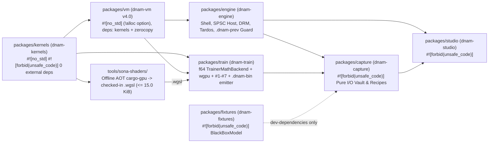

# Rust Implementation, 5-Crate Diamond, Deterministic `dnam-vm`, Shared `no_std` Kernels & C-ABI Specification

This specification defines the normative Rust implementation contracts for **Dynamic Neural Audio Modeler (DNAM)** across the 5-crate workspace diamond (`dnam-kernels`, `dnam-vm`, `dnam-engine`, `dnam-train`, and `dnam-capture`), offline AOT shader generation (`tools/sona-shaders/`), and the planned Phase 4 offline warm-start companion crate (`packages/train-warmstart`, decoupled from the 5-crate core).

It concretizes the implementation-agnostic [SONA architecture](../architecture/sona_architecture.md), [repository quality rules](../architecture/project_and_documentation_quality.md), and binary container formats under [system goals and requirements](../../requirements/system_goals_and_requirements.md) (REQ-1.6, REQ-1.9, REQ-4.1–REQ-4.3, REQ-5.1–REQ-5.6, REQ-6.1–REQ-6.3, REQ-7.1, REQ-7.2, REQ-8.5, REQ-8.8). Architectural rationales appear in [ADR-0015](../../adr/0015-realtime-host-concurrency-spsc-and-telemetry-seqlock.md), [ADR-0018](../../adr/0018-signal-chain-fixtures-crate-and-whitebox-distillation.md), [ADR-0019](../../adr/0019-simd-kernel-architecture-and-realtime-execution-optimizations.md), [ADR-0020](../../adr/0020-modular-monorepo-and-dnam-proj-container.md), [ADR-0022](../../adr/0022-sona-state-space-operator-and-webgpu-architecture.md), [ADR-0024](../../adr/0024-sona-v4-kernel-hb-fir-perimeter-and-control-bus-gra.md), and [ADR-0025](../../adr/0025-unified-runtime-and-non-causal-trainer-attention.md).

---

## 1. 5-Crate Diamond DAG, `#![no_std]` / `!alloc` & Safe-Rust Boundaries

`r[sdk.rust.safe-rust-and-boundaries]`

Workspace Rust crates enforce a strict acyclic 5-crate diamond where `dnam-kernels` feeds `dnam-vm`, which splits into sibling `dnam-engine` and `dnam-train`, which rejoin in `dnam-capture`. Planned Phase 4 `packages/train-warmstart` operates strictly above the offline trainer boundary with zero edges into core runtime crates.

Pure-Rust `dnam-kernels`, `dnam-fixtures`, `dnam-capture`, and `dnam-studio` enforce `#![forbid(unsafe_code)]` across every library and binary target.

The VM crate (`dnam-vm`) compiles cleanly as `#![no_std]` with optional std and alloc feature gates, depending strictly on `dnam-kernels` and `zerocopy`. Under `--no-default-features`, `dnam-vm` drops all heap imports by borrowing caller-owned storage:

| Borrowed `#![no_std]` / `!alloc` Surface | Stack / Caller-Owned Representation in `dnam-vm` |
| :--- | :--- |
| **Extended `ModalConvolver` FIR, `ErSparseBank` & Delay Tails** | `ColdBuf<'a, T>` on `ConvolverHighSrFirExt<'a>`, `ErSparseBank` (8 Lite / 16 Full..Ultra), `TransportExtStorage::Borrowed*`, and `&'a mut [f32]` `PartitionedSchroederBank` |
| **Control Bus v4 `GRA` & Rules** | Inlined `SonaControlBusGraParams` (`control_bus_lite` 2,048 B in Arena 0 + `control_bus_ultra_delta` <= 9,280 B cum. in Arena 3 + 40 B TSYN `subdivision_override` rows) inside `SonaColdTail<'a>` plus `ControlBusBacking<'a>` over caller-owned descriptor, contributor, and `CP1` overflow slices |
| **Arena Slab Backing** | `ArenaStorage::Borrowed` slice bindings paired with fixed 64 B-aligned Quad-Major active-hot slabs (4,432 B Lite 2× prefix) |

The `dnam-vm` crate enforces zero JSON parsing, zero cryptography, and zero 64-bit trainer math, operating strictly as a pure 2-in / 2-out v4.0 binary DSP register machine. It evaluates all-tier 2× 15-tap HB-FIR `OS2X`, SensoryQuad, `[1,1,1,1]..[3,3,2,2]` CoreQuads, ModalConvolver, `W_ro_head`, symmetric TransportQuad Op-T v4, and ControlBus v4 GRA with zero clean-path crossovers, host freeze flags, or multi-port patchbay state.

`SonaVm::open_dnam_bin` opens bare `.dnam-bin` (`"DNBN"`, `version_major = 4, version_minor = 0`) images in under 50 ns via zero-copy `zerocopy` borrows and exposes bare `.dnam-bin` `subdivision_override` for TSYN tempo sync without requiring Layer-1 `.dnam` metadata.

`dnam-engine` wraps `SonaVm` over `extract_dnam_bin(bytes)` as the outer Host-Shell 8-Port Patchbay (4CM/WDW, `S_router`, `ParallelAlignLine`, post-VM `ms_width`), v4.0 .dnam / .dnam-seal / .dnam-prev shell, SPSC host, Ed25519 / ChaCha20 DRM layer, `sona_gauge.rs` watermarker (REQ-8.5), and C-ABI boundary.

It forbids dependencies on `dnam-train`, `dnam-capture`, `dnam-fixtures`, or trainer math backends, exposing zero clean-path crossovers, host freeze methods, or string heuristics.

`dnam-train` sits as an independent sibling to `dnam-engine`, depending on dnam-kernels, dnam-vm, and optional `wgpu`. It owns `TrainerMathBackend`, persistent desktop `GpuTrainArena` pooling (<= 1.5 GiB inside the 1–2 GiB desktop WebGPU ceiling, <= 128 MiB storage binding, <= 512 MiB WASM CPU fallback; REQ-4.3), offline attention #1–#7, checked-in `.wgsl` forward/adjoint runners, and v4.0 `.dnam-bin` emission without depending on dnam-engine or dnam-fixtures.

Training solves execute Perceiver IO Top-K = 4 screening, AdamW (`#1` RBA, `#3` EnvOT, `#7` contrastive FiLM), diagonally preconditioned L-SSBroyden (m = 16..32), VarPro, 54-D `NW-PANAMA`, and `GRA` control-bus fitting with `O(P+M)` global convex-hull BIBO clamping (< 5 µs).

Sibling `dnam-capture` executes solely over pure in-memory audio and container buffers without Python, PyTorch, CUDA, clap, cpal, or external linear-algebra dependencies (`REQ-1.6`, `REQ-1.9`, [ADR-0020](../../adr/0020-modular-monorepo-and-dnam-proj-container.md)), passing full-coreset `Pass1ProbeResult` physics once across passes without duplicate probing.

Ground-truth fixtures (`dnam-fixtures`) remain confined to `[dev-dependencies]` and never appear in `dnam-kernels`, `dnam-vm`, `dnam-engine`, `dnam-train`, or non-test capture sources (`ref[repo.code.universal-black-box]`).

`dnam-vm`, `dnam-engine`, and `dnam-train` set `#![deny(unsafe_code)]` at crate root while pinning `#![forbid(unsafe_code)]` across `.dnam-bin` `zerocopy` parsing, `SonaVm`, containers, operators, graph, host concurrency, provenance, and schemas:

| Permitted `#[allow(unsafe_code)]` Scope | Normative Boundary & Proof Requirement |
| :--- | :--- |
| **`f32` SIMD Intrinsics (`dnam-vm::math`)** | Bounded 32-bit hardware intrinsics (`aarch64`, `x86_64`, `wasm32`) implementing `SimdVec4`, `StereoVec8`, and `MathBackend` with `target_os = "linux"` gated `mrs` and safe `!std` fallbacks. |
| **Hardware FP CSR (`dnam-vm::types`)** | `FtzDazGuard` inline assembly saving and restoring `FPCR` on `aarch64` or `MXCSR` on `x86_64` at audio block entry and exit. |
| **`f64` Trainer SIMD (`dnam-train::math`)** | Bounded 64-bit vector intrinsics implementing `TrainerMathBackend` (`aarch64` NEON/SVE2/SME, `x86_64` AVX2+FMA, `wasm32` f64) isolated out of `dnam-vm` and `dnam-engine`. |
| **HW SHA-256 & C-ABI (`dnam-engine`)** | `dnam_engine::provenance::sha256_hw` SHA intrinsics plus `#[unsafe(no_mangle)] extern "C"` entrypoints in `dnam_engine::ffi` with null, length, and aliasing checks plus `// SAFETY:` proofs. |

---

## 2. Hierarchical Rust Layout, `const_eval` & Property Testing

`r[sdk.rust.modular-layout-and-proptest]`

All Rust crates follow the Rust 2018+ nested module tree (`src/<module>.rs` to `src/<module>/<sub_aspect>.rs` to `src/<module>/<sub_aspect>/<leaf>.rs`) with zero `mod.rs` files anywhere under `packages/` (`ref[repo.code.modular-decomposition-and-tests]`). Every `.rs` source and test file stays strictly below 900 lines, targeting 250–650 lines per cohesive submodule.

Compile-time constant evaluators (`pub const fn`) live in `dnam_kernels::simd::const_eval` and `dnam_vm::math::const_eval`. Derived trigonometric poles, IEEE-754 seeds, 15-tap HB-FIR coefficients, `layout_7680` offsets (`core::mem::offset_of!`), and 64 B wire offsets are verified with `const _: () = assert!(...)` assertions (`ref[repo.code.constant-eval-and-derivations]`).

Leaf unit tests and `proptest!` suites live inside inline `#[cfg(test)] mod tests { ... }` blocks at the bottom of each production module, with zero production code following test blocks inside `packages/kernels/src/` and `packages/vm/src/`.

Standalone unit-test files, external test module declarations inside crate sources, and grab-bag `*_coverage.rs` integration files are prohibited. Shared helper utilities belong strictly in `test_support.rs`, `test_utils.rs`, or `testing.rs`.

---

## 3. Single-Source `#![no_std]` Shared Kernels & Checked-In AOT WGSL Pipeline

`r[sdk.rust.shared-nostd-kernels]`

All shared 32-bit SONA v4.0 operator math lives in `dnam-kernels` under `packages/kernels/` with `#![no_std]`, `#![forbid(unsafe_code)]`, and zero external crate dependencies (REQ-4.1, REQ-4.2, [ADR-0022](../../adr/0022-sona-state-space-operator-and-webgpu-architecture.md), [ADR-0024](../../adr/0024-sona-v4-kernel-hb-fir-perimeter-and-control-bus-gra.md)). Non-test kernel code forbids 64-bit floats (`f64`) and 64/128-bit integer scalar types outside host-only non-SPIR-V items.

| Shared `dnam-kernels` Module | Normative 32-Bit Primitives & Traits | Target Compilation & Parity |
| :--- | :--- | :--- |
| **SIMD, Constants & Codecs (`simd`)** | `KernelVec4`, `GpuVec4`, `StereoVec8`, `const_eval` (`SonaTierSpec`, `LITE_SPEC`..`ULTRA_SPEC` for `[1,1,1,1]..[3,3,2,2]` and 5/13/24/37 tiles, `MAX_OUTGOING_PER_QUAD = 7`), 15-tap `HB-FIR` `OS2X` perimeter helpers, software `fp16` codecs, and subnormal flushing | Identical LLVM CPU vector and `spirv-unknown-naga-wgsl` lowering; zero `f64`/`u64` runtime ops |
| **SONA Core & Scans (`sona_core`)** | `SensoryQuad` (Log-Knee VCA `[-5.0, +4.0]` octaves, `sense_vca_w` in `[-512.0, 512.0]`), 3-tap folded SVF & Block 0 Pred-Corr PHS (`step_tpt_svf_phs_stereo8`, `QUAD_PARAMS_VEC4_STRIDE <= 28`), Selective-Duhem `ParaLRU` (`κ(1-η)==0` fast path), `g_pre(v^2)`, `AlgADAA1(4096, NR3)`, `SE-Bus`, `C^2` `soft_rect` + explicit `u16` `rect_sign_mask`, bounded `GLU`, `Op-N[Pre]` v4, and `KernelVec4::rcp_pos_quad_nr2` | Exact 0-ULP same-FMA-class CPU `ParaLRU` forward parity (`C0.1` SIMD fixes); <= 1.5 ULP/step FMA vs non-FMA CPU/WGSL parity |
| **Modal & Transport (`modal_and_transport`)** | `KautzQuadState` (reclaimed `onset_delay_samp` + `c_cross_fp16`), `ErSparseBank` (8/16), `PhasorQ32Bank4`, Op-T v4 (`||M_fb||_2 <= 1`, bipolar `g_loop` in `[-0.9990, +0.9990]`, `M_series`, ±64 Hz, continuous `freeze_mix` + `freeze_ortho_mix`, unified `sigma_knee` <= 4.0 / `V_ceil = 4.0`), stereo 6-pair `HilbertH1StereoKernel`, `T1DcBlockerStereo`, and 2-stage `rsqrt_pos_nr3` `T1SubHarmonicKernel` | Shared CPU and GPU physics evaluation (<= 1e-4 * max(1.0, peak) on 256-wide linear scans; 0-ULP `process_microchunk_4` parity) |
| **Ozaki Integer Slices (`ozaki_i32`)** | `pow2_ceil_fp32`, `round_ties_even_f32`, `slice_f32_mantissa_i8x3`, `accum_ozaki_chunk_i32`, and host `reconstruct_ozaki_dot_f64` | Exact 0-ULP 32-bit `i32` Ozaki contraction parity across WebGPU drivers (REQ-4.2) |

Under the Shared no_std Kernels and Checked-In AOT WGSL pipeline, `tools/sona-shaders/` compiles `dnam-kernels` offline via `cargo-gpu` targeting `spirv-unknown-naga-wgsl` (<= 15.0 KiB SRAM cap) and checks in validated `.wgsl` artifacts for `dnam-train`.

The AOT WGSL shader suite defines seven compute kernels: `prescreen_population`, `fused_core_scan_256` (8-thread ParaLRU and constant-M register-squaring stereo scan), `adjoint_scan_256` (binary-tree pass0 reducing barriers 596 to ~220, Gauss–Legendre AlgADAA1 pullback, and SE-Bus pullback), `tile_mix_fwd_adj` (up to 37 tiles), `gabor_bezout_grad`, `ozaki_gram_rhs_i32`, and `inner_opt_step` (diagonal L-SSBroyden).

Workgroup SRAM (`var<workgroup>`) is strictly capped at 15,360 B (15.0 KiB) inside 16,384 B adapters (`>= 1,024 B` driver scratch), with `QUAD_PARAMS_VEC4_STRIDE <= 28` and `BLOCK_QUAD_SLOTS` `{0,4,8}` / `{1,5,9}` / `{2,6}` / `{3,7}`.

Persistent `GpuTrainArena` pooling runs 16,384-frame streamed 2× time-blocks via double-buffered `exit_adj_boundary` (<= 128 MiB binding, <= 1.5 GiB inside 1–2 GiB desktop WebGPU ceiling, <= 512 MiB WASM CPU fallback; REQ-4.3). It pairs this streaming pool with `inner_opt_step` (`m <= 32`) and 2D split-64 Ozaki reductions (<= 1.2 MiB Ultra readback, 0 KB shader bloat in `dnam.wasm`).

---

## 4. Tiered Serialization & Declarative `zerocopy` Wire / Arena Structs

`r[sdk.rust.zerocopy-wire-structs]`

DNAM partitions persistence, canonical manifests, cross-language RPCs, and internal Rust IPC across four normative serialization mechanisms ([ADR-0023](../../adr/0023-tiered-serialization-and-ipc-formats.md), [ADR-0022](../../adr/0022-sona-state-space-operator-and-webgpu-architecture.md)):

| Use Case in DNAM | Canonical Format / Crate | Normative Boundary Scope |
| :--- | :--- | :--- |
| **Fixed binary headers, descriptors, arenas & seqlocks** | **`zerocopy 0.8`** (`FromBytes` / `IntoBytes` + `little_endian::*`) | Fixed-layout v4.0 `.dnam-bin`, `.dnam`, `.dnam-seal`, `.dnam-prev`, `.dnam-proj`, `Arena0..3`, `DNPR` lock-free telemetry packets, `DnwbHeader64BWire` sample frame preambles, and WAV headers (`#![forbid(unsafe_code)]`, `!alloc` compatible). |
| **Container manifests & presets** | **`serde_json` + RFC 8785 JCS** | `.dnam` immutable JSON header (`version_major = 4`), `DMU1`/`DME1` mutable presets and catalog metadata, and `.dnam-proj` RFC 8785 JCS project manifests for deterministic cryptographic hashing. |
| **Binary RPC / APIs** | **`buffa` (Protobuf Editions)** | Schema-evolving binary service RPCs and cross-language structured protocol messages requiring forward/backward field evolution. |
| **Closed, ephemeral `#![no_std]` Rust ↔ Rust IPC** | **`postcard`** (or **`zerocopy 0.8`** on latency/throughput hot paths) | Compact variable-length local control messages exchanged exclusively between coupled Rust endpoints built from the same workspace revision (e.g., `DNWB` white-box subprocess control handshakes); fixed `zerocopy 0.8` wire structs remain permitted whenever `postcard` cannot meet latency or throughput requirements (e.g., lock-free `DNPR` seqlocks, streaming `DnwbHeader64BWire` audio frames, or hot-path IPC buffers). |

Every fixed-size binary preamble, directory, `.dnam-bin` header, tier arena, descriptor, project vault chunk, fixed IPC/seqlock frame header, and audio file header uses declarative `#[repr(C)]` `zerocopy` little-endian structs under `#![forbid(unsafe_code)]` (REQ-8.8, [ADR-0022](../../adr/0022-sona-state-space-operator-and-webgpu-architecture.md), [ADR-0023](../../adr/0023-tiered-serialization-and-ipc-formats.md)). Wire fields must use `zerocopy::byteorder::little_endian` scalar types or fixed `[u8; N]` arrays rather than untyped slices.

Every fixed wire struct derives `FromBytes`, `IntoBytes`, `KnownLayout`, and `Immutable`, adding `Unaligned` wherever cast from arbitrary byte slices. Compile-time `size_of`, `align_of`, and `offset_of!` assertions (including layout_7680 cross-platform ABI verification) verify every struct's exact footprint and alignment.

All parsing and serialization of fixed binary wire structs execute exclusively via safe `zerocopy` operations (`ref_from_bytes`, `read_from_prefix`, `write_to_prefix`, and `as_bytes`). Manual `from_le_bytes` or `to_le_bytes` byte-offset slicing is prohibited across wire, container, and arena modules.

| Container / Protocol Domain | Canonical `zerocopy` v4.0 Wire Structs | Normative Layout Specification |
| :--- | :--- | :--- |
| **Layer 0 `.dnam-bin` (`dnam-vm`)** | `DnamBinHeaderWire` (64 B `[0..64)` `"DNBN"`, `Unaligned`, `version_major = 4, version_minor = 0`, `max_present_tier`, `flags`, `num_controls`, `tsyn_count`, `reference_sample_rate_hz`, `prefix_crc32c`, `arena0_offset`, `tier_end_offsets[4]`, `tier_arena_crc32c[4]`), `DnamBinRuntimeMetaWire` (64 B `[64..128)` `"DBRM"`, `Unaligned`, `shared_controls_{offset,len}`, `tsyn_{offset,len}`, `cext_offset == 0, cext_len == 0`, `ext_ring_{pow2_frames,lines,format}`, `content_hash_prefix: [u8; 8]`, `cp1_overflow_bytes`, `ro_pole_48k` at bytes 44..48), `TempoSyncEntryWire` (40 B, `Unaligned`, `subdivision_override` + `PeriodMs`/`FrequencyHz` + Lobatto anchors) | [dnam_binary_format.md §1](../containers/dnam_binary_format.md#1-hybrid-binary-container-wire-framing---50-ns-zero-json-hardware-fast-path) |
| **Layer 1 `.dnam` & Descriptors** | `DnamPreambleWire` (`version_major = 4`), `DnamDirectoryWire` (`dbin_offset`, `dbin_prefix_bytes`, `shared_binary_length == 0` when `dbin_prefix_bytes > 0`), `Dmu1HeaderWire`, `Dme1HeaderWire`, `DmueFooterWire`, `DcrcAuthRecordWire` (`[32..36)` `crc_dbin_prefix`), `ControlClampDescriptorWire`, `ConditionalClampRuleWire` | [dnam_binary_format.md §1](../containers/dnam_binary_format.md#1-hybrid-binary-container-wire-framing---50-ns-zero-json-hardware-fast-path) |
| **SONA v4.0 Nested Arenas (0..3)** | `SonaCellDescWire`, `CrossbarWire` (SensoryQuad Log-Knee VCA + `OpNPreBaseWire` + `W_ro_head`), `CoreQuadWire` (retained `fp16` + explicit `u16` `rect_sign_mask` + Block 0 `svf_k_nl_fp16`), `Arena0LiteWire`..`Arena3UltraDeltaWire` (`[1,1,1,1]..[3,3,2,2]`, 5/13/24/37 tiles, `MAX_OUTGOING_PER_QUAD = 7`, 64-frame Quad 0 inline ring, `ErSparseBank` 8/16), `ConvolverFir*Wire`, `KautzSoaBlockWire` (128 B `dr` -> `onset_delay_samp` + `c_cross_fp16`), `TransportQuadWire` (Op-T v4 `||M_fb||_2 <= 1`, bipolar `g_loop`, `M_series`, ±64 Hz, `freeze_mix_fp16`, `sigma_knee_fp16 <= 0x4400`), `LinearReadout*Wire` (retained `fp16` `W_ro_head` per `REQ-8.5`), `GraControlBusWire` (Arena 0 `control_bus_lite` 2,048 B + Arena 3 `control_bus_ultra_delta` <= 9,280 B cum. reclaiming 6,336 B non-Tardos bytes, `K_ctrl = 16`, `slot 31 L/R`) | [dnam_binary_format.md §2](../containers/dnam_binary_format.md#2-tier-prefix-hardware-loading) |
| **`.dnam-seal` (`DNSL`) DRM** | `DnslPreambleWire` (`version_major = 4`), `DnslDirectoryWire`, `DnplPreambleWire`, `InnerDirectoryWire`, `Dsa1ManifestHeaderWire`, `HpkeSlotWire`, `RecordDirEntryWire` | [provenance_and_enclave_drm.md §3](../security/provenance_and_enclave_drm.md#3-pillar-2-hardware-enclave--oem-drm-oemdevicecertificate-attestation--dnam-seal-dnsl-wrapper) |
| **Layer 2 `.dnam-proj`, `DNWB` & WAV** | `DnamProjPreambleWire` (`version_major = 4`), `ProjChunkDirEntryWire`, `CalbChunkWire`, `InpcCapsuleHeaderWire`, `StmcCapsuleHeaderWire`, `StmcTrajectoryWindowWire`, `ProjAuthRecordWire`, `DnwbHeader64BWire`, `DnprProgressWire` (256 B seqlock telemetry), and WAV `RIFF`/`fmt `/`data` headers | [project_container_format.md §1–§3](../containers/project_container_format.md#1-front-loaded-cloud-ready-wire-framing--chunk-directory) |

In `.dnam-bin`, `shared_controls` at `shared_controls_offset` packs `ControlClampDescriptorWire` (carrying up to 3 inline `ConditionalClampRuleWire` slots, failing closed above 3 rules) and optional `"CP1\0"` overflow bytes padded to 64 B.

Bare `TempoSyncEntryWire` entries (with `subdivision_override`) follow `shared_controls` directly ahead of `arena0_offset` (`128 <= shared_controls <= TSYN <= arena0_offset`, `cext_offset == 0, cext_len == 0`), while unwatermarked ControlBus v4 GRA tables reside inside Arena 0 (`control_bus_lite`, 2,048 B) and Arena 3 (`control_bus_ultra_delta`, <= 9,280 B cum.).

Zero-mutation `REQ-5.6` prefix truncation matches `bytes.len() == tier_end_offsets[t]` (`t <= max_present_tier`), checks `prefix_crc32c`, and validates `tier_arena_crc32c[t]` without mutating headers.

---

## 5. Explicit Two-Level SIMD Traits, Quad-Major `SonaVm`, `ControlBus` v4 & 4,432 B Lite 2× Slab

`r[sdk.rust.explicit-simd-and-coverage]`

CPU vector backends implement a two-level trait hierarchy across `dnam-kernels`, `dnam-vm`, `dnam-train`, and `dnam-engine` (REQ-6.1, [ADR-0019](../../adr/0019-simd-kernel-architecture-and-realtime-execution-optimizations.md), [ADR-0024](../../adr/0024-sona-v4-kernel-hb-fir-perimeter-and-control-bus-gra.md)).

Level 1 in `dnam-vm` defines 32-bit `SimdVec4`, `StereoVec8`, `MathBackend`, and `Crc32cBackend` alongside C0.1 SIMD fixes (`rsqrt_nr2_pair_f32` parity across lanes) and startup capability probing (`detect_cpu_simd_features`, `warm_simd_feature_caches`).

Sibling `dnam-train` owns the offline 64-bit training traits (`TrainerMathBackend` and `Wide192Accum`), isolated out of runtime crates.

Level 2 domain traits extend those primitives without upward dependencies via `ConvolverBackend` and `GraphBackend` under `dnam-vm::graph`, plus `EngineBackend` in `dnam-engine`.

All eight ISA implementations compile into one single library per target architecture with lock-free cached runtime dispatch, gating `aarch64` `mrs` probing under `target_os = "linux"`, using `cpuid` plus `XGETBV` on x86_64, and falling back to compile-time `target_feature` on bare-metal `!std` targets.

Wrapper `macro_rules!` SIMD generators and `coverage(off)` attributes are forbidden under the 95% coverage gate, with cross-ISA parity verified across NEON, SVE2/SME (`engine:test-sve2` and `dnam-vm`), and `x86_64` (`engine:test-x86` Rosetta 2 emulation).

| ISA Backend Implementation | Target Architecture & Verification Gate | Dispatch & Register Model |
| :--- | :--- | :--- |
| `NeonBackend`, `ArmSve2Backend`, `ArmSmeBackend` | `aarch64` (`dnam-vm` + `engine:test-sve2`) | NEON 4-lane, SVE2 8-lane `StereoVec8`, SME vector-pair dispatch via `AtomicU8` cache |
| `X86Sse2Backend`, `X86Sse42Backend`, `X86Avx2FmaBackend` | `x86_64` (`dnam-vm` + `engine:test-x86`) | SSE2/SSE4.2 4-lane and AVX2+FMA 256-bit `StereoVec8` via `cpuid` + `XGETBV` cache |
| `WasmSimd128Backend`, `ScalarBackend` | `wasm32` (`simd128`) & portable scalar fallback | Interleaved 4-lane SIMD128 pairs and scalar reference with 0-ULP `C0.1` `rsqrt_nr2_pair_f32` parity |

To keep working sets strictly inside the 64 KiB L1D limit across 14×/8×/4×/2× concurrent instances under uniform all-tier 2× 15-tap HB-FIR `OS2X`, `dnam-vm` packs `C0.2` Quad-Major hot audio state into `SonaHotSlab` prefixes. Processing steps in 4-frame causal micro-chunks (`process_microchunk_4`) and 16-frame ticks (`K_ctrl = 16` at 44.1 kHz), eliminating `cold.hoisted_core` indirection:

| `SonaVm` v4.0 Active-Hot Struct | Verified Footprint & Alignment | Contained Hot State & Quad-Major Micro-Chunk Invariant |
| :--- | :---: | :--- |
| `SonaLiteHotPrefix` (Lite 2×) | 4,432 B (<= 4,608 B, 14 × 4,432 = 62,048 B <= 65,536 B) | Native 15-tap `HB-FIR` `OS2X` perimeter, `SensoryQuadHotState` (Log-Knee VCA `[-5.0, +4.0]` octaves), `HilbertH1StereoKernel`, `T1DcBlockerStereo`, `T1SubHarmonicKernel`, `OpNPreHotState`, 4 `[1,1,1,1]` Quad-Major `CoreQuadHot`s (5 tiles, zero `cold.hoisted_core` copy), `W_ro_head`, lag-ordered 32-tap FIR history, `ErSparseBank` (8), and 64-frame Quad 0 inline ring |
| `SonaFullHotDelta` | `<= 7,936 B` cumulative (`[2,2,1,1]`, 6 quads, 13 tiles) | Incremental lag-ordered FIR taps 32..48 + Full Quad-Major `CoreQuadHot`/tiles/`ModalConvolver`/`ErSparseBank` (16)/Kautz + `quad1` |
| `SonaProHotDelta` | `<= 15,872 B` cumulative (`[2,2,2,2]`, 8 quads, 24 tiles) | Incremental lag-ordered FIR taps 48..96 + Pro Quad-Major `CoreQuadHot`/tiles/`ModalConvolver`/Kautz + `quad2` |
| `SonaUltraHotDelta` | `<= 28,672 B` cumulative (`[3,3,2,2]`, 10 quads, 37 tiles) | Incremental lag-ordered FIR taps 96..128 + Ultra Quad-Major `CoreQuadHot`/tiles/`ModalConvolver`/Kautz + `quad3` |
| `TransportQuadHotCompact` | `#[repr(C, align(8))]` | DF-I/damp/wet DC states, `delay_samples`/`ramp_spans_samples`, `g_loop` in `[-0.9990, +0.9990]`, `||M_fb||_2 <= 1`, ±64 Hz, `freeze_mix_fp16`, `freeze_ortho_mix`, `sigma_knee_fp16 <= 0x4400`, and `flags: u8` (`bit 2 = QUAD_FLAG_HOST_WRITE_LOCK`) paired with cold `PartitionedSchroederBank::step_chunk4` |

In `dnam-vm`, ControlBus v4 expands stage targets (`last_stage_targets`, `current_stage_params`, `stage_ramp_deltas`) to `[f32; 32]` from Arena 0 (`control_bus_lite`, 2,048 B) and Arena 3 (`control_bus_ultra_delta`, <= 9,280 B cum., reclaiming 6,336 B non-Tardos bytes for W_key, W_val, b_key, g_edge[0..6], and op_t_q[0..16]) with zero CEXT chunk:

| `ControlBus` v4 `GRA` Slot | Target Field | Signal & Control Meaning (4-Frame Micro-Ramp) |
| :--- | :--- | :--- |
| 0..=15 | Base stage targets (`svf_g_oct`..`crossbar_wet_mod`) | `CoreQuad` 3-tap `TPT-SVF`, `AlgADAA1(4096)`, `ParaLRU`, `ModalConvolver` Kautz, `Transport`, and crossbar wet blend |
| 16 | `op_t_freeze_mix_delta` | Uniformly 4-frame micro-ramped passive recirculation (`mu_freeze` in `[0.0, 1.0]`, pinned 1.0 by `QUAD_FLAG_HOST_WRITE_LOCK`) + `freeze_ortho_mix` |
| 17..=21 | `op_t_delay_scale_oct`, `op_t_ramp_rate_hz_delta`, `op_t_lfo_rate_hz_delta`, `op_t_lfo_depth_scale`, `op_t_damp_pole_delta` | `TransportQuad` delay scale, ±64 Hz crossfade ramp speed, LFO speed/depth, and damping pole |
| 22..=25 | `op_t_dry_mix_mod`, `op_t_input_gain_mod`, `op_t_window_depth_delta`, `op_t_allpass_g_delta` | Stage-level `tank_dry_mix` blend (`[-2.0, 2.0]`), quad input drive, pitch window depth, and Schroeder allpass feedback |
| 26..=28 | `op_n_pre_{gamma_bc,zoh_hold,beta_q}_delta` | Pre-core `Op-N[Pre]` v4 bitcrusher wet blend, raised-cosine hold depth, and log2 Fourier staircase bit-depth |
| 29..=31 | `op_p_phasor_rate_oct`, `sense_vca_gain_delta`, `readout_gain_mod_l/r` | Crossbar quadrature carrier octave offset, `SensoryQuad` Log-Knee VCA gain delta (`[-1.0, +1.0]`), and active `slot 31` L/R readout gain modulation |

ControlBus v4 GRA updates execute on every `K_ctrl` tick (16 samples at both 44.1 kHz and 48 kHz) with 4-frame micro-ramp smoothing whenever controls, `subdivision_override` tempo entries, modulators, dirty state, or drift are active.

Slot 16 micro-ramps uniformly into `mu_freeze = clamp(base_freeze_mix + t[16], 0.0, 1.0)`, while `set_quad_write_enable` / `set_op_t_write_enable` updates only bit 2 (`QUAD_FLAG_HOST_WRITE_LOCK`), forcing unity freeze and locking delay writes at 0 ULP without a 3 kHz overwrite race.

Hot sub-block, Quad-Major micro-chunk, and control-tick entrypoints carry explicit `#[inline(never)]` markers inside `dnam-vm` to keep instruction caches compact (`process_tick16_const`, `process_microchunk_4`, `step_frame_sona`, `step_frame_2x_sona`, `step_control_tick_3khz`), while `dnam-engine` owns multi-port HostShellPatchbay routing and post-VM ms_width.

Meanwhile `dnam-engine` isolates JSON header parsing (`DnamJsonHeader::from_json_slice`, `DnamJsonHeader::to_json_vec`) out of `dnam-vm`.

---

## 6. Release Binary Disassembly Audit, WCET Gates & Qualification Diagnostics

`r[sdk.rust.realtime-disassembly-audit]`

Every `vm:test` and `engine:test` run executes the release-binary disassembly gate (`realtime_disassembly_audit.rs`, REQ-6.2, REQ-6.3, [ADR-0019](../../adr/0019-simd-kernel-architecture-and-realtime-execution-optimizations.md)), paired with `realtime_wcet` (14×/8×/4×/2× concurrent instance microbenchmark) and the Five-Tier Fail-Fast Qualification Pyramid (gated by `DNAM_DIAG_STOP_AFTER_L2`). It compiles libdnam_vm.rlib and libdnam_engine.rlib in `--release`, runs demangled `objdump -dr`, computes the transitive call-graph closure across v4.0 roots, and fails on prohibited instructions.

Source-level guardrails additionally forbid float `rem_euclid` and direct float transcendental method calls inside non-test `packages/kernels/src/`, `packages/vm/src/`, and `packages/engine/src/` Rust sources:

| Audited / Prohibited Domain | Tracked v4.0 Roots, Disallowed Instructions & Relocations |
| :--- | :--- |
| **Audited RT Closure Roots** | `SonaVm` (`process_tick16_const`, `process_microchunk_4`, `SonaHotSlab`, `ControlBus`, `set_quad_write_enable`, `set_op_t_write_enable`, `subdivision_override`), `SonaInstance`, `DnamEngine`, `DynamicDnamEngine`, `DnamHostHandle`, hot graph/operator entrypoints, and real-time `dnam_engine_*` C-ABI symbols (zero dedicated host freeze exports). |
| **Floating-Point Div / Sqrt** | Hardware `fdiv`, `vdiv*`, `divss`, `divps`, `divsd`, `divpd`, `fsqrt`, `vsqrt*`, `sqrtss`, `sqrtps`, `sqrtsd`, `sqrtpd`. |
| **Integer Div / Remainder** | Hardware `udiv`, `sdiv`, `div`, `divl`, `divq`, `idiv`, `idivl`, `idivq`, and 128-bit helpers `__udivti3`, `__divti3`, `__umodti3`, `__modti3`. |
| **RT Alloc / Uncached Syscall** | Heap symbols `__rust_alloc`, `__rust_dealloc`, `__rust_realloc`, `__rust_alloc_zeroed`, and uncached probes `sysctlbyname`, `getauxval`. |
| **External `libm` Relocation** | Crate-wide relocations to `fmodf`, `fmod`, `sin*`, `cos*`, `tan*`, `exp*`, `log*`, `pow*`, `sqrt*`, `cbrt*`, `hypot*`, `atan*`, `asin*`, `acos*`, `sinh*`, `cosh*`, `tanh*`. |

---

## 7. Real-Time Host Handle, SPSC Ingress, Telemetry Seqlock & C-ABI

`r[sdk.rust.c-abi-and-host-handle]`

Host concurrency primitives under `dnam_engine::host` wrap `SonaVm` over `extract_dnam_bin(bytes)` to decouple real-time audio rendering from UI, MIDI, DAW plugin, and TypeScript worker threads in `#![forbid(unsafe_code)]` Rust (REQ-6.3, [ADR-0015](../../adr/0015-realtime-host-concurrency-spsc-and-telemetry-seqlock.md)).

`dnam_engine::ffi` exposes a null-checked C-ABI surface over `DnamEngineHandle` and `DnamTelemetrySnapshot`. Hardware sustain and infinite-hold controls bind strictly through calibrated GRA targets (`op_t_freeze_mix_delta`, `freeze_ortho_mix`, and slot 31 L/R) alongside bare `.dnam-bin` `subdivision_override` without dedicated host freeze functions.

Under REQ-8.5 and [ADR-0024](../../adr/0024-sona-v4-kernel-hb-fir-perimeter-and-control-bus-gra.md), `sona_gauge.rs` applies buyer Tardos gauges across CoreQuad odd-symmetric lanes (`rect_sign_mask`, cyclic `glu_mix_fp16`), `W_ro_head_odd`, InterBlockTile 5 / 8 / 11 / 13 gauges, and Kautz poles with ~1e-6 SO(4) invariance and a 224-D / 15 * M_tier fingerprint dropping dr. It strictly excludes Arena 0/3 GRA (`control_bus_lite` 2,048 B / `control_bus_ultra_delta` <= 9,280 B cum.), 128 B dr, ErSparseBank, SensoryQuad, and Op-N[Pre].

| Host / C-ABI Component | Concrete v4.0 Rust Contract & Real-Time Invariant |
| :--- | :--- |
| **Shell Wrapping, `GRA` & Preview Guard** | `DnamEngine` and `DnamHostHandle` validate v4.0 `.dnam` / `.dnam-seal` / `.dnam-prev` (`DCRC` `crc_dbin_prefix`, `DAU1`/`DAI1`, `DNSL` `logical_prefix`), enforce `sona_gauge.rs` invariants, load `shared_controls` + `"TSYN"` (`subdivision_override`) (`cext_offset == 0, cext_len == 0`) from `dbin_prefix` ahead of `arena0_offset`, and bind Arena 0 (`control_bus_lite`, 2,048 B) + Arena 3 (`control_bus_ultra_delta`, <= 9,280 B cum.) `GRA` tables during both boot and live `reload_model_in_place` (`Region 4 == 0 B`). |
| **3-Lane SPSC Ingress (`SpscControlRing`)** | `ControlProducer`, `ControlConsumer`, and `AcceptedStateShadow` drain Lane 1 atomic control slots, Lane 2 64-entry discrete ring, and Lane 3 coalescing seqlock latch at sub-block entry (`DEFAULT_HOST_SUBBLOCK_FRAMES = 512`). |
| **29-Word Telemetry Seqlock (`TelemetryReader`)** | 64-byte-aligned `TelemetryCell` (`seq` + 29 `AtomicU64` words) written release/relaxed by `TelemetryWriter` and read wait-free via `TelemetryReader::read_snapshot()` without locking the audio thread. |
| **Ping-Pong Engine Swap (`RealtimeEngineSwap`)** | Pre-warms `Mutex` internals off-RT, polls `try_lock()` on the audio handle without allocating or dropping, and moves displaced engines into an 8-slot retirement array reclaimed non-RT via `reclaim_retired`. |
| **Block FP Environment (`FtzDazGuard`)** | Sets RNE, non-trapping exceptions, and `FPCR.FZ` / conditional `FIZ` (`aarch64`) or `MXCSR` FTZ/DAZ (`x86_64`), restoring prior CSR state on drop, paired with unconditional bitwise/SIMD `NaN`/`±Inf` and subnormal scrubbing on recursive writebacks across all targets. |
| **C/C++ FFI (`dnam_engine_*`)** | Exports `dnam_engine_create_from_bytes`, `dnam_engine_create_with_max_tier`, `dnam_engine_destroy`, `dnam_engine_set_tier`, `dnam_engine_set_max_supported_tier`, `dnam_engine_set_offline_bounce`, `dnam_engine_set_maximize_tier_on_bounce`, `dnam_engine_get_latency_samples`, `dnam_engine_set_sample_rate`, `dnam_engine_set_control_value`, `dnam_engine_set_control_immediate`, `dnam_engine_reset`, `dnam_engine_process_block`, `dnam_engine_process_mono`, and `dnam_engine_get_telemetry` handling null, empty, in-place, and crossed-channel aliasing safely. |
