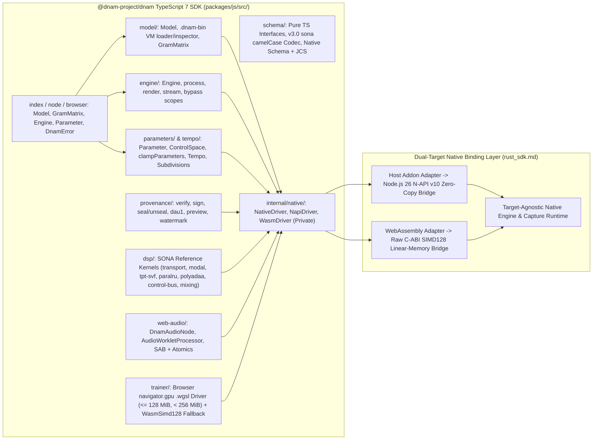

# TypeScript SDK (`@dnam-project/dnam`): Idiomatic TypeScript 7 Interface, Dual-Target N-API v10 + WASM SIMD128 Runtime, WebGPU Trainer & WebAudio Contract

This specification defines the normative architecture, feature-module layout, TypeScript 7 typing and Biome hygiene rules, dual-target N-API v10 plus WebAssembly SIMD128 runtime invariants, browser WebGPU trainer driver, WebAudio `AudioWorklet` bridge, and native behavioral parity contracts for `@dnam-project/dnam` ([JavaScript SDK README](../../../packages/js/README.md)).

The TypeScript SDK consumes the native runtime engine and shared mathematical kernels defined in the [Rust Implementation Specification](rust_sdk.md) for SONA v3.0 ([SONA architecture](../architecture/sona_architecture.md)). Design rationales and concurrency trade-offs appear in [`ADR-0013`](../../adr/0013-typescript-sdk-architecture-and-dual-target-runtime.md), [`ADR-0015`](../../adr/0015-realtime-host-concurrency-spsc-and-telemetry-seqlock.md), and [`ADR-0022`](../../adr/0022-sona-state-space-operator-and-webgpu-architecture.md).

---

## 1. Feature-Oriented Package Organization & Maintainability Contract

### 1.1 Feature Module Layout, Native Core Separation & Test Colocation

`r[sdk.ts.layout.feature-modules]`

The TypeScript SDK is published as `@dnam-project/dnam` from `packages/js/` and organizes its source code into kebab-case feature directories paired with a unified dual-target native binding layer ([Rust Implementation Specification](rust_sdk.md)):

Implemented TypeScript domains under `packages/js/src/` cover container loading in `model/`, inference in `engine/`, parameter clamping in `parameters/`, tempo math in `tempo/`, and JSON schemas in `schema/`.

Supporting domains provide provenance workflows in `provenance/`, DSP kernels in `dsp/`, Worklet bindings in `web-audio/`, and private driver plumbing in `internal/`. The `trainer/` directory is an internal module for browser `navigator.gpu` WebGPU training rather than a shipped public subpath.

All intra-package and test imports route directly to concrete leaf modules with explicit ESM `.js` extensions (`../schema/header.js`, `../model/preamble.js`, `../engine/engine.js`).

Non-exported internal folders (`model/`, `engine/`, `internal/native/{napi,wasm}/`, and `trainer/`) forbid `index.ts` barrels.

Large drivers and domain modules across TypeScript packages decompose hierarchically under a 900-line ceiling (`ref[repo.code.modular-decomposition-and-tests]`), adhering to the 4-tier TypeScript testing layout below while native bindings follow the [Rust Implementation Specification](rust_sdk.md) (`ref[sdk.rust.modular-layout-and-proptest]`, `ref[sdk.rust.safe-rust-and-boundaries]`):

| Test Tier | TypeScript / React Location | Verification Scope & Prohibited Anti-Patterns |
| :--- | :--- | :--- |
| **Tier 1 (Leaf Unit & Property)** | Adjacent `<leaf>.test.ts(x)` and `<leaf>.browser.test.ts(x)` beside source files | Uses `fast-check` property suites, ARIA/accessibility checks, and React Cosmos `<component>.fixture.tsx`; forbids `src/**/__tests__/`, generic `test(s).ts(x)`, and `src/**/*.spec.ts(x)`. |
| **Tier 2 (Domain Integration)** | `<domain>.test.ts(x)` inside `src/<domain>/` without internal `index.ts` barrels | Tests collaboration across concrete leaf modules within `<domain>`; shared helpers belong in `test-support.ts`, `test-utils.ts`, `testing.ts`, or `tests/setup.ts`. |
| **Tier 3 (Package Integration, Profile & E2E)** | `tests/integration/*.test.ts(x)`, `tests/profile/*.test.ts`, `tests/e2e/*.spec.ts` | Covers cross-domain N-API vs WASM parity, profiling, and Playwright E2E; forbids `*coverage*.test.ts(x)` grab-bag files. |
| **Tier 4 (Workspace Guardrails)** | Top-level workspace guardrail suites | Enforces repository-wide typing, barrel, and modularity invariants (`ref[repo.code.modular-decomposition-and-tests]`). |

The `src/internal/` tree is strictly private. Neither `NativeDriver` nor any raw N-API or WASM handle symbol may be exported from any public subpath.

### 1.2 Curated Subpath Exports, Biome Barrel Bans & Strict TypeScript 7

`r[sdk.ts.layout.curated-exports]`

Downstream consumers import exclusively from the 11 subpath entrypoints declared under `"exports"` in `packages/js/package.json`. The internal `trainer/` module is not a public `@dnam-project/dnam/trainer` subpath export unless added explicitly to `"exports"` and guardrail allowlists:

| Public Subpath | Entrypoint / Asset | Primary Exports |
| :--- | :--- | :--- |
| `@dnam-project/dnam` | `dist/node.js` / `dist/browser.js` / `dist/index.js` | `Model`, `GramMatrix`, `inspectDnamBin`, `stripDnamBinToTier`, `Engine`, `Parameter`, `ParameterMap`, `ControlSpace`, `clampParameters`, `TempoController`, `DnamError`, `initWasm` |
| `./node` & `./browser` | `dist/node.js` & `dist/browser.js` | Explicit Node.js N-API v10 and browser WASM SIMD128 runtime entrypoints |
| `./parameters` | `dist/parameters/index.js` | `Parameter`, `ParameterMap`, `ControlSpace`, `clampParameters`, `defineModelTypes` |
| `./tempo` | `dist/tempo/index.js` | `TempoController`, `subdivisions`, `computeZoh`, `controlStride`, `subdivisionPhase`, `invertTempoCalibration` |
| `./schema` | `dist/schema/index.js` | `ModelHeader`, `decodeHeader`, `encodeHeader`, `headerToJcs`, `canonicalJson`, schema interfaces |
| `./provenance` | `dist/provenance/index.js` | `verify`, `enforcePolicy`, `signCreatorHeader`, `signMarketplaceReceipt`, `seal`, `unseal`, watermark helpers |
| `./dsp` | `dist/dsp/index.js` | Vectorized SONA reference DSP kernels (`transport`, `modal`, `nonlinear`, `control-bus`, `mixing`) |
| `./web-audio` & `./web-audio/processor` | `dist/web-audio/index.js` & `dist/web-audio-processor.js` | `DnamAudioNode`, `DnamAudioWorkletProcessor`, `WorkletSharedState`, standalone worklet bundle |
| `./dnam.wasm` | `dist/wasm/release/dnam.wasm` | Release `wasm32-unknown-unknown` SIMD128 binary |

Biome rules `lint/performance/noBarrelFile` and `lint/performance/noReExportAll` forbid internal `index.ts` barrel files, wildcard `export *`, and `default` exports repository-wide (`ref[repo.code.modular-decomposition-and-tests]`).

Across `packages/js/`, `packages/ui/`, and `packages/studio/`, `@dnam-project/ui` exposes granular subpath exports (`@dnam-project/ui/base/*` and domain subpaths) with zero internal barrels.

Explicit named re-exports (`export { ... }`) are restricted strictly to the declared public `package.json` `"exports"` entrypoints of `@dnam-project/dnam` listed above (`index.ts`, `node.ts`, `browser.ts`, and the six domain entrypoints).

All TypeScript packages compile cleanly under TypeScript 7.0+ with `strict`, `noUncheckedIndexedAccess`, `exactOptionalPropertyTypes`, and `verbatimModuleSyntax` enabled.

Zero `any` types, `@ts-ignore` or `@ts-expect-error` suppressions, or non-null assertions (`!`) are permitted (`ref[repo.code.type-safety-and-imports]`).

### 1.3 Enforced Layered Dependency Direction & Runtime Isolation

`r[sdk.ts.layout.dependency-direction]`

Internal imports enforce a strict acyclic feature hierarchy from low-level primitives up to host adapters, rooted at `errors.ts` and `types.ts` into `schema/`, `internal/`, and `model/`.

Above the container layer, `parameters/` and `tempo/` feed `engine/`, which in turn serves `web-audio/` and `trainer/`.

Adjacent feature domains stay narrow: `provenance/` depends on `model/`, while `dsp/` depends solely on `internal/` and `errors.ts`.

`@dnam-project/dnam` declares zero runtime npm dependencies (`"dependencies"` is omitted).

Browser-safe modules (`src/browser.ts`, `src/internal/native/wasm.ts`, `src/internal/native/wasm/**/*.ts`, `src/schema/**/*.ts`, `src/web-audio/**/*.ts`, and `src/trainer/**/*.ts`) must never import `node:*` built-in modules.

Worklet runtime modules `src/web-audio/processor.ts` and `src/web-audio/shared-state.ts` remain completely self-contained for `AudioWorkletGlobalScope`.

---

## 2. Idiomatic TypeScript API, Resources, Parameters & Error Contract

### 2.1 Plain Frozen CamelCase Data vs. Stateful Native Resources

`r[sdk.ts.api.resources-and-data]`

The public API separates explicit-lifetime native wrappers from deeply frozen plain objects. `@dnam-project/dnam` targets strictly the v3.0 (`"architecture": "sona"`, `version_major = 3`, `version_minor = 0`) container and DSP schema:

| Category | Public Types / Classes | Ownership & Immutability Contract |
| :--- | :--- | :--- |
| **Stateful Resources (Classes)** | `Model`, `Engine`, `Parameter`, `ControlSpace`, `DnamAudioNode` | Wrap native host handles (`ref[sdk.rust.c-abi-and-host-handle]`) or validated aligned container buffers (`ref[sdk.rust.zerocopy-wire-structs]`); disposable resources expose `.dispose()` and `[Symbol.dispose]()`. |
| **Plain Metadata (Frozen Objects)** | `ModelHeader`, `PreambleInfo`, `DnamBinHeader`, `DnamBinRuntimeMeta`, `TempoSyncEntry`, `ParameterDescriptor`, `Preset`, `TelemetrySnapshot`, `ClampReport`, `VerificationResult` | Deeply `readonly` and `Object.freeze`-d plain camelCase objects with zero prototype methods or hidden native pointers. |

### 2.2 String-Literal Unions, Companion Tuples & Options Objects

`r[sdk.ts.api.literal-unions-and-options]`

Domain enumerations use lowercase string-literal unions paired with `readonly` companion tuples rather than TypeScript `enum` declarations:

| Union Type | Companion Tuple | Canonical Values |
| :--- | :--- | :--- |
| `Tier` | `tiers` | `"lite" \| "full" \| "pro" \| "ultra"` |
| `Backend` | `backends` | `"auto" \| "scalar" \| "neon" \| "arm-sme" \| "x86-simd" \| "wasm-simd128"` |
| `Subdivision` | `subdivisions` | `"1/2." \| "1/2" \| "1/2T" \| "1/4." \| "1/4" \| "1/4T" \| "1/8." \| "1/8" \| "1/8T" \| "1/16." \| "1/16" \| "1/16T"` |

Multi-flag configuration methods (`model.createEngine(options)`, `engine.bypass(options)`, `engine.render(audio, options)`, and `param.setValue(value, options)`) accept typed options objects compatible with `exactOptionalPropertyTypes`.

### 2.3 Compile-Time Model Parameter Inference

`r[sdk.ts.api.typed-model-inference]`

`Model<TParams>`, `Engine<TParams>`, `ControlSpace<TParams>`, and `DnamAudioNode<TParams>` accept a compile-time parameter map `TParams extends ParameterValueMap = Record<string, number | string>`.

That generic parameter narrows `engine.parameters.get(id)` to `Parameter<K, TParams[K]>` and `engine.parameters.set(partial)` to `Partial<TParams>`.

The helper `defineModelTypes<const TSchema>()` infers continuous `range` parameters as `number` and discrete `switch` parameters as the literal union of their `declaredOptions`.

### 2.4 Uniform Synchronous API & Optional WASM Pre-Initialization

`r[sdk.ts.api.sync-init]`

Both `src/node.ts` (synchronous N-API v10 load with synchronous WASM fallback) and `src/browser.ts` (top-level `await` WASM instantiation) initialize the default `NativeDriver` at module evaluation time. Consequently, `Model.from(...)`, `Model.reference(...)`, `model.createEngine(...)`, and `engine.process(...)` execute synchronously across all runtimes.

Callers needing custom CDN hosting, Web Worker pre-compilation, `AudioWorklet` module sharing, or `shared: true` with `SharedArrayBuffer` memory injection call `initWasm(options?)`.

The options object accepts custom binary sources via `module`, `bytes`, or `url`. Callers can also supply backing `memory`, `initialPages`, `maximumPages`, and `shared`, passing `{ env: { memory } }` at instantiation.

### 2.5 Dual-Mode Resource Disposal & Exception-Safe State Scopes

`r[sdk.ts.api.disposable-scopes]`

`Model`, `Engine`, and `ControlSpace` implement both idempotent `.dispose(): void` and `[Symbol.dispose](): void`, backed by a `FinalizationRegistry` safety net.

Entry `.d.ts` files emit `/// <reference lib="esnext.disposable" />` so downstream ES2024 and ES2025 consumers compile without `tsconfig.json` overrides even when `skipLibCheck` is `false`.

`engine.bypass(options?: { trails?: boolean }): StateScope` enters `SpilloverTrails` when `trails ?? true` or `HardBypass` when `trails === false` (`ref[arch.topology.spillover-trails]`), returning a scope that exposes `.restore(): void` and `[Symbol.dispose](): void`.

The exception-safe closure `engine.withBypass(options, fn)` wraps `fn` in a `try / finally` block so prior bypass state always restores on return or throw.

Dedicated freeze scopes, capability flags, and special freeze calibration roles are absent from the TypeScript API. Captured hardware sustain or infinite-hold controls bind strictly as standard range or switch `Parameter` targets over continuous `Op-T` `freeze_mix` recirculation and crossbar wet/dry balance.

### 2.6 WebAudio `AudioParam`-Aligned `Parameter`, `ParameterMap` & `ControlSpace`

`r[sdk.ts.parameters.audio-param-semantics]`

`engine.parameters` implements `ParameterMap<TParams>` (`Iterable<[keyof TParams, Parameter]>`) and exposes the core collection accessors and clamp reporting methods summarized below.

Each `Parameter<TId, TValue>` controller mirrors WebAudio `AudioParam` semantics with live 3 kHz smoothing on `.value = v` (`ref[dsp.ctrl.range.normalize-clamp]`). Immediate non-smoothed updates use `.setValue(v, { immediate: true })`, alongside `toPhysical` and `toNormalized` coordinate helpers.

For standalone or zero-allocation host clamping, `@dnam-project/dnam` and `@dnam-project/dnam/parameters` expose `clampParameters(source, values)` and `ControlSpace<TParams>`. `ControlSpace.from(modelOrHeader)` compiles the container's binary control-clamp descriptor tables once, offering `.clamp(values): ClampReport` plus the zero-allocation numeric fast-path `clampNumericInto(rawNumeric: Float32Array, clampedOut: Float32Array, normOut?: Float32Array): number`, which writes clamped and normalized coordinates in-place inside the native driver and returns the 32-bit active clamp bitmask:

| Surface | Key Members | Runtime Semantics |
| :--- | :--- | :--- |
| `Parameter<TId, TValue>` | `id`, `name`, `kind`, `unit`, `value`, `setValue`, `reset`, `defaultValue`, `minValue`, `maxValue`, `safeRange`, `options`, `activeOptions`, `clamped`, `toPhysical`, `toNormalized` | Getter returns live clamped value; setter triggers 3 kHz smoothing unless `immediate: true`. |
| `ParameterMap<TParams>` | `get`, `has`, `set`, `resetAll`, `values`, `keys`, `toObject`, `clampedReport`, `[Symbol.iterator]` | Batches multi-knob updates and evaluates switch-conditioned clamps atomically. |
| `ControlSpace<TParams>` | `ControlSpace.from`, `descriptors`, `size`, `indexOf`, `clamp`, `clampNumericInto`, `toPhysical`, `toNormalized`, `dispose` | Pre-compiled 3-Phase clamping space; `clampNumericInto` allocates zero JS objects. |

### 2.7 Coded `DnamError` & Exhaustive Native Tag Mapping

`r[sdk.ts.errors.coded-error]`

Every native runtime error maps exhaustively from the native engine error taxonomy ([Rust Implementation Specification](rust_sdk.md)) via structured tag prefixes without a wildcard fallback, so adding any native error variant forces an explicit TypeScript `ErrorCode` mapping. The `isDnamError(err, code?)` guard narrows `unknown` values to `DnamError` and optionally to a specific `ErrorCode`:

| Native Error Condition | Native Tag Prefix | `DnamError.code` (`ErrorCode`) |
| :--- | :---: | :--- |
| Container magic, version, truncation, CRC32C, or header capacity failure | `[DNAM-CONTAINER]` | `"ERR_DNAM_CONTAINER"` |
| Unsupported host or container sample-rate validation failure | `[DNAM-SAMPLERATE]` | `"ERR_DNAM_SAMPLE_RATE"` |
| Invalid control index or unknown parameter or preset ID | `[DNAM-CONTROL]` | `"ERR_DNAM_PARAMETER"` |
| Cryptographic signature, encrypted arena key, or preview containment failure | `[DNAM-PROVENANCE]` | `"ERR_DNAM_PROVENANCE"` |
| Unaligned container offset, malformed JSON header, or schema validation failure | `[DNAM-VALIDATION]` | `"ERR_DNAM_VALIDATION"` |
| Concurrent audio render or disposal during active `processAsync` or use after `.dispose()` | `[DNAM-BUSY]` / `[DNAM-DISPOSED]` | `"ERR_DNAM_BUSY"` / `"ERR_DNAM_DISPOSED"` |

---

## 3. Dual-Target Runtime, Real-Time Engine & Behavioral Parity

### 3.1 Unified `NativeDriver` Seam (N-API v10 + Raw WASM SIMD128), Zero Duplicated Logic & Safe Binding Boundaries

`r[sdk.ts.runtime.dual-target-drivers]`

`packages/js/src/` and its thin native binding glue must never reimplement any algorithm, validation rule, or domain constant already owned by the native engine and shared kernels ([Rust Implementation Specification](rust_sdk.md), `ref[sdk.rust.shared-nostd-kernels]`).

All DSP, ZOH rescaling (`ref[dsp.zoh.ctrl-stride]`), 3-Phase control clamping, Lobatto calibration inversion, preset loading, tempo sync, and v3.0 `"sona"` header validation execute in compiled native code via the unified runtime seam.

RFC 8785 JCS canonicalization, immutable-header projection (`ref[sec.jcs.immutable-header-digest]`), and creator or marketplace tier-prefix signing (`ref[sec.sig.prefix-delegation]`) likewise execute natively. The TypeScript layer handles only idiomatic API ergonomics, camelCase/snake_case key translation, input coercion, WebGPU `.wgsl` dispatch orchestration (§4.5), and handle lifecycle management.

Both `NapiDriver` and `WasmDriver` implement the exact same `NativeDriver` interface declared in `src/internal/native/driver.ts`.

`r[sdk.ts.runtime.zero-unsafe]`

All native host-addon and WebAssembly linear-memory bindings uphold the safe-binding, aligned-wire, and host-handle isolation contracts specified in the [Rust Implementation Specification](rust_sdk.md) (`ref[sdk.rust.safe-rust-and-boundaries]`, `ref[sdk.rust.zerocopy-wire-structs]`, `ref[sdk.rust.c-abi-and-host-handle]`).

Engine and control-space instances live inside safe handle tables accessed exclusively through disjoint-slice buffer borrows, never exposing raw linear-memory pointers or aliased mutable slices across JavaScript calls.

Both the N-API worker dispatch and `WasmEngineHandle.processStereoAsync` snapshot caller input `Float32Array` channels on the main thread before dispatching worker execution so concurrent JS mutations never race with worker memory.

`engine.processAsync` accepts both `engine.processAsync(input, out)` and `engine.processAsync(input, { output, transfer, blockSize, signal })`, detaching input buffers via `ArrayBuffer.prototype.transfer()` when `{ transfer: true }` is set.

### 3.2 Zero-Copy Planar Audio, In-Place Output & Libuv `processAsync`

`r[sdk.ts.engine.zero-copy-and-async]`

`engine.process(input, options?: { output?: Float32Array[] })` accepts a mono `Float32Array` or planar `readonly Float32Array[]` (`[left]` or `[left, right]`) across all four topologies (1-to-1, 2-to-1, 1-to-2, and 2-to-2, `ref[arch.topology.signal-flow]`). When `options.output` supplies matching channels and length, processing writes directly into caller buffers with zero output allocation.

`dnam.wasm` links with `--import-memory --export-memory --max-memory=268435456` (768 KiB shadow stack) and instantiates via `{ env: { memory } }` over `WebAssembly.Memory`. Default allocation starts at 18 pages (1.125 MiB above the 15-page module minimum) with a default maximum of 4,096 pages (256 MiB), an architectural ceiling of 65,536 pages (4 GiB), and optional `shared: true` (`SharedArrayBuffer`) when `crossOriginIsolated !== false`.

Specifying a bounded `maximum` enables V8 static guard-page bounds-check elision and reserves virtual address space upfront without heap relocation copies. `WasmDriver` caches typed-array views keyed by `memory.buffer` and `byteLength` and verifies bounded `dnam_wasm_alloc` allocation for graceful `DnamError` out-of-memory reporting.

`engine.processAsync` runs on the Node.js libuv worker pool via an N-API `AsyncTask` over the thread-safe host handle (`ref[sdk.rust.c-abi-and-host-handle]`) and resolves asynchronously in browsers, honoring `AbortSignal` before dispatch.

Concurrent rendering or `.dispose()` calls during an in-flight `processAsync` reject with `"ERR_DNAM_BUSY"`, while parameter, preset, tempo, bypass, and tier updates (`ref[dsp.ctrl.op-m.spsc-ingress]`) plus `engine.telemetry` reads (`ref[arch.telemetry.seqlock-publication]`) complete synchronously and non-blockingly on the main thread.

### 3.3 Offline `render` (4x Bounce) & Web `TransformStream`

`r[sdk.ts.engine.streaming-and-render]`

`engine.render(input, options?: { sampleRate?: number; blockSize?: number; reset?: boolean; oversample?: 1 | 4; maxTier?: boolean })` optionally updates `sampleRate`, resets to analytical resting equilibrium (`ref[dsp.op-n.commuted.dc-equilibrium]`) when `reset ?? true`, and renders in chunks of `blockSize`. Setting `oversample: 4` engages 4x linear-phase polyphase oversampling with 12-sample PDC lead-in stripping (`ref[arch.bounce.oversampling]`), and `engine.bounce(input, { maxTier? })` provides a concise 4x shorthand.

`engine.stream(options?: { blockSize?: number }): TransformStream<Float32Array | readonly Float32Array[], Float32Array[]>` exposes a standard WHATWG Web Streams stage for piping chunked audio through the engine.

### 3.4 Bit-Identical Cross-Driver & Native Reference Behavioral Parity

`r[sdk.ts.engine.behavioral-parity]`

When instantiated with `backend: "scalar"` on the same host ISA, `NapiDriver` and the native reference engine ([Rust Implementation Specification](rust_sdk.md)) produce bit-identical (0 ULP) `Float32Array` samples across all tiers (Lite, Full, Pro, Ultra), topologies, and block sizes. Host sample rates spanning 44.1–192 kHz obey `M_os * f_{s,host} <= 384 kHz` (44.1–96 kHz at 2× RT and 4× bounce; 176.4–192 kHz at 1× or 2×).

`WasmDriver` (IEEE-754 non-fused `f32.mul` plus `f32.add`) agrees with host `NapiDriver` (hardware `fmadd`) within <= 4 ULP (< 5e-7) on scalar WASM and < 1e-5 on WASM SIMD128.

On hardware SIMD backends (`neon`, `x86-simd`, `wasm-simd128`), `NapiDriver` matches the native engine on the same backend to 0 ULP, while WASM SIMD128 stays within < 1e-5 max absolute difference across multi-block SONA rendering.

---

## 4. Schema Codec, Containers, Provenance, DSP, WebAudio Worklet & WebGPU Trainer

### 4.1 Bijective CamelCase v3.0 `"sona"` Schema Codec & RFC 8785 JCS Parity

`r[sdk.ts.schema.camel-case-codec-parity]`

`@dnam-project/dnam/schema` provides pure `readonly` TypeScript interfaces with zero runtime JS dependencies for every v3.0 `"sona"` schema object and union defined in [dnam_binary_format.md](../containers/dnam_binary_format.md).

Mirrored definitions cover header metadata, I/O capabilities, slimmable tier profiles, operator topology, delay histories, tensor slices, controls, presets, and cryptographic provenance:

| Canonical Wire Schema ([dnam_binary_format.md](../containers/dnam_binary_format.md)) | `@dnam-project/dnam/schema` TypeScript Interface | Schema Domain |
| :--- | :--- | :--- |
| Layer 0 `.dnam-bin` VM preamble (`"DNBN"` / `"DBRM"` / `"TSYN"`) | `DnamBinHeader`, `DnamBinRuntimeMeta`, `TempoSyncEntry` | Fixed-VM binary header, active-hot metadata, and tempo-sync calibration table |
| Top-level header & `metadata` (`"3.0.0"`, `"sona"`, 48000 Hz, `"dnam" \| "preview"`) | `ModelHeader`, `ModelMetadata` | Discriminants (`"3.0.0"`, `"sona"`, 48000 Hz, `"dnam" \| "preview"`), identity, and attribution |
| `io_config`, `capabilities`, `leveling`, `slimmable_tiers` | `IoConfig`, `ModelCapabilities`, `LevelingConfig`, `SlimmableTiersConfig`, `TierProfile` | Channel topology, capabilities (without dedicated freeze flags), auto-unity leveling, and per-tier arena profiles |
| `crossbar_and_sensory`, `modal_convolver`, `transport`, `linear_readout`, `control_bus` | `CrossbarSensoryConfig`, `ModalConvolverConfig`, `TransportConfig`, `LinearReadoutConfig`, `ControlBusConfig` | `SensoryQuad`, `ModalConvolver` (`ro_pole_48k` optional), `Transport`, `LinearReadout`, and 3 kHz control bus configurations |
| `delay_histories`, `tensor_directory`, `controls_schema`, `presets` | `DelayHistoryEntry`, `TensorSliceEntry`, `ParameterDescriptor`, `ParameterCalibration`, `ParameterUiHints`, `Preset` | Delay capacities (`owner: "transport" \| "crossbar"`), 64 B-aligned tensor slices, 10 calibration roles, macro controls, and factory presets |
| `metadata.signatures`, `authorized_devices`, `royalty_splits`, `distribution_policy`, `provenance` | `ModelSignatures`, `CreatorSignature`, `MarketplaceReceipt`, `AuthorizedDevice`, `RoyaltySplit`, `DistributionPolicy`, `DatasetProvenance`, `OemDeviceCertificate` | Cryptographic provenance, distribution policies, receipts, and OEM device certs |

`decodeHeader(wireJson)` and `encodeHeader(header)` delegate validation and default population directly to the native schema validator ([Rust Implementation Specification](rust_sdk.md)), returning deeply frozen camelCase `ModelHeader` values or canonical snake_case wire JSON.

Decoding any natively emitted v3.0 `"sona"` header (both minimal reference headers and fully populated headers exercising every optional field and union variant) via `decodeHeader` and re-encoding via `encodeHeader` plus `canonicalJson` produces byte-identical UTF-8 output and identical `immutableHeaderSha256` digests.

`canonicalJson` delegates natively to enforce -0.0 normalization to `"0"`, UTF-16 code-unit sorting, finite checks, and absent/null optional field omission (`ref[sec.jcs.immutable-header-digest]`).

Before hashing, canonicalization performs non-recursive stripping of the seven canonical paths: `presets`, `user_metadata`, `stem_user_metadata`, `metadata.signatures`, `controls_schema[*].user_metadata`, `stems_registry[*].user_metadata`, and `slimmable_tiers.{lite,full,pro,ultra}.prefix_crc32c`.

### 4.2 `.dnam-bin` VM Images, `.dnam` Models, `GramMatrix` & Tempo

`r[sdk.ts.model.containers-and-gram]`

Asynchronous `await Model.load(source)` accepts Node.js paths as well as `URL`, `Response`, `Blob`, `ArrayBuffer`, or `Uint8Array` inputs.

Raw Layer 0 .dnam-bin VM executables load directly via `inspectDnamBin(bytes)`, `Model.fromDnamBin(bytes)`, and `stripDnamBinToTier(bytes, maxTier)`.

Together with `Model.from(bytes)`, `Model.reference(options?)`, and `Model.build(header, arenaBytes)`, every factory validates 64 B-aligned v3.0 `.dnam-bin` and `.dnam` containers fail-fast (`ref[container.dnam.load-validation]`, `ref[sdk.rust.zerocopy-wire-structs]`, `REQ-8.8`).

Cumulative SONA v3.0 tier arena boundaries span `[4_608, 7_936, 15_872, 30_720]` B across Lite, Full, Pro, and Ultra. Arena 0 carries 1× Lite weights and self-contained parametric controls, while Arena 1..3 carry 2×-OS incremental deltas; loaders reject invalid major/minor versions or non-`"sona"` / non-`"DNBN"` headers with `"ERR_DNAM_CONTAINER"`.

When a `.dnam` container embeds an executable `dbin_prefix`, its Region 4 payload stays 0 B so weights are never duplicated; `model.extractDnamBin()` slices that embedded binary directly, while `stripDnamBinToTier` truncates `.dnam-bin` at `tierEndOffsets[maxTier]` with zero-mutation parity (`REQ-5.6`).

Immutable `Model` properties expose `model.preamble`, `model.header`, `model.parameters`, `model.presets`, and `model.tierArenas`.

Transform and factory methods include `model.withHeader(updater)` (in-place within the 4 KB page budget when unsealed), `model.withMaxTier(tier)` (prefix stripping that trims both `.dnam` and embedded `dbin_prefix` consistently while keeping Arena 0 controls, `ref[container.dnam.tier-prefix]`), and `model.createEngine(options?)`.

`GramMatrix` packs and unpacks symmetric sufficient-statistic matrices in canonical `uplo='U'` upper-triangular `Float64Array` layout via `GramMatrix.fromDense(matrix, dim)` and `gram.toDense()` (`ref[container.proj.stat-uplo-u]`).

`@dnam-project/dnam/parameters` exposes `ControlSpace` (`ControlSpace.from`, `.clamp`, and zero-allocation `.clampNumericInto`) alongside `clampParameters(source, values): ClampReport`.

Parameter normalization and clamping enforce the 3-Phase pipeline (`ref[train.audit.phase1.clamp-range]`, `ref[train.audit.phase1.clamp-switch]`, `ref[train.audit.phase1.clamp-stability]`).

`@dnam-project/dnam/tempo` provides `computeZoh(...)`, `controlStride(sampleRate)`, `subdivisionPhase(...)`, and 32-step binary-search `invertTempoCalibration(...)` (`ref[dsp.tempo.physical-inversion]`).

### 4.3 Marketplace Provenance, Hardware Sealing & Forensic Watermarking

`r[sdk.ts.provenance.security-and-drm]`

`@dnam-project/dnam/provenance` delegates container verification, policy checks, signing, HPKE sealing, preview containment, buyer watermarking, and anti-cloning fingerprinting directly to the native provenance runtime ([Rust Implementation Specification](rust_sdk.md)).

Signature verification, HPKE `.dnam-seal` sealing, and unsealing authenticate any embedded `.dnam-bin` `dbin_prefix` alongside the canonical JCS header while requiring Region 4 to remain 0 B when embedded (`ref[sec.sig.dau1-envelope]`).

Both `verify` and `unseal` MUST fail closed (`"ERR_DNAM_PROVENANCE"`) whenever a container carries commercial data (`authKind === 1` or non-null `marketplaceReceipt`) or non-Open protection (`protectionProfile !== "open"`) without a matching `trustedMarketplacePubkeyHex` or recipient key:

| Exported Group (`@dnam-project/dnam/provenance`) | Key Functions & Wire Contracts | Specification Reference |
| :--- | :--- | :--- |
| **Verification & Signing** | `verify`, `enforcePolicy`, `immutableHeaderSha256`, `signCreatorHeader`, `signMarketplaceReceipt`, `signDeviceCertificate`, `verifyDeviceCertificate` | `ref[sec.sig.prefix-delegation]`, `ref[sec.drm.oem-certificate]` |
| **HPKE `.dnam-seal` (`DNSL`) & Envelopes** | `seal`, `unseal` (RFC 9180 HPKE `0x0020` / `0x0001` / `0x0003` + ChaCha20-Poly1305 AEAD), `encodeDau1`, `decodeDau1`, `buildDme1Header`, `parseDme1Plaintext` | `ref[sec.drm.dnsl-public-framing]`, `ref[sec.sig.dau1-envelope]` |
| **Preview Containment (`.dnam-prev`)** | `computePreviewWindow`, `validatePreviewSwitchOptions`, plus DAW/hardware host rejection of `containerKind === "preview"` on load and hot-swap `reload` | `ref[sec.preview.containment]` |
| **Buyer Watermarking & Structural Hash** | `applyGaugeWatermark` (`ModalConvolver` Kautz + `SO(4)` + 40-lane `CoreQuad` sign-flip incl. cyclic `GLU`), `generateTardosCode`, `applyTardosWatermark` (5,807-coord Role B across 7,680-coord partition with `2 * fp16_ulp(w)` floor), `scoreTardosWatermark`, `extractStructuralHash`, `structuralCosineSimilarity` | `ref[sec.watermark.reciprocal-gauge]`, `ref[sec.watermark.tardos-code]`, `ref[sec.anticlone.cabinet-fingerprint]` |

`applyTardosWatermark` mutates only linear Role B coordinates (`W_readout` and `W_mod` plus linear reserves) in place, leaving DBRM, `shared_controls`, TSYN, CEXT, crossbar, SensoryQuad, `ou_to_z_stage_ultra`, `Op-N[Pre]`, and nonlinear SONA core trajectories untouched.

When emitting a signed or sealed buyer container carrying `dbin_prefix_bytes > 0` (`authKind === 1` or `.dnam-seal`), buyer issuance updates integrity digests over the watermarked arenas.

Specifically, issuance recomputes `tier_arena_crc32c`, `prefix_crc32c`, `crc_dbin_prefix`, `crc_tiers`, and buyer prefix digests (`L_buyer`) over the updated `dbin_prefix` while preserving creator `L_master` and `creatorSignature` verbatim.

### 4.4 Vectorized SONA Reference DSP Kernels (`@dnam-project/dnam/dsp`)

`r[sdk.ts.dsp.reference-kernels]`

`@dnam-project/dnam/dsp` exposes vectorized `Float64Array` slice and scalar reference kernels across five operator families:

| Submodule / Operator | Exported Reference Kernels | Specification Reference |
| :--- | :--- | :--- |
| `transport` (`Op-T`) | `catmullRomHermite`, `catmullRomHermiteSlice`, `coerciveStep`, `tankSlice` | `ref[dsp.op-t.reader.catmull-rom]` |
| `modal` (`Op-M`) | `modalStep`, `modalSlice`, `unitRotor`, `unitRotorSlice` | `ref[dsp.op-m.recurrence.symplectic]`, `ref[dsp.op-m.rotor.contractive]` |
| `nonlinear` (`Op-N` & SONA Core) | `polyAdaaAlgebraic`, `polyAdaaStep`, `polyAdaaSlice` | `ref[dsp.op-n.polyadaa.midpoint]` |
| `control-bus` | `lobattoBasis`, `lobattoBasisSlice`, `rank4Fm`, `rank4FmSlice`, `chebyshevLfo`, `chebyshevLfoSlice`, `trustRegionSoftclip`, `trustRegionSoftclipSlice` | `ref[dsp.ctrl.basis.lobatto]`, `ref[dsp.ctrl.op-n.trust-clip]` |
| `mixing` | `cubicLagrangeWeights`, `cubicLagrangeWeightsSlice`, `givensHouseholder8ch`, `givensHouseholder8chSlice`, `givensHouseholder16ch`, `givensHouseholder16chSlice` | `ref[dsp.tank.feedback-loop]` |

All slice-accepting DSP functions execute in compiled native loops (`ref[sdk.rust.shared-nostd-kernels]`) with zero per-sample JavaScript iteration, accept optional `{ output }` pre-allocated `Float64Array` buffers, and agree with their single-sample counterparts to 0 ULP.

### 4.5 Lock-Free WebAudio `AudioWorklet` Bridge & Browser `navigator.gpu` WebGPU Trainer

`r[sdk.ts.web-audio.realtime-bridge]`

`DnamAudioNode.create(context, model, options?)` in `@dnam-project/dnam/web-audio` registers the standalone zero-dependency `web-audio-processor.js` module and forwards the pre-compiled `WebAssembly.Module`, optional shared `WebAssembly.Memory`, and v3.0 container bytes via `processorOptions`.

Each node instance exposes the identical `node.parameters`, `node.applyPreset(id)`, `node.tempo`, `node.bypass(...)`, and typed `"telemetry"` events as the synchronous `Engine` API.

End-to-end Worklet rendering is verified in headless Chromium (`OfflineAudioContext` plus `AudioWorkletNode`) via `@vitest/browser-playwright`.

When `crossOriginIsolated === true`, parameter updates, transport commands, and telemetry snapshots flow across a lock-free `SharedArrayBuffer` (`Int32Array` / `Float32Array` + `Atomics`) with zero allocations on the audio thread. When `crossOriginIsolated === false`, the bridge falls back transparently to `MessagePort`.

The browser `navigator.gpu` trainer driver (`src/trainer/`, internal to `@dnam-project/dnam`) accelerates SONA v3.0 capture training in background Web Workers (REQ-4.1, REQ-4.2, REQ-4.3, `ref[train.pipeline.webgpu-scans-and-ozaki]`):

| Browser Trainer Component | Normative Resource & Shader Contract |
| :--- | :--- |
| **Checked-In AOT `.wgsl` Pipelines** | Compiles the seven AOT `naga`-validated `.wgsl` compute kernels (`prescreen_population.wgsl`, `fused_core_scan_256.wgsl`, `adjoint_scan_256.wgsl`, `tile_mix_fwd_adj.wgsl`, `gabor_bezout_grad.wgsl`, `ozaki_gram_rhs_i32.wgsl`, `inner_opt_step.wgsl`) via `device.createShaderModule` with 0 KB added to `dnam.wasm`. |
| **Startup Probes, Persistent Arena & Time-Block Streaming** | Runs < 1 ms startup WGSL numerics probes (`i32` Ozaki dot exactness, `pow2_ceil_fp32`, >= 16 KiB workgroup SRAM), executes persistent GpuTrainArena pooling paired with 16,384-frame 2× time-block streamed full-batch BPTT paired with `exit_adj_boundary` (<= 128 MiB per storage binding, < 256 MiB total browser worker memory, <= 1.2 MiB `mapAsync` split-64 Ozaki readbacks to host WASM float64 VarPro), and falls back to the WebAssembly SIMD128 CPU trainer path (< 64 MiB worker cap) when `navigator.gpu` is absent or fails probes. |

### 4.6 Profiling Methodology & Real-Time FFI Overhead Budgets

`r[sdk.ts.perf.profiling-budgets]`

`packages/js/scripts/build_wasm.mjs` compiles native N-API addons into `dist/native/{release,debug,profiling}/dnam.<platform>-<arch>.node` and WebAssembly binaries into `dist/wasm/{release,debug,profiling}/dnam.wasm`. Only `release` directories are included in `package.json` `"files"`:

| Build Flag | Moon Task & Outputs | Optimization Target & Binaryen Pass |
| :--- | :--- | :--- |
| `--debug` | `js:build-rust-debug` -> `dist/{native,wasm}/debug/` | Debug target (minimal optimization, line-table diagnostics, stripped symbols on `wasm32-unknown-unknown`); skips `wasm-opt` for fast `js:test` and `js:coverage` iteration. |
| `--release` | `js:build-rust` -> `dist/{native,wasm}/release/` | Release target (maximum optimization, thin cross-module link optimization, abort-on-trap, stripped symbols) plus Binaryen `wasm-opt` with SIMD and bulk-memory passes. |
| `--profiling` | `js:build-rust-profiling` -> `dist/{native,wasm}/profiling/` | Profiling target (release optimization with line-table diagnostics and unstripped symbols) plus `wasm-opt -O1 --debuginfo`, retaining WebAssembly `"name"` symbols for V8 CPU profiling (`profile_sdk.mjs`). |

`packages/js/src/engine/engine.bench.ts`, `packages/js/src/web-audio/web-audio.browser.bench.ts`, and `packages/js/tests/profile/profile-sdk.test.ts` benchmark per-block audio latency for N-API v10 and WASM SIMD128 across Lite, Full, Pro, and Ultra tiers.

Throughput suites also profile `ControlSpace.clampNumericInto` (alongside `ControlSpace.clamp` and `clampParameters`), `decodeHeader`, `encodeHeader`, `headerToJcs`, and `crc32c`.

`packages/js/tests/integration/parity-and-public-api.test.ts` runs all `packages/js/examples/` scripts and `fast-check` property suites.

The WebAssembly SIMD128 and shared portable math backends defined in the [Rust Implementation Specification](rust_sdk.md) (`ref[sdk.rust.explicit-simd-and-coverage]`, `ref[sdk.rust.shared-nostd-kernels]`) implement 4-lane SIMD128 floating-point, `fp16` packing, subnormal-flushing, and Newton–Raphson reciprocal primitives.

Floating-point and SIMD lane layouts follow `ref[arch.fp.callback-env]` and `ref[arch.simd.lane-packing]`, pairing interleaved 8-lane stereo SIMD cascade kernels across all four SONA tiers ([1,1,1,1] at 1× Lite, [2,2,1,1] at 2× Full, [3,2,2,1] at 2× Pro, [4,3,2,1] at 2× Ultra; 4,544 / 7,552 / 11,136 / 14,592 B hot working sets inside 4,608 / 7,936 / 15,872 / 28,672 B L1D ceilings; 1–4 `TransportQuad`s = 4–16 `Transport` lines) and the 3 kHz control bus.

To preserve L1 instruction-cache locality and keep `dnam.wasm` compact (with 0 KB added for `.wgsl` shaders), the native audio-loop and JSON schema boundaries prevent cross-unit inlining and monomorphization bloat per the [Rust Implementation Specification](rust_sdk.md) (`ref[sdk.rust.c-abi-and-host-handle]`).

At 48 kHz stereo (where a 128-frame WebAudio quantum equals 2,666.67 us), in-place `engine.process(input, { output })` on both N-API v10 and WASM SIMD128 (bounded or `SharedArrayBuffer` `WebAssembly.Memory`) must meet these budgets with zero JS heap allocations:

| Target & Memory Mode | `lite` (`[1,1,1,1]` @ 1× / 1 `TransportQuad` / 32 FIR) | `full` (`[2,2,1,1]` @ 2× / 2 `TransportQuad`s / 48 FIR) | `pro` (`[3,2,2,1]` @ 2× / 3 `TransportQuad`s / 96 FIR) | `ultra` (`[4,3,2,1]` @ 2× / 4 `TransportQuad`s / 128 FIR) | Real-Time Block Budget (128 Frames @ 48 kHz) |
| :--- | :---: | :---: | :---: | :---: | :---: |
| **Node.js 26 N-API v10 (`neon` / `avx2` / `sme`)** | In-place < 250 us | In-place < 250 us | In-place < 250 us | In-place < 250 us | < 250 us (> 10x real-time headroom, 0 JS allocs) |
| **Node.js 26 / Chromium WASM SIMD128 (`bounded` / `shared`)** | In-place < 250 us | In-place < 250 us | In-place < 250 us | In-place < 250 us | < 250 us (> 10x real-time headroom, 0 JS allocs) |
| **Browser Trainer (`navigator.gpu` / `WasmSimd128` Fallback)** | <= 128 MiB/binding | <= 128 MiB/binding | <= 128 MiB/binding | <= 128 MiB/binding | < 256 MiB WebGPU / < 64 MiB WASM CPU (0 KB `dnam.wasm` shader bloat) |
