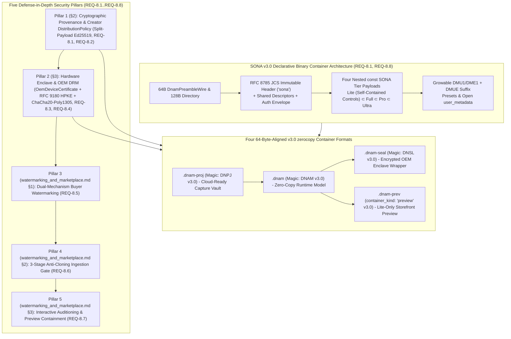
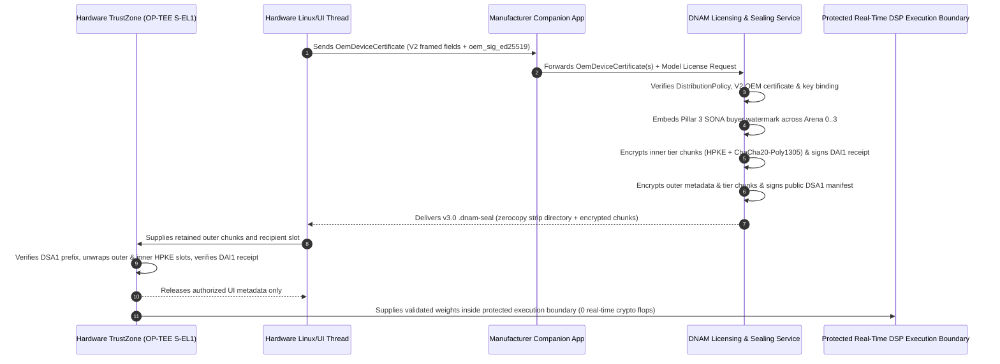

# Cryptographic Provenance (`Ed25519`), `DistributionPolicy`, `OemDeviceCertificate` & `.dnam-seal` (`DNSL`) Hardware DRM

This specification defines **Pillar 1 (Cryptographic Provenance & `DistributionPolicy`)**, **Pillar 2 (Hardware Enclave & OEM DRM via `OemDeviceCertificate` and `v3.0` `zerocopy` `.dnam-seal` `b"DNSL"`)**, and the **Three Container Protection Profiles (`DnamProtectionProfile`)** of the `SONA` `v3.0` DNAM 5-Pillar Security Architecture (paired with Pillars 3–5 in [`watermarking_and_marketplace.md`](watermarking_and_marketplace.md)), fulfilling [`../../requirements/system_goals_and_requirements.md` §9 (`REQ-8.1`–`REQ-8.8`)](../../requirements/system_goals_and_requirements.md#9-goal-8--model-provenance-hardware-drm-forensic-watermarking--marketplace-security) (see [`../../adr/0009-jcs-prefix-signing-hpke-and-preview-containment.md`](../../adr/0009-jcs-prefix-signing-hpke-and-preview-containment.md) and [`../../adr/0022-sona-state-space-operator-and-webgpu-architecture.md`](../../adr/0022-sona-state-space-operator-and-webgpu-architecture.md)).

---

## 1. Taxonomy Overview: 5 Security Pillars, 3 Protection Profiles & 4 Container Formats

`r[sec.taxonomy.overview]`



---

## 2. Pillar 1: Cryptographic Provenance (`Ed25519` Split-Payload Chain) & Creator-Signed `DistributionPolicy`

### 2.1 Preset-Safe Canonical Header Digest (RFC 8785 JCS)

`r[sec.jcs.immutable-header-digest]`

To allow user preset edits and storefront catalog tagging without invalidating creator or marketplace signatures, `immutable_header_sha256` hashes the exact **RFC 8785 JSON Canonicalization Scheme (JCS)** UTF-8 byte serialization of the `v3.0` `"sona"` logical header (`"version": "3.0.0"`, `"architecture": "sona"`, `"sample_rate_train_hz": 48000`, zero `v2`/`tora` legacy compatibility) after projecting out only the top-level / scoped mutable paths below:

```text
presets
user_metadata
metadata.signatures
controls_schema[*].user_metadata
stems_registry[*].user_metadata
slimmable_tiers.{lite,full,pro,ultra}.prefix_crc32c
```

**Canonical RFC 8785 JCS & Projection Invariants (Clean-Room SSOT):**
1. **Non-Recursive Exact Path Stripping:** Strip only the six exact schema paths listed above (`metadata.signatures`, `slimmable_tiers.<tier>.prefix_crc32c`, etc.); never recursively strip arbitrary nested occurrences of keys with those names. Optional fields set to `null` / absent under Rust `skip_serializing_if` conventions are omitted prior to canonicalization so TypeScript and Rust `serde` produce identical keys.
2. **UTF-16 Code-Unit Key Ordering (`RFC 8785 §3.2.3`):** Sort every JSON object's member keys strictly in ascending lexicographical order of their UTF-16 code units (not UTF-8 bytes—characters above `U+FFFF` sort as surrogate pairs `0xD800..0xDFFF` ahead of `U+E000..0xFFFF`).
3. **Minimal Token Whitespace & String Escaping:** Emit zero insignificant whitespace around `:`, `,`, `{`, `}`, `[`, `]`. Escape only mandatory JSON characters (`"`, `\`, and `U+0000..U+001F` using `\b`, `\f`, `\n`, `\r`, `\t`, or lowercase `\u00xx`); emit all other valid Unicode characters as raw unescaped UTF-8.
4. **ECMAScript `binary64` Number Formatting & Fail-Closed Non-Finite Rejection:** Serialize finite numbers using shortest round-trip ECMAScript `Number.prototype.toString` formatting, map `-0.0` strictly to `"0"`, emit integers in the exact range $[-(2^{53}-1), 2^{53}-1]$ without fractional `.0` suffixes, and fail closed (`DnamError::InvalidJsonHeader` / `DnamError::SchemaValidationError`) on non-finite `NaN` or `±Infinity`.

| JSON Header Path | Included in `immutable_header_sha256`? | Security Role |
| :--- | :---: | :--- |
| `version` (`"3.0.0"`), `container_kind`, `architecture` (`"sona"`), `sample_rate_train_hz` | **Yes (Signed)** | Locks `v3.0` `SONA` core architecture and reference sample rate (`48000`) |
| `metadata.{name, author, description, license, created_at, input_reference_dbfs, provenance}` | **Yes (Signed)** | Locks creator attribution, license terms, and PCM dataset provenance |
| **`metadata.distribution_policy`** (`allowed_protection_profiles`, `allowed_oem_vendors`) | **Yes (Signed)** | Locks permitted protection profiles and OEM hardware vendors/models |
| `io_config`, `controls_schema`, `delay_histories`, `tensor_directory`, `slimmable_tiers` | **Yes (Signed)** | Locks safety clamps, delay capacities, constant tier offsets, and calibration |
| **`presets`** & **`*_user_metadata`** | **No (Mutable Suffix)** | Stored in the growable `DMU1`/`DME1` + `DMUE` suffix |
| **`metadata.signatures`** | **No (Auth Envelope)** | Stored in the `DAU1`/`DAI1`/`DSA1` authentication envelope |

### 2.2 Creator-Signed `DistributionPolicy` & Protection Profile Exclusivity

`r[sec.policy.distribution-policy]`

```json
{
  "metadata": {
    "name": "Darkglass Exclusive B7K Ultra Rig",
    "author": "Darkglass Electronics",
    "distribution_policy": {
      "allowed_protection_profiles": ["enclave_sealed"],
      "allowed_oem_vendors": ["darkglass:anagram_rk3582"]
    }
  }
}
```

1. **Protection Profile Gate (`allowed_protection_profiles`):** Restricts which `DnamProtectionProfile` values (`"open"`, `"device_allowlisted"`, `"enclave_sealed"`) may issue or load the model.
2. **Granular OEM Vendor & Model Matching (`allowed_oem_vendors`):** Supports vendor-wide (`"darkglass"`) and model-specific (`"darkglass:anagram_rk3582"`) rules. Any nonempty OEM restriction requires key-bound `OemDeviceCertificate` attestation for every encrypted recipient (rejecting unverified self-registered keys).

### 2.3 Two-Certificate `Ed25519` Delegation Chain & 4-Tier Cumulative Arena Digests

`r[sec.sig.prefix-delegation]`

**Canonical Binary Domain-Field Encoder (`encode_domain_field`):** Every cryptographic transcript in DNAM uses exact little-endian length-prefixed framing with zero delimiters or implicit field boundaries:
```text
F(label, value) = u32le(len(label_utf8)) || label_utf8 || u64le(len(value_bytes)) || value_bytes
```
All tier prefix lists encode `L = u8(count) || (u8(tier[0]) || digest[0][32]) || ... || (u8(tier[count-1]) || digest[count-1][32])` (`1 + 33 * count` bytes, `count = max_tier + 1 in 1..=4`, `tier[k] == k` strictly contiguous). Because `Arena 0` (`Arena0LiteWire`) embeds self-contained `Lite` control descriptors, `CP1`, `U_int`, `W_ctrl`, and `Lite` `W_readout`, `strip_container_to_tier(Lite)` preserves authenticated parametric control descriptors and signatures without re-signing (`REQ-5.6`):

```text
+---------------------------------------------------------------------------------------------------+
| DOMAIN-SEPARATED PREFIX COMMITMENTS & ED25519 DELEGATION TRANSCRIPTS                              |
+---------------------------------------------------------------------------------------------------+
|  1. Shared Plaintext Framing ("DNAM-PLAINTEXT-SHARED-V1"):                                        |
|     exact_shared_model_bytes = F("domain", "DNAM-PLAINTEXT-SHARED-V1")                            |
|       || F("preamble", exact_plaintext_preamble[64])                                              |
|       || F("directory", exact_plaintext_directory[128])                                           |
|       || F("shared_model_binary", exact_immutable_shared_binary)                                  |
+---------------------------------------------------------------------------------------------------+
|  2. Plaintext Prefix Digest (domain = "DNAM-MASTER-PREFIX-V1" or "DNAM-BUYER-PREFIX-V1"):         |
|     SHA256( F("domain", domain) || F("immutable_header_sha256", H_hdr[32])                        |
|             || F("shared_model_data", exact_shared_model_bytes)                                   |
|             || F("tier_lite", exact_lite_bytes)                                                   |
|             [|| F("tier_full", full) || F("tier_pro", pro) || F("tier_ultra", ultra)] )           |
+---------------------------------------------------------------------------------------------------+
|  3. Creator Signing Message ("DNAM-CREATOR-MANIFEST-V1") & Signed Identity:                       |
|     creator_msg = F("domain", "DNAM-CREATOR-MANIFEST-V1")                                         |
|       || F("creator_pubkey_ed25519", creator_public_key[32])                                      |
|       || F("immutable_header_sha256", immutable_header_sha256[32])                                |
|       || F("issued_max_tier", u8(maximum_tier)) || F("master_prefix_sha256", L_master)            |
|     creator_signed_manifest_sha256 = SHA256(                                                      |
|       F("domain", "DNAM-CREATOR-SIGNED-V1")                                                       |
|       || F("creator_manifest", creator_msg) || F("creator_signature", creator_signature[64]))     |
+---------------------------------------------------------------------------------------------------+
|  4. Ciphertext Prefix Digest ("DNAM-CIPHERTEXT-PREFIX-V1"):                                       |
|     SHA256( F("domain", "DNAM-CIPHERTEXT-PREFIX-V1")                                              |
|             || F("record_context_sha256", record_context_sha256[32])                              |
|             || F("shared", shared_ct_and_pad) || F("tier_lite", lite_ct_and_pad) [|| ...] )       |
+---------------------------------------------------------------------------------------------------+
|  5. Buyer Receipt Signing Message ("DNAM-BUYER-RECEIPT-V1") & Policy Digest:                      |
|     license_policy_sha256 = SHA256(                                                               |
|       F("domain", "DNAM-LICENSE-POLICY-V1") || F("policy", exact_versioned_policy_bytes))         |
|     buyer_msg = F("domain", "DNAM-BUYER-RECEIPT-V1")                                              |
|       || F("marketplace_pubkey_ed25519", marketplace_public_key[32])                              |
|       || F("creator_signed_manifest_sha256", creator_signed_manifest_sha256[32])                  |
|       || F("license_policy_sha256", license_policy_sha256[32])                                    |
|       || F("protection_profile", u8(profile)) || F("issued_max_tier", u8(maximum_tier))           |
|       || F("buyer_prefix_sha256", L_buyer)                                                        |
|       || F("inner_record_context_sha256", inner_record_context_or_empty)                          |
|       || F("inner_ciphertext_prefix_sha256", L_inner_ct_or_empty)                                 |
+---------------------------------------------------------------------------------------------------+
|  6. Public Outer Manifest ("DNAM-OUTER-PUBLIC-METADATA-V1" & "DNAM-OUTER-MANIFEST-V1"):           |
|     outer_public_metadata_sha256 = SHA256(                                                        |
|       F("domain", "DNAM-OUTER-PUBLIC-METADATA-V1")                                                |
|       || F("preamble", public_preamble[64]) || F("directory", public_directory[128])              |
|       || F("public_auxiliary", outer_plan_and_slots_with_padding))                                |
|     outer_msg = F("domain", "DNAM-OUTER-MANIFEST-V1")                                             |
|       || F("outer_signer_pubkey_ed25519", outer_signer_public_key[32])                            |
|       || F("outer_public_metadata_sha256", outer_public_metadata_sha256[32])                      |
|       || F("outer_record_context_sha256", outer_record_context_sha256[32])                        |
|       || F("issued_max_tier", u8(maximum_tier)) || F("outer_ciphertext_prefix_sha256", L_outer_ct)|
+---------------------------------------------------------------------------------------------------+
```

**Fail-Closed Verification, Trust-Anchor Pinning & Host Preview Containment:**
1. **Strict Fail-Closed Trust Anchor Enforcement:** Whenever a container declares `auth_kind == 1`, `protection_profile != 0`, a marketplace receipt in `metadata.signatures`, or commercial `DAU1`/`DAI1` marketplace fields, verification (`verify`) and unsealing (`unseal`) **MUST execute fail-closed** against a pinned caller-supplied trusted `marketplace_pubkey()` (`[u8; 32]`). If `marketplace_pubkey()` (or any required OEM issuer key / device `X25519` secret) is absent (`None`), mismatched, or fails `Ed25519` verification, the operation **MUST return `Err(DnamError::CryptoVerificationFailed)`** (or `Err(DnamError::EncryptedArenaRequiresDeviceKey)` when unsealing without the recipient secret)—never warn, ignore, or downgrade to `CreatorVerified` / unsigned acceptance.
2. **DAW / Hardware Host Preview Rejection Across Initial Load & Hot-Swap:** Non-browser DAW and embedded hardware hosts MUST invoke `ensure_not_preview_for_daw_host()` (`container_kind == "preview" -> Err(DnamError::PreviewContainerRejected)`) on **both** initial container load (`Model::from` / `DnamEngine::from_container`) **and** live model hot-swap (`reload_model_in_place` / `reload_model_in_place_owned`, [`watermarking_and_marketplace.md` §3](watermarking_and_marketplace.md#3-commercial-storefront-platform-auditioning-royalty-splits--storefront-metadata)).

`r[sec.sig.dau1-envelope]` **Open `DAU1` Authentication Envelope:** In Open `3.0` containers (`protection_profile = 0`), the authentication region (`authentication_envelope_offset..+length`) encodes `Dau1Envelope` with exact byte layout (`N_c = creator_max_tier + 1`, `N_b = buyer_max_tier + 1`, `L_master_end = 42 + 33 * N_c`, `pos = L_master_end + 64`):

| Byte Offset | Type / Size | Field | Invariant |
| :--- | :---: | :--- | :--- |
| `0..4` | `[u8; 4]` | `magic` | Strictly `b"DAU1"` |
| `4..5` | `u8` | `auth_kind` | `0` (creator-only) or `1` (creator + marketplace) |
| `5..8` | `[u8; 3]` | `reserved` | Strictly `[0, 0, 0]` |
| `8..40` | `[u8; 32]` | `creator_pubkey` | Creator `Ed25519` verifying key |
| `40..41` | `u8` | `creator_max_tier` | `0..=3` (`Lite..Ultra`) |
| `41..L_master_end` | `[u8; 1 + 33*N_c]` | `creator_master_prefix_list` | `u8(N_c) || (u8(t) || digest[32])[0..N_c]` (`"DNAM-MASTER-PREFIX-V1"`) |
| `L_master_end..pos` | `[u8; 64]` | `creator_signature` | Pure `Ed25519` signature over `"DNAM-CREATOR-MANIFEST-V1"` (`pos == len` if `auth_kind == 0`, total `106 + 33 * N_c` B) |
| `pos..pos+32` | `[u8; 32]` | `marketplace_pubkey` *(only if `auth_kind == 1`)* | Must match pinned trusted marketplace key (`CryptoVerificationFailed` if absent/mismatch) |
| `pos+32..pos+36` | `U32` LE | `policy_len` (`P`) | Canonical license policy byte length |
| `pos+36..pos+36+P` | `[u8; P]` | `policy_bytes` | Exact UTF-8 RFC 8785 JCS license policy bytes |
| `p_end..p_end+1` | `u8` | `buyer_max_tier` (`p_end = pos + 36 + P`) | `0 <= buyer_max_tier <= creator_max_tier` |
| `p_end+1..b_end` | `[u8; 1 + 33*N_b]` | `buyer_prefix_list` | `u8(N_b) || (u8(t) || digest[32])[0..N_b]` (`"DNAM-BUYER-PREFIX-V1"`, `b_end = p_end + 2 + 33*N_b`) |
| `b_end..b_end+64` | `[u8; 64]` | `marketplace_signature` | Pure `Ed25519` signature over `"DNAM-BUYER-RECEIPT-V1"`, total `208 + 33*N_c + 33*N_b + P` B |

#### Offline Authorization and Future Revocation

`r[sec.sig.offline-auth]`

Once a protected model is authorized and issued to a device, it remains loadable and usable on that device **offline indefinitely** without periodic lease renewal, online checks, or wall-clock expiration while local keys and authorization remain intact (`REQ-8.4`). Revocation applies to future licensing and new issuances rather than retroactively disabling existing offline issuances.

---

## 3. Pillar 2: Hardware Enclave & OEM DRM (`OemDeviceCertificate` Attestation & `.dnam-seal` `b"DNSL"` Wrapper)

### 3.1 Three OEM Hardware Integration & Key Provisioning Paths

`r[sec.drm.oem-certificate]`

| OEM Integration Path | Protection Profile | Factory Assembly-Line Changes? | Key Attestation Mechanism |
| :--- | :--- | :--- | :--- |
| **Path 1: Self-Registered Device Key** | `DeviceAllowlisted` (`.dnam`) | **None** | Device generates `X25519` keypair locally and proves possession via challenge-response during account pairing. |
| **Path 2: Companion-App / OTA Cert Enrollment** | `EnclaveSealed` (`.dnam-seal`, `b"DNSL"`) | **None** (uses hardware root of trust) | Hardware TrustZone / secure element attests key binding to OEM cloud HSM, which issues a signed `OemDeviceCertificate`. |
| **Path 3: Factory-Line HSM Provisioning** | `EnclaveSealed` (`.dnam-seal`, `b"DNSL"`) | **Yes** (factory PCB test rig) | Offline factory HSM verifies device-key binding and writes a signed `OemDeviceCertificate` to non-volatile storage. |

**`OemDeviceCertificate` V2 Signing Input:** Both attested paths sign the length-framed `F` sequence with pure `Ed25519`:

```text
F("domain",                      ASCII("DNAM-OEM-CERT-V2"))
|| F("oem_vendor",               ASCII(canonical_vendor_id))       # 1..32 B, [a-z0-9][a-z0-9._-]*
|| F("model_code",               ASCII(canonical_model_id))        # 1..64 B, [a-z0-9][a-z0-9._-]*
|| F("device_id_hash",           device_id_hash[16])
|| F("public_key_x25519",        pk_device_x25519[32])
|| F("issuer_key_sha256",        SHA256(oem_issuer_pubkey_ed25519[32]))
|| F("assurance",                u8(0x01 = remote_ota, 0x02 = factory_hsm))
|| F("attestation_policy_sha256", policy_sha256[32])
|| F("attestation_evidence_sha256", evidence_sha256[32])
```

For `EnclaveSealed`, decrypted weights and secret-bearing model state remain inside a protected DSP execution boundary inaccessible to normal-world code, debuggers, and unauthorized DMA.

### 3.2 End-to-End `.dnam-seal` (`b"DNSL"`) Sealing & Hardware TrustZone Unsealing Flow

`r[sec.drm.trustzone-flow]`



### 3.3 `.dnam-seal` (`b"DNSL"`) 64-Byte Cache-Line Binary Envelope Specification

1. `r[sec.drm.hpke-record-encryption]` **Single Canonical `.dnam-seal` AEAD Format (RFC 9180 HPKE + `ChaCha20-Poly1305`, Zero Unauthenticated Raw ChaCha20 XOR):**
   - **Sole Normative Ciphersuite & AEAD Records:** Uses **RFC 9180 Base mode (`DHKEM(X25519, HKDF-SHA256)` `0x0020`, `HKDF-SHA256` `0x0001`, `ChaCha20Poly1305` `0x0003`; 6-byte wire suite ID `00 20 00 01 00 03`)**, rejecting non-contributory all-zero X25519 shared secrets fail-closed, paired with authenticated **`ChaCha20-Poly1305` AEAD records** (`MAX_RECORD_PLAINTEXT_BYTES = ((1u64 << 32) - 1) * 64 = 274_877_906_880 B`, `MAX_RECORD_CIPHERTEXT_BYTES = MAX_RECORD_PLAINTEXT_BYTES + 16`).
   - **Prohibition of Legacy Raw ChaCha20 XOR (`DnamSealEnvelopePreamble`):** Unauthenticated raw `ChaCha20` XOR `.dnam-seal` envelopes (including legacy `DnamSealEnvelopePreamble` / raw stream XOR without `DnslPreambleWire` + `DnslDirectoryWire` + `DSA1` + AEAD Poly1305 record tags) are **strictly forbidden** on `v3.0` `.dnam-seal`. Loaders MUST reject any `.dnam-seal` envelope using unauthenticated raw XOR fail-closed (`DnamError::UnsupportedVersion`, `DnamError::MalformedContainer`, or `DnamError::CryptoVerificationFailed`).
   - **Record Indexing & Nonces:** Record `i = 0` holds the shared layer data (`record_kind = 0`, `tier = 0`); records `i = 1..=maximum_tier+1` hold cumulative tier slices (`record_kind = 1`, `tier = i - 1`), with `C = maximum_tier + 2` entries total (`2..=5`), `12 B` AEAD nonce `u64le(0) || u32le(i)`, and `16 B` packed `RecordDirEntryWire` descriptors (`0..8 offset: U64`, `8..16 ciphertext_length: U64`). Each `HpkeSlotWire` (`80 B`) stores `0..32 enc: [u8; 32]` followed by `32..80 wrapped_cek_and_tag: [u8; 48]`. Recipient count `N` MUST lie in `1..=16`, with `recipient_key_ids` sorted lexicographically by `SHA-256(pk_x25519[32])` and zero duplicates.

```text
+---------------------------------------------------------------------------------------------------+
| PRE-WRAP PLAN, RECORD CONTEXT & CHACHA20-POLY1305 AAD TRANSCRIPTS                                 |
+---------------------------------------------------------------------------------------------------+
|  structural_metadata_sha256 = SHA256(                                                             |
|    F("domain", "DNAM-ENCRYPTED-STRUCTURE-V1") || F("layer", u8(layer))                            |
|    || F("preamble", exact_layer_preamble[64]) || F("directory", exact_layer_directory[128]))      |
|    (layer = 0 for public DNSL outer or DeviceAllowlisted; layer = 1 for encrypted DNPL inner)     |
|                                                                                                   |
|  Pre-Wrap Plan P ("DNAM-PRE-WRAP-PLAN-V1"):                                                       |
|    F("domain", "DNAM-PRE-WRAP-PLAN-V1") || F("issuance_id", issuance_id[16])                      |
|    || F("layer", u8(layer)) || F("protection_profile", u8(profile))                               |
|    || F("issued_max_tier", u8(maximum_tier))                                                      |
|    || F("structural_metadata_sha256", structural_metadata_sha256[32])                             |
|    || F("mutable_offset", u64le(0)) || F("mutable_capacity", u64le(0))                            |
|    || F("hpke_suite", 00 20 00 01 00 03) || F("recipient_key_ids", R) || F("record_descriptors",D)|
|    where R = u32le(N) || SHA256(pk_x25519)[0..N] (4 + 32*N B, strictly sorted & unique),          |
|          S = u32le(N) || HpkeSlotWire[0..N] (4 + 80*N B: enc[32] || wrapped_cek_and_tag[48]),      |
|          D = u32le(C) || RecordDirEntryWire[0..C] (4 + 16*C B: offset:U64 || ciphertext_len:U64)  |
|                                                                                                   |
|  wrap_plan_sha256 = SHA256(F("domain", "DNAM-WRAP-PLAN-V1") || F("plan", P))                      |
|  record_context_sha256 = SHA256(                                                                  |
|    F("domain", "DNAM-RECORD-CONTEXT-V1")                                                          |
|    || F("wrap_plan_sha256", wrap_plan_sha256[32]) || F("slots", S))                               |
|                                                                                                   |
|  HPKE Slot i Info / AAD (domain = "DNAM-HPKE-INFO-V1" or "DNAM-HPKE-AAD-V1"):                     |
|    F("domain", domain) || F("wrap_plan_sha256", wrap_plan_sha256[32])                             |
|    || F("slot_index", u32le(i)) || F("recipient_key_sha256", recipient_key_sha256[i][32])         |
|                                                                                                   |
|  Record i (0=shared, 1..4=Lite..Ultra, Nonce = u64le(0) || u32le(i)) AAD:                         |
|    F("domain", "DNAM-RECORD-AAD-V1") || F("record_context_sha256", record_context_sha256[32])     |
|    || F("record_index", u32le(i)) || F("record_kind", u8(kind))                                   |
|    || F("tier", u8(tier)) || F("ciphertext_length", u64le(ciphertext_length))                     |
+---------------------------------------------------------------------------------------------------+
```

#### Sealed Public Framing

`r[sec.drm.dnsl-public-framing]`

An `EnclaveSealed` (`v3.0` `.dnam-seal`) file is parsed strictly via declarative `#[repr(C)]` `zerocopy::byteorder::little_endian` wire structs (`DnslPreambleWire`, `DnslDirectoryWire`, `HpkeSlotWire`, `RecordDirEntryWire`, `ref[repo.code.zerocopy-wire-structs]`) ordering `[preamble(0..64)][directory(64..192)][outer plan P(192..)][pad][outer slots S][pad][DSA1 manifest][pad][outer shared record][pad][outer Lite..Ultra records][pad][DME1 frame][DMUE footer]`:

**`DnslPreambleWire` (`64 B`, `#[repr(C, align(64))]`, offsets `0..64`):**

| Offset | Type | Field | Validation Invariant |
| :--- | :---: | :--- | :--- |
| `0..4` | `[u8; 4]` | `magic` | Strictly `b"DNSL"` |
| `4..6` | `U16` LE | `version_major` | Strictly `3` |
| `6..8` | `U16` LE | `version_minor` | Strictly `0` |
| `8..9` | `u8` | `protection_profile` | Strictly `2` (`EnclaveSealed`) |
| `9..10` | `u8` | `maximum_tier` | `0..=3` (`Lite..Ultra`) |
| `10..64` | `[u8; 54]` | `reserved` | Strictly `[0u8; 54]` |

**`DnslDirectoryWire` (`128 B`, `#[repr(C)]`, `Unaligned`, offsets `64..192`):**

| Offset | Type | Field | Validation Invariant |
| :--- | :---: | :--- | :--- |
| `0..8` | `U64` LE | `plan_offset` | Strictly `== 192` |
| `8..16` | `U64` LE | `plan_length` | `> 0`, `plan_offset + plan_length <= slots_offset` |
| `16..24` | `U64` LE | `slots_offset` | `64 B`-aligned (`% 64 == 0`) |
| `24..32` | `U64` LE | `slots_length` | `4 + 80 * N` (`N in 1..=16`), `slots_offset + slots_length <= manifest_offset` |
| `32..40` | `U64` LE | `manifest_offset` | `64 B`-aligned |
| `40..48` | `U64` LE | `manifest_length` | `105 + 33 * (maximum_tier + 1)` (`DSA1` byte length) |
| `48..56` | `U64` LE | `shared_record_offset` | `64 B`-aligned, `>= manifest_offset + manifest_length` |
| `56..64` | `U64` LE | `shared_ciphertext_length` | `16 <= len <= MAX_RECORD_CIPHERTEXT_BYTES` |
| `64..96` | `[U64; 4]` | `original_tier_ends` | Strictly monotonic `64 B`-aligned ends for `0..=maximum_tier` (`original_tier_ends[0] >= ceil64(shared_record_offset + shared_ciphertext_length)`), remaining `[maximum_tier + 1..4]` strictly `0`, no `u64` overflow |
| `96..128` | `[u8; 32]` | `reserved` | Strictly `[0u8; 32]` |

**`DSA1` Public Manifest Wire Layout (`105 + 33 * M` B, `M = maximum_tier + 1`):** `0..4 magic = b"DSA1"` | `4..5 original_maximum_tier (0..=3)` | `5..8 reserved = [0, 0, 0]` | `8..40 outer_signer_public_key[32]` | `40..41+33*M outer_ciphertext_prefix_list` (`u8(M) || (u8(t) || ct_digest[32])[0..M]`) | `41+33*M..105+33*M outer_signature[64]` (`Ed25519` over `"DNAM-OUTER-MANIFEST-V1"`).

**`HpkeSlotWire` (`80 B`, `Unaligned`) & `RecordDirEntryWire` (`16 B`, `Unaligned`):**
- `HpkeSlotWire`: `0..32 enc: [u8; 32]` | `32..80 wrapped_cek_and_tag: [u8; 48]`.
- `RecordDirEntryWire`: `0..8 offset: U64` | `8..16 ciphertext_length: U64`.

#### Protected Inner Framing

`r[sec.drm.protected-inner-framing]`

In `DeviceAllowlisted` (`protection_profile = 1`, standalone `v3.0` `.dnam`) and inside the decrypted outer records of `EnclaveSealed` (`protection_profile = 2`), the inner layer uses declarative `zerocopy` `DnplPreambleWire` (`64 B`, `#[repr(C, align(64))]`) and `InnerDirectoryWire` (`128 B`, `#[repr(C)]`, `Unaligned`) (`ref[repo.code.zerocopy-wire-structs]`) ordering `[inner preamble(0..64)][inner directory(64..192)][DNPL logical metadata prefix(192..plan_offset)][inner plan P][pad][inner slots S][pad][DAI1 envelope][pad][inner shared record][pad][inner Lite..Ultra records][pad]`:

**`DnplPreambleWire` (`64 B`, `#[repr(C, align(64))]`, offsets `0..64`):**

| Offset | Type | Field | Validation Invariant |
| :--- | :---: | :--- | :--- |
| `0..4` | `[u8; 4]` | `magic` | Strictly `b"DNPL"` |
| `4..6` | `U16` LE | `version_major` | Strictly `3` |
| `6..8` | `U16` LE | `version_minor` | Strictly `0` |
| `8..9` | `u8` | `protection_profile` | `1` (`DeviceAllowlisted`) or `2` (`EnclaveSealed`) |
| `9..10` | `u8` | `auth_kind` | `0` or `1` (`1` for marketplace-authorized commercial issuances; matches `DnamPreambleWire.auth_kind`) |
| `10..11` | `u8` | `buyer_max_tier` | `0..=3` (`Lite..Ultra`) |
| `11..12` | `u8` | `reserved_pad` | Strictly `0` |
| `12..16` | `U32` LE | `sample_rate_train_hz` | Strictly `48_000` |
| `16..64` | `[u8; 48]` | `reserved` | Strictly `[0u8; 48]` |

**`InnerDirectoryWire` (`128 B`, `#[repr(C)]`, `Unaligned`, offsets `64..192`):**

| Offset | Type | Field | Validation Invariant |
| :--- | :---: | :--- | :--- |
| `0..8` | `U64` LE | `plan_offset` | `>= 192` and `64 B`-aligned (immediately follows `DNPL` logical metadata prefix) |
| `8..16` | `U64` LE | `plan_length` | `> 0`, `plan_offset + plan_length <= slots_offset` |
| `16..24` | `U64` LE | `slots_offset` | `64 B`-aligned |
| `24..32` | `U64` LE | `slots_length` | `4 + 80 * N` (`N in 1..=16`) |
| `32..40` | `U64` LE | `authentication_offset` | `64 B`-aligned |
| `40..48` | `U64` LE | `authentication_length` | `> 0`, `>= 209 + 33*N_c + 66*N_b + P` |
| `48..56` | `U64` LE | `shared_record_offset` | `64 B`-aligned |
| `56..64` | `U64` LE | `shared_ciphertext_length` | `16 <= len <= MAX_RECORD_CIPHERTEXT_BYTES` |
| `64..96` | `[U64; 4]` | `original_tier_ends` | Strictly monotonic `64 B`-aligned ends for `0..=buyer_max_tier`, remaining `[buyer_max_tier + 1..4]` strictly `0` |
| `96..128` | `[u8; 32]` | `logical_metadata_sha256` | `SHA256(F("domain", "DNAM-LOGICAL-METADATA-V1") || F("logical_prefix", logical_prefix))` where `logical_prefix = inner[192..plan_offset]` (`0..logical_prefix_len`) |

**`DNPL` Logical Metadata Prefix (`logical_prefix = inner[192..plan_offset]`, `logical_prefix_len = plan_offset - 192`, `64 B`-aligned):**
Inside the unsealed plaintext buffer slice `logical_prefix` starting at byte `0` (`0..logical_prefix_len`):
- `0..64`: Plaintext `DnplPreambleWire` (`magic = b"DNPL"`, `3.0`, `protection_profile`, `auth_kind`, `buyer_max_tier`, `sample_rate_train_hz = 48_000`).
- `64..192`: Logical `DnamDirectoryWire` using virtual plaintext `.dnam` offsets for `immutable_header_offset = 192`, `immutable_header_length`, `shared_binary_offset`, `shared_binary_length`, `authentication_envelope_offset`, `authentication_envelope_length`, `reserved = 0`, `tier_start`, `original_tier_ends[4]`, and `reserved_tail = [0; 24]`.
- `192..logical_prefix_len`: Unencrypted canonical RFC 8785 JCS Immutable Header (`"architecture": "sona"`, `"version": "3.0.0"`) zero-padded to a `64 B` boundary.
- **Buffer-Base Separation:** All offsets inside the `DNPL` header table above (`0..64`, `64..192`, `192..logical_prefix_len`) are relative to the `logical_prefix` buffer itself (starting at byte `0`), which is SHA-256 hashed under `"DNAM-LOGICAL-METADATA-V1"` (`SHA256(F("domain", "DNAM-LOGICAL-METADATA-V1") || F("logical_prefix", logical_prefix))`) into `InnerDirectoryWire.logical_metadata_sha256` (`96..128`). Meanwhile, `InnerDirectoryWire` (`inner[64..192]`) holds the outer-to-inner ciphertext record offsets (`plan_offset`, `slots_offset`, `authentication_offset`, `shared_record_offset`, `original_tier_ends`) relative to the inner framing buffer. In `EnclaveSealed` (`profile = 2`), outer record `0` decrypts to `DnplPreambleWire` (`0..64`) || `InnerDirectoryWire` (`64..192`) || `logical_prefix` (`192..plan_offset`) || `inner_plan` || `inner_slots` || `DAI1` || `inner_shared_record` (`64 B` aligned AEAD ciphertexts matching `InnerDirectoryWire.logical_metadata_sha256` and `structural_metadata_sha256(layer = 1)`).

**`DAI1` Inner Authentication Envelope (`209 + 33 * N_c + 66 * N_b + P` B):**
`0..4 "DAI1"` | `4..8 [0,0,0,0]` | `8..40 creator_public_key[32]` | `40 creator_original_max_tier` | `creator_master_prefix_list[1 + 33*N_c]` | `creator_signature[64]` | `marketplace_public_key[32]` | `u32le(P)` | `exact_policy_bytes[P]` | `buyer_original_max_tier` | `buyer_plaintext_prefix_list[1 + 33*N_b]` | `inner_ciphertext_prefix_list[1 + 33*N_b]` | `marketplace_signature[64]` (verified fail-closed against pinned trusted `marketplace_pubkey()`, `ref[sec.sig.prefix-delegation]`).

#### Encrypted Mutable Suffix

`r[sec.drm.dme1-mutable-suffix]`

Both `DeviceAllowlisted` and `EnclaveSealed` containers place a growable `DME1` frame (`Dme1HeaderWire`, `#[repr(C)]` `zerocopy`) and `16 B` `DmueFooterWire` (`0..4 "DMUE" | 4..12 frame_len: U64 | 12..16 reserved: U32 = 0`) immediately after the retained outermost tier boundary:

**`Dme1HeaderWire` (`20 B`, `#[repr(C)]`, `Unaligned`) & Frame Layout:**

| Offset / Field | Type | Constraints & Invariants |
| :--- | :---: | :--- |
| `0..4` (`magic`) | `[u8; 4]` | Strictly `b"DME1"` |
| `4..5` (`protection_profile`) | `u8` | `1` (`DeviceAllowlisted`) or `2` (`EnclaveSealed`) |
| `5..8` (`reserved`) | `[u8; 3]` | Strictly `[0, 0, 0]` |
| `8..12` (`recipient_count`, `N`) | `U32` LE | `1 <= N <= 16` |
| `12..20` (`ciphertext_length`, `C`) | `U64` LE | `min_ct <= C <= 4096` where `min_ct = 4 + 32*N + 18 + 16` (`header_count + N*32B pubkeys + min_dmu1_18B + poly1305_tag_16B`) |
| `20 .. 20+80*N` | `[HpkeSlotWire; N]` | `enc[32] || wrapped_cek_and_tag[48]` sorted strictly by recipient `SHA-256(pk_x25519)` |
| `20+80*N .. 20+80*N+C` | `[u8; C]` | `ChaCha20-Poly1305` ciphertext + tag over `u32le(N) || recipient_pk_x25519[0..N][32] || complete DMU1 frame` |

```text
DME1 Domain-Separated Transcripts:
  mutable_wrap_sha256 = SHA256(
    F("domain", "DNAM-MUTABLE-WRAP-V1")
    || F("record_context_sha256", signed_outermost_record_context_sha256)
    || F("header", exact_20_byte_header) || F("recipient_key_ids", R))
  Slot i Info / AAD (domain = "DNAM-MUTABLE-HPKE-INFO-V1" or "DNAM-MUTABLE-HPKE-AAD-V1"):
    F("domain", domain) || F("mutable_wrap_sha256", mutable_wrap_sha256)
    || F("slot_index", u32le(i)) || F("recipient_key_sha256", recipient_key_sha256[i])
  Content AEAD AAD (nonce = 0x00 * 12, fresh 32-byte cek_mutable per edit):
    F("domain", "DNAM-MUTABLE-CONTENT-V1")
    || F("mutable_wrap_sha256", mutable_wrap_sha256) || F("slots", S)
```

---

## 4. Three Container Protection Profiles (`DnamProtectionProfile`) & Loader Auto-Detection

`r[sec.drm.protection-profiles]`

| Protection Profile (`DnamProtectionProfile`) | Container (`v3.0`) | Metadata | Tier Payloads | Primary Target & Security Posture |
| :--- | :--- | :--- | :--- | :--- |
| **`Open` (`0`, `"open"`)** | `.dnam` (`b"DNAM"`) | Plaintext JCS (`"sona"`) | Plaintext (`DAU1` signed prefixes, `Arena 0` controls) | Community models and open commercial packs |
| **`DeviceAllowlisted` (`1`, `"device_allowlisted"`)** | `.dnam` (`b"DNAM"`) | Plaintext `DNPL` JCS (`"sona"`) | Encrypted tier chunks (`DAI1` + HPKE) | Desktop/mobile/pedal licenses bound to allowlisted device keys |
| **`EnclaveSealed` (`2`, `"enclave_sealed"`)** | `.dnam-seal` (`b"DNSL"`) | Encrypted (public `DSA1` strip directory) | Nested outer + inner encrypted tier chunks | Attested OEM hardware enclaves with protected DSP execution |
