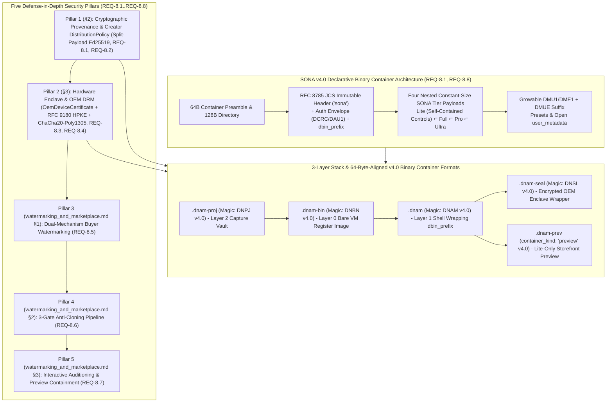

# Cryptographic Provenance (Ed25519), `DistributionPolicy`, `OemDeviceCertificate` & `.dnam-seal` (`DNSL`) Hardware DRM

This specification defines Pillar 1 (Cryptographic Provenance and `DistributionPolicy`) and Pillar 2 (Hardware Enclave and OEM DRM via `OemDeviceCertificate` and the v4.0 little-endian `.dnam-seal` `"DNSL"` wrapper) of the SONA v4.0 5-Pillar Security Architecture. It also specifies the three container protection profiles (Open, `DeviceAllowlisted`, and `EnclaveSealed`) and pairs with Pillars 3–5 in [watermarking and marketplace](watermarking_and_marketplace.md).

Together, these mechanisms fulfill [`REQ-8.1`–`REQ-8.8`](../../requirements/system_goals_and_requirements.md#9-goal-8--model-provenance-hardware-drm-forensic-watermarking--marketplace-security). For the underlying design rationale and security trade-offs, see [`ADR-0009`](../../adr/0009-jcs-prefix-signing-hpke-and-preview-containment.md) and [`ADR-0022`](../../adr/0022-sona-state-space-operator-and-webgpu-architecture.md).

---

## 1. Taxonomy Overview: 5 Security Pillars, 3 Protection Profiles & 3-Layer Container Stack

`r[sec.taxonomy.overview]`

The DNAM security model binds every v4.0 deployment format (.dnam, `.dnam-seal`, `.dnam-prev`, and `.dnam-proj`) around a common 64 B-aligned little-endian binary layout with immutable signed regions, an embedded Layer 0 register prefix (`dbin_prefix`), and a growable mutable suffix.

Bare `.dnam-bin` (`"DNBN"`) payloads hold zero JSON or signatures, whereas `.dnam` and `.dnam-seal` wrap them with cryptographic provenance, hardware DRM, and buyer tracing.



---

## 2. Pillar 1: Cryptographic Provenance (Ed25519 Split-Payload Chain) & Creator-Signed `DistributionPolicy`

### 2.1 Preset-Safe Canonical Header Digest (RFC 8785 JCS)

`r[sec.jcs.immutable-header-digest]`

To allow user preset edits and storefront catalog tagging without invalidating creator or marketplace signatures, `immutable_header_sha256` hashes the exact RFC 8785 JSON Canonicalization Scheme (JCS) UTF-8 serialization of the v4.0 `"sona"` `.dnam` logical header. The header locks `"version": "4.0.0"`, `"architecture": "sona"`, and `"sample_rate_train_hz": 48000` after projecting out only the seven mutable paths below:

```text
presets
user_metadata
stem_user_metadata
metadata.signatures
controls_schema[*].user_metadata
stems_registry[*].user_metadata
slimmable_tiers.{lite,full,pro,ultra}.prefix_crc32c
```

| Canonical RFC 8785 JCS Invariant | Normative Rule |
| :--- | :--- |
| **Non-Recursive Exact Path Stripping** | Strip only the seven exact schema paths listed above; never recursively strip nested keys sharing those names. Mutable `presets`, `user_metadata`, `control_user_metadata`, and `stem_user_metadata` live in the `DMU1` / `DME1` suffix, and `null` or absent optional fields are omitted before canonicalization so all encoders emit identical keys. |
| **UTF-16 Code-Unit Key Ordering** | Sort every JSON object's member keys strictly in ascending lexicographical order of their UTF-16 code units per RFC 8785 §3.2.3. Characters above `U+FFFF` sort as surrogate pairs (`0xD800`..`0xDFFF`) ahead of `U+E000`..`0xFFFF`. |
| **Minimal Token Whitespace & Escaping** | Emit zero insignificant whitespace around structural JSON punctuation. Escape only mandatory control characters and quotes using standard short escapes or lowercase `\u00xx`, emitting all other valid Unicode characters as raw unescaped UTF-8. |
| **RFC 8785 `binary64` Formatting** | Serialize finite numbers using shortest round-trip RFC 8785 §3.2.2.3 IEEE-754 binary64 rules, mapping -0.0 strictly to `"0"` and integers in `[-(2^53 - 1), 2^53 - 1]` without `.0` suffixes. Fail closed (`InvalidJsonHeader` or `SchemaValidationError`) on `NaN` or non-finite values. |

The table below partitions every top-level JSON header region between the signed immutable digest and the unsigned mutable or authentication extents:

| JSON Header Path | Included in `immutable_header_sha256`? | Security Role |
| :--- | :---: | :--- |
| `version`, `container_kind`, `architecture`, `sample_rate_train_hz` | **Yes (Signed)** | Locks v4.0 `"sona"` core architecture (`"4.0.0"`, `"sona"`) and reference sample rate (48000 Hz) |
| `metadata.{name, author, description, license, created_at, input_reference_dbfs, provenance}` | **Yes (Signed)** | Locks creator attribution, license terms, and PCM dataset provenance |
| `metadata.distribution_policy` (`allowed_protection_profiles`, `allowed_oem_vendors`) | **Yes (Signed)** | Locks permitted protection profiles and OEM hardware vendors or models |
| `io_config`, `controls_schema`, `control_bus`, `modal_convolver`, `transport`, `linear_readout`, `delay_histories`, `tensor_directory`, `slimmable_tiers` | **Yes (Signed)** | Locks safety clamps, delay capacities, constant tier offsets, and calibration |
| `presets`, `user_metadata`, `control_user_metadata`, `stem_user_metadata` | **No (Mutable Suffix)** | Stored in the growable `DMU1` (`.dnam`) or `DME1` (`.dnam-seal`) + `DMUE` suffix |
| `metadata.signatures` | **No (Auth Metadata / Envelopes)** | Excluded from `immutable_header_sha256`; serialized in Region 3 JSON on `DCRC`-backed `.dnam` files (Open and `DeviceAllowlisted`) and decrypted `DNPL` logical headers inside `.dnam-seal`, alongside binary `DAU1` / `DSA1` + `DAI1` envelopes |

### 2.2 Creator-Signed `DistributionPolicy` & Protection Profile Exclusivity

`r[sec.policy.distribution-policy]`

Creators may attach an optional `metadata.distribution_policy` block covered by `immutable_header_sha256` to govern how marketplaces and OEM enclaves may issue or execute the model:

```json
{
  "metadata": {
    "name": "Darkglass Exclusive B7K Ultra Rig",
    "author": "Darkglass Electronics",
    "distribution_policy": {
      "allowed_protection_profiles": ["enclave_sealed"],
      "allowed_oem_vendors": ["darkglass:anagram_rk3582"]
    }
  }
}
```

The `allowed_protection_profiles` field restricts which protection profile values (`"open"`, `"device_allowlisted"`, or `"enclave_sealed"`) may issue or load the model. When empty, all three protection profiles are permitted.

The `allowed_oem_vendors` field supports vendor-wide patterns such as `"darkglass"` and model-specific patterns such as `"darkglass:anagram_rk3582"`. Any nonempty OEM restriction requires key-bound `OemDeviceCertificate` attestation for every encrypted recipient and rejects unverified self-registered keys.

### 2.3 Two-Certificate Ed25519 Delegation Chain & 4-Tier Cumulative Arena Digests

`r[sec.sig.prefix-delegation]`

Every cryptographic transcript in DNAM uses exact little-endian length-prefixed framing (`encode_domain_field`) with zero delimiters or implicit field boundaries:

```text
F(label, value) = u32le(len(label_utf8)) || label_utf8 || u64le(len(value_bytes)) || value_bytes
```

All tier prefix lists encode `L = u8(count) || (u8(tier[0]) || digest[0][32]) || ... || (u8(tier[count-1]) || digest[count-1][32])` across `1 + 33 * count` bytes, where `count = max_tier + 1` spans 1 through 4 and `tier[k] == k` is strictly contiguous.

Because the Arena 0 Lite payload embeds self-contained Lite control descriptors, `CP1`, `U_int`, `W_ctrl`, and Lite `W_readout`, container tier stripping preserves authenticated parametric control descriptors and signatures without re-signing (`REQ-5.6`).

```text
+---------------------------------------------------------------------------------------------------+
| DOMAIN-SEPARATED PREFIX COMMITMENTS & ED25519 DELEGATION TRANSCRIPTS                              |
+---------------------------------------------------------------------------------------------------+
|  1. Shared Plaintext Framing ("DNAM-PLAINTEXT-SHARED-V1"):                                        |
|     exact_shared_model_bytes = F("domain", "DNAM-PLAINTEXT-SHARED-V1")                            |
|       || F("preamble", exact_plaintext_preamble[64])                                              |
|       || F("directory", exact_plaintext_directory[128])                                           |
|       || F("shared_model_binary", exact_immutable_shared_binary)                                  |
|       [|| F("dbin_prefix", exact_dbin_prefix)   (required when dbin_prefix_bytes > 0; Region 4=0)]|
+---------------------------------------------------------------------------------------------------+
|  2. Plaintext Prefix Digest (domain = "DNAM-MASTER-PREFIX-V1" or "DNAM-BUYER-PREFIX-V1"):         |
|     SHA256( F("domain", domain) || F("immutable_header_sha256", H_hdr[32])                        |
|             || F("shared_model_data", exact_shared_model_bytes)                                   |
|             || F("tier_lite", exact_lite_bytes)                                                   |
|             [|| F("tier_full", full) || F("tier_pro", pro) || F("tier_ultra", ultra)] )           |
+---------------------------------------------------------------------------------------------------+
|  3. Creator Signing Message ("DNAM-CREATOR-MANIFEST-V1") & Signed Identity:                       |
|     creator_msg = F("domain", "DNAM-CREATOR-MANIFEST-V1")                                         |
|       || F("creator_pubkey_ed25519", creator_public_key[32])                                      |
|       || F("immutable_header_sha256", immutable_header_sha256[32])                                |
|       || F("issued_max_tier", u8(maximum_tier)) || F("master_prefix_sha256", L_master)            |
|     creator_signed_manifest_sha256 = SHA256(                                                      |
|       F("domain", "DNAM-CREATOR-SIGNED-V1")                                                       |
|       || F("creator_manifest", creator_msg) || F("creator_signature", creator_signature[64]))     |
+---------------------------------------------------------------------------------------------------+
|  4. Ciphertext Prefix Digest ("DNAM-CIPHERTEXT-PREFIX-V1"):                                       |
|     SHA256( F("domain", "DNAM-CIPHERTEXT-PREFIX-V1")                                              |
|             || F("record_context_sha256", record_context_sha256[32])                              |
|             || F("shared", shared_ct_and_pad) || F("tier_lite", lite_ct_and_pad) [|| ...] )       |
+---------------------------------------------------------------------------------------------------+
|  5. Buyer Receipt Signing Message ("DNAM-BUYER-RECEIPT-V1") & Policy Digest:                      |
|     license_policy_sha256 = SHA256(                                                               |
|       F("domain", "DNAM-LICENSE-POLICY-V1") || F("policy", exact_versioned_policy_bytes))         |
|     buyer_msg = F("domain", "DNAM-BUYER-RECEIPT-V1")                                              |
|       || F("marketplace_pubkey_ed25519", marketplace_public_key[32])                              |
|       || F("creator_signed_manifest_sha256", creator_signed_manifest_sha256[32])                  |
|       || F("license_policy_sha256", license_policy_sha256[32])                                    |
|       || F("protection_profile", u8(profile)) || F("issued_max_tier", u8(maximum_tier))           |
|       || F("buyer_prefix_sha256", L_buyer)                                                        |
|       || F("inner_record_context_sha256", inner_record_context_or_empty)                          |
|       || F("inner_ciphertext_prefix_sha256", L_inner_ct_or_empty)                                 |
+---------------------------------------------------------------------------------------------------+
|  6. Public Outer Manifest ("DNAM-OUTER-PUBLIC-METADATA-V1" & "DNAM-OUTER-MANIFEST-V1"):           |
|     outer_public_metadata_sha256 = SHA256(                                                        |
|       F("domain", "DNAM-OUTER-PUBLIC-METADATA-V1")                                                |
|       || F("preamble", public_preamble[64]) || F("directory", public_directory[128])              |
|       || F("public_auxiliary", outer_plan_and_slots_with_padding))                                |
|     outer_msg = F("domain", "DNAM-OUTER-MANIFEST-V1")                                             |
|       || F("outer_signer_pubkey_ed25519", outer_signer_public_key[32])                            |
|       || F("outer_public_metadata_sha256", outer_public_metadata_sha256[32])                      |
|       || F("outer_record_context_sha256", outer_record_context_sha256[32])                        |
|       || F("issued_max_tier", u8(maximum_tier)) || F("outer_ciphertext_prefix_sha256", L_outer_ct)|
+---------------------------------------------------------------------------------------------------+
```

When a container embeds a Layer 0 register prefix (`dbin_prefix_bytes > 0`), Region 4 (`shared_extent`) MUST equal zero (`shared_binary_length == 0`) so no duplicate control or weight bytes reside outside the embedded prefix.

In that layout, Region 5 `auth_extent` precedes `dbin_offset == align64(auth_end)`, `dbin_prefix_bytes` is a positive multiple of 64 B, and `tier_start == align64(dbin_offset + dbin_prefix_bytes)`.

If both `shared_binary_length > 0` and `dbin_prefix_bytes > 0` appear simultaneously, or if `dbin_offset` or `dbin_prefix_bytes` fails 64 B alignment or monotonicity, loaders fail closed with `SchemaValidationError`.

When `dbin_prefix_bytes > 0`, `build_plaintext_shared_v1` appends `F("dbin_prefix", exact_dbin_prefix)` after `shared_model_binary` so `DAU1` and `DAI1` signatures commit cryptographically to the executable VM prefix.

| Security / Integrity Field | Layout & Byte Invariant (`dbin_prefix_bytes > 0`) | Fail-Closed Check & `REQ-5.6` Stripping Rule |
| :--- | :--- | :--- |
| **Directory Order & Region 4** | `auth_extent` precedes `dbin_offset`; `shared_binary_length == 0`; `tier_start == dbin_offset + dbin_prefix_bytes` | Rejects nonzero Region 4 alongside `dbin_prefix`, non-64 B padding, or misaligned `dbin_offset` (`SchemaValidationError`). |
| **`DCRC` `[32..36)` `crc_dbin_prefix`** | `u32le` Castagnoli CRC-32C over `[dbin_offset..dbin_offset + dbin_prefix_bytes)`; bytes `[36..64)` strictly `0x00` | Checked alongside `crc_prefix` (`[0..auth_offset)`), `.dnam-bin` `prefix_crc32c`, `tier_arena_crc32c[T]`, and `crc_tiers` (`Crc32cMismatch`). |
| **Zero-Mutation `REQ-5.6` Strip** | Retains `[0..original_tier_ends[T]]` (Headers, `DCRC`/`DAU1`, verbatim `dbin_prefix`, `Arena 0..T`) + mutable suffix | Strips both `.dnam` and embedded `.dnam-bin` cleanly without mutating headers, re-validating `crc_prefix`, `crc_dbin_prefix`, `prefix_crc32c`, `tier_arena_crc32c[T]`, and `crc_tiers[T]` without re-signing. |
| **Buyer Issuance Re-Framing** | Recomputes `.dnam-bin` `tier_arena_crc32c[0..max]` & `prefix_crc32c`, `DCRC` `crc_dbin_prefix` & `crc_tiers`, and `L_buyer` `F("dbin_prefix", ...)` | Preserves creator `L_master` and `creator_signature` verbatim from pre-watermark master bytes while signing updated `dbin_prefix` inside `L_buyer` (`auth_kind == 1`) and `.dnam-seal`. |

Region 3 JSON manifests (`metadata.signatures`, used by `DCRC`-backed Open and Path 1 `DeviceAllowlisted` containers instead of binary `DAU1`/`DAI1`) bind Ed25519 signatures over `F`-framed transcripts mixing raw 32 B digests, encoded tier prefix lists `L`, unsigned little-endian integers, and UTF-8 strings:

```text
+---------------------------------------------------------------------------------------------------+
| REGION 3 JSON (DCRC-BACKED) ED25519 TRANSCRIPTS                                                   |
+---------------------------------------------------------------------------------------------------+
|  1. Creator Manifest ("DNAM-CREATOR-MANIFEST-V1" -> metadata.signatures.creator_signature):       |
|     F("domain", "DNAM-CREATOR-MANIFEST-V1")                                                       |
|     || F("immutable_header_sha256", H_hdr[32])                                                    |
|     || F("master_arena_sha256", H_master_arena[32])                                               |
|     [|| F("tier_arena_sha256", L_master[1 + 33 * count])]                                         |
|       (omit when all-tier digests absent; raw 32 B digests decoded from hex)                      |
+---------------------------------------------------------------------------------------------------+
|  2. Marketplace Receipt ("DNAM-BUYER-RECEIPT-V1" -> metadata.signatures.marketplace_receipt):     |
|     F("domain", "DNAM-BUYER-RECEIPT-V1")                                                          |
|     || F("immutable_header_sha256", H_hdr[32]) || F("master_arena_sha256", H_master_arena[32])    |
|     || F("buyer_arena_sha256", H_buyer_arena[32])                                                 |
|     [|| F("buyer_tier_arena_sha256", L_buyer[1 + 33 * count])]                                    |
|     || F("marketplace_id", utf8) || F("license_id", utf8) || F("buyer_hash", utf8)                |
|     || F("license_tier", utf8) || F("issued_at", utf8) || F("encryption_mode", utf8)              |
|     [|| F("arena_nonce_96", utf8)] [|| F("ephemeral_pubkey_x25519", utf8)]                         |
|     || F("authorized_device_count", u32le(K))                                                     |
|        || repeat i in 0..K:                                                                       |
|             F("device_oem_vendor", utf8) || F("device_model_code", utf8)                          |
|             || F("device_id_hash", utf8) [|| F("device_wrapped_cek", utf8)]                       |
|     || F("royalty_split_count", u32le(M))                                                         |
|        || repeat j in 0..M:                                                                       |
|             F("royalty_recipient_id", utf8) || F("royalty_role", utf8)                            |
|             || F("royalty_share_bps", u16le(bps))                                                 |
+---------------------------------------------------------------------------------------------------+
```

Whenever a container declares `auth_kind == 1`, `protection_profile != 0`, a marketplace receipt in `metadata.signatures`, or commercial `DAU1` / `DAI1` fields, verification and unsealing MUST execute fail-closed against a pinned caller-supplied trusted marketplace public key.

If the pinned marketplace key, required OEM issuer key, or device X25519 secret is missing or fails Ed25519 verification, the loader MUST fail with `CryptoVerificationFailed` or `EncryptedArenaRequiresDeviceKey` rather than downgrading to creator-only acceptance.

Unsealing enforces creator `DistributionPolicy` for `EnclaveSealed` containers and rejects any configured local device ID hash absent from a nonempty `authorized_devices` list with `CryptoVerificationFailed`.

Non-browser DAW and hardware hosts MUST reject `container_kind == "preview"` (`PreviewContainerRejected`) on both initial load and live model hot-swap per [storefront preview containment](watermarking_and_marketplace.md#3-commercial-storefront-platform-auditioning-royalty-splits--storefront-metadata).

#### Open `DAU1` Authentication Envelope

`r[sec.sig.dau1-envelope]`

In Open v4.0 containers (`protection_profile == 0`) carrying a binary `DAU1` envelope instead of the 64-byte `DCRC` Authentication Record, Region 5 encodes a binary `DAU1` envelope. With `N_c = creator_max_tier + 1`, `N_b = buyer_max_tier + 1`, and index `L_master_end = 42 + 33 * N_c` (`pos = L_master_end + 64`), the binary layout proceeds as follows:

| Byte Offset | Type / Size | Field | Invariant |
| :--- | :---: | :--- | :--- |
| 0..4 | `u8[4]` | `magic` | Strictly `"DAU1"` |
| 4..5 | `u8` | `auth_kind` | 0 (creator-only) or 1 (creator + marketplace) |
| 5..8 | `u8[3]` | `reserved` | Strictly `[0, 0, 0]` |
| 8..40 | `u8[32]` | `creator_pubkey` | Creator Ed25519 verifying key |
| 40..41 | `u8` | `creator_max_tier` | 0–3 (Lite through Ultra) |
| 41..`L_master_end` | `u8[1 + 33*N_c]` | `creator_master_prefix_list` | `u8(N_c) \|\| (u8(t) \|\| digest[32])[0..N_c]` (`"DNAM-MASTER-PREFIX-V1"`) |
| `L_master_end`..`pos` | `u8[64]` | `creator_signature` | Pure Ed25519 signature over `"DNAM-CREATOR-MANIFEST-V1"`; total 106 + 33 * `N_c` B when `auth_kind == 0` |
| `pos`..`pos+32` | `u8[32]` | `marketplace_pubkey` *(only if `auth_kind == 1`)* | Must match pinned trusted marketplace key (`CryptoVerificationFailed` if absent or mismatched) |
| `pos+32`..`pos+36` | `u32le` | `policy_len` (`P`) | Canonical license policy byte length |
| `pos+36`..`pos+36+P` | `u8[P]` | `policy_bytes` | Exact UTF-8 RFC 8785 JCS license policy bytes |
| `p_end`..`p_end+1` | `u8` | `buyer_max_tier` (`p_end = pos + 36 + P`) | `0 <= buyer_max_tier <= creator_max_tier` |
| `p_end+1`..`b_end` | `u8[1 + 33*N_b]` | `buyer_prefix_list` | `u8(N_b) \|\| (u8(t) || digest[32])[0..N_b]` (`"DNAM-BUYER-PREFIX-V1"`, `b_end = p_end + 2 + 33 * N_b`) |
| `b_end`..`b_end+64` | `u8[64]` | `marketplace_signature` | Pure Ed25519 signature over `"DNAM-BUYER-RECEIPT-V1"`, total 208 + 33 * `N_c` + 33 * `N_b` + `P` B |

#### Offline Authorization and Future Revocation

`r[sec.sig.offline-auth]`

Once a protected model is authorized and issued to a device, it remains loadable and usable on that device offline indefinitely without periodic lease renewal, online checks, or wall-clock expiration while local keys and authorization remain intact (`REQ-8.4`). Revocation applies to future licensing and new issuances rather than retroactively disabling existing offline issuances.

---

## 3. Pillar 2: Hardware Enclave & OEM DRM (`OemDeviceCertificate` Attestation & `.dnam-seal` `"DNSL"` Wrapper)

### 3.1 Three OEM Hardware Integration & Key Provisioning Paths

`r[sec.drm.oem-certificate]`

DNAM supports three OEM integration paths ranging from unattested user-paired keys for `DeviceAllowlisted` containers to hardware-attested certificates for `EnclaveSealed` containers. Attested paths allow post-factory OTA enrollment via companion apps as well as factory-line HSM provisioning:

| OEM Integration Path | Protection Profile | Factory Assembly-Line Changes? | Key Attestation Mechanism |
| :--- | :--- | :--- | :--- |
| **Path 1: Self-Registered Device Key** | `DeviceAllowlisted` (`.dnam`, profile 1) | **None** | Device generates an X25519 keypair locally; marketplace wraps the arena CEK inside Region 3 `metadata.signatures.marketplace_receipt.authorized_devices[*]` and encrypts the arena via 64 B ChaCha20 with `DCRC` verification. |
| **Path 2: Companion-App / OTA Cert Enrollment** | `EnclaveSealed` (`.dnam-seal`, `"DNSL"`) | **None** (uses hardware root of trust) | Hardware TrustZone or secure element attests key binding to the OEM cloud HSM, which issues a signed `OemDeviceCertificate`. |
| **Path 3: Factory-Line HSM Provisioning** | `EnclaveSealed` (`.dnam-seal`, `"DNSL"`) | **Yes** (factory PCB test rig) | Offline factory HSM verifies device-key binding and writes a signed `OemDeviceCertificate` to non-volatile storage. |

Under Path 1 (`DeviceAllowlisted`, profile 1), each 96-hex-character `wrapped_cek` (48 B) is sealed via contributory X25519 Diffie-Hellman (rejecting all-zero shared secrets) followed by `HKDF-SHA256` with `salt = UTF-8(device_id_hash)` and `info = "dnam-hpke-cek-v1"` to derive 44 OKM bytes.

Splitting OKM yields a 32 B key (`OKM[0..32]`) and 12 B nonce (`OKM[32..44]`) for ChaCha20-Poly1305 with `AAD = UTF-8(device_id_hash)` over the 32 B `cek`, emitting `ciphertext[32] || tag[16]`. Unsealing selects `local_device_id_hash` (or the first wrapped entry when no device-ID filter is supplied).

The unwrapper applies raw RFC 8439 ChaCha20 (`key = cek[32]`, `nonce = arena_nonce_96[12]`, `start_block = 0`) strictly across every 64 B block of `[tier_start..retained_end]` (72, 124, 248, or 480 blocks for Lite..Ultra).

The embedded prefix `dbin_prefix` ahead of `tier_start` stays plaintext and authenticated by `DCRC` (`crc_dbin_prefix`), while decrypted tier arenas validate against `crc_tiers` CRC-32C digests.

Both attested paths sign the V2 `OemDeviceCertificate` length-framed sequence using pure Ed25519 over the exact transcript below:

```text
F("domain",                      ASCII("DNAM-OEM-CERT-V2"))
|| F("oem_vendor",               ASCII(canonical_vendor_id))       # 1..32 B, [a-z0-9][a-z0-9._-]*
|| F("model_code",               ASCII(canonical_model_id))        # 1..64 B, [a-z0-9][a-z0-9._-]*
|| F("device_id_hash",           device_id_hash[16])
|| F("public_key_x25519",        pk_device_x25519[32])
|| F("issuer_key_sha256",        SHA256(oem_issuer_pubkey_ed25519[32]))
|| F("assurance",                u8(0x01 = remote_ota, 0x02 = factory_hsm))
|| F("attestation_policy_sha256", policy_sha256[32])
|| F("attestation_evidence_sha256", evidence_sha256[32])
```

For `EnclaveSealed` models, decrypted weights and secret-bearing model state remain inside a protected DSP execution boundary inaccessible to normal-world code, debuggers, and unauthorized DMA.

### 3.2 End-to-End `.dnam-seal` (`"DNSL"`) Sealing & Hardware TrustZone Unsealing Flow

`r[sec.drm.trustzone-flow]`

Stateless sealing verifies the creator's `DistributionPolicy`, checks the V2 `OemDeviceCertificate`, embeds Pillar 3 buyer watermarks across Arena 0..3, and wraps both inner and outer encrypted layers in one pass. On the hardware unit, TrustZone unwraps only the outer and inner HPKE slots inside secure memory and delivers validated weights to the protected DSP boundary with zero real-time cryptographic operations on the audio thread.


### 3.3 `.dnam-seal` (`"DNSL"`) 64-Byte Cache-Line Binary Envelope Specification

#### Single Canonical `.dnam-seal` AEAD Format

`r[sec.drm.hpke-record-encryption]`

Every v4.0 `.dnam-seal` container uses RFC 9180 Base mode (`DHKEM(X25519, HKDF-SHA256)` `0x0020`, `HKDF-SHA256` `0x0001`, `ChaCha20Poly1305` `0x0003`, wire suite ID 00 20 00 01 00 03), rejecting non-contributory all-zero X25519 shared secrets fail-closed.

Content payloads use authenticated ChaCha20-Poly1305 AEAD records bounded by `MAX_RECORD_PLAINTEXT_BYTES` (274,877,906,880 B) and `MAX_RECORD_CIPHERTEXT_BYTES` (`MAX_RECORD_PLAINTEXT_BYTES + 16`). Loaders reject any unauthenticated or malformed framing fail-closed with `BufferTooSmall`, `InvalidMagic`, `UnsupportedVersion`, `SchemaValidationError`, or `CryptoVerificationFailed`.

Record `i = 0` holds the shared layer data (`record_kind = 0`, `tier = 0xFF`), while records `i = 1..maximum_tier+1` hold cumulative tier slices (`record_kind = 1`, `tier = i - 1`), giving `C = maximum_tier + 2` entries (2 to 5 total).

Each AEAD record uses the 12 B nonce `u64le(0) || u32le(i)` and a 16 B packed Record Directory Entry storing `offset: u64le` at bytes 0..8 and `ciphertext_length: u64le` at bytes 8..16.

Each 80 B HPKE Recipient Slot stores `enc: u8[32]` at bytes 0..32 followed by `wrapped_cek_and_tag: u8[48]` at bytes 32..80. Recipient count `N` MUST lie in 1–16, with `recipient_key_ids` sorted lexicographically by SHA-256 of `pk_x25519[32]` and zero duplicate entries.

```text
+---------------------------------------------------------------------------------------------------+
| PRE-WRAP PLAN, RECORD CONTEXT & CHACHA20-POLY1305 AAD TRANSCRIPTS                                 |
+---------------------------------------------------------------------------------------------------+
|  structural_metadata_sha256 = SHA256(                                                             |
|    F("domain", "DNAM-ENCRYPTED-STRUCTURE-V1") || F("layer", u8(layer))                            |
|    || F("preamble", exact_layer_preamble[64]) || F("directory", exact_layer_directory[128]))      |
|    (layer = 0 for public DNSL outer; layer = 1 for encrypted DNPL inner inside .dnam-seal)        |
|                                                                                                   |
|  Pre-Wrap Plan P ("DNAM-PRE-WRAP-PLAN-V1"):                                                       |
|    F("domain", "DNAM-PRE-WRAP-PLAN-V1") || F("issuance_id", issuance_id[16])                      |
|    || F("layer", u8(layer)) || F("protection_profile", u8(profile))                               |
|    || F("issued_max_tier", u8(maximum_tier))                                                      |
|    || F("structural_metadata_sha256", structural_metadata_sha256[32])                             |
|    || F("mutable_offset", u64le(0)) || F("mutable_capacity", u64le(0))                            |
|    || F("hpke_suite", 00 20 00 01 00 03) || F("recipient_key_ids", R) || F("record_descriptors",D)|
|    where R = u32le(N) || SHA256(pk_x25519)[0..N] (4 + 32*N B, strictly sorted & unique),          |
|          S = u32le(N) || HpkeSlot[0..N] (4 + 80*N B: enc[32] || wrapped_cek_and_tag[48]),          |
|          D = u32le(C) || RecordDirEntry[0..C] (4 + 16*C B: offset:u64le || ciphertext_len:u64le)  |
|                                                                                                   |
|  wrap_plan_sha256 = SHA256(F("domain", "DNAM-WRAP-PLAN-V1") || F("plan", P))                      |
|  record_context_sha256 = SHA256(                                                                  |
|    F("domain", "DNAM-RECORD-CONTEXT-V1")                                                          |
|    || F("wrap_plan_sha256", wrap_plan_sha256[32]) || F("slots", S))                               |
|                                                                                                   |
|  HPKE Slot i Info / AAD (domain = "DNAM-HPKE-INFO-V1" or "DNAM-HPKE-AAD-V1"):                     |
|    F("domain", domain) || F("wrap_plan_sha256", wrap_plan_sha256[32])                             |
|    || F("slot_index", u32le(i)) || F("recipient_key_sha256", recipient_key_sha256[i][32])         |
|                                                                                                   |
|  Record i (0=shared kind=0 tier=0xFF; 1..4=Lite..Ultra kind=1 tier=i-1, Nonce=u64le(0)||u32le(i)):|
|    F("domain", "DNAM-RECORD-AAD-V1") || F("record_context_sha256", record_context_sha256[32])     |
|    || F("record_index", u32le(i)) || F("record_kind", u8(kind))                                   |
|    || F("tier", u8(tier)) || F("ciphertext_length", u64le(ciphertext_length))                     |
+---------------------------------------------------------------------------------------------------+
```

#### Sealed Public Framing

`r[sec.drm.dnsl-public-framing]`

An `EnclaveSealed` v4.0 `.dnam-seal` file is decoded strictly from packed little-endian binary records with 64 B region alignment.

The outer layout orders the 64-byte `DNSL` Outer Preamble (0..64), 128-byte `DNSL` Outer Directory (64..192), outer plan `P` (192..), padded outer slots `S`, padded `DSA1` manifest, padded outer shared record, padded outer Lite..Ultra records, `DME1` frame, and 16-byte `DMUE` Footer.

The 64 B `DNSL` Outer Preamble (64-byte aligned) occupies bytes 0..64:

| Offset | Type | Field | Validation Invariant |
| :--- | :---: | :--- | :--- |
| 0..4 | `u8[4]` | `magic` | Strictly `"DNSL"` |
| 4..6 | `u16le` | `version_major` | Strictly 4 |
| 6..8 | `u16le` | `version_minor` | Strictly 0 |
| 8..9 | `u8` | `protection_profile` | Strictly 2 (`EnclaveSealed`) |
| 9..10 | `u8` | `maximum_tier` | 0–3 (Lite through Ultra) |
| 10..64 | `u8[54]` | `reserved` | Strictly 54 zero bytes (`0x00`) |

The 128 B `DNSL` Outer Directory (1-byte aligned) occupies bytes 64..192:

| Offset | Type | Field | Validation Invariant |
| :--- | :---: | :--- | :--- |
| 0..8 | `u64le` | `plan_offset` | Strictly `== 192` |
| 8..16 | `u64le` | `plan_length` | Strictly greater than 0; `plan_offset + plan_length <= slots_offset` |
| 16..24 | `u64le` | `slots_offset` | 64 B-aligned (`% 64 == 0`) |
| 24..32 | `u64le` | `slots_length` | `4 + 80 * N` (`N` in 1–16), `slots_offset + slots_length <= manifest_offset` |
| 32..40 | `u64le` | `manifest_offset` | 64 B-aligned |
| 40..48 | `u64le` | `manifest_length` | `105 + 33 * (maximum_tier + 1)` (`DSA1` byte length) |
| 48..56 | `u64le` | `shared_record_offset` | 64 B-aligned, `>= manifest_offset + manifest_length` |
| 56..64 | `u64le` | `shared_ciphertext_length` | `16 <= len <= MAX_RECORD_CIPHERTEXT_BYTES` |
| 64..96 | `u64le[4]` | `original_tier_ends` | Strictly monotonic 64 B-aligned ends for `0..maximum_tier` (`original_tier_ends[0] >= ceil64(shared_record_offset + shared_ciphertext_length)`); remaining `[maximum_tier + 1..4]` strictly 0 with zero `u64` overflow |
| 96..128 | `u8[32]` | `reserved` | Strictly 32 zero bytes (`0x00`) |

The `DSA1` public manifest spans `105 + 33 * M` B (`M = maximum_tier + 1`):

| Byte Offset | Type / Size | Field | Invariant |
| :--- | :---: | :--- | :--- |
| 0..4 | `u8[4]` | `magic` | Strictly `"DSA1"` |
| 4..5 | `u8` | `original_maximum_tier` | 0–3 (Lite through Ultra) |
| 5..8 | `u8[3]` | `reserved` | Strictly `[0, 0, 0]` |
| 8..40 | `u8[32]` | `outer_signer_public_key` | Outer Ed25519 verifying key |
| 40..`41+33*M` | `u8[1 + 33*M]` | `outer_ciphertext_prefix_list` | `u8(M) \|\| (u8(t) \|\| ct_digest[32])[0..M]` |
| `41+33*M`..`105+33*M` | `u8[64]` | `outer_signature` | Pure Ed25519 signature over `"DNAM-OUTER-MANIFEST-V1"` |

Recipient slot and record directory entries pack identically across outer and inner framing via 1-byte-aligned 80 B HPKE Recipient Slots (`enc: u8[32]` at 0..32, `wrapped_cek_and_tag: u8[48]` at 32..80) and 16 B Record Directory Entries (`offset: u64le` at 0..8, `ciphertext_length: u64le` at 8..16).

#### Protected Inner Framing

`r[sec.drm.protected-inner-framing]`

The decrypted outer records of `EnclaveSealed` `.dnam-seal` containers (`protection_profile == 2`) use packed little-endian inner `DNPL` framing, where the inner preamble permits protection profile 1 or 2 inside `DNPL`.

By contrast, standard `DeviceAllowlisted` files (`protection_profile == 1`) use the 128-byte Chunk Directory, plaintext Region 3 JSON with `marketplace_receipt`, Region 5 64-byte `DCRC` Authentication Record, 64-byte ChaCha20 arena encryption, and `DMU1`.

The inner layout starts with the 64-byte `DNPL` Inner Preamble (64-byte aligned) and 128-byte Inner Directory (1-byte aligned). Those headers precede the `DNPL` logical metadata prefix, inner plan and slots, `DAI1` envelope, inner shared record, and inner Lite..Ultra records.

The 64 B `DNPL` Inner Preamble occupies bytes 0..64 of the inner layer:

| Offset | Type | Field | Validation Invariant |
| :--- | :---: | :--- | :--- |
| 0..4 | `u8[4]` | `magic` | Strictly `"DNPL"` |
| 4..6 | `u16le` | `version_major` | Strictly 4 |
| 6..8 | `u16le` | `version_minor` | Strictly 0 |
| 8..9 | `u8` | `protection_profile` | 1 (`DeviceAllowlisted`) or 2 (`EnclaveSealed`) |
| 9..10 | `u8` | `auth_kind` | 0 or 1 (1 for marketplace-authorized commercial issuances; matches Container Preamble `auth_kind`) |
| 10..11 | `u8` | `buyer_max_tier` | 0–3 (Lite through Ultra) |
| 11..12 | `u8` | `reserved_pad` | Strictly 0 |
| 12..16 | `u32le` | `sample_rate_train_hz` | Strictly 48000 |
| 16..64 | `u8[48]` | `reserved` | Strictly 48 zero bytes (`0x00`) |

The 128 B Inner Directory occupies bytes 64..192 of the inner layer:

| Offset | Type | Field | Validation Invariant |
| :--- | :---: | :--- | :--- |
| 0..8 | `u64le` | `plan_offset` | `>= 192` and 64 B-aligned (immediately follows `DNPL` logical metadata prefix) |
| 8..16 | `u64le` | `plan_length` | Strictly greater than 0; `plan_offset + plan_length <= slots_offset` |
| 16..24 | `u64le` | `slots_offset` | 64 B-aligned |
| 24..32 | `u64le` | `slots_length` | `4 + 80 * N` (`N` in 1–16) |
| 32..40 | `u64le` | `authentication_offset` | 64 B-aligned |
| 40..48 | `u64le` | `authentication_length` | Strictly greater than 0; `>= 209 + 33*N_c + 66*N_b + P` |
| 48..56 | `u64le` | `shared_record_offset` | 64 B-aligned |
| 56..64 | `u64le` | `shared_ciphertext_length` | `16 <= len <= MAX_RECORD_CIPHERTEXT_BYTES` |
| 64..96 | `u64le[4]` | `original_tier_ends` | Strictly monotonic 64 B-aligned ends for `0..buyer_max_tier`; remaining `[buyer_max_tier + 1..4]` strictly 0 |
| 96..128 | `u8[32]` | `logical_metadata_sha256` | `SHA256(F("domain", "DNAM-LOGICAL-METADATA-V1") \|\| F("logical_prefix", logical_prefix))` for `inner[192..plan_offset]` |

The `DNPL` logical metadata prefix spans `logical_prefix = inner[192..plan_offset]` (`logical_prefix_len = plan_offset - 192`, 64 B-aligned) and contains the virtual plaintext `.dnam` metadata layout indexed from byte 0:

| `logical_prefix` Offset | Structure / Content | Addressing Base & Invariant |
| :--- | :--- | :--- |
| 0..64 | Plaintext `DNPL` Inner Preamble | `magic = "DNPL"`, version 4.0, `protection_profile`, `auth_kind`, `buyer_max_tier`, `sample_rate_train_hz = 48000` |
| 64..192 | Logical 128-byte Chunk Directory | Virtual plaintext `.dnam` offsets (`immutable_header_offset = 192`, `shared_binary_length == 0` when `dbin_prefix_bytes > 0`, `dbin_offset`, `dbin_prefix_bytes`, `tier_start`, `original_tier_ends[4]`, `reserved_tail` = 24 zero bytes) |
| 192..`align64(192 + l_hdr_len)` | Canonical RFC 8785 JCS Immutable Header | Unencrypted `"architecture": "sona"`, `"version": "4.0.0"` JSON zero-padded to a 64 B boundary (`l_hdr_len = immutable_header_length`) |
| `align64(192 + l_hdr_len)`..`logical_prefix_len` | Embedded `.dnam-bin` Register Prefix (`dbin_prefix`) | Verbatim 64 B-aligned `dbin_prefix` (0 B only in empty-dbin test fixtures; otherwise trailing length strictly equals `logical_dnam_dir.dbin_prefix_bytes` and inner `shared_record` `shared_bytes` is 0 B) |

All offsets inside the `DNPL` header table are relative to `logical_prefix` and hashed into `logical_metadata_sha256`, whereas the Inner Directory holds ciphertext record offsets relative to the inner framing buffer.

When `dbin_prefix_bytes > 0`, unsealing verifies that the trailing slice at `logical_prefix[align64(192 + l_hdr_len)..]` matches `dbin_prefix_bytes` (`CryptoVerificationFailed` on mismatch) and feeds `dbin_prefix` to `build_plaintext_shared_v1` for `DAI1` `buyer_prefixes` verification.

In `EnclaveSealed` (`protection_profile == 2`), outer record 0 decrypts to `DNPL Inner Preamble || Inner Directory || logical_prefix || inner_plan || inner_slots || DAI1 || inner_shared_record`, matching `logical_metadata_sha256` and `structural_metadata_sha256(layer = 1)`.

The `DAI1` inner authentication envelope spans `209 + 33 * N_c + 66 * N_b + P` B and is verified fail-closed against the pinned trusted marketplace public key (`ref[sec.sig.prefix-delegation]`):

| Byte Offset | Type / Size | Field | Invariant |
| :--- | :---: | :--- | :--- |
| 0..4 | `u8[4]` | `magic` | Strictly `"DAI1"` |
| 4..8 | `u8[4]` | `reserved` | Strictly `[0, 0, 0, 0]` |
| 8..40 | `u8[32]` | `creator_public_key` | Creator Ed25519 verifying key |
| 40..41 | `u8` | `creator_original_max_tier` | 0–3 (Lite through Ultra), `N_c = creator_original_max_tier + 1` |
| 41..`pos_c` | `u8[1 + 33*N_c]` | `creator_master_prefix_list` | `u8(N_c) \|\| (u8(t) \|\| digest[32])[0..N_c]` (`"DNAM-MASTER-PREFIX-V1"`, `pos_c = 42 + 33 * N_c`) |
| `pos_c`..`pos_m` | `u8[64]` | `creator_signature` | Pure Ed25519 signature over `"DNAM-CREATOR-MANIFEST-V1"` (`pos_m = pos_c + 64`) |
| `pos_m`..`pos_m+32` | `u8[32]` | `marketplace_public_key` | Must match pinned trusted marketplace verifying key |
| `pos_m+32`..`pos_m+36` | `u32le` | `policy_len` (`P`) | Exact license policy byte length |
| `pos_m+36`..`p_end` | `u8[P]` | `exact_policy_bytes` | Canonical UTF-8 RFC 8785 JCS license policy bytes (`p_end = pos_m + 36 + P`) |
| `p_end`..`p_end+1` | `u8` | `buyer_original_max_tier` | `0 <= buyer_original_max_tier <= creator_original_max_tier`, `N_b = buyer_original_max_tier + 1` |
| `p_end+1`..`pt_end` | `u8[1 + 33*N_b]` | `buyer_plaintext_prefix_list` | `u8(N_b) \|\| (u8(t) \|\| pt_digest[32])[0..N_b]` (`"DNAM-BUYER-PREFIX-V1"`, `pt_end = p_end + 2 + 33 * N_b`) |
| `pt_end`..`ct_end` | `u8[1 + 33*N_b]` | `inner_ciphertext_prefix_list` | `u8(N_b) \|\| (u8(t) \|\| ct_digest[32])[0..N_b]` (`ct_end = pt_end + 1 + 33 * N_b`) |
| `ct_end`..`ct_end+64` | `u8[64]` | `marketplace_signature` | Pure Ed25519 signature over `"DNAM-BUYER-RECEIPT-V1"` |

#### Encrypted Mutable Suffix

`r[sec.drm.dme1-mutable-suffix]`

`EnclaveSealed` containers append a growable `DME1` frame (20-byte `DME1` Header, 1-byte aligned, wire profile 1 or 2 permitted) followed by a 16-byte `DMUE` Footer after the retained outermost tier boundary, while standard `.dnam` files use `DMU1` and reject `DME1` outside sealed `DNPL` context.

The 16 B footer packs `"DMUE"` at bytes 0..4, `frame_len: u64le` at 4..12, and zeroed `reserved: u32le` at 12..16. The 20 B `DME1` Header (1-byte aligned) and encrypted payload follow this layout:

| Offset / Field | Type | Constraints & Invariants |
| :--- | :---: | :--- |
| 0..4 (`magic`) | `u8[4]` | Strictly `"DME1"` |
| 4..5 (`protection_profile`) | `u8` | 1 (`DeviceAllowlisted`) or 2 (`EnclaveSealed`) |
| 5..8 (`reserved`) | `u8[3]` | Strictly `[0, 0, 0]` |
| 8..12 (`recipient_count`, `N`) | `u32le` | `1 <= N <= 16` |
| 12..20 (`ciphertext_length`, `C`) | `u64le` | `min_ct <= C <= 4096` where `min_ct = 4 + 32*N + 18 + 16` (`header_count + N*32B pubkeys + min_dmu1_18B + poly1305_tag_16B`) |
| 20..`20+80*N` | `HpkeSlot[N]` | `enc[32] \|\| wrapped_cek_and_tag[48]` sorted strictly by recipient `SHA-256(pk_x25519)` |
| `20+80*N`..`20+80*N+C` | `u8[C]` | ChaCha20-Poly1305 ciphertext and tag over `u32le(N) \|\| recipient_pk_x25519[0..N][32] \|\| complete DMU1 frame` |

The `DME1` frame binds mutable edits to the outermost signed `record_context_sha256` and rotates a fresh 32 B `cek_mutable` on every edit via the transcripts below:

```text
DME1 Domain-Separated Transcripts:
  mutable_wrap_sha256 = SHA256(
    F("domain", "DNAM-MUTABLE-WRAP-V1")
    || F("record_context_sha256", signed_outermost_record_context_sha256)
    || F("header", exact_20_byte_header) || F("recipient_key_ids", R))
  Slot i Info / AAD (domain = "DNAM-MUTABLE-HPKE-INFO-V1" or "DNAM-MUTABLE-HPKE-AAD-V1"):
    F("domain", domain) || F("mutable_wrap_sha256", mutable_wrap_sha256)
    || F("slot_index", u32le(i)) || F("recipient_key_sha256", recipient_key_sha256[i])
  Content AEAD AAD (nonce = 0x00 * 12, fresh 32-byte cek_mutable per edit):
    F("domain", "DNAM-MUTABLE-CONTENT-V1")
    || F("mutable_wrap_sha256", mutable_wrap_sha256) || F("slots", S)
```

---

## 4. Three Container Protection Profiles & Loader Auto-Detection

`r[sec.drm.protection-profiles]`

Container loaders inspect the 64 B preamble's `magic` bytes and `protection_profile` field to select Open plaintext loading, `DeviceAllowlisted` inner unwrapping, or `EnclaveSealed` nested enclave unwrapping automatically:

| Protection Profile | Container (v4.0) | Metadata | Tier Payloads | Primary Target & Security Posture |
| :--- | :--- | :--- | :--- | :--- |
| **Open (0, `"open"`)** | `.dnam` (`"DNAM"`) wrapping `.dnam-bin` | Plaintext JCS (`"sona"`) + `DMU1` | Plaintext `dbin_prefix` (`Region 4 == 0 B`) + `Arena 0..T` (`DCRC` or `DAU1`) | Community models and open commercial packs |
| **`DeviceAllowlisted` (1, `"device_allowlisted"`)** | `.dnam` (`"DNAM"`) wrapping `.dnam-bin` | Plaintext JCS (`"sona"`) + `marketplace_receipt` + `DMU1` | Plaintext `dbin_prefix` (`crc_dbin_prefix`) + 64-byte ChaCha20 encrypted `Arena 0..T` | Desktop, mobile, and pedal licenses bound to allowlisted device keys |
| **`EnclaveSealed` (2, `"enclave_sealed"`)** | `.dnam-seal` (`"DNSL"`) | Encrypted `DNPL` JCS + `dbin_prefix` + `DME1` (`DSA1`) | Nested outer and inner AEAD records (`DAI1` + HPKE) | Attested OEM hardware enclaves with protected DSP execution |
