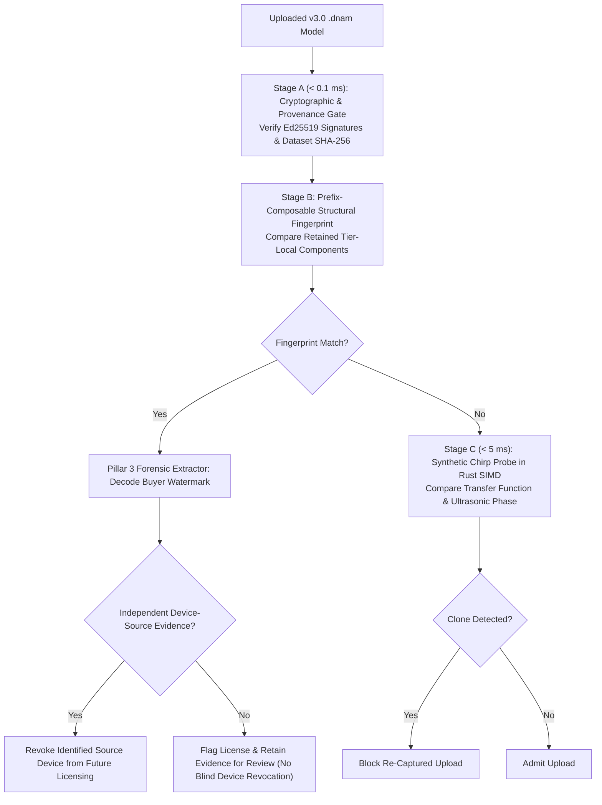
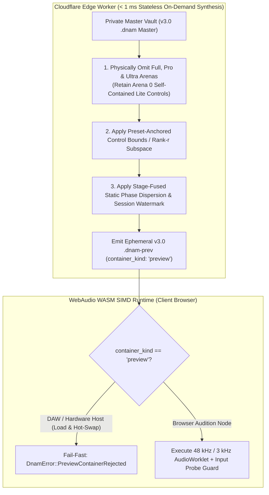
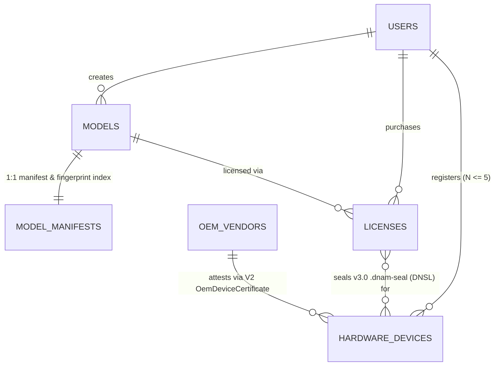

# Forensic Watermarking, 3-Stage Anti-Cloning Gate & Marketplace Edge Infrastructure

Complementing Cryptographic Provenance & Hardware Enclave DRM ([`provenance_and_enclave_drm.md`](provenance_and_enclave_drm.md), [`ADR-0009`](../../adr/0009-jcs-prefix-signing-hpke-and-preview-containment.md), [`ADR-0022`](../../adr/0022-sona-state-space-operator-and-webgpu-architecture.md)) and fulfilling [`../../requirements/system_goals_and_requirements.md` §9 (`REQ-8.5`–`REQ-8.7`)](../../requirements/system_goals_and_requirements.md#9-goal-8--model-provenance-hardware-drm-forensic-watermarking--marketplace-security), this specification defines **Pillar 3 (Dual-Mechanism Buyer Watermarking for `SONA` `v3.0`)**, **Pillar 4 (3-Stage Anti-Cloning Ingestion Gate)**, the **Commercial Storefront Platform (`.dnam-prev`)**, and the **Cloudflare + TiDB Edge Infrastructure**.

---

## 1. Pillar 3: Forensic Traitor Tracing (`< 0.2 ms` Dual-Mechanism Buyer Watermarking)

### 1.1 Mechanism A — Reciprocal Scaling Gauge & Odd-Symmetric `SONA` Sign-Flip Gauge

1. `r[sec.watermark.reciprocal-gauge]` **Mechanism A1 (`0-ULP` Stage III Kautz + `ControlBus` `SO(4)`) & Mechanism A2 (`0-ULP` Odd-Symmetric `SONA` 40-Lane Sign-Flip Gauge):**
   - **Mechanism A1 — Stage III Kautz Reciprocal Scaling (`b_gamma * kappa`, `c / kappa`):** Across all active shared Stage III Kautz blocks (`[2, 1, 3, 2]` `KautzSoaBlockWire` blocks across `Lite / Full / Pro / Ultra`, cumulative `8 / 12 / 24 / 32` pole pairs at byte ranges `1,664..1,920`, `6,656..6,784`, `12,928..13,312`, `22,784..23,040`), apply a buyer multiplier $\eta_m = \kappa_m \in [0.5, 2.0]$:
     $$b_{\gamma,m}^{(\text{buyer})} = \kappa_m b_{\gamma,m}^{(\text{master})}, \qquad c_{m,a}^{(\text{buyer})} = \frac{c_{m,a}^{(\text{master})}}{\kappa_m}, \qquad a \in \lbrace (\text{re},L), (\text{im},L), (\text{re},R), (\text{im},R) \rbrace$$
     Encoders set `V3_META_STAGE3_PREFIX_OVERRIDES` iff any packed tier `t in 1..=3` differs from `t - 1` on its shared Stage III prefix (`fir`, `kautz_b_gamma`, or `kautz_c`). When `V3_META_STAGE3_PREFIX_OVERRIDES == 0`, decoders retain the inherited `f32` `Stage3Fir*Wire` and `KautzSoaBlockWire` weights (`< 1e-5` `f32` gauge invariance). Whenever `V3_META_STAGE3_PREFIX_OVERRIDES == 1` in `Stage0CrossbarWire.meta.v3_meta_flags`, apply exact inverse scaling $1/\kappa_m$ to `Stage3PrefixOverrideFullWire` (`6,912..7,104`, `m in 0..4`), `Stage3PrefixOverrideProWire` (`13,568..13,952`, `m in 0..8`), and `Stage3PrefixOverrideUltraWire` (`23,296..23,872`, `m in 0..12`), and apply consistent $\kappa_m$ / $1/\kappa_m$ scaling to the `VarProReadout{Full,Pro,Ultra}Wire.w_ro_and_mods_fp16` Kautz override slots (`[328..352]` in `Full`: `8` `b_gamma[328..336]` + `16` interleaved `kautz_c[4..8]` at `[336..352]`; `[424..452]` in `Pro`: `12` `b_gamma[424..436]` + `16` interleaved `kautz_c[8..12]` at `[436..452]`; `[584..656]` in `Ultra`: `24` `b_gamma[584..608]` + `48` interleaved `kautz_c[12..24]` at `[608..656]`), preserving $\mathcal{O}(2^{-11})$ `fp16` mantissa equivalence under non-unit $\kappa_m$ (`< 1e-3`).
   - **Mechanism A2 — `0-ULP` Odd-Symmetric `SONA` 40-Lane Sign-Flip Gauge (`derive_sona_sign_gauge_40`):** Derive a prefix-independent 40-lane sign vector $s \in \lbrace -1, +1 \rbrace^{40}$ across cumulative Matryoshka lane ranges `[0..16, 16..24, 24..32, 32..40]` (`10` groups × `4` lanes) via:
     ```text
     For each tier t in 0..=3 owning range [start_t .. end_t):
       digest_t = SHA-256("DNAM-WM-SONA-SIGN-V1:" || buyer_seed[32] || u8(t))  // 54 B input
       for bit_idx in 0 .. (end_t - start_t):
         s[start_t + bit_idx] = if ((digest_t[bit_idx >> 3] >> (bit_idx & 7)) & 1) == 1 { +1.0 } else { -1.0 }
     ```
     Propagate signs via IEEE-754 sign-bit XOR (`^ 0x8000` on nonzero `fp16` magnitudes; negation on nonzero `f32`, strictly leaving `+0.0` untouched) across:
     1. Every active `SonaGroupWire` (`4 / 2 / 2 / 2` groups in `Arena 0..3`): multiply `in_x_weight[l]`, `lru_bias_drive[l]`, and `rect_sign_fp16[l]` by $s_{4g+l}$.
     2. Every active `SonaInterBlockTilePairWire` (`3 / 10 / 10 / 12` tiles in `Arena 0..3`, source group `sg`, destination group `dg`): multiply `w_odd_4x4[col][row]` by $s_{\text{dst}} \cdot s_{\text{src}}$, and multiply `w_even_4x4_fp16[col][row]` and `w_lru_4x4_fp16[col][row]` by $s_{\text{dst}}$.
     3. Active crossbar coupling weights: in `Arena 0`, multiply `readout_lite.stage_latent_mods_fp16[80..96]` (`op_p_to_group` for groups `0..4`) and `readout_lite.w_ro_fp16[192..208]` (`phasor_to_group` for groups `0..4`) by $s_{4g+l}$; in `Arena 1..3`, multiply `SonaCrossbarBlockWire.{op_p_to_group_fp16, phasor_to_group_fp16}` across active groups `0..6`, `0..8`, `0..10` by $s_{4g+l}$.
     4. Active `VarPro` `odd` linear readout weights: in `readout_lite.w_ro_fp16[..192]` (`16` lanes), `varpro_readout_full.w_ro_and_mods_fp16[..288]` (`24` lanes), `varpro_readout_pro.w_ro_and_mods_fp16[..384]` (`32` lanes), and `varpro_readout_ultra.w_ro_and_mods_fp16[..480]` (`40` lanes), multiply terms `[0, 1, 6, 7]` of each 12-term lane row by $s_l$.
     Because odd-symmetric `PolyADAA1` satisfies $g(-x) = -g(x)$ with $h_{\text{eq}} = +0.0$, `adaa_even` satisfies $g_e(-x) = +g_e(x)$, and `1D` `ParaLRU` commutes with input polarity conjugation when `rect_sign` flips, forward audio parity is algebraically `0.000000 ULP` with **zero `rate_1x_cal` overlays** (`0` `V3_META_RATE_1X_CAL` / `rate_1x_groups` / `rate_1x_tiles` paths), commuting losslessly with `strip_container_to_tier(Lite..Ultra)`.
2. `r[sec.watermark.orthogonal-gauge]` **ControlBus Isometric `SO(4)` Rotation ($\mathbf{Q}_{\text{buyer}} \in SO(4)$) & Layer 2 Spectral Pole-Angle Phase Coding (`[0.2, 0.8]` Guard-Band Snap):**
   - **ControlBus `SO(4)` Isometric Gauge:** Post-multiply by $\mathbf{Q}_{\text{buyer}} \in SO(4)$ strictly within the `4-D` rank-4 subspace `z_head[0..4]`, transforming only:
     1. `Arena0ControlBusWire.cp1_base.main_base[l][0..4]` (`4`-float prefix rows across each inline `CP1` contributor, leaving columns `4..8` untouched; indexed by `Cp1InlineDirWire` at `2,724..2,752` with `cp1_dir_count in 0..=8` inline in `cp1_base[576 B]` at `2,880..3,456`, overflowing to `shared_extent` `"CP1\0"` when `> 8` contributors — `"CP1\0"` overflow follows the exact same `main_base[l][0..4]` rule);
     2. `Arena0ControlBusWire.u_int_base[r][0..4]` — **strictly elements `0..4` (`16 B`) of each `8`-element (`32 B`) row `r in 0..4`** (starting at `2,752 + r * 32`, leaving elements `4..8` = unrotated `z_stage[0..4]` untouched);
     3. `Arena3ControlBusWire.u_int_ultra` (`27,136..27,520`, wire layout `[[[f32le; 8]; 4]; 3]`) — **strictly elements `c in 0..4` (`16 B`) of each `8`-element (`32 B`) row `r in 0..4` inside Block `0`** (`u_int_ultra[0][r][0..4]` starting at byte offset `27,136 + r * 32`, matching `u_int_base[r][0..4]` wire stride and feeding `z_head[0..4]`, leaving Block `0` elements `4..8` feeding `z_stage[0..4]` and Blocks `1..2` `u_int_ultra[1..3]` at `27,264..27,520` feeding `z_raw[8..16] = [z_head_ultra[0..4], z_stage_ultra[0..4]]` untouched); and
     4. `Arena0ControlBusWire.w_ctrl` columns `0..4` (`3,456..4,480`: rows `0..16`, elements `0..4` corresponding to `q0 = z_head[0..4]`).

     Explicitly **exclude** `v_base` (which would break FM `0.5 * ((sum v_p z_p)^2 - sum v_p^2 z_p^2)` invariance), `z_stage`, `u_int_base[r][4..8]`, `u_int_ultra` Block `0` elements `4..8` (`z_stage[0..4]`) and Blocks `1..2`, and `cp1_ultra`. All `stage_latent_*` `fp16` sensitivity tables (`VarProReadoutLiteWire.stage_latent_mods_fp16[0..80]`, `Arena3ControlBusWire.stage_latent_ctrl_ultra_fp16[0..256]`, and `SonaCoreUltraDeltaWire.stage_latent_core_mods_fp16[0..1,024]`) dot strictly against unrotated `z_stage[0..D_s]` (`ctrl_basis_4` + `z_stage_ultra`), **never** `z_head[0..4]`, so $\mathbf{Q}_{\text{buyer}} \in SO(4)$ achieves **exact `0-ULP` DSP invariance** without transforming any `fp16` readout/sensitivity weights or conflicting with Role B Tardos scoring.
   - **Layer 2 Kautz Pole-Angle Phase Coding (`[0.2, 0.8]` Guard-Band Snap):** Derive per-tier `32`-byte digests via `digest = SHA-256("DNAM-WM-PHASE-V1:" || buyer_seed[32] || u8(tier))` across `tier in 0..max_tiers` and iterate Kautz block `blk in 0..STAGE3_KAUTZ_BLOCKS_PER_TIER[tier]` (`[2, 1, 3, 2]`) and `lane in 0..4`. Index the carrier bit linearly within each tier via `chip_idx = blk * 4 + lane`, extracting `(digest[(chip_idx / 8) & 31] >> (chip_idx & 7)) & 1` (`1 -> +1.0`, `0 -> -1.0`), and perturb active Stage III Kautz pole angles `theta` (`kautz_soa_byte_offset(tier, blk) + (8 + lane) * 4`, valid window $[10^{-3}, \pi - 10^{-3}]$) by `±step_rad` (`0 <= step_rad <= PHASE_CODING_MAX_RAD = 8.726646e-4 rad` $\le 0.05^\circ$, `0.00 dB` pole-radius change). Before adding `±step_rad`, enforce the **`[0.2, 0.8]` Guard-Band Snap Invariant** relative to the `10^{-2} rad` (`0.01 rad`) detection bin width (`cell = theta / 0.01`, `base = floor(cell)`, `frac = cell - base`): if `frac < 0.2`, snap `theta` up to `(base + 0.2) * 0.01`; if `frac > 0.8`, snap `theta` down to `(base + 0.8) * 0.01` (clamped inside $[10^{-3}, \pi - 10^{-3}]$). Because `step_rad / 0.01 <= 0.0873 < 0.11`, marked angles strictly remain in `[0.11, 0.89]` within the same `10^{-2} rad` cell so near-boundary carriers never flip across quantized detection thresholds under `f32`/`fp16` rounding or re-capture solver jitter while `quantize_pole_angle_1e2` stays `100%` invariant. On forensic extraction (`score_phase_coding_arena` / `score_phase_coding_blackbox`), skip unmodified carriers where `|theta_s - theta_m| <= 1e-6` (`y = 0`, preserving `score == 0.0` on unwatermarked masters), and otherwise evaluate `diff = theta_s - carrier_m` against the deterministic guard-band carrier `carrier_m = snap_pole_angle_guard_band(theta_m)` (`y = sign(diff)` if `|diff| > 1e-6`, else `0`).

### 1.2 Mechanism B — Two-Seed Arcsine `7,680`-Coordinate Tardos Codebook & `fp16` ULP Survival Floor

`r[sec.watermark.tardos-code]`

Embeds a Two-Seed Arcsine Tardos codeword (`0..7,680`, `TardosCodebook7680`) partitioned strictly by cumulative tier bounds `TARDOS_TIER_INDEX_BOUNDS = [(0, 655), (655, 1_159), (1_159, 3_051), (3_051, 5_875)]` (`64` Role A + `5,811` Role B active carriers + `1,805` unassigned `0.0` tail at `5,875..7,680`) with per-tier shared and buyer seeds derived via `HMAC-SHA256` (`owning_tier = tier as u8`):
- **Threshold Calibration (`c_eff`) & Arcsine PRNG Stream:** Let $c_{\text{eff}} = \max(c_{\max}, 1)$, cutoff $\tau = \mathrm{clamp}(1 / (300 c_{\text{eff}}^2), 10^{-6}, 0.25)$, $\tau' = \arcsin(\sqrt{\tau})$ (`4`-term small-angle series `x * (1 + x^2*(1/6 + x^2*(3/40 + 5/112 * x^2)))`), and $\text{span} = \pi/2 - 2\tau'$. Inside each tier `(start, end)`, initialize two independent RFC 8439 `ChaCha20` streams (`chacha20_block_64b(seed, [0u8; 12], blk_counter)`, starting at counter `0`) from `shared_seed` and `buyer_seed`, drawing consecutive `32`-bit little-endian words normalized onto `(0, 1)` via $u_i, v_{ji} = (\mathrm{u32le} + 0.5) \cdot 2^{-32}$.
- **Role A Stream-Skip Invariant & Role B Accusation Weights:** For every Role A prefix coordinate (`idx - start < 16`, i.e., `[0..16, 655..671, 1_159..1_175, 3_051..3_067]`), set `chips[idx] = 0.0`, `accusation_weights[idx] = 0.0`, and **do not advance either `ChaCha20` PRNG stream**. For every Role B coordinate (`idx - start >= 16`), draw `(u_i, v_ji)`, compute $p_i = \mathrm{clamp}(\sin^2(\tau' + \text{span} \cdot u_i), \tau, 1 - \tau)$, and emit `chips[idx] = +1.0` with symmetric Škorić accusation weight $A_{ji} = +\sqrt{(1 - p_i) / p_i}$ when $v_{ji} < p_i$, or `chips[idx] = -1.0` with $A_{ji} = -\sqrt{p_i / (1 - p_i)}$ otherwise (`0` perturbations to nonlinear `SONA` core trajectories).

1. **Exact Disjoint `0..7,680` Coordinate Partition (`64` Role A + `5,811` Active Linear/Reserve Role B + `1,805` Unassigned `0.0` Tail = `7,680`):**

| Tier / Byte Arena | Coordinate Range (`0..7680`) | Element Type | Target Arena Field & Byte Offsets (`Arena 0..3`) | Security Role & Strict Exclusions |
| :--- | :---: | :---: | :--- | :--- |
| **Tier 0 (`Arena 0`)** | `0..16` (`16`) | `F32` | `ctrl_base.w_ctrl[0][0..16]` (`3,456..3,520`) | **Role A** (`chip = 0.0`, `accusation_weight = 0.0`) |
| **Tier 0 (`Arena 0`)** | `16..80` (`64`) | `F32` | `fir_lite` (`1,408..1,664`) | **Role B** Stage III `FIR` taps |
| **Tier 0 (`Arena 0`)** | `80..112` (`32`) | `F32` | `kautz_lite[0..2].c_{re,im}_{l,r}` (`1,728..1,792`, `1,856..1,920`) | **Role B** Stage III Kautz linear readouts (excludes `r_low/dr/theta/b_gamma`) |
| **Tier 0 (`Arena 0`)** | `112..120` (`8`) | `F32` | `readout_lite` `pre_cab_*/direct_s2_*` gains (`2,048..2,080`) | **Role B** linear `VarPro` direct gains |
| **Tier 0 (`Arena 0`)** | `120..360` (`240`) | `F32` | `ctrl_base.w_ctrl[1..16]` (`3,520..4,480`) | **Role B** linear ControlBus `W_ctrl` (Layer 3 Tardos marks are embedded in the unrotated master domain **before** applying Mechanism A1 `Q_buyer in SO(4)` to `z_head[0..4]` columns `0..4`; detection rotates columns `0..4` back by `Q_buyer^-1` prior to Tardos correlation scoring, leaving `u_int_base[r][4..8]` / `z_stage` unrotated) |
| **Tier 0 (`Arena 0`)** | `360..383` (`23`) | `F32` | `ctrl_base.rho_head_and_ctrl_tail[1..24]` (`4,484..4,576`) | **Role B** `Arena 0` spare control tail (**strictly excludes `[0]`** `4,480..4,484` alignment mirror of canonical `ctrl_base.trust_radius_mh` at `2,720..2,724` AND **excludes `[24..32]`** `opt_to_lr[0..4][0..2]` at `4,576..4,608`) |
| **Tier 0 (`Arena 0`)** | `383..655` (`272`) | `U16` (`fp16`) | `readout_lite.stage_latent_mods_fp16[0..80]` (`2,080..2,240`) + `w_ro_fp16[0..192]` (`2,272..2,656`) | **Role B** linear `fp16` `W_mod`/`W_readout` (`stage_latent_mods_fp16[0..80]` dots strictly against unrotated `z_stage[0..4]`, never `z_head[0..4]`, so it has zero rotation under `Q_buyer` and needs no inverse rotation; **excludes** `[80..96]` `op_p_to_group` & `[192..208]` `phasor_to_group`) |
| **Tier 1 (`Arena 1`)** | `655..671` (`16`) | `F32` | `varpro_readout_full.prefix_override[0..16]` (`6,912..6,976`) | **Role A** (`chip = 0.0`, `accusation_weight = 0.0`) |
| **Tier 1 (`Arena 1`)** | `671..751` (`80`) | `F32` | `fir_full` (`6,528..6,656`, `32`), `kautz_full.c_*` (`6,720..6,784`, `16`), `prefix_override` tail (`6,976..7,104`, `32`) | **Role B** Stage III `Full` linear `FIR`/Kautz |
| **Tier 1 (`Arena 1`)** | `751..1,159` (`408`) | `U16` (`fp16`) | `varpro_readout_full.w_ro_and_mods_fp16[0..328]` (`7,104..7,760`) & `[336..416]` (`7,776..7,936`) | **Role B** linear `fp16` `W_readout`/`W_mod` & tail (**excludes** `[328..336]` `kautz_b_gamma[0..8]`) |
| **Tier 2 (`Arena 2`)** | `1,159..1,175` (`16`) | `F32` | `varpro_readout_pro.prefix_override[0..16]` (`13,568..13,632`) | **Role A** (`chip = 0.0`, `accusation_weight = 0.0`) |
| **Tier 2 (`Arena 2`)** | `1,175..2,103` (`928`) | `F32` | `Pro` `2,688 B` `reserve` (`9,856..12,544`, `672`), `stage4_pro[1]` `128 B` `reserve` (`32`), `fir_pro` (`12,544..12,928`, `96`), `kautz_pro.c_*` (`48`), `prefix_override` tail (`13,632..13,952`, `80`) | **Role B** `Pro` `2,688 B` + `stage4_pro[1]` `128 B` reserves + Stage III `FIR`/Kautz (zero `rate_1x_cal`) |
| **Tier 2 (`Arena 2`)** | `2,103..3,051` (`948`) | `U16` (`fp16`) | `varpro_readout_pro.w_ro_and_mods_fp16[0..424]` (`13,952..14,800`) & `[436..960]` (`14,824..15,872`) | **Role B** linear `fp16` `W_readout`/`W_mod` & tail (**excludes** `[424..436]` `kautz_b_gamma[0..12]`) |
| **Tier 3 (`Arena 3`)** | `3,051..3,067` (`16`) | `F32` | `ctrl_ultra.w_ctrl_ultra[0][0..16]` (`26,880..26,944`) | **Role A** (`chip = 0.0`, `accusation_weight = 0.0`) |
| **Tier 3 (`Arena 3`)** | `3,067..4,139` (`1,072`) | `F32` | `sona_core_ultra.reserve` (`20,096..22,528`, `608`), `stage4_ultra[1]` `reserve` (`32`), `fir_ultra` (`64`), `kautz_ultra.c_*` (`32`), `prefix_override` (`144`), `w_ctrl_ultra[1..4]` (`48`), `ctrl_ultra.reserve` (`30,144..30,720`, `144`) | **Role B** `Ultra` linear `f32` & spare reserves |
| **Tier 3 (`Arena 3`)** | `4,139..5,875` (`1,736`) | `U16` (`fp16`) | `varpro_readout_ultra.w_ro_and_mods_fp16[0..584, 608..1,504]` (`1,480`, `23,872..26,880`, excl. `b_gamma[584..608]`), `stage_latent_ctrl_ultra_fp16[0..256]` (`29,632..30,144`) | **Role B** `Ultra` linear `fp16` `W_readout`/`W_mod` & `stage_latent_ctrl_ultra_fp16` (**excludes** `b_gamma`, `stage_latent_core_mods_fp16`, `Crossbar`, `Stage 0`, nonlinear `SONA` core) |
| **Unassigned Tail** | `5,875..7,680` (`1,805`) | `0.0` | **Unassigned Tail** (`chip = 0.0`, `accusation_weight = 0.0`) | Strictly unperturbed (`0.0` chip & `0.0` accusation weight) |

   *Strict Architectural Exclusions:* `Stage0CrossbarWire` (`0..256`), all `SonaCrossbarBlockWire` matrices, `readout_lite` crossbar aliases (`stage_latent_mods_fp16[80..96]` `op_p_to_group`, `w_ro_fp16[192..208]` `phasor_to_group`), all `SonaGroupWire`, `SonaInterBlockTilePairWire`, and `SonaCoreUltraDeltaWire.stage_latent_core_mods_fp16[0..1,024]` (`18,048..20,096`) nonlinear core weights, `Stage IV` tank quads, `ControlBus` scalars/`U_int`/`CP1` (`Cp1InlineDirWire` with `cp1_dir_count in 0..=8` inline in `cp1_base[576 B]`, overflowing to `shared_extent` `"CP1\0"` when `> 8` contributors), `ctrl_base.trust_radius_mh` (`2,720..2,724`, the canonical `f32le` slot — `ctrl_base.rho_head_and_ctrl_tail[0]` at `4,480..4,484` mirrors it strictly for alignment and is strictly excluded from Role B alongside `[24..32]` `opt_to_lr[0..4][0..2]` at `4,576..4,608`), and Kautz pole fields (`r_low`, `dr`, `theta`, `b_gamma`, `kautz_b_gamma`) are **100% excluded** from Layer 3 Tardos perturbation.
2. **ULP-Aware `fp16` Tardos Embedding (`binary16` Rounding Survival Floor) & Coordinate-Space `EMR` Envelopes:**
   Because IEEE-754 `binary16` (`fp16`) quantization (`10`-bit mantissa, `fp16_ulp(w) = 2^(max(-24, floor(log2|w|) - 10))`) erases sub-`0.5 ULP` `epsilon` shifts, every linear `fp16` Role B coordinate $i$ with master weight $w_i$ MUST enforce a minimum `2 * fp16_ulp(w_i)` amplitude floor (`rn_16 = f32_to_fp16`) paired with finite magnitude bounds (`|w_i| <= 65_504 - delta_i` and optional `delta_i <= delta_max` distortion guard):
   $$\Delta_i = \max\big(\epsilon_i, 2 \cdot \text{ulp}_{16}(w_i)\big), \qquad W_{\text{ro},i}^{(\text{buyer})} = \text{rn}_{16}\left(w_i + \Delta_i c_i^{(\text{buyer})}\right)$$
   guaranteeing zero erasure under `f32 -> fp16` conversion and high matched-filter collusion scores ($Z \gg 8.5$) across `4..16`-buyer linear averaging and `strip_container_to_tier` down to `Lite`. For scalar uniform embedding, $\epsilon_i = \epsilon$; for `EMR`-masked perceptual envelopes (`compute_emr_masked_tardos_envelopes`), map each Role B coordinate `idx` inside tier `(start, end)` via `role_b_word = (idx - start) - 16`, `vec4_idx = role_b_word / 4`, `lane = role_b_word % 4`, `slot_32 = vec4_idx % 32`, `group_16 = slot_32 % 16`, and `feat_idx = tier * 64 + group_16 * 4 + lane` (`0..256`), letting $g_{\text{diag},i}$ denote `gram_diag_256[feat_idx]`:
   $$\epsilon_i = \mathrm{clamp}\left(\frac{\max(\min(\epsilon_{\text{mask},L}, \epsilon_{\text{mask},R}), 0)}{\sqrt{\max(g_{\text{diag},i}, 10^{-12})}}, 5 \times 10^{-5}, 2 \times 10^{-4}\right)$$
   (`0.0` on Role A and unassigned tail `5,875..7,680`). For `f32` coordinates, $W_i^{(\text{buyer})} = W_i^{(\text{master})} + \epsilon_i c_i^{(\text{buyer})}$ with `Role A` strictly zeroed ($c_i = 0$).

### 1.3 License-Scoped Seed Derivation

`r[sec.watermark.seed-derivation]`

Using the length-framed `F(label, value) = u32le(len(label)) || label_utf8 || u64le(len(value)) || value` encoding ([`provenance_and_enclave_drm.md` §2.3](provenance_and_enclave_drm.md#23-two-certificate-ed25519-delegation-chain--4-tier-cumulative-arena-digests)) and a 32-byte secret key `K_wm`, derive tier-scoped shared codebook (`356 B` message) and buyer-specific (`429 B` message) seeds via `HMAC-SHA256(K_wm, message)` where `owning_tier` (`0..3`) is the tier slice that owns the embedded symbols (so stripping higher tiers never alters retained-tier seeds):

```text
Shared Codebook Seed ("DNAM-WM-SHARED-SEED-V1"):
  F("domain", ASCII("DNAM-WM-SHARED-SEED-V1"))
  || F("marketplace_pubkey_ed25519", marketplace_public_key[32])
  || F("watermark_key_id", watermark_key_id[16])
  || F("creator_signed_manifest_sha256", creator_signed_manifest_sha256[32])
  || F("model_id", model_id[16])
  || F("watermark_profile_sha256", watermark_profile_sha256[32])
  || F("owning_tier", u8(tier))

Buyer Seed ("DNAM-WM-BUYER-SEED-V1"):
  [Shared Codebook Seed fields with domain = "DNAM-WM-BUYER-SEED-V1"]
  || F("license_id", license_id[16])
  || F("buyer_id", buyer_id[16])

Watermark Profile Digest ("DNAM-WM-PROFILE-V1"):
  watermark_profile_sha256 = compute_watermark_profile_sha256(profile_bytes) = SHA256(
    F("domain", ASCII("DNAM-WM-PROFILE-V1")) || F("profile", profile_bytes))
```

Where `profile_bytes` (`exact_profile_bytes`) are arbitrary canonical watermark-policy/profile TLV or UTF-8 bytes passed identically by the license issuer and verifier (for example, a UTF-8 policy string or serialized binary profile descriptor — never omitted or ambiguous) and hashed via `compute_watermark_profile_sha256(profile_bytes)` into `WatermarkSeedScope.watermark_profile_sha256`.

---

## 2. Pillar 4: 3-Stage Anti-Cloning Ingestion Gate (`< 50 ms` Clone & Re-Capture Prevention)

`r[sec.anticlone.three-stage-gate]`



1. **Stage A — Cryptographic & Provenance Gate (`< 0.1 ms`):** Checks `creator_signature`, `marketplace_receipt`, and `dataset_manifest_sha256`.
2. **Stage B — Prefix-Composable Structural Fingerprint & Evidence-Based Revocation (`REQ-8.6`):** Compares retained-tier structural fingerprints and extracts buyer watermarks. A device is revoked from **future licensing only when independent evidence identifies that device as the leak source**; a buyer watermark or transferred file alone never triggers blind hardware revocation.
3. **Stage C — Synthetic Probe Transfer-Function Check (`< 5 ms`):** Renders a 2-second synthetic chirp probe in Rust SIMD to detect black-box re-captured clones.

### 2.1 Tier-Local Stage III Fingerprint Component

`r[sec.anticlone.stage3-fingerprint]`

All structural parameter hashing and extraction MUST deserialize binary fields exclusively through declarative `zerocopy` LE types (`U16::read_from_prefix`, `U32::read_from_prefix`, `F32`/`F64` word conversions via `zerocopy` — never hand-written `from_le_bytes` / `to_le_bytes` slicing, `ref[repo.code.zerocopy-wire-structs]`). For each retained tier (`Lite..Ultra`), `extract_stage3_tier_fingerprint_component` extracts the incremental Stage III per-tier component of **`120` `f64`s (`Lite`), `60` `f64`s (`Full`), `180` `f64`s (`Pro`), and `120` `f64`s (`Ultra`)** — totaling `15 * M_tier` dimensions per tier and summing cumulatively across retained tiers to **`120 / 180 / 360 / 480`** total values ([`dnam_binary_format.md` §2.4](../containers/dnam_binary_format.md#24-tier-local-projection--stage-iii-slice-layout)) — from that tier's incremental L/R early FIR taps (`K_fir = 32 / 16 / 48 / 32` per channel, cumulative `32 / 48 / 96 / 128`, i.e., `2 * K_fir = 64 / 32 / 96 / 64` `f32` LE taps) and `7` `f64` values per added shared Kautz pole pair (`M_tier = 8 / 4 / 12 / 8` pairs, cumulative `8 / 12 / 24 / 32` pairs), canonicalizing `-0.0` to `+0.0` and failing closed on non-finite values:

```text
[b_early_L[0..K_fir-1], b_early_R[0..K_fir-1], (r_low, dr, floor_1e2(theta), b_gamma*c_re_l, b_gamma*c_im_l, b_gamma*c_re_r, b_gamma*c_im_r) x M_tier]
```

where `floor_1e2(theta) = floor(theta * 100.0) * 0.01` (`quantize_pole_angle_1e2`).

And `extract_structural_hash_224d` emits the fixed `224-D` (`56 * 4`) vector across tier slices `[56 * t .. 56 * (t + 1)]` (`t in 0..4`, zero-filled `0.0` for any stripped tier above `maximum_tier`), reading **only** the populated tier Kautz pole slots (`[8, 4, 12, 8]` across `Lite / Full / Pro / Ultra`) and zero-padding remaining slots up to `16`:
- **`[0..16]`:** `r_low_{t,m} + 0.5 * dr_{t,m} + 0.1 * floor_1e2(theta_{0,t,m})` where `floor_1e2(theta) = floor(theta * 100.0) * 0.01` across tier `t`'s `[8, 4, 12, 8]` Kautz pairs (zero-padded `0.0` to `16`).
- **`[16..32]`:** `b_gamma_{t,m} * (c_re_L_{t,m} + c_re_R_{t,m})` across tier `t`'s Kautz pairs (zero-padded `0.0` to `16`).
- **`[32..48]`:** `b_gamma_{t,m} * (c_im_L_{t,m} + c_im_R_{t,m})` across tier `t`'s Kautz pairs (zero-padded `0.0` to `16`).
- **`[48..52]`:** `4` Stage IV `delay_lengths` invariants (`STAGE4_DELAY_BASES`, each read strictly via `zerocopy` LE `U32::read_from_prefix` and decoded as `if (4..=48_000).contains(&bits) { f64::from(bits) } else { finite f64::from(f32::from_bits(bits)) }`, matching `delay_lengths in [4, 48_000]`).
- **`[52..56]`:** `4` `VarPro` `fp16` `W_readout` segment $\ell_2^2$ energy norms (`sum(v^2)` over `4` equal-length segments of `seg_len = [48, 72, 96, 120]` consecutive `u16` weights spanning the `[192, 288, 384, 480]` `W_ro,0` matrix entries of tier `t`, invariant under orthogonal gauge and $\kappa_m$ scaling).

Because `b_gamma * c_re` and `b_gamma * c_im` cancel the Mechanism A1 multiplier $\kappa_m$ in exact arithmetic—and `extract_structural_hash_224d` quantizes each Kautz pole angle $\theta_m$ onto a $10^{-2}\text{ rad}$ grid via `quantize_pole_angle_1e2` inside the `[0.2, 0.8]` guard-band snap invariant—this vector is invariant under both reciprocal gauge watermarking, `40`-lane sign flips, `SO(4)` rotations, Layer 2 phase coding, and black-box re-capture solver jitter.

---

## 3. Commercial Storefront Platform: Auditioning, Royalty Splits & Storefront Metadata

`r[sec.preview.containment]`



| Protection Layer | Structural & Mathematical Specification (`REQ-8.7`) |
| :--- | :--- |
| **1. Dedicated Preview Type & High-Tier Omission** | Sets `container_kind: "preview"` (`"architecture": "sona"`, `v3.0`) and physically omits `Full`, `Pro`, and `Ultra` arenas while retaining `Arena 0` self-contained `Lite` controls. Non-browser DAW/hardware hosts MUST enforce `ensure_not_preview_for_daw_host()` (`Err(DnamError::PreviewContainerRejected)`) on **both** initial load **and** `reload_model_in_place` / `reload_model_in_place_owned` hot-swap! |
| **2. Bounded Preview Controls & Fixed-Anchor Rank-`r` Containment** | • **Single control (`P = 1`):** Exposes a bounded continuous window `v ∈ [v₀ - δ, v₀ + δ] ∩ [0, 1]` (`0 < δ ≤ 0.15`) or at most one additional observed safe switch option.<br/>• **Multiple controls (`P ≥ 2`):** Fixes a master-scoped reference anchor `a` and rank-`r` (`r < D_cont`) direction matrix `B`, permitting only settings `a + B t` across all published previews while locking discrete switches. |
| **3. Stateless On-Demand Generation (`< 1 ms`)** | Synthesizes `.dnam-prev` payloads at the CDN edge directly from the master's `Arena 0` `Lite` prefix (`strip_container_to_tier(Lite)`) with zero per-session storage multiplication. |
| **4. Stage-Fused Static Phase Dispersion** | Perturbs Stage III/IV phase response (`∣20 log₁₀ ∣H_disp(e^{jω})∣∣ ≤ 0.05 dB`, `τ_g^(demo)(ω) ≠ τ_g^(master)(ω)`) while preserving stability bounds. |
| **5. Dynamic Synthetic-Sweep & Impulse Input Guard** | Monitors `3 kHz` crest factor and zero-crossing regularity (`0 FDIV`, `0 FSQRT`), smoothly engaging phase flutter on synthetic probe stimuli while preserving natural musical playing. |
| **6. Black-Box Acoustic Watermarking & Session Binding** | Embeds HMAC-keyed sparse micro-echoes (`y_wm[n] = y[n] + ∑ β_i y[n - d_i]`, `∣β_i∣ ≤ 10^(-42/20)`, `d_i ∈ [120, 800]` samples) alongside session lease metadata. |

$$\gamma_{\text{crest}}[k] = \frac{\max_{n \in [0..15]} |x[16k + n]|}{p_{\text{rms}}[k] + \epsilon}, \qquad \sigma_{\text{zcr}}^2[k] = \frac{1}{M_z} \sum_{i=1}^{M_z} (z_i - \bar{z})^2$$
$$g_{\text{poison}}[k] = g_{\text{poison}}[k-1] + \alpha_{\text{engage}} \big(1.0 - g_{\text{poison}}[k-1]\big), \qquad \Delta\tau_{\text{flutter}}[n] = g_{\text{poison}}[k] \cdot A_{\text{flutter}} \sin(\omega_{\text{flutter}} n + \phi_k)$$
$$y_{\text{wm}}[n] = y[n] + \sum_{i=1}^{K_{\text{wm}}} \beta_i y[n - d_i], \qquad |H_{\text{clone}}(e^{j\omega})|^2 \approx |H_{\text{true}}(e^{j\omega})|^2 \left(1 + 2 \sum_{i=1}^{K_{\text{wm}}} \beta_i \cos(\omega d_i)\right)$$

### 3.2 Standardized `license_tier` Values & Automated Split Royalties (`royalty_splits`)

`r[sec.preview.royalty-splits]`

Inside the marketplace receipt:
- **`license_tier`:** `"free"`, `"personal"`, `"commercial_studio"`, or `"oem_bundle"`.
- **`royalty_splits`:** Array of `{ "recipient_id": str, "role": str, "share_bps": int }` entries summing to `10000` bps (`100%`).

### 3.3 Clean Storefront Taxonomy Isolation via `user_metadata`

`r[sec.preview.storefront-metadata]`

Storefront discovery attributes (`product_slug`, `category`, `gear_modeled`, `tags`, `artwork_url`, `demo_audio_urls`) reside under `user_metadata["dnam.store"]` in the growable `DMU1`/`DME1` suffix.

---

## 4. Cloud Edge Infrastructure, Logical Data Model & Stateless OEM Sealing Service

`r[sec.edge.data-model]`



| Logical Entity | Primary Key & Indexing Strategy | Core Attributes & Cryptographic Invariants |
| :--- | :--- | :--- |
| **`users`** | `id` (`BINARY(16)` UUIDv7), unique `handle` | `handle`, `display_name`, `creator_pubkey` (`32 B` `Ed25519`), `is_verified` |
| **`models`** | `id` (`BINARY(16)`), cursor indices | `slug`, `format_kind`, `category_kind`, `allowed_profiles_mask`, `license_tier`, `price_cents` |
| **`model_manifests`** | `model_id` (`BINARY(16)`) | `r2_master_key`, `immutable_header_sha256`, `dataset_manifest_sha256`, `creator_signature`, `structural_fingerprint`, `allowed_oem_vendors_json` |
| **`oem_vendors`** | `id` (`VARCHAR(32)`, e.g. `'darkglass'`) | `display_name`, `oem_pubkey_ed25519` (`32 B` pinned root key), `api_key_sha256`, `max_devices_per_user` |
| **`hardware_devices`** | `device_id_hash` (`BINARY(16)`) | `oem_vendor`, `model_code`, `owner_user_id`, `pubkey_x25519`, `oem_sig_ed25519`, `assurance`, `status` |
| **`licenses`** | `id` (`BINARY(16)` UUIDv7) | `model_id`, `buyer_id`, `license_tier`, `protection_profile`, `watermark_key_id`, `watermark_profile_sha256` |
| **`credit_wallets` & `training_jobs`** | `user_id` / `id` (`BINARY(16)` UUIDv7) | `balance_credits`, `reserved_credits`, `parent_job_id`, `job_kind`, per-tier `bESR`, `audit_report_json` |
