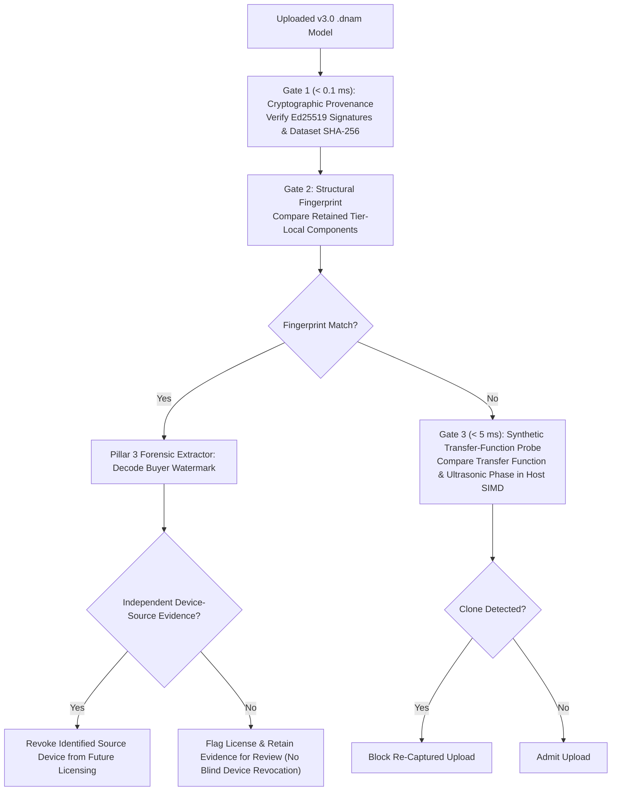
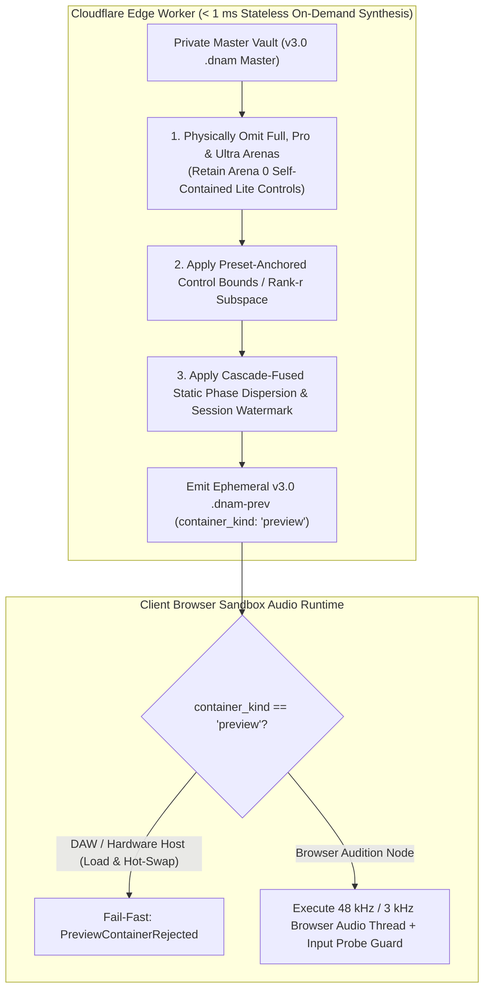
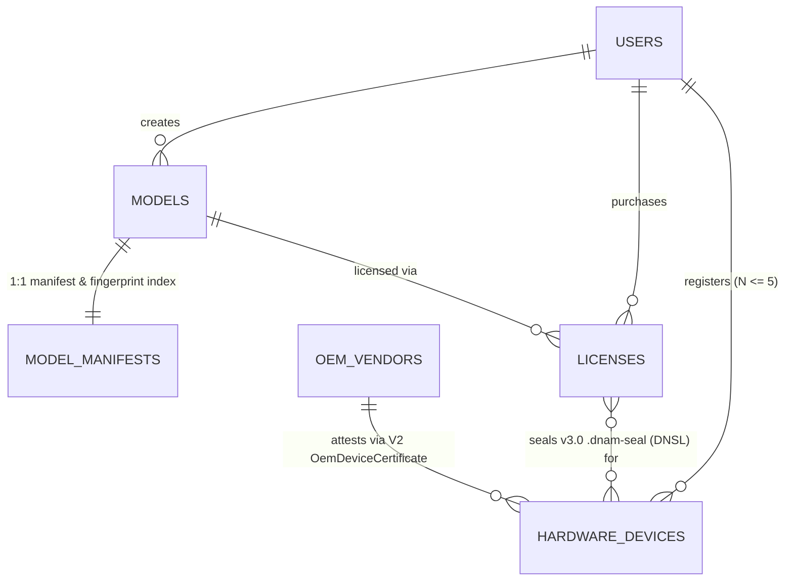

# Forensic Watermarking, 3-Gate Anti-Cloning Pipeline & Marketplace Edge Infrastructure

Complementing Cryptographic Provenance and Hardware Enclave DRM ([provenance and enclave DRM](provenance_and_enclave_drm.md), [`ADR-0009`](../../adr/0009-jcs-prefix-signing-hpke-and-preview-containment.md), [`ADR-0022`](../../adr/0022-sona-state-space-operator-and-webgpu-architecture.md)), this specification defines Pillar 3 (Dual-Mechanism Buyer Watermarking for SONA v3.0), Pillar 4 (the 3-Gate Anti-Cloning Pipeline), the Commercial Storefront Platform (`.dnam-prev`), and the Cloudflare and TiDB Edge Infrastructure. Together, these subsystems fulfill [`REQ-8.5`–`REQ-8.7`](../../requirements/system_goals_and_requirements.md#9-goal-8--model-provenance-hardware-drm-forensic-watermarking--marketplace-security).

---

## 1. Pillar 3: Forensic Traitor Tracing (< 0.2 ms Dual-Mechanism Buyer Watermarking)

### 1.1 Mechanism A — Reciprocal Scaling Gauge & Odd-Symmetric SONA Sign-Flip Gauge

#### Mechanism A1 (Reciprocal Kautz Gauge) & Mechanism A2 (0-ULP 40-Lane SONA Sign-Flip Gauge)

`r[sec.watermark.reciprocal-gauge]`

Mechanism A1 applies a buyer-specific reciprocal scaling gauge across all active shared `ModalConvolver` Kautz blocks (`[2, 1, 3, 2]` Kautz SoA blocks across Lite, Full, Pro, and Ultra, yielding cumulative 8, 12, 24, and 32 pole pairs at byte ranges 1,664..1,920, 6,656..6,784, 12,928..13,312, and 22,784..23,040). Each pair applies a buyer multiplier $\eta_m = \kappa_m \in [0.5, 2.0]$ so the input gain and stereo residues cancel identically in exact arithmetic:

$$b_{\gamma,m}^{(\text{buyer})} = \kappa_m b_{\gamma,m}^{(\text{master})}, \qquad c_{m,a}^{(\text{buyer})} = \frac{c_{m,a}^{(\text{master})}}{\kappa_m}, \qquad a \in \lbrace (\text{re},L), (\text{im},L), (\text{re},R), (\text{im},R) \rbrace$$

Encoders set `SONA_META_CONVOLVER_PREFIX_OVERRIDES` whenever any packed tier above Arena 0 differs from the previous tier on its shared `ModalConvolver` prefix (`fir`, `kautz_b_gamma`, or `kautz_c`).

When `SONA_META_CONVOLVER_PREFIX_OVERRIDES` is zero, decoders retain inherited `f32` `ModalConvolver` Early FIR and Kautz SoA weights within 1e-5 gauge invariance.

When set to 1, decoders apply inverse $1/\kappa_m$ to Convolver Prefix Override weights and consistent $\kappa_m$ or $1/\kappa_m$ scaling to `LinearReadout` Kautz override slots within $\mathcal{O}(2^{-11})$ `fp16` equivalence:

| Retained Tier | Convolver Prefix Override Range (`1 / kappa_m`) | `LinearReadout` `w_ro_and_mods_fp16` Kautz Override Slots |
| :--- | :--- | :--- |
| Full (m in 0..4 / 0..8) | 6,912..7,104 | `[328..336]` (8 `b_gamma` × kappa_m), `[336..352]` (16 interleaved `kautz_c[4..8]` / kappa_m) |
| Pro (m in 0..8 / 0..12) | 13,568..13,952 | `[424..436]` (12 `b_gamma` × kappa_m), `[436..452]` (16 interleaved `kautz_c[8..12]` / kappa_m) |
| Ultra (m in 0..12 / 0..24) | 23,296..23,872 | `[584..608]` (24 `b_gamma` × kappa_m), `[608..656]` (48 interleaved `kautz_c[12..24]` / kappa_m) |

Mechanism A2 derives a prefix-independent 40-lane sign vector $s \in \lbrace -1, +1 \rbrace^{40}$ across cumulative Matryoshka lane ranges `[0..16, 16..24, 24..32, 32..40]` (10 `CoreQuad` blocks × 4 lanes) using SHA-256 over the buyer seed and owning tier index:

```text
For each tier t in 0..4 owning range [start_t .. end_t):
  digest_t = SHA-256("DNAM-WM-SONA-SIGN-V1:" || buyer_seed[32] || u8(t))  // 54 B input
  for bit_idx in 0 .. (end_t - start_t):
    s[start_t + bit_idx] = +1.0 if ((digest_t[bit_idx >> 3] >> (bit_idx & 7)) & 1) == 1 else -1.0
```

Encoders propagate signs via IEEE-754 sign-bit XOR (^ 0x8000 on nonzero fp16 magnitudes and negation on nonzero f32, leaving +0.0 untouched) across four wire regions. Because odd-symmetric PolyADAA1 satisfies $g(-x) = -g(x)$ with $h_{\text{eq}} = +0.0$, `adaa_even` satisfies $g_e(-x) = +g_e(x)$, cyclic `glu_mix` cancels `(s[l] * s[(l+1)%4])`, and Selective-Duhem 1D ParaLRU commutes with polarity conjugation when `rect_sign` flips, forward audio parity stays algebraically 0.000000 ULP across Arena 0..3 and commutes losslessly with container tier stripping:

| SONA Wire Target | Per-Arena Quad / Tile Span | Sign-Flip Transformation |
| :--- | :--- | :--- |
| `CoreQuad` Block | 4 / 2 / 2 / 2 quads in Arena 0..3 | Multiply `in_mid_weight_fp16[l]`, `in_side_weight_fp16[l]`, `lru_bias_drive_fp16[l]`, and `rect_sign_fp16[l]` by `s[4*g + l]`, and multiply `glu_mix_fp16[l]` by `s[4*g + l] * s[4*g + ((l + 1) & 3)]` |
| Inter-Block Tile Pair | 3 / 10 / 10 / 12 tiles in Arena 0..3 | Multiply `w_odd_4x4[col][row]` by `s_dst * s_src`; multiply `w_even_4x4_fp16` and `w_lru_4x4_fp16` by `s_dst` |
| Crossbar Coupling Weights | Arena 0 (quads 0..4, lanes 0..16) and Arena 1..3 (quads 0..6 / 0..8 / 0..10, lanes 0..24 / 0..32 / 0..40) | Multiply Lite `LinearReadout` `stage_latent_mods_fp16[80..96]` (`op_p_to_core`), `w_ro_fp16[192..208]` (`phasor_to_core`), and SONA Crossbar Coupling matrices by `s[4*g + l]` |
| `LinearReadout` Odd Linear Readout | 16 / 24 / 32 / 40 lanes in Arena 0..3 | Multiply terms `[0, 1, 6, 7]` of each 12-term lane row in Lite `w_ro_fp16[0..192]` and Full/Pro/Ultra `w_ro_and_mods_fp16` by `s[l]` |

#### Control Plane Isometric `SO(4)` Rotation & Layer 2 Spectral Pole-Angle Phase Coding

`r[sec.watermark.orthogonal-gauge]`

The control-plane `SO(4)` isometric gauge post-multiplies by $\mathbf{Q}_{\text{buyer}} \in SO(4)$ strictly within the 4-D rank-4 subspace `z_head[0..4]`. The four permitted rotation targets and their preserved subspaces are specified below:

| `SO(4)` Rotation Target | Byte Range / Indexing | Rotated Columns & Strict Exclusions |
| :--- | :--- | :--- |
| Arena 0 Control Plane `cp1_base.main_base[l][0..4]` | Inline `CP1` directory at 2,724..2,752; `cp1_base` at 2,880..3,456; `"CP1\0"` overflow in `shared_controls` (when `dbin_prefix_bytes > 0`) or `shared_extent` | Rotate 4-float prefix `main_base[l][0..4]` across each `CP1` contributor (`cp1_dir_count` in 0–8 inline or `"CP1\0"` overflow); leave columns 4..8 untouched |
| Arena 0 Control Plane `u_int_base[r][0..4]` | Starting at `2,752 + r * 32` for row `r` in 0..4 | Rotate strictly elements 0..4 (16 B) of each 8-element (32 B) row; leave elements 4..8 (`z_stage[0..4]`) untouched |
| Arena 3 Control Plane `u_int_ultra[0][r][0..4]` | 27,136..27,520 (`f32le[3][4][8]`); Block 0 at `27,136 + r * 32` | Rotate strictly Block 0 elements `c` in 0..4 (16 B) feeding `z_head[0..4]`; leave Block 0 elements 4..8 and Blocks 1..2 (27,264..27,520) feeding `z_raw[8..16]` untouched |
| Arena 0 Control Plane `w_ctrl[0..16][0..4]` | 3,456..4,480 (16 × 16 matrix) | Rotate strictly columns 0..4 (`q0 = z_head[0..4]`) across rows 0..16 |

The rotation excludes `v_base` to preserve FM $0.5 \cdot ((\sum v_p z_p)^2 - \sum v_p^2 z_p^2)$ invariance. It also excludes `z_stage`, `u_int_base[r][4..8]`, `u_int_ultra` Block 0 elements 4..8 and Blocks 1..2, and `cp1_ultra`.

Sensitivity tables dot strictly against unrotated `z_stage[0..D_s]` (`ctrl_basis_4` plus `z_stage_ultra`), never z_head[0..4]. This applies to Lite LinearReadout `stage_latent_mods_fp16[0..80]`, Arena 3 Control Plane `stage_latent_ctrl_ultra_fp16[0..160]` (where `[160..164]` holds `ou_to_z_stage_ultra_fp16`), and Ultra CoreQuad Delta `stage_latent_core_mods_fp16[0..1,024]`, achieving exact 0-ULP DSP invariance without altering fp16 readout weights or interfering with Tardos scoring.

Layer 2 Kautz pole-angle phase coding perturbs pole angles within quantized 0.01 rad cells using a `[0.2, 0.8]` guard-band snap so quantized structural hashes remain 100% invariant:

| Step | Formula / Wire Mapping | Guard-Band & Extraction Invariant |
| :--- | :--- | :--- |
| **1. Carrier Bit Derivation** | `digest = SHA-256("DNAM-WM-PHASE-V1:" \|\| buyer_seed[32] \|\| u8(tier))` | Across `tier in 0..max_tiers`, `blk in 0..CONVOLVER_KAUTZ_BLOCKS_PER_TIER[tier]` (`[2, 1, 3, 2]`), and `lane in 0..4`: `chip_idx = blk * 4 + lane`, bit `(digest[(chip_idx / 8) & 31] >> (chip_idx & 7)) & 1` maps 1 to +1.0 and 0 to -1.0. |
| **2. Guard-Band Snap (`[0.2, 0.8]`)** | `cell = theta / 0.01`, `base = floor(cell)`, `frac = cell - base` | Before perturbing `theta` (at `Kautz block offset(tier, blk) + (8 + lane) * 4` in `[1e-3, pi - 1e-3]`), snap `frac < 0.2` up to `(base + 0.2) * 0.01` and `frac > 0.8` down to `(base + 0.8) * 0.01`, clamped inside `[1e-3, pi - 1e-3]`. |
| **3. Phase Perturbation** | `theta' = carrier_m + sign_bit * step_rad` (`0 <= step_rad <= 8.726646e-4 rad`, <= 0.05 deg) | Because `step_rad / 0.01 <= 0.0873 < 0.11`, marked angles stay in `[0.11, 0.89]` within the same 0.01 rad cell so `floor_1e2` stays 100% invariant with 0.00 dB pole-radius change. |
| **4. Forensic Extraction** | `carrier_m = guard-band-snapped theta_m`, `diff = theta_s - carrier_m` | During arena and black-box phase-coding extraction, skip unmodified masters where `\|theta_s - theta_m\| <= 1e-6` (`y = 0`, keeping `score == 0.0`); else emit `y = sign(diff)` if `\|diff\| > 1e-6`, otherwise 0. |

### 1.2 Mechanism B — Two-Seed Arcsine 7,680-Coordinate Tardos Codebook & `fp16` ULP Survival Floor

`r[sec.watermark.tardos-code]`

Mechanism B embeds a Two-Seed Arcsine Tardos codeword (coordinates 0..7,680) partitioned strictly by cumulative tier bounds `TARDOS_TIER_INDEX_BOUNDS = [(0, 655), (655, 1_159), (1_159, 3_051), (3_051, 5_871)]`. The partition assigns 64 Role A prefix coordinates, 5,807 active linear and reserve Role B coordinates, and 1,809 unassigned tail coordinates (5,871..7,680 fixed at 0.0), deriving per-tier shared and buyer seeds via HMAC-SHA256 for each owning tier (`owning_tier = tier` encoded as a single `u8` byte).

For threshold calibration, let $c_{\text{eff}} = \max(c_{\max}, 1)$, cutoff $\tau = \mathrm{clamp}(1 / (300 c_{\text{eff}}^2), 10^{-6}, 0.25)$, $\tau' = \arcsin(\sqrt{\tau})$ evaluated via the 4-term small-angle series `x * (1 + x^2*(1/6 + x^2*(3/40 + 5/112 * x^2)))`, and $\text{span} = \pi/2 - 2\tau'$.

Inside each tier `(start, end)`, encoders initialize two independent RFC 8439 `ChaCha20` streams (12-byte zero nonce and 32-bit block counter starting at 0) from `shared_seed` and `buyer_seed`, drawing consecutive 32-bit little-endian words normalized onto `(0, 1)` via $u_i, v_{ji} = (\mathrm{u32le} + 0.5) \cdot 2^{-32}$.

For every Role A prefix coordinate (`idx - start < 16`, spanning `[0..16, 655..671, 1_159..1_175, 3_051..3_067]`), encoders set `chips[idx] = 0.0`, set `accusation_weights[idx] = 0.0`, and do not advance either `ChaCha20` stream.

For every Role B coordinate (`idx - start >= 16`), encoders draw `(u_i, v_ji)`, compute $p_i = \mathrm{clamp}(\sin^2(\tau' + \text{span} \cdot u_i), \tau, 1 - \tau)$, and emit `chips[idx] = +1.0` with symmetric Škorić accusation weight $A_{ji} = +\sqrt{(1 - p_i) / p_i}$ when $v_{ji} < p_i$, or `chips[idx] = -1.0` with $A_{ji} = -\sqrt{p_i / (1 - p_i)}$ otherwise, leaving nonlinear SONA core trajectories unperturbed.

The exact disjoint 0..7,680 coordinate partition across Arena 0..3 is specified below:

| Tier / Byte Arena | Coordinate Range (0..7680) | Element Type | Target Arena Field & Byte Offsets (Arena 0..3) | Security Role & Strict Exclusions |
| :--- | :---: | :---: | :--- | :--- |
| Tier 0 (Arena 0) | 0..16 (16) | `f32le` | Arena 0 `w_ctrl[0][0..16]` (3,456..3,520) | Role A (`chip = 0.0`, `accusation_weight = 0.0`) |
| Tier 0 (Arena 0) | 16..80 (64) | `f32le` | `conv_fir_lite` (1,408..1,664) | Role B `ModalConvolver` FIR taps |
| Tier 0 (Arena 0) | 80..112 (32) | `f32le` | `conv_kautz_lite[0..2].c_{re,im}_{l,r}` (1,728..1,792 and 1,856..1,920) | Role B `ModalConvolver` Kautz linear readouts (excludes `r_low`, `dr`, `theta`, `b_gamma`) |
| Tier 0 (Arena 0) | 112..120 (8) | `f32le` | Lite `LinearReadout` `pre_conv_*` / `direct_s2_*` gains (2,048..2,080) | Role B linear direct gains |
| Tier 0 (Arena 0) | 120..360 (240) | `f32le` | Arena 0 Control Plane `w_ctrl[1..16]` (3,520..4,480) | Role B linear control-plane `W_ctrl`; embedded unrotated before applying `Q_buyer` on `z_head[0..4]` columns 0..4, and rotated back by `Q_buyer^-1` on detection |
| Tier 0 (Arena 0) | 360..383 (23) | `f32le` | Arena 0 `rho_head_and_ctrl_tail[1..24]` (4,484..4,576) | Role B Arena 0 spare control tail; excludes `[0]` (`trust_radius_mh` mirror at 4,480..4,484) and `[24..32]` (`opt_to_lr` at 4,576..4,608) |
| Tier 0 (Arena 0) | 383..655 (272) | `fp16` | Lite `LinearReadout` `stage_latent_mods_fp16[0..80]` (2,080..2,240) + `w_ro_fp16[0..192]` (2,272..2,656) | Role B linear `fp16` `W_mod` / `W_readout` over unrotated `z_stage[0..4]`; excludes `[80..96]` `op_p_to_core` and `[192..208]` `phasor_to_core` |
| Tier 1 (Arena 1) | 655..671 (16) | `f32le` | Full `LinearReadout` `prefix_override[0..16]` (6,912..6,976) | Role A (`chip = 0.0`, `accusation_weight = 0.0`) |
| Tier 1 (Arena 1) | 671..751 (80) | `f32le` | `conv_fir_full` (6,528..6,656, 32), `conv_kautz_full.c_*` (6,720..6,784, 16), `prefix_override` tail (6,976..7,104, 32) | Role B `ModalConvolver` Full linear FIR / Kautz |
| Tier 1 (Arena 1) | 751..1,159 (408) | `fp16` | Full `LinearReadout` `w_ro_and_mods_fp16[0..328]` (7,104..7,760) & `[336..416]` (7,776..7,936) | Role B linear `fp16` `W_readout` / `W_mod` & tail (excludes `[328..336]` `kautz_b_gamma[0..8]`) |
| Tier 2 (Arena 2) | 1,159..1,175 (16) | `f32le` | Pro `LinearReadout` `prefix_override[0..16]` (13,568..13,632) | Role A (`chip = 0.0`, `accusation_weight = 0.0`) |
| Tier 2 (Arena 2) | 1,175..2,103 (928) | `f32le` | Pro 2,688 B `reserve` (9,856..12,544, 672), `transport_pro[1]` 128 B `reserve` (32), `conv_fir_pro` (12,544..12,928, 96), `conv_kautz_pro.c_*` (48), `prefix_override` tail (13,632..13,952, 80) | Role B Pro 2,688 B and `transport_pro[1]` 128 B reserves plus `ModalConvolver` FIR / Kautz |
| Tier 2 (Arena 2) | 2,103..3,051 (948) | `fp16` | Pro `LinearReadout` `w_ro_and_mods_fp16[0..424]` (13,952..14,800) & `[436..960]` (14,824..15,872) | Role B linear `fp16` `W_readout` / `W_mod` & tail (excludes `[424..436]` `kautz_b_gamma[0..12]`) |
| Tier 3 (Arena 3) | 3,051..3,067 (16) | `f32le` | Arena 3 `w_ctrl_ultra[0..4][0..4]` (26,880..26,944) | Role A (`chip = 0.0`, `accusation_weight = 0.0`) |
| Tier 3 (Arena 3) | 3,067..4,139 (1,072) | `f32le` | Ultra Core `reserve` (20,096..22,528, 608), `transport_ultra[1]` `reserve` (32), `conv_fir_ultra` (64), `conv_kautz_ultra.c_*` (32), `prefix_override` (144), `w_ctrl_ultra[4..16][0..4]` (26,944..27,136, 48), Arena 3 Control Plane `reserve` (30,144..30,720, 144) | Role B Ultra linear `f32` & spare reserves |
| Tier 3 (Arena 3) | 4,139..5,871 (1,732) | `fp16` | Ultra `LinearReadout` `w_ro_and_mods_fp16[0..584, 608..1,504]` (1,480, 23,872..26,880), `stage_latent_ctrl_ultra_fp16[0..160, 164..256]` (252, 29,632..29,952 & 29,960..30,144) | Role B Ultra linear `fp16` `W_readout` / `W_mod` & `stage_latent_ctrl_ultra_fp16` (excludes `b_gamma`, `ou_to_z_stage_ultra_fp16[4]` at `[160..164]`, `stage_latent_core_mods_fp16`, `SensoryQuad`, Crossbar, and nonlinear SONA core) |
| Unassigned Tail | 5,871..7,680 (1,809) | 0.0 | Unassigned Tail (`chip = 0.0`, `accusation_weight = 0.0`) | Strictly unperturbed (0.0 chip & 0.0 accusation weight) |

All nonlinear trajectories, crossbar weights, control basis descriptors, and recursive poles remain strictly excluded from Tardos Role B perturbation:

| Excluded Subsystem | Protected Wire Fields & Byte Ranges |
| :--- | :--- |
| **Crossbar, `Op-N[Pre]` & `SensoryQuad`** | Crossbar & `SensoryQuad` Block (0..256, including `Op-N[Pre]` at 180..192 and `sense_*` at 0..64 / 88..120 / 240..256), all SONA Crossbar Coupling matrices, and Lite `LinearReadout` crossbar aliases (`stage_latent_mods_fp16[80..96]`, `w_ro_fp16[192..208]`) |
| **Nonlinear SONA Core & `Transport`** | All `CoreQuad` Blocks, Inter-Block Tile Pairs, Ultra Core Delta `stage_latent_core_mods_fp16[0..1,024]` (18,048..20,096), and active 128 B `TransportQuad` blocks (`TRANSPORT_DELAY_BASES[0..4]`) |
| **Control Plane & Kautz Poles** | Control scalars (`lfo_skew_fp16`, `tank_dry_mix_fp16`, `ou_to_z_stage_fp16`, `ou_to_z_stage_ultra_fp16` at `[160..164]`), `U_int`, `CP1` (Inline `CP1` Directory with `cp1_dir_count` in 0–8 inline in `cp1_base[576 B]` or `"CP1\0"` overflow), `trust_radius_mh` (2,720..2,724), `rho_head_and_ctrl_tail[0]` (4,480..4,484), `opt_to_lr[0..4][0..2]` (4,576..4,608), and Kautz pole fields (`r_low`, `dr`, `theta`, `b_gamma`, `kautz_b_gamma`) |
| **`.dnam-bin` Prefix (`dbin_prefix`) & Framing** | Region 4 (0 B when `dbin_prefix_bytes > 0`), Region 5 `auth_extent`, embedded `dbin_prefix` (`[dbin_offset..tier_start)`: `"DNBN"`, `"DBRM"`, `shared_controls`, `"TSYN"`, `"CEXT"` 1,280 B), and unassigned tail 5,871..7,680 |

When a container embeds a Layer 0 prefix (`dbin_prefix_bytes > 0`), Region 4 (`shared_extent`) MUST equal zero bytes (0 B) while `dbin_prefix` precedes `tier_start` (Arena 0..3). All 0..5,871 Tardos Role A and Role B coordinates reside strictly inside Arena 0..3, while 5,871..7,680 stays an unperturbed guard tail.

Tardos watermark embedding and extraction operate strictly on Role B coordinates inside Arena 0..3, leaving `"DBRM"`, `shared_controls`, `"TSYN"`, `"CEXT"`, crossbar, `SensoryQuad`, `Op-N[Pre]`, `ou_to_z_stage_ultra_fp16`, and unassigned slots untouched.

When issuing a watermarked buyer container with `dbin_prefix_bytes > 0` (`auth_kind == 1` or `.dnam-seal`), buyer issuance MUST recompute layer-0 `tier_arena_crc32c` and `prefix_crc32c` digests over the buyer arenas.

Outer DCRC `crc_dbin_prefix` and `crc_tiers`, along with buyer prefix commitments (`L_buyer`, `DAI1/DSA1`), then commit to the updated `dbin_prefix` while preserving creator `L_master` and `creator_signature` verbatim.

Because IEEE-754 binary16 (`fp16`) quantization with its 10-bit mantissa (`fp16_ulp(w) = 2^(max(-24, floor(log2|w|) - 10))`) erases sub-0.5 ULP `epsilon` shifts, naive perturbations disappear upon rounding.

Every linear `fp16` Role B coordinate $i$ with master weight $w_i$ MUST therefore enforce a minimum `2 * fp16_ulp(w_i)` amplitude floor (`rn_16` = binary32-to-binary16 round-to-nearest-even) paired with finite magnitude bounds (`|w_i| <= 65,504 - delta_i` and optional `delta_i <= delta_max` guard):

$$\Delta_i = \max\big(\epsilon_i, 2 \cdot \text{ulp}_{16}(w_i)\big), \qquad W_{\text{ro},i}^{(\text{buyer})} = \text{rn}_{16}\left(w_i + \Delta_i c_i^{(\text{buyer})}\right)$$

This guarantees zero erasure under `f32 -> fp16` conversion and matched-filter collusion scores giving $Z \gg 8.5$ across 4..16-buyer linear averaging and container tier stripping down to Lite. For `f32` coordinates, encoders apply $W_i^{(\text{buyer})} = W_i^{(\text{master})} + \epsilon_i c_i^{(\text{buyer})}$ with Role A coordinates strictly zeroed at $c_i = 0$.

For scalar uniform embedding, $\epsilon_i = \epsilon$. For EMR-masked perceptual envelopes, encoders map each Role B coordinate `idx` inside tier `(start, end)` via `role_b_word = (idx - start) - 16`, `vec4_idx = role_b_word / 4`, and `lane = role_b_word % 4`.

From that lane tuple, encoders compute `slot_32 = vec4_idx % 32`, `group_16 = slot_32 % 16`, and `feat_idx = tier * 64 + group_16 * 4 + lane` across 0..256, set $g_{\text{diag},i}$ to `gram_diag_256[feat_idx]`, and clamp $\epsilon_i$ to 0.0 on Role A and the 5,871..7,680 tail:

$$\epsilon_i = \mathrm{clamp}\left(\frac{\max(\min(\epsilon_{\text{mask},L}, \epsilon_{\text{mask},R}), 0)}{\sqrt{\max(g_{\text{diag},i}, 10^{-12})}}, 5 \times 10^{-5}, 2 \times 10^{-4}\right)$$

### 1.3 License-Scoped Seed Derivation

`r[sec.watermark.seed-derivation]`

Using the length-framed `F(label, value)` encoding defined in [the cryptographic delegation specification](provenance_and_enclave_drm.md#23-two-certificate-ed25519-delegation-chain--4-tier-cumulative-arena-digests) and a 32-byte secret key `K_wm`, encoders derive tier-scoped shared codebook (356 B message) and buyer-specific (429 B message) seeds via HMAC-SHA256. Here `owning_tier` in 0..3 identifies the tier slice that owns the embedded symbols so stripping higher tiers never alters retained-tier seeds:

```text
Shared Codebook Seed ("DNAM-WM-SHARED-SEED-V1"):
  F("domain", ASCII("DNAM-WM-SHARED-SEED-V1"))
  || F("marketplace_pubkey_ed25519", marketplace_public_key[32])
  || F("watermark_key_id", watermark_key_id[16])
  || F("creator_signed_manifest_sha256", creator_signed_manifest_sha256[32])
  || F("model_id", model_id[16])
  || F("watermark_profile_sha256", watermark_profile_sha256[32])
  || F("owning_tier", u8(tier))

Buyer Seed ("DNAM-WM-BUYER-SEED-V1"):
  [Shared Codebook Seed fields with domain = "DNAM-WM-BUYER-SEED-V1"]
  || F("license_id", license_id[16])
  || F("buyer_id", buyer_id[16])

Watermark Profile Digest ("DNAM-WM-PROFILE-V1"):
  watermark_profile_sha256 = SHA256(
    F("domain", ASCII("DNAM-WM-PROFILE-V1")) || F("profile", profile_bytes))
```

In this transcript, `profile_bytes` (`exact_profile_bytes`) are canonical watermark-policy TLV or UTF-8 bytes passed identically by the license issuer and verifier without omission or ambiguity. The resulting digest binds directly into `watermark_profile_sha256` during seed derivation.

---

## 2. Pillar 4: 3-Gate Anti-Cloning Pipeline (< 50 ms Clone & Re-Capture Prevention)

`r[sec.anticlone.three-gate-pipeline]`

Every marketplace upload passes through a sequential three-gate screening pipeline before admission, combining sub-millisecond signature verification, gauge-invariant structural fingerprinting, and a synthetic probe check:



| Ingestion Gate | Latency Budget | Verification & Revocation Policy |
| :--- | :---: | :--- |
| **Gate 1: Cryptographic Provenance** | < 0.1 ms | Verifies `creator_signature`, `marketplace_receipt`, and `dataset_manifest_sha256`. |
| **Gate 2: Structural Fingerprint** | < 1 ms | Compares retained-tier structural fingerprints and extracts buyer watermarks. A device is revoked from future licensing only when independent evidence identifies that device as the leak source (`REQ-8.6`); a watermark or transferred file alone never triggers blind hardware revocation. |
| **Gate 3: Synthetic Probe** | < 5 ms | Renders a 2-second synthetic chirp probe in host SIMD to detect black-box re-captured clones. |

### 2.1 Tier-Local ModalConvolver Fingerprint Component

`r[sec.anticlone.cabinet-fingerprint]`

All structural parameter hashing and extraction MUST decode little-endian binary fields directly from their fixed byte offsets with strict bounds validation rather than assuming host endianness or unaligned pointer casts.

For each retained tier, tier-local fingerprint extraction collects the incremental `ModalConvolver` component of `15 * M_tier` dimensions from that tier's incremental L/R early FIR taps (`2 * K_fir` `f32le` taps) and 7 `f64` values per added shared Kautz pole pair ([convolver slice layout](../containers/dnam_binary_format.md#24-tier-local-projection--modalconvolver-slice-layout)). It canonicalizes -0.0 to +0.0 and fails closed on non-finite values:

| Tier | Incremental `K_fir` (L/R Taps) | Added Kautz Pairs (`M_tier`) | Component Dim (`15 * M_tier`) | Cumulative Dim |
| :--- | :---: | :---: | :---: | :---: |
| Lite | 32 (64 taps) | 8 | 120 `f64` | 120 |
| Full | 16 (32 taps) | 4 | 60 `f64` | 180 |
| Pro | 48 (96 taps) | 12 | 180 `f64` | 360 |
| Ultra | 32 (64 taps) | 8 | 120 `f64` | 480 |

```text
[b_early_L[0..K_fir-1], b_early_R[0..K_fir-1], (r_low, dr, floor_1e2(theta), b_gamma*c_re_l, b_gamma*c_im_l, b_gamma*c_re_r, b_gamma*c_im_r) x M_tier]
```

Here `floor_1e2(theta) = floor(theta * 100.0) * 0.01`.

The 224-D structural hash extractor emits a fixed 224-D (`56 * 4`) vector across tier slices `[56 * t .. 56 * (t + 1)]` for `t` in 0..4, zero-filling 0.0 for stripped tiers above `maximum_tier` and reading only the populated `[8, 4, 12, 8]` Kautz slots per tier:

| Slice Range (`56 * t + ...`) | Width | Extracted Formula & Wire Invariant |
| :--- | :---: | :--- |
| `[0..16]` | 16 | `r_low_{t,m} + 0.5 * dr_{t,m} + 0.1 * floor_1e2(theta_{0,t,m})` across tier `t` Kautz pairs, zero-padded to 16 |
| `[16..32]` | 16 | `b_gamma_{t,m} * (c_re_L_{t,m} + c_re_R_{t,m})` across tier `t` Kautz pairs, zero-padded to 16 |
| `[32..48]` | 16 | `b_gamma_{t,m} * (c_im_L_{t,m} + c_im_R_{t,m})` across tier `t` Kautz pairs, zero-padded to 16 |
| `[48..52]` | 4 | `TransportQuad` `delay_samples[0..4]` invariants (bytes 0..16 of each 128 B quad header at `TRANSPORT_DELAY_BASES[t]`), read as finite IEEE-754 binary32 `f32le` floats widened to binary64 (0.0 if non-finite) |
| `[52..56]` | 4 | `LinearReadout` `fp16` `W_readout` segment squared norms (`sum(v^2)` over 4 equal segments of `[48, 72, 96, 120]` `u16` weights spanning `[192, 288, 384, 480]` `W_ro,0` entries of tier `t`) |

Because `b_gamma * c_re` and `b_gamma * c_im` cancel the Mechanism A1 multiplier $\kappa_m$ in exact arithmetic—and the 224-D structural hash quantizes each Kautz pole angle $\theta_m$ onto a $10^{-2}\text{ rad}$ grid via `floor_1e2` inside the `[0.2, 0.8]` guard band—this 224-D vector stays invariant under reciprocal gauge watermarking, 40-lane sign flips, `SO(4)` rotations, Layer 2 phase coding, and black-box re-capture solver jitter.

---

## 3. Commercial Storefront Platform: Auditioning, Royalty Splits & Storefront Metadata

### 3.1 Storefront Auditioning & Preview Containment (`.dnam-prev`)

`r[sec.preview.containment]`

Commercial storefronts synthesize ephemeral Lite-only `.dnam-prev` containers directly at the edge from the master's Arena 0 prefix so prospective buyers can audition presets in a browser audio runtime without exposing Full, Pro, or Ultra weights or unrestricted parameter sweeps:



| Protection Layer | Structural & Mathematical Specification (`REQ-8.7`) |
| :--- | :--- |
| **1. Dedicated Preview Type & High-Tier Omission** | Sets `container_kind: "preview"` (`"architecture": "sona"`, v3.0) and physically omits Full, Pro, and Ultra arenas while retaining Arena 0 self-contained Lite controls. Non-browser DAW and hardware hosts MUST reject preview containers (`PreviewContainerRejected`) on both initial load and live model hot-swap. |
| **2. Bounded Preview Controls & Fixed-Anchor Rank-r Containment** | Single control (`P = 1`): exposes a bounded continuous window `v in [v_0 - delta, v_0 + delta]` intersected with `[0, 1]` (`0 < delta <= 0.15`), or at most one additional observed safe switch option. Multiple controls (`P >= 2`): fixes a master-scoped anchor `a` and rank-r (`r < D_cont`) matrix `B`, permitting only `a + B t` across published previews while locking discrete switches. |
| **3. Stateless On-Demand Generation (< 1 ms)** | Synthesizes `.dnam-prev` payloads at the CDN edge directly from the master's Arena 0 Lite prefix and Lite `.dnam-bin` prefix (`tier_end_offsets[0]`, Region 4 = 0 B) via keyless tier stripping with zero per-session storage multiplication. |
| **4. Cascade-Fused Static Phase Dispersion** | Perturbs `ModalConvolver` / `Transport` phase response (`|20 log10 |H_disp(e^{jw})|| <= 0.05 dB`, `tau_g^(demo)(w) != tau_g^(master)(w)`) while preserving stability bounds. |
| **5. Dynamic Synthetic-Sweep & Impulse Input Guard** | Monitors 3 kHz crest factor and zero-crossing regularity (0 `FDIV`, 0 `FSQRT`), smoothly engaging phase flutter on synthetic probe stimuli while preserving natural musical playing. |
| **6. Black-Box Acoustic Watermarking & Session Binding** | Embeds HMAC-keyed sparse micro-echoes (`y_wm[n] = y[n] + sum beta_i y[n - d_i]`, `|beta_i| <= 10^(-42/20)`, `d_i in [120, 800]` samples) alongside session lease metadata. |

The dynamic probe guard and acoustic micro-echo watermark obey the following recurrence equations:

$$\gamma_{\text{crest}}[k] = \frac{\max_{n \in [0..15]} |x[16k + n]|}{p_{\text{rms}}[k] + \epsilon}, \qquad \sigma_{\text{zcr}}^2[k] = \frac{1}{M_z} \sum_{i=1}^{M_z} (z_i - \bar{z})^2$$

$$g_{\text{poison}}[k] = g_{\text{poison}}[k-1] + \alpha_{\text{engage}} \big(1.0 - g_{\text{poison}}[k-1]\big), \qquad \Delta\tau_{\text{flutter}}[n] = g_{\text{poison}}[k] \cdot A_{\text{flutter}} \sin(\omega_{\text{flutter}} n + \phi_k)$$

$$y_{\text{wm}}[n] = y[n] + \sum_{i=1}^{K_{\text{wm}}} \beta_i y[n - d_i], \qquad |H_{\text{clone}}(e^{j\omega})|^2 \approx |H_{\text{true}}(e^{j\omega})|^2 \left(1 + 2 \sum_{i=1}^{K_{\text{wm}}} \beta_i \cos(\omega d_i)\right)$$

### 3.2 Standardized `license_tier` Values & Automated Split Royalties (`royalty_splits`)

`r[sec.preview.royalty-splits]`

Inside the signed marketplace receipt, `license_tier` takes one of `"free"`, `"personal"`, `"commercial_studio"`, or `"oem_bundle"`. Multi-creator payouts populate `royalty_splits` as an array of `{ "recipient_id": string, "role": string, "share_bps": u16 }` entries whose `share_bps` values sum strictly to 10000 basis points (100%).

### 3.3 Clean Storefront Taxonomy Isolation via `user_metadata`

`r[sec.preview.storefront-metadata]`

Storefront catalog discovery fields reside exclusively inside `user_metadata["dnam.store"]` within the growable `DMU1` / `DME1` suffix so catalog edits never perturb `immutable_header_sha256`.

Standardized discovery keys include `product_slug`, `category`, `gear_modeled`, `tags`, `artwork_url`, and `demo_audio_urls`.

---

## 4. Cloud Edge Infrastructure, Logical Data Model & Stateless OEM Sealing Service

`r[sec.edge.data-model]`

The Cloudflare Workers and TiDB edge layer maintains one canonical master artifact per published model in R2 and synthesizes watermarked `.dnam` or `.dnam-seal` (`DNSL`) buyer deliverables statelessly at license issuance time. The logical relational schema tracks users, models, manifests, attested OEM vendors, registered hardware devices, licenses, and training credit jobs:



| Logical Entity | Primary Key & Indexing Strategy | Core Attributes & Cryptographic Invariants |
| :--- | :--- | :--- |
| `users` | `id` (`BINARY(16)` UUIDv7), unique `handle` | `handle`, `display_name`, `creator_pubkey` (32 B Ed25519), `is_verified` |
| `models` | `id` (`BINARY(16)`), cursor indices | `slug`, `format_kind`, `category_kind`, `allowed_profiles_mask`, `license_tier`, `price_cents` |
| `model_manifests` | `model_id` (`BINARY(16)`) | `r2_master_key`, `immutable_header_sha256`, `dataset_manifest_sha256`, `creator_signature`, `structural_fingerprint`, `allowed_oem_vendors_json` |
| `oem_vendors` | `id` (`VARCHAR(32)`, e.g. `'darkglass'`) | `display_name`, `oem_pubkey_ed25519` (32 B pinned root key), `api_key_sha256`, `max_devices_per_user` |
| `hardware_devices` | `device_id_hash` (`BINARY(16)`) | `oem_vendor`, `model_code`, `owner_user_id`, `pubkey_x25519`, `oem_sig_ed25519`, `assurance`, `status` |
| `licenses` | `id` (`BINARY(16)` UUIDv7) | `model_id`, `buyer_id`, `license_tier`, `protection_profile`, `watermark_key_id`, `watermark_profile_sha256` |
| `credit_wallets` & `training_jobs` | `user_id` / `id` (`BINARY(16)` UUIDv7) | `balance_credits`, `reserved_credits`, `parent_job_id`, `job_kind`, per-tier `bESR`, `audit_report_json` |
