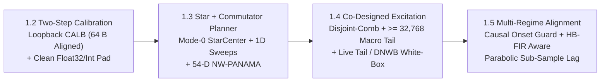

# Hardware Excitation, Multi-Mic Calibration & Router Alignment

This specification defines the universal hardware excitation schedule, two-step converter calibration, multi-regime sub-sample latency alignment, capture-side offline attention seeding, and white-box or grey-box distillation contracts for SONA v4.0. It fulfills [REQ-1.5–REQ-1.9, REQ-4.3, REQ-7.2, REQ-7.3](../../requirements/system_goals_and_requirements.md), [sona_architecture.md](../architecture/sona_architecture.md), [ADR-0016](../../adr/0016-codesigned-disjoint-comb-stimulus-and-null-homing-capture.md), [ADR-0018](../../adr/0018-signal-chain-fixtures-crate-and-whitebox-distillation.md), [ADR-0020](../../adr/0020-modular-monorepo-and-dnam-proj-container.md), [ADR-0022](../../adr/0022-sona-state-space-operator-and-webgpu-architecture.md), [ADR-0024](../../adr/0024-sona-v4-kernel-hb-fir-perimeter-and-control-bus-gra.md), and [ADR-0025](../../adr/0025-unified-runtime-and-non-causal-trainer-attention.md).

---

## 1. Universal Hardware Capture, Calibration & Alignment

### 1.1 Fundamental Capture Invariants

`r[train.capture.invariants]`

All physical hardware captures, capture-side offline attention extractors, and programmatic distillations enforce four device-agnostic invariants (REQ-1.5–REQ-1.7, REQ-1.9):

| Invariant | Normative Requirement |
| :--- | :--- |
| Zero Control-Name or Topology Heuristics (REQ-1.6, REQ-1.9) | Excitation synthesis, lag alignment, corner selection, and solver passes never inspect control labels (`"Gain"`, `"Mix"`, `"Drive"`), calibration role heuristics, UI hints, circuit templates, or device category tags; fixed 0-control snapshots and multi-pedal + amp + cab + stereo rack rigs run identically |
| Zero External Pretraining & Strict Session Isolation (REQ-1.9) | Every offline capture/trainer attention module (`#1–#7`, including 54-D `NW-PANAMA` and `Perceiver IO`) initializes purely from the active device's calibrated session telemetry without cross-device weights, cloud priors, or fixture lookups |
| Multi-Rate & 5-Bit-Depth Lossless Staging (REQ-1.7, REQ-7.3) | Capture I/O decodes Int12 (left-justified in 16-bit containers), Int16, Int24, Int32, and unclipped IEEE-754 Float32 (`WAVE_FORMAT_IEEE_FLOAT`) via validated little-endian WAV headers, resampling 8..384 kHz captures onto the 48 kHz canonical grid via zero-phase polyphase Kaiser-sinc filtering ahead of universal 2× `HB-FIR` runtime execution |
| True-Stereo & Multi-Port Channel Preservation (REQ-7.2, REQ-7.4) | Mono (`1->1`), mono-to-stereo (`1->2`), stereo-to-mono (`2->1`), true-stereo (`2->2`), `4CM`, and `WDW` channel assignments remain intact without mono downmixing ahead of Host-Shell Patchbay / VM routing |

### 1.2 Two-Step Hardware Calibration & Clean 32-Bit Float Pad Staging

#### Direct Converter Loopback (`CALB`)

`r[train.capture.calib.loopback]`

Converter calibration measures round-trip DAC-to-ADC loopback latency $\hat{\tau}_{\text{loop}}$ over the canonical 0.5 s loopback probe (`CALB_STIMULUS_SAMPLES_48K = 24,000` at 48 kHz) to sub-sample precision. It also solves linear converter gain $g_{\text{conv}}$ and per-band quiescent noise-floor energy $\epsilon_{\text{floor},b,c}^2$, persisting the 64-byte `CALB` v4.0 chunk inside `.dnam-proj` (`ref[container.proj.preamble-and-directory]`).

#### Clean Reference Level, 400 ms Differential Mic-Pad Probe & Unclipped `Float32` Pad Staging

`r[train.capture.calib.clean-pad]`

Before and after toggling hardware pad switches, capture records a 400 ms (`MIC_PAD_PROBE_SAMPLES_48K = 19,200` at 48 kHz, −18 dBFS) differential probe, solving $\hat{G}_{\text{pad}} \in (0, 2.0]$, relative lag compensation, and $\gamma^2$. It tracks `input_reference_dbfs` relative to 1 dBu (0.869 Vrms, default -20.5 dBFS), warns on converter clipping (>= −0.1 dBFS, 0.988553 full scale), and stages aligned signals in unclipped 32-bit IEEE-754 float buffers (±100.0 = +40 dBFS linear headroom, REQ-7.3).

### 1.3 Adaptive Star + Commutator Schedule & Null-Homing Verification

#### StarCenter + Triangular Newton 1D Schedule

`r[train.capture.planner.schedule]`

The capture planner locks `Mode-0` at the declared StarCenter reference stem (`s = 0`). It sweeps each continuous knob across Gauss–Lobatto nodes along 1D rays, steps each discrete switch across observed non-reference options, and schedules targeted 2D commutator bursts only on control pairs whose measured 1D commutator norm exceeds the noise-qualified gate ([ADR-0016](../../adr/0016-codesigned-disjoint-comb-stimulus-and-null-homing-capture.md)) alongside 54-D `NW-PANAMA` corner recommendations (`§2`).

#### Hardware Null-Homing & Thermal Recovery Gates

`r[train.capture.planner.null-homing]`

Before committing non-reference knob stems on physical hardware, the planner verifies mechanical return repeatability back to StarCenter against the reference residual envelope (`ACOUSTIC_NULL_HOMING_MAX_DB = 0.05` dB and pre-stem thermal or sag drift `THERMAL_RECOVERY_MAX_DB <= 0.15` dB). This gate isolates potentiometer backlash or thermal drift from true parametric control variation (REQ-1.7).

#### Sustain-Hold and Write-Enable Transition Capture

`r[train.capture.planner.freeze-transition]`

Sustain-hold state transitions are captured with zero control-name, string-matching, or calibration-role heuristics (REQ-1.6). Whenever physical hardware or a white-box `DNWB` simulator (`HAS_FREEZE_WINDOW` bit `1<<2` or any general sustained-hold control axis across control trajectories) exhibits a write-enable (`WE`) hold transition, the planner records active-sustain entry while harmonic energy is present, held steady-state sustain under live play-over phrases, and release recovery.

The identification solver lowers that write-hold trajectory purely from input/output signal telemetry via `GRA` into 4-frame micro-ramped slot 16 (`op_t_freeze_mix_delta`), sweeping continuous passive `freeze_mix` and orthogonal loop freeze mixing (`freeze_ortho_mix`) for 0-ULP hold at unity (`ref[dsp.tank.captured-freeze]`). This keeps `TransportQuad` states bit-clean across 30 s tails without quantization hiss while play-over continues through the core—requiring zero dedicated host freeze APIs.

### 1.4 Co-Designed Disjoint-Comb Excitation, Live Tail Extension & White-Box Distillation

#### Co-Designed Disjoint-Comb + Full-Bandwidth Stimulus

`r[train.capture.excitation.codesigned]`

Hardware capture pairs an open-loop Two-Tier Schoukens–Pintelon 4-regime fullband excitation with the closed-loop 96 ms (4,608-sample) feedback-adaptive disjoint-comb safeguard loop (`Laws 0.A–0.F` and `Laws 1–3`, [ADR-0016](../../adr/0016-codesigned-disjoint-comb-stimulus-and-null-homing-capture.md), REQ-1.6).

During active StarCenter capture (`s = 0`), capture streams a full 8.0–12.0 s (384,000–576,000 frames at 48 kHz) 4-regime waveform into transient `SPCM` storage to identify the Best Linear Approximation (`BLA`), separate even/odd nonlinear distortions (`bla_mag_33_db`, `even_dist_ratio_db`, `odd_dist_ratio_db`), and apply global RMS normalization so `#5` `SSM-LFO` modulation amplitude estimates remain level-invariant.

It simultaneously preserves at least 32,768-frame macro-windows for `#3` macro `EnvOT` / `TF-Sinkhorn` decay alignment while estimating Law 0.A-gated noise variance and Energy Decay Curve reverberation times, persisting `noise_var_33_lin`, `edc_t60_s`, and `law0a_ltv_flag` inside manifest `extracted_physics` (`ref[container.proj.jcs-manifest]`).

Upon capsule compaction (`ref[container.proj.inpc-capsule]`), raw `SPCM` is stripped and `INPC`/`STMC` retain a 2.0–2.5 s (96,000–120,000-frame, canonically 2.5 s / 120,000 frames) Condensed 4-Regime Coreset indexed by five-entry `extracted_physics.coreset_regime_offsets` (`[0, r2_start, r3_start, r4_start, total_frames]`) verified against dry envelope onset (`16,384 + 36,000 + 24,000 + 19,616` = 96,000 at 2.0 s; `32,768 + 40,800 + 26,400 + 20,032` = 120,000 at 2.5 s) under the < 20 MB budget (REQ-3.3):

| Excitation Regime | Active 8–12 s `SPCM` & 2.0–2.5 s Coreset Structure | Physical Identification & Hardware Safeguard Rules |
| :--- | :--- | :--- |
| **Regime 1: Odd-Random Multisine** | `P >= 3` identical periods of 16,384 or 32,768 samples in `SPCM` (`CF <= 1.8`, Period 0 dropped); condensed packs 1 × 32,768 or 2 × 16,384 settled samples (1 × 16,384 at 2.0 s) | Extracts `BLA`, even/odd distortion at unexcited bins, and `Law 0.A`-gated variance; comparing Period 1 response energy `E_y1` against one-period `CALB` quiescent energy `E_calb = N_per * 10^(noise_floor_dbfs / 10)` (`N_per` = 16,384 or 32,768), falls back to `CALB` quiescent floor + unexcited guard bins (`law0a_ltv_flag = true`) when maximum normalized period mismatch across settled periods `p >= 2` vs Period 1 exceeds `max(0.01, 8 * E_calb / max(E_y1, 1e-12))` or period coherence < 0.90, excluding `Law 0.C` mains & squeal bins |
| **Regime 2: Dynamic Staircase + Decay Gaps** | Multi-level bursts (-42 / -24 / -12 / -1.5 dBFS) interleaved with 250–350 ms silent decay gaps (40,800 samples at 2.5 s; 36,000 at 2.0 s) | Peak level capped at -1.5 dBFS (0.841 FS) by `Law 0.D` ADC peak governor and `0.80 * A_rail` `Law 0.F` capsule governor; measures `EDC` decay tails and `Op-N` compression/gate ballistics |
| **Regime 3: Monophonic Chirp + IMD Sweep** | Gapless monophonic logarithmic chirp (`Law 0.E`) paired with chromatic/dissonant multi-tone IMD sweeps (26,400 samples at 2.5 s; 24,000 at 2.0 s) | Separates broadband phase dispersion and intermodulation while monophonic chirp satisfies `Law 0.E` sub-harmonic divider chatter immunity |
| **Regime 4: Topology-Branched Contrast** | 20,032 samples at 2.5 s (19,616 at 2.0 s); branched across all `REQ-7.4` topologies (`1->1`, `1->2`, `2->2`, `2->1`, and `4CM`/`WDW`) | `1->1` excites mono dynamic/transient bursts; `1->2` drives mono bursts probing L/R panning & decorrelation; `2->2` (`TrueStereo2To2`) excites L-only, R-only, Mid, Side & Hard-Pan + Witness; `2->1` (`DualInToMono2To1`) excites Key-Silent/Loud/Burst vs Audio-Mid/Steady; `4CM`/`WDW` branches per routed VM port pair |

When recording or probing live hardware stems dynamically, the deterministic 96 ms disjoint-comb loop preserves odd-bin harmonic separation (`k_p = 8`, `dk >= 34`), sub-millisecond crest-factor lookahead, and the 500 ms Musical Transient Coreset alongside `INPC` PRNG seeds.

#### Automatic Live Decay-Tail Extension

`r[train.capture.excitation.live-tail]`

Post-stimulus return energy is monitored against the calibrated `CALB` noise floor in real time. Capture automatically extends recording until reverb, delay, or feedback tails decay within +1.0 dB of $\epsilon_{\text{floor}}^2$, bounded by the configured maximum tail ceiling.

#### Unified White-Box Distillation & Out-of-Process `DNWB` Runners

`r[train.capture.whitebox.distillation]`

Programmatic white-box targets expose batch stem rendering (`RenderStem`) and closed-loop per-frame adaptive probing (`RenderFrame`) commands.

External circuit or DSP simulator processes connected over a little-endian binary `DNWB` stream (64-byte header + IEEE-754 float32 payload, `DNWB` version 1) run in isolated subprocesses, using variable-timestep PCHIP plus 309-tap Kaiser-sinc decimation for circuit solvers ([ADR-0018](../../adr/0018-signal-chain-fixtures-crate-and-whitebox-distillation.md), REQ-1.8).

### 1.5 Multi-Regime Sub-Sample Hardware Latency Alignment

`r[train.capture.alignment.multi-regime]`

Given dry excitation $x[n]$ and recorded wet return $y[n]$ after subtracting loopback offset $\hat{\tau}_{\text{loop}}$, hybrid multi-regime alignment executes a strict three-step causal-preserving refinement solving integer/polarity onset, signed sub-sample lag correction $\Delta\tau \in [-1.5, +1.5]$, clock drift in ppm, and linear converter gain $\hat{g}$:

| Alignment Regime | Activation Condition | Peak Selection & Estimator |
| :--- | :--- | :--- |
| `CleanLinear` | Broadband linear coherence `gamma_lin >= 0.35`, positive peak | Normalized waveform cross-correlation peak |
| `PolarityInverted` | Broadband linear coherence `gamma_lin >= 0.35`, negative peak | Signed normalized cross-correlation peak (`\|R[k*]\|`, sign restored on `g_hat`) |
| `DispersiveAllPass` | Broadband linear coherence `gamma_lin >= 0.35`, dispersed phase | Coarse causal wavefront lock bounded ahead of signed parabolic sub-sample refinement |
| `NonlinearEnvelopeFallback` | Hard clipping or octave division pushes `gamma_lin < 0.35` | Stereo 6-pair Jacobi elliptic H1 Hilbert envelope cross-correlation |

First, the coarse causal wavefront probe determines earliest envelope/wavefront onset $\tau_{\text{coarse}}$ and polarity, then applies a strict causal onset alignment verification guard ensuring $\tau_{\text{coarse}}$ tracks actual wet causal impulse arrival rather than pre-response sidelobes or subtractive `HB-FIR` group-delay artifacts (7 samples round-trip under uniform 2× `OS2X`), preventing dispersive all-pass group delay from pulling alignment past causal arrival.

Next, 3-point parabolic vertex interpolation around magnitude peak $k^\star$ solves $\delta \in [-0.5, +0.5]$ inside $\Delta\tau = \mathrm{clamp}(k^\star + \delta - \tau_{\text{coarse}}, -1.5, +1.5)$ (setting $\delta = 0.0$ on flat plateaus where the denominator magnitude <= 1e-12), yielding aligned lag $\hat{\tau} = \max(0.0, \tau_{\text{coarse}} + \Delta\tau)$ :
$$\delta = \frac{\lvert R[k^\star - 1] \rvert - \lvert R[k^\star + 1] \rvert}{2\big(\lvert R[k^\star - 1] \rvert - 2 \lvert R[k^\star] \rvert + \lvert R[k^\star + 1] \rvert\big)} \in [-0.5, +0.5], \qquad \hat{\tau} = \max\big(0.0, \tau_{\text{coarse}} + \mathrm{clamp}(k^\star + \delta - \tau_{\text{coarse}}, -1.5, +1.5)\big)$$

Finally, 64-tap (`RADIUS = 32`) partition-of-unity Kaiser-sinc resampling with Kaiser shape parameter $\beta = 8.6$ and 512-phase linear interpolation aligns fractional delay onto the zero-phase `INPC` grid.

Dynamic ppm clock-drift compensation estimates leading and trailing fractional lags (`l_early`, `l_late`) over `[0..N/4)` and `[3N/4..N)` for N >= 24,000 samples using energy-weighted centroids (`c_early`, `c_late`), computing `ppm = 1e6 * (l_late - l_early) / max(c_late - c_early, 1000.0)`.

Polyphase drift resampling (1.0 < |ppm| <= 250.0) runs strictly when Law 0.A confirms `TimeInvariant` (`law0a_ltv_flag == false`) and both quarter coherences meet 0.75, achieving < 0.02-sample accuracy at 48 kHz (`ref[qual.eval.jitter-floor]`).

---

## 2. Capture-Side Attention Seeding & Five-Tier Qualification Integration

`r[train.capture.attention-and-qualification]`

Capture pipelines directly feed Mechanisms `#2–#7` without cross-device pretraining (`REQ-1.9`, [ADR-0025](../../adr/0025-unified-runtime-and-non-causal-trainer-attention.md)), bridging calibrated physical stems into the Five-Tier Fail-Fast Qualification Pyramid (`T0..T4`, `ref[train.pipeline.qualification-pyramid]`):

| Capture/Attention Interface | Normative Telemetry & Qualification Contract |
| :--- | :--- |
| **`#2` Causal Delay Seeding & `HB-FIR` Compensation** | Provides aligned causal onset telemetry and subtracts the exact 7-sample `HB-FIR` perimeter round-trip offset prior to two-phase delay dictionary lookup across 5..24,000 samples |
| **`#3` Macro-Window Persistence (`>= 32,768` fr)** | Retains `>= 32,768`-frame macro-windows in `INPC`/`STMC` and live tail extensions so macro `EnvOT` and `TF-Sinkhorn` capture long ambient decays and optical release curves |
| **`#4` 54-D `NW-PANAMA` Active Corner Selection** | Extracts 54-D physical/modulation telemetry (38-D base + 16-D harmonic/spectral/modulation descriptors) validated under `N_int >= 2` LOOCV to schedule high-uncertainty corners inside `<= 100`-stem budgets |
| **`#5` Level-Invariant 34-Feature `SSM-LFO` Extraction** | Applies global RMS normalization across aligned returns before extracting 34 dual-peak modulation features so bipolar ±64 Hz shimmer/Doppler sign (+1.5 Hz) remains immune to pad/gain scaling |
| **`#6` `Perceiver IO` & `OOD` Blind Holdout (`#6`)** | Supplies `INPC`/`STMC` capsules to Top-`K = 4` basin screening and reserves held-out blind corner sweeps (`OOD` `#6`) for `T4` qualification audits without leaking into `ControlBus` fits |
| **`#7` Cross-Stem Contrastive `FiLM` Disentanglement Telemetry** | Extracts cross-stem difference descriptors `[33 Gabor ΔS, 16 staircase ΔD, 16 env ΔE]` across `StarCenter` and `K_rep = min(S - 1, 12)` non-`StarCenter` control stems (`wg_y = K_rep`) so Pass 2B computes similarity `C_{s,s'}`, jointly optimizes `θ_base + δφ_s` (`δφ_0 ≡ 0`) to expel knob-varying spectra from static FIR into `CoreQuad` lanes and activate unvisited switch modes, and applies tapered `1.5-entmax` `L_disent` |
| **Five-Tier Pyramid (`T0..T4`) Mapping** | Capture invariants, `CALB` pad math, and causal onset alignment gate `T0`/`T1`; single-effect and coupled/multi-rate synthetic fixtures (32..192 kHz, `DNWB`) gate `T2`/`T3`; physical blind `OOD` hardware captures gate `T4` |
