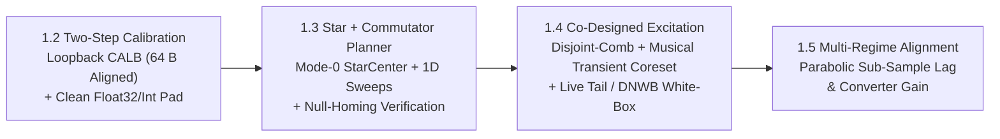

# Hardware Excitation, Multi-Mic Calibration & Router Alignment

This specification defines the universal hardware excitation schedule, two-step converter calibration, multi-regime sub-sample latency alignment, and white-box or grey-box distillation contracts for SONA v3.0. It fulfills [REQ-1.5–REQ-1.8, REQ-7.2, REQ-7.3](../../requirements/system_goals_and_requirements.md), [sona_architecture.md](../architecture/sona_architecture.md), [ADR-0016](../../adr/0016-codesigned-disjoint-comb-stimulus-and-null-homing-capture.md), [ADR-0018](../../adr/0018-signal-chain-fixtures-crate-and-whitebox-distillation.md), [ADR-0020](../../adr/0020-modular-monorepo-and-dnam-proj-container.md), and [ADR-0022](../../adr/0022-sona-state-space-operator-and-webgpu-architecture.md).

---

## 1. Universal Hardware Capture, Calibration & Alignment

### 1.1 Fundamental Capture Invariants

`r[train.capture.invariants]`

All physical hardware captures and programmatic distillations enforce three device-agnostic invariants (REQ-1.5–REQ-1.7):

| Invariant | Normative Requirement |
| :--- | :--- |
| Zero Control-Name or Topology Heuristics (REQ-1.6, REQ-1.9) | Excitation synthesis, lag alignment, and solver passes never inspect control labels (`"Gain"`, `"Mix"`, `"Drive"`), calibration role heuristics, UI hints, circuit templates, or device category tags; fixed 0-control snapshots and multi-pedal + amp + cab + stereo rack rigs run identically |
| Multi-Rate & 5-Bit-Depth Lossless Staging (REQ-1.7, REQ-7.3) | Capture I/O decodes Int12 (left-justified in 16-bit containers), Int16, Int24, Int32, and unclipped IEEE-754 Float32 (`WAVE_FORMAT_IEEE_FLOAT`) via validated little-endian WAV headers, resampling 8..384 kHz captures onto the 48 kHz identification grid via zero-phase polyphase Kaiser-sinc filtering |
| True-Stereo & Multi-Port Channel Preservation (REQ-7.2, REQ-7.4) | Mono (`1->1`), mono-to-stereo (`1->2`), stereo-to-mono (`2->1`), true-stereo (`2->2`), `4CM`, and `WDW` channel assignments remain intact without mono downmixing prior to I/O Router crossbar routing |

### 1.2 Two-Step Hardware Calibration & Clean 32-Bit Float Pad Staging

#### Direct Converter Loopback (`CALB`)

`r[train.capture.calib.loopback]`

Converter calibration measures round-trip DAC-to-ADC loopback latency $\hat{\tau}_{\text{loop}}$ over the canonical 0.5 s loopback probe (`CALB_STIMULUS_SAMPLES_48K = 24,000` at 48 kHz) to sub-sample precision. It also solves linear converter gain $g_{\text{conv}}$ and per-band quiescent noise-floor energy $\epsilon_{\text{floor},b,c}^2$, persisting the 64-byte `CALB` v3.0 chunk inside `.dnam-proj` (`ref[container.proj.preamble-and-directory]`).

#### Clean Reference Level, 400 ms Differential Mic-Pad Probe & Unclipped `Float32` Pad Staging

`r[train.capture.calib.clean-pad]`

Before and after toggling hardware pad switches, capture records a 400 ms (`MIC_PAD_PROBE_SAMPLES_48K = 19,200` at 48 kHz, −18 dBFS) differential probe, solving $\hat{G}_{\text{pad}} \in (0, 2.0]$, relative lag compensation, and $\gamma^2$. It tracks `input_reference_dbfs` relative to 1 dBu (0.869 Vrms, default -20.5 dBFS), warns on converter clipping (>= −0.1 dBFS, 0.988553 full scale), and stages aligned signals in unclipped 32-bit IEEE-754 float buffers (±100.0 = +40 dBFS linear headroom, REQ-7.3).

### 1.3 Adaptive Star + Commutator Schedule & Null-Homing Verification

#### StarCenter + Triangular Newton 1D Schedule

`r[train.capture.planner.schedule]`

The capture planner locks `Mode-0` at the declared StarCenter reference stem (`s = 0`). It sweeps each continuous knob across Gauss–Lobatto nodes along 1D rays, steps each discrete switch across observed non-reference options, and schedules targeted 2D commutator bursts only on control pairs whose measured 1D commutator norm exceeds the noise-qualified gate ([ADR-0016](../../adr/0016-codesigned-disjoint-comb-stimulus-and-null-homing-capture.md)).

#### Hardware Null-Homing & Thermal Recovery Gates

`r[train.capture.planner.null-homing]`

Before committing non-reference knob stems on physical hardware, the planner verifies mechanical return repeatability back to StarCenter against the reference residual envelope (`ACOUSTIC_NULL_HOMING_MAX_DB = 0.05` dB and pre-stem thermal or sag drift `THERMAL_RECOVERY_MAX_DB <= 0.15` dB). This gate isolates potentiometer backlash or thermal drift from true parametric control variation (REQ-1.7).

#### Freeze-Transition Capture

`r[train.capture.planner.freeze-transition]`

Sustain-hold state transitions are captured with zero control-name, string-matching, or calibration-role heuristics (REQ-1.6). Whenever physical hardware or a white-box `DNWB` runner (`HAS_FREEZE_WINDOW` bit 1<<2 or any general sustained-hold control axis across control trajectories) exhibits a write-hold transition, the planner records active-sustain entry while harmonic energy is present, held steady-state sustain under live play-over phrases, and release recovery.

The identification solver lowers that write-hold trajectory purely from input/output signal telemetry into calibrated `ControlBus` slot 16 (`op_t_we_drive`), toggling bit 0 `WE_HOLD_ACTIVE` via Schmitt (0.45, 0.55) to drive `Op-T` `WE` RAM write lock (`ref[dsp.tank.captured-freeze]`). This keeps tank states bit-clean across 30 s tails without fp16 re-quantization hiss while play-over continues through the core—requiring zero dedicated host freeze APIs.

### 1.4 Co-Designed Disjoint-Comb Excitation, Live Tail Extension & White-Box Distillation

#### Co-Designed Disjoint-Comb + Full-Bandwidth Stimulus

`r[train.capture.excitation.codesigned]`

Capture synthesizes a deterministic, crest-factor-controlled excitation combining odd-bin disjoint harmonic combs (leaving unexcited even harmonic bins open to isolate even-order intermodulation sidebands), swept exponential/logarithmic chirps, multi-level dynamic step envelopes (−48 dBFS to 0 dBFS), a deterministic 500 ms Musical Transient Coreset (capturing musical transient attacks and decay tails), and full-bandwidth (20 Hz–20 kHz) 32-bit float content spanning all 33 canonical LTAS bands.

This excitation separates linear FRF pedestals from intermodulation sidebands and archives the shared 2.0–2.5 s (96,000–120,000 frames at 48 kHz) fp32 capsule in `INPC` (`ref[container.proj.inpc-capsule]`, [ADR-0016](../../adr/0016-codesigned-disjoint-comb-stimulus-and-null-homing-capture.md), REQ-1.6).

#### Automatic Live Decay-Tail Extension

`r[train.capture.excitation.live-tail]`

Post-stimulus return energy is monitored against the calibrated `CALB` noise floor in real time. Capture automatically extends recording until reverb, delay, or feedback tails decay within +1.0 dB of $\epsilon_{\text{floor}}^2$, bounded by the configured maximum tail ceiling.

#### Unified White-Box Distillation & Out-of-Process `DNWB` Runners

`r[train.capture.whitebox.distillation]`

Programmatic white-box targets expose batch stem rendering (`RenderStem`) and closed-loop per-frame adaptive probing (`RenderFrame`) commands.

External circuit or DSP simulator processes connected over a little-endian binary `DNWB` stream (64-byte header + IEEE-754 float32 payload, `DNWB` version 1) run in isolated subprocesses, using variable-timestep PCHIP plus 309-tap Kaiser-sinc decimation for circuit solvers ([ADR-0018](../../adr/0018-signal-chain-fixtures-crate-and-whitebox-distillation.md), REQ-1.8).

### 1.5 Multi-Regime Sub-Sample Hardware Latency Alignment

`r[train.capture.alignment.multi-regime]`

Given dry excitation $x[n]$ and recorded wet return $y[n]$ after subtracting loopback offset $\hat{\tau}_{\text{loop}}$, multi-regime sub-sample alignment classifies the physical return across four alignment regimes and solves sub-sample lag $\Delta\tau$, clock drift in ppm (`clock_drift_ppm * 1e-6` clamped to `[-0.05, 0.05]`), and linear converter gain $\hat{g}$:

| Alignment Regime | Activation Condition | Peak Selection & Estimator |
| :--- | :--- | :--- |
| `CleanLinear` | Broadband linear coherence `gamma_lin >= 0.35`, positive peak | Normalized waveform cross-correlation peak |
| `PolarityInverted` | Broadband linear coherence `gamma_lin >= 0.35`, negative peak | Signed normalized cross-correlation peak (`\|R[k*]\|`, sign restored on `g_hat`) |
| `DispersiveAllPass` | Broadband linear coherence `gamma_lin >= 0.35`, dispersed phase | Causal HF wavefront correlation lock |
| `NonlinearEnvelopeFallback` | Hard clipping or octave division pushes `gamma_lin < 0.35` | True stereo 6-pair Jacobi elliptic `H1` Hilbert envelope cross-correlation |

Alignment first evaluates normalized cross-correlation (or the true stereo `H1` elliptic Hilbert envelope fallback) over the causal search window and fits a 3-point parabolic vertex around the correlation magnitude peak $k^\star$:
$$\delta = \frac{\lvert R[k^\star - 1] \rvert - \lvert R[k^\star + 1] \rvert}{2\big(\lvert R[k^\star - 1] \rvert - 2 \lvert R[k^\star] \rvert + \lvert R[k^\star + 1] \rvert\big)} \in [-0.5, +0.5], \qquad \hat{\tau} = k^\star + \delta$$

Finally, fractional resampling maps the wet stem onto the zero-phase `INPC` grid using a 64-tap (`RADIUS = 32`) partition-of-unity Kaiser-sinc filter with $\beta = 8.6$ and 512-phase linear table interpolation when compensating clock skew. This aligns dry-to-wet causal wavefronts consistently with the 4-frame causal micro-chunk latency floor of $\tau \ge 5.0$ crossbar or $\ge 4.0$ standalone, achieving better than 0.02-sample accuracy at 48 kHz (`ref[qual.eval.jitter-floor]`).
