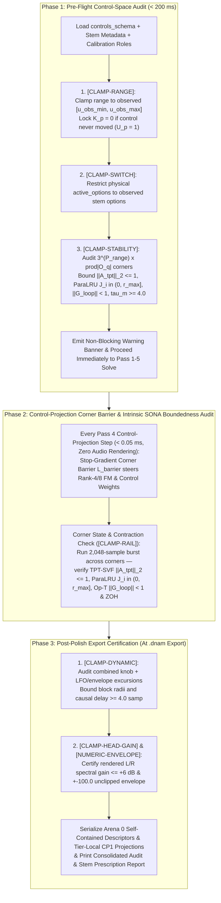

# Non-Stop 3-Phase Control-Space Audit & Automatic Clamping

Because neural audio training runs unattended across multi-stem captures, DNAM never blocks or pauses training on user confirmation prompts ([REQ-2.4, REQ-7.1, REQ-7.2](../../requirements/system_goals_and_requirements.md)). The Non-Stop 3-Phase Control-Space Audit & Automatic Clamping Pipeline enforces all control-range, intrinsic contraction, and numeric bounds across model identification and runtime execution automatically ([ADR-0022](../../adr/0022-sona-state-space-operator-and-webgpu-architecture.md)).

Specifically, the audit guarantees $\Vert \mathbf{A}_{\text{tpt}} \Vert_2 \le 1$, `ParaLRU` contraction $J_i \in (0, r_{\max}]$, and coercive `Op-T` loop gain $\Vert G_{\text{loop}} \Vert < 1$ across all operating corners.



---

## 1. The Non-Stop 3-Phase Control-Space Audit Lifecycle

### 1.1 Phase 1 — Calibration Prepass Audit (< 200 ms Before Epoch 1)

#### `[CLAMP-RANGE]` — Unobserved Range Extrapolation Clamp

`r[train.audit.phase1.clamp-range]`

For each continuous `range` control $p$ with `declared_range` $[u_{p,\text{decl-min}}, u_{p,\text{decl-max}}]$ and observed stem span $[u_{p,\text{obs-min}}, u_{p,\text{obs-max}}]$ (`ref[dsp.ctrl.range.normalize-clamp]`):
$$u_{p,\text{safe-min}} = \max\big(u_{p,\text{decl-min}},\ u_{p,\text{obs-min}}\big), \qquad u_{p,\text{safe-max}} = \min\big(u_{p,\text{decl-max}},\ u_{p,\text{obs-max}}\big)$$
If $U_p = 1$ (control never moved across stems), Phase 1 locks the polynomial degree to $K_p = 0$ (`ref[dsp.ctrl.basis.lobatto]`).

#### `[CLAMP-SWITCH]` — Unobserved Switch Option Masking

`r[train.audit.phase1.clamp-switch]`

Phase 1 restricts `active_options` of each discrete `switch` control $q$ to the observed option subset $\mathcal{O}_{q,\text{obs}}$ seen on at least one valid recorded frame. Hardware roles—including `stereo_mode` and `freeze_latch`—require observed capture evidence, keeping unobserved options masked while the declared default serves as the mathematical reference for `CP1` projections (`ref[dsp.ctrl.switch.option-contributors]`).

#### `[CLAMP-STABILITY]` — Multi-Knob Corner Stability Audit

`r[train.audit.phase1.clamp-stability]`

Phase 1 evaluates the Pass 1 physical parameter fit across the $3^{P_{\text{range}}} \times \prod_q |\mathcal{O}_{q,\text{obs}}|$ grid of `safe_clamped_range` and `active_options`, applying structured `conditional_bounds` (`ref[container.dnam.conditional-rules]`) whenever any corner exceeds the intrinsic stability invariants below:

| Operator Domain | Enforced Corner Stability Bound | Canonical Reference |
| :--- | :--- | :--- |
| `TPT-SVF` Core | Passive contraction `\|\|A_tpt[n]\|\|_2 <= 1` | [op_n_paralru_and_polyadaa.md](../dsp/op_n_paralru_and_polyadaa.md) |
| `ParaLRU` Core | Decoupled 1D scalar contraction `J_i[n] in (0, r_max] ⊂ (0, 1)` | [op_n_paralru_and_polyadaa.md](../dsp/op_n_paralru_and_polyadaa.md) |
| Cabinet Kautz Modal Bank | Pole radius `r_c <= 0.9995` | `ref[dsp.op-m.recurrence.symplectic]` |
| Coercive `Op-T` Spatial Tank | Loop norm `\|\|G_loop\|\| < 1`, `g_lin <= 0.9990`, `\|a_diff\| <= 0.75`, and causal delay `tau_m >= 4.0` samples | `ref[dsp.op-t.reader.catmull-rom]`, `ref[dsp.op-t.diffuser.recurrence]`, `ref[dsp.tank.quiet-feedback-knee]` |

### 1.2 Phase 2 — During-Training Stop-Gradient Corner Barrier & Periodic Rail-Lockup Check

#### Stop-Gradient Corner Barrier Loss

`r[train.audit.phase2.corner-barrier]`

At every Pass 4 optimizer step, the solver evaluates corner stability across $r_{\text{worst}} \in [0.0, 0.9995]$, $g_{\text{lin}} \in [0.0, 0.9990]$, $|a_{\text{diff}}| \le 0.75$, and $\tau_{\min} \ge 4.0$ samples. Non-finite values incur penalty $10^6$ and infeasible regions add quadratic penalty $10^4 + 10^5 \sum (\text{violation})^2$, paired with smooth logarithmic barrier margins using a 1e-7 floor:
$$\mathcal{L}_{\text{barrier}} = \lambda_{\text{bar}} \sum_{(\mathbf{u}_c, \mathbf{s}_c) \in \mathcal{V}_{\text{corners}}} \mathrm{relu}\Big(\mathrm{sg}\big(\boldsymbol{\theta}_{\text{main}}(\mathbf{u}_c, \mathbf{s}_c)\big) + \Delta\boldsymbol{\theta}_{\text{FM}}(\mathbf{u}_c, \mathbf{s}_c) - \boldsymbol{\theta}_{\text{safe}}\Big)^2$$
$$\mathcal{L}_{\text{phys}} = -10^{-4}\left[\ln\left(\min\Big(1, \frac{\max(0.9995 - r_w, 10^{-7})}{0.01}\Big)\right) + \ln\left(\min\Big(1, \frac{\max(0.9990 - g_{\text{lin}}, 10^{-7})}{0.01}\Big)\right) + \ln\left(\min\Big(1, \frac{\max(0.75 - |a_{\text{diff}}|, 10^{-7})}{0.05}\Big)\right) + \ln\left(\min\Big(1, \max(\tau_{\min} - 4.0, 10^{-7})\Big)\right)\right]$$

#### `[CLAMP-RAIL]` — Periodic Dynamic State & Rail Audit

`r[train.audit.phase2.clamp-rail]`

Periodically during training, `[CLAMP-RAIL]` executes a 2,048-sample multi-tone burst $x[n] = 0.85 \cdot \mathrm{clamp}(d_{\text{corner}}, 0.1, 64.0) \cdot (\sin(0.06544985 n) + 0.35\cos(0.21991149 n))$ without gradient tracking and verifies three runtime safety invariants:

| Dynamic Rail Check | Verified Contraction & Saturation Invariant |
| :--- | :--- |
| Matryoshka Core | Passive `TPT-SVF` (`\|\|A_tpt\|\|_2 <= 1`, zero overflow) and decoupled 1D scalar `ParaLRU` contraction (`J_i in [alpha_rel * (1 - kappa * (1 - alpha_atk)), alpha_rel] ⊂ [0, r_max]`) |
| `Op-T` Tank & Cabinet Bank | Coercive `Op-T` feedback (`\|\|G_loop\|\| < 1`), Cabinet Schur pole bounds (`r < 1`), and finite state envelopes (`<= 100.0`) |
| Saturation Occupancy Guard | Monitors `PolyADAA1` and `C^2` wavefolder occupancy (`SAT_OCCUPANCY_LIMIT = 0.95`), emitting `safe_scale = clamp(2.0 / max(eff_drive, 2.0), 0.05, 1.0)` on saturating corners (`ref[dsp.op-n.polyadaa.clamp]`) |

### 1.3 Phase 3 — Post-Training & Post-Polish Export Certification Audit

#### `[CLAMP-DYNAMIC]` — Combined Knob + Learned LFO/Envelope Excursion Clamp

`r[train.audit.phase3.clamp-dynamic]`

Phase 3 bounds worst-case joint knob and dynamic modulation excursions so Kautz poles stay strictly inside 0.9995 and causal delays stay at least 4.0 samples:
$$r_{c,\text{worst}}(\mathbf{u}, \mathbf{s}) = r_{\text{high},c}(\mathbf{u}, \mathbf{s}) + |\mathbf{w}_{r,c}|^\top \mathbf{m}_{\text{max}} \le 0.9995, \qquad \tau_{m,\text{min}}(\mathbf{u}, \mathbf{s}) = \tau_{0,m}(\mathbf{u}, \mathbf{s}) - |\mathbf{w}_{\tau,m}|^\top \mathbf{m}_{\text{max}} \ge 4.0\text{ samples}$$
Cabinet Bank modal poles remain bounded by their shared radial gate $g[n] \in [0, 1]$ and validated endpoint $r_{\text{high},m} \le 0.9995$ (`ref[dsp.op-m.kautz.radial-gate]`, [op_m_modal_kautz.md](../dsp/op_m_modal_kautz.md)).

#### `[CLAMP-HEAD-GAIN]` — Post-Polish Direct-Register Mid/Side Spectral Gain Clamp

`r[train.audit.phase3.clamp-head-gain]`

Phase 3 evaluates the active tier's rendered L/R frequency response and linear VarPro readout gain over the permitted head-control and width domains (`ref[dsp.head.mid-side-factorization]`). Whenever gain exceeds +6.0 dB (`MAX_GAIN_6DB_LIN = 1.9952623`), it scales the readout using idempotent target `MAX_GAIN_IDEMPOTENT = 1.9952583` (~33 ULPs inside +6.0 dB for 0-ULP re-audit idempotence) while preserving tier-specific head radius and self-contained Arena 0 descriptors (`ref[dsp.ctrl.op-n.trust-clip]`).

#### `[NUMERIC-ENVELOPE]` — Finite-Precision Operating Range Certification

`r[train.audit.phase3.numeric-envelope]`

Phase 3 certifies an unclipped ±100.0 (+40 dBFS peak) operating envelope simultaneously across all active audio inputs and linear VarPro readout outputs (REQ-7.1, `ref[arch.fp.range-saturation]`). Passive `TPT-SVF` and contractive `ParaLRU` states stay strictly bounded, while `Op-T` `fp16` delay writes remain within ±65,504.0 (or bounded finite `f32` in optional cold `ext_lines`) with zero representational saturation ([sona_architecture.md](../architecture/sona_architecture.md#finite-precision-range-and-saturation-policy)).

---

## 2. Consolidated Post-Training Audit & Stem Prescription Report

`r[train.audit.report.prescription]`

```text
================================================================================
DNAM v3.0 (SONA) TRAINING COMPLETE — EXPORTED: model.dnam | project.dnam-proj
================================================================================
Active Control Clamps Applied (4):
  1. [CLAMP-RANGE]     'gain': Clamped declared [0.0, 10.0] -> safe [2.0, 8.0]
                       -> Prescription: Add stems at gain=0.0 and gain=10.0
  2. [CLAMP-SWITCH]    'boost': Disabled unobserved option ['ultra'] (active: ['off', 'on'])
                       -> Prescription: Add >= 1 stem with boost='ultra'
  3. [CLAMP-STABILITY] 'feedback': Clamped <= 9.37 when boost='on' (||G_loop|| < 1, g_lin <= 0.9990)
                       -> Prescription: Add corner stem (feedback=10.0, boost='on')
  4. [CLAMP-DYNAMIC]   'delay_ms': Tightened min 0.00 -> 0.08 (LFO trough >= 4.0 samp)

Refine non-destructively in the Capture Vault by adding these stems to project.dnam-proj.
================================================================================
```
