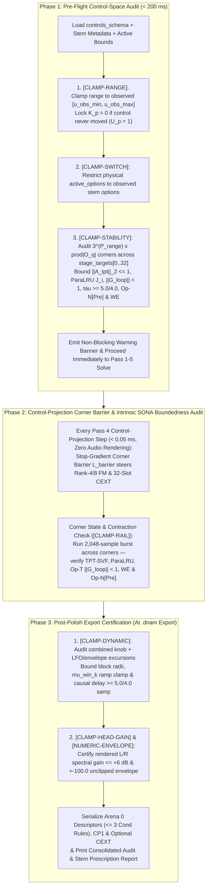

# Non-Stop 3-Phase Control-Space Audit & Automatic Clamping

Because neural audio training runs unattended across multi-stem captures, DNAM never blocks or pauses training on user confirmation prompts ([REQ-2.4, REQ-7.1, REQ-7.2](../../requirements/system_goals_and_requirements.md)). The Non-Stop 3-Phase Control-Space Audit & Automatic Clamping Pipeline enforces all control-range, intrinsic contraction, and numeric bounds across model identification and runtime execution automatically ([ADR-0022](../../adr/0022-sona-state-space-operator-and-webgpu-architecture.md)).

Specifically, the audit guarantees $\Vert \mathbf{A}_{\text{tpt}} \Vert_2 \le 1$, `ParaLRU` contraction $J_i \in (0, r_{\max}]$, and coercive `Op-T` loop gain $\Vert G_{\text{loop}} \Vert < 1$ across all operating corners.



---

## 1. The Non-Stop 3-Phase Control-Space Audit Lifecycle

### 1.1 Phase 1 — Calibration Prepass Audit (< 200 ms Before Epoch 1)

#### `[CLAMP-RANGE]` — Unobserved Range Extrapolation Clamp

`r[train.audit.phase1.clamp-range]`

For each continuous `range` control $p$ with `declared_range` $[u_{p,\text{decl-min}}, u_{p,\text{decl-max}}]$ and observed stem span $[u_{p,\text{obs-min}}, u_{p,\text{obs-max}}]$ (`ref[dsp.ctrl.range.normalize-clamp]`):
$$u_{p,\text{safe-min}} = \max\big(u_{p,\text{decl-min}},\ u_{p,\text{obs-min}}\big), \qquad u_{p,\text{safe-max}} = \min\big(u_{p,\text{decl-max}},\ u_{p,\text{obs-max}}\big)$$
If $U_p = 1$ (control never moved across stems), Phase 1 locks the polynomial degree to $K_p = 0$ (`ref[dsp.ctrl.basis.lobatto]`).

#### `[CLAMP-SWITCH]` — Unobserved Switch Option Masking

`r[train.audit.phase1.clamp-switch]`

Phase 1 restricts `active_options` of each discrete `switch` control $q$ to the observed option subset $\mathcal{O}_{q,\text{obs}}$ seen on at least one valid recorded frame. Unobserved switch masking applies uniformly across every discrete switch control regardless of control name, label, or role—such as `stereo_mode` or any other selector—keeping unobserved options masked while the declared default serves as the mathematical reference for `CP1` projections (`ref[dsp.ctrl.switch.option-contributors]`).

#### `[CLAMP-STABILITY]` — Multi-Knob Corner Stability Audit

`r[train.audit.phase1.clamp-stability]`

Phase 1 evaluates the Pass 1 physical parameter fit across the $3^{P_{\text{range}}} \times \prod_q |\mathcal{O}_{q,\text{obs}}|$ grid of `safe_clamped_range` and `active_options` over all 32 dispatch channels `stage_targets[0..32]`—covering base `W_ctrl` rows 0..15 plus optional `"CEXT"` rows 16..31—and emits structured `conditional_bounds` (`ref[container.dnam.conditional-rules]`) whenever any corner exceeds the stability bounds below.

Inside each 64-byte binary Control Clamp Descriptor, conditional safety bounds pack into at most 3 inline 8-byte `cond_rules` slots. Descriptor compilation fails closed whenever a control requires more than 3 inline slots, ensuring runtime deserialization never depends on separate conditional overflow slices (`reserved_cond_zero == 0`).

| Operator Domain (`stage_targets`) | Enforced Corner Stability Bound | Canonical Reference |
| :--- | :--- | :--- |
| `TPT-SVF` Core (slots 0..1) | Passive contraction `\|\|A_tpt[n]\|\|_2 <= 1`, `svf_g_oct` in [-3.0, +3.0], `svf_k_delta` in [-0.8, +1.5] | [op_n_paralru_and_polyadaa.md](../dsp/op_n_paralru_and_polyadaa.md) |
| `PolyADAA1` Core (slots 2..5) | `block_adaa_oct[0..4]` clamped in [-1.5, +1.5] octaves across cascade blocks 0..3 and Ultra group overrides | [op_n_paralru_and_polyadaa.md](../dsp/op_n_paralru_and_polyadaa.md) |
| `ParaLRU` Core (slots 6..9) | Decoupled 1D scalar contraction `J_i[n] in (0, r_max] ⊂ (0, 1)` (`block_lru_bias` in [-2.0, +2.0]) | [op_n_paralru_and_polyadaa.md](../dsp/op_n_paralru_and_polyadaa.md) |
| Cabinet Kautz Modal Bank (slots 10..11) | Pole radius `r_c <= 0.9995`, `kautz_oct_delta` & `kautz_damp_delta` in [-1.5, +1.5] | `ref[dsp.op-m.recurrence.symplectic]` |
| Crossbar & Stereo Wet Blend (slot 15) | `crossbar_wet_mod` clamped in [-1.0, +1.0], forming `wet_scale = clamp(1.0 + mod, 0.0, 2.0)` | [parametric_control_bus.md](../dsp/parametric_control_bus.md#31-operator-parameter-dispatch-matrix--sensitivity-laws) |
| Coercive `Op-T` Tank & Crossbar (slots 12..14, 17..25) | Loop norm `\|\|G_loop\|\| < 1`, `g_lin` <= `0x3F7F_BE76` (0.9990), `\|a_diff\| <= 0.75`, causal delay `tau_m >= 5.0` across crossbar/tank micro-chunks (>= 4.0 standalone), boundary window clamp `mu_win_k`, pitch-down loop-gain clamp <= `0x3F7F_BE76`, plus `op_t_delay_scale_oct` in [-3.0, +3.0], `lfo_rate_hz` in [0.0, 16.0], `tank_psi_delta` in [-pi, +pi] (<= 0.25 rad/tick slew), 48 kHz wire `base_damp_pole` in [0.0, 0.9995], effective host-rate `damp_pole_eff` in [0.0, 0.99995], `dry_mix` in [-2.0, 2.0], `window_depth` in [0.0, 1.0], `allpass_g` in [-0.75, +0.75], and headroom-bounded `ramp_rate_hz`, `lfo_depth`, and `input_gain` | `ref[dsp.op-t.reader.catmull-rom]`, `ref[dsp.op-t.window.partition-of-unity]`, `ref[dsp.op-t.diffuser.recurrence]`, `ref[dsp.tank.quiet-feedback-knee]` |
| `WE` Write-Enable Latch (slot 16 `op_t_we_drive`) | Immediate un-ramped snap feeding Schmitt (0.45, 0.55) into bit 0 `WE_HOLD_ACTIVE` for 0-ULP hold vs pass-through | `ref[dsp.tank.captured-freeze]` |
| `Op-N[Pre]` Front-End (slots 26..28) | Clamps `zoh_hold_depth` strictly inside [0.0, 0.9999] (`rho_zoh` in [1e-4, 1.0], zero-init safe bypass) alongside bounded `gamma_bc` and `beta_q` deltas | [op_n_paralru_and_polyadaa.md](../dsp/op_n_paralru_and_polyadaa.md) |
| Crossbar Phasor & Router Gate (slots 29..30) | `op_p_phasor_rate_oct` clamped in [-4.0, +4.0] (slot 29) and `router_gate_thresh_delta` clamped within safe gate hysteresis (slot 30; slot 31 reserved +0.0) | [router_and_crossbar_topology.md](../dsp/router_and_crossbar_topology.md) |

### 1.2 Phase 2 — During-Training Stop-Gradient Corner Barrier & Periodic Rail-Lockup Check

#### Stop-Gradient Corner Barrier Loss

`r[train.audit.phase2.corner-barrier]`

At every Pass 4 optimizer step, the solver evaluates corner stability across all 32 `stage_targets[0..32]` slots (base `W_ctrl` plus optional `"CEXT"`): $r_{\text{worst}} \in [0.0, 0.9995]$, $g_{\text{lin}} \in [0.0, 0.9990]$, $|a_{\text{diff}}| \le 0.75$, and causal delay floor $\tau_{\min} \ge \tau_{\text{floor}}$ where $\tau_{\text{floor}} = 5.0$ across crossbar/tank micro-chunks and $4.0$ standalone.

The barrier concurrently enforces boundary window clamp $\mu_{\text{win},k}$ when `ramp_spans_samples[k] * |ramp_rate_hz| != 0`, pitch-down passive loop gain <= `0x3F7F_BE76`, `Op-N[Pre]` `zoh_hold_depth` in [0.0, 0.9999], `op_p_phasor_rate_oct` in [-4.0, +4.0], and `router_gate_thresh_delta` hysteresis margins.

Non-finite values incur penalty $10^6$ and infeasible regions add quadratic penalty $10^4 + 10^5 \sum (\text{violation})^2$, paired with smooth logarithmic barrier margins using a 1e-7 floor:

$$\mathcal{L}_{\text{barrier}} = \lambda_{\text{bar}} \sum_{(\mathbf{u}_c, \mathbf{s}_c) \in \mathcal{V}_{\text{corners}}} \mathrm{relu}\Big(\mathrm{sg}\big(\boldsymbol{\theta}_{\text{main}}(\mathbf{u}_c, \mathbf{s}_c)\big) + \Delta\boldsymbol{\theta}_{\text{FM}}(\mathbf{u}_c, \mathbf{s}_c) - \boldsymbol{\theta}_{\text{safe}}\Big)^2$$
$$\mathcal{L}_{\text{phys}} = -10^{-4}\left[\ln\left(\min\Big(1, \frac{\max(0.9995 - r_w, 10^{-7})}{0.01}\Big)\right) + \ln\left(\min\Big(1, \frac{\max(0.9990 - g_{\text{lin}}, 10^{-7})}{0.01}\Big)\right) + \ln\left(\min\Big(1, \frac{\max(0.75 - |a_{\text{diff}}|, 10^{-7})}{0.05}\Big)\right) + \ln\left(\min\Big(1, \max(\tau_{\min} - \tau_{\text{floor}}, 10^{-7})\Big)\right)\right]$$

#### `[CLAMP-RAIL]` — Periodic Dynamic State & Rail Audit

`r[train.audit.phase2.clamp-rail]`

Periodically during training, `[CLAMP-RAIL]` feeds the differential stereo stimulus `[+x[n], -x[n]]` over 2,048 samples without gradient tracking using `eff_drive = clamp(d_corner, 0.1, 64.0)` and $x[n] = 0.85 \cdot \mathrm{clamp}(d_{\text{corner}}, 0.1, 64.0) \cdot (\sin(0.06544985 n) + 0.35\cos(0.21991149 n))$ across `stage_targets[0..32]` verifying three runtime safety invariants:

Each sample n increments `sat_hits` whenever any active core pre-activation satisfies `|u_nl| >= 8.0` or stereo output magnitude satisfies `|y_c[n]| >= 25.0`. The rail check flags saturation and emits `safe_scale = clamp(2.0 / max(eff_drive, 2.0), 0.05, 1.0)` whenever `sat_hits / 2048 > 0.95` (`SAT_OCCUPANCY_LIMIT`), any sample is non-finite, or `max_n |y_c[n]| > 100.0`.

| Dynamic Rail Check | Verified Contraction & Saturation Invariant |
| :--- | :--- |
| Matryoshka Core | Passive `TPT-SVF` (`\|\|A_tpt\|\|_2 <= 1`, zero overflow) and decoupled 1D scalar `ParaLRU` contraction (`J_i in [alpha_rel * (1 - kappa * (1 - alpha_atk)), alpha_rel] ⊂ [0, r_max]`) |
| `Op-T` Tank, `WE` & Cabinet Bank | Coercive `Op-T` feedback (`\|\|G_loop\|\| < 1`, pitch-down `<= 0x3F7F_BE76`), boundary window clamp `mu_win_k` on active ramps, clean Schmitt (0.45, 0.55) `op_t_we_drive` switching on `WE_HOLD_ACTIVE`, Cabinet Schur poles (`r < 1`), and finite envelopes <= 100.0 |
| `Op-N[Pre]`, Crossbar & Saturation Guard | Bounded `zoh_hold_depth in [0.0, 0.9999]`, `op_p_phasor_rate_oct in [-4.0, +4.0]`, `router_gate_thresh_delta` stability, and occupancy check (`\|u_nl\| >= 8.0` or `\|y_c[n]\| >= 25.0` -> `sat_hits / 2048 > 0.95` `SAT_OCCUPANCY_LIMIT`, non-finite, or `max_n \|y_c[n]\| > 100.0` emits `safe_scale = clamp(2.0 / max(eff_drive, 2.0), 0.05, 1.0)` per `ref[dsp.op-n.polyadaa.clamp]`) |

### 1.3 Phase 3 — Post-Training & Post-Polish Export Certification Audit

#### `[CLAMP-DYNAMIC]` — Combined Knob + Learned LFO/Envelope Excursion Clamp

`r[train.audit.phase3.clamp-dynamic]`

Phase 3 bounds worst-case joint knob and dynamic modulation excursions across all 32 `stage_targets[0..32]` (`W_ctrl` + `"CEXT"`) so Kautz poles stay strictly inside 0.9995 and causal delays stay at least $\tau_{\text{floor}}$ samples (5.0 across crossbar/tank micro-chunks and 4.0 standalone):

$$r_{c,\text{worst}}(\mathbf{u}, \mathbf{s}) = r_{\text{high},c}(\mathbf{u}, \mathbf{s}) + |\mathbf{w}_{r,c}|^\top \mathbf{m}_{\text{max}} \le 0.9995, \qquad \tau_{m,\text{min}}(\mathbf{u}, \mathbf{s}) = \tau_{0,m}(\mathbf{u}, \mathbf{s}) - |\mathbf{w}_{\tau,m}|^\top \mathbf{m}_{\text{max}} \ge \tau_{\text{floor}}\text{ samples}$$

Phase 3 additionally verifies automatic boundary window clamping $\mu_{\text{win},k}$ whenever `ramp_spans_samples[k] * |ramp_rate_hz| != 0`, pitch-down loop-gain passivity <= `0x3F7F_BE76`, and immediate un-ramped Schmitt (0.45, 0.55) safety on slot 16 (`op_t_we_drive`) driving bit 0 `WE_HOLD_ACTIVE`.

It simultaneously verifies `Op-N[Pre]` `zoh_hold_depth` in [0.0, 0.9999] (`rho_zoh` in [1e-4, 1.0]), `op_p_phasor_rate_oct` in [-4.0, +4.0], and `router_gate_thresh_delta` hysteresis preservation. Cabinet Bank modal poles remain bounded by their shared radial gate $g[n] \in [0, 1]$ and validated endpoint $r_{\text{high},m} \le 0.9995$ (`ref[dsp.op-m.kautz.radial-gate]`, [op_m_modal_kautz.md](../dsp/op_m_modal_kautz.md)).

#### `[CLAMP-HEAD-GAIN]` — Post-Polish Direct-Register Mid/Side Spectral Gain Clamp

`r[train.audit.phase3.clamp-head-gain]`

Phase 3 evaluates the active tier's rendered L/R frequency response and linear VarPro readout gain over the permitted head-control and width domains (`ref[dsp.head.mid-side-factorization]`). Whenever gain exceeds +6.0 dB (`MAX_GAIN_6DB_LIN = 1.9952623`), it scales the readout using idempotent target `MAX_GAIN_IDEMPOTENT = 1.9952583` (~33 ULPs inside +6.0 dB for 0-ULP re-audit idempotence) while preserving tier-specific head radius and self-contained Arena 0 descriptors (`ref[dsp.ctrl.op-n.trust-clip]`).

#### `[NUMERIC-ENVELOPE]` — Finite-Precision Operating Range Certification

`r[train.audit.phase3.numeric-envelope]`

Phase 3 certifies an unclipped ±100.0 (+40 dBFS peak) operating envelope simultaneously across all active audio inputs and linear VarPro readout outputs (REQ-7.1, `ref[arch.fp.range-saturation]`). Passive TPT-SVF and contractive ParaLRU states stay strictly bounded, while Op-T `fp16` delay writes remain within ±65,504.0 (or bounded finite `f32` in optional cold `ext_lines`) with zero representational saturation ([sona_architecture.md](../architecture/sona_architecture.md#finite-precision-range-and-saturation-policy)).

Serialized descriptors strictly satisfy the 3-slot inline `cond_rules` ceiling (`reserved_cond_zero == 0`), emitting optional 1,280 B `"CEXT"` dispatch weights inside Layer-0 .dnam-bin and .dnam containers.

---

## 2. Consolidated Post-Training Audit & Stem Prescription Report

`r[train.audit.report.prescription]`

```text
================================================================================
DNAM v3.0 (SONA) TRAINING COMPLETE — EXPORTED: model.dnam | project.dnam-proj
================================================================================
Active Control Clamps Applied (4):
  1. [CLAMP-RANGE]     'gain': Clamped declared [0.0, 10.0] -> safe [2.0, 8.0]
                       -> Prescription: Add stems at gain=0.0 and gain=10.0
  2. [CLAMP-SWITCH]    'boost': Disabled unobserved option ['ultra'] (active: ['off', 'on'])
                       -> Prescription: Add >= 1 stem with boost='ultra'
  3. [CLAMP-STABILITY] 'feedback': Clamped <= 9.37 when boost='on' (||G_loop|| < 1, g_lin <= 0.9990)
                       -> Prescription: Add corner stem (feedback=10.0, boost='on')
  4. [CLAMP-DYNAMIC]   'delay_ms': Tightened min 0.00 -> 0.11 (crossbar trough >= 5.0 samp)

Refine non-destructively in the Capture Vault by adding these stems to project.dnam-proj.
================================================================================
```
