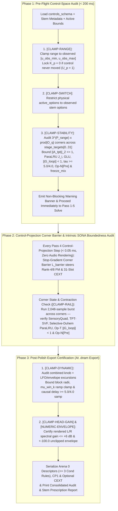

# Non-Stop 3-Phase Control-Space Audit & Automatic Clamping

Because neural audio training runs unattended across multi-stem captures, DNAM never blocks or pauses training on user confirmation prompts ([REQ-2.4, REQ-7.1, REQ-7.2](../../requirements/system_goals_and_requirements.md)). The Non-Stop 3-Phase Control-Space Audit & Automatic Clamping Pipeline enforces all control-range, intrinsic contraction, and numeric bounds across model identification and runtime execution automatically ([ADR-0022](../../adr/0022-sona-state-space-operator-and-webgpu-architecture.md)).

Specifically, the audit guarantees $\Vert \mathbf{A}_{\text{tpt}} \Vert_2 \le 1$, `ParaLRU` contraction $J_i \in (0, r_{\max}]$, and coercive `Op-T` loop gain $\Vert G_{\text{loop}} \Vert < 1$ across all operating corners.



---

## 1. The Non-Stop 3-Phase Control-Space Audit Lifecycle

### 1.1 Phase 1 — Calibration Prepass Audit (< 200 ms Before Epoch 1)

#### `[CLAMP-RANGE]` — Unobserved Range Extrapolation Clamp

`r[train.audit.phase1.clamp-range]`

For each continuous `range` control $p$ with `declared_range` $[u_{p,\text{decl-min}}, u_{p,\text{decl-max}}]$ and observed stem span $[u_{p,\text{obs-min}}, u_{p,\text{obs-max}}]$ (`ref[dsp.ctrl.range.normalize-clamp]`):
$$u_{p,\text{safe-min}} = \max\big(u_{p,\text{decl-min}},\ u_{p,\text{obs-min}}\big), \qquad u_{p,\text{safe-max}} = \min\big(u_{p,\text{decl-max}},\ u_{p,\text{obs-max}}\big)$$
If $U_p = 1$ (control never moved across stems), Phase 1 locks the polynomial degree to $K_p = 0$ (`ref[dsp.ctrl.basis.lobatto]`).

#### `[CLAMP-SWITCH]` — Unobserved Switch Option Masking

`r[train.audit.phase1.clamp-switch]`

Phase 1 restricts `active_options` of each discrete `switch` control $q$ to the observed option subset $\mathcal{O}_{q,\text{obs}}$ seen on at least one valid recorded frame. Unobserved switch masking applies uniformly across every discrete switch control regardless of control name, label, or role—such as `stereo_mode` or any other selector—keeping unobserved options masked while the declared default serves as the mathematical reference for `CP1` projections (`ref[dsp.ctrl.switch.option-contributors]`).

#### `[CLAMP-STABILITY]` — Multi-Knob Corner Stability Audit

`r[train.audit.phase1.clamp-stability]`

Phase 1 evaluates the Pass 1 physical parameter fit across the $3^{P_{\text{range}}} \times \prod_q |\mathcal{O}_{q,\text{obs}}|$ grid of `safe_clamped_range` and `active_options` over all 31 active dispatch slots `stage_targets[0..31]` (`slot 31` reserved +0.0) together with combined latent-sensitivity excursions (`stage_targets[r] + dot(w_latent, eff_z_stage)`) across every active CoreQuad and lane.

This corner check covers `stage_latent_mods_fp16[48..80]`, `stage_latent_ctrl_ultra_fp16[0..160]`, and `stage_latent_core_mods_fp16[0..1024]` (`[-4.0, +4.0]`, mirrored `SONA_META_CORE_MODS_PRESENT`, zeroed cols 120..128), emitting structured `conditional_bounds` (`ref[container.dnam.conditional-rules]`) whenever any corner exceeds the stability bounds below.

Inside each 64-byte binary Control Clamp Descriptor, conditional safety bounds pack into at most 3 inline 8-byte `cond_rules` slots. Descriptor compilation fails closed whenever a control requires more than 3 inline slots, ensuring runtime deserialization never depends on separate conditional overflow slices (`reserved_cond_zero == 0`).

| Operator Domain (`stage_targets`) | Enforced Corner Stability Bound | Canonical Reference |
| :--- | :--- | :--- |
| `TPT-SVF` Core (slots 0..1) | Passive contraction `\|\|A_tpt[n]\|\|_2 <= 1`, Block 0 PHS nonlinear damping `svf_k_nl` in `[0.0, 16.0]` (strictly 0.0 on Blocks 1..3; discrete energy step `-4 g k_eff v1^2 <= 0`), `svf_g_oct` in [-3.0, +3.0], `svf_k_delta` in [-0.8, +1.5] | [op_n_paralru_and_polyadaa.md](../dsp/op_n_paralru_and_polyadaa.md) |
| `PolyADAA1` & `GLU` Core (slots 2..5) | `block_adaa_oct[0..4]` clamped in [-1.5, +1.5] octaves across cascade blocks 0..3 and Ultra `CoreQuad` overrides; `glu_mix` in `[-4.0, +4.0]` | [op_n_paralru_and_polyadaa.md](../dsp/op_n_paralru_and_polyadaa.md) |
| Selective-Duhem `ParaLRU` Core (slots 6..9) | Decoupled 1D scalar contraction `J_i[n] in [(1 - rho_i[n]) * alpha_rel,i, alpha_rel,i] ⊂ [0, r_max]` (`block_lru_bias` in [-2.0, +2.0], `lru_stereo_link` & `eta` in [0.0, 1.0], `gamma_duhem` in [0.0, 64.0]) | [op_n_paralru_and_polyadaa.md](../dsp/op_n_paralru_and_polyadaa.md) |
| `ModalConvolver` Kautz Bank (slots 10..11) | Pole radius `r_c <= 0.9995`, `kautz_oct_delta` & `kautz_damp_delta` in [-1.5, +1.5]; `"DBRM"` `ro_pole_48k` in `[0.0, 0x3F7F_FFAC]` | `ref[dsp.op-m.recurrence.symplectic]` |
| Crossbar & `Transport` Wet Blend (slot 15) | `crossbar_wet_mod` clamped in [-1.0, +1.0], forming `wet_scale = clamp(1.0 + mod, 0.0, 2.0)` | [parametric_control_bus.md](../dsp/parametric_control_bus.md#31-operator-parameter-dispatch-matrix--sensitivity-laws) |
| Coercive `Op-T` `Transport` (slots 12..14, 17..25) | Loop norm `\|\|G_loop\|\| < 1`, raw `stage_targets[12]` in `[-(48,000 - max(min_base_delay, delay_floor)), +48,000]` (lower bound capped <= -1.0, `delay_floor = 5.0` crossbar / 4.0 standalone), `stage_targets[13]` (`tank_gain_mod`) in `[-1.0, +0.9990]`, `stage_targets[14]` (`tank_psi_delta`) in `[-pi, +pi]` (<= 0.25 rad/tick slew), `stage_targets[17]` (`op_t_delay_scale_oct`) in `[-3.0, +3.0]`, `stage_targets[18]` (`op_t_ramp_rate_hz_delta`) in `[-16.0, +16.0]` Hz, `stage_targets[19]` (`op_t_lfo_rate_hz_delta`) in `[-16.0, +16.0]` Hz (effective `[0.0, 16.0]`), `stage_targets[20]` (`op_t_lfo_depth_scale`) in `[-4.0, +4.0]` oct, `stage_targets[21]` (`op_t_damp_pole_delta`) in `[-1.0, +0.99995]` (wire `base_damp_pole` in `[0.0, 0.9995]`), `stage_targets[22]` (`op_t_dry_mix_mod`) in `[-2.0, +2.0]`, `stage_targets[23]` (`op_t_input_gain_mod`) in `[-4.0, +4.0]` oct, `stage_targets[24]` (`op_t_window_depth_delta`) in `[-1.0, +1.0]` (effective `[0.0, 1.0]`), `stage_targets[25]` (`op_t_allpass_g_delta`) in `[-0.75, +0.75]`, `sigma_knee` in `[1.0e-3, 0.984375]` (`0x3BE0`), `scat_psi` in `[-pi, +pi]`, causal delay `tau_m >= delay_floor`, `mu_win_k`, and pitch-down loop gain <= `0x3F7F_BE76` | `ref[dsp.op-t.reader.catmull-rom]`, `ref[dsp.op-t.window.partition-of-unity]`, `ref[dsp.op-t.diffuser.recurrence]`, `ref[dsp.tank.loop-saturator]` |
| Passive `freeze_mix` (slot 16 `op_t_freeze_mix_delta`) | Raw `stage_targets[16]` in `[-1.0, +1.0]`; effective `mu_freeze = clamp(base_freeze_mix[q] + t[16], 0.0, 1.0)` (forced 1.0 under host lock) | `ref[dsp.tank.captured-freeze]` |
| `Op-N[Pre]` Front-End (slots 26..29) | Raw `stage_targets[26]` (`op_n_pre_gamma_bc_delta`) in `[-1.0, +1.0]`, `stage_targets[27]` (`op_n_pre_zoh_hold_delta`) in `[-1.0, +0.9999]`, `stage_targets[28]` (`op_n_pre_beta_q_delta`) in `[-16.0, +16.0]`; effective `zoh_hold_depth` in `[0.0, 0.9999]` (`rho_zoh` in `[1e-4, 1.0]`) | [op_n_paralru_and_polyadaa.md](../dsp/op_n_paralru_and_polyadaa.md) |
| Crossbar Phasor & `SensoryQuad` VCA (slots 29..32) | Raw `stage_targets[29]` (`op_p_phasor_rate_oct`) in `[-4.0, +4.0]`; `stage_targets[30]` (`sense_vca_gain_delta`) in `[-1.0, +1.0]` (`sense_tone_*` in `[-16.0, +16.0]`, `sense_vca_w` in `[-512.0, +512.0]`, `g_in` in `[0.0, 2.0]`); reserved slot 31 `[0.0, 0.0]` (+0.0) | [router_and_crossbar_topology.md](../dsp/router_and_crossbar_topology.md) |

### 1.2 Phase 2 — During-Training Stop-Gradient Corner Barrier & Periodic Rail-Lockup Check

#### Stop-Gradient Corner Barrier Loss

`r[train.audit.phase2.corner-barrier]`

At every Pass 4 optimizer step, the solver evaluates corner stability across all 31 active `stage_targets[0..31]` slots together with unlocked `stage_latent_*` excursions across every CoreQuad and lane: $r_{\text{worst}} \in [0.0, 0.9995]$, $g_{\text{lin}} \in [0.0, 0.9990]$, $|a_{\text{diff}}| \le 0.75$, and causal delay floor $\tau_{\min} \ge \tau_{\text{floor}}$ where $\tau_{\text{floor}} = 5.0$ across crossbar/`TransportQuad` micro-chunks and $4.0$ standalone.

The barrier concurrently enforces boundary window clamp $\mu_{\text{win},k}$ when `ramp_spans_samples[k] * |ramp_rate_hz| != 0`, pitch-down passive loop gain <= `0x3F7F_BE76`, Op-N[Pre] `zoh_hold_depth` in [0.0, 0.9999], `op_p_phasor_rate_oct` in [-4.0, +4.0], and SensoryQuad VCA bounds (`sense_vca_gain_delta` in [-1.0, +1.0], `g_in` in [0.0, 2.0]).

Non-finite values incur penalty $10^6$ and infeasible regions add quadratic penalty $10^4 + 10^5 \sum (\text{violation})^2$, paired with smooth logarithmic barrier margins using a 1e-7 floor:

$$\mathcal{L}_{\text{barrier}} = \lambda_{\text{bar}} \sum_{(\mathbf{u}_c, \mathbf{s}_c) \in \mathcal{V}_{\text{corners}}} \mathrm{relu}\Big(\mathrm{sg}\big(\boldsymbol{\theta}_{\text{main}}(\mathbf{u}_c, \mathbf{s}_c)\big) + \Delta\boldsymbol{\theta}_{\text{FM}}(\mathbf{u}_c, \mathbf{s}_c) - \boldsymbol{\theta}_{\text{safe}}\Big)^2$$
$$\mathcal{L}_{\text{phys}} = -10^{-4}\left[\ln\left(\min\Big(1, \frac{\max(0.9995 - r_w, 10^{-7})}{0.01}\Big)\right) + \ln\left(\min\Big(1, \frac{\max(0.9990 - g_{\text{lin}}, 10^{-7})}{0.01}\Big)\right) + \ln\left(\min\Big(1, \frac{\max(0.75 - |a_{\text{diff}}|, 10^{-7})}{0.05}\Big)\right) + \ln\left(\min\Big(1, \max(\tau_{\min} - \tau_{\text{floor}}, 10^{-7})\Big)\right)\right]$$

#### `[CLAMP-RAIL]` — Periodic Dynamic State & Rail Audit

`r[train.audit.phase2.clamp-rail]`

Periodically during training, `[CLAMP-RAIL]` feeds the differential stereo stimulus `[+x[n], -x[n]]` over 2,048 samples without gradient tracking using `eff_drive = clamp(d_corner, 0.1, 64.0)` and $x[n] = 0.85 \cdot \mathrm{clamp}(d_{\text{corner}}, 0.1, 64.0) \cdot (\sin(0.06544985 n) + 0.35\cos(0.21991149 n))$ across active `stage_targets[0..31]` (`slot 31` fixed at +0.0) verifying three runtime safety invariants:

Each sample n increments `sat_hits` whenever any active core pre-activation satisfies `|u_nl| >= 8.0` or stereo output magnitude satisfies `|y_c[n]| >= 25.0`. The rail check flags saturation and emits `safe_scale = clamp(2.0 / max(eff_drive, 2.0), 0.05, 1.0)` whenever `sat_hits / 2048 > 0.95` (`SAT_OCCUPANCY_LIMIT`), any sample is non-finite, or `max_n |y_c[n]| > 100.0`.

| Dynamic Rail Check | Verified Contraction & Saturation Invariant |
| :--- | :--- |
| Matryoshka Core (`CoreQuad`s) | Passive `TPT-SVF` (`\|\|A_tpt\|\|_2 <= 1`, Block 0 PHS `svf_k_nl` in `[0.0, 16.0]`, zero overflow), Selective-Duhem 1D scalar `ParaLRU` contraction (`J_i in [(1 - rho_i) * alpha_rel, alpha_rel] ⊂ [0, r_max]`), and bounded `glu_mix in [-4.0, +4.0]` |
| `Op-T` `Transport` & `ModalConvolver` | Coercive `Op-T` feedback (`\|\|G_loop\|\| < 1`, unified `sigma_knee <= 0x3BE0`, pitch-down `<= 0x3F7F_BE76`, paraunitary `SO(4)` `scat_psi` in `[-pi, +pi]`), boundary window clamp `mu_win_k` on active ramps, continuous `mu_freeze in [0, 1]` on slot 16 (`op_t_freeze_mix_delta`), `ModalConvolver` Schur poles (`r < 1`), and finite envelopes <= 100.0 |
| `SensoryQuad`, `Op-N[Pre]` & Saturation | Bounded `zoh_hold_depth in [0.0, 0.9999]`, `op_p_phasor_rate_oct in [-4.0, +4.0]`, `SensoryQuad` `g_in in [0.0, 2.0]` (`sense_vca_w in [-512.0, 512.0]`, `sense_tone_* in [-16.0, 16.0]`), and occupancy check (`\|u_nl\| >= 8.0` or `\|y_c[n]\| >= 25.0` -> `sat_hits / 2048 > 0.95` `SAT_OCCUPANCY_LIMIT`, non-finite, or `max_n \|y_c[n]\| > 100.0` emits `safe_scale = clamp(2.0 / max(eff_drive, 2.0), 0.05, 1.0)` per `ref[dsp.op-n.polyadaa.clamp]`) |

### 1.3 Phase 3 — Post-Training & Post-Polish Export Certification Audit

#### `[CLAMP-DYNAMIC]` — Combined Knob + Learned LFO/Envelope Excursion Clamp

`r[train.audit.phase3.clamp-dynamic]`

Phase 3 bounds worst-case joint knob, dynamic modulation, and combined `stage_latent_*` excursions across all 31 active `stage_targets[0..31]` slots and every active CoreQuad lane (SVF cutoff and damping, wavefolder mix, ADAA drive, ParaLRU bias, and core-mods in `[-4.0, +4.0]`) so Kautz poles stay <= 0.9995 and causal delays stay at least $\tau_{\text{floor}}$ samples (5.0 across crossbar/`TransportQuad` micro-chunks and 4.0 standalone):

Over the highest compiled tier (`P_Q` active TransportQuads and active Kautz modes `r_base_48k[m] > 0.0 && b_gamma_stored[m] > 0.0`), evaluate Pass-4 static `ControlBus(u)` targets `t_r(u)` (`q2 = q3 = ou = 0`, including Ultra `W_ctrl_ultra` / `W_ctrl_ultra_ext` when present) and 8-column L1 bound $\delta_r = \sum_{j=0}^{7} |w_{\mathrm{dyn},r,j}| m_{\max,j}$:

Here w_dyn,r equals `W_ctrl[r][8..16]` (for `r < 16`) or `W_ctrl_ext[r - 16][8..16]` (for 16..31, zero without CEXT), $\mathbf{m}_{\max} = [1 + |\beta_0|,\ 1,\ 1 + |\beta_1|,\ 1,\ 1,\ 1,\ 1,\ 1]^\top$ (`beta_j = fp16_to_f32(lfo_skew_fp16[j])`), `damp_min(u) = clamp(t_11(u) + dot_s(w_kautz_damp, static_z_stage(u)) - delta_11, -1.5, +1.5)`, `oct_min(u) = clamp(t_17(u) - delta_17, -3.0, +3.0)`, and `s_lfo_max(u) = clamp(t_20(u) + delta_20, -4.0, +4.0)`:

$$r_{\mathrm{kautz},m}(\mathbf{u}) = 1 - (1 - r_{\mathrm{base},m}) \cdot 2^{\mathrm{damp}_{\min}(\mathbf{u})} \le 0.9995, \qquad d_{\mathrm{base},q} + t_{21}(\mathbf{u}) + \delta_{21} \le 0.99995, \qquad 0 \le g_{\mathrm{base},q} + t_{13}(\mathbf{u}) - \delta_{13}, \quad g_{\mathrm{base},q} + t_{13}(\mathbf{u}) + \delta_{13} \le 0.9990$$
$$\tau_{q,l,\min}(\mathbf{u}) = D_{q,l} \cdot 2^{\mathrm{oct}_{\min}(\mathbf{u})} + (t_{12}(\mathbf{u}) - \delta_{12}) - |d_{\mathrm{lfo},q,l}| \cdot 2^{s_{\mathrm{lfo},\max}(\mathbf{u})} - 0.5 |S_{\mathrm{span},q,l}| \ge \tau_{\mathrm{floor}}, \qquad |a_{\mathrm{base},q,k} + t_{25}(\mathbf{u})| + \delta_{25} \le 0.75$$

Here $d_{\mathrm{base},q}$, $g_{\mathrm{base},q}$, $D_{q,l}$, $d_{\mathrm{lfo},q,l}$, $S_{\mathrm{span},q,l}$, and $a_{\mathrm{base},q,k}$ denote `base_damp_pole`, `base_tank_g_loop`, `delay_samples`, `fp16_to_f32(lfo_depths_fp16)`, `ramp_spans_samples`, and `fp16_to_f32(allpass_g_fp16)`.

Phase 3 also verifies boundary window clamping $\mu_{\text{win},k}$ when `ramp_spans_samples[k] * |ramp_rate_hz| != 0`, pitch-down loop gain <= `0x3F7F_BE76`, `sigma_knee <= 0x3BE0`, and `mu_freeze in [0.0, 1.0]` on slot 16 (`op_t_freeze_mix_delta`).

It simultaneously verifies Op-N[Pre] `zoh_hold_depth` in [0.0, 0.9999] (`rho_zoh` in [1e-4, 1.0]), `op_p_phasor_rate_oct` in [-4.0, +4.0], and SensoryQuad `g_in` bounds (`sense_vca_gain_delta` in [-1.0, +1.0]). ModalConvolver modal poles remain bounded by their shared radial gate $g[n] \in [0, 1]$ and validated endpoint $r_{\text{high},m} \le 0.9995$ (`ref[dsp.op-m.kautz.radial-gate]`, [op_m_modal_kautz.md](../dsp/op_m_modal_kautz.md)).

#### `[CLAMP-HEAD-GAIN]` — Post-Polish Direct-Register Mid/Side Spectral Gain Clamp

`r[train.audit.phase3.clamp-head-gain]`

Phase 3 evaluates the active tier's rendered L/R frequency response and `LinearReadout` (`ro_pole_48k` in `[0.0, 0x3F7F_FFAC]`) gain over the permitted head-control and width domains (`ref[dsp.head.mid-side-factorization]`). Whenever gain exceeds +6.0 dB (`MAX_GAIN_6DB_LIN = 1.9952623`), it scales the readout using idempotent target `MAX_GAIN_IDEMPOTENT = 1.9952583` (~33 ULPs inside +6.0 dB for 0-ULP re-audit idempotence) while preserving tier-specific head radius and self-contained Arena 0 descriptors (`ref[dsp.ctrl.op-n.trust-clip]`).

#### `[NUMERIC-ENVELOPE]` — Finite-Precision Operating Range Certification

`r[train.audit.phase3.numeric-envelope]`

Phase 3 certifies an unclipped ±100.0 (+40 dBFS peak) operating envelope simultaneously across all active audio inputs and `LinearReadout` outputs (REQ-7.1, `ref[arch.fp.range-saturation]`), evaluating 256 zero-input settling frames per extreme valid knob corner against `[STAB-ZERO-DC]` (`<= 1e-5`, `ref[container.proj.wght-and-export]`) and contracting offending bias excursions along `[CLAMP-STABILITY]` (failing closed if unrecoverable).

Passive TPT-SVF and contractive ParaLRU states stay strictly bounded, while Op-T half-precision delay writes remain within ±65,504.0 (or bounded finite binary32 in optional cold `ext_lines`) with zero representational saturation ([sona_architecture.md](../architecture/sona_architecture.md#finite-precision-range-and-saturation-policy)).

Serialized descriptors strictly satisfy the 3-slot inline `cond_rules` ceiling (`reserved_cond_zero == 0`), emitting optional 1,280 B `"CEXT"` dispatch weights inside Layer-0 .dnam-bin and .dnam containers.

---

## 2. Consolidated Post-Training Audit, `PANAMA` Corner Recommender & Stem Prescription Report

`r[train.audit.report.prescription]`

To identify high-uncertainty unobserved multi-knob corners without slowing capture solves, the deterministic CPU PANAMA (Predictive Anchored Multi-Ensemble Acquisition) recommender executes whenever varying controls satisfy `P_var >= 2` in < 10 ms at audit time without rendering audio.

Using M = 5 ensemble members (`m` in 0..5) over unregularized sample Gram $\mathbf{G}_{\psi,0}$ and baseline Pass-4 ridge $\lambda_{\mathrm{cp1}} = 10^{-3}$ (adaptive Cholesky floor 1e-9), each member regresses with ordered ridge $\lambda_m = [0.25, 0.5, 1, 2, 4]_m \cdot \lambda_{\mathrm{cp1}}$ against Pass 4's `StarCenter`-centered 31-slot targets (`ref[train.pipeline.dispatch-solve]`):

$$\bar{\mathbf{t}}(\mathbf{u}) = \frac{1}{M}\sum_{m=0}^{M-1} \hat{\mathbf{t}}^{(m)}(\mathbf{u}), \qquad \sigma^2(\mathbf{u}) = \frac{1}{M - 1} \sum_{m=0}^{M-1} \left\Vert \mathbf{W}_{\mathrm{sens}} \big(\hat{\mathbf{t}}^{(m)}(\mathbf{u}) - \bar{\mathbf{t}}(\mathbf{u})\big) \right\Vert_2^2 + \gamma_{\mathrm{lev}} \mathbf{d}_{\mathrm{cp1}}(\mathbf{u})^\top (\mathbf{G}_{\psi,0} + \lambda_{\mathrm{cp1}}\mathbf{I})^{-1} \mathbf{d}_{\mathrm{cp1}}(\mathbf{u})$$

| PANAMA Specification Rule | Deterministic Clean-Room Definition |
| :--- | :--- |
| **Varying Controls (`P_var >= 2`)** | Ordered `0..P_var` strictly ascending by `ControlDescriptorJson.id` (`control_id`); includes `"range"` controls with `safe_max - safe_min > 1e-6` and `"switch"` controls with `K_c >= 2` active options |
| **Sample Rows, `psi(u)` & Ridge (`lambda_cp1`)** | Pass-4 rows `u_k` (`k` in `0..N_samp`, unit weight `w_k = 1.0`, sorted ascending by `(stem_id, window_idx)`) comprise `window_idx = 0` (`controls_meta`) for enabled stationary stems plus `M_max = max_c M_c` synchronous windows (`window_idx` in `0..M_max` at frame `t_k = floor(window_idx * (N_active - 1) / (M_max - 1))`, or 0 when `M_max == 1`, decoding `u_k = u(t_k)`) for enabled `MODE_A_SWEEP` stems (`ref[train.pipeline.dispatch-solve]`). Basis `psi(u)` is Pass 4's main-effect Lobatto (`deg <= 3` per range) + switch indicator basis (`StarCenter` = 0, zero FM cross-terms), with baseline ridge `lambda_cp1 = 1e-3` (Cholesky floor 1e-9) |
| **Normalization `z_c` & `d_inf` Metric** | Continuous `z_c(v) = (v - safe_min) / (safe_max - safe_min)`; switch rank `q / (K_c - 1)` in ascending option-index order; `Delta_c = \|z_c(u_c) - z_c(u'_c)\|` for ranges and 0 (equal) vs 1 (unequal) for switches; `d_inf(u, u') = max_c Delta_c` |
| **Anchor Split, Ensemble & `N_int == 0`** | Classify each row relative to `StarCenter`: `StarCenter` (`max_c Delta_c <= 1e-6`), 1D-axis anchor (`exactly 1` varying control has `Delta_c > 1e-6`), or non-anchor interior (`>= 2` varying controls have `Delta_c > 1e-6`, count `N_int` in `(stem_id, window_idx)` order). Member `m` solves `(G_psi^(m) + lambda_m * I)^(-1) R_{psi,t}^(m)` onto Pass 4's `StarCenter`-centered 31-slot targets `t(u_k)` with slot 12 (`tank_delay_mod`) zeroed when its population variance falls below 0.2 samples² (`ref[dsp.ctrl.calib.variance-gating]`), using weight 1.0 per anchor and ChaCha20 draw count `c_k` per interior row (`N_int > 0`), predicting `t_hat^(m)(u)` across slots 0..31; when `N_int == 0`, skip ChaCha20 and fit all 5 `lambda_m` members on anchors plus leverage |
| **Deterministic ChaCha20 Seeding** | `stems_key` is lowercase 64-hex SHA-256 of all enabled stems' lowercase 64-hex `target_pcm_sha256` strings sorted lexicographically ascending (preserving duplicates) and joined by ASCII LF (`0x0A`) with no trailing newline. Member `m` seeds RFC 8439 ChaCha20 (12-byte zero nonce, counter 0) with SHA-256 over UTF-8 `"DNAM-PANAMA-V1:"` concatenated with `stems_key` and little-endian 32-bit `m`, drawing `N_int` interior indices from consecutive `u64_le` keystream words as `floor((u64_le * N_int) / 2^64)` |
| **`W_sens` Scaling & Leverage** | Over active slots 0..31 (slot 31 excluded), compute `span_r = max_k t_r(u_k) - min_k t_r(u_k)` from Pass 4's solved nominal target vectors across all `N_samp` rows; set diagonal `W_sens[r, r] = 2 / span_r` when `span_r >= 1e-6` and 0.0 otherwise. Leverage evaluates `gamma_lev = 0.05` and `d_cp1(u) = psi(u)` against `(G_{psi,0} + lambda_cp1 * I)^(-1)` |
| **Candidate Set & Exclusions** | Grid values span `{safe_min, 0.5 * (safe_min + safe_max), safe_max}` or first <= 3 active switch options in ascending option-index order: full Cartesian product for `P_var <= 5`; for `P_var > 5`, deduplicated union of 2D pairs `(i, j)` and top-6 3D triples `(i, j, k)` (`0 <= i < j < k < P_var` indexing `control_id`-ordered varying controls) ranked descending by `round((s_i + s_j + s_k) * 1e6)` with ascending `(i, j, k)` ties, where `s_c` is unweighted population stddev `sqrt((1 / N_samp) * sum_k (z_c(u_k) - mean_z_c)^2)` across all `N_samp` rows and remaining controls stay at `StarCenter`. Exclude candidate `u` iff: (a) `d_inf(u, u_k) <= 1e-3` to any sample row `u_k`; OR (b) any continuous control violates `ControlDescriptorJson.conditional_bounds` (`\|u_c - clamp(u_c, eff_min(u), eff_max(u))\| > 1e-6`, where `[eff_min(u), eff_max(u)]` evaluates `ref[container.dnam.conditional-rules]` from `safe_clamped_range` or `declared_range` fallback with `eff_max = eff_min` on empty intersection); OR (c) highest-tier static `ControlBus(u)` (`q2 = q3 = ou = 0`, zero audio rendering) violates any of the 31 raw `StageTargetBounds` intervals (§1.1, `delay_floor = 5.0`) or pre-clamp `[CLAMP-DYNAMIC]` bounds in §1.3 at 48 kHz (`tau_floor = 5.0`: `r_{kautz,m}(u) <= 0.9995`, `d_{base,q} + t_21(u) + delta_21 <= 0.99995`, `tau_{q,l,min}(u) >= 5.0`, `g_{base,q} + t_13(u) - delta_13 >= 0.0`, `g_{base,q} + t_13(u) + delta_13 <= 0.9990`, `\|a_{base,q,k} + t_25(u)\| + delta_25 <= 0.75`) |
| **Rounding, Total Order & `audit_report.prescriptions`** | Integer `round(x)` uses symmetric half-away-from-zero (`sign(x) * floor(\|x\| + 0.5)`). Surviving candidates (`sigma2 >= 1e-6`) sort descending by `round(sigma2 * 1e6)`, breaking ties lexicographically ascending on the full `P_var`-element quantized tuple (`round(v * 1e4)` for ranges, `active_opt * 10,000` for switches) in ascending `control_id` order. Top 1..3 candidates append exact strings `"[PANAMA] Corner (<id>=<val>, ...) (sigma2=<x.xxxx>)"` to `audit_report.prescriptions` (displayed with `"  <rank>. "` prefix below), listing strictly controls with `Delta_c > 1e-6` from `StarCenter` in ascending `ControlDescriptorJson.id` order, formatted with `ControlDescriptorJson.id`, 4-decimal IEEE-754 binary64 RNE (-0.0000 -> 0.0000), single-quoted `declared_options[active_opt]`, and `", "` separators |

```text
================================================================================
DNAM v3.0 (SONA) TRAINING COMPLETE — EXPORTED: model.dnam | project.dnam-proj
================================================================================
Active Control Clamps Applied (4):
  1. [CLAMP-RANGE]     'gain': Clamped declared [0.0, 10.0] -> safe [2.0, 8.0]
                       -> Prescription: Add stems at gain=0.0 and gain=10.0
  2. [CLAMP-SWITCH]    'boost': Disabled unobserved option ['ultra'] (active: ['off', 'on'])
                       -> Prescription: Add >= 1 stem with boost='ultra'
  3. [CLAMP-STABILITY] 'feedback': Clamped <= 9.37 when boost='on' (||G_loop|| < 1, g_lin <= 0.9990)
                       -> Prescription: Add corner stem (feedback=10.0, boost='on')
  4. [CLAMP-DYNAMIC]   'delay_ms': Tightened min 0.00 -> 0.11 (crossbar trough >= 5.0 samp)

PANAMA Corner Recommendations (1):
  1. [PANAMA] Corner (feedback=8.5000, gain=8.0000, tone=1.0000) (sigma2=0.0412)

Refine non-destructively in the Capture Vault by adding these stems to project.dnam-proj.
================================================================================
```
