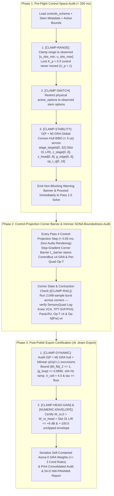

# Non-Stop 3-Phase Control-Space Audit & Automatic Clamping

Because neural audio training runs unattended across multi-stem captures, DNAM never blocks or pauses training on user confirmation prompts ([REQ-1.9, REQ-2.4, REQ-7.1, REQ-7.2](../../requirements/system_goals_and_requirements.md)). The Non-Stop 3-Phase Control-Space Audit & Automatic Clamping Pipeline enforces all control-range, intrinsic contraction, and numeric bounds across model identification and runtime execution automatically ([ADR-0022](../../adr/0022-sona-state-space-operator-and-webgpu-architecture.md), [ADR-0024](../../adr/0024-sona-v4-kernel-hb-fir-perimeter-and-control-bus-gra.md), [ADR-0025](../../adr/0025-unified-runtime-and-non-causal-trainer-attention.md), [ADR-0026](../../adr/0026-core-only-multirate-offline-and-crossbar-latency-invariance.md)).

Specifically, the audit certifies `ControlBus` v4 `GRA` via analytical `O(P + M)` global convex-hull BIBO verification (< 5 us across all `3^P` corners), $\Vert \mathbf{A}_{\text{tpt}} \Vert_2 \le 1$, smooth `ParaLRU` contraction $J_i \in [(1 - \rho_i)\alpha_{\text{rel},i}, \alpha_{\text{rel},i}]$, and passive `Op-T` v4 loop bounds $\Vert \mathbf{M}_{\text{fb}} \Vert_2 \le 1$ and $|g_{\text{loop}}| \le 0.9990$ across the 18-archetype universal black-box suite (`REQ-1.9`).



---

## 1. The Non-Stop 3-Phase Control-Space Audit Lifecycle

### 1.1 Phase 1 — Calibration Prepass Audit (< 200 ms Before Epoch 1)

#### `[CLAMP-RANGE]` — Unobserved Range Extrapolation Clamp

`r[train.audit.phase1.clamp-range]`

For each continuous `range` control $p$ with `declared_range` $[u_{p,\text{decl-min}}, u_{p,\text{decl-max}}]$ and observed stem span $[u_{p,\text{obs-min}}, u_{p,\text{obs-max}}]$ (`ref[dsp.ctrl.range.normalize-clamp]`):
$$u_{p,\text{safe-min}} = \max\big(u_{p,\text{decl-min}},\ u_{p,\text{obs-min}}\big), \qquad u_{p,\text{safe-max}} = \min\big(u_{p,\text{decl-max}},\ u_{p,\text{obs-max}}\big)$$
If $U_p = 1$ (control never moved across stems), Phase 1 locks the polynomial degree to $K_p = 0$ (`ref[dsp.ctrl.basis.lobatto]`).

#### `[CLAMP-SWITCH]` — Unobserved Switch Option Masking

`r[train.audit.phase1.clamp-switch]`

Phase 1 restricts `active_options` of each discrete `switch` control $q$ to the observed option subset $\mathcal{O}_{q,\text{obs}}$ seen on at least one valid recorded frame. Unobserved switch masking applies uniformly across every discrete switch control regardless of control name, label, or role—such as `stereo_mode` or any other selector—keeping unobserved options masked while the declared default serves as the mathematical reference for `CP1` projections (`ref[dsp.ctrl.switch.option-contributors]`).

#### `[CLAMP-STABILITY]` — `O(P + M)` Global Convex-Hull BIBO & Multi-Knob Corner Audit

`r[train.audit.phase1.clamp-stability]`

Rather than exponential corner enumeration over $3^{P_{\text{range}}} \times \prod_q |\mathcal{O}_{q,\text{obs}}|$, Phase 1 certifies ControlBus v4 GRA in exact analytical $O(P + M)$ time (< 5 us) across all $3^P$ corners of $[-1, +1]^P$ (`ref[dsp.ctrl.gra.bibo-convex-hull]`, `ref[dsp.ctrl.gra.rational-and-entmax]`) covering all 32 `stage_targets` slots, `z_stage`, `z_head`, `g_edge`, and `op_t_q`:

1. **0-ULP StarCenter Anchor:** Unrotated `CP1` (with xi == +0.0) enforces zero input drift, zero-anchored SwiGLU and Padé-[1/1], Entmax fast-exit (V_0 = 0), and `z_head[0..4]`.
2. **Cauchy–Schwarz Rational Bound:** Clamping $\mathbf{h}_1 = \mathrm{trustClip}(\mathbf{h}_0 + \mathbf{W}_o \mathbf{a})$ within $R_{\text{trust}}$ and Padé-[1/1] $1 + d_r \ge 0.25$, $\rho_r \le 4.0$ keeps outputs finite.
3. **Convex-Hull 1.5-Entmax Bound:** Normalized weights (`V_0 = 0`) bound $3^P$ corner residuals alongside `stage_latent_mods_fp16` and <= 3 `conditional_bounds` (`ref[container.dnam.conditional-rules]`).

| Operator Domain (`stage_targets`) | Enforced Corner Stability Bound | Canonical Reference |
| :--- | :--- | :--- |
| `TPT-SVF` & Block 0 `PHS` (slots 0..1) | Passive contraction `||A_tpt[n]||_2 <= 1`, Block 0 Predictor-Corrector PHS `k_eff = k + k_nl * min(v_{1,lin}^2, 64.0)` (`svf_k_nl` in `[0.0, 16.0]` on Block 0, strictly 0.0 on Blocks 1..3), 3-tap folded `(c_lp, c_bp, c_u)`, `svf_g_oct` in [-3.0, +3.0], `svf_k_delta` in [-0.8, +1.5] | [op_n_paralru_and_polyadaa.md](../dsp/op_n_paralru_and_polyadaa.md) |
| `g_pre(v²)`, `AlgADAA1(4096)`, `SE-Bus` & `GLU` (slots 2..5) | `g0, g_inf` in `[0.0, 2.5]` (`e = min(v_eff², 1e6)`), `|r_curr| <= 4096.0`, post-ADAA `SE-Bus` `g_se` in `(0.0, 1.0]`, `GLU` strictly on `g_se * A_odd` (`glu_mix` in `[-4.0, +4.0]`), `out_gain` in `[-4.0, +4.0]`, `block_adaa_oct[0..4]` in [-1.5, +1.5], explicit `u16` `rect_sign_mask` | [op_n_paralru_and_polyadaa.md](../dsp/op_n_paralru_and_polyadaa.md) |
| Smooth `ParaLRU` Core (slots 6..9) | C^2 quartic spline `soft_rect`, smooth `rho = 1 - alpha_atk * rcp_ge1_nr2(1 + gamma_duhem * |2*g*BP|)`, scalar contraction `J_i[n] in [(1 - rho_i[n]) * alpha_rel,i, alpha_rel,i] ⊂ [0, r_max]` (`block_lru_bias` in [-2.0, +2.0], `lru_stereo_link` & `eta` in [0.0, 1.0], `gamma_duhem` in [0.0, 64.0]) | [op_n_paralru_and_polyadaa.md](../dsp/op_n_paralru_and_polyadaa.md) |
| `ModalConvolver` v4 (slots 10..11) | Kautz pole radius `r_c <= 0.9995`, `ErSparseBank` (8/16 taps in `[0, 1020]`), `onset_delay_samp[4]` in `[0, 1023]`, `kautz_oct_delta` & `kautz_damp_delta` in [-1.5, +1.5]; `"DBRM"` `ro_pole_48k` in `[0.0, 0x3F7F_FFAC]` | `ref[dsp.op-m.recurrence.symplectic]` |
| Crossbar Wet (slot 15) | `crossbar_wet_mod` clamped in [-1.0, +1.0], forming `wet_scale = clamp(1.0 + mod, 0.0, 2.0)` strictly decoupled from `op_p_to_core` & `phasor_to_core` | [parametric_control_bus.md](../dsp/parametric_control_bus.md#31-operator-parameter-dispatch-matrix--sensitivity-laws) |
| Passive `Op-T` v4 (slots 12..14, 17..25 + `op_t_q[0..16]`) | `\|\|M_fb\|\|_2 <= 1`, **bipolar `g_loop` in `[-0.9990, +0.9990]`** (`±0x3F7F_BE76`), `stage_targets[13]` in `[-1.998, +1.998]`, causal lower-tri `M_series`, `|alpha_sum_fb| <= 0.5`, **`op_t_ramp_rate_hz_delta` (slot 18) in `[-64.0, +64.0]` Hz**, **`sigma_knee` in `[1.0e-3, 4.0]` (`0x4400`, `V_ceil = 4.0`)**, `op_t_delay_scale_oct` in [-3.0, +3.0], `op_t_lfo_rate_hz_delta` in [-16.0, +16.0], `op_t_damp_pole_delta` in [-1.0, +0.99995], `op_t_allpass_g_delta` in [-0.75, +0.75], 0.25 samp/samp delay slew, `tau_m >= delay_floor` (42.0 crossbar `tau_eff` so `tau_ring_cb >= 5.0` at `D_os = 37`, 5.0 self-feedback, 4.0 standalone) | `ref[dsp.op-t.reader.catmull-rom]`, `ref[dsp.op-t.window.partition-of-unity]`, `ref[dsp.op-t.diffuser.recurrence]`, `ref[dsp.tank.loop-saturator]` |
| Unitary Freeze (slot 16 `op_t_freeze_mix_delta`) | Raw `stage_targets[16]` in `[-1.0, +1.0]`; effective `mu_freeze = clamp(base_freeze_mix[q] + t[16], 0.0, 1.0)` with unitary `H_4(1)` `freeze_ortho_mix` (forced 1.0 under host lock) | `ref[dsp.tank.captured-freeze]` |
| `Op-N[Pre]` v4 (slots 26..28) | `quantize -> ZOH`, `kappa_h` in `[0.0, 1.0]`, `stage_targets[26]` in `[-1.0, +1.0]`, `stage_targets[27]` in `[-1.0, +0.9999]` (`zoh_hold_depth` in `[0.0, 0.9999]`), `stage_targets[28]` (`beta_q_delta`) in `[-16.0, +16.0]` | [op_n_paralru_and_polyadaa.md](../dsp/op_n_paralru_and_polyadaa.md) |
| `SensoryQuad` v4 & `Slot 31 L/R` (slots 29..32) | `op_p_phasor_rate_oct` in `[-4.0, +4.0]`; `sense_vca_log_bias_delta` (slot 30) & Unified `0-FDIV` Log-Knee VCA `[-5.0, +4.0]` octaves (`[-30 dB, +24 dB]`), modulated `sense_svf_g_oct[0..4]` in `[-4.0, +4.0]`, 4-frame `block_vca_gain[0..4]`; **`slot 31 L/R` active differential stereo quadrature AM output gain** (+0.0 at `StarCenter`) | [router_and_crossbar_topology.md](../dsp/router_and_crossbar_topology.md) |

### 1.2 Phase 2 — During-Training Stop-Gradient Corner Barrier & Periodic Rail-Lockup Check

#### Stop-Gradient Corner Barrier Loss

`r[train.audit.phase2.corner-barrier]`

At every Pass 4 optimizer step, the solver evaluates corner stability via the `O(P + M)` `GRA` convex hull across all 32 `stage_targets[0..32]` slots (`slot 31 L/R` active), `g_edge[0..6]`, `op_t_q[0..16]`, and unlocked `stage_latent_*` excursions across every CoreQuad and lane: $r_{\text{worst}} \in [0.0, 0.9995]$, $|g_{\text{loop}}| \in [0.0, 0.9990]$, $|a_{\text{diff}}| \le 0.75$, and causal delay floor $\tau_{\min} \ge \tau_{\text{floor}}$ (42.0 crossbar tau_eff so tau_ring_cb >= 5.0 at D_os = 37, 5.0 self-feedback, 4.0 standalone), certifying universal compliance across the 18-archetype suite (`REQ-1.9`).

The barrier concurrently enforces boundary window clamping when active, keeping ramp rate in [-64.0, +64.0] Hz, `sigma_knee` <= 4.0 (0x4400, ceiling 4.0), spectral loop feedback norm <= 1, pitch-down loop gain <= 0x3F7F_BE76, Op-N[Pre] hold depth in [0.0, 0.9999] with `kappa_h` in [0.0, 1.0], phasor octave rate in [-4.0, +4.0], and SensoryQuad Log-Knee VCA bounds in [-5.0, +4.0] octaves.

Non-finite values incur penalty $10^6$ and infeasible regions add quadratic penalty $10^4 + 10^5 \sum (\text{violation})^2$, paired with smooth logarithmic barrier margins using a 1e-7 floor:

$$\mathcal{L}_{\text{barrier}} = \lambda_{\text{bar}} \sum_{(\mathbf{u}_c, \mathbf{s}_c) \in \mathcal{V}_{\text{corners}}} \mathrm{relu}\Big(\mathrm{sg}\big(\boldsymbol{\theta}_{\text{main}}(\mathbf{u}_c, \mathbf{s}_c)\big) + \Delta\boldsymbol{\theta}_{\text{FM}}(\mathbf{u}_c, \mathbf{s}_c) - \boldsymbol{\theta}_{\text{safe}}\Big)^2$$
$$\mathcal{L}_{\text{phys}} = -10^{-4}\left[\ln\left(\min\Big(1, \frac{\max(0.9995 - r_w, 10^{-7})}{0.01}\Big)\right) + \ln\left(\min\Big(1, \frac{\max(0.9990 - |g_{\text{loop}}|, 10^{-7})}{0.01}\Big)\right) + \ln\left(\min\Big(1, \frac{\max(0.75 - |a_{\text{diff}}|, 10^{-7})}{0.05}\Big)\right) + \ln\left(\min\Big(1, \max(\tau_{\min} - \tau_{\text{floor}}, 10^{-7})\Big)\right)\right]$$

#### `[CLAMP-RAIL]` — Periodic Dynamic State & Rail Audit

`r[train.audit.phase2.clamp-rail]`

Periodially? No -> Periodically during training, `[CLAMP-RAIL]` feeds the differential stereo stimulus `[+x[n], -x[n]]` over 2,048 samples without gradient tracking using `eff_drive = clamp(d_corner, 0.1, 64.0)` and $x[n] = 0.85 \cdot \mathrm{clamp}(d_{\text{corner}}, 0.1, 64.0) \cdot (\sin(0.06544985 n) + 0.35\cos(0.21991149 n))$ across active `stage_targets[0..32]` (`slot 31 L/R` active), `g_edge[0..6]`, and `op_t_q[0..16]`, verifying three runtime safety invariants:

Each sample `n` increments `sat_hits` whenever any active core pre-activation satisfies `|u_nl| >= 8.0` or stereo output magnitude satisfies `|y_c[n]| >= 25.0`. The rail check flags saturation and emits `safe_scale = clamp(2.0 / max(eff_drive, 2.0), 0.05, 1.0)` whenever `sat_hits / 2048 > 0.95` (`SAT_OCCUPANCY_LIMIT`), any sample is non-finite, or `max_n |y_c[n]| > 100.0`.

| Dynamic Rail Check | Verified Contraction & Saturation Invariant |
| :--- | :--- |
| Matryoshka Core (`CoreQuad` v4) | Passive `TPT-SVF` (`\|\|A_tpt\|\|_2 <= 1`, Block 0 Pred-Corr PHS `svf_k_nl` in `[0.0, 16.0]`, zero overflow), smooth `C²` `soft_rect` `ParaLRU` contraction (`J_i in [(1 - rho_i) * alpha_rel, alpha_rel] ⊂ [0, r_max]`), `g_pre(v²)` in `[0, 2.5]`, `AlgADAA1(4096, NR3)`, `SE-Bus` `g_se` in `(0, 1]`, and bounded `glu_mix` / `out_gain` in `[-4.0, +4.0]` |
| `Op-T` v4 & `ModalConvolver` v4 | Passive `Op-T` feedback (`\|\|M_fb\|\|_2 <= 1`, `|g_loop| <= 0.9990`, causal lower-tri `M_series`, ±64 Hz ramp, unified `sigma_knee <= 4.0` `0x4400`, `V_ceil = 4.0`), boundary window clamp `mu_win_k`, continuous unitary `mu_freeze in [0, 1]`, `ModalConvolver` Schur poles (`r <= 0.9995`), `ErSparseBank`, and finite envelopes <= 100.0 |
| `SensoryQuad` v4, `Op-N[Pre]` v4 & Saturation | Bounded `zoh_hold_depth in [0.0, 0.9999]` & `kappa_h in [0.0, 1.0]`, `op_p_phasor_rate_oct in [-4.0, +4.0]`, `SensoryQuad` v4 Log-Knee VCA (`[-5.0, +4.0]` octaves), `slot 31 L/R` quadrature AM, and occupancy check (`\|u_nl\| >= 8.0` or `\|y_c[n]\| >= 25.0` -> `sat_hits / 2048 > 0.95` emits `safe_scale` per `ref[dsp.op-n.polyadaa.clamp]`) |

### 1.3 Phase 3 — Post-Training & Post-Polish Export Certification Audit

#### `[CLAMP-DYNAMIC]` — Combined Knob + Learned LFO/Envelope Excursion Clamp

`r[train.audit.phase3.clamp-dynamic]`

Phase 3 bounds worst-case joint knob, dynamic modulation, and combined stage-latent excursions across all 32 `stage_targets[0..32]` (slot 31 L/R included), `g_edge[0..6]`, `op_t_q[0..16]`, and every active CoreQuad lane so Kautz poles stay <= 0.9995 and causal delays stay at least $\tau_{\text{floor}}$ samples (42.0 on crossbar `tau_eff` so `tau_ring_cb >= 5.0` at `D_os = 37`, 5.0 self-feedback, 4.0 standalone):

Over the highest compiled tier (active TransportQuads and active Kautz modes `r_base_48k[m] > 0.0 && b_gamma_stored[m] > 0.0`), evaluate static ControlBus v4 GRA targets `t_r(u)` (norm-clipped, rational Padé-[1/1], 1.5-Entmax convex hull with zero dynamic/inertia gates) and bilinear envelope $\delta_r = \sum_{j=0}^{7} |w_{\mathrm{dyn},r,j}| m_{\max,j}$:

Here `w_dyn,r` covers the bilinear dynamic/inertia gate coefficients onto `stage_targets[0..32]` and per-quad `op_t_q[0..16]`, $\mathbf{m}_{\max} = [1 + |\beta_0|,\ 1,\ 1 + |\beta_1|,\ 1,\ 1,\ 1,\ 1,\ 1]^\top$ (`beta_j = fp16_to_f32(lfo_skew_fp16[j])`), `damp_min(u) = clamp(t_11(u) + dot_s(w_kautz_damp, z_stage(u)) - delta_11, -1.5, +1.5)`, `oct_min(u) = clamp(t_17(u) + op_t_delay_oct[q](u) - delta_17, -3.0, +3.0)`, and `s_lfo_max(u) = clamp(t_20(u) + delta_20, -4.0, +4.0)`:

$$r_{\mathrm{kautz},m}(\mathbf{u}) = 1 - (1 - r_{\mathrm{base},m}) \cdot 2^{\mathrm{damp}_{\min}(\mathbf{u})} \le 0.9995, \qquad d_{\mathrm{base},q} + t_{21}(\mathbf{u}) + \delta_{21} \le 0.99995, \qquad |g_{\mathrm{base},q} + t_{13}(\mathbf{u}) + g_{\mathrm{loop},\Delta,q}(\mathbf{u})| + \delta_{13} \le 0.9990$$
$$\tau_{q,l,\min}(\mathbf{u}) = D_{q,l} \cdot 2^{\mathrm{oct}_{\min}(\mathbf{u})} + (t_{12}(\mathbf{u}) - \delta_{12}) - |d_{\mathrm{lfo},q,l}| \cdot 2^{s_{\mathrm{lfo},\max}(\mathbf{u})} - 0.5 |S_{\mathrm{span},q,l}(\mathbf{u})| \ge \tau_{\mathrm{floor}}, \qquad |a_{\mathrm{base},q,k} + t_{25}(\mathbf{u})| + \delta_{25} \le 0.75$$

Here $d_{\mathrm{base},q}$, $g_{\mathrm{base},q}$, $D_{q,l}$, $d_{\mathrm{lfo},q,l}$, $S_{\mathrm{span},q,l}(\mathbf{u})$, and $a_{\mathrm{base},q,k}$ denote `base_damp_pole`, `base_tank_g_loop`, `delay_samples`, `fp16_to_f32(lfo_depths_fp16)`, modulatable `ramp_spans_samples` (via `ramp_span_scale[q]`), and `fp16_to_f32(allpass_g_fp16)`.

Phase 3 also verifies `||M_fb||_2 <= 1`, causal lower-triangular `M_series`, boundary window clamping $\mu_{\text{win},k}$ with `ramp_rate_hz` in [-64.0, +64.0] Hz, pitch-down loop gain <= `0x3F7F_BE76`, `sigma_knee` <= 4.0 (0x4400, ceiling 4.0), and `mu_freeze` in [0.0, 1.0] on slot 16 (`op_t_freeze_mix_delta`).

It simultaneously verifies Op-N[Pre] v4 `zoh_hold_depth` in [0.0, 0.9999] (`rho_zoh` in [1e-4, 1.0]) and `kappa_h` in [0.0, 1.0], `op_p_phasor_rate_oct` in [-4.0, +4.0], and SensoryQuad v4 Log-Knee VCA bounds ([-5.0, +4.0] octaves). ModalConvolver poles remain bounded by their shared radial gate $g[n] \in [0, 1]$ and endpoint $r_{\text{high},m} \le 0.9995$ (`ref[dsp.op-m.kautz.radial-gate]`, [op_m_modal_kautz.md](../dsp/op_m_modal_kautz.md)).

#### `[CLAMP-HEAD-GAIN]` — Post-Polish Direct-Register Mid/Side Spectral Gain Clamp

`r[train.audit.phase3.clamp-head-gain]`

Phase 3 evaluates the active tier's rendered L/R frequency response, compact half-precision `W_ro,0` + split `W_ro_head`, slot 31 L/R stereo AM gain, and LinearReadout (`ro_pole_48k` in `[0.0, 0x3F7F_FFAC]`) over permitted head-control domains (`ref[dsp.head.mid-side-factorization]`). Whenever gain exceeds +6.0 dB (`MAX_GAIN_6DB_LIN = 1.9952623`), it scales readout using idempotent target `MAX_GAIN_IDEMPOTENT = 1.9952583` (~33 ULPs inside +6.0 dB) while preserving Arena 0 descriptors (`ref[dsp.ctrl.op-n.trust-clip]`).

#### `[NUMERIC-ENVELOPE]` — Finite-Precision Operating Range Certification

`r[train.audit.phase3.numeric-envelope]`

Phase 3 certifies an unclipped ±100.0 (+40 dBFS peak) operating envelope simultaneously across all active audio inputs and `LinearReadout` outputs (REQ-7.1, `ref[arch.fp.range-saturation]`), evaluating 256 zero-input settling frames per extreme valid knob corner against `[STAB-ZERO-DC]` (`<= 1e-5`, `ref[container.proj.wght-and-export]`) and contracting offending bias excursions along `[CLAMP-STABILITY]` (failing closed if unrecoverable).

Passive `TPT-SVF` and smooth `ParaLRU` states stay strictly bounded, while `Op-T` v4 half-precision delay writes remain within ±65,504.0 (or bounded finite binary32 in optional cold `ext_lines`) with zero representational saturation ([sona_architecture.md](../architecture/sona_architecture.md#finite-precision-range-and-saturation-policy)).

Serializing descriptors strictly satisfies the 3-slot inline `cond_rules` ceiling (`reserved_cond_zero == 0`), emitting self-contained Arena 0 `ControlBus` v4 `GRA` weights inside Layer-0 `.dnam-bin` and `.dnam` containers (`cext_len == 0`).

---

## 2. Consolidated Post-Training Audit, 54-D `NW-PANAMA` & Stem Prescription Report

`r[train.audit.report.prescription]`

To identify high-uncertainty unobserved multi-knob corners without slowing capture solves, the deterministic CPU `NW-PANAMA` (Noise-Weighted Predictive Anchored Multi-Ensemble Acquisition) recommender executes whenever varying controls satisfy `P_var >= 2` in < 10 ms at audit time without rendering audio, directly seeding runtime `A.1` `1.5-Entmax` prototypes `(k_m, beta_m, V_m)`.

Using M = 5 ensemble members (`m` in 0..5) over unregularized sample Gram $\mathbf{G}_{\psi,0}$ and baseline Pass-4 ridge $\lambda_{\mathrm{cp1}} = 10^{-3}$ (adaptive Cholesky floor 1e-9), each member regresses with ordered ridge $\lambda_m = [0.25, 0.5, 1, 2, 4]_m \cdot \lambda_{\mathrm{cp1}}$ against Pass 4's `StarCenter`-centered **54-D** target vector (`[32 stage_targets incl. slot 31 L/R, 6 g_edge, top-16 SVD FiLM/readout/op_t_q modes]`, `ref[train.pipeline.dispatch-solve]`):

$$\bar{\mathbf{t}}(\mathbf{u}) = \frac{1}{M}\sum_{m=0}^{M-1} \hat{\mathbf{t}}^{(m)}(\mathbf{u}), \qquad \sigma^2(\mathbf{u}) = \frac{1}{M - 1} \sum_{m=0}^{M-1} \left\Vert \mathbf{W}_{\mathrm{sens}} \big(\hat{\mathbf{t}}^{(m)}(\mathbf{u}) - \bar{\mathbf{t}}(\mathbf{u})\big) \right\Vert_2^2 + \gamma_{\mathrm{lev}} \mathbf{d}_{\mathrm{cp1}}(\mathbf{u})^\top (\mathbf{G}_{\psi,0} + \lambda_{\mathrm{cp1}}\mathbf{I})^{-1} \mathbf{d}_{\mathrm{cp1}}(\mathbf{u})$$

| `NW-PANAMA` Specification Rule | Deterministic Clean-Room Definition |
| :--- | :--- |
| **Varying Controls (`P_var >= 2`)** | Ordered `0..P_var` strictly ascending by `ControlDescriptorJson.id` (`control_id`); includes `"range"` controls with `safe_max - safe_min > 1e-6` and `"switch"` controls with `K_c >= 2` active options |
| **Sample Rows, `psi(u)` & Ridge (`lambda_cp1`)** | Pass-4 rows `u_k` (`k` in `0..N_samp`, unit weight `w_k = 1.0`, sorted ascending by `(stem_id, window_idx)`) comprise `window_idx = 0` (`controls_meta`) for enabled stationary stems plus `M_max = max_c M_c` synchronous windows (`window_idx` in `0..M_max` at frame `t_k = floor(window_idx * (N_active - 1) / (M_max - 1))`, or 0 when `M_max == 1`, decoding `u_k = u(t_k)`) for enabled `MODE_A_SWEEP` stems (`ref[train.pipeline.dispatch-solve]`). Basis `psi(u)` is Pass 4's main-effect Lobatto (`deg <= 3` per range) + switch indicator basis (`StarCenter` = 0, zero FM cross-terms), with baseline ridge `lambda_cp1 = 1e-3` (Cholesky floor 1e-9) |
| **Normalization `z_c` & `d_inf` Metric** | Continuous `z_c(v) = (v - safe_min) / (safe_max - safe_min)`; switch rank `q / (K_c - 1)` in ascending option-index order; `Delta_c = \|z_c(u_c) - z_c(u'_c)\|` for ranges and 0 (equal) vs 1 (unequal) for switches; `d_inf(u, u') = max_c Delta_c` |
| **Anchor Split, LOOCV `N_int >= 2` Gate & Ensemble** | Classify each row relative to `StarCenter`: `StarCenter` (`max_c Delta_c <= 1e-6`), 1D-axis anchor (`exactly 1` varying control has `Delta_c > 1e-6`), or non-anchor interior (`>= 2` varying controls have `Delta_c > 1e-6`, count `N_int` in `(stem_id, window_idx)` order). Member `m` solves `(G_psi^(m) + lambda_m * I)^(-1) R_{psi,t}^(m)` onto Pass 4's `StarCenter`-centered 54-D targets `t(u_k)` with slot 12 (`tank_delay_mod`) zeroed when its population variance falls below 0.2 samples² (`ref[dsp.ctrl.calib.variance-gating]`), gating LOOCV metric-matrix `M_met` fitting strictly on `N_int >= 2` (skipping ChaCha20 bootstrap and falling back to anchor + leverage when `N_int < 2`) |
| **Deterministic ChaCha20 Seeding** | `stems_key` is lowercase 64-hex SHA-256 of all enabled stems' lowercase 64-hex `target_pcm_sha256` strings sorted lexicographically ascending (preserving duplicates) and joined by ASCII LF (`0x0A`) with no trailing newline. Member `m` seeds RFC 8439 ChaCha20 (12-byte zero nonce, counter 0) with SHA-256 over UTF-8 `"DNAM-PANAMA-V1:"` concatenated with `stems_key` and little-endian 32-bit `m`, drawing `N_int` interior indices from consecutive `u64_le` keystream words as `floor((u64_le * N_int) / 2^64)` |
| **`W_sens` Scaling & Leverage** | Over active 54-D target coordinates (`[32 stage_targets incl. slot 31 L/R, 6 g_edge, top-16 SVD FiLM/readout/op_t_q modes]`), compute `span_r = max_k t_r(u_k) - min_k t_r(u_k)` from Pass 4's solved nominal target vectors across all `N_samp` rows; set diagonal `W_sens[r, r] = 2 / span_r` when `span_r >= 1e-6` and 0.0 otherwise. Leverage evaluates `gamma_lev = 0.05` and `d_cp1(u) = psi(u)` against `(G_{psi,0} + lambda_cp1 * I)^(-1)` |
| **Candidate Set & Exclusions** | Grid values span `{safe_min, 0.5 * (safe_min + safe_max), safe_max}` or first <= 3 active switch options in ascending option-index order: full Cartesian product for `P_var <= 5`; for `P_var > 5`, deduplicated union of 2D pairs `(i, j)` and top-6 3D triples `(i, j, k)` (`0 <= i < j < k < P_var` indexing `control_id`-ordered varying controls) ranked descending by `round((s_i + s_j + s_k) * 1e6)` with ascending `(i, j, k)` ties, where `s_c` is unweighted population stddev `sqrt((1 / N_samp) * sum_k (z_c(u_k) - mean_z_c)^2)` across all `N_samp` rows and remaining controls stay at `StarCenter`. Exclude candidate `u` iff: (a) `d_inf(u, u_k) <= 1e-3` to any sample row `u_k`; OR (b) any continuous control violates `ControlDescriptorJson.conditional_bounds` (`\|u_c - clamp(u_c, eff_min(u), eff_max(u))\| > 1e-6`, where `[eff_min(u), eff_max(u)]` evaluates `ref[container.dnam.conditional-rules]` from `safe_clamped_range` or `declared_range` fallback with `eff_max = eff_min` on empty intersection); OR (c) highest-tier static `ControlBus` v4 `GRA` (`q2 = q3 = 0`, zero audio rendering) violates any of the 32 raw `StageTargetBounds` intervals, `g_edge[0..6]`, `op_t_q[0..16]` (§1.1, `delay_floor` 42.0 crossbar / 5.0 self-FB), or pre-clamp `[CLAMP-DYNAMIC]` bounds in §1.3 at 48 kHz (`tau_floor` 42.0 crossbar / 5.0 self-FB: `r_{kautz,m}(u) <= 0.9995`, `d_{base,q} + t_21(u) + delta_21 <= 0.99995`, `tau_{q,l,min}(u) >= tau_floor`, `\|g_{base,q} + t_13(u) + g_{loop,delta,q}(u)\| + delta_13 <= 0.9990`, `\|a_{base,q,k} + t_25(u)\| + delta_25 <= 0.75`) |
| **Rounding, Total Order & `audit_report.prescriptions`** | Integer `round(x)` uses symmetric half-away-from-zero (`sign(x) * floor(\|x\| + 0.5)`). Surviving candidates (`sigma2 >= 1e-6`) sort descending by `round(sigma2 * 1e6)`, breaking ties lexicographically ascending on the full `P_var`-element quantized tuple (`round(v * 1e4)` for ranges, `active_opt * 10,000` for switches) in ascending `control_id` order. Top 1..3 candidates append exact strings `"[PANAMA] Corner (<id>=<val>, ...) (sigma2=<x.xxxx>)"` to `audit_report.prescriptions` (displayed with `"  <rank>. "` prefix below), listing strictly controls with `Delta_c > 1e-6` from `StarCenter` in ascending `ControlDescriptorJson.id` order, formatted with `ControlDescriptorJson.id`, 4-decimal IEEE-754 binary64 RNE (-0.0000 -> 0.0000), single-quoted `declared_options[active_opt]`, and `", "` separators |

```text
================================================================================
DNAM v4.0 (SONA) TRAINING COMPLETE — EXPORTED: model.dnam | project.dnam-proj
================================================================================
Active Control Clamps Applied (4):
  1. [CLAMP-RANGE]     'gain': Clamped declared [0.0, 10.0] -> safe [2.0, 8.0]
                       -> Prescription: Add stems at gain=0.0 and gain=10.0
  2. [CLAMP-SWITCH]    'boost': Disabled unobserved option ['ultra'] (active: ['off', 'on'])
                       -> Prescription: Add >= 1 stem with boost='ultra'
  3. [CLAMP-STABILITY] 'feedback': Clamped <= 9.37 when boost='on' (||M_fb||_2 <= 1, |g_loop| <= 0.9990)
                       -> Prescription: Add corner stem (feedback=10.0, boost='on')
  4. [CLAMP-DYNAMIC]   'delay_ms': Tightened min 0.00 -> 0.88 (tau_eff >= 42.0, crossbar tau_ring_cb >= 5.0 samp)

PANAMA Corner Recommendations (1):
  1. [PANAMA] Corner (feedback=8.5000, gain=8.0000, tone=1.0000) (sigma2=0.0412)

Refine non-destructively in the Capture Vault by adding these stems to project.dnam-proj.
================================================================================
```
