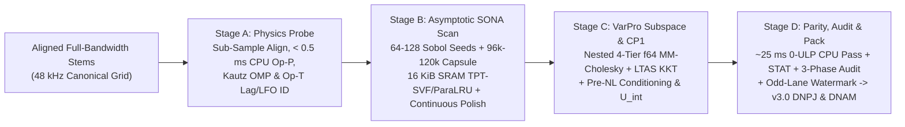
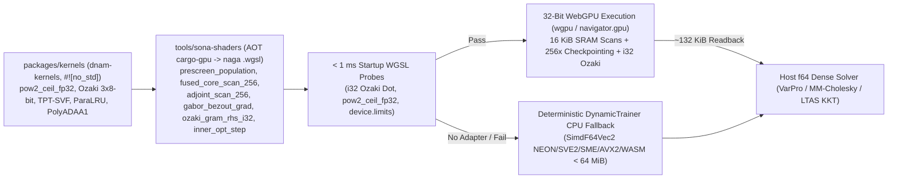

# `SONA` `v3.0` Black-Box WebGPU & Analytical `VarPro` Training Pipeline

This specification defines the **100% pure-Rust (`#![forbid(unsafe_code)]`) Black-Box Fixed-Shape Asymptotic `SONA` Solver (`v3.0`)** in [`packages/capture/`](../../../packages/capture/README.md) (`dnam_capture::solver`), combining portable `32-bit WebGPU` (`dnam-kernels` + `tools/sona-shaders` `.wgsl`) associative scans and `i32` Ozaki reductions with host `IEEE-754 float64` `MM-Cholesky`, `33`-band `LTAS` Newton-KKT, `Schur` prefix re-balancing, and deterministic `DynamicTrainer` CPU fallback, fulfilling [`REQ-1.5`, `REQ-1.6`, `REQ-1.8`, `REQ-1.9`, `REQ-2.1`, `REQ-4.1`–`REQ-4.3`, `REQ-5.2`](../../requirements/system_goals_and_requirements.md) (see [`../architecture/sona_architecture.md`](../architecture/sona_architecture.md), [`../../adr/0018-signal-chain-fixtures-crate-and-whitebox-distillation.md`](../../adr/0018-signal-chain-fixtures-crate-and-whitebox-distillation.md), [`../../adr/0020-modular-monorepo-and-dnam-proj-container.md`](../../adr/0020-modular-monorepo-and-dnam-proj-container.md), and [`../../adr/0022-sona-state-space-operator-and-webgpu-architecture.md`](../../adr/0022-sona-state-space-operator-and-webgpu-architecture.md)).

---

## 1. Pipeline Overview & Dataflow Topology

`r[train.pipeline.topology]`

`dnam-capture` operates as a **100% black-box, fixed-shape asymptotic solver** (`REQ-1.6`, `REQ-1.9`, `ref[repo.code.universal-black-box]`) with **zero** circuit-specific seed templates, **zero** hardcoded crossover frequencies, **zero** post-hoc recurrent clamping hacks, and **zero** capture-time tier resizing (`ref[arch.tiers.maximize-quality-within-budget]`):
1. **Single-Run Joint Nesting (`REQ-5.1`, `REQ-5.2`):** All four causally nested `SONA` `v3.0` compile-time `const` tier shapes (`LiteSpec ⊂ FullSpec ⊂ ProSpec ⊂ UltraSpec`: `[1,1,1,1] / [2,2,1,1] / [3,2,2,1] / [4,3,2,1]` 4-block Matryoshka core, `32 / 48 / 96 / 128` early FIR taps/ch, `8 / 12 / 24 / 32` shared Kautz pairs, and `4 / 8 / 12–16 / 16` `Op-T` lines) optimize jointly in one self-contained run without Python, PyTorch, or CUDA dependencies (`REQ-4.1`).
2. **Quality-First Asymptotic Convergence (`ref[arch.tiers.maximize-quality-within-budget]`):** Solver speed from WebGPU `16 KiB` SRAM scans and `64–128`-seed screening is reinvested strictly into finding higher-fidelity weights inside those locked `const` shapes (`BestUntilDiminishingReturns`, `|ΔbESR| < 0.01 dB/epoch`, zero `ThresholdStop` early-exit shortcuts) over full `2.0–2.5 s` (`96,000–120,000`-frame) `fp32` capsules.

---

## 2. Five-Stage Analytical Variable-Projection & Cholesky Solver

In `SONA` `v3.0`, the historical five-stage flow consolidates into the unified four-stage `Stage A → Stage B → Stage C → Stage D` solver mapped across `§2.1–§2.5` below (`Stage C` and `Stage D` spans preserve canonical rule and anchor traceability while eliminating all recurrent `GRU` / circuit-template scaffolding).

### 2.1 Stage A — Steiglitz–McBride Rational Pole & Delay Identification

`r[train.pipeline.stage-a-poles]`

On the aligned `StarCenter` reference stem (`s = 0`), `Stage A` (`Physics Probe`) performs device-agnostic physical identification:
1. **Sub-Sample Lag, Polarity & `< 0.5 ms` CPU `Op-P` Prepass:** Computes sub-sample delay & polarity alignment (`ref[train.capture.alignment.multi-regime]`) and precomputes the input-only `Op-P` sub-harmonic and analytic basis (`HilbertH1Lattice6Sec` 6-section all-pass pair + pure-`f32` `T1SubHarmonicTracker` $-1/-2$ octave channels) once on the host CPU in `< 0.5 ms` prior to WebGPU buffer upload.
2. **2-Pass Kautz OMP & `Op-T` Delay / Phasor Initialization:** Identifies shared conjugate Kautz modal poles $\lbrace (r_m, \theta_m) \rbrace$ (`8 / 12 / 24 / 32` cumulative pairs across `Lite..Ultra`, $r_m \le 0.9995$, `ref[dsp.op-m.stage3.pole-extraction]`) via 2-pass Kautz orthogonal matching pursuit (`OMP`) / Steiglitz–McBride rational identification, estimates `Op-T` delay-line lengths (`4 / 8 / 12–16 / 16` lines) and `4`-lane `Q0.32` quadrature phasor frequencies (`0.05 Hz–20 kHz`), and enforces intrinsic stability bounds (`Vert A_tpt Vert_2 <= 1`, `ParaLRU` $J_i \in (0, r_{\max}]$, coercive `Op-T` $\Vert G_{\text{loop}} \Vert < 1$, `ref[train.audit.phase1.clamp-stability]`).

### 2.2 Stage B — Full-Capsule Population Exploration, Fused Scans & Continuous Polish

`r[train.pipeline.stage-b-harvest]`

`Stage B` jointly trains the fixed-shape 4-tier Matryoshka `SONA` core (`LiteSpec ⊂ FullSpec ⊂ ProSpec ⊂ UltraSpec`) on `StarCenter` (plus extreme switch/gain corners when present):
1. **`64–128`-Seed Sobol & Spectral Population Exploration (`< 30 ms`):** Screens `64–128` Sobol and log-spaced spectral initializations in parallel across GPU workgroups (or host SIMD lanes) to avoid single-basin local minima on stiff crossovers, envelope rectifiers, and nonlinear feedback paths without circuit-specific templates (`REQ-1.9`).
2. **Full-Capsule `96k–120k`-Frame (`2.0–2.5 s`) Associative Trajectory Optimization:** Optimizes directly over the full `2.0–2.5 s` `fp32` capsule timeline (capturing `0.5–2.5 s` B+ sag, optical dual-release, and spatial decay couplings simultaneously) using fused `16 KiB` `var<workgroup>` SRAM `mat2x2` `TPT-SVF` and `K = 3` Newton `ParaLRU` Blelloch scans (with optional `subgroups` acceleration), `256`-sample tile activation checkpointing, and pure-`f32` divided-difference `PolyADAA1` + `C^2` wavefolder forward/adjoint passes (`§3.2`).
3. **Outer `VarPro` (`i32` Ozaki + `f64` `MM-Cholesky` / `LTAS` KKT) & Continuous Polish to Asymptotic Convergence:** Every outer `VarPro` epoch accumulates chunkwise `3 × 8-bit` `i32` Ozaki normal equations (`~132 KiB` readback), solves `f64` `EMR` `1/12`-octave `MM-Cholesky` + `33`-band `LTAS` Newton-KKT + `Schur` tier prefix re-balancing on the host, refines **continuous `(r_m, θ_m)` Kautz pole radii/angles** and **fractional `Op-T` delays / LFO depths** via `16–32` GPU-resident `m = 8` `L-BFGS` / `J^T J` Gauss–Newton steps, and terminates strictly on **`BestUntilDiminishingReturns`** (`|ΔbESR| < 0.01 dB/epoch`) while archiving `2.0–2.5 s` `fp32` `INPC`/`STMC` capsules (`ref[container.proj.inpc-capsule]`, `ref[container.proj.stmc-capsule]`).

### 2.3 Stage C — Nested 4-Tier Schur-Complement & Selective MM-Cholesky Solve

`r[train.pipeline.stage-c-schur]`

`Stage C` solves the causally nested `Lite`, `Full`, `Pro`, and `Ultra` direct-register `VarPro` readout subspace (`W_readout` `fp16` subspace + `pre_cab` and `direct` stereo linear projections) and pre-nonlinear crossbar conditioning jointly in one run (`REQ-5.1`, `REQ-5.2`):
1. **Nested `uplo='U'` `f64` `Schur` & `MM-Cholesky` Solve:** Accumulates tier-prefix normal equations ($\mathbf{G}_{1:D_T, 1:D_T} + \boldsymbol{\Lambda}_{D_T}$) via `IEEE-754 float64` Cholesky factorization (`solve_uplo_u_cholesky_2ch`) and `Schur`-complement prefix re-balancing so `Lite`, `Full`, `Pro`, and `Ultra` each independently achieve optimal spectral balance without separate per-tier training jobs.
2. **Psychoacoustic `bESR` + `33`-Band `LTAS` KKT & `CP1`/`U_int` Conditioning:** Weights normal equations across the 4th-order Bézout `LF`/`MF`/`HF` bands (`ref[qual.besr.bezout-crossover]`), enforces `33`-band `1/3`-octave `LTAS` tilt bounds (`ref[qual.companion.ltas]`), conditions pre-nonlinear crossbar & `CP1`/`U_int` control subspaces, and bakes effective `StarCenter` readout sufficient statistics into `STAT` (`ref[container.proj.stat-uplo-u]`).

### 2.4 Stage D (Control-Bus) — Triangular Newton Control-Bus Projection & Corner Barrier

`r[train.pipeline.stage-d-control]`

Across multi-stem control schedules ($P \ge 1$), `Stage D` control solving fits per-stem `3 kHz` Parametric Control Bus projections (`CP1` arbitrary-$P$ contributor slices `W_main`, `w_proj`, `v`, global `U_int`, `W_ctrl` stage dispatch, `TPT-SVF` / `ParaLRU` / crossbar targets, and `W_readout` deltas, `ref[container.dnam.cp1-profile]`) in parallel across non-center stems (`< 50 ms` for `Path 1` Vault edits, `< 256 MiB` browser GPU / `< 64 MiB` WASM CPU `REQ-4.3`) using Gauss–Lobatto interpolation anchored at `StarCenter` (`Mode-0` locked for `0-ULP` invariance), executing the non-stop 3-Phase Control-Space Audit (`[CLAMP-RANGE]`, `[CLAMP-SWITCH]`, `[CLAMP-STABILITY]`, Phase-2 corner barrier, and Phase-3 export bounds; `ref[train.audit.phase1.clamp-stability]`).
1. **Two-Pass Multiband Wiener Collapse Recovery (`ref[repo.code.constant-eval-and-derivations]`):** Pass 1 solves damped Gauss–Newton under pure waveform MSE (`w_band = 0.0`). On stems whose active Pass-1 RMS falls below `-0.55 oct` (`≈ -3.3 dB` Wiener shrinkage from dynamic envelope/phase decorrelation) while remaining active (`oct_tot > -2.5 oct`) and non-heterodyne (`rho_wave > -0.15`), Pass 2 adds the 4-band partition-of-unity TPT RMS consistency penalty `FOUR_BAND_RMS_MATCH_WEIGHT * sum_b (sqrt(E_wet,b) - sqrt(E_mdl,b))^2` (`w_band = 2.5`), restoring multiband loudness without degrading coherent compressors or waveshapers.
2. **Stationary Coreset & Multi-Window Sweep Extraction:** Compact stationary coresets evaluate over broadband chord + log-chirp slices, while interior sweep windowing extracts `2..=4` windows across `Mode A` (`1-D`) and `2`-knob `Hadamard` sweeps (deferring `3+`-knob short non-stationary coresets to orthogonal `Mode B` stops so bass-only segments do not bias mid/high knobs).

### 2.5 Stage D (Finalize) — Deterministic Host Parity Pass, Audit, Watermarking & Packing

`r[train.pipeline.stage-e-pack]`

Before emission, `Stage D` finalizes every trained model on the host CPU:
1. **`~25 ms` Deterministic Host CPU `SonaInstance` + `Wide192Accum` Parity Pass (`REQ-4.2`):** Steps the exact `dnam-engine` `SonaInstance` (`dnam-kernels` CPU kernels) + `Wide192Accum` over the certification timeline, locking `0-ULP` parity between GPU-accelerated and CPU-only solves while persisting `uplo='U'` `STAT` sufficient statistics for `< 50 ms` `Path 1` Vault updates.
2. **Certification, Intrinsic Stability & `v3.0` Container Packing:** Enforces adjacent-tier monotone non-regression (`Lite <= Full <= Pro <= Ultra`), verifies intrinsic stability ($\Vert \mathbf{A}_{\text{tpt}} \Vert_2 \le 1$, `ParaLRU` $J_i \in (0, r_{\max}]$, coercive `Op-T` $\Vert G_{\text{loop}} \Vert < 1$, `[STAB-ZERO-DC]` $b_{\text{head}} = 0.0$), calibrates `<= 0.05 LU` inter-tier `tier_gain_trim_lin` (`REQ-7.4`), applies optional `0-ULP` odd-symmetric `SONA` (`PolyADAA1`/`ParaLRU`) hidden-lane sign-flip + Stage III Kautz + `EMR`-masked Tardos watermarking (`ref[sec.watermark.reciprocal-gauge]`), certifies the 4-metric perceptual suite (`bESR`, `MR-IIR`, `LTAS`, `SegESR`), and packs `64 B`-aligned `zerocopy` `v3.0` `.dnam-proj` (`DNPJ`) and runtime `.dnam` (`DNAM`) containers (`Arena 0` carrying self-contained `Lite` controls).

---

## 3. Wide-Significand Gram Contraction & Cross-Platform Accuracy

### 3.1 Host `IEEE-754 float64` & `Wide192Accum` Contraction Contract

1. `r[train.gram.accuracy-contract]` **`IEEE-754 float64` & Deterministic Contraction Contract (`REQ-4.2`):** Every `uplo = 'U'` Gram matrix $\mathbf{G} = \sum_{n=0}^{N-1} w_n \boldsymbol{\phi}[n]\boldsymbol{\phi}[n]^\top$ and target cross-correlation $\mathbf{C} = \sum_{n=0}^{N-1} w_n \boldsymbol{\phi}[n]\mathbf{y}[n]^\top$ solved on the host satisfies entrywise error bound $\lvert \hat{g}_{ij} - g_{ij} \rvert \le \gamma_N \sum_{n=0}^{N-1} w_n \lvert \phi_i[n] \phi_j[n] \rvert$ in `IEEE-754 float64` with fixed-order deterministic parallel reduction (`0..n_pairs`) across `ARM64`, `x86_64`, and `WASM`, binding input provenance to the `DNAM-GRAM-INPUT-V3` `SHA-256` fingerprint (`compute_gram_input_fingerprint`).
2. `r[train.gram.wide192]` **Compensated / Wide-Significand Accumulation (`ADR-0022`):** For high-dynamic-range stems spanning $> 53$ bits of exponent cancellation (e.g., $[1, 2^{-30}, -1]$), `Wide192Accum` (`3 × f64` `~159`-bit Priest/Dekker expansion with zero hardware FMA dependence) preserves cancellation-immune cross-platform bit reproducibility before final `f64` rounding.

### 3.2 Portable 32-Bit WebGPU Scans, Ozaki Accumulator & 2-D Memory Planner

`r[train.pipeline.webgpu-scans-and-ozaki]`

1. **Single-Source `#![no_std]` Kernels & Checked-In AOT `.wgsl` Shaders (`REQ-4.1`):** Both `dnam-engine` / `dnam-capture` (stable Rust) and `tools/sona-shaders` (`cargo-gpu` targeting `spirv-unknown-naga-wgsl`) compile the exact `#![no_std]`, `#![forbid(unsafe_code)]`, zero-dependency arithmetic primitives in `packages/kernels` (`dnam-kernels`). Checked-in, `naga`-validated `.wgsl` compute kernels (`prescreen_population.wgsl`, `fused_core_scan_256.wgsl`, `adjoint_scan_256.wgsl`, `gabor_bezout_grad.wgsl`, `ozaki_gram_rhs_i32.wgsl`, `inner_opt_step.wgsl`) ship directly to native `wgpu` (`Metal`/`Vulkan`/`DX12`) and browser `navigator.gpu` (`0 KB` added to `dnam.wasm`), guaranteeing `CPU <-> GPU` operator parity (`<= 1.5 ULP` across trajectories, zero SFU `tanhf`/`rcpf` divergence).
2. **`< 1 ms` Startup WGSL Numerics & Limit Probes (`REQ-4.2`):** Before dispatching training workgroups, the WebGPU backend executes `< 1 ms` startup probes verifying exact `i32` Ozaki dot-product arithmetic, `pow2_ceil_fp32` IEEE-754 bit-masking (`(bits + 0x007FFFFF) & 0x7F800000`), and `device.limits` (`maxComputeWorkgroupStorageSize`, `maxStorageBufferBindingSize`, optional `subgroups`), falling back transparently to `DynamicTrainer` (`WasmSimd128TrainerBackend` in browsers) if any probe fails.
3. **Universal `16 KiB` Workgroup-SRAM Scans, `256×` Checkpointing & Pipelined Async Readbacks:** `workgroup_size(256)` Blelloch scans fuse `Crossbar + TPT-SVF mat2x2 Scan (8 KiB) + K=3 ParaLRU Newton Scan (2 KiB) + PolyADAA1` inside WebGPU's guaranteed `16 KiB` `var<workgroup>` SRAM baseline (using `enable subgroups;` fast paths where supported), store 1 boundary state per `256`-sample tile (shrinking `16 stems × 2.5 s` = `1.92M` frames of activation tapes from `~780 MiB` to `~3.1 MiB`), and keep `16–32` inner `m = 8` `L-BFGS` / Gauss–Newton steps GPU-resident (`< 5 ms` total async `mapAsync` overhead across `3–4` outer `VarPro` epochs, zero blocking `Maintain::Wait` calls in WASM).
4. **Fast-Math-Immune `3 × 8-bit` `i32` Ozaki `ExactGramAccumulator` (`REQ-4.2`):** On-device reductions decompose each `f32` feature/residual column into `3 × 8-bit` mantissa slices and accumulate chunkwise dot products ($\le 1024 \times 128^2 = 2^{24}$ exact `i32` bounds) strictly in integer `i32` registers (`72`-bit effective significand immunity against fast-math contraction across all GPU drivers without requiring SPIR-V `NoContraction`), reading back `~132 KiB` per outer epoch to host `f64` `HostDenseSolver`.
5. **2-D `RESIDENT_BATCHED` / `STREAMED` Memory Planner (`REQ-4.3`):** Dynamically tiles `time_block × stem_group` across `<= 128 MiB` per storage binding, strictly enforcing `< 256 MiB` total device + host memory in browser WebGPU workers (`< 64 MiB` on `WasmSimd128TrainerBackend` CPU fallback), `< 512 MiB` for standard desktop coreset/capsule solves, and a configurable `<= 4–8 GiB` raw host ceiling (`<= 1 GiB` per tensor) when streaming multi-minute raw captures.

---

## 4. Engine-Capture Isomorphism, Control Dispatch & Fixture Certification

### 4.1 Zero-ULP Engine-Capture Isomorphism Parity

`r[train.pipeline.isomorphism-parity]`

Because `dnam-capture` (`SonaInstance`) and `dnam-engine` (`DynamicDnamEngine`) share the exact `dnam-kernels` `TPT-SVF`, `ParaLRU`, `PolyADAA1`, `KautzModalBank`, and `Op-T` primitives—and every GPU-accelerated solve concludes with the deterministic host CPU `SonaInstance` + `Wide192Accum` pass—exporting `WGHT` from `.dnam-proj` via `export_runtime_dnam` reproduces the solver's predicted waveform to `0 ULP` (`<= 1.5 ULP` between GPU and CPU trajectory intermediates, `0-ULP` integer Ozaki slices vs. `Wide192Accum` `f64`) and `bESR <= -60 dB` on structural `SONA` isomorphism oracles (`Oracle-01..03`).

### 4.2 Closed-Form Control-Dispatch Normal Equations

`r[train.pipeline.dispatch-solve]`

Given per-stem feature Gram matrices $\mathbf{G}_s \in \mathbb{R}^{D \times D}$, cross-correlations $\mathbf{C}_s \in \mathbb{R}^{D \times C_{\text{out}}}$, and evaluated `3 kHz` control-basis vectors $\boldsymbol{\psi}_s \in \mathbb{R}^K$, the joint bilinear Kronecker head normal matrix assembles in closed form without re-streaming audio frames (`ref[train.resume.kronecker-reassembly]`):
$$\mathbf{H}_{\text{kron}} = \sum_{s \in \mathcal{S}_{\text{enabled}}} \big(\boldsymbol{\psi}_s \boldsymbol{\psi}_s^\top\big) \otimes \mathbf{G}_s + \boldsymbol{\Lambda}_{\text{kron}}, \qquad \mathbf{B}_{\text{kron}} = \sum_{s \in \mathcal{S}_{\text{enabled}}} \boldsymbol{\psi}_s \otimes \mathbf{C}_s$$

### 4.3 Four-Tier Signal-Chain Fixture Matrix & White-Box Runners

`r[train.pipeline.fixtures-matrix]`

`packages/capture` verifies end-to-end solver fidelity against [`packages/fixtures/`](../../../packages/fixtures/README.md) (`fixtures <- capture` `[dev-dependencies]` only, `ADR-0018`) across four automated verification tiers on **both `DynamicTrainer` CPU and `wgpu` WebGPU backends (`0-ULP` runtime parity)**:
1. **Tier 1 (`3` Structural Isomorphism Oracles, `Oracle-01..03`):** `Schur` + sign-flip/Kautz gauge recovery, arbitrary-$P$ `CP1` (`P = 6`, `P = 16`), and zero-WAV `.dnam-proj` capsule vault editing.
2. **Tier 2 (`14` Primary Single-Device / `Amp+Cab` Archetypes `Chain-01..11, 13..15` -> `56/56` Tier Cells + `16/16` Analytical + `52/52` Unrecorded-Control Cells + Optional `Chain-12` Smoke Rig):** Clean/dirty preamps (`Chain-01`), overdrive, fuzz/wavefolder, optical/FET & tri-band VCA compressors (`Chain-04, 13`), tri-band comp+distortion (`Chain-14`), standalone tube amp head DI (`Chain-15`), zero-latency `4x12` cab, wah/phaser (`Chain-06`), chorus/TZF (`Chain-07`), tape/BBD echo (`Chain-08`), spring/hall reverb (`Chain-09`), octave/ring-mod (`Chain-10` `switch=0` `Op-P` & `switch=1` `220 Hz` carrier), and granular shimmer/freeze (`Chain-11`), plus an optional multi-stage `4CM`/`WDW` smoke rig (`Chain-12`).
3. **Tier 3 (`14` Composable Hardware Fault Decorators, `Cases #1..#26`):** ADC clipping/pads, converter loopback lag, human knob trajectories, thermal hysteresis, pot tapers, polarity inversion/DC offset, mains hum/hiss, noise gates, spring chirp, digital bit-crush quirks, scratchy pots, idle squeal, and microphone capsule clipping.
4. **Tier 4 (`DNWB` Out-of-Process White-Box Runners & Multi-Rate / 5-Bit-Depth Certification):** `FaustRunner` + `SpiceRunner` subprocess pipes (`zerocopy` `DnwbHeader64BWire`) and `32 / 44.1 / 48 / 88.2 / 96 / 192 kHz` × `Int12 / Int16 / Int24 / Int32 / Float32` 4-metric certification.
