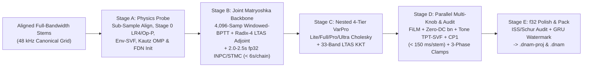

# TORA `v3` Analytical Variable-Projection, Windowed-BPTT & Cholesky Training Pipeline

This specification defines the **100% pure-Rust (`#![forbid(unsafe_code)]`) TORA `v3` Analytical Variable-Projection (`VarPro`), Parallel Windowed-BPTT, Selective `MM-Cholesky`, and Wide-Significand Gram Contraction Pipeline** in [`packages/capture/`](../../../packages/capture/README.md) (`dnam_capture::solver`), fulfilling [`REQ-1.5`, `REQ-1.8`, `REQ-2.1`, `REQ-4.1`–`REQ-4.3`, `REQ-5.2`](../../requirements/system_goals_and_requirements.md) (see [`../../adr/0018-signal-chain-fixtures-crate-and-whitebox-distillation.md`](../../adr/0018-signal-chain-fixtures-crate-and-whitebox-distillation.md), [`../../adr/0020-modular-monorepo-and-dnam-proj-container.md`](../../adr/0020-modular-monorepo-and-dnam-proj-container.md), and [`../../adr/0021-unified-matryoshka-gru-and-direct-register-stages.md`](../../adr/0021-unified-matryoshka-gru-and-direct-register-stages.md)).

---

## 1. Pipeline Overview & Dataflow Topology

`r[train.pipeline.topology]`

`dnam-capture` trains all four causally nested TORA `v3` tiers (**`Lite` `[1,1,1] @ 1x` $\subset$ `Full` `[2,1,1] @ 1x` $\subset$ `Pro` `[2,2,1] @ 2x` $\subset$ `Ultra` `[3,2,1] @ 2x`**) jointly in **one deterministic CPU training run** (`< 6 s/chain` end-to-end, `REQ-4.1`, `REQ-5.1`, `REQ-5.2`) without Python, PyTorch, or GPU runtimes, supporting `< 150 ms` incremental `Path 1` vault updates alongside raw-audio-free `Path 2` capsule re-pooling over `2.0–2.5 s` `fp32` stems while staying within `< 64 MiB` working RAM on browser workers (`REQ-4.3`).

---

## 2. Five-Stage Analytical Variable-Projection & Cholesky Solver

### 2.1 Stage A — Steiglitz–McBride Rational Pole & Delay Identification

`r[train.pipeline.stage-a-poles]`

On the aligned `StarCenter` stem (`s = 0`), `Stage A` (`Physics Probe`) performs sub-sample lag & polarity alignment, extracts `Stage 0` crossover/gate/sub-octave `Op-P` probes, estimates `Stage I` initial `2`-Section `Env-SVF` trajectories, identifies shared conjugate Kautz modal poles $\lbrace (r_m, \theta_m) \rbrace$ ($4 / 8 / 12 / 16$ pairs, $r_m \le 0.9995$, `ref[dsp.op-m.stage3.pole-extraction]`) via `2`-pass Kautz orthogonal matching pursuit (OMP) / Steiglitz–McBride identification, and initializes Stage IV late-tail `fp16` FDN delays (`4 / 8 / 8 / 16` lines), clamping every pole and feedback gain into the unconditional BIBO/Lyapunov envelope (`ref[train.audit.phase1.clamp-stability]`).

### 2.2 Stage B — Trajectory Basis Harvesting & Coreset Extraction

`r[train.pipeline.stage-b-harvest]`

`Stage B` jointly trains the 4-tier Zero-DC Matryoshka `GRU` backbone (`[1,1,1] @ 1x`, `[2,1,1] @ 1x`, `[2,2,1] @ 2x`, `[3,2,1] @ 2x`) on `StarCenter` (+ extreme switch/gain corners when present) via `1x` seed prescreening, parallel `4,096`-sample **Windowed-BPTT** with 4-lane vectorized `GRU` forward/backward passes, a process-wide atomic CAS worker cap (`ACTIVE_EXTRA_WORKERS`), fused Radix-4 multi-window Welch `33`-band `LTAS` adjoint gradients (`WelchPairScratch` deterministic `0..n_pairs` reduction), and `2`-pass Kautz OMP refinement, while caching the `StarCenter` backbone trajectory in `STAT` and extracting the shared **`2.0–2.5 s` (`96,000–120,000`-frame) full-bandwidth `fp32` `INPC`/`STMC` capsules** (`ref[container.proj.inpc-capsule]`, `ref[container.proj.stmc-capsule]`).

### 2.3 Stage C — Nested 4-Tier Schur-Complement & Selective MM-Cholesky Solve

`r[train.pipeline.stage-c-schur]`

`Stage C` solves the causally nested `Lite`, `Full`, `Pro`, and `Ultra` direct-register Mid/Side `VarPro` linear readout projections (`pre_cab` and `direct`) jointly (`REQ-5.1`, `REQ-5.2`):
1. **Nested `uplo='U'` `f64` `VarPro` Cholesky Solve:** Accumulates tier-prefix direct readout normal matrices ($\mathbf{G}_{1:D_T, 1:D_T} + \boldsymbol{\Lambda}_{D_T}$) via `IEEE-754 float64` Cholesky factorization (`solve_uplo_u_cholesky_2ch`) so `Lite`, `Full`, `Pro`, and `Ultra` each independently achieve optimal spectral balance without separate per-tier training jobs.
2. **Psychoacoustic `bESR` + `33`-Band `LTAS` KKT Projection:** Weights normal equations across the 4th-order Bézout `LF`/`MF`/`HF` bands (`ref[qual.besr.bezout-crossover]`) and enforces `33`-band `1/3`-octave `LTAS` tilt bounds (`ref[qual.companion.ltas]`), baking the effective readout statistics into `STAT` (`ref[container.proj.stat-uplo-u]`).

### 2.4 Stage D — Triangular Newton Control-Bus Projection & Corner Barrier

`r[train.pipeline.stage-d-control]`

Across multi-stem control schedules ($P \ge 1$), `Stage D` fits per-stem Stage II `FiLM` gains/shifts, Zero-DC $b_n$ shifts, inter-block `TPT-SVF` / post-Stage-3 4-band conditioner targets, and the `3 kHz` Parametric Control Bus (`CP1` arbitrary-$P$ contributor records, `ref[container.dnam.cp1-profile]`) in parallel across non-center stems (`< 150 ms/stem`, `< 64 MiB` peak memory `REQ-4.3`) using triangular Newton / Gauss–Lobatto interpolation (`Mode-0` locked at `StarCenter` for `0-ULP` invariance), executing the non-stop 3-Phase Control-Space Audit (`[CLAMP-RANGE]`, `[CLAMP-SWITCH]`, `[CLAMP-STABILITY]`, Phase-2 corner barrier, and Phase-3 dynamic/head-gain certification; `ref[train.audit.phase1.clamp-stability]`).
1. **Two-Pass 4-Band TPT Wiener Collapse Recovery (`ref[repo.code.constant-eval-and-derivations]`):** Pass 1 solves damped Gauss–Newton under pure waveform MSE (`w_band = 0.0`). On stems whose active post-conditioner Pass-1 RMS falls below `-0.55 oct` (`≈ -3.3 dB` Wiener shrinkage from dynamic envelope/phase decorrelation) while remaining active (`oct_tot > -2.5 oct`) and non-heterodyne (`rho_wave > -0.15`), Pass 2 adds the 4-band partition-of-unity TPT RMS consistency penalty `FOUR_BAND_RMS_MATCH_WEIGHT * sum_b (sqrt(E_wet,b) - sqrt(E_mdl,b))^2` (`w_band = 2.5`) matched to `V3PostStageConditioner`'s `250 Hz` / `1.8 kHz` (`k = 1.25`) crossover bands, restoring multiband loudness without degrading coherent compressor or waveshaper stems.
2. **Stationary Coreset & Multi-Window Sweep Extraction:** Compact closed-loop `CORESET_A5` (`12,000` samples) stationary stems evaluate over the `Q3+Q4` broadband chord + log-chirp slice (`[6,000..10,096)`), while interior sweep windowing extracts `2..=4` windows across `Mode A` (`1-D`) and `2`-knob `Hadamard` sweeps (deferring `3+`-knob short non-stationary coresets to the orthogonal `Mode B` stops so bass-only `Q1/Q2` segments do not bias mid/high knobs).

### 2.5 Stage E — Rank-1 Kautz Contraction, Zero-DC Enforcement & Container Packing

`r[train.pipeline.stage-e-pack]`

`Stage E` performs joint `f32` readout polish across the full `96,000`-sample certification timeline, enforces adjacent-tier monotone non-regression (`Lite <= Full <= Pro <= Ultra`), audits ISS/Schur/SVF stability, locks `b_head = 0.0` (`[STAB-ZERO-DC]`), calibrates exact `<= 0.05 LU` inter-tier `tier_gain_trim_lin` loudness parity (`REQ-7.4`), applies optional `0-ULP` `GRU` sign-flip + Kautz + EMR-masked Tardos watermarking (`ref[sec.watermark.reciprocal-gauge]`), certifies the 4-metric perceptual suite (`bESR`, `MR-IIR`, `LTAS`, `SegESR`), and packs `64 B`-aligned `v2.0` `.dnam-proj` (`DNPJ`) and runtime `.dnam` (`DNAM`) containers.

---

## 3. Wide-Significand Gram Contraction & Cross-Platform Accuracy

1. `r[train.gram.accuracy-contract]` **`IEEE-754 float64` & Deterministic Contraction Contract (`REQ-4.2`):** Every `uplo = 'U'` Gram matrix $\mathbf{G} = \sum_{n=0}^{N-1} w_n \boldsymbol{\phi}[n]\boldsymbol{\phi}[n]^\top$ and target cross-correlation $\mathbf{C} = \sum_{n=0}^{N-1} w_n \boldsymbol{\phi}[n]\mathbf{y}[n]^\top$ satisfies entrywise error bound $\lvert \hat{g}_{ij} - g_{ij} \rvert \le \gamma_N \sum_{n=0}^{N-1} w_n \lvert \phi_i[n] \phi_j[n] \rvert$ in `IEEE-754 float64` with fixed-order deterministic parallel reduction (`0..n_pairs`) across `ARM64`, `x86_64`, and `WASM`, binding input provenance to the `DNAM-GRAM-INPUT-v2` `SHA-256` fingerprint (`compute_gram_input_fingerprint`).
2. `r[train.gram.wide192]` **Compensated / Wide-Significand Accumulation (`ADR-0021`):** For high-dynamic-range stems spanning $> 53$ bits of exponent cancellation (e.g. $[1, 2^{-25}, -1]$), wide-significand / compensated `f64` accumulation and deterministic reduction preserve cross-platform bit reproducibility before final `f64` rounding.

---

## 4. Engine-Capture Isomorphism, Control Dispatch & Fixture Certification

### 4.1 Zero-ULP Engine-Capture Isomorphism Parity

`r[train.pipeline.isomorphism-parity]`

Because `dnam-capture` steps the **exact** `dnam-engine` Matryoshka `GRU`, `Env-SVF`, `TPT-SVF`, `Kautz`, and `FDN` kernels directly, exporting `WGHT` from `.dnam-proj` via `export_runtime_dnam` and stepping `DnamEngine` reproduces the solver's predicted waveform to `0 ULP` (on scalar/matched SIMD backends) and `bESR <= -60 dB` on structural `TORA` isomorphism oracles (`Oracle-01..03`).

### 4.2 Closed-Form Control-Dispatch Normal Equations

`r[train.pipeline.dispatch-solve]`

Given per-stem feature Gram matrices $\mathbf{G}_s \in \mathbb{R}^{D \times D}$, cross-correlations $\mathbf{C}_s \in \mathbb{R}^{D \times C_{\text{out}}}$, and evaluated `3 kHz` control-basis vectors $\boldsymbol{\psi}_s \in \mathbb{R}^K$, the joint bilinear Kronecker head normal matrix assembles in closed form without re-streaming audio frames (`ref[train.resume.kronecker-reassembly]`):
$$\mathbf{H}_{\text{kron}} = \sum_{s \in \mathcal{S}_{\text{enabled}}} \big(\boldsymbol{\psi}_s \boldsymbol{\psi}_s^\top\big) \otimes \mathbf{G}_s + \boldsymbol{\Lambda}_{\text{kron}}, \qquad \mathbf{B}_{\text{kron}} = \sum_{s \in \mathcal{S}_{\text{enabled}}} \boldsymbol{\psi}_s \otimes \mathbf{C}_s$$

### 4.3 Four-Tier Signal-Chain Fixture Matrix & White-Box Runners

`r[train.pipeline.fixtures-matrix]`

`packages/capture` verifies end-to-end solver fidelity against [`packages/fixtures/`](../../../packages/fixtures/README.md) (`fixtures <- capture` `[dev-dependencies]` only, `ADR-0018`) across four automated verification tiers:
1. **Tier 1 (`3` Structural Isomorphism Oracles, `Oracle-01..03`):** `256-D` Schur + gauge recovery, arbitrary-$P$ `CP1` (`P = 6`, `P = 16`), and zero-WAV `.dnam-proj` capsule vault editing.
2. **Tier 2 (`14` Primary Single-Device / `Amp+Cab` Archetypes `Chain-01..11, 13..15` + Optional `Chain-12` Smoke Rig):** Clean/dirty preamps (`Chain-01`), overdrive, fuzz/wavefolder, optical/FET & tri-band VCA compressors (`Chain-04, 13` with shared low/high crossovers plus per-band threshold, ratio, and level), tri-band comp+distortion (`Chain-14` with per-band cutoff/crossover filters, low comp/level, and independent mid/high drive & circuit voicing selectors), standalone tube amp head DI (`Chain-15`), zero-latency `4x12` cab, wah/phaser (`EnvSVF`), octave/ring-mod, chorus/TZF, tape/BBD echo, spring/hall reverb, and granular shimmer/freeze, plus an optional multi-stage `4CM`/`WDW` smoke rig (`Chain-12`).
3. **Tier 3 (`14` Composable Hardware Fault Decorators, `Cases #1..#26`):** ADC clipping/pads, converter loopback lag, human knob trajectories, thermal hysteresis, pot tapers, polarity inversion/DC offset, mains hum/hiss, noise gates, spring chirp, digital bit-crush quirks, scratchy pots, idle squeal, and microphone capsule clipping.
4. **Tier 4 (`DNWB` Out-of-Process White-Box Runners & Multi-Rate / 5-Bit-Depth Certification):** `FaustRunner` + `SpiceRunner` subprocess pipes and `32 / 44.1 / 48 / 88.2 / 96 / 192 kHz` $\times$ `Int12 / Int16 / Int24 / Int32 / Float32` 4-metric certification.
