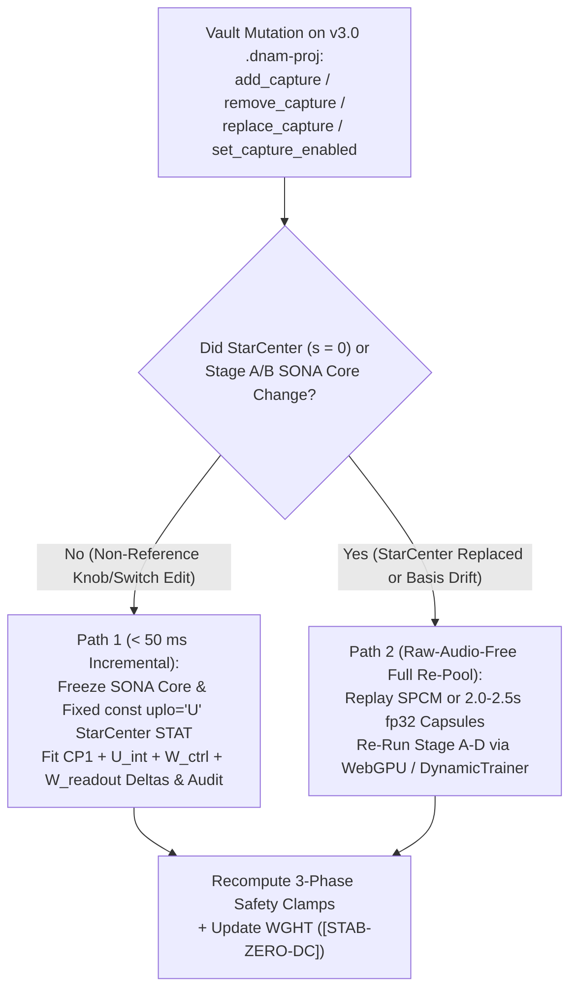

# Capture Vault Editing, Capsule Persistence & Cloud Sync Protocol

This specification defines **non-destructive `v3.0` `.dnam-proj` (`DNPJ`) Capture Vault stem editing (`add_capture`, `remove_capture`, `replace_capture`, `set_capture_enabled`), Two-Path compositional re-solving (`< 50 ms` `Path 1` Vault edits over fixed `const` `uplo='U'` `STAT` blocks vs. raw-audio-free `Path 2` WebGPU/CPU re-pool), `2.0–2.5 s` `fp32` `INPC`/`STMC` capsule persistence, and `HTTP Range` cloud object-storage synchronization** in [`packages/capture/`](../../../packages/capture/README.md) (`dnam_capture::proj::vault`), fulfilling [`REQ-3.1`–`REQ-3.3`, `REQ-4.3`, `REQ-5.3`](../../requirements/system_goals_and_requirements.md) (see [`../architecture/sona_architecture.md`](../architecture/sona_architecture.md), [`../../adr/0020-modular-monorepo-and-dnam-proj-container.md`](../../adr/0020-modular-monorepo-and-dnam-proj-container.md), and [`../../adr/0022-sona-state-space-operator-and-webgpu-architecture.md`](../../adr/0022-sona-state-space-operator-and-webgpu-architecture.md)).

---

## 1. Single-Project Capture Vault Editing & Compositional Re-Solve

### 1.1 Factored-Kronecker Sufficient-Statistic Reassembly

1. `r[train.resume.kronecker-reassembly]` **Closed-Form Multi-Tier Kronecker Reassembly (`REQ-3.1`, `REQ-5.3`):** By factoring `3 kHz` control coordinates and crossbar/`TPT-SVF`/`ParaLRU`/`W_readout` modulations $\boldsymbol{\psi}_s$ from cached `StarCenter` trajectories and fixed-dimension compile-time `const` `uplo='U'` readout statistics (`STAT` + `fp32` `STMC`, [`../containers/project_container_format.md` §2](../containers/project_container_format.md#2-capture-capsules--compositional-sufficient-statistics)), adding, disabling, removing, or re-recording non-reference control stems updates all active tiers (`Lite` through `Ultra`) in a single invocation without separate per-tier training jobs or capture-time tier resizing.
2. `r[train.resume.constant-factor-records]` **Stationary Control-Setting Stem Records:** Stems recorded at stationary knob and switch coordinates $(\mathbf{u}_s, \boldsymbol{\sigma}_s)$ retain `uplo = 'U'` `(G_{s,T}, C_{s,T})` statistics and `2.0–2.5 s` `fp32` capsules, re-combining algebraically in host `f64` precision whenever `CP1` Newton/Lobatto control nodes expand (`P -> P + 1`).
3. `r[train.resume.time-varying-records]` **Time-Varying Trajectory & Transition Stems:** Dynamic sweep, commutator, and freeze-transition stems evaluate $\boldsymbol{\psi}_s[k]$ at the `3 kHz` control stride over the `2.0–2.5 s` `fp32` `INPC`/`STMC` capsules and `R <= 36` `zerocopy` `StmcTrajectoryWindowWire` records (`ref[container.proj.stmc-capsule]`, `ref[repo.code.zerocopy-wire-structs]`) without retaining multi-megabyte raw WAV files.

### 1.2 Two-Path Vault Editing & Dependency Digests

1. `r[train.resume.two-tier-execution]` **Two-Path Compositional Vault Execution (`< 50 ms` `Path 1` vs. Raw-Audio-Free `Path 2` Re-Pool):**
   - **Path 1 — Incremental Fast-Path (`< 50 ms`):** When `extracted_physics` and the `StarCenter` reference stem remain valid, `add_capture`, `remove_capture`, `replace_capture`, and `set_capture_enabled` freeze the Stage II `SONA` (`TPT-SVF` + `ParaLRU` + `PolyADAA1`) core and cached `StarCenter` fixed-`const` `uplo='U'` `STAT` trajectory (**guaranteeing `0-ULP` `StarCenter` invariance**, `REQ-4.2`), fit only added/edited stem `CP1` + `3 kHz` `U_int` / `W_ctrl` / `W_readout` deltas in host `f64`, run `recompute_vault_phase1_audit_and_clamps`, and emit updated `v3.0` `WGHT` weights incrementally on desktop or browser worker.
   - **Path 2 — Full Re-Pool (Deterministic, Zero Raw Audio Required):** When `StarCenter` is replaced or a new capture invalidates the upstream basis, the vault automatically re-runs `Stage A`–`Stage D` directly over embedded full-bandwidth `SPCM` stems or compact `2.0–2.5 s` `fp32` `INPC` + enabled `STMC` capsules (`< 20 MB` `REQ-5.4`) using `32-bit WebGPU` (or deterministic `DynamicTrainer` / `WasmSimd128TrainerBackend` CPU fallback) without external WAV files.
2. `r[train.resume.dependency-digests]` **Cryptographic Provenance & Dependency Invalidation (`REQ-3.2`):** Every `StemRegistryEntry` binds dry/wet PCM `SHA-256` digests, sample rate, bit depth, sub-sample lag, converter gain, and the `DNAM-GRAM-INPUT-V3` `SHA-256` fingerprint (`ref[container.proj.jcs-manifest]`). Statistics reuse is permitted if and only if upstream stage parameters, filter versions, and dependency digests match identically; any mismatch automatically triggers capsule replay rather than combining stale statistics.
3. `r[train.resume.old-stem-nonregression]` **Unchanged-Stem Non-Regression Guarantee (`REQ-3.1`):** Expanding a `.dnam-proj` vault with additional knob settings or discrete switch positions (with `StarCenter` anchored at `Mode-0`) preserves `StarCenter` (`0-ULP` `Path 1` invariance) and previously captured stem `bESR` within tier certification tolerances without tone drift.

### 1.3 Bounded Windowed & 2-D Streamed Statistics Refresh

`r[train.resume.windowed-refresh]`

When target weighting (`LTAS` / `bESR` crossover parameters) or upstream stage coefficients change during full re-pooling or raw `SPCM` replay, the 2-D `RESIDENT_BATCHED` / `STREAMED` planner (`ref[train.pipeline.webgpu-scans-and-ozaki]`) tiles execution across `<= 128 MiB` WebGPU storage bindings (`< 256 MiB` total browser GPU / `< 64 MiB` `WasmSimd128TrainerBackend` CPU fallback, `< 512 MiB` desktop coreset, configurable `<= 4–8 GiB` raw host ceiling `REQ-4.3`) and verifies the replayed `DNAM-GRAM-INPUT-V3` digest before committing updated `STAT` and `WGHT` chunks.

---

## 2. Compact Capsule Vault Persistence

`r[train.cache.proj-vault]`

All reusable calibration (`CALB`), `2.0–2.5 s` `fp32` excitation (`INPC`) and per-stem response (`STMC`) capsules, `StarCenter` `STAT` trajectories & fixed-`const` `uplo='U'` statistics, and runtime model (`WGHT`) state reside inside the single `< 20 MB` `v3.0` `.dnam-proj` (`DNPJ`) file (`ref[container.proj.lifecycle-states]` and `REQ-3.3`, `REQ-5.4`):
- Calling `compact_to_capsules` strips raw `SPCM` WAV chunks in `< 1 ms` once `INPC` + `STMC` capsules are verified while retaining full non-destructive `add_capture`, `remove_capture`, `replace_capture`, `set_capture_enabled`, and `< 0.2 ms` `export_runtime_dnam` (which strips all training-only `CALB`/`INPC`/`STMC`/`STAT` chunks from the exported `v3.0` `.dnam` runtime file).

---

## 3. Cloud Object-Storage Sync & Remote Job Protocol

`r[train.cloud.job-protocol]`

Because `v3.0` `.dnam-proj` front-loads its `zerocopy` `64 B` Preamble, `64 B * N` Chunk Directory (with per-chunk `SHA-256` + `CRC32C`), and RFC 8785 JCS Manifest at byte `0` (`ref[container.proj.preamble-and-directory]`, `ref[repo.code.zerocopy-wire-structs]`), cloud storage and remote worker coordination (`Cloudflare Workers`, `Durable Objects`, `R2`, and `TiDB`) operate directly on content-addressed chunks without unpacking multi-file archives:
1. **Single-Request Metadata Inspection:** Clients and edge workers issue `HTTP Range: bytes=0-65535` (`parse_proj_manifest_range`) to read project metadata, control schemas, `audit_report`, and the complete `ProjChunkDirEntryWire` `SHA-256` table in one round-trip.
2. **Delta Chunk Upload / Download & Remote Distillation:** When syncing a vault edit or dispatching heavy `DNWB` white-box SPICE/Faust distillation jobs to remote workers, only chunks whose `sha256` digest is absent on the peer (`STMC`, `STAT`, `WGHT`, `AUTH`) are transferred over `HTTP Range` / multipart object puts, reassembling a verified `64 B`-aligned `v3.0` `.dnam-proj` container at commit time.
