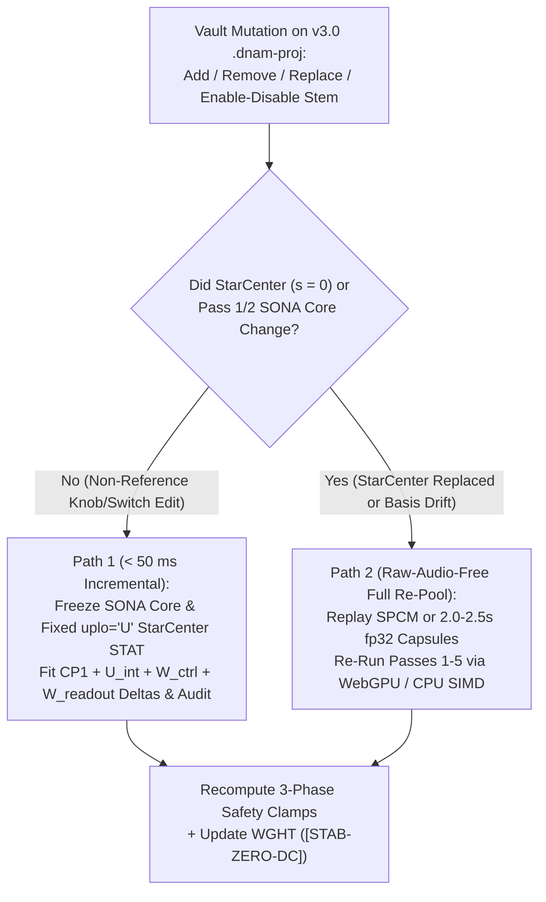

# Capture Vault Editing, Capsule Persistence & Cloud Sync Protocol

This specification defines non-destructive v3.0 `.dnam-proj` (`DNPJ`) Capture Vault stem editing (adding, removing, replacing, and toggling enablement of capture stems) and Two-Path compositional re-solving.

It specifies < 50 ms Path 1 Vault edits over fixed-dimension `uplo='U'` `STAT` blocks, raw-audio-free Path 2 GPU or CPU re-pooling, 2.0–2.5 s fp32 `INPC`/`STMC` capsule persistence, and HTTP Range cloud synchronization. These mechanisms satisfy [REQ-3.1–REQ-3.3, REQ-4.3, REQ-5.3](../../requirements/system_goals_and_requirements.md), [sona_architecture.md](../architecture/sona_architecture.md), [ADR-0020](../../adr/0020-modular-monorepo-and-dnam-proj-container.md), and [ADR-0022](../../adr/0022-sona-state-space-operator-and-webgpu-architecture.md).

---

## 1. Single-Project Capture Vault Editing & Compositional Re-Solve

### 1.1 Factored-Kronecker Sufficient-Statistic Reassembly

#### Closed-Form Multi-Tier Kronecker Reassembly

`r[train.resume.kronecker-reassembly]`

The solver factors 3 kHz control coordinates and crossbar, TPT-SVF, ParaLRU, and `W_readout` modulations $\boldsymbol{\psi}_s$ from cached StarCenter trajectories and fixed-dimension `uplo='U'` readout statistics (`STAT`). Canonically, `PROJ_STAT_BYTES_ULTRA` (267,264 B) packs a 256 × 256 `uplo='U'` Gram matrix plus 256 × 2 stereo cross-correlations in `f64` alongside fp32 `STMC` ([project_container_format.md §2](../containers/project_container_format.md#2-capture-capsules--compositional-sufficient-statistics)).

Because all four tiers nest inside one fixed `STAT` layout, adding, disabling, removing, or re-recording non-reference control stems updates Lite through Ultra in a single invocation without separate per-tier jobs or capture-time tier resizing (REQ-3.1, REQ-5.3).

#### Stationary Control-Setting Stem Records

`r[train.resume.constant-factor-records]`

Stems recorded at stationary knob and switch coordinates $(\mathbf{u}_s, \boldsymbol{\sigma}_s)$ retain `uplo = 'U'` $(G_{s,T}, C_{s,T})$ statistics and 2.0–2.5 s fp32 capsules. They re-combine algebraically in host `f64` precision whenever `CP1` Newton/Lobatto control nodes expand (`P -> P + 1`).

#### Time-Varying Trajectory & Transition Stems

`r[train.resume.time-varying-records]`

Dynamic sweep, commutator, and freeze-transition stems evaluate $\boldsymbol{\psi}_s[k]$ at the 3 kHz control stride over 2.0–2.5 s fp32 `INPC`/`STMC` capsules and `R <= 36` packed 16-byte trajectory window records (`ref[container.proj.stmc-capsule]`) without retaining multi-megabyte raw WAV files.

### 1.2 Two-Path Vault Editing & Dependency Digests

#### Two-Path Compositional Vault Execution

`r[train.resume.two-tier-execution]`

Vault mutations execute through either an incremental host fast-path or a full capsule re-pool depending on whether the upstream basis remains valid:

| Execution Path | Trigger Condition | Execution Scope & Guarantees |
| :--- | :--- | :--- |
| Path 1 — Incremental Fast-Path (< 50 ms) | `extracted_physics` and StarCenter (`s = 0`) remain valid across stem addition, removal, replacement, or enablement changes | Freezes SONA core (`TPT-SVF`, `ParaLRU`, `PolyADAA1`) and fixed-dimension `uplo='U'` StarCenter `STAT` (0-ULP StarCenter invariance, REQ-4.2); fits added/edited stem `CP1`, `U_int`, `W_ctrl`, and `W_readout` deltas in host `f64`, runs Phase-1 control-space audit and clamping, and emits updated v3.0 `WGHT` |
| Path 2 — Full Re-Pool (Zero Raw Audio) | StarCenter is replaced or a new capture invalidates the upstream basis | Re-runs Solver Passes 1–5 over embedded `SPCM` stems or compact 2.0–2.5 s fp32 `INPC` + enabled `STMC` capsules (< 20 MB, REQ-3.3) via 32-bit WebGPU or deterministic CPU SIMD fallback without external WAVs |

#### Cryptographic Provenance & Dependency Invalidation

`r[train.resume.dependency-digests]`

Every registered stem entry binds dry/wet PCM SHA-256 digests, sample rate, bit depth, sub-sample lag, converter gain, and the `DNAM-GRAM-INPUT-V3` SHA-256 fingerprint (`ref[container.proj.jcs-manifest]`, REQ-3.2). Statistics reuse is permitted if and only if upstream basis parameters, filter versions, and dependency digests match identically; any mismatch triggers capsule replay rather than combining stale statistics.

#### Unchanged-Stem Non-Regression Guarantee

`r[train.resume.old-stem-nonregression]`

Expanding a `.dnam-proj` vault with additional knob settings or discrete switch positions (with StarCenter anchored at Mode-0) preserves StarCenter to 0 ULP under Path 1 and maintains previously captured stem `bESR` within tier certification tolerances without tone drift (REQ-3.1).

### 1.3 Bounded Windowed & 2-D Streamed Statistics Refresh

`r[train.resume.windowed-refresh]`

When target weighting (LTAS or bESR crossover parameters) or upstream coefficients change during full re-pooling or raw `SPCM` replay, the 2-D `RESIDENT_BATCHED` / `STREAMED` planner (`ref[train.pipeline.webgpu-scans-and-ozaki]`) tiles execution across <= 128 MiB GPU storage bindings.

Memory stays below 256 MiB for browser WebGPU, below 64 MiB for CPU SIMD fallback, below 512 MiB for desktop coresets, and within a configurable 4–8 GiB raw host ceiling (REQ-4.3), verifying the replayed `DNAM-GRAM-INPUT-V3` digest before committing updated `STAT` and `WGHT` chunks.

---

## 2. Compact Capsule Vault Persistence

`r[train.cache.proj-vault]`

All reusable calibration (`CALB`), 2.0–2.5 s fp32 excitation (`INPC`), and per-stem response (`STMC`) capsules reside inside a single < 20 MB v3.0 `.dnam-proj` file (`ref[container.proj.lifecycle-states]`, REQ-3.3).

The same `DNPJ` vault also retains StarCenter `STAT` trajectories, fixed-dimension `uplo='U'` statistics, and runtime `WGHT` weights.

Capsule compaction strips raw `SPCM` audio chunks in < 1 ms once `INPC` and `STMC` capsules are verified.

Compacted projects preserve full non-destructive stem addition, removal, replacement, and enablement editing alongside < 0.2 ms runtime `.dnam` export, which strips all training-only `CALB`, `INPC`, `STMC`, and `STAT` chunks from the exported v3.0 `.dnam` model.

---

## 3. Cloud Object-Storage Sync & Remote Job Protocol

`r[train.cloud.job-protocol]`

Because v3.0 `.dnam-proj` front-loads its little-endian 64 B Preamble, `64 B * N` Chunk Directory (carrying per-chunk SHA-256 and CRC-32C digests), and RFC 8785 JCS Manifest at byte 0 (`ref[container.proj.preamble-and-directory]`), cloud services (Cloudflare Workers, Durable Objects, R2, and TiDB) operate directly on content-addressed chunks without unpacking multi-file archives.

To inspect a remote project, clients and edge workers issue a single HTTP Range request (`bytes=0-65535`) to read project metadata, control schemas, `audit_report`, and the complete 64-byte Chunk Directory Entry SHA-256 table in one round-trip.

When syncing a vault edit or dispatching heavy `DNWB` white-box simulation distillation jobs to remote workers, peers transfer only chunks whose `sha256` digest is absent remotely (`STMC`, `STAT`, `WGHT`, `AUTH`) via HTTP Range or multipart object puts. Commit reassembles a verified 64 B-aligned v3.0 `.dnam-proj` container.
