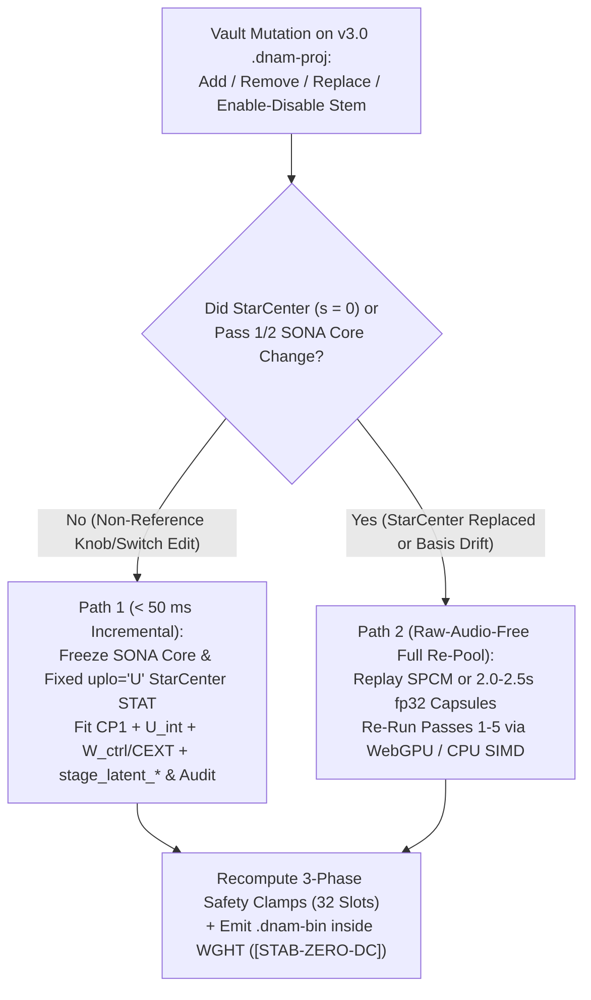

# Capture Vault Editing, Capsule Persistence & Cloud Sync Protocol

This specification defines non-destructive v3.0 `.dnam-proj` (`DNPJ`) Capture Vault stem editing (adding, removing, replacing, and toggling enablement of capture stems) and Two-Path compositional re-solving.

It specifies < 50 ms Path 1 Vault edits over fixed-dimension `uplo='U'` `STAT` blocks, raw-audio-free Path 2 GPU or CPU re-pooling, 2.0–2.5 s fp32 `INPC`/`STMC` capsule persistence, and HTTP Range cloud synchronization. These mechanisms satisfy [REQ-3.1–REQ-3.3, REQ-4.3, REQ-5.3](../../requirements/system_goals_and_requirements.md), [sona_architecture.md](../architecture/sona_architecture.md), [ADR-0020](../../adr/0020-modular-monorepo-and-dnam-proj-container.md), and [ADR-0022](../../adr/0022-sona-state-space-operator-and-webgpu-architecture.md).

---

## 1. Single-Project Capture Vault Editing & Compositional Re-Solve

### 1.1 Factored-Kronecker Sufficient-Statistic Reassembly

#### Closed-Form Multi-Tier Kronecker Reassembly

`r[train.resume.kronecker-reassembly]`

Singleton `STAT` (`chunk_id = 0`, 17,664..267,264 B up to `PROJ_STAT_BYTES_ULTRA`) stores the cached `StarCenter` (`s = 0`) `uplo = 'U'` Gram and cross-correlation statistics $(\mathbf{G}_0, \mathbf{C}_0)$ determining static base readout `W_ro,0` ([project_container_format.md §2](../containers/project_container_format.md#2-capture-capsules--compositional-sufficient-statistics)).

Non-center stems retain compact fp32 `STMC` capsules whose solved 32-slot control targets and `stage_latent_*` sensitivities factor over the 3 kHz control basis $\boldsymbol{\psi}_s$.

Kronecker reassembly and sufficient-statistic updates span both the base 16 rows of `W_ctrl` (`stage_targets[0..16]`) and, whenever `"CEXT"` is present, extended rows 16..31 (`stage_targets[16..32]`, including slot 16 `op_t_we_drive` and slot 30 `router_gate_thresh_delta`, plus Ultra `w_ctrl_ultra_ext`). Because all four tiers nest inside one fixed `STAT` layout, editing non-reference stems updates Lite through Ultra in a single invocation without per-tier jobs or capture-time tier resizing (REQ-3.1, REQ-5.3).

#### Stationary Control-Setting Stem Records

`r[train.resume.constant-factor-records]`

Stationary stems at fixed coordinates $(\mathbf{u}_s, \boldsymbol{\sigma}_s)$ retain 2.0–2.5 s fp32 `STMC` capsules (`spectral_summary_4096` and `band_psd_summary_88`) and cached per-stem 32-slot target vectors, without storing per-stem Gram arrays in `.dnam-proj`.

They re-combine algebraically in host `f64` `uplo = 'U'` control-subspace Cholesky solves whenever `CP1` Newton/Lobatto nodes expand (`U_p -> U_p + 1, K_p -> K_p + 1`), emitting `"CP1\0"` overflow streams in `.dnam-bin` `shared_controls` when exceeding 8 contributors or 576 B in `cp1_base`.

#### Time-Varying Trajectory & Transition Stems

`r[train.resume.time-varying-records]`

Dynamic sweep, commutator, and sustain-hold transition stems evaluate $\boldsymbol{\psi}_s[k]$ at the 3 kHz control stride over 2.0–2.5 s fp32 `INPC`/`STMC` capsules and `R <= 36` packed 16-byte trajectory window records (`ref[container.proj.stmc-capsule]`) without retaining multi-megabyte raw WAV files. Sustain-hold transitions update empirical slot 16 (`op_t_we_drive`) inside `"CEXT"` alongside time-varying operator trajectories.

### 1.2 Two-Path Vault Editing & Dependency Digests

#### Two-Path Compositional Vault Execution

`r[train.resume.two-tier-execution]`

Vault mutations execute through either an incremental host fast-path or a full capsule re-pool depending on whether the upstream basis remains valid:

| Execution Path | Trigger Condition | Execution Scope & Guarantees |
| :--- | :--- | :--- |
| Path 1 — Incremental Fast-Path (< 50 ms) | `extracted_physics` and StarCenter (`s = 0`) remain valid across stem addition, removal, replacement, or enablement changes | Freezes SONA core (`TPT-SVF`, `ParaLRU`, `PolyADAA1`) and fixed-dimension `uplo='U'` StarCenter `STAT` (0-ULP StarCenter invariance, REQ-4.2); fits added/edited stem `CP1` (inline or `"CP1\0"`), `U_int`, 16-row `W_ctrl` plus optional 1,280 B `"CEXT"` rows 16..31, 40 B `"TSYN"` rows, and `stage_latent_*` sensitivity tables in host `f64` while holding static base `W_ro,0` untouched for exact 0-ULP StarCenter invariance; runs 3-phase clamping (<= 3 inline `cond_rules` per descriptor) and updates `WGHT` wrapping compiled `.dnam-bin` |
| Path 2 — Full Re-Pool (Zero Raw Audio) | StarCenter is replaced or a new capture invalidates the upstream basis | Re-runs Solver Passes 1–5 over embedded `SPCM` stems or compact 2.0–2.5 s fp32 `INPC` + enabled `STMC` capsules (< 20 MB, REQ-3.3) via <= 15.5 KiB SRAM 32-bit WebGPU or deterministic CPU SIMD fallback without external WAVs, emitting updated `STAT` and `WGHT` (wrapping `.dnam-bin`) |

#### Cryptographic Provenance & Dependency Invalidation

`r[train.resume.dependency-digests]`

Every registered stem entry binds dry/wet PCM SHA-256 digests, sample rate, bit depth, sub-sample lag, converter gain, and the `DNAM-GRAM-INPUT-V3` SHA-256 fingerprint (`ref[container.proj.jcs-manifest]`, REQ-3.2). Statistics reuse is permitted if and only if upstream basis parameters, filter versions, and dependency digests match identically; any mismatch triggers capsule replay rather than combining stale statistics.

#### Unchanged-Stem Non-Regression Guarantee

`r[train.resume.old-stem-nonregression]`

Expanding a `.dnam-proj` vault with additional knob settings or discrete switch positions (with StarCenter anchored at Mode-0) preserves StarCenter to 0 ULP under Path 1 and maintains previously captured stem `bESR` within tier certification tolerances without tone drift (REQ-3.1).

### 1.3 Bounded Windowed & 2-D Streamed Statistics Refresh

`r[train.resume.windowed-refresh]`

When target weighting (LTAS or bESR crossover parameters) or upstream coefficients change during full re-pooling or raw `SPCM` replay, the 2-D `RESIDENT_BATCHED` / `STREAMED` planner (`ref[train.pipeline.webgpu-scans-and-ozaki]`) tiles execution across <= 128 MiB GPU storage bindings.

Memory stays below 256 MiB for browser WebGPU, below 64 MiB for CPU SIMD fallback, below 512 MiB for desktop coresets, and within a configurable 4–8 GiB raw host ceiling (REQ-4.3), verifying the replayed `DNAM-GRAM-INPUT-V3` digest before committing updated `STAT` and `WGHT` chunks.

---

## 2. Compact Capsule Vault Persistence

`r[train.cache.proj-vault]`

All reusable calibration (`CALB`), 2.0–2.5 s fp32 excitation (`INPC`), and per-stem response (`STMC`) capsules reside inside a single < 20 MB v3.0 `.dnam-proj` file (`ref[container.proj.lifecycle-states]`, REQ-3.3).

The same DNPJ vault retains StarCenter `STAT` trajectories, fixed-dimension `uplo='U'` statistics, and runtime `WGHT` weights. Both Path 1 and Path 2 pack the compiled pure-binary Layer-0 .dnam-bin payload (DNBN, DBRM, `shared_controls`, TSYN, optional CEXT, and Arena 0..3) directly inside `WGHT` (`dbin_offset` with Region 4 == 0 B and DCRC `crc_dbin_prefix`).

Capsule compaction strips raw `SPCM` audio chunks in < 1 ms once `INPC` and `STMC` capsules are verified.

Compacted projects preserve full non-destructive stem addition, removal, replacement, and enablement editing alongside < 0.2 ms runtime .dnam export (or direct .dnam-bin slicing), stripping all training-only `CALB`, `INPC`, `STMC`, and `STAT` chunks from the exported v3.0 .dnam model (`ref[container.proj.wght-and-export]`, `ref[container.dnam.vm-binary]`).

---

## 3. Cloud Object-Storage Sync & Remote Job Protocol

`r[train.cloud.job-protocol]`

Because v3.0 `.dnam-proj` front-loads its little-endian 64 B Preamble, `64 B * N` Chunk Directory (carrying per-chunk SHA-256 and CRC-32C digests), and RFC 8785 JCS Manifest at byte 0 (`ref[container.proj.preamble-and-directory]`), cloud services (Cloudflare Workers, Durable Objects, R2, and TiDB) operate directly on content-addressed chunks without unpacking multi-file archives.

To inspect a remote project, clients and edge workers issue a single HTTP Range request (`bytes=0-65535`) to read project metadata, control schemas, `audit_report`, and the complete 64-byte Chunk Directory Entry SHA-256 table in one round-trip.

When syncing a vault edit or dispatching heavy `DNWB` white-box simulation distillation jobs to remote workers, peers transfer only chunks whose `sha256` digest is absent remotely (`STMC`, `STAT`, `WGHT`, `AUTH`) via HTTP Range or multipart object puts. Commit reassembles a verified 64 B-aligned v3.0 `.dnam-proj` container.
