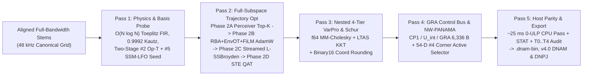
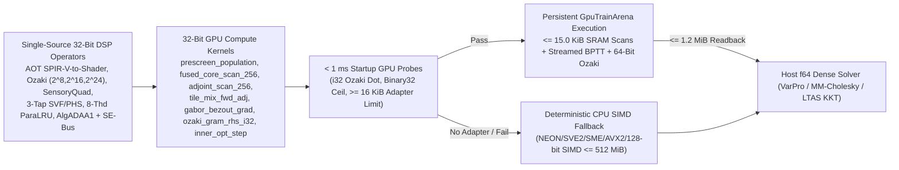

# Split-Precision WebGPU & Analytical VarPro Identification Solver

This specification defines the Black-Box Fixed-Shape Asymptotic SONA Identification Solver (v4.0). It combines portable 32-bit GPU associative scans (`<= 15.0 KiB` SRAM), 32-bit integer Ozaki reductions, seven training-only non-causal neural/spectral attention mechanisms (`#1–#7`), host IEEE-754 float64 `MM-Cholesky`, 33-band LTAS Newton-KKT, Schur prefix re-balancing, and a deterministic CPU SIMD solver fallback.

Together these mechanisms satisfy [REQ-1.5, REQ-1.6, REQ-1.8, REQ-1.9, REQ-2.1, REQ-4.1–REQ-4.3, REQ-5.1–REQ-5.6, REQ-6.1, REQ-6.2, REQ-7.1, REQ-7.2](../../requirements/system_goals_and_requirements.md), [sona_architecture.md](../architecture/sona_architecture.md), [ADR-0018](../../adr/0018-signal-chain-fixtures-crate-and-whitebox-distillation.md), [ADR-0020](../../adr/0020-modular-monorepo-and-dnam-proj-container.md), [ADR-0022](../../adr/0022-sona-state-space-operator-and-webgpu-architecture.md), [ADR-0024](../../adr/0024-sona-v4-kernel-hb-fir-perimeter-and-control-bus-gra.md), and [ADR-0025](../../adr/0025-unified-runtime-and-non-causal-trainer-attention.md).

---

## 1. Solver Overview & Dataflow Topology

`r[train.pipeline.topology]`



The solver operates as a 100% black-box, fixed-shape asymptotic identifier (`REQ-1.6`, `REQ-1.9`, `ref[repo.code.universal-black-box]`) with zero external pretraining, zero circuit-specific seed templates, zero hardcoded crossover frequencies, and zero capture-time tier resizing (`ref[arch.tiers.maximize-quality-within-budget]`). All four causally nested SONA v4.0 fixed-shape tiers execute over uniform 2× oversampling (15-tap HB-FIR `OS2X` perimeter) and optimize jointly in one self-contained run without external machine-learning framework dependencies (`REQ-4.1`, `REQ-5.1`, `REQ-5.2`).

| Solver Property | Lite / Full / Pro / Ultra Nesting (Lite ⊂ Full ⊂ Pro ⊂ Ultra) |
| :--- | :--- |
| 4-Block Matryoshka Core | `[1,1,1,1]` / `[2,2,1,1]` / `[2,2,2,2]` / `[3,3,2,2]` (CoreQuad count: 4 / 6 / 8 / 10; InterBlockTile count: 5 / 13 / 24 / 37; `MAX_OUTGOING_PER_QUAD = 7`) |
| Perimeter & Continuous Nonlinear Dim | All-tier 2× 15-tap HB-FIR `OS2X`; 64-frame Quad 0 inline ring; continuous subspace partitioned across CoreQuads, InterBlockTiles, SensoryQuad, Crossbar, Op-N[Pre], Kautz poles, `ro_pole_48k`, and TransportQuads |
| ModalConvolver FIR, Kautz & ER Sparse | 32 / 48 / 96 / 128 FIR taps per channel; 8 / 12 / 24 / 32 shared Kautz pole pairs; ErSparseBank (8 Lite / 16 Full..Ultra sparse echoes) |
| TransportQuad (Op-T v4) & SensoryQuad v4 | 1 / 2 / 3 / 4 quads = 4 / 8 / 12 / 16 delay lines with `||M_fb||_2 <= 1`, series matrix `M_series`, ±64 Hz shimmer/Doppler, Op-T loop saturator (`V_ceil = 4.0`), and SensoryQuad Log-Knee VCA (`[-5.0, +4.0]` octaves; `sense_vca_w` in `[-512.0, 512.0]`) |
| Desktop Worker Memory & Qualification | <= 1.5 GiB desktop WebGPU (1–2 GiB worker ceiling, <= 128 MiB storage binding, <= 512 MiB WASM CPU fallback, `REQ-4.3`); `BestUntilDiminishingReturns` (`|ΔbESR| < 0.01` dB/epoch) and T0..T4 pyramid |

Speed gained from ahead-of-time shader compilation, <= 15,360 B (15.0 KiB) WebGPU SRAM scans, persistent desktop GPU training arenas, optional hardware subgroup reductions, and Perceiver-guided 64–128-seed screening is reinvested directly into finding higher-fidelity weights inside those locked fixed shapes (`ref[arch.tiers.maximize-quality-within-budget]`).

---

## 2. Five-Pass Analytical Variable-Projection & Cholesky Solver

The identification solver executes sequentially across five deterministic passes (`§2.1–§2.5`), augmented by seven non-causal offline attention mechanisms (`§2.6`), without recurrent runtime gating or circuit-template scaffolding.

### 2.1 Pass 1 — Physics & Basis Prepass

`r[train.pipeline.physics-probe]`

On the aligned StarCenter reference stem (`s = 0`), Pass 1 performs 100% data-driven physical identification with zero device names, control-name matching, or circuit templates (REQ-1.6, REQ-1.9). It executes once over the complete active coreset—consuming full 8.0–12.0 s StarCenter capture recordings when present ahead of compaction to extract `BLA`, even/odd nonlinear distortion products, repeatability noise variance, and Schroeder energy-decay curves.

Pass 1 persists those structured `extracted_physics` summaries directly for Pass 2 reuse without redundant probe recomputation or short-prefix truncation. It applies hybrid multi-regime alignment with causal onset verification (`ref[train.capture.alignment.multi-regime]`) and precomputes the input-only Op-P basis once on host CPU in < 0.5 ms prior to GPU buffer upload, spanning the stereo 6-pair Hilbert H1 lattice, 3-basis carrier, and mid-derived 2-stage `rsqrt_pos_nr3` T1 −1 and −2 octave tracker channels across uniform 2× oversampling.

Next, Pass 1 estimates initial early FIR taps (32 / 48 / 96 / 128 per channel) via O(N log N) zero-padded radix-2 FFT Toeplitz autocorrelation and cross-correlation of transform length $L_{\mathrm{fft}} = 2^{\lceil \log_2(N + P) \rceil}$ with filter span $P = 128$, using biased lag estimates and diagonal ridge $10^{-6} r_x[0]$ for Levinson–Durbin stability.

It then identifies shared conjugate Kautz modal poles $\lbrace (r_m, \theta_m) \rbrace$ (8 / 12 / 24 / 32 pairs) seeded up to `MAX_PASS1_KAUTZ_R` (0.9992, inside the 0.9995 bound, `ref[dsp.op-m.kautz.pole-extraction]`) via 2-pass Kautz OMP with Pass-B Steiglitz–McBride pole extraction and ErSparseBank (8 Lite / 16 Full..Ultra) onset extraction (`onset_delay_samp` in the reclaimed 128 B Kautz `dr` payload alongside `c_cross_fp16`).

Alongside Kautz poles, Pass 1 estimates initial SensoryQuad parameters (including `[-5.0, +4.0]`-octave Log-Knee VCA behavior and Op-T loop saturator `V_ceil = 4.0`) and continuous Op-N[Pre] settings (`gamma_bc`, `zoh_hold_depth` in `[0.0, 0.9999]`, and `beta_q`) solely from aligned dry/wet telemetry.

Pass 1 also seeds causal Op-T v4 echo and comb delays via **Attention Mechanism `#2`** (Two-Stage Cross-Spectral Delay Dictionary Attention over 5..24,000 samples, subtracting the deterministic 7-sample HB-FIR perimeter round-trip group delay offset prior to candidate lookup) across 1 / 2 / 3 / 4 TransportQuad blocks (4..16 delay lines) rather than hard delay overrides under low linear coherence.

Whenever no dynamic modulation is active (`!mod_detected`), Pass 1 runs post-modal Welch cross-spectral Wiener deconvolution $S_{R\hat{B}} / (S_{\hat{B}\hat{B}} + \lambda)$ against the raw Lite-horizon modal prediction $\hat{b}$ on lags at least 32, solves passive per-channel least-squares wet taps on feed-forward Quad 0 (`g_loop == 0.0`), applies causal $(I + \text{Op-T}_0)^{-1}$ series inversion before refitting Kautz, ErSparseBank, and FIR taps, and commits passive Quad 0 whenever it beats both Lite (< 0.80) and Ultra (< 0.90) baselines when Op-T was inactive, or beats both by < 0.50 when superseding a static feedback seed.

In parallel, Pass 1 executes **Attention Mechanism `#5`** (34-feature Harmonic Modulation & SSM-LFO Seeder over dual-peak modulation spectra) to initialize bipolar `ramp_rate_hz` inside ±64 Hz (preserving positive +1.5 Hz shimmer sign rather than clamping <= 0), `lfo_rate_hz`, complementary grain phases, continuous `freeze_mix`, `tank_dry_mix`, unified `sigma_sat` ceiling (<= 4.0, `V_ceil = 4.0`), boundary window clamping, and 4-lane Q0.32 phasor frequencies across signed [-0.49 * fs, +0.49 * fs], while enforcing intrinsic stability bounds upfront (`ref[train.audit.phase1.clamp-stability]`).

### 2.2 Pass 2 — Population Screening & Full-Subspace Trajectory Optimization

`r[train.pipeline.backbone-trajectory-opt]`

Pass 2 jointly trains all fixed-shape Matryoshka tiers inside the pure 2×2 VM topology on StarCenter and extreme corner stems when present. Unlike restricted low-dimensional subsets, Pass 2 partitions every continuous parameter cleanly into an uncoupled nonlinear vector $\boldsymbol{\theta} \in \mathbb{R}^{D_\theta}$ and strictly linear-in-output VarPro readout weights $\boldsymbol{\alpha} \in \mathbb{R}^{D_\alpha}$.

Inactive trailing `TransportQuad` blocks remain muted (`active_opt_quad_count`). Any quad seeded purely as passive LTI feed-forward unlocks only its active delay, input gain, wet taps, and `tank_dry_mix` while locking feedback, modulation, scattering, allpass diffusion, and `opt_to_lr` at zero.

**Exact Full-Subspace Parameter Partition:** To preserve exact Cholesky linearity without conflating bilinear or saturated feedback terms in one linear solve, Pass 2 enforces strict separability between $\boldsymbol{\alpha}$ and $\boldsymbol{\theta}$. When Op-T v4 feedback is inactive (`g_loop == 0` and `wet_tap == 0`), the strictly linear VarPro subspace solves jointly via host binary64 `uplo='U'` Cholesky across direct readout gains (`direct_s2_u_gain`, `direct_s2_hp_gain`), direct matrix weights (`W_ro_head`), early FIR taps, ErSparseBank gains (8 Lite / 16 Full..Ultra), and Kautz complex output residues (`c_re_l/r`, `c_im_l/r`).

Because pre-convolver projections feed serially into `ModalConvolver` v4 and active Op-T v4 loops contain the nonlinear `sigma_sat` cubic limiter, bilinear couplings never share a single Cholesky matrix solve. Whenever Op-T is active, core readout head couplings, `pre_conv_u_gain`, `pre_conv_hp_gain`, `tank_dry_mix`, wet tap gains, `opt_to_lr`, `ro_pole_48k`, and `kautz.b_gamma` stay inside the nonlinear subspace, or update via separate alternating linear block solves on frozen delay taps in non-saturating regimes.

| Subspace Domain | Nested Tier Structure (Lite / Full / Pro / Ultra) | Wire Precision & Structural Invariants |
| :--- | :--- | :--- |
| CoreQuad Block 0 (`{0, 4, 8}`) | 1 / 2 / 2 / 3 quads (4 / 8 / 8 / 12 lanes; 3-tap folded SVF + Block 0 Pred-Corr PHS) | `svf_g`, `svf_k`, `lru_alpha_rel`, `lru_alpha_atk`, `C^2` `soft_rect`, `g_pre(v^2)`, `AlgADAA1`, `SE-Bus`, bounded `GLU`, and Block 0 `svf_k_nl` in `[0, 16]`; explicit `u16` `rect_sign_mask` excluded from continuous steps |
| CoreQuad Blocks 1..3 (`{1,5,9}`, `{2,6}`, `{3,7}`) | 3 / 4 / 6 / 7 quads (12 / 16 / 24 / 28 lanes across Blocks 1..3) | Same `CoreQuad` operator primitives; Block 1..3 `svf_k_nl` strictly fixed at `0x0000` |
| InterBlockTile Topology | 5 / 13 / 24 / 37 tiles (`MAX_OUTGOING_PER_QUAD = 7`; 48 weights/tile = 240 / 624 / 1,152 / 1,776) | 16 binary32 (`w_odd_4x4`) + 32 retained binary16 (`w_even_4x4_fp16`, `w_lru_4x4_fp16`) |
| SensoryQuad (Arena 0) | 4 sensing lanes (shared across Lite..Ultra) with Log-Knee VCA (`[-5.0, +4.0]` octaves; `sense_vca_w` in `[-512.0, 512.0]`) | Mixed binary32 poles/log-knee fields + retained binary16 sensing and VCA weights |
| Op-P & Phasor Crossbar | Crossbar basis (`crossbar_op_gains`, `carrier_basis_w`, `op_p_to_core`, `phasor_to_core`, plus `opt_to_lr`) | 4 binary32 (`phasor_freq_hz`) + retained binary16 crossbar tables across 4 / 6 / 8 / 10 quads; discrete `phasor_init_phase_q32` fixed; 4 `phasor_stereo_phase` at Full..Ultra |
| Op-N[Pre] v4 Front-End | 4 continuous parameters (`gamma_bc`, `zoh_hold_depth`, `beta_q`, plus v4 pre-conditioning) | Binary32 fields with native smooth C-infinity evaluation (zero STE); `zoh_hold_depth` gradient step scaled by `1 / N` |
| ModalConvolver v4 & ER Sparse | 32 / 48 / 96 / 128 FIR taps; 8 / 12 / 24 / 32 Kautz pole pairs; 8 / 16 ErSparseBank taps | Binary32 poles (`r_low <= 0.9995`, `ro_pole_48k <= 0x3F7F_FFAC`); reclaimed 128 B Kautz `dr` stores `onset_delay_samp` (`u16le`) + `c_cross_fp16` (`f16[2]`) |
| TransportQuad (Op-T v4) | 1 / 2 / 3 / 4 quads (4 / 8 / 12 / 16 delay lines) with `||M_fb||_2 <= 1`, `M_series`, and `V_ceil = 4.0` | Binary32 `delay_samples` `[5, 48000]`, `ramp_spans_samples`, bipolar `g_loop` in `[-0.9990, +0.9990]`, `r_dc`, `damp_pole`, `lfo_rate_hz`, ±64 Hz `ramp_rate_hz`; `freeze_mix` in `[0, 0.999]`; discrete phases & allpass delays fixed |

**Discrete Polarity & Phase Seeding:** Pass 1 and Phase 2A initialize each quad's explicit `u16` `rect_sign_mask` from Regime 1 even-order distortion polarity or Perceiver-guided screening, keeping `rect_sign_mask` invariant across continuous Phase 2B–2D updates alongside Pass-1-seeded `phasor_init_phase_q32`, `lfo_phase_off_q16`, `ramp_phase_off_q16`, `onset_delay_samp`, and `allpass_delays`.

**Conditioned Unconstrained Optimization Coordinates:** To remove multi-decade curvature disparities during optimization, continuous parameters optimize in unconstrained coordinates $u \in \mathbb{R}$ via smooth analytic bijections with exact analytical chain-rule Jacobians $\partial v / \partial u$:

| Coordinate Transform | Parameter Families & Canonical Domain Bounds | Forward Bijection `u -> v` & Derivative Property |
| :--- | :--- | :--- |
| **`ComplementLog`** | Low edge 0.0 (pack snap 0.0 below 1e-7): `lru_alpha_rel`, `lru_alpha_atk`, `sense_lru_alpha_rel`, `sense_lru_alpha_atk`, `damp_pole` (0.9995), `ro_pole_48k` (`0x3F7F_FFAC`); low edge > 0.0: active `kautz.r_low` in `[0.25, 0.9995]` (`r_base <= 0.0` inactive sentinel), `r_dc` in `[0.95, 0.999995]` | Given `c_min = 1 - r_max`, `c_max = 1 - r_min`, and `s = sigmoid(u)`: strictly increasing `r_cl = 1 - c_max * (c_min / c_max)^s` with positive derivative |
| **`LogBox`** | Strictly positive ratios (`v_min > 0`): `svf_g`, `svf_k`, `sense_svf_g`, `sense_svf_k`, `delay_samples` `[5.0, max_tau]`, `kautz.theta` `[1e-4, pi - 1e-4]`, `sigma_knee` `[1e-3, 4.0]` (`0x4400`, `V_ceil = 4.0`), positive `kautz.b_gamma` `[1e-4, 8.0]` | Exponential scaling `v = v_min * (v_max / v_min)^sigmoid(u)` with strictly positive Jacobian `v * ln(v_max / v_min) * s * (1 - s)` |
| **`AsinhBox`** | Signed `[-V, +V]`: `g_loop` (bipolar `[-0.9990, +0.9990]`), `ramp_rate_hz` (±64 Hz), `adaa_drive` (s=1, V=32), `lru_bias_drive`, `c_lp`, `c_bp`, `c_kbp`, `c_u`, `w_tile`, `out_gain` (`[-4.0, +4.0]`), `op_p_to_core`, `phasor_to_core`, `carrier_basis_w`, `glu_mix`, `sense_in_l/r`, `crossbar_op_gains`, `opt_to_lr`, `input_gains`, `wet_tap_l/r`, `tank_dry_mix`, `sense_vca_w` (`[-512.0, 512.0]` for Log-Knee VCA `[-5.0, +4.0]` octaves), `phasor_freq_hz`; non-neg `[0, V]`: `svf_k_nl`, `d_pre`, `se_w_sq`, `se_d_bus`, `beta_q`, `lfo_rate_hz`, `lru_duhem_gamma`, `lfo_depths`, `ramp_spans_samples` | Symmetric `v = s * sinh(c * (2 * sigmoid(u) - 1))` or non-negative `v = s * sinh(c * sigmoid(u))`, where `c = asinh(V / s)` |
| **Bounded `Box`** | Clamped angles `[-pi, +pi]` (`scat_psi`, `fb_psi`, `phasor_stereo_phase`), `allpass_g` `[-0.75, 0.75]`, `g0`, `g_inf` `[0.0, 2.5]`, unit `[0, 1]` (`lin_mix`, `lru_kappa`, `sense_lru_kappa`, `lru_stereo_link`, `lru_signed_mix`, `gamma_bc`, `wavefolder_mix`, `window_depth`), `zoh_hold_depth` `[0.0, 0.9999]`, `freeze_mix` `[0, 0.999]` | Linear logit `v = v_min + (v_max - v_min) * sigmoid(u)`; clamped angles never wrap modulo `2 * pi` so `(1 - mu_freeze) * scat_psi` stays continuous |

$$c_{\min} = 1 - r_{\max}, \qquad c_{\max} = 1 - r_{\min}, \qquad r_{\mathrm{cl}}(u) = 1 - c_{\max}\left(\frac{c_{\min}}{c_{\max}}\right)^{\sigma(u)}, \qquad \frac{\partial r_{\mathrm{cl}}}{\partial u} = (1 - r_{\mathrm{cl}})\ln\left(\frac{c_{\max}}{c_{\min}}\right)\sigma(u)(1 - \sigma(u)) > 0$$

$$v_{\mathrm{asinh}}(u) = s\sinh\big(c(2\sigma(u) - 1)\big), \qquad t = \tanh(u / 2) = 2\sigma(u) - 1, \qquad \frac{\partial v_{\mathrm{asinh}}}{\partial u} = \frac{s c}{2}\cosh(c t)(1 - t^2)$$

**Four-Phase Optimization Schedule (Phase 2A..2D):** Trajectory optimization progresses through four deterministic phases over 2.0–2.5 s (96,000–120,000 frames at 48 kHz) capsules inside <= 15,360 B (15.0 KiB) workgroup SRAM:

| Phase | Method & Budget | Normative Optimization Contract |
| :--- | :--- | :--- |
| **Phase 2A** | **Attention Mechanism `#6`** (`Perceiver IO` / Latent Cross-Attention Top-`K = 4`) | Scores 64–128 Sobol and physics-seeded candidates paired with exact host VarPro readout projection (< 30 ms), advancing the Top K = 4 diverse basins (desktop and browser) |
| **Phase 2B** | Chunked TBPTT AdamW + `#1 RBA` + `#3 EnvOT` + `#7` Cross-Stem Contrastive `FiLM` | Evaluates 2,048–4,096-frame warm-state-carried chunks using AdamW (`beta1 = 0.9`, `beta2 = 0.999`, `eps = 1e-8`, global `u`-norm clip 10.0, cosine LR `3e-3 -> 1e-4`), pairing noise-floored `#1 RBA`, macro `#3 EnvOT / TF-Sinkhorn`, and `#7` Cross-Stem Contrastive `FiLM` Disentanglement Attention (batching `K_rep = min(S - 1, 12)` non-`StarCenter` control stems on `wg_y = K_rep`, optimizing `theta_base + delta_phi_s` with `delta_phi_0 == 0` and tapered `1.5-entmax` `L_disent` tapering to 0 before Phase 2C `L-SSBroyden`) with VarPro refresh every 20–25 steps |
| **Phase 2C** | Time-Block Streamed Full-Batch Diagonal `L-SSBroyden` (`m = 16..32`) | Refines continuous weights over 16,384-frame streamed 2× time-blocks using Limited-Memory Self-Scaled Broyden with diagonal preconditioning inside desktop `REQ-4.3` budgets (`<= 1.5 MiB` history; dense SSBroyden when `D_theta <= 512`), clamped `tau_k in [1e-3, 1e3]`, Strong Wolfe line search (`c1 = 1e-4`, `c2 = 0.9`, max 8 evals), and `s^T y > 1e-10 * ||s|| ||y||` |
| **Phase 2D** | Wire-Precision-Aware STE Binary16 QAT Polish | Executes 8–24 line-search-free STE Adam steps anchored at the binary16-snapped continuous optimum for monotone non-regression, quantizing strictly retained binary16-wire fields (`REQ-8.5` cores, tiles, `W_ro`, `GRA` deltas) while keeping binary32 fields unquantized |

Under the non-quadratic composite perceptual objective $\mathcal{L}_{\mathrm{comp}}(\boldsymbol{\theta}, \boldsymbol{\alpha})$ in Phase 2C, $\partial_{\boldsymbol{\alpha}} \mathcal{L}_{\mathrm{comp}} \ne \mathbf{0}$ even at the L2 VarPro optimum $\boldsymbol{\alpha}^*(\boldsymbol{\theta})$. Consequently, Phase 2C never assumes a zero L2 envelope residual on composite perceptual losses.

Instead, Phase 2C executes alternating block-coordinate `L-SSBroyden`—holding $\boldsymbol{\alpha}$ fixed across 15–25 diagonally preconditioned quasi-Newton steps ahead of a monotone-gated VarPro refresh and history reset, or optimizing $(\boldsymbol{\theta}, \boldsymbol{\alpha})$ jointly inside each block—or adds the one-backsolve implicit-function correction reusing factored Cholesky $\mathbf{R}$.

With homotopy progress $p \in [0, 1]$ and $h(p) = \frac{1}{2}(1 - \cos(\pi p))$, Phase 2B minimizes the smooth perceptual composite over canonical SONA metrics augmented by **Attention Mechanism `#1`** (noise-floored Residual-Band Attention weights) and **Attention Mechanism `#3`** (macro Envelope Optimal Transport and TF-Sinkhorn) alongside differentiable repeatability noise-floor SNR weighting (`ref[qual.eval.thermal-hiss]`):

$$\mathcal{L}_{\mathrm{comp}} = w_{\mathrm{mriir}}(p)\mathcal{L}_{\mathrm{mriir}} + w_{\mathrm{specot}}(p)\mathcal{L}_{\mathrm{specot}} + w_{\mathrm{gabor}}(p)\mathcal{L}_{\mathrm{gabor}} + w_{\mathrm{segesr}}(p)\mathcal{L}_{\mathrm{segesr}} + w_{\mathrm{besr}}(p)\mathcal{L}_{\mathrm{besr}} + w_{\mathrm{ifgd}}(p)\mathcal{L}_{\mathrm{ifgd}} + w_{\mathrm{ltas}}\mathcal{L}_{\mathrm{ltas}} + w_{\mathrm{alias}}\mathcal{L}_{\mathrm{alias}} + w_{\mathrm{envot}}(p)\mathcal{L}_{\mathrm{envot}}$$

Schedule defaults evolve monotonically from coarse spectral shaping (`w_mriir` 0.60 -> 0.25, `w_specot` 0.25 -> 0.10, 33-band `w_gabor` 0.25 -> 0.15, 20 ms `w_segesr` 0.20 -> 0.10) toward phase-accurate waveform locking (`w_besr` 0.05 -> 1.00, `w_ifgd` 0.0 -> 0.15 over the second half, constant `w_ltas` = 0.10, and above-20 kHz `w_alias` = 0.25), modulated by RBA #1 noise-floored inverse-variance bands and macro EnvOT #3:

| Composite Loss Term | Canonical Mathematical Formulation (Evaluated Post-Warmup) |
| :--- | :--- |
| **`bESR`** | Degree-7 Bezout 3-band error energy ratio over 250 Hz / 2.5 kHz crossovers normalized by target band energy plus 1e-6 floor (`ref[qual.besr.bezout-crossover]`) |
| **`MR-IIR`** | 5-scale (256..4096) 32-probe log-spaced 2nd-order bandpass resonator spectral convergence plus log-L1 magnitude distance (`ref[qual.companion.mr-iir]`) |
| **`SpecOT` & `#3 EnvOT`** | Smoothed 1D Wasserstein-1 over 256-FFT / 128-hop Hann STFT (20 Hz–20 kHz) plus `#3` multi-scale macro Envelope OT and TF-Sinkhorn (`>= 32,768` frames) for long decay/echo tails |
| **`33-Band Gabor` + `#1 RBA`** | Constant-Q DC-removed unit-norm quadrature Hann wavelets at canonical 33 LTAS centers (`win_len = clamp(round(6.5 * fs / fc), 48, 4096)` even, `hop = win_len / 4`), gated by `#1` noise-floored residual-band attention (`N_floor` floor) |
| **`20 ms SegESR`** | Duration-weighted mean of 20 ms (`round(fs / 50)`) 3-band Bezout RMS envelope squared error normalized by target band energy plus 1e-12 (`ref[qual.companion.seg-esr]`) |
| **IF+GD** | Energy-weighted unit-phasor coherence over 256-FFT / 64-hop Hann STFT (20 Hz–20 kHz, floor 1e-6) across time-adjacent IF and frequency-adjacent GD ratios |
| **Welch LTAS** | 33-band base-10 1/3-octave Welch PSD `LogSumExpMinimax` (`beta` = 4.0, `goal_db` = 0.20, sum of excess hinge squared, 0.25 `f_lse^2`, and 0.25 mean band squared dB error) |
| **`UltrasonicHinge`** | Stopband (`[21.6 kHz, fs/2]` at `fs >= 48 kHz`; `[min(0.48 * fs, 20 kHz), fs/2]` at `fs < 48 kHz`) excess penalty `2 * max(0, 10 log10(P_nyq / P_ceil))^2`, where `P_ceil` tracks 2.2× target HF reference plus 2e-3 total power |

Phase 2D STE forward rounding applies IEEE-754 binary16 RNE strictly to parameters quantized on binary16 wire or hydrated storage (`REQ-8.5`). Retained binary16 targets cover CoreQuad binary16 lanes (excluding explicit `u16` `rect_sign_mask`, with Block 0 `svf_k_nl` in [0.0, 16.0] and Blocks 1..3 fixed `0x0000`), InterBlockTile `w_even_4x4_fp16` and `w_lru_4x4_fp16`, and Op-T v4 binary16 fields (Arena 0 `tank_dry_mix_fp16` plus TransportQuad wet taps, M_series couplings, and loop mixes).

They also cover SensoryQuad and Crossbar binary16 tables (plus all tiers' `opt_to_lr`: Lite hydrated binary16 and Full..Ultra binary16 wire), readout weights (`W_ro_head` split between odd/even/Kautz/ER + 8 scalar gains), and `PrefixOverride` intermediate binary16 FIR/Kautz bands. Every non-hydrated binary32 field (CoreQuad poles, `w_odd_4x4`, Op-N[Pre] v4, TransportQuad delays/rates/poles, SensoryQuad poles, base/prefix/delta FIR and Kautz poles, `ErSparseBank` `onset_delay_samp`, and `ro_pole_48k`) stays unquantized.

**Workgroup SRAM Execution, Matryoshka Progressive Expansion & PCGrad Refinement:** Across persistent 256-thread tiles (<= 15,360 B workgroup SRAM inside 16,384 B adapters), forward `fused_core_scan_256` steps each 256-frame tile as two sequential 128-frame sub-tiles using 8-thread ParaLRU + `κ(1-η)==0` fast path, constant-`M` register-squaring stereo scans, and binary-tree `pass0` adjoints (§3.2). Full-subspace multi-tier optimization supports both progressive warm-started expansion and joint 4-tier Matryoshka refinement:

| Multi-Tier Strategy | Normative Initialization, Loss Scaling & Conflict Projection Rules |
| :--- | :--- |
| **Progressive Expansion (`[1,1,1,1]..[3,3,2,2]` = 4 -> 6 -> 8 -> 10 quads)** | Zero-initializes every new InterBlockTile whose destination quad lies in an existing lower tier across uniform 2× 15-tap HB-FIR tiers, allowing nonzero init only on newly added quads while solving nested tier readouts (5 -> 13 -> 24 -> 37 tiles) |
| **Joint 4-Tier Matryoshka Refinement** | Optimizes log-scaled tier losses `tilde(L)_t = ln(L_t(theta, alpha_t*(theta)) + 1e-8)` weighted by `(0.15, 0.20, 0.25, 0.40)`, evaluating each tier with its own nested VarPro readout and per-tier crossbar coupling block (`phasor_stereo_phase` = 0 at Lite) |
| **Arena-Scoped Deterministic PCGrad** | Applies strictly during first-order AdamW updates (never inside L-SSBroyden), projecting conflicting gradients on Arena 0 shared weights in order 0 -> 1 -> 2 -> 3, Arena 1 across {Full, Pro, Ultra}, and Arena 2 Ultra against Pro while leaving Arena 3 and readouts unprojected |

Continuous optimization terminates on `BestUntilDiminishingReturns` (`|ΔbESR| < 0.01` dB/epoch), permanently snapping binary16-wire parameters ahead of Pass 3 while archiving 2.0–2.5 s `INPC`/`STMC` capsules (`ref[container.proj.inpc-capsule]`, `ref[container.proj.stmc-capsule]`).

### 2.3 Pass 3 — Nested 4-Tier VarPro Subspace & Schur Re-Balancing

`r[train.pipeline.nested-varpro-schur]`

Pass 3 builds its feature Gram matrices over the permanently binary16-snapped core, crossbar, and Op-T v4 trajectories.

It jointly solves the nested LinearReadout subspace (`W_ro_head`, `pre_conv`, `direct_s2`, `ErSparseBank` taps, linear `opt_to_lr` hydrated as binary16 across Lite..Ultra) and DBRM `ro_pole_48k` tilt/shelf basis alongside crossbar conditioning (REQ-5.1, REQ-5.2, REQ-8.5).

After the host float64 Cholesky/Schur and LTAS KKT solve yielding post-KKT continuous optimum $\mathbf{w}_{\mathrm{cont}}$, two cyclic Gauss–Seidel sweeps over $(\mathbf{G} + \boldsymbol{\Lambda})$ maintain residual $\mathbf{r} = (\mathbf{G} + \boldsymbol{\Lambda})(\mathbf{w} - \mathbf{w}_{\mathrm{cont}})$ initialized to zero at $\mathbf{w} = \mathbf{w}_{\mathrm{cont}}$ (preserving KKT multipliers).

First, binary16-wire and hydrated columns (`W_ro_head`, `direct_s2`, `pre_conv`, all tiers' `opt_to_lr`, and binary16 prefix overrides) update via $w_j \gets \mathrm{fp16}_{\mathrm{RNE}}\big(w_j - r_j / (G_{jj} + \Lambda_{jj})\big)$. Unquantized binary32 FIR, `ErSparseBank`, and Kautz columns then compensate via $w_j \gets w_j - r_j / (G_{jj} + \Lambda_{jj})$, falling back to direct snap if its quadratic error $(\mathbf{w} - \mathbf{w}_{\mathrm{cont}})^\top (\mathbf{G} + \boldsymbol{\Lambda})(\mathbf{w} - \mathbf{w}_{\mathrm{cont}})$ is lower and re-projecting damped KKT if tilt bounds exceed.

Accumulated tier-prefix normal equations $\mathbf{G}_{1:D_T, 1:D_T} + \boldsymbol{\Lambda}_{D_T}$ are solved via IEEE-754 float64 Cholesky factorization and Schur-complement prefix re-balancing so Lite, Full, Pro, and Ultra each achieve optimal spectral balance without separate per-tier jobs.

Normal equations are weighted across 4th-order Bezout LF/MF/HF bands (`ref[qual.besr.bezout-crossover]`), subject to 33-band 1/3-octave LTAS tilt bounds (`ref[qual.companion.ltas]`), while refining continuous Kautz poles and lag-ordered ModalConvolver early FIR taps (32 / 48 / 96 / 128 taps) plus ErSparseBank (8 / 16), conditioning pre-nonlinear crossbar and `CP1`/`U_int` subspaces, and baking StarCenter readout statistics into `STAT` (`ref[container.proj.stat-uplo-u]`).

Host LTAS KKT polish uses periodic-equivalent Hann-windowed Welch FFT projection (`eval_ltas_and_nyquist_fused`), excludes bins whose target input basis amplitude falls below 5% of peak basis amplitude so Schoukens-Pintelon Regime-1 Law 0.C notch gaps never destabilize normal equations, and targets aspiration LTAS ceilings [0.20, 0.05, 0.03, 0.02] dB across Lite..Ultra (`ref[qual.tiers.floors-not-stopping-criteria]`).

When adjacent tiers share the same basis (`same_basis`) and the lower tier already reaches normalized MSE below 1e-4 (`INHERIT_HIGH_ACCURACY_NESR_CEIL`), upper-tier inheritance (`tier_gate`) copies zero-padded lower-tier weights into the child whenever child MSE exceeds `(1 - min_rel_drop)` times parent MSE. The required drop is 0.50 (`INHERIT_DEEP_MIN_REL_DROP`) when parent NESR is below 1e-5 (`INHERIT_DEEP_FLOOR_NESR_CEIL`), and `clamp(0.001 * delta_dim, 0.02, 0.08)` otherwise, keeping holdout tiers monotone.

### 2.4 Pass 4 — Gated Rational Attention Control Bus, `CP1` & `NW-PANAMA` Identification

`r[train.pipeline.control-projection-fit]`

Across multi-stem control schedules for $P \ge 1$, Pass 4 fits 3 kHz ControlBus v4 (`GRA`) projections jointly across all active non-center stems (< 50 ms for Path 1 Vault edits, strictly inside desktop `REQ-4.3` budgets: <= 1.5 GiB WebGPU worker, <= 128 MiB storage binding, <= 512 MiB WASM CPU fallback).

These fits optimize CP1 contributor slices (W_main, w_proj, and v, adding `"CP1\0"` overflow streams when exceeding 8 slots or 576 B in `cp1_base`), 4×4 `U_int^base` (`u_int_base[:,0..4]` plus `u_int_ultra[0]`), and Arena 0/3 GRA tables (`control_bus_lite` 2,048 B + `control_bus_ultra_delta` <= 9,280 B cum. from 6,336 B reclaimed non-Tardos bytes) over Slot 0..31 with K_ctrl(44.1k) = 16 and 4-frame micro-ramps (slot 31 routed to `readout_gain_mod_l/r`).

Unlike legacy linear control tables, GRA projects normalized `(u_ctrl, z_head, ctrl_basis_4, env, lfo)` features through sparse rational attention gates (`1 + sum exp / entmax` normalized convex routing) bounded on the convex hull so zero out-of-range control extrapolation can destabilize ParaLRU, TPT-SVF, Op-T v4, or AlgADAA1(4096) (`ref[train.audit.phase1.clamp-stability]`).

Every active dispatch weight targeting core/modal/transport slots (excluding watermark-invariant odd-symmetric gauge coordinates) routes strictly through bounded GRA convex weights (slot 14 `fb_psi`, slot 16 `op_t_freeze_mix_delta`, slot 22 `op_t_dry_mix_mod`, slot 30 `sense_vca_gain_delta`, and slot 31 L/R readout gain mod) with zero legacy CEXT chunks (`cext_offset == 0`, `cext_len == 0`).

In parallel, Pass 4 updates the active corner recommender via **Attention Mechanism `#4`** (54-D `NW-PANAMA`, expanding 38-D telemetry with 16-D harmonic/spectral/modulation features under `N_int >= 2` LOOCV validation) to prioritize maximally informative physical corner captures without redundant grids.

When off-center `STMC` stems exhibit at least 0.75 dB inter-stem 33-band spectral spread (`MIN_SPECTRAL_SHAPE_SPREAD_DB`), Pass 4 configures a data-driven 4-block Arena 0 partition-of-unity TPT-SVF plus `tone_dir` `ControlBus` v4 spectral shaping bounded inside 300..6,500 Hz. Dedicated `AlgADAA1(4096, NR3)` lanes feed `pre_conv` with zero unmodulated bypass using two-phase pure-vs-hybrid selection (-48.0 dB pure sufficiency, -38.0 dB 2× trigger, both strictly below Ultra's -34.0 dB floor).

Pass 4 point-wise optimization gates Pass-0 slots [22, 30] early exit (0.05 relative residual, 2.5e-4 broadband or 1.0e-3 narrowband NESR) and parsimony (0.25 relative residual, 2.5e-3 NESR) before running broadband (0.45 MSE + 0.55 bESR, 1e-6 L2) or narrowband (1.0 MSE, 1e-5 L2) Pass-1 adjoint optimization and optional 4-band Wiener Pass-2 recovery (0.40 MSE + 0.40 bESR + 0.20 MR-IIR broadband).

For continuous dynamic sweeps (`MODE_A_SWEEP`, `bit 1<<2` in `STMC`, `ref[container.proj.stmc-capsule]`), Pass 4 executes primary batched end-to-end continuous 3 kHz trajectory optimization over the decoded $u(t)$ knot schedule (`R <= 36` uniform knot grid linear interpolation onto every 16-sample tick) paired with sampled stationary coreset stems under StarCenter Mode-0 lock and `O(P+M)` convex-hull BIBO clamping (`ref[train.audit.phase1.clamp-stability]`).

For deterministic initialization or CPU fallback against envelope/phase decorrelation without hurting coherent waveshapers, Pass 4 retains the two-pass multiband Wiener filter (`ref[repo.code.constant-eval-and-derivations]`), starting Pass 1 under pure waveform MSE (`w_band` = 0.0).

With $\varepsilon = 10^{-12}$ over active evaluation samples comparing target `y_wet` against StarCenter Ultra and Lite renders `y_star,U` and `y_star,L`, averaging mono or stereo channel energies gives:

$$E_{\text{star}} = \frac{1}{2}(E_{\text{star},U} + E_{\text{star},L}), \qquad \mathrm{oct}_{\text{tot}} = \frac{1}{2}\log_2\frac{E_{\text{wet}} + \varepsilon}{E_{\text{star}} + \varepsilon}, \qquad \rho_{\text{wave}} = \frac{\langle y_{\text{wet}}, y_{\text{star},U}\rangle}{2\sqrt{E_{\text{wet}} E_{\text{star},U}} + 2\varepsilon} + \frac{\langle y_{\text{wet}}, y_{\text{star},L}\rangle}{2\sqrt{E_{\text{wet}} E_{\text{star},L}} + 2\varepsilon}$$

Pass 1 renders Ultra output $y_{\text{mdl},1,U}$ and Lite output $y_{\text{mdl},1,L}$, yielding broadband Pass-1 energy $E_{\text{mdl},1}$, per-band Pass-1 energy $E_{\text{mdl},1,b}$, and per-band error $\mathrm{oct}_{\text{err},1,b}$ across bands $b \in \lbrace \text{sub}, \text{lm}, \text{pres}, \text{hi} \rbrace$:

$$E_{\text{mdl},1} = \frac{1}{2}(E_{\text{mdl},1,U} + E_{\text{mdl},1,L}), \qquad E_{\text{mdl},1,b} = \frac{1}{2}(E_{\text{mdl},1,U,b} + E_{\text{mdl},1,L,b}), \qquad \mathrm{oct}_{\text{err},1,b} = \frac{1}{2}\log_2\frac{E_{\text{mdl},1,b} + \varepsilon}{E_{\text{wet},b} + \varepsilon}$$

When `oct_tot > -2.5` oct and `rho_wave > -0.15`, Pass-2 4-band Wiener recovery triggers if Pass-1 broadband error $\mathrm{oct}_{\text{err},1} = \frac{1}{2}\log_2((E_{\text{mdl},1} + \varepsilon)/(E_{\text{wet}} + \varepsilon)) < -0.55\text{ oct}$ or any single band (`sub`, `lm`, `pres`, `hi`) satisfies all three band-collapse gating predicates:

$$E_{\text{wet},b} \ge 0.05 \sum_{b'} E_{\text{wet},b'}, \qquad \rho_b = \frac{1}{2}(\rho_{b,U} + \rho_{b,L}) < 0.65, \qquad \mathrm{oct}_{\text{err},1,b} < -0.55\text{ oct}$$

Here `ACTIVE_BAND_MIN_ENERGY_FRAC = 0.05` excludes low-energy bands, and `BAND_PHASE_DECORR_RHO_MAX = 0.65` caps tier-averaged per-band waveform correlation $\rho_b$ across Ultra and Lite Pass-1 correlations $\rho_{b,U}$ and $\rho_{b,L}$ so coherent waveshapers stay under pure waveform MSE.

When triggered, Pass 2 sets $w_{\text{band}} = 2.5$ (`FOUR_BAND_RMS_MATCH_WEIGHT`) and adds the tier-averaged 4-band envelope penalty (`0.25 * 2.5` factor across both tiers):

$$\mathcal{L}_{\text{band}} = 0.25 w_{\text{band}} \sum_b \Big(\big(\sqrt{E_{\text{wet},b}} - \sqrt{E_{\text{mdl},U,b}}\big)^2 + \big(\sqrt{E_{\text{wet},b}} - \sqrt{E_{\text{mdl},L,b}}\big)^2\Big)$$

Band energies across Pass 1 and Pass 2 evaluate the shared 4-band TPT-SVF bank over generic input signal $s[n]$ applied to $y_{\text{wet}}$, $y_{\text{mdl},U}$, and $y_{\text{mdl},L}$ at $f_s = 48{,}000\text{ Hz}$ using a 1-pole TPT lowpass at $f_{\text{sub}} = 250\text{ Hz}$ and a parallel 2-pole TPT-SVF at $f_{\text{mid}} = 1{,}800\text{ Hz}$, $Q = 0.8$, and $k = 1 / Q = 1.25$:

$$g_{\text{sub}} = \tan\left(\frac{\pi \cdot 250}{f_s}\right), \qquad G_{\text{sub}} = \frac{g_{\text{sub}}}{1 + g_{\text{sub}}}, \qquad v_{\text{sub}}[n] = G_{\text{sub}}\big(s[n] - s_{\text{sub}}[n-1]\big), \qquad b_{\text{sub}}[n] = v_{\text{sub}}[n] + s_{\text{sub}}[n-1]$$
$$g_{\text{mid}} = \tan\left(\frac{\pi \cdot 1800}{f_s}\right), \qquad k = 1.25, \qquad a_1 = \frac{1}{1 + g_{\text{mid}}(g_{\text{mid}} + k)}, \qquad a_2 = g_{\text{mid}} a_1, \qquad a_3 = g_{\text{mid}} a_2$$
$$v_3[n] = s[n] - s_2[n-1], \qquad v_1[n] = a_1 s_1[n-1] + a_2 v_3[n], \qquad v_2[n] = s_2[n-1] + a_2 s_1[n-1] + a_3 v_3[n]$$
$$b_{\text{lm}}[n] = v_2[n] - b_{\text{sub}}[n], \qquad b_{\text{pres}}[n] = k v_1[n], \qquad b_{\text{hi}}[n] = s[n] - k v_1[n] - v_2[n]$$

State updates use exact trapezoidal integrators $s_{\text{sub}}[n] = b_{\text{sub}}[n] + v_{\text{sub}}[n]$, $s_1[n] = 2 v_1[n] - s_1[n-1]$, and $s_2[n] = 2 v_2[n] - s_2[n-1]$, guaranteeing algebraic partition of unity $b_{\text{sub}}[n] + b_{\text{lm}}[n] + b_{\text{pres}}[n] + b_{\text{hi}}[n] = s[n]$ and restoring multiband energies $E_{\text{wet},b}$, $E_{\text{mdl},U,b}$, and $E_{\text{mdl},L,b}$ across bands $b \in \lbrace \text{sub}, \text{lm}, \text{pres}, \text{hi} \rbrace$.

### 2.5 Pass 5 — Deterministic Host Parity Pass, Certification & Container Emission

`r[train.pipeline.host-parity-and-export]`

Before emission, Pass 5 runs a ~25 ms deterministic host CPU pass using the reference CPU engine and 3-limb compensated binary64 summation over the certification timeline (REQ-4.2). This locks 0-ULP parity between GPU-accelerated and CPU-only solves while persisting `uplo='U'` `STAT` sufficient statistics for < 50 ms Path 1 Vault updates.

Pass 5 then enforces adjacent-tier monotone non-regression across Lite..Ultra (`[1,1,1,1]..[3,3,2,2]`) and verifies intrinsic stability: $\Vert \mathbf{A}_{\text{tpt}} \Vert_2 \le 1$, Block 0 `svf_k_nl` inside [0.0, 16.0] with Blocks 1..3 fixed at `0x0000`, ParaLRU $J_i \in (0, r_{\max}]$, causal Op-T v4 $\tau \ge 5.0$ across crossbar micro-chunks or $\ge 4.0$ standalone with $\Vert \mathbf{M}_{\mathrm{fb}} \Vert_2 \le 1$ and bipolar $g_{\mathrm{loop}} \in [-0.9990, +0.9990]$, O(P+M) global convex-hull GRA (< 5 µs) BIBO compliance, and `scat_psi` inside $[-\pi, +\pi]$.

Pass 5 further verifies `Op-N[Pre] v4` `zoh_hold_depth` inside [0.0, 0.9999], `ro_pole_48k` inside `[0.0, 0x3F7F_FFAC]`, and zero-DC `[STAB-ZERO-DC]` $b_{\text{head}} = 0.0$.

It calibrates <= 0.05 LU inter-tier `tier_gain_trim_lin` (REQ-5.4) and applies optional Tardos buyer watermarking over odd-symmetric CoreQuad gauges (`rect_sign_mask`, cyclic `glu_mix_fp16`), ModalConvolver Kautz poles (224-D / 15 * M_tier omitting reclaimed dr), and InterBlockTile 5 / 8 / 11 / 13 gauges strictly outside protected `.dnam-bin` prefixes, Arena 0/3 GRA (`control_bus_lite` 2,048 B + `control_bus_ultra_delta` <= 9,280 B cum.), 128 B dr, ErSparseBank, SensoryQuad, and Op-N[Pre] fields (`ref[sec.watermark.reciprocal-gauge]`).

Finally, Pass 5 runs the Five-Tier Qualification Pyramid (T0..T4, §4.4), certifies the 4-metric perceptual suite (`bESR`, `MR-IIR`, LTAS, `SegESR`), and compiles the pure-binary Layer-0 `.dnam-bin` image (zero-CEXT 64 B-aligned prefix "DNBN", "DBRM", `shared_controls`, "TSYN" with 128 <= shared_controls <= TSYN <= arena0_offset, followed by Arena 0 `control_bus_lite` 2,048 B GRA and Arena 1..3 deltas up to `control_bus_ultra_delta` <= 9,280 B cum.).

Pass 5 embeds `dbin_prefix` at `[dbin_offset..tier_start)` ahead of `[tier_start..retained_tier_end]` inside 64 B-aligned v4.0 `.dnam` containers (version 4.0, zero CEXT length/offset, Region 4 == 0 B) and stores the resulting `.dnam` container inside the WGHT chunk of `.dnam-proj` (`ref[container.dnam.vm-binary]`).

### 2.6 Seven Training-Only Non-Causal Attention Mechanisms (`#1–#7`)

`r[train.pipeline.offline-attention]`

To maximize model quality inside locked v4.0 runtime shapes (`REQ-1.9`, `REQ-5.3`, `ADR-0025`), the offline identification solver integrates seven training-only non-causal neural and spectral attention mechanisms (`#1–#7`). Every mechanism executes strictly inside the trainer, incurs zero external pretraining (`REQ-1.9`), and adds zero bytes, branches, or cycles to exported `.dnam`/`.dnam-bin` runtime containers:

| Attention Mechanism | Offline Trainer Execution Point | Exact Role & Clean-Room Guarantee |
| :--- | :--- | :--- |
| **`#1` Residual-Band Attention (`RBA`)** | Pass 2 Phase 2B & Phase 2C | Noise-floored cross-band inverse-variance weighting over the 33 LTAS bands (`N_floor` noise-gated) directing capacity toward residual-heavy bands without chasing converter noise |
| **`#2` Two-Stage Delay Dictionary** | Pass 1 Op-T v4 delay seeding | Coarse correlation + fine cross-spectral dictionary attention over 5..24,000 samples after subtracting the exact 7-sample HB-FIR perimeter round-trip group delay |
| **`#3` Macro EnvOT & TF-Sinkhorn** | Pass 2 Phase 2B (>= 32,768 frames) | Multi-scale macro-window Envelope Optimal Transport and time-frequency Sinkhorn alignment locking slow reverbs, echoes, and optical release curves |
| **`#4` 54-D NW-PANAMA Selector** | Pass 4 active corner recommender | Expands telemetry to 54 physical/modulation descriptors under `N_int >= 2` LOOCV validation to pick minimum-uncertainty control corners |
| **`#5` 34-Feature SSM-LFO Seeder** | Pass 1 modulation/shimmer init | Dual-peak modulation state-space seeder initializing LFO and bipolar ±64 Hz Doppler/shimmer rates (preserving +1.5 Hz shimmer sign) |
| **`#6` Perceiver IO Top-K = 4** | Pass 2 Phase 2A screening | Permutation-equivariant latent cross-attention scoring 64–128 diverse basins paired with exact VarPro projection in < 30 ms to retain Top K = 4 candidates |
| **`#7` Cross-Stem Contrastive `FiLM` Disentanglement Attention** | Pass 2 Phase 2B trajectory opt (0 B RT) | Scores cross-stem difference cosine similarity `C_{s,s'}` over `[33 Gabor ΔS, 16 staircase ΔD, 16 env ΔE]`, batches `K_rep = min(S - 1, 12)` non-`StarCenter` control stems (`wg_y = K_rep`), jointly optimizes shared `θ_base` + per-stem FiLM/routing deltas `δφ_s` (`δφ_0 ≡ 0`) to expel knob-varying spectra from static FIR into `CoreQuad` lanes and activate unvisited switch modes, plus tapered `1.5-entmax` `L_disent` (tapers to 0 before Phase 2C `L-SSBroyden`) |

---

## 3. Wide-Significand Gram Contraction & Cross-Platform Accuracy

### 3.1 Host IEEE-754 `float64` & Wide-Significand Contraction Contract

#### IEEE-754 `float64` & Deterministic Contraction Contract

`r[train.gram.accuracy-contract]`

Every `uplo = 'U'` Gram matrix $\mathbf{G} = \sum_{n=0}^{N-1} w_n \boldsymbol{\phi}[n]\boldsymbol{\phi}[n]^\top$ and target cross-correlation $\mathbf{C} = \sum_{n=0}^{N-1} w_n \boldsymbol{\phi}[n]\mathbf{y}[n]^\top$ solved on the host satisfies entrywise error bound $\lvert \hat{g}_{ij} - g_{ij} \rvert \le \gamma_N \sum_{n=0}^{N-1} w_n \lvert \phi_i[n] \phi_j[n] \rvert$ in IEEE-754 `float64`.

Execution uses fixed-order deterministic `[4 × 4]` and `[8 × 4]` register-tiled 256-frame micro-batch reduction (`MICRO_BATCH_FRAMES = 256`, `0..n_pairs`) across ARM64, x86_64, and 128-bit portable SIMD targets (REQ-4.2). Input provenance binds via input-gram fingerprinting, computing SHA-256 over the little-endian byte transcript below where `canon(x)` maps -0.0 to +0.0:

```text
"DNAM-GRAM-INPUT-V3\0"
|| u32le(feature_dim)
|| [u8(2), u8(2)]  (feature_type = 2 for f64, weight_type = 2 for f64)
|| for frame_idx in 0..N:
     (u8(1) || u64le(frame_idx) || f64le(canon(weight)) || f64le(canon(row[0..feature_dim])))
|| u8(0)
|| u64le(N)
```

#### Compensated / Wide-Significand 3-Limb Accumulation

`r[train.gram.wide192]`

For high-dynamic-range stems spanning > 53 bits of exponent cancellation (such as `[1, 2^-30, -1]`), the 3-limb compensated accumulator ([ADR-0022](../../adr/0022-sona-state-space-operator-and-webgpu-architecture.md)) maintains 3 × `f64` (~159-bit significand) non-overlapping Priest/Dekker expansion limbs.

It splits mantissas using `DEKKER_SPLIT_F64 = 134_217_729.0` (with zero hardware FMA dependence) across `[DEKKER_SAFE_MIN = 2^-450 = 0x23D0_0000_0000_0000, DEKKER_SAFE_MAX = 2^+450 = 0x5C10_0000_0000_0000]`, falling back to exponent-normalizing `ldexp` outside that range. Final collapse applies Boldo–Melquiond round-to-odd on `limbs[1] + limbs[2]` and canonicalizes zero to +0.0 for bit-identical ARM64, x86_64, and 128-bit portable SIMD parity.

### 3.2 Portable 32-Bit WebGPU Scans, Ozaki Accumulator & 2-D Memory Planner

`r[train.pipeline.webgpu-scans-and-ozaki]`



**Single-Source 32-Bit Kernels & < 1 ms Startup Probes (REQ-4.1, REQ-4.2):** Both the real-time audio engine and the 32-bit GPU/CPU training solver share identical single-source fixed-precision arithmetic primitives across all SONA v4.0 operators, compiled to portable compute shaders via ahead-of-time SPIR-V-to-shader compilation. Seven 32-bit GPU compute kernels execute across desktop and browser compute backends inside a persistent `GpuTrainArena` buffer pool without per-step host readbacks or single-encoder staging churn.

Before dispatching workgroups, GPU backends run < 1 ms startup probes verifying exact `i32` Ozaki dot products (`sum == exact`), binary32 power-of-two ceiling bit-masking (`((bits + 0x007FFFFF) & 0x7F800000)`), and adapter limits—requiring `maxComputeWorkgroupStorageSize` >= 16,384 B (so the <= 15,360 B / 15.0 KiB shader SRAM cap reserves >= 1,024 B for driver scratch), `maxStorageBuffersPerShaderStage` >= 8, 128 MiB storage binding size, and optional hardware subgroup support with automatic subgroup-free fallback. On probe failure, execution falls back transparently to CPU SIMD (`<= 512 MiB`).

**Universal <= 15,360 B (15.0 KiB) Workgroup-SRAM Scans & Persistent Arena Streaming (REQ-4.3):** Under <= 15.0 KiB workgroup shared memory inside 16,384 B adapters, forward `fused_core_scan_256` steps each 256-frame tile as two sequential 128-frame sub-tiles carrying state across the midpoint in `aux_scratch`, with diagonal `L-SSBroyden` (`inner_opt_step`) and `adjoint_scan_256` strictly capped below 15.0 KiB.

Persistent workgroups map `q_local = wg_id.x` (0..quads_in_block) to `quad_idx = BLOCK_QUAD_SLOTS[block_idx][q_local]` (< num_quads over canonical Block 0 {0, 4, 8}, Block 1 {1, 5, 9}, Block 2 {2, 6}, Block 3 {3, 7}) and tier-global `q_tier = wg_id.z * num_quads + quad_idx`, reading Slot 2 (`quad_params`) at `QUAD_PARAMS_VEC4_STRIDE` (<= 28 vectors of `f32[4]` per quad):

| `quad_params` Stride Region | Mapped Vector Parameters (Binary32 `f32[4]`) | Block Scope |
| :--- | :--- | :--- |
| Linear Filter & Shaper | `svf_a1`, `svf_a2`, `svf_a3`, `svf_k`, `svf_two_k`, `svf_g`, `two_svf_g`, `svf_k_nl` | Block 0 `svf_k_nl` in `[0, 16]`; Blocks 1..3 = 0.0 |
| Tone & Gain Coupling | `c_lp`, `c_bp`, `c_kbp`, `c_u` (3-tap folded SVF; `c_kbp` Block 0), `g0`, `g_inf`, `d_pre`, `lin_mix`, `se_w_sq`, `se_d_bus`, `glu_mix`, `out_gain` | All blocks (3-tap folded SVF + `g_pre` + SE-Bus) |
| `ParaLRU` & Hysteresis | `lru_alpha_rel`, `lru_alpha_atk`, `lru_kappa`, `lru_gamma_duhem`, `lru_signed_mix`, `lru_stereo_link`, `lru_bias_drive` | All blocks (`κ(1-η)==0` fast path; 8-thread scan) |
| Saturation & Polarity | `rect_sign` (derived from `u16` `rect_sign_mask`), `adaa_drive`, `wavefolder_mix`, `svf_g_floor` | All blocks (`C^2` `soft_rect` + `AlgADAA1(4096)`) |

Controlled strictly by uniform `block_idx == 0`, Block 0 stages each 128-frame sub-tile and executes its linearly-implicit Pred-Corr `PHS` `TPT-SVF` + 3-tap folded SVF bank, whereas Blocks 1..3 run 256-thread Hillis-Steele associative TPT scans paired with constant-`M` register-squaring stereo state propagation into `lane_buf` while preserving midpoint states in `aux_scratch`.

Workgroup threads 0..8 (two stereo channels across 4 lanes) then read `lane_buf` and execute joint L/R Selective-Duhem ParaLRU concurrently with a `κ(1 - η) == 0` fast path, writing effective trajectories into `scan_scratch` ahead of parallel `AlgADAA1(4096, NR3)`, C^2 wavefolder, SE-Bus, and bounded cross-lane `GLU` evaluation.

Inter-block coupling across all 5 / 13 / 24 / 37 lower-triangular tiles (`MAX_OUTGOING_PER_QUAD = 7`) executes natively in `tile_mix_fwd_adj` (<= 2,048 B SRAM) without floating-point atomics; uniform `block_wave` (0..4, or `0xFFFF_FFFF`) indexes Block 0 {0, 4, 8}, Block 1 {1, 5, 9}, Block 2 {2, 6}, Block 3 {3, 7}, whereas modes 2 and 3 index `tile = wg_id.x` up to 37 tiles:

| `tile_mix_fwd_adj` Buffer / Mode | Layout, Grid & Conflict-Free Execution Contract |
| :--- | :--- |
| `Slot 2` (`tile_descriptors`) | `13 × f32[4]` (208 B) per active tile: vec 0 bitcasts `(src_quad, dst_quad, src_block, dst_block)`; vecs 1..5, 5..9, and 9..13 store column-major `w_odd_4x4`, `w_even_4x4`, and `w_lru_4x4` (`[src_lane][dst_lane]`) |
| `Slot 4` (`tile_weight_grads`) | Leading `num_active_tiles * 48` floats hold cross-stem reduced final grads (`tile * 48`, with `num_frame_tiles = TileMixUniforms.num_tiles = ceil(num_frames / 256)`); tail holds conflict-free `(wg_id.z, tile, wg_id.y)` partials |
| `Slot 5` (`d_loss_d_features`) | Writable upstream gradient buffer (`dir_mode = 1`, RW): `6 × f32[4]` per frame across `src_quad` lanes, formatted identically to `adjoint_scan_256` `Slot 4` |
| `dir_mode = 0..3` | Mode 0 accumulates incoming tile projections into `Slot 1`; Mode 1 pulls `d_loss_d_inputs` backward into `Slot 5`; Mode 2 computes 48-float tile weight partials; Mode 3 deterministically tree-reduces partials into leading `Slot 4` |

Where higher GPU occupancy is enabled inside the 15.0 KiB SRAM cap, optional fixed-point forward scans run up to 6 iterations (<= 1e-6 error vs sequential fallback) over `scan_scratch`: backtracking-damped 1D DEER (`ParaLRU`, `{1.0, 0.5, 0.25}` step) and passive Picard (`Block 0 PHS`, `||A(k_eff)||_2 <= 1` or Frobenius-clamped `||J_scan||_F <= 1`). Both 2D Kalman smoothers and unguarded PHS Newton scans are forbidden.

To obey the 128 MiB per-binding limit and `REQ-4.3` desktop worker budgets (<= 1.5 GiB inside the 1–2 GiB WebGPU desktop ceiling, <= 512 MiB WASM CPU fallback) during 2× oversampled full-batch Phase 2C refinement, the `RESIDENT_BATCHED` / `STREAMED` 2-D planner tiles BPTT at `stem_group = 1` into 16,384-frame 2× time-blocks (<= 15.0 MiB max binding across 10 quads, <= 40.5 MiB active scan arena).

Backward `adjoint_scan_256` (<= 15.0 KiB SRAM) launches `(quads_in_block, num_tiles, num_stems)` workgroups in `pass_mode` 0, 1, and 2, using a binary-tree `pass0` reduction (596 down to ~220 workgroup barriers), Gauss–Legendre / Möbius AlgADAA1 pullback, and SE-Bus Slot 8 pullback across Block 0 Pred-Corr PHS or Blocks 1..3 8-step Hillis-Steele associative scans.

To stay within `maxStorageBuffersPerShaderStage` = 8 (Slots 1..8), the cross-block double-buffered wave boundary header `exit_adj_boundary` occupies the leading `tile_base = num_stems * quads_in_block * 16` vectors of `Slot 7` (`tile_adj_boundaries`), keeping each `(stem, q_local)` slice at 256 B followed by `Slot 8` (`feature_outputs`) SE-Bus and AlgADAA1 seam reads:

| Slot 7 / Adjoint Role | Element & Execution Contract (<= 15.0 KiB SRAM, Zero Truncation) |
| :--- | :--- |
| Boundary Header (`in_exit` / `out_entry`) | 16 × `f32[4]` (256 B) per `(stem, q_local)` carrying TPT, 8-thread `ParaLRU`, and Gauss–Legendre `AlgADAA1` boundary adjoints between block waves via host-queued `<= 1,280 B` copy |
| `pass_mode = 0` | Recomputes per-lane trajectories from `tile_checkpoints`, pulls SE-Bus and AlgADAA1 seams via Slot 8, and runs binary-tree reduction (~220 barriers) into slot + 0..6 summaries |
| `pass_mode = 1` (< 0.05 ms) | Resolves 8-thread ParaLRU suffix scan (`κ(1-η)==0` fast path), injects `k_vs * adj_v_out`, resolves level-2 TPT suffix scan, and exports `out_entry` vectors 8..16 |
| `pass_mode = 2` | Consumes resolved boundaries, Gauss–Legendre `AlgADAA1` adjacent-sample seams, and `Slot 8` `SE-Bus` activations; runs 256-thread Hillis-Steele suffix scans into `param_grads` (zero `f32` atomics) |

**Fast-Math-Immune 32-Bit Ozaki Accumulator & Split-64 Cross-Chunk Reduction (REQ-4.2, REQ-4.3):** Exact integer-sliced Ozaki accumulation uses dynamic power-of-two block scaling, returning `(1.0, 1.0)` on non-positive chunk `max_abs`. Otherwise it sets `ceil_bits = (bits + 0x007F_FFFF) & 0x7F80_0000` and exponent `e = clamp(ceil_bits >> 23, 1, 253)` to construct `scale` (`e << 23`) and `inv_scale` (`(254 - e) << 23`).

For magnitudes <= 2^126, 3-slice mantissa decomposition normalizes `v = clamp(clamp(val, -2^126, 2^126) * inv_scale, -1, 1)` and extracts signed slices (`s0` in `[-256, 256]`, `s1`, `s2` in `[-128, 128]`) via 1.5 * 2^23 biased RNE residuals $s_0 = \mathrm{RNE}(2^8 v)$, $s_1 = \mathrm{RNE}(2^{16}(v - 2^{-8} s_0))$, and $s_2 = \mathrm{RNE}(2^{24}(v - 2^{-8} s_0 - 2^{-16} s_1))$, summing 5 diagonals in chunks of up to 1,024 frames (`|d2| <= 83,886,080`, immune to FMA contraction).

To lift the 1D 65,535-pair limit and avoid summing multi-chunk 29-bit buckets inside overflowing 32-bit integers, `ozaki_gram_rhs_i32` indexes 2D pairs `pair_idx = wg_id.y * pair_tile_rows + wg_id.x` (tile row width 256, decoded via division-free binary search over upper-triangle and RHS pairs) across two passes: `reduce_pass` = 0 emits chunk buckets, and `reduce_pass` = 1 emits split-64 carry pairs (`hi64_lo`, `hi64_hi`, `lo64_lo`, `lo64_hi` in 16 B/pair).

Here $\mathrm{hi64} = \sum_c (2^{16} d_{0,c} + 2^8 d_{1,c} + d_{2,c})$ and $\mathrm{lo64} = \sum_c (2^8 d_{3,c} + d_{4,c})$ stay bounded inside signed 64-bit integers (`< 2^50` and `< 2^41` at 240,000 frames). Host reconstruction evaluates `(f64(hi64) * 2^-32 + f64(lo64) * 2^-48) * f64(scale_x) * f64(scale_y)` (0-ULP equivalent to exact 5-diagonal summation), capping Ultra host readbacks below 1.2 MiB.

**Canonical 32-Bit GPU Compute Kernel ABI:** All seven compute kernels execute over 256-thread workgroups (`(256, 1, 1)`), 32-bit storage buffers, and 16 B-aligned packed 32-byte uniform blocks in `Slot 0` (zero 64-bit shader types, <= 15.0 KiB workgroup shared memory).

In `inner_opt_step`, one strided `(1, num_candidates, 1)` workgroup per candidate iterates across all parameters in <= 2,560 B SRAM with diagonal preconditioner `diag_p` scaling (`L-SSBroyden`) and zero cross-workgroup sync, operating on unconstrained `u` and gradients `dL/du` (stride `num_params` across Slots 1 and 2):

| Optimizer `Slot` / Field | Layout & Clean-Room Equation Definition |
| :--- | :--- |
| Uniform `mode_flags` | Bit 0 selects AdamW (0) or diagonal `L-SSBroyden` (1); bit 1 enables `ste_fp16`; bit 2 runs `line_search_trial`; bit 3 resets state |
| `Slot 3` (`param_bounds_and_ste_mask`) | `f32[4]` per param: `(lo, hi, scale_s, packed_meta)` (`scale_s` = `AsinhBox` scale or 1.0; bits 0..4 encode `transform_id` 0..5 for `Free`, `Box`, `LogBox`, `ComplementLog`, `AsinhBoxSym`, `AsinhBoxNonNeg`; bit 8 enables `ste_fp16`, others 0) |
| `Slot 4` (`adamw_m_v_or_lbfgs`) | AdamW stride `num_params` `f32[4]` (`(m, v, qat_anchor, grad_prev)` with `step_idx` bias correction `beta1=0.9, beta2=0.999, eps=1e-8`); `L-SSBroyden` stride `(history_m + 1) * num_params` `f32[4]` (`0..history_m` circular `(s_k, y_k, 0, diag_p)` up to 32; slot `history_m` holds `(u_ref, g_ref, 0, 0)`) |
| `Slot 5` (`search_dir`) | `f32` vector computed via self-scaled diagonally preconditioned two-loop recursion (`phi_k = 0`) with `H_0 = tau_k * diag_p * I`, `tau_k = clamp(dot(s, y) / (dot(y, y) + damping_lambda), 1e-3, 1e3)` gated by `dot(s, y) > 1e-10 * ||s|| ||y||` |

| Compute Kernel | 256-Thread Workgroup Grid | Slot 0: 32-Byte Packed Uniforms | Storage Buffer Slots (`1..N`) |
| :--- | :--- | :--- | :--- |
| `prescreen_population` | `(num_seeds, num_tiles, num_stems)` | `PrescreenUniforms { num_seeds, num_frames, num_quads, num_stems, sample_rate_hz, eps_floor, _pad0, _pad1 }` | `Slot 1 (RO)`: `input_audio`; `Slot 2 (RO)`: `target_audio`; `Slot 3 (RO)`: `seed_params`; `Slot 4 (RW)`: `seed_losses` |
| `fused_core_scan_256` | `(quads_in_block, num_independent_windows, num_stems)` (`block_idx` in 0..4) | `FusedScanUniforms { num_frames, num_tiles, num_quads, num_stems, tile_start, soft_rect_eps, tiny_crossing_eps, block_idx }` | `Slot 1 (RO)`: `core_inputs: f32[4][]`; `Slot 2 (RO)`: `quad_params` (`<= 28 × f32[4]`/quad); `Slot 3 (RW)`: `tile_checkpoints`; `Slot 4 (RW)`: `feature_outputs` |
| `adjoint_scan_256` | `(quads_in_block, num_tiles or 1, num_stems)` (`pass_mode` in 0, 1, 2) | `AdjointScanUniforms { num_frames, num_tiles, num_quads, num_stems, pass_mode, soft_rect_eps, tiny_crossing_eps, block_idx }` | `Slot 1 (RO)`: `core_inputs`; `Slot 2 (RO)`: `quad_params`; `Slot 3 (RW)`: `tile_checkpoints`; `Slot 4 (RO)`: `d_loss_d_features`; `Slot 5 (RW)`: `d_loss_d_inputs`; `Slot 6 (RW)`: `param_grads`; `Slot 7 (RW)`: `tile_adj_boundaries`; `Slot 8 (RO)`: `feature_outputs` |
| `tile_mix_fwd_adj` | `modes 0,1: (quads_in_wave_or_num_quads, num_tiles, num_stems); mode 2: (num_active_tiles, num_tiles, num_stems); mode 3: (num_active_tiles, 1, 1)` | `TileMixUniforms { num_frames, num_tiles, num_active_tiles, dir_mode, num_stems, block_wave, num_quads, _pad1 }` | `Slot 1 (RW)`: `block_inputs_or_d_loss_d_inputs`; `Slot 2 (RO)`: `tile_descriptors`; `Slot 3 (RO)`: `feature_outputs`; `Slot 4 (RW)`: `tile_weight_grads`; `Slot 5 (RW)`: `d_loss_d_features` (mode 1) |
| `gabor_bezout_grad` | `(num_subbands_or_windows, num_stems, 1)` | `GaborBezoutUniforms { num_frames, fft_size, hop_size, num_stems, w_lf, w_mf, w_hf, eps_noise }` | `Slot 1 (RO)`: `pred_audio`; `Slot 2 (RO)`: `target_audio`; `Slot 3 (RO)`: `bezout_taps`; `Slot 4 (RW)`: `d_loss_d_pred`; `Slot 5 (RW)`: `band_losses` |
| `ozaki_gram_rhs_i32` | `pass 0: (tile_x, tile_y, ceil(N / 1024))`; `pass 1: (tile_x, tile_y, 1)` | `OzakiGramUniforms { num_frames, feature_dim, target_channels, chunk_len, num_chunks, pair_tile_rows, reduce_pass, _pad }` | `Slot 1 (RO)`: `features`; `Slot 2 (RO)`: `targets`; `Slot 3 (RO)`: `col_scales`; `Slot 4 (RW)`: `ozaki_buckets` |
| `inner_opt_step` | `(1, num_candidates, 1)` (strided 256-thread WG per candidate) | `InnerOptUniforms { num_params, history_m, step_idx, mode_flags, step_size, damping_lambda, min_bound_eps, grad_clip_norm }` | `Slot 1 (RW)`: `theta_candidates`; `Slot 2 (RO)`: `grad_candidates`; `Slot 3 (RO)`: `param_bounds_and_ste_mask`; `Slot 4 (RW)`: `adamw_m_v_or_lbfgs`; `Slot 5 (RW)`: `search_dir` |

---

## 4. Engine-Capture Isomorphism, Control Dispatch & Fixture Certification

### 4.1 Zero-ULP Engine-Capture Isomorphism Parity

`r[train.pipeline.isomorphism-parity]`

Because the identification solver and runtime audio engine execute identical fixed-precision DSP operator formulations (SensoryQuad, 15-tap HB-FIR `OS2X`, ModalConvolver FIR/Kautz/ErSparseBank, 3-tap folded SVF / Block 0 Pred-Corr PHS, Selective-Duhem stereo-linked ParaLRU, `AlgADAA1(4096, NR3)`, C^2 wavefolder, SE-Bus, GLU, smooth Op-N[Pre] v4, and pure-wet Op-T v4), GPU and host solves agree across all modules.

Every GPU-accelerated solve concludes with a deterministic host CPU reference pass and 3-limb compensated binary64 summation, so exporting `WGHT` (wrapping `.dnam-bin`) from `.dnam-proj` reproduces the solver's predicted waveform to 0 ULP (`Oracle-01..03`, `bESR` <= -60 dB).

| Parity Domain | Verified Numerical Bound |
| :--- | :--- |
| CPU ParaLRU Forward Tile & `i32` Ozaki Reduction | 0-ULP CPU/GPU identity (matches 3-limb binary64 summation to ~2^-24, and 0-ULP when inputs lie in `[0.5 * scale, scale]`) |
| 32-Bit GPU FMA Contraction | <= 1.5 ULP/step on ParaLRU, 3-tap TPT-SVF, `AlgADAA1(4096)`, and Kautz quad per-step updates |
| 256-Wide Binary32 Linear Tree Scans | <= 1.0e-4 * max(1.0, `trajectory_peak`) reassociation parity across TPT-SVF, Kautz, and ParaLRU reverse adjoint |
| Optional Damped-DEER / Passive-Picard Scans | <= 1.0e-6 max pointwise deviation vs exact 0-ULP sequential execution (reverted automatically to sequential on exceedance; Pass 5 locks 0-ULP runtime parity) |

### 4.2 Closed-Form Control-Dispatch Normal Equations

`r[train.pipeline.dispatch-solve]`

Because SONA v4.0 anchors static readout `W_ro_head` at StarCenter, non-reference stem and window identification solves `CP1`, `U_int`, and ControlBus v4 GRA (6,336 B) over `uplo = 'U'` control-subspace normal systems without re-streaming audio frames (`ref[train.resume.kronecker-reassembly]`):

$$\mathbf{G}_{\psi} = \sum_{s \in \mathcal{S}_{\text{enabled}}} w_s \boldsymbol{\psi}_s \boldsymbol{\psi}_s^\top + \boldsymbol{\Lambda}_{\psi}, \qquad \mathbf{R}_{\psi} = \sum_{s \in \mathcal{S}_{\text{enabled}}} w_s \boldsymbol{\psi}_s \mathbf{z}_{s,\text{target}}^\top$$

Host binary64 `uplo = 'U'` Cholesky factorization solves $\mathbf{G}_{\psi}$ with baseline ridge $\boldsymbol{\Lambda}_{\psi} = \lambda_{\mathrm{cp1}}\mathbf{I}$ (`lambda_cp1 = 1e-3`, adaptive Cholesky floor 1e-9) and unit weights `w_s = 1.0` over enabled Pass-4 rows `(stem_id, window_idx)` sorted ascending, pinning `StarCenter` at $\boldsymbol{\psi}_0 = \mathbf{0}$ so static `W_ro_head` stays invariant at 0 ULP.

Stationary enabled stems contribute 1 row at window 0 (`controls_meta`). Enabled `MODE_A_SWEEP` stems (`bit 1<<2`) filter positive-weight records per control (`M_c` records, holding single-record controls static), take maximum count `M_max`, and sample synchronous windows 0..`M_max` at frame index t_k = 0 (when M_max == 1) else `floor(window_idx * (N_active - 1) / (M_max - 1))`.

Each synchronous frame decodes full P-dimensional `u_k = u(t_k)` (`ref[container.proj.stmc-capsule]`) paired with StarCenter-centered 32-slot Slot 0..31 targets `t(u_k)` from Pass 4's fitted static ControlBus v4 GRA (`q2 = 0, q3 = 0, ou = 0`) after §2.4 trajectory fits, zeroing strictly slot 12 (`tank_delay_mod`) across all rows whenever its population variance falls below 0.2 samples² (`ref[dsp.ctrl.calib.variance-gating]`).

The solve outputs CP1 (main base/ultra, inline or "CP1\0"), 4×4 U_int^base (`u_int_base[:,0..4]` + `u_int_ultra[0]`), 40 B "TSYN" tempo rows (K_ctrl = 16 + 4-frame micro-ramp), and Arena 0/3 GRA tables (`control_bus_lite` 2,048 B + `control_bus_ultra_delta` <= 9,280 B cum. from 6,336 B reclaimed non-Tardos bytes) resolving Slot 0..31 (including slot 16 `op_t_freeze_mix_delta`, slot 22 `op_t_dry_mix_mod`, slot 30 sense VCA delta, and slot 31 readout gain mod) with zero legacy CEXT chunks (`cext_offset == 0, cext_len == 0`).

### 4.3 Four-Tier Signal-Chain Fixture Matrix & White-Box Runners

`r[train.pipeline.fixtures-matrix]`

The verification suite defines a four-tier benchmark matrix against synthetic reference signal chains ([ADR-0018](../../adr/0018-signal-chain-fixtures-crate-and-whitebox-distillation.md)) targeting 0-ULP runtime parity between deterministic CPU SIMD and 32-bit GPU backends across all unrecorded-control and multi-rate cases:

| Verification Tier | Target Coverage Scope | Key Fixtures & Gate Scenarios |
| :--- | :--- | :--- |
| Tier 1 (3 Structural Oracles) | `Oracle-01..03` | Schur + sign-flip/Kautz/`GRA` gauge recovery, arbitrary P `CP1` (P = 6, P = 16), and zero-WAV `.dnam-proj` capsule vault editing |
| Tier 2 (18 Canonical Archetypes + Optional Rig) | `Chain-01..18` (all 18 universal archetypes across 4 tiers, analytical, and unrecorded-control matrices + optional `Chain-12` 4CM/WDW rig) | Symmetric OD (`Chain-01`), gated fuzz (`Chain-02`), parallel clean-blend drive (`Chain-03`), tube amp + FMV 4×12 (`Chain-04`), zero-control LTI cab & room (`Chain-05`), envelope SVF/wah (`Chain-06`), stereo chorus/rotary (`Chain-07`), BBD echo & 30 s shimmer/sustain-hold (`Chain-08`), LA-2A optical comp (`Chain-09`), OC-2 octave & ring-mod (`Chain-10`), bi-amp bass & output iron (`Chain-11`), tri-band VCA comp (`Chain-13`), tri-band comp + distortion (`Chain-14`), tube head DI (`Chain-15`), granular pitch/shimmer (`Chain-16`), endless barberpole sweep (`Chain-17`), and ZOH-quantizer/bitcrusher (`Chain-18`) |
| Tier 3 (14 Fault Decorators) | `Cases #1..#26` | ADC clipping/pads, converter loopback lag, human knob trajectories, thermal hysteresis, pot tapers, polarity inversion/DC offset, mains hum/hiss, noise gates, spring chirp, digital bit-crush quirks, scratchy pots, idle squeal, and microphone capsule clipping |
| Tier 4 (`DNWB` White-Box & Multi-Rate) | External circuit and DSP simulator subprocesses over little-endian `DNWB` binary streams (64-byte header + IEEE-754 float32 payload) | 32 / 44.1 / 48 / 88.2 / 96 / 192 kHz × Int12 / Int16 / Int24 / Int32 / Float32 4-metric certification |

**Phased 3-Level Fixture Qualification Protocol:** Fixture qualification runs across two sequential isolation phases and three progressively gated generalization levels per fixture evaluated under the 4-metric perceptual suite (`bESR`, `MR-IIR`, LTAS, `SegESR`):

| Qualification Level | Execution Sequence & Verification Scope |
| :--- | :--- |
| **Phase A — Component-Isolating Fixtures** | Isolates each trained operator subsystem before coupled chains: `Chain-05` (`P = 0`), `Chain-01`, `Chain-03`, `Chain-09`, `Chain-02`, `Chain-06`, `Chain-18`, `Chain-10`, `Chain-07`, `Chain-08`, `Chain-16`, and `Chain-17` |
| **Phase B — Cross-Component Excitation Fixtures** | Qualifies coupled multi-stage nonlinear, envelope, multi-band, and spatial chains across both CPU SIMD and 32-bit WebGPU backends plus analytical and unrecorded-control matrices: `Chain-15`, `Chain-04`, `Chain-13`, `Chain-14`, `Chain-11`, and optional `Chain-12` |
| **Level 1 — In-Sample Fixed Setting** | Trains against aligned dry/wet audio at a fixed control setting (StarCenter) and certifies accurate reproduction across `bESR`, `MR-IIR`, LTAS, and `SegESR` |
| **Level 2 — Out-of-Sample Generalization (Fixed Setting)** | Evaluates the fixed-setting model against held-out untrained dry/wet stimuli to certify waveform and spectral generalization across all 4 perceptual metrics |
| **Level 3 — Out-of-Sample Parametric Interpolation** | Trains across multi-stem control schedules and certifies accurate reproduction of untrained dry/wet waveforms across unseen intermediate knob and switch control points; N/A for `P = 0` fixtures such as `Chain-05` |

### 4.4 Five-Tier Fail-Fast Qualification Pyramid (T0–T4)

`r[train.pipeline.qualification-pyramid]`

Every trainer or runtime modification must ascend the five-tier fail-fast qualification pyramid (`T0..T4`, [ADR-0025](../../adr/0025-unified-runtime-and-non-causal-trainer-attention.md)) strictly in order, gating promotion on hard pass/fail metrics before expensive multi-tier sweeps execute:

| Pyramid Tier | Scope & Budget | Blocking Pass Criteria |
| :--- | :--- | :--- |
| **`T0` Operator Micro-Oracles** | Individual kernel & module suites (< 5 s) | Exact binary64/decimal oracle parity, central FD `rel_err < 1e-6`, CPU/GPU hardware parity, ±1e9 finite safety (REQ-7.2), zero-division/alloc RT disassembly checks, < 15.5 KiB GPU SRAM, binary wire layout assertions, and GRA convex-hull BIBO (< 5 µs) |
| **`T1` Lite Canary Quartet** | Lite L1 `fast_self_test` on `Chain-05`, 01, 02, 18 (< 30 s) | Isolates aligner, Pass 1–5, and v4.0 wire ahead of Full..Ultra or L3; clears `Chain-05` < -38 dB and `Chain-01`/02/18 < -22..-26 dB (exceeding -18 dB Lite floor) |
| **`T2` Nested Matryoshka Gate** | Lite ⊂ Full ⊂ Pro ⊂ Ultra (L1 -> L2) + WCET | 7-metric adjacent-tier monotonicity (REQ-5.1–5.2), `STAT` `uplo='U'` parity (REQ-5.3), click-free Lite–Ultra switch (REQ-5.4), 4× bounce parity (REQ-5.5), 4,432 B Lite 2× L1D (14× <= 64 KiB), 14×/8×/4×/2× WCET, and 0-ULP `StarCenter` invariance |
| **`T3` Stratified 5-Wave (`L1 -> L2 -> L3`)** | `Chain-01..18` Waves 1–5 + `Cases #1..#26` + `DNWB` | Sequential L1 -> L2 -> L3 via `DNAM_DIAG_STOP_AFTER_L2` across Wave 1 (05, 01, 03, 02), Wave 2 (09, 06, 18), Wave 3 (10, 07, 17, 08, 16), Wave 4 (15, 04, 11, 13, 14), Wave 5 (12 4CM/WDW) with zero external pretraining (REQ-1.9) |
| **`T4` Full Production Certification** | Full 18-chain CPU<->GPU, 44.1..192 kHz SR, `#6` OOD | 18/18 chains pass CPU<->GPU parity, 44.1/48/96/192 kHz SR invariance (REQ-2.5), REQ-8.5 watermark f32->fp16 (~1e-6 SO(4) + 224-D hash), Op-T/LFO `TSYN` phase-lock, >= 95% coverage, and `#6` Perceiver IO desktop OOD gate (REQ-4.3) |
