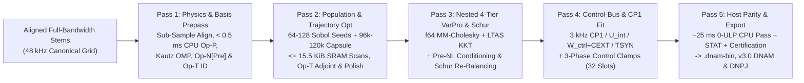
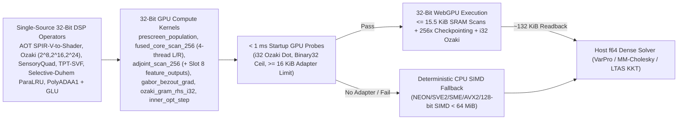

# Split-Precision WebGPU & Analytical VarPro Identification Solver

This specification defines the Black-Box Fixed-Shape Asymptotic SONA Identification Solver (v3.0). It combines portable 32-bit GPU associative scans and 32-bit integer Ozaki reductions with host IEEE-754 float64 `MM-Cholesky`, 33-band LTAS Newton-KKT, Schur prefix re-balancing, and a deterministic CPU SIMD solver fallback.

Together these mechanisms satisfy [REQ-1.5, REQ-1.6, REQ-1.8, REQ-1.9, REQ-2.1, REQ-4.1–REQ-4.3, REQ-5.1, REQ-5.2, REQ-5.4](../../requirements/system_goals_and_requirements.md), [sona_architecture.md](../architecture/sona_architecture.md), [ADR-0018](../../adr/0018-signal-chain-fixtures-crate-and-whitebox-distillation.md), [ADR-0020](../../adr/0020-modular-monorepo-and-dnam-proj-container.md), and [ADR-0022](../../adr/0022-sona-state-space-operator-and-webgpu-architecture.md).

---

## 1. Solver Overview & Dataflow Topology

`r[train.pipeline.topology]`



The solver operates as a 100% black-box, fixed-shape asymptotic identifier (REQ-1.6, REQ-1.9, `ref[repo.code.universal-black-box]`) with zero circuit-specific seed templates, zero hardcoded crossover frequencies, and zero capture-time tier resizing (`ref[arch.tiers.maximize-quality-within-budget]`). All four causally nested SONA v3.0 fixed-shape tiers optimize jointly in one self-contained run without external machine-learning framework dependencies (REQ-4.1, REQ-5.1, REQ-5.2).

| Solver Property | Lite / Full / Pro / Ultra Nesting (Lite ⊂ Full ⊂ Pro ⊂ Ultra) |
| :--- | :--- |
| 4-Block Matryoshka Core | `[1,1,1,1]` / `[2,2,1,1]` / `[3,2,2,1]` / `[4,3,2,1]` (`CoreQuad`s: 4 / 6 / 8 / 10) |
| `ModalConvolver` Early FIR & Kautz Pairs | 32 / 48 / 96 / 128 FIR taps per channel; 8 / 12 / 24 / 32 shared Kautz pole pairs |
| `TransportQuad` (`Op-T`) Quads | 1 / 2 / 3 / 4 `transport_quads` = 4 / 8 / 12 / 16 delay lines |
| Convergence Criterion | `BestUntilDiminishingReturns` (`|ΔbESR| < 0.01` dB/epoch, zero `ThresholdStop` early exit) over full 2.0–2.5 s (96,000–120,000 frames) fp32 capsules |

Speed gained from ahead-of-time SPIR-V-to-shader compilation, <= 15,872 B (15.5 KiB) WebGPU SRAM scans, optional hardware subgroup reductions, and 64–128-seed screening is reinvested directly into finding higher-fidelity weights inside those locked fixed shapes (`ref[arch.tiers.maximize-quality-within-budget]`).

---

## 2. Five-Pass Analytical Variable-Projection & Cholesky Solver

The identification solver executes sequentially across five deterministic passes (`§2.1–§2.5`) without recurrent gating or circuit-template scaffolding.

### 2.1 Pass 1 — Physics & Basis Prepass

`r[train.pipeline.physics-probe]`

On the aligned StarCenter reference stem (`s = 0`), Pass 1 performs 100% data-driven physical identification with zero device names, control-name matching, or circuit templates (REQ-1.6, REQ-1.9). It computes multi-regime sub-sample delay and polarity alignment (`ref[train.capture.alignment.multi-regime]`) and precomputes the input-only `Op-P` basis once on host CPU in < 0.5 ms prior to GPU buffer upload: the true stereo 6-pair Hilbert H1 lattice, 3-basis carrier, and mid-derived 2-stage `rsqrt_pos_nr3` T1 −1 and −2 octave tracker channels (2× OS midpoint-interpolated across Full..Ultra).

Next, Pass 1 identifies shared conjugate Kautz modal poles $\lbrace (r_m, \theta_m) \rbrace$ (8 / 12 / 24 / 32 cumulative pairs across Lite..Ultra, with $r_m \le 0.9995$, `ref[dsp.op-m.kautz.pole-extraction]`) via 2-pass Kautz OMP and Steiglitz–McBride rational identification, alongside initial `SensoryQuad` parameters and continuous front-end `Op-N[Pre]` settings (`gamma_bc`, `zoh_hold_depth = 1.0 - rho_zoh` in [0.0, 0.9999] with zero-init safe bypass, and `beta_q`) solely from aligned dry/wet telemetry.

Pass 1 also estimates causal `Op-T` echo and comb delays of $\tau \ge 5.0$ across 4-frame causal micro-chunks over 1 / 2 / 3 / 4 symmetric pure-wet `TransportQuad`s (4 / 8 / 12 / 16 lines), Doppler grain pitch and shimmer rates with nonzero `ramp_rate_hz`, complementary grain phases, continuous `freeze_mix` and `tank_dry_mix`, unified `sigma_sat` ceiling (`<= 0.984375`), boundary window clamping $\mu_{\text{win},k}$, and 4-lane `Q0.32` quadrature phasor frequencies across 0.05 Hz–20 kHz.

It enforces all intrinsic stability bounds upfront: $\Vert \mathbf{A}_{\text{tpt}} \Vert_2 \le 1$, `ParaLRU` $J_i \in (0, r_{\max}]$, $\tau \ge 5.0$, and coercive `Op-T` $\Vert G_{\text{loop}} \Vert < 1$ (`ref[train.audit.phase1.clamp-stability]`).

### 2.2 Pass 2 — Population Screening & Full-Capsule Trajectory Optimization

`r[train.pipeline.backbone-trajectory-opt]`

Pass 2 jointly trains the fixed-shape 4-tier Matryoshka SONA core (Lite ⊂ Full ⊂ Pro ⊂ Ultra) inside the pure 2×2 VM topology on StarCenter plus extreme switch and gain corners when present. It begins by screening 64–128 Sobol and log-spaced spectral initializations in parallel across GPU workgroups or host SIMD lanes in < 30 ms to avoid single-basin local minima on stiff crossovers, envelope rectifiers, and nonlinear feedback paths (REQ-1.9).

Full-capsule optimization then executes directly over the 2.0–2.5 s (96,000–120,000 frames) fp32 timeline to capture `SensoryQuad` gating/sidechain coupling, 0.5–2.5 s B+ sag, magnetic Duhem hysteresis, optical dual-release, and spatial decay couplings simultaneously.

Computation stays within the strict portable workgroup SRAM ceiling of at most 15,872 B (15.5 KiB), reserving at least 512 B of the 16,384 B baseline for GPU driver and subgroup scratch while pairing optional hardware subgroup optimizations with a clean subgroup-free fallback. Inside 15,360 B (15.0 KiB) forward and 14,848 B (14.5 KiB) adjoint budgets, persistent tiles run 4-block `TPT-SVF` exclusive 2×2 Blelloch prefix scans, 4-thread joint `(L, R)` Selective-Duhem + stereo-linked `ParaLRU` in-SRAM updates, and `PolyADAA1` / $C^2$ wavefolder / bounded `GLU` evaluation.

To preserve exact long-tail sensitivity across both the core and Op-T feedback loops, Pass 2 pairs 2-level cross-tile linear-recurrence and 2×2 TPT reverse-adjoint suffix scans (§3.2) with 256-sample tile activation checkpointing (`Slot 8` `feature_outputs` bound in adjoint for GLU), Selective-Duhem `BP_i` and `lru_stereo_link` pullback, C∞ Op-N[Pre] raised-cosine/Fourier gradients, and exact recurrent Op-T differentiation through Catmull-Rom cubic readers, Hermite windows, partitioned Schroeder all-pass states, unified `sigma_sat` limiters, and continuous `freeze_mix` recirculation.

Trajectory optimization minimizes composable multi-objective perceptual losses combining offline 3-band Bezout `bESR`, 5-scale `MR-IIR` (`ref[qual.companion.mr-iir]`), Spectral Optimal Transport (`SpecOT`), multi-window Gabor magnitude, and instantaneous-frequency plus group-delay (`IF+GD`) phase coherence. The offline 3-band Bezout crossover exists purely inside this training loss metric, with zero runtime clean-path crossover inside the audio VM.

On every outer VarPro epoch, the solver accumulates chunkwise 3-slice (2^8, 2^16, 2^24) `i32` Ozaki normal equations (~132 KiB readback) and solves host float64 EMR 1/12-octave `MM-Cholesky`, 33-band LTAS Newton-KKT, and Schur tier prefix re-balancing—jointly resolving 1× ZOH-adapted Lite readouts alongside 2× Full..Ultra. It refines continuous $(r_m, \theta_m)$ Kautz pole pairs and fractional `Op-T` delays and LFO depths via 16–32 GPU-resident m = 8 L-BFGS / $J^\top J$ Gauss–Newton steps.

Optimization terminates strictly on `BestUntilDiminishingReturns` (`|ΔbESR| < 0.01` dB/epoch) while archiving 2.0–2.5 s fp32 `INPC`/`STMC` capsules (`ref[container.proj.inpc-capsule]`, `ref[container.proj.stmc-capsule]`).

### 2.3 Pass 3 — Nested 4-Tier VarPro Subspace & Schur Re-Balancing

`r[train.pipeline.nested-varpro-schur]`

Pass 3 solves the causally nested Lite, Full, Pro, and Ultra direct-register `LinearReadout` subspace (`W_ro,0` `fp16` subspace plus `pre_conv` and `direct_s2` stereo linear projections) and learned `"DBRM"` `ro_pole_48k` tilt/shelf basis jointly in one run alongside pre-nonlinear crossbar conditioning (REQ-5.1, REQ-5.2).

Accumulated tier-prefix normal equations $\mathbf{G}_{1:D_T, 1:D_T} + \boldsymbol{\Lambda}_{D_T}$ are solved via IEEE-754 float64 Cholesky factorization and Schur-complement prefix re-balancing so Lite, Full, Pro, and Ultra each achieve optimal spectral balance without separate per-tier jobs.

Normal equations are weighted across 4th-order Bezout LF/MF/HF bands (`ref[qual.besr.bezout-crossover]`), subject to 33-band 1/3-octave LTAS tilt bounds (`ref[qual.companion.ltas]`), while refining continuous Kautz poles and lag-ordered `ModalConvolver` early FIR taps (32 / 48 / 96 / 128 taps), conditioning pre-nonlinear crossbar and `CP1`/`U_int` subspaces, and baking StarCenter readout statistics into `STAT` (`ref[container.proj.stat-uplo-u]`).

### 2.4 Pass 4 — Parametric Control-Bus & `CP1` Subspace Identification

`r[train.pipeline.control-projection-fit]`

Across multi-stem control schedules for $P \ge 1$, Pass 4 fits per-stem 3 kHz Parametric Control Bus projections in parallel across non-center stems (< 50 ms for Path 1 Vault edits, < 256 MiB browser GPU or < 64 MiB portable CPU SIMD; REQ-4.3).

These fits optimize CP1 contributor slices (`W_main`, `w_proj`, and `v`, adding `"CP1\0"` overflow streams when exceeding 8 slots or 576 B in `cp1_base`) alongside global Rank-4/8 `U_int` matrices.

Each fit also solves all 16 base rows of `W_ctrl`, Ultra `W_ctrl_ultra`, `lfo_skew_fp16`, `ou_to_z_stage*_fp16`, and the optional 1,280 B `"CEXT"` dispatch matrix.

Extended dispatch rows 16..31 of `stage_targets[0..32]` include uniformly micro-ramped slot 16 (`op_t_freeze_mix_delta`) identified empirically from sustain-hold stems without freeze-role heuristics, slot 22 stage `op_t_dry_mix_mod`, slot 30 (`sense_vca_gain_delta` in `[-1.0, +1.0]`), and 40 B `"TSYN"` physical PeriodMs/FrequencyHz tempo rows alongside TPT-SVF, ParaLRU, `Op-N[Pre]`, and crossbar targets (`ref[container.dnam.cp1-profile]`).

Each stem uses Gauss–Lobatto interpolation anchored at StarCenter (Mode-0 locked for 0-ULP invariance) while running the non-stop 3-Phase Control-Space Audit across all 32 dispatch slots (`ref[train.audit.phase1.clamp-stability]`).

Compact stationary coresets evaluate over broadband chord and log-chirp slices, whereas interior sweep windowing extracts 2–4 midpoint-labeled windows across continuous 1D sweep stems (flagged `MODE_A_SWEEP`, `bit 1<<2` in `STMC`, `ref[container.proj.stmc-capsule]`) and 2-knob Hadamard diagonal sweeps, while evaluating 3+-knob short captures at orthogonal stationary coreset stops so bass-only segments do not bias mid or high knobs.

To recover from dynamic envelope or phase decorrelation without hurting coherent waveshapers, Pass 4 runs a two-pass multiband Wiener filter (`ref[repo.code.constant-eval-and-derivations]`). Gauss–Newton Pass 1 solves under pure waveform MSE (`w_band` = 0.0).

With $\varepsilon = 10^{-12}$ over active evaluation samples comparing target `y_wet` against StarCenter Ultra and Lite renders `y_star,U` and `y_star,L`, averaging mono or stereo channel energies gives:

$$E_{\text{star}} = \frac{1}{2}(E_{\text{star},U} + E_{\text{star},L}), \qquad \mathrm{oct}_{\text{tot}} = \frac{1}{2}\log_2\frac{E_{\text{wet}} + \varepsilon}{E_{\text{star}} + \varepsilon}, \qquad \rho_{\text{wave}} = \frac{\langle y_{\text{wet}}, y_{\text{star},U}\rangle}{2\sqrt{E_{\text{wet}} E_{\text{star},U}} + 2\varepsilon} + \frac{\langle y_{\text{wet}}, y_{\text{star},L}\rangle}{2\sqrt{E_{\text{wet}} E_{\text{star},L}} + 2\varepsilon}$$

Pass 1 renders Ultra output $y_{\text{mdl},1,U}$ and Lite output $y_{\text{mdl},1,L}$, yielding broadband Pass-1 energy $E_{\text{mdl},1}$, per-band Pass-1 energy $E_{\text{mdl},1,b}$, and per-band error $\mathrm{oct}_{\text{err},1,b}$ across bands $b \in \lbrace \text{sub}, \text{lm}, \text{pres}, \text{hi} \rbrace$:

$$E_{\text{mdl},1} = \frac{1}{2}(E_{\text{mdl},1,U} + E_{\text{mdl},1,L}), \qquad E_{\text{mdl},1,b} = \frac{1}{2}(E_{\text{mdl},1,U,b} + E_{\text{mdl},1,L,b}), \qquad \mathrm{oct}_{\text{err},1,b} = \frac{1}{2}\log_2\frac{E_{\text{mdl},1,b} + \varepsilon}{E_{\text{wet},b} + \varepsilon}$$

When `oct_tot > -2.5` oct and `rho_wave > -0.15`, Pass-2 4-band Wiener recovery triggers if Pass-1 broadband error $\mathrm{oct}_{\text{err},1} = \frac{1}{2}\log_2((E_{\text{mdl},1} + \varepsilon)/(E_{\text{wet}} + \varepsilon)) < -0.55\text{ oct}$ or any single band (`sub`, `lm`, `pres`, `hi`) satisfies all three band-collapse gating predicates:

$$E_{\text{wet},b} \ge 0.05 \sum_{b'} E_{\text{wet},b'}, \qquad \rho_b = \frac{1}{2}(\rho_{b,U} + \rho_{b,L}) < 0.65, \qquad \mathrm{oct}_{\text{err},1,b} < -0.55\text{ oct}$$

Here `ACTIVE_BAND_MIN_ENERGY_FRAC = 0.05` excludes low-energy bands, and `BAND_PHASE_DECORR_RHO_MAX = 0.65` caps tier-averaged per-band waveform correlation $\rho_b$ across Ultra and Lite Pass-1 correlations $\rho_{b,U}$ and $\rho_{b,L}$ so coherent waveshapers stay under pure waveform MSE.

When triggered, Pass 2 sets $w_{\text{band}} = 2.5$ (`FOUR_BAND_RMS_MATCH_WEIGHT`) and adds the tier-averaged 4-band envelope penalty (`0.25 * 2.5` factor across both tiers):

$$\mathcal{L}_{\text{band}} = 0.25 w_{\text{band}} \sum_b \Big(\big(\sqrt{E_{\text{wet},b}} - \sqrt{E_{\text{mdl},U,b}}\big)^2 + \big(\sqrt{E_{\text{wet},b}} - \sqrt{E_{\text{mdl},L,b}}\big)^2\Big)$$

Band energies across Pass 1 and Pass 2 evaluate the shared 4-band TPT-SVF bank over generic input signal $s[n]$ applied to $y_{\text{wet}}$, $y_{\text{mdl},U}$, and $y_{\text{mdl},L}$ at $f_s = 48{,}000\text{ Hz}$ using a 1-pole TPT lowpass at $f_{\text{sub}} = 250\text{ Hz}$ and a parallel 2-pole TPT-SVF at $f_{\text{mid}} = 1{,}800\text{ Hz}$, $Q = 0.8$, and $k = 1 / Q = 1.25$:

$$g_{\text{sub}} = \tan\left(\frac{\pi \cdot 250}{f_s}\right), \qquad G_{\text{sub}} = \frac{g_{\text{sub}}}{1 + g_{\text{sub}}}, \qquad v_{\text{sub}}[n] = G_{\text{sub}}\big(s[n] - s_{\text{sub}}[n-1]\big), \qquad b_{\text{sub}}[n] = v_{\text{sub}}[n] + s_{\text{sub}}[n-1]$$
$$g_{\text{mid}} = \tan\left(\frac{\pi \cdot 1800}{f_s}\right), \qquad k = 1.25, \qquad a_1 = \frac{1}{1 + g_{\text{mid}}(g_{\text{mid}} + k)}, \qquad a_2 = g_{\text{mid}} a_1, \qquad a_3 = g_{\text{mid}} a_2$$
$$v_3[n] = s[n] - s_2[n-1], \qquad v_1[n] = a_1 s_1[n-1] + a_2 v_3[n], \qquad v_2[n] = s_2[n-1] + a_2 s_1[n-1] + a_3 v_3[n]$$
$$b_{\text{lm}}[n] = v_2[n] - b_{\text{sub}}[n], \qquad b_{\text{pres}}[n] = k v_1[n], \qquad b_{\text{hi}}[n] = s[n] - k v_1[n] - v_2[n]$$

State updates use exact trapezoidal integrators $s_{\text{sub}}[n] = b_{\text{sub}}[n] + v_{\text{sub}}[n]$, $s_1[n] = 2 v_1[n] - s_1[n-1]$, and $s_2[n] = 2 v_2[n] - s_2[n-1]$, guaranteeing algebraic partition of unity $b_{\text{sub}}[n] + b_{\text{lm}}[n] + b_{\text{pres}}[n] + b_{\text{hi}}[n] = s[n]$ and restoring multiband energies $E_{\text{wet},b}$, $E_{\text{mdl},U,b}$, and $E_{\text{mdl},L,b}$ across bands $b \in \lbrace \text{sub}, \text{lm}, \text{pres}, \text{hi} \rbrace$.

### 2.5 Pass 5 — Deterministic Host Parity Pass, Certification & Container Emission

`r[train.pipeline.host-parity-and-export]`

Before emission, Pass 5 runs a ~25 ms deterministic host CPU pass using the reference CPU engine and 3-limb compensated binary64 summation over the certification timeline (REQ-4.2). This locks 0-ULP parity between GPU-accelerated and CPU-only solves while persisting `uplo='U'` `STAT` sufficient statistics for < 50 ms Path 1 Vault updates.

Pass 5 then enforces adjacent-tier monotone non-regression (Lite <= Full <= Pro <= Ultra) and verifies intrinsic stability: $\Vert \mathbf{A}_{\text{tpt}} \Vert_2 \le 1$, `ParaLRU` $J_i \in (0, r_{\max}]$, causal `Op-T` $\tau \ge 5.0$ across crossbar micro-chunks or $\ge 4.0$ standalone with coercive $\Vert G_{\text{loop}} \Vert < 1$, `Op-N[Pre]` `zoh_hold_depth` inside [0.0, 0.9999], `ro_pole_48k` inside `[0.0, 0x3F7F_FFAC]`, and `[STAB-ZERO-DC]` $b_{\text{head}} = 0.0$.

It calibrates <= 0.05 LU inter-tier `tier_gain_trim_lin` (REQ-5.4) and applies optional 0-ULP odd-symmetric CoreQuad sign-flip (plus cyclic `glu_mix_fp16` parity), ModalConvolver Kautz, and EMR-masked Tardos watermarking strictly outside protected `.dnam-bin` prefixes, `"CEXT"`, SensoryQuad, `ou_to_z_stage_ultra_fp16`, and Op-N[Pre] fields (`ref[sec.watermark.reciprocal-gauge]`).

Finally, Pass 5 certifies the 4-metric perceptual suite (bESR, MR-IIR, LTAS, SegESR) and compiles the pure-binary Layer-0 .dnam-bin image. The Layer-0 header prefix (`dbin_prefix`) spans `"DNBN"`, `"DBRM"`, `shared_controls`, `"TSYN"`, optional `"CEXT"`, and 64 B zero-padding ahead of Arena 0..3.

Pass 5 embeds `dbin_prefix` at `[dbin_offset..tier_start)` ahead of `[tier_start..retained_tier_end]` inside 64 B-aligned v3.0 .dnam containers (`Region 4 == 0 B`) and stores the resulting .dnam container inside the `WGHT` chunk of .dnam-proj (`ref[container.dnam.vm-binary]`).

---

## 3. Wide-Significand Gram Contraction & Cross-Platform Accuracy

### 3.1 Host IEEE-754 `float64` & Wide-Significand Contraction Contract

#### IEEE-754 `float64` & Deterministic Contraction Contract

`r[train.gram.accuracy-contract]`

Every `uplo = 'U'` Gram matrix $\mathbf{G} = \sum_{n=0}^{N-1} w_n \boldsymbol{\phi}[n]\boldsymbol{\phi}[n]^\top$ and target cross-correlation $\mathbf{C} = \sum_{n=0}^{N-1} w_n \boldsymbol{\phi}[n]\mathbf{y}[n]^\top$ solved on the host satisfies entrywise error bound $\lvert \hat{g}_{ij} - g_{ij} \rvert \le \gamma_N \sum_{n=0}^{N-1} w_n \lvert \phi_i[n] \phi_j[n] \rvert$ in IEEE-754 `float64`.

Execution uses fixed-order deterministic `[4 × 4]` and `[8 × 4]` register-tiled 256-frame micro-batch reduction (`MICRO_BATCH_FRAMES = 256`, `0..n_pairs`) across ARM64, x86_64, and 128-bit portable SIMD targets (REQ-4.2). Input provenance binds via input-gram fingerprinting, computing SHA-256 over the little-endian byte transcript below where `canon(x)` maps -0.0 to +0.0:

```text
"DNAM-GRAM-INPUT-V3\0"
|| u32le(feature_dim)
|| [u8(2), u8(2)]  (feature_type = 2 for f64, weight_type = 2 for f64)
|| for frame_idx in 0..N:
     (u8(1) || u64le(frame_idx) || f64le(canon(weight)) || f64le(canon(row[0..feature_dim])))
|| u8(0)
|| u64le(N)
```

#### Compensated / Wide-Significand 3-Limb Accumulation

`r[train.gram.wide192]`

For high-dynamic-range stems spanning > 53 bits of exponent cancellation (such as `[1, 2^-30, -1]`), the 3-limb compensated accumulator ([ADR-0022](../../adr/0022-sona-state-space-operator-and-webgpu-architecture.md)) maintains 3 × `f64` (~159-bit significand) non-overlapping Priest/Dekker expansion limbs.

It splits mantissas using `DEKKER_SPLIT_F64 = 134_217_729.0` (with zero hardware FMA dependence) across `[DEKKER_SAFE_MIN = 2^-450 = 0x23D0_0000_0000_0000, DEKKER_SAFE_MAX = 2^+450 = 0x5C10_0000_0000_0000]`, falling back to exponent-normalizing `ldexp` outside that range. Final collapse applies Boldo–Melquiond round-to-odd on `limbs[1] + limbs[2]` and canonicalizes zero to +0.0 for bit-identical ARM64, x86_64, and 128-bit portable SIMD parity.

### 3.2 Portable 32-Bit WebGPU Scans, Ozaki Accumulator & 2-D Memory Planner

`r[train.pipeline.webgpu-scans-and-ozaki]`



**Single-Source 32-Bit Kernels & < 1 ms Startup Probes (REQ-4.1, REQ-4.2):** Both the real-time audio engine and the 32-bit GPU/CPU training solver share identical single-source fixed-precision arithmetic primitives across all SONA operators, compiled to portable compute shaders via ahead-of-time SPIR-V-to-shader compilation.

Six 32-bit GPU compute kernels (enumerated in the ABI table below) execute across native and browser GPU compute backends without inflating client runtime binaries.

Before dispatching workgroups, GPU backends run < 1 ms startup probes verifying exact `i32` Ozaki dot products (`sum == exact`), binary32 power-of-two ceiling bit-masking (`((bits + 0x007FFFFF) & 0x7F800000)`), and adapter device limits—requiring `maxComputeWorkgroupStorageSize` >= 16,384 B so the <= 15,872 B shader SRAM cap reserves >= 512 B for driver scratch, 128 MiB storage buffer binding size, and optional hardware subgroup support with automatic subgroup-free fallback.

If any probe fails, execution falls back transparently to the deterministic CPU SIMD solver.

**Universal <= 15,872 B (15.5 KiB) Workgroup-SRAM Scans & 256× Checkpointing (REQ-4.3):** Each 256-thread workgroup processes one `(CoreQuad, stem)` pair across 8 decoupled scalar lanes (4L + 4R) under the portable <= 15,872 B (15.5 KiB) workgroup shared-memory ceiling, reserving >= 512 B of the 16,384 B adapter baseline for GPU driver and optional subgroup scratch.

This shrinks 16 stems × 2.5 s (1.92M frames) of activation tapes from ~780 MiB to ~3.1 MiB, keeping 16–32 inner m = 8 L-BFGS / Gauss–Newton steps GPU-resident with < 5 ms asynchronous host readback and zero blocking event-loop waits.

In the forward kernel (`fused_core_scan_256`, 15,360 B = 15.0 KiB <= 15,872 B), dispatch runs once per cascade block (`block_idx` in 0..4) over grid `(quads_in_block, num_independent_windows, num_stems)`. Persistent workgroups iterate across tiles `tile_start .. tile_start + num_tiles` carrying `(s1, s2, v, adaa_prev)` in registers.

All 256 threads run exclusive `(s_{1,t-1}, s_{2,t-1})` 2×2 `TPT-SVF` Blelloch scans (`scan_scratch`: `1,536 × f32` = 6,144 B) into `lane_buf` (`512 × f32[4]` = 8,192 B).

Next, workgroup threads 0..4 (`local_invocation_index < 4`) execute Selective-Duhem ParaLRU and `lru_stereo_link` jointly across `(v_{L,i}, v_{R,i})` in registers across 1- or 2-lane passes over `(u_tone, BP)` inside scan_scratch (6,144 B, keeping total SRAM <= 15,872 B) before overwriting `lane_buf` with pre-activation `r_curr[t]` (+0.0 Zero-DC). All 256 threads then evaluate PolyADAA1, the $C^2$ wavefolder, and bounded cross-lane GLU (after `wavefolder_mix`, canonicalizing +0.0) using `aux_scratch` (1,024 B) and padding tail tiles with identity elements.

In the backward kernel (`adjoint_scan_256`, 14,848 B = 14.5 KiB <= 15,872 B), exact 3-pass full-stem BPTT executes within one uniform binding layout selected by `pass_mode` in {0, 1, 2}, propagating gradients across CoreQuad states (including `Slot 8` `feature_outputs` for zero-SRAM cross-lane GLU pullback, `lru_stereo_link` transpose, Selective-Duhem `BP_i` recomputation into `adj_s1, adj_s2, adj_g`, Op-N[Pre] 1-D affine/Fourier paths) and recurrent Op-T paths.

Its 14.5 KiB SRAM budget partitions across `s_prev2` (4,096 B), `u_tone2` (2,048 B), `v_traj2` (2,048 B), `scan_scratch` (6,144 B), and `aux` (512 B).

It indexes storage slot 7 (`tile_adj_boundaries`) at stride `16 × f32[4]` (256 B per stem, q_local, and tile), where lane channel c in 0..4 occupies `4 × f32[4]` at `slot = (((stem * quads_in_block + q_local) * num_tiles + tile) * 4 + c) * 4` while reading `Slot 8` (`feature_outputs`) for zero-SRAM cross-lane GLU adjoint pullback and recomputing Selective-Duhem `BP_i` and `lru_stereo_link` transposes in registers:

| Slot 7 Offset | Element Type | `pass_mode = 0` Write & `pass_mode = 1` Suffix Resolution | `pass_mode = 2` Tile Pullback Role |
| :--- | :--- | :--- | :--- |
| `slot + 0` | `f32[4]` | 2×2 TPT adjoint transition matrix `(t00, t01, t10, t11)`; overwritten in-place during `pass_mode = 1` with `(adj_s1_L_out, adj_s2_L_out, adj_s1_R_out, adj_s2_R_out)` | Supplies resolved outgoing `(adj_s1_out, adj_s2_out)` boundary sensitivities |
| `slot + 1` | `f32[4]` | 2×2 TPT adjoint injection vector `(g0_L, g1_L, g0_R, g1_R)` | Consumed during `pass_mode = 1` cross-tile suffix scan |
| `slot + 2` | `f32[4]` | Selective-Duhem `ParaLRU` linear-scan element `(a_L, b_L, a_R, b_R)`; overwritten in-place during `pass_mode = 1` with `(adj_v_out_L, adj_v_out_R, 0, 0)` | Supplies resolved outgoing `adj_v_out` sensitivity after `lru_stereo_link` transpose pullback |
| `slot + 3` | `f32[4]` | `PolyADAA1` seam `(r_first_L, r_first_R, 0, 0)` written by `tile` | Read during `pass_mode = 2` by `tile` via `tile_adj_boundaries[slot + 16 + 3]` when `tile + 1 < num_tiles` for the `(r_curr[255], r_curr[256])` seam pullback |

| Adjoint Pass Mode (`pass_mode`) | Dispatch Grid | Exact Execution Role (Zero Truncation Across 200 ms–2.5 s Poles) |
| :--- | :--- | :--- |
| 0 | `(quads_in_block, num_tiles, num_stems)` | Recomputes `v_traj` from `tile_checkpoints[tile]` in parallel; writes `slot + 0..3` summaries into `tile_adj_boundaries` |
| 1 (< 0.05 ms) | `(quads_in_block, 1, num_stems)` | Executes level-2 `O(log2 num_tiles)` suffix scan in 256-tile scan blocks, overwriting `slot + 0` and `slot + 2` with outgoing boundary sensitivities |
| 2 | `(quads_in_block, num_tiles, num_stems)` | Consumes resolved boundaries, `tile + 1` seam, and `Slot 8` `feature_outputs` for `GLU` pullback; runs Selective-Duhem `BP_i`, `ParaLRU`, and 2×2 TPT suffix scans in `scan_scratch`, emitting deterministic `param_grads` (zero `f32` atomics) |

**Fast-Math-Immune (2^8, 2^16, 2^24) `i32` Ozaki Accumulator & 2-D Memory Planner (REQ-4.2, REQ-4.3):** Exact integer-sliced Ozaki accumulation uses dynamic power-of-two block scaling, returning `(1.0, 1.0)` on non-positive or non-finite chunk `max_abs`.

Otherwise, it computes `ceil_bits = (bits + 0x007F_FFFF) & 0x7F80_0000` and exponent `e = clamp(ceil_bits >> 23, 1, 253)` to construct binary32 `scale` from bit pattern `(e << 23)` and `inv_scale` from `((254 - e) << 23)`.

For |val| <= 2^126, 3-slice mantissa decomposition normalizes `v = clamp(val * inv_scale, -1.0, 1.0)` and splits all 24 significand bits via biased ties-to-even rounding (`0x4B40_0000`). This extracts signed slices `s0 = rne(v * 2^8)` in [-256, 256], `s1 = rne((v - f32(s0)*2^-8) * 2^16)` in [-128, 128], and `s2 = rne((rem1 - f32(s1)*2^-16) * 2^24)` in [-128, 128].

Over `N <= OZAKI_MAX_CHUNK_LEN = 1024`, the GPU accumulates 5 diagonals (`d0 = sx0*sy0`, `d1 = sx0*sy1 + sx1*sy0`, `d2 = sx0*sy2 + sx1*sy1 + sx2*sy0`, `d3 = sx1*sy2 + sx2*sy1`, `d4 = sx2*sy2`) strictly in 32-bit signed integer registers.

Because every partial sum stays at most 83,886,080 (at most 2,147,483,647) and immune to FMA contraction, host binary64 reconstruction restores `f64` totals at 0-ULP precision (~132 KiB per outer epoch readback).

The 2-D `RESIDENT_BATCHED` / `STREAMED` memory planner tiles `time_block × stem_group` across <= 128 MiB per storage binding. It strictly caps combined device and host memory below 256 MiB in browser GPU workers (< 64 MiB on CPU SIMD fallback), below 512 MiB for desktop capsule solves, and within a configurable 4–8 GiB ceiling (<= 1 GiB per tensor) when streaming multi-minute raw captures.

**Canonical 32-Bit GPU Compute Kernel ABI:** All six compute kernels execute over 256-thread workgroups (`(256, 1, 1)`), 32-bit storage buffers, and 16 B-aligned packed 32-byte uniform blocks in slot 0 (zero `f64` types, <= 15,872 B = 15.5 KiB workgroup shared memory reserving >= 512 B driver/subgroup scratch):

| Compute Kernel | 256-Thread Workgroup Grid | Slot 0: 32-Byte Packed Uniforms | Storage Buffer Slots (`1..N`) |
| :--- | :--- | :--- | :--- |
| `prescreen_population` | `(num_seeds, num_tiles, num_stems)` | `PrescreenUniforms { num_seeds: u32, num_frames: u32, num_quads: u32, num_stems: u32, sample_rate_hz: f32, eps_floor: f32, _pad0: u32, _pad1: u32 }` | `Slot 1 (RO)`: `input_audio: f32[2][]`<br/>`Slot 2 (RO)`: `target_audio: f32[2][]`<br/>`Slot 3 (RO)`: `seed_params: f32[]`<br/>`Slot 4 (RW)`: `seed_losses: f32[]` |
| `fused_core_scan_256` | `(quads_in_block, num_independent_windows, num_stems)` (1 dispatch per `block_idx` in 0..4) | `FusedScanUniforms { num_frames: u32, num_tiles: u32, num_quads: u32, num_stems: u32, tile_start: u32, soft_rect_eps: f32, tiny_crossing_eps: f32, block_idx: u32 }` | `Slot 1 (RO)`: `core_inputs: f32[4][]`<br/>`Slot 2 (RO)`: `quad_params: f32[4][]`<br/>`Slot 3 (RW)`: `tile_checkpoints: f32[4][]`<br/>`Slot 4 (RW)`: `feature_outputs: f32[4][]` |
| `adjoint_scan_256` | `(quads_in_block, num_tiles or 1, num_stems)` (`pass_mode` in `{0, 1, 2}` per `block_idx`) | `AdjointScanUniforms { num_frames: u32, num_tiles: u32, num_quads: u32, num_stems: u32, pass_mode: u32, soft_rect_eps: f32, tiny_crossing_eps: f32, block_idx: u32 }` | `Slot 1 (RO)`: `core_inputs: f32[4][]`<br/>`Slot 2 (RO)`: `quad_params: f32[4][]`<br/>`Slot 3 (RO)`: `tile_checkpoints: f32[4][]`<br/>`Slot 4 (RO)`: `d_loss_d_features: f32[4][]`<br/>`Slot 5 (RW)`: `d_loss_d_inputs: f32[4][]`<br/>`Slot 6 (RW)`: `param_grads: f32[4][]`<br/>`Slot 7 (RW)`: `tile_adj_boundaries: f32[4][]`<br/>`Slot 8 (RO)`: `feature_outputs: f32[4][]` (`GLU` neighbor `adaa_odd` pullback, 0 B extra SRAM) |
| `gabor_bezout_grad` | `(num_subbands_or_windows, num_stems, 1)` | `GaborBezoutUniforms { num_frames: u32, fft_size: u32, hop_size: u32, num_stems: u32, w_lf: f32, w_mf: f32, w_hf: f32, eps_noise: f32 }` | `Slot 1 (RO)`: `pred_audio: f32[2][]`<br/>`Slot 2 (RO)`: `target_audio: f32[2][]`<br/>`Slot 3 (RO)`: `bezout_taps: f32[4][]` (offline multi-band perceptual `bESR` training loss only; zero runtime clean crossover)<br/>`Slot 4 (RW)`: `d_loss_d_pred: f32[2][]`<br/>`Slot 5 (RW)`: `band_losses: f32[4][]` |
| `ozaki_gram_rhs_i32` | `(num_col_tiles, ceil(num_frames / 1024), 1)` | `OzakiGramUniforms { num_frames: u32, feature_dim: u32, target_channels: u32, chunk_len: u32, num_chunks: u32, _pad0: u32, _pad1: u32, _pad2: u32 }` | `Slot 1 (RO)`: `features: f32[]`<br/>`Slot 2 (RO)`: `targets: f32[]`<br/>`Slot 3 (RO)`: `col_scales: f32[2][]`<br/>`Slot 4 (RW)`: `ozaki_buckets: i32[]` |
| `inner_opt_step` | `(ceil(num_params / 256), 1, 1)` | `InnerOptUniforms { num_params: u32, history_m: u32, step_idx: u32, line_search_iter: u32, step_size: f32, damping_lambda: f32, min_bound_eps: f32, _pad: u32 }` | `Slot 1 (RW)`: `theta: f32[]`<br/>`Slot 2 (RO)`: `grad: f32[]`<br/>`Slot 3 (RO)`: `param_bounds: f32[2][]`<br/>`Slot 4 (RW)`: `lbfgs_s_y: f32[4][]`<br/>`Slot 5 (RW)`: `search_dir: f32[]` |

---

## 4. Engine-Capture Isomorphism, Control Dispatch & Fixture Certification

### 4.1 Zero-ULP Engine-Capture Isomorphism Parity

`r[train.pipeline.isomorphism-parity]`

Because the identification solver and runtime audio engine execute identical fixed-precision DSP operator formulations (`SensoryQuad`, `ModalConvolver` FIR/Kautz bank, TPT-SVF, Selective-Duhem stereo-linked ParaLRU, PolyADAA1, wavefolder, `GLU`, smooth `Op-N[Pre]`, and pure-wet `Op-T`), GPU and host solves agree across all modules.

Every GPU-accelerated solve concludes with a deterministic host CPU reference pass and 3-limb compensated binary64 summation, so exporting `WGHT` (wrapping `.dnam-bin`) from `.dnam-proj` reproduces the solver's predicted waveform to 0 ULP (`Oracle-01..03`, `bESR` <= -60 dB).

| Parity Domain | Verified Numerical Bound |
| :--- | :--- |
| CPU ParaLRU Forward Tile & `i32` Ozaki Reduction | 0-ULP CPU/GPU identity (matches 3-limb binary64 summation to ~2^-24, and 0-ULP when inputs lie in `[0.5 * scale, scale]`) |
| 32-Bit GPU FMA Contraction | <= 1.5 ULP/step on ParaLRU, TPT-SVF, PolyADAA1, and Kautz quad per-step updates |
| 256-Wide `f32` Linear Tree Scans | <= 1.0e-4 * max(1.0, `trajectory_peak`) reassociation parity across `TPT-SVF`, Kautz, and `ParaLRU` reverse adjoint |

### 4.2 Closed-Form Control-Dispatch Normal Equations

`r[train.pipeline.dispatch-solve]`

Because SONA v3.0 anchors static readout `W_ro,0` at `StarCenter`, non-reference stem and window identification assembles a weighted `uplo = 'U'` control-subspace normal system without re-streaming audio frames (`ref[train.resume.kronecker-reassembly]`):

$$\mathbf{G}_{\psi} = \sum_{s \in \mathcal{S}_{\text{enabled}}} w_s \boldsymbol{\psi}_s \boldsymbol{\psi}_s^\top + \boldsymbol{\Lambda}_{\psi}, \qquad \mathbf{R}_{\psi} = \sum_{s \in \mathcal{S}_{\text{enabled}}} w_s \boldsymbol{\psi}_s \mathbf{z}_{s,\text{target}}^\top$$

Host `f64` `uplo = 'U'` Cholesky factorization solves $\mathbf{G}_{\psi}$ over enabled stem and window control basis rows $\boldsymbol{\psi}_s \in \mathbb{R}^K$ and target modulation vectors $\mathbf{z}_{s,\text{target}}$, pinning `StarCenter` at $\boldsymbol{\psi}_0 = \mathbf{0}$ so `W_ro,0` stays invariant at 0 ULP.

The solve outputs `CP1` (`main_base` and `main_ultra`, inline or `"CP1\0"`), 4×8 `U_int`, `stage_latent_*` sensitivity tables, and 40 B `"TSYN"` tempo rows.

It also resolves all 32 `stage_targets[0..32]` rows across 16-row `W_ctrl`, Ultra `W_ctrl_ultra`, and optional 1,280 B `"CEXT"` rows 16..31 including empirical slot 16 `op_t_freeze_mix_delta`, slot 22 stage `op_t_dry_mix_mod`, and slot 30 `sense_vca_gain_delta`.

### 4.3 Four-Tier Signal-Chain Fixture Matrix & White-Box Runners

`r[train.pipeline.fixtures-matrix]`

The verification suite defines a four-tier benchmark matrix against synthetic reference signal chains ([ADR-0018](../../adr/0018-signal-chain-fixtures-crate-and-whitebox-distillation.md)) targeting 0-ULP runtime parity between deterministic CPU SIMD and 32-bit GPU backends across all unrecorded-control and multi-rate cases:

| Verification Tier | Target Coverage Scope | Key Fixtures & Gate Scenarios |
| :--- | :--- | :--- |
| Tier 1 (3 Structural Oracles) | `Oracle-01..03` | Schur + sign-flip/Kautz gauge recovery, arbitrary P `CP1` (P = 6, P = 16), and zero-WAV `.dnam-proj` capsule vault editing |
| Tier 2 (14 Primary Archetypes + Universal Black-Box Extensions + Optional Smoke Rig) | `Chain-01..11, 13..15` (target 56/56 tier cells + 16/16 analytical + 52/52 unrecorded-control cells) + Granular Pitch/Shimmer, Endless Barberpole Sweep & ZOH-Quantizer / Bitcrusher + optional `Chain-12` | Symmetric OD (`Chain-01`), gated fuzz (`Chain-02`), parallel clean-blend drive (`Chain-03`), tube amp + FMV 4×12 (`Chain-04`), zero-control LTI cab & room (`Chain-05`), envelope SVF/wah (`Chain-06`), stereo chorus/rotary (`Chain-07`), BBD echo & 30 s shimmer/sustain-hold (`Chain-08`), LA-2A optical comp (`Chain-09`), OC-2 octave & ring-mod (`Chain-10`), bi-amp bass & output iron (`Chain-11`), tri-band VCA comp (`Chain-13`), tri-band comp + distortion (`Chain-14`), tube head DI (`Chain-15`), universal Granular Pitch/Shimmer, Endless Barberpole Sweep, and ZOH-Quantizer / Bitcrusher capsules, plus optional 4CM/WDW rig (`Chain-12`) |
| Tier 3 (14 Fault Decorators) | `Cases #1..#26` | ADC clipping/pads, converter loopback lag, human knob trajectories, thermal hysteresis, pot tapers, polarity inversion/DC offset, mains hum/hiss, noise gates, spring chirp, digital bit-crush quirks, scratchy pots, idle squeal, and microphone capsule clipping |
| Tier 4 (`DNWB` White-Box & Multi-Rate) | External circuit and DSP simulator subprocesses over little-endian `DNWB` binary streams (64-byte header + IEEE-754 float32 payload) | 32 / 44.1 / 48 / 88.2 / 96 / 192 kHz × Int12 / Int16 / Int24 / Int32 / Float32 4-metric certification |
