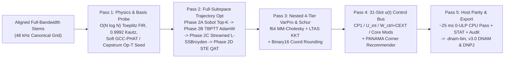
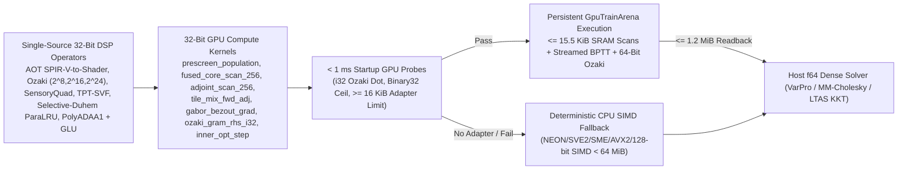

# Split-Precision WebGPU & Analytical VarPro Identification Solver

This specification defines the Black-Box Fixed-Shape Asymptotic SONA Identification Solver (v3.0). It combines portable 32-bit GPU associative scans and 32-bit integer Ozaki reductions with host IEEE-754 float64 `MM-Cholesky`, 33-band LTAS Newton-KKT, Schur prefix re-balancing, and a deterministic CPU SIMD solver fallback.

Together these mechanisms satisfy [REQ-1.5, REQ-1.6, REQ-1.8, REQ-1.9, REQ-2.1, REQ-4.1–REQ-4.3, REQ-5.1, REQ-5.2, REQ-5.4](../../requirements/system_goals_and_requirements.md), [sona_architecture.md](../architecture/sona_architecture.md), [ADR-0018](../../adr/0018-signal-chain-fixtures-crate-and-whitebox-distillation.md), [ADR-0020](../../adr/0020-modular-monorepo-and-dnam-proj-container.md), and [ADR-0022](../../adr/0022-sona-state-space-operator-and-webgpu-architecture.md).

---

## 1. Solver Overview & Dataflow Topology

`r[train.pipeline.topology]`



The solver operates as a 100% black-box, fixed-shape asymptotic identifier (`REQ-1.6`, `REQ-1.9`, `ref[repo.code.universal-black-box]`) with zero circuit-specific seed templates, zero hardcoded crossover frequencies, and zero capture-time tier resizing (`ref[arch.tiers.maximize-quality-within-budget]`). All four causally nested SONA v3.0 fixed-shape tiers optimize jointly in one self-contained run without external machine-learning framework dependencies (`REQ-4.1`, `REQ-5.1`, `REQ-5.2`).

| Solver Property | Lite / Full / Pro / Ultra Nesting (Lite ⊂ Full ⊂ Pro ⊂ Ultra) |
| :--- | :--- |
| 4-Block Matryoshka Core | `[1,1,1,1]` / `[2,2,1,1]` / `[3,2,2,1]` / `[4,3,2,1]` (`CoreQuad` count: 4 / 6 / 8 / 10; InterBlockTile count: 3 / 13 / 23 / 35) |
| Full-Subspace Continuous Nonlinear Dim | 612 / 1,314 / 2,028 / 2,830 base continuous nonlinear parameters (637 / 1,359 / 2,101 / 2,927 with active-Op-T extras) across CoreQuads, InterBlockTiles, SensoryQuad, Crossbar, Op-N[Pre], Kautz poles, `ro_pole_48k`, and TransportQuads |
| ModalConvolver Early FIR & Kautz Pairs | 32 / 48 / 96 / 128 FIR taps per channel; 8 / 12 / 24 / 32 shared Kautz pole pairs |
| TransportQuad (Op-T) Quads | 1 / 2 / 3 / 4 quads = 4 / 8 / 12 / 16 delay lines |
| Convergence Criterion | `BestUntilDiminishingReturns` (`|ΔbESR| < 0.01` dB/epoch, zero `ThresholdStop` early exit) over full 2.0–2.5 s (96,000–120,000 frames) binary32 capsules |

Speed gained from ahead-of-time shader compilation, <= 15,872 B (15.5 KiB) WebGPU SRAM scans, persistent GPU training arenas, optional hardware subgroup reductions, and 64–128-seed screening is reinvested directly into finding higher-fidelity weights inside those locked fixed shapes (`ref[arch.tiers.maximize-quality-within-budget]`).

---

## 2. Five-Pass Analytical Variable-Projection & Cholesky Solver

The identification solver executes sequentially across five deterministic passes (`§2.1–§2.5`) without recurrent gating or circuit-template scaffolding.

### 2.1 Pass 1 — Physics & Basis Prepass

`r[train.pipeline.physics-probe]`

On the aligned StarCenter reference stem (`s = 0`), Pass 1 performs 100% data-driven physical identification with zero device names, control-name matching, or circuit templates (REQ-1.6, REQ-1.9). It executes once over the complete active coreset—consuming full 8.0–12.0 s StarCenter capture recordings when present ahead of compaction to extract `BLA`, even/odd nonlinear distortion products, repeatability noise variance, and Schroeder energy-decay curves.

Pass 1 persists those structured `extracted_physics` summaries directly for Pass 2 reuse without redundant probe recomputation or short-prefix truncation. It applies hybrid multi-regime alignment (`ref[train.capture.alignment.multi-regime]`) and precomputes the input-only Op-P basis once on host CPU in < 0.5 ms prior to GPU buffer upload, spanning the stereo 6-pair Hilbert H1 lattice, 3-basis carrier, and mid-derived 2-stage `rsqrt_pos_nr3` T1 −1 and −2 octave tracker channels midpoint-interpolated at 2× OS for Full..Ultra.

Next, Pass 1 estimates initial early FIR taps (32 / 48 / 96 / 128 per channel) via O(N log N) zero-padded radix-2 FFT Toeplitz autocorrelation and cross-correlation of transform length $L_{\mathrm{fft}} = 2^{\lceil \log_2(N + P) \rceil}$ with filter span $P = 128$, using biased lag estimates and diagonal ridge $10^{-6} r_x[0]$ for Levinson–Durbin stability. It then identifies shared conjugate Kautz modal poles $\lbrace (r_m, \theta_m) \rbrace$ (8 / 12 / 24 / 32 pairs) seeded up to `MAX_PASS1_KAUTZ_R` (0.9992, inside the 0.9995 bound, `ref[dsp.op-m.kautz.pole-extraction]`) via 2-pass Kautz OMP and Steiglitz–McBride.

Alongside Kautz poles, Pass 1 estimates initial `SensoryQuad` parameters and continuous Op-N[Pre] settings (`gamma_bc`, `zoh_hold_depth` in `[0.0, 0.9999]`, and `beta_q`) solely from aligned dry/wet telemetry.

Pass 1 also seeds causal Op-T echo and comb delays of at least 5.0 samples across 4-frame causal micro-chunks over 1 / 2 / 3 / 4 symmetric pure-wet TransportQuads using soft GCC-PHAT and cepstrum multi-delay peak weighting rather than hard delay overrides under low linear coherence.

In parallel, Pass 1 initializes Doppler grain pitch, shimmer rates with nonzero `ramp_rate_hz`, complementary grain phases, continuous `freeze_mix` and `tank_dry_mix`, unified `sigma_sat` ceiling (<= 0.984375), boundary window clamping, and 4-lane Q0.32 phasor frequencies across signed `[-0.49 * fs, +0.49 * fs]` (typical audible LFO and carrier magnitudes 0.05 Hz–20 kHz), while enforcing intrinsic stability bounds upfront (`ref[train.audit.phase1.clamp-stability]`).

### 2.2 Pass 2 — Population Screening & Full-Subspace Trajectory Optimization

`r[train.pipeline.backbone-trajectory-opt]`

Pass 2 jointly trains all fixed-shape Matryoshka tiers inside the pure 2×2 VM topology on StarCenter and extreme corner stems when present. Unlike restricted low-dimensional subsets, Pass 2 partitions every continuous parameter cleanly into an uncoupled nonlinear vector $\boldsymbol{\theta} \in \mathbb{R}^{D_\theta}$ and strictly linear-in-output VarPro readout weights $\boldsymbol{\alpha} \in \mathbb{R}^{D_\alpha}$.

**Exact Full-Subspace Parameter Partition:** To preserve exact Cholesky linearity without conflating bilinear or saturated feedback terms in one linear solve, Pass 2 enforces strict separability between $\boldsymbol{\alpha}$ and $\boldsymbol{\theta}$. When Op-T feedback is inactive (`g_loop == 0` and `wet_tap == 0`), the strictly linear VarPro subspace solves jointly via host binary64 `uplo='U'` Cholesky across direct readout gains (`direct_s2_u_gain`, `direct_s2_hp_gain`), direct matrix weights (`w_ro[..][6..12]`), early FIR taps, and Kautz complex output residues (`c_re_l/r`, `c_im_l/r`).

Because pre-convolver projections feed serially into the modal convolver and active Op-T loops contain the nonlinear `sigma_sat` cubic limiter, bilinear couplings never share a single Cholesky matrix solve. Whenever Op-T is active, `w_ro[..][0..6]`, `pre_conv_u_gain`, `pre_conv_hp_gain`, `tank_dry_mix`, wet tap gains, `opt_to_lr`, `ro_pole_48k`, and `kautz.b_gamma` stay inside the nonlinear subspace, or update via separate alternating linear block solves on frozen delay taps in non-saturating regimes.

| Subspace Domain | Continuous Nonlinear Parameters (Lite / Full / Pro / Ultra) | Wire Precision & Structural Invariants |
| :--- | :---: | :--- |
| CoreQuad Block 0 (`{0,4,6,8}`) | 84 / 168 / 252 / 336 (21 per lane × 4 lanes/quad) | 3 binary32 (`svf_g`, `lru_alpha_rel`, `lru_alpha_atk`) + 18 binary16 (incl. `svf_k_nl` in `[0, 16]`); discrete bit-15 `rect_sign` excluded from continuous steps; derived shader slots 0, 1, 2, 4, 16 never double-counted |
| CoreQuad Blocks 1..3 (`{1,2,3,5,7,9}`) | 240 / 320 / 400 / 480 (20 per lane × 4 lanes/quad) | Same 3 binary32 + 17 binary16; Block 1..3 `svf_k_nl` strictly fixed at `0x0000` |
| InterBlockTile Topology | 144 / 624 / 1,104 / 1,680 (48 weights × 3 / 13 / 23 / 35 tiles) | 16 binary32 (`w_odd_4x4`) + 32 binary16 (`w_even_4x4_fp16`, `w_lru_4x4_fp16`) |
| SensoryQuad (Arena 0) | 44 (11 per sensing lane × 4 lanes) | 12 binary32 + 32 binary16 (shared across Lite..Ultra) |
| Op-P & Phasor Crossbar | 50 / 70 / 86 / 102 base (+ 8 / 16 / 24 / 32 `opt_to_lr` when paired with theta) | 4 binary32 (`phasor_freq_hz`) + 46 / 66 / 82 / 98 binary16 (`crossbar_op_gains`, `carrier_basis_w`, active `op_p_to_core` & `phasor_to_core`, 4 `phasor_stereo_phase` at Full..Ultra); discrete `phasor_init_phase_q32` fixed; `opt_to_lr` hydrated binary16 across all tiers (f32le on Lite wire, binary16 on Full..Ultra wire) |
| Op-N[Pre] Front-End | 3 (`gamma_bc`, `zoh_hold_depth`, `beta_q`) | All 3 binary32; native smooth C-infinity cosine/Fourier evaluation (zero STE); `zoh_hold_depth` gradient step scaled by `1 / N` to prevent secular `2 * pi * n` growth |
| ModalConvolver Poles & Shelf | 17 / 25 / 49 / 65 (+ 8 / 12 / 24 / 32 `kautz.b_gamma` when unlocked from Pass 1) | All binary32; `dr` fixed at 0.0; pole radius bounded `r_low` <= 0.9995 and `ro_pole_48k` <= 0.999995 (`0x3F7F_FFAC`) |
| TransportQuad (Op-T) | 30 / 60 / 90 / 120 (+ 9 / 17 / 25 / 33 for `wet_tap` and `tank_dry_mix` when in theta) | 13 binary32 (`delay_samples` `[5, 48000]`, `ramp_spans_samples`, `g_loop`, `r_dc`, `damp_pole`, `lfo_rate_hz`, `ramp_rate_hz`) + 17 binary16 per quad; discrete `lfo_phase_off_q16`, `ramp_phase_off_q16`, and `allpass_delays` held fixed; `freeze_mix` capped `[0, 0.999]` |
| **Total Nonlinear Dim** | **612 / 1,314 / 2,028 / 2,830 base** (637 / 1,359 / 2,101 / 2,927 with extras) | Mixed binary32/binary16 tracking bitmask for Phase 2D STE quantization |

**Discrete Polarity & Phase Seeding:** Pass 1 and Phase 2A initialize each lane's discrete bit-15 `rect_sign` from Regime 1 even-order distortion polarity or Sobol exploration, keeping bit 15 (`-0.0 = 0x8000` when `wavefolder_mix` = 0.0) invariant across continuous Phase 2B–2D updates alongside Pass-1-seeded `phasor_init_phase_q32`, `lfo_phase_off_q16`, `ramp_phase_off_q16`, and `allpass_delays`.

**Conditioned Unconstrained Optimization Coordinates:** To remove multi-decade curvature disparities during optimization, continuous parameters optimize in unconstrained coordinates $u \in \mathbb{R}$ via smooth analytic bijections with exact analytical chain-rule Jacobians $\partial v / \partial u$:

| Coordinate Transform | Parameter Families & Canonical Domain Bounds | Forward Bijection `u -> v` & Derivative Property |
| :--- | :--- | :--- |
| **`ComplementLog`** | Low edge 0.0 (pack snap 0.0 below 1e-7): `lru_alpha_rel` (`0x3F7F_FFAC`), `sense_lru_alpha_rel` (`0x3F7F_FFAC`), `damp_pole` (0.9995), `g_loop` (0.9990), `ro_pole_48k` (`0x3F7F_FFAC`); low edge > 0.0 (never snapped to 0.0): active `kautz.r_low` in `[0.25, 0.9995]` (keeping `r_base <= 0.0` inactive sentinel), `r_dc` in `[0.95, 0.9999]` | Given `c_min = 1 - r_max`, `c_max = 1 - r_min`, and `s = sigmoid(u)`: strictly increasing `r_cl = 1 - c_max * (c_min / c_max)^s` with positive derivative |
| **`LogBox`** | Strictly positive ratios (`v_min > 0`): `svf_g` & `sense_svf_g` `[1e-5, 64]`, `delay_samples` `[5.0, max_tau]`, `kautz.theta` `[1e-4, pi - 1e-4]`, `sigma_knee` `[1e-3, 0.984375]`, positive `kautz.b_gamma` `[1e-4, 8.0]` | Exponential scaling `v = v_min * (v_max / v_min)^sigmoid(u)` with strictly positive Jacobian `v * ln(v_max / v_min) * s * (1 - s)` |
| **`AsinhBox`** | Signed `[-V, +V]`: `adaa_drive` (s=1, V=32); `lru_bias_drive`, `tone_*`, `sense_tone_*`, `in_mid_weight`, `in_side_weight`, `ramp_rate_hz` (s=1, V=16); `w_tile`, `sag_depth`, `op_p_to_core`, `phasor_to_core`, `carrier_basis_w` (s=1, V=8); `glu_mix`, `sense_in_l/r`, `crossbar_op_gains`, `opt_to_lr` (s=1, V=4); `input_gains`, `wet_tap_l/r`, `tank_dry_mix` (s=1, V=2); `sense_vca_w` (s=4, V=512); `phasor_freq_hz` (s=10, V=23,520). Non-neg `[0, V]`: `svf_k`, `sense_svf_k` (s=1, V=8); `svf_k_nl`, `beta_q`, `lfo_rate_hz` (s=1, V=16); `lru_duhem_gamma` (s=2, V=64); `lfo_depths` (s=4, V=512); `ramp_spans_samples` (s=32, V=max_span) | Symmetric `v = s * sinh(c * (2 * sigmoid(u) - 1))` or non-negative `v = s * sinh(c * sigmoid(u))`, where `c = asinh(V / s)` |
| **Bounded `Box`** | Clamped angles `[-pi, +pi]` (`scat_psi`, `fb_psi`, `phasor_stereo_phase`), `allpass_g` `[-0.75, 0.75]`, unit `[0, 1]` (`lru_alpha_atk`, `sense_lru_alpha_atk`, `lru_kappa`, `sense_lru_kappa`, `lru_stereo_link`, `lru_signed_mix`, `gamma_bc`, `wavefolder_mix`, `window_depth`), `zoh_hold_depth` `[0.0, 0.9999]`, `freeze_mix` `[0, 0.999]` | Linear logit `v = v_min + (v_max - v_min) * sigmoid(u)`; clamped angles never wrap modulo `2 * pi` so `(1 - mu_freeze) * scat_psi` stays continuous |

$$c_{\min} = 1 - r_{\max}, \qquad c_{\max} = 1 - r_{\min}, \qquad r_{\mathrm{cl}}(u) = 1 - c_{\max}\left(\frac{c_{\min}}{c_{\max}}\right)^{\sigma(u)}, \qquad \frac{\partial r_{\mathrm{cl}}}{\partial u} = (1 - r_{\mathrm{cl}})\ln\left(\frac{c_{\max}}{c_{\min}}\right)\sigma(u)(1 - \sigma(u)) > 0$$

$$v_{\mathrm{asinh}}(u) = s\sinh\big(c(2\sigma(u) - 1)\big), \qquad t = \tanh(u / 2) = 2\sigma(u) - 1, \qquad \frac{\partial v_{\mathrm{asinh}}}{\partial u} = \frac{s c}{2}\cosh(c t)(1 - t^2)$$

**Four-Phase Optimization Schedule (Phase 2A..2D):** Trajectory optimization progresses through four deterministic phases over 2.0–2.5 s (96,000–120,000 frames at 48 kHz) capsules inside <= 15,872 B (15.5 KiB) workgroup SRAM:

| Phase | Method & Budget | Normative Optimization Contract |
| :--- | :--- | :--- |
| **Phase 2A** | Projection-Invariant Sobol Top-K (64–128 seeds -> Top K = 4 browser / K = 8 desktop) | Evaluates Sobol and log-spaced seeds paired with exact host VarPro readout projection (< 30 ms), retaining Top-K diverse basins |
| **Phase 2B** | Chunked TBPTT AdamW + Cosine Homotopy + Periodic VarPro | Evaluates 2,048–4,096-frame warm-state-carried chunks using AdamW (`beta1 = 0.9`, `beta2 = 0.999`, `eps = 1e-8`, global `u`-norm clip 10.0, cosine LR `3e-3 -> 1e-4`, zero `u`-space weight decay), refreshing VarPro readouts every 20–25 steps under cosine homotopy |
| **Phase 2C** | Time-Block Streamed Full-Batch L-SSBroyden (history m = 16..32) | Refines continuous weights over 16,384-frame streamed 2× time-blocks using Limited-Memory Self-Scaled Broyden (<= 1.5 MiB at Ultra; dense SSBroyden permitted only when `D_theta <= 512`) with clamped `tau_k in [1e-3, 1e3]`, Strong Wolfe line search (`c1 = 1e-4`, `c2 = 0.9`, max 8 evals), and `s^T y > 1e-10 * ||s|| ||y||` |
| **Phase 2D** | Wire-Precision-Aware STE Binary16 QAT Polish | Executes 8–24 line-search-free STE Adam steps anchored at the binary16-snapped continuous optimum for monotone non-regression, quantizing strictly binary16-wire/hydrated fields while keeping every binary32-wire field unquantized |

Under the non-quadratic composite perceptual objective $\mathcal{L}_{\mathrm{comp}}(\boldsymbol{\theta}, \boldsymbol{\alpha})$ in Phase 2C, $\partial_{\boldsymbol{\alpha}} \mathcal{L}_{\mathrm{comp}} \ne \mathbf{0}$ even at the L2 VarPro optimum $\boldsymbol{\alpha}^*(\boldsymbol{\theta})$. Consequently, Phase 2C never assumes a zero L2 envelope residual on composite perceptual losses.

Instead, Phase 2C executes alternating block-coordinate `L-SSBroyden`—holding $\boldsymbol{\alpha}$ fixed across 15–25 quasi-Newton steps ahead of a monotone-gated VarPro refresh and history reset, or optimizing $(\boldsymbol{\theta}, \boldsymbol{\alpha})$ jointly inside each block—or adds the one-backsolve implicit-function correction reusing factored Cholesky $\mathbf{R}$.

With homotopy progress $p \in [0, 1]$ and $h(p) = \frac{1}{2}(1 - \cos(\pi p))$, Phase 2B minimizes the smooth perceptual composite over canonical SONA metrics alongside differentiable repeatability noise-floor SNR weighting (`ref[qual.eval.thermal-hiss]`):

$$\mathcal{L}_{\mathrm{comp}} = w_{\mathrm{mriir}}(p)\mathcal{L}_{\mathrm{mriir}} + w_{\mathrm{specot}}(p)\mathcal{L}_{\mathrm{specot}} + w_{\mathrm{gabor}}(p)\mathcal{L}_{\mathrm{gabor}} + w_{\mathrm{segesr}}(p)\mathcal{L}_{\mathrm{segesr}} + w_{\mathrm{besr}}(p)\mathcal{L}_{\mathrm{besr}} + w_{\mathrm{ifgd}}(p)\mathcal{L}_{\mathrm{ifgd}} + w_{\mathrm{ltas}}\mathcal{L}_{\mathrm{ltas}} + w_{\mathrm{alias}}\mathcal{L}_{\mathrm{alias}}$$

Schedule defaults evolve monotonically from coarse spectral shaping (`w_mriir` 0.60 -> 0.25, `w_specot` 0.25 -> 0.10, 33-band `w_gabor` 0.25 -> 0.15, 20 ms `w_segesr` 0.20 -> 0.10) toward phase-accurate waveform locking (`w_besr` 0.05 -> 1.00, `w_ifgd` 0.0 -> 0.15 over the second half, constant `w_ltas` = 0.10, and above-20 kHz `w_alias` = 0.25), with zero runtime crossover inside the audio VM:

| Composite Loss Term | Canonical Mathematical Formulation (Evaluated Post-Warmup) |
| :--- | :--- |
| **`bESR`** | Degree-7 Bezout 3-band error energy ratio over 250 Hz / 2.5 kHz crossovers normalized by target band energy plus 1e-6 floor (`ref[qual.besr.bezout-crossover]`) |
| **`MR-IIR`** | 5-scale (256..4096) 32-probe log-spaced 2nd-order bandpass resonator spectral convergence plus log-L1 magnitude distance (`ref[qual.companion.mr-iir]`) |
| **`SpecOT`** | Smoothed 1D Wasserstein-1 over 256-FFT / 128-hop Hann STFT (20 Hz–20 kHz) normalized mean power CDFs with bin weight `ln((k+1)/k)` and Huber delta 1e-5 |
| **`33-Band Gabor`** | Constant-Q DC-removed unit-norm quadrature Hann wavelets at canonical 33 LTAS centers (`win_len = clamp(round(6.5 * fs / fc), 48, 4096)` even, `hop = win_len / 4`), mean normalized `(E_hat - E)^2 + 0.25 * abs(Z_hat - Z)^2` with floor 1e-18 |
| **`20 ms SegESR`** | Duration-weighted mean of 20 ms (`round(fs / 50)`) 3-band Bezout RMS envelope squared error normalized by target band energy plus 1e-12 (`ref[qual.companion.seg-esr]`) |
| **`IF+GD`** | Energy-weighted unit-phasor coherence over 256-FFT / 64-hop Hann STFT (20 Hz–20 kHz, floor 1e-6) across time-adjacent IF and frequency-adjacent GD ratios |
| **`Welch LTAS`** | 33-band base-10 1/3-octave Welch PSD `LogSumExpMinimax` (`beta` = 4.0, `goal_db` = 0.20, sum of excess hinge squared, 0.25 `f_lse^2`, and 0.25 mean band squared dB error) |
| **`UltrasonicHinge`** | Stopband (`[21.6 kHz, fs/2]` at `fs >= 48 kHz`; `[min(0.48 * fs, 20 kHz), fs/2]` at `fs < 48 kHz`) excess penalty `2 * max(0, 10 log10(P_nyq / P_ceil))^2`, where `P_ceil` tracks 2.2× target HF reference plus 2e-3 total power |

Phase 2D STE forward rounding applies IEEE-754 binary16 RNE strictly to parameters quantized on binary16 wire or hydrated storage. Quantized targets cover CoreQuad binary16 lanes (excluding bit-15 `rect_sign`, with Block 0 `svf_k_nl` in `[0.0, 16.0]` and Blocks 1..3 fixed `0x0000`), InterBlockTile `w_even_4x4_fp16` and `w_lru_4x4_fp16`, and Op-T / Transport binary16 fields (Arena 0 `tank_dry_mix_fp16` plus TransportQuad wet taps and loop mixes).

They also cover SensoryQuad and Crossbar binary16 tables (plus all tiers' `opt_to_lr`: Lite hydrated binary16 and Full..Ultra binary16 wire), readout weights (`w_ro_fp16` plus 8 scalar gains), and `PrefixOverride` intermediate binary16 FIR/Kautz bands. Every non-hydrated binary32 field (CoreQuad poles, `w_odd_4x4`, Op-N[Pre], TransportQuad delays/rates/poles, SensoryQuad poles, base/prefix/delta FIR and Kautz poles, and `ro_pole_48k`) stays unquantized.

**Workgroup SRAM Execution, Matryoshka Progressive Expansion & PCGrad Refinement:** Across persistent 256-thread tiles (<= 15,872 B workgroup SRAM, reserving >= 512 B for driver scratch), forward `fused_core_scan_256` (15,360 B) executes each 256-frame tile as two sequential 128-frame sub-tiles stepping 4 lanes concurrently in lane-major scalar storage (8,192 B), while backward `adjoint_scan_256` (14,848 B) launches parallel tile workgroups stepping one lane at a time via 8-step Hillis-Steele associative suffix scans.

Tiles branch strictly on uniform `block_idx == 0` for Block 0 linearly-implicit PHS `TPT-SVF`, and run 2-level cross-tile suffix adjoints (`Slot 7` + `Slot 8` `feature_outputs`) through Selective-Duhem `BP_i`, `lru_stereo_link`, PolyADAA1, C^2 wavefolder, Op-N[Pre], and recurrent Op-T paths (§3.2). Full-subspace multi-tier optimization supports both progressive warm-started expansion and joint 4-tier Matryoshka refinement:

| Multi-Tier Strategy | Normative Initialization, Loss Scaling & Conflict Projection Rules |
| :--- | :--- |
| **Progressive Expansion (`4 -> 6 -> 8 -> 10` quads)** | Zero-initializes every new `InterBlockTile` whose destination quad lies in an existing lower tier (8 of 10 Full tiles target Lite quads `{1, 2, 3}`), allowing nonzero init only on tiles targeting new quads while solving tier-specific readouts across 1× Lite to 2× Full..Ultra |
| **Joint 4-Tier Matryoshka Refinement** | Optimizes log-scaled tier losses `tilde(L)_t = ln(L_t(theta, alpha_t*(theta)) + 1e-8)` weighted by `(0.15, 0.20, 0.25, 0.40)`, evaluating each tier with its own nested VarPro readout and per-tier crossbar coupling block (`phasor_stereo_phase` = 0 at Lite) |
| **Arena-Scoped Deterministic PCGrad** | Applies strictly during first-order AdamW updates (never inside L-SSBroyden), projecting conflicting gradients on Arena 0 shared weights in order 0 -> 1 -> 2 -> 3, Arena 1 across `{Full, Pro, Ultra}`, and Arena 2 Ultra against Pro while leaving Arena 3 and readouts unprojected |

Continuous optimization terminates on `BestUntilDiminishingReturns` (`|ΔbESR| < 0.01` dB/epoch), permanently snapping binary16-wire parameters ahead of Pass 3 while archiving 2.0–2.5 s `INPC`/`STMC` capsules (`ref[container.proj.inpc-capsule]`, `ref[container.proj.stmc-capsule]`).

### 2.3 Pass 3 — Nested 4-Tier VarPro Subspace & Schur Re-Balancing

`r[train.pipeline.nested-varpro-schur]`

Pass 3 builds its feature Gram matrices over the permanently binary16-snapped core, crossbar, and Op-T trajectories.

It jointly solves the nested LinearReadout subspace (`W_ro,0`, `pre_conv`, `direct_s2`, linear `opt_to_lr` hydrated as binary16 across Lite..Ultra) and DBRM `ro_pole_48k` tilt/shelf basis alongside crossbar conditioning (REQ-5.1, REQ-5.2).

After the host float64 Cholesky/Schur and LTAS KKT solve yielding post-KKT continuous optimum $\mathbf{w}_{\mathrm{cont}}$, two cyclic Gauss–Seidel sweeps over $(\mathbf{G} + \boldsymbol{\Lambda})$ maintain residual $\mathbf{r} = (\mathbf{G} + \boldsymbol{\Lambda})(\mathbf{w} - \mathbf{w}_{\mathrm{cont}})$ initialized to zero at $\mathbf{w} = \mathbf{w}_{\mathrm{cont}}$ (preserving KKT multipliers).

First, binary16-wire and hydrated columns (`W_ro,0`, `direct_s2`, `pre_conv`, all tiers' `opt_to_lr`, and binary16 prefix overrides) update via $w_j \gets \mathrm{fp16}_{\mathrm{RNE}}\big(w_j - r_j / (G_{jj} + \Lambda_{jj})\big)$. Unquantized binary32 FIR and Kautz columns then compensate via $w_j \gets w_j - r_j / (G_{jj} + \Lambda_{jj})$, falling back to direct snap if its quadratic error $(\mathbf{w} - \mathbf{w}_{\mathrm{cont}})^\top (\mathbf{G} + \boldsymbol{\Lambda})(\mathbf{w} - \mathbf{w}_{\mathrm{cont}})$ is lower and re-projecting damped KKT if tilt bounds exceed.

Accumulated tier-prefix normal equations $\mathbf{G}_{1:D_T, 1:D_T} + \boldsymbol{\Lambda}_{D_T}$ are solved via IEEE-754 float64 Cholesky factorization and Schur-complement prefix re-balancing so Lite, Full, Pro, and Ultra each achieve optimal spectral balance without separate per-tier jobs.

Normal equations are weighted across 4th-order Bezout LF/MF/HF bands (`ref[qual.besr.bezout-crossover]`), subject to 33-band 1/3-octave LTAS tilt bounds (`ref[qual.companion.ltas]`), while refining continuous Kautz poles and lag-ordered `ModalConvolver` early FIR taps (32 / 48 / 96 / 128 taps), conditioning pre-nonlinear crossbar and `CP1`/`U_int` subspaces, and baking StarCenter readout statistics into `STAT` (`ref[container.proj.stat-uplo-u]`).

### 2.4 Pass 4 — Parametric Control-Bus & `CP1` Subspace Identification

`r[train.pipeline.control-projection-fit]`

Across multi-stem control schedules for $P \ge 1$, Pass 4 fits 3 kHz Parametric Control Bus projections jointly across all active non-center stems (< 50 ms for Path 1 Vault edits, < 256 MiB browser GPU or < 64 MiB portable CPU SIMD; REQ-4.3).

These fits optimize `CP1` contributor slices (`W_main`, `w_proj`, and `v`, adding `"CP1\0"` overflow streams when exceeding 8 slots or 576 B in `cp1_base`) alongside global Rank-4/8 `U_int` matrices.

Each fit solves all 16 base rows of `W_ctrl`, Ultra `W_ctrl_ultra`, `lfo_skew_fp16`, `ou_to_z_stage*_fp16`, and the optional 1,280 B CEXT dispatch matrix over all 31 active dispatch slots `stage_targets[0..31]` (with slot 31 reserved +0.0).

Across extended rows, slot 14 (`tank_psi_delta`) modulates feedback Givens angle `fb_psi` (static `scat_psi` has no Control Bus slot), slot 16 (`op_t_freeze_mix_delta`) captures sustain-hold transitions, slot 22 adjusts stage `op_t_dry_mix_mod`, and slot 30 adjusts `sense_vca_gain_delta` in `[-1.0, +1.0]` (`ref[container.dnam.cp1-profile]`).

To preserve exact 0-ULP SO(4) buyer-watermark gauge invariance without mutating embedded `dbin_prefix`, columns 0..4 (`z_head[0..4]`) of CEXT (`w_ctrl_ext[0..16][0..4]`) remain fixed at +0.0 so active extended slots 16..31 (indices 16 through 30) couple strictly to unrotated `ctrl_basis_4[0..4]`, LFO, envelope, and `z_stage_ultra[0..4]` subspaces.

Additionally, joint control optimization unlocks per-lane `stage_latent_core_mods_fp16[0..1024]` (`SONA_META_CORE_MODS_PRESENT`, zeroed cols 120..128, `[-4.0, +4.0]`) alongside per-block `stage_latent_mods_fp16[48..80]` and per-quad `stage_latent_ctrl_ultra_fp16[0..160]` coordinated with Tardos masking.

Meanwhile, collinear `[8..48]` stays zero while `default_knobs`, `op_p_to_core`, and `ou_to_z_stage_ultra_fp16` stay untouched.

For continuous dynamic sweeps (`MODE_A_SWEEP`, `bit 1<<2` in `STMC`, `ref[container.proj.stmc-capsule]`), Pass 4 executes primary batched end-to-end continuous 3 kHz trajectory optimization over the decoded $u(t)$ knot schedule (`R <= 36` uniform knot grid linear interpolation onto every 16-sample tick) paired with sampled stationary coreset stems under StarCenter Mode-0 lock and 3-Phase Control-Space clamping (`ref[train.audit.phase1.clamp-stability]`).

For deterministic initialization or CPU fallback against envelope/phase decorrelation without hurting coherent waveshapers, Pass 4 retains the two-pass multiband Wiener filter (`ref[repo.code.constant-eval-and-derivations]`), starting Pass 1 under pure waveform MSE (`w_band` = 0.0).

With $\varepsilon = 10^{-12}$ over active evaluation samples comparing target `y_wet` against StarCenter Ultra and Lite renders `y_star,U` and `y_star,L`, averaging mono or stereo channel energies gives:

$$E_{\text{star}} = \frac{1}{2}(E_{\text{star},U} + E_{\text{star},L}), \qquad \mathrm{oct}_{\text{tot}} = \frac{1}{2}\log_2\frac{E_{\text{wet}} + \varepsilon}{E_{\text{star}} + \varepsilon}, \qquad \rho_{\text{wave}} = \frac{\langle y_{\text{wet}}, y_{\text{star},U}\rangle}{2\sqrt{E_{\text{wet}} E_{\text{star},U}} + 2\varepsilon} + \frac{\langle y_{\text{wet}}, y_{\text{star},L}\rangle}{2\sqrt{E_{\text{wet}} E_{\text{star},L}} + 2\varepsilon}$$

Pass 1 renders Ultra output $y_{\text{mdl},1,U}$ and Lite output $y_{\text{mdl},1,L}$, yielding broadband Pass-1 energy $E_{\text{mdl},1}$, per-band Pass-1 energy $E_{\text{mdl},1,b}$, and per-band error $\mathrm{oct}_{\text{err},1,b}$ across bands $b \in \lbrace \text{sub}, \text{lm}, \text{pres}, \text{hi} \rbrace$:

$$E_{\text{mdl},1} = \frac{1}{2}(E_{\text{mdl},1,U} + E_{\text{mdl},1,L}), \qquad E_{\text{mdl},1,b} = \frac{1}{2}(E_{\text{mdl},1,U,b} + E_{\text{mdl},1,L,b}), \qquad \mathrm{oct}_{\text{err},1,b} = \frac{1}{2}\log_2\frac{E_{\text{mdl},1,b} + \varepsilon}{E_{\text{wet},b} + \varepsilon}$$

When `oct_tot > -2.5` oct and `rho_wave > -0.15`, Pass-2 4-band Wiener recovery triggers if Pass-1 broadband error $\mathrm{oct}_{\text{err},1} = \frac{1}{2}\log_2((E_{\text{mdl},1} + \varepsilon)/(E_{\text{wet}} + \varepsilon)) < -0.55\text{ oct}$ or any single band (`sub`, `lm`, `pres`, `hi`) satisfies all three band-collapse gating predicates:

$$E_{\text{wet},b} \ge 0.05 \sum_{b'} E_{\text{wet},b'}, \qquad \rho_b = \frac{1}{2}(\rho_{b,U} + \rho_{b,L}) < 0.65, \qquad \mathrm{oct}_{\text{err},1,b} < -0.55\text{ oct}$$

Here `ACTIVE_BAND_MIN_ENERGY_FRAC = 0.05` excludes low-energy bands, and `BAND_PHASE_DECORR_RHO_MAX = 0.65` caps tier-averaged per-band waveform correlation $\rho_b$ across Ultra and Lite Pass-1 correlations $\rho_{b,U}$ and $\rho_{b,L}$ so coherent waveshapers stay under pure waveform MSE.

When triggered, Pass 2 sets $w_{\text{band}} = 2.5$ (`FOUR_BAND_RMS_MATCH_WEIGHT`) and adds the tier-averaged 4-band envelope penalty (`0.25 * 2.5` factor across both tiers):

$$\mathcal{L}_{\text{band}} = 0.25 w_{\text{band}} \sum_b \Big(\big(\sqrt{E_{\text{wet},b}} - \sqrt{E_{\text{mdl},U,b}}\big)^2 + \big(\sqrt{E_{\text{wet},b}} - \sqrt{E_{\text{mdl},L,b}}\big)^2\Big)$$

Band energies across Pass 1 and Pass 2 evaluate the shared 4-band TPT-SVF bank over generic input signal $s[n]$ applied to $y_{\text{wet}}$, $y_{\text{mdl},U}$, and $y_{\text{mdl},L}$ at $f_s = 48{,}000\text{ Hz}$ using a 1-pole TPT lowpass at $f_{\text{sub}} = 250\text{ Hz}$ and a parallel 2-pole TPT-SVF at $f_{\text{mid}} = 1{,}800\text{ Hz}$, $Q = 0.8$, and $k = 1 / Q = 1.25$:

$$g_{\text{sub}} = \tan\left(\frac{\pi \cdot 250}{f_s}\right), \qquad G_{\text{sub}} = \frac{g_{\text{sub}}}{1 + g_{\text{sub}}}, \qquad v_{\text{sub}}[n] = G_{\text{sub}}\big(s[n] - s_{\text{sub}}[n-1]\big), \qquad b_{\text{sub}}[n] = v_{\text{sub}}[n] + s_{\text{sub}}[n-1]$$
$$g_{\text{mid}} = \tan\left(\frac{\pi \cdot 1800}{f_s}\right), \qquad k = 1.25, \qquad a_1 = \frac{1}{1 + g_{\text{mid}}(g_{\text{mid}} + k)}, \qquad a_2 = g_{\text{mid}} a_1, \qquad a_3 = g_{\text{mid}} a_2$$
$$v_3[n] = s[n] - s_2[n-1], \qquad v_1[n] = a_1 s_1[n-1] + a_2 v_3[n], \qquad v_2[n] = s_2[n-1] + a_2 s_1[n-1] + a_3 v_3[n]$$
$$b_{\text{lm}}[n] = v_2[n] - b_{\text{sub}}[n], \qquad b_{\text{pres}}[n] = k v_1[n], \qquad b_{\text{hi}}[n] = s[n] - k v_1[n] - v_2[n]$$

State updates use exact trapezoidal integrators $s_{\text{sub}}[n] = b_{\text{sub}}[n] + v_{\text{sub}}[n]$, $s_1[n] = 2 v_1[n] - s_1[n-1]$, and $s_2[n] = 2 v_2[n] - s_2[n-1]$, guaranteeing algebraic partition of unity $b_{\text{sub}}[n] + b_{\text{lm}}[n] + b_{\text{pres}}[n] + b_{\text{hi}}[n] = s[n]$ and restoring multiband energies $E_{\text{wet},b}$, $E_{\text{mdl},U,b}$, and $E_{\text{mdl},L,b}$ across bands $b \in \lbrace \text{sub}, \text{lm}, \text{pres}, \text{hi} \rbrace$.

### 2.5 Pass 5 — Deterministic Host Parity Pass, Certification & Container Emission

`r[train.pipeline.host-parity-and-export]`

Before emission, Pass 5 runs a ~25 ms deterministic host CPU pass using the reference CPU engine and 3-limb compensated binary64 summation over the certification timeline (REQ-4.2). This locks 0-ULP parity between GPU-accelerated and CPU-only solves while persisting `uplo='U'` `STAT` sufficient statistics for < 50 ms Path 1 Vault updates.

Pass 5 then enforces adjacent-tier monotone non-regression across Lite..Ultra and verifies intrinsic stability: $\Vert \mathbf{A}_{\text{tpt}} \Vert_2 \le 1$, Block 0 `svf_k_nl` inside [0.0, 16.0] with Blocks 1..3 fixed at `0x0000`, `ParaLRU` $J_i \in (0, r_{\max}]$, causal `Op-T` $\tau \ge 5.0$ across crossbar micro-chunks or $\ge 4.0$ standalone with $\Vert G_{\text{loop}} \Vert < 1$, and `scat_psi` inside $[-\pi, +\pi]$.

Pass 5 further verifies `Op-N[Pre]` `zoh_hold_depth` inside [0.0, 0.9999], `ro_pole_48k` inside `[0.0, 0x3F7F_FFAC]`, and zero-DC `[STAB-ZERO-DC]` $b_{\text{head}} = 0.0$.

It calibrates <= 0.05 LU inter-tier `tier_gain_trim_lin` (REQ-5.4) and applies optional 0-ULP odd-symmetric CoreQuad sign-flip (plus cyclic `glu_mix_fp16` parity), ModalConvolver Kautz, and EMR-masked Tardos watermarking strictly outside protected `.dnam-bin` prefixes, `"CEXT"`, SensoryQuad, `ou_to_z_stage_ultra_fp16`, and Op-N[Pre] fields (`ref[sec.watermark.reciprocal-gauge]`).

Finally, Pass 5 certifies the 4-metric perceptual suite (bESR, MR-IIR, LTAS, SegESR) and compiles the pure-binary Layer-0 .dnam-bin image. The Layer-0 header prefix (`dbin_prefix`) spans `"DNBN"`, `"DBRM"`, `shared_controls`, `"TSYN"`, optional `"CEXT"`, and 64 B zero-padding ahead of Arena 0..3.

Pass 5 embeds `dbin_prefix` at `[dbin_offset..tier_start)` ahead of `[tier_start..retained_tier_end]` inside 64 B-aligned v3.0 .dnam containers (`Region 4 == 0 B`) and stores the resulting .dnam container inside the `WGHT` chunk of .dnam-proj (`ref[container.dnam.vm-binary]`).

---

## 3. Wide-Significand Gram Contraction & Cross-Platform Accuracy

### 3.1 Host IEEE-754 `float64` & Wide-Significand Contraction Contract

#### IEEE-754 `float64` & Deterministic Contraction Contract

`r[train.gram.accuracy-contract]`

Every `uplo = 'U'` Gram matrix $\mathbf{G} = \sum_{n=0}^{N-1} w_n \boldsymbol{\phi}[n]\boldsymbol{\phi}[n]^\top$ and target cross-correlation $\mathbf{C} = \sum_{n=0}^{N-1} w_n \boldsymbol{\phi}[n]\mathbf{y}[n]^\top$ solved on the host satisfies entrywise error bound $\lvert \hat{g}_{ij} - g_{ij} \rvert \le \gamma_N \sum_{n=0}^{N-1} w_n \lvert \phi_i[n] \phi_j[n] \rvert$ in IEEE-754 `float64`.

Execution uses fixed-order deterministic `[4 × 4]` and `[8 × 4]` register-tiled 256-frame micro-batch reduction (`MICRO_BATCH_FRAMES = 256`, `0..n_pairs`) across ARM64, x86_64, and 128-bit portable SIMD targets (REQ-4.2). Input provenance binds via input-gram fingerprinting, computing SHA-256 over the little-endian byte transcript below where `canon(x)` maps -0.0 to +0.0:

```text
"DNAM-GRAM-INPUT-V3\0"
|| u32le(feature_dim)
|| [u8(2), u8(2)]  (feature_type = 2 for f64, weight_type = 2 for f64)
|| for frame_idx in 0..N:
     (u8(1) || u64le(frame_idx) || f64le(canon(weight)) || f64le(canon(row[0..feature_dim])))
|| u8(0)
|| u64le(N)
```

#### Compensated / Wide-Significand 3-Limb Accumulation

`r[train.gram.wide192]`

For high-dynamic-range stems spanning > 53 bits of exponent cancellation (such as `[1, 2^-30, -1]`), the 3-limb compensated accumulator ([ADR-0022](../../adr/0022-sona-state-space-operator-and-webgpu-architecture.md)) maintains 3 × `f64` (~159-bit significand) non-overlapping Priest/Dekker expansion limbs.

It splits mantissas using `DEKKER_SPLIT_F64 = 134_217_729.0` (with zero hardware FMA dependence) across `[DEKKER_SAFE_MIN = 2^-450 = 0x23D0_0000_0000_0000, DEKKER_SAFE_MAX = 2^+450 = 0x5C10_0000_0000_0000]`, falling back to exponent-normalizing `ldexp` outside that range. Final collapse applies Boldo–Melquiond round-to-odd on `limbs[1] + limbs[2]` and canonicalizes zero to +0.0 for bit-identical ARM64, x86_64, and 128-bit portable SIMD parity.

### 3.2 Portable 32-Bit WebGPU Scans, Ozaki Accumulator & 2-D Memory Planner

`r[train.pipeline.webgpu-scans-and-ozaki]`



**Single-Source 32-Bit Kernels & < 1 ms Startup Probes (REQ-4.1, REQ-4.2):** Both the real-time audio engine and the 32-bit GPU/CPU training solver share identical single-source fixed-precision arithmetic primitives across all SONA operators, compiled to portable compute shaders via ahead-of-time SPIR-V-to-shader compilation. Seven 32-bit GPU compute kernels (enumerated below) execute across native and browser GPU compute backends inside a persistent `GpuTrainArena` buffer pool without per-step host readbacks or single-encoder staging churn.

Before dispatching workgroups, GPU backends run < 1 ms startup probes verifying exact `i32` Ozaki dot products (`sum == exact`), binary32 power-of-two ceiling bit-masking (`((bits + 0x007FFFFF) & 0x7F800000)`), and adapter limits—requiring `maxComputeWorkgroupStorageSize` >= 16,384 B so the <= 15,872 B shader SRAM cap reserves >= 512 B for driver scratch, 128 MiB storage binding size, and optional hardware subgroup support with automatic subgroup-free fallback. On probe failure, execution falls back transparently to CPU SIMD.

**Universal <= 15,872 B (15.5 KiB) Workgroup-SRAM Scans & Persistent Arena Streaming (REQ-4.3):** Under <= 15,872 B workgroup shared memory (reserving >= 512 B inside 16,384 B adapters), forward `fused_core_scan_256` (15,360 B: `scan_scratch` 6,144 B, lane-major scalar `lane_buf: f32[2048]` 8,192 B, `aux_scratch` 1,024 B) steps each 256-frame tile as two sequential 128-frame sub-tiles (frames 0..128 then 128..256), carrying state across the midpoint in `aux_scratch`.

Persistent workgroups map `q_local = wg_id.x` (`0..quads_in_block`) to `quad_idx = BLOCK_QUAD_SLOTS[block_idx][q_local]` (`< num_quads` over canonical Block 0 {0,4,6,8}, Block 1 {1,5,9}, Block 2 {2,7}, Block 3 {3}) and tier-global `q_tier = wg_id.z * num_quads + quad_idx`, carrying `(s1, s2, v, adaa_prev)` in registers across the 25 `quad_params` vectors (`Slot 2`):

| `quad_params` Slots | Mapped Vector Parameters (Binary32 `f32[4]`) | Block Scope |
| :--- | :--- | :--- |
| 0..5 (0, 1, 2, 3, 4) | `svf_a1`, `svf_a2`, `svf_a3`, `svf_k`, `svf_two_k` | All blocks |
| 5..10 (5, 6, 7, 8, 9) | `tone_lp`, `tone_bp`, `tone_hp`, `tone_ap`, `tone_dir` | All blocks |
| 10..16 (10..15) | `lru_alpha_rel`, `lru_alpha_atk`, `lru_kappa`, `lru_gamma_duhem`, `lru_signed_mix`, `lru_stereo_link` | All blocks |
| 16..21 (16..20) | `two_svf_g`, `rect_sign`, `sag_depth`, `adaa_drive`, `lru_bias_drive` | All blocks |
| 21..25 (21..24) | `wavefolder_mix`, `glu_mix`, `svf_g`, `svf_k_nl` | Block 0 `svf_k_nl` in `[0, 16]`; Blocks 1..3 = 0.0 |

Controlled strictly by uniform `block_idx == 0`, Block 0 stages all 4 lanes × 2 channels for one 128-frame sub-tile (1,024 floats = 4,096 B) in `scan_scratch[0..1024]`, steps threads 0..8 concurrently over those 128 frames, and writes `(tone_L, bp_L, tone_R, bp_R)` (2,048 floats = 8,192 B) directly into `lane_buf`.

Blocks 1..3 instead run 256-thread 8-step Hillis-Steele associative TPT scans in `scan_scratch` (6,144 B), staging each 128-frame sub-tile's `(tone_L, bp_L, tone_R, bp_R)` (8,192 B) into `lane_buf` while preserving midpoint states in `aux_scratch`.

Workgroup threads 0..4 (one thread per lane `c`) then read `lane_buf` and execute joint L/R Selective-Duhem ParaLRU concurrently across all 4 lanes over the 128 frames, writing `(v_eff_L, v_eff_R)` (4,096 B) into `scan_scratch[0..1024]` ahead of parallel PolyADAA1, C^2 wavefolder, and bounded cross-lane GLU evaluation.

Inter-block coupling across all 35 lower-triangular tiles executes natively in `tile_mix_fwd_adj` (<= 2,048 B SRAM) without floating-point atomics; uniform `block_wave` (0..4, or `0xFFFF_FFFF` for all waves) selects Block 0 {0,4,6,8}, Block 1 {1,5,9}, Block 2 {2,7}, Block 3 {3} (`quad_idx = BLOCK_QUAD_SLOTS[block_wave][wg_id.x] < num_quads` in modes 0 and 1, or direct `quad_idx = wg_id.x` in 0..`num_quads` for `0xFFFF_FFFF`), whereas modes 2 and 3 index `tile = wg_id.x`:

| `tile_mix_fwd_adj` Buffer / Mode | Layout, Grid & Conflict-Free Execution Contract |
| :--- | :--- |
| `Slot 2` (`tile_descriptors`) | `13 × f32[4]` (208 B) per active tile: vec 0 bitcasts `(src_quad, dst_quad, src_block, dst_block)`; vecs 1..5, 5..9, and 9..13 store column-major `w_odd_4x4`, `w_even_4x4`, and `w_lru_4x4` (`[src_lane][dst_lane]`) |
| `Slot 4` (`tile_weight_grads`) | Leading `num_active_tiles * 48` floats hold cross-stem reduced final grads (`tile * 48`, with `num_frame_tiles = TileMixUniforms.num_tiles = ceil(num_frames / 256)`); tail starting at `num_active_tiles * 48` holds `num_stems * num_active_tiles * num_frame_tiles * 48` partials indexed at `(num_active_tiles + ((wg_id.z * num_active_tiles + tile) * num_frame_tiles + wg_id.y)) * 48` |
| `Slot 5` (`d_loss_d_features`) | Writable upstream gradient buffer (`dir_mode = 1`, RW): `6 × f32[4]` per frame across `src_quad` lanes, formatted identically to `adjoint_scan_256` `Slot 4` |
| `dir_mode = 0` | Grid `(quads_in_dst_block, num_frame_tiles, num_stems)`: Crossbar M/S, Op-P, and phasor drives are pre-populated in `Slot 1` (`block_inputs_or_d_loss_d_inputs`, RW) ahead of dispatch; each `dst_quad` workgroup accumulates incoming tile projections into `Slot 1` |
| `dir_mode = 1` | Grid `(quads_in_src_block, num_frame_tiles, num_stems)`: reads downstream `d_loss_d_inputs` (`2 × f32[4]`/frame per `dst_quad`) from `Slot 1` (RO) and accumulates upstream pullback through transpose tile weights into `Slot 5` (RW) `d_loss_d_features` |
| `dir_mode = 2` | Grid `(num_active_tiles, num_frame_tiles, num_stems)`: reads `Slot 1` (RO `d_loss_d_inputs`) and `Slot 3` (RO `feature_outputs`), computing 48-float partials in <= 2,048 B SRAM into each conflict-free `(wg_id.z, tile, wg_id.y)` tail slice of `Slot 4` |
| `dir_mode = 3` | Grid `(num_active_tiles, 1, 1)`: deterministically tree-reduces all `num_stems * num_frame_tiles` partials in canonical `(stem, frame_tile)` order into leading `Slot 4` (`tile * 48`) |

Where higher GPU occupancy is enabled inside the 15,872 B SRAM cap, optional fixed-point forward scans run up to 6 iterations (<= 1e-6 error vs sequential fallback) over `scan_scratch` (6,144 B): backtracking-damped 1D DEER (`ParaLRU`, `{1.0, 0.5, 0.25}` step) and passive Picard (`Block 0 PHS`, `||A(k_eff)||_2 <= 1` or Frobenius-clamped `||J_scan||_F <= 1`). Both 2D Kalman smoothers and unguarded PHS Newton scans are forbidden.

To obey the 128 MiB per-binding limit and < 256 MiB browser worker cap (< 512 MiB desktop) during 2× oversampled full-batch Phase 2C refinement (unstreamed `feature_outputs` alone exceeds 219.7 MiB at 240,000 frames), the `RESIDENT_BATCHED` / `STREAMED` 2-D planner tiles BPTT at `stem_group = 1` into 16,384-frame 2× time-blocks (<= 15.0 MiB max binding across 10 quads, 40.5 MiB active arena).

Backward `adjoint_scan_256` (14,848 B: `s_prev2` 4,096 B, `u_tone2` 2,048 B, `v_traj2` 2,048 B, `scan_scratch` 6,144 B, `aux` 512 B) launches `(quads_in_block, num_tiles, num_stems)` workgroups in pass modes 0 and 2, stepping one lane at a time via threads 0..2 Block 0 PHS or 256-thread 8-step Hillis-Steele associative scans.

Slot 9 (`exit_adj_boundary`) is a double-buffered (RW) allocation of 16 × f32[4] (256 B) per stem/local quad: vectors 0..8 (`in_exit`, read-only within block B) hold outgoing adj_s1/adj_s2 in 0..4, adj_v in 4..6, and Block B+1 cross-block ADAA seam sensitivities `(adj_r_prev_L, adj_r_prev_R)` across the 4 lanes in 6..8 (2 × f32[4], zeroed on the final block).

Vectors 8..16 (`out_entry`) store resolved tile-0 entry sensitivities (adj_s1, adj_s2) in 8..12 and adj_v in 12..14 written in mode 1, plus Block B+1 `(adj_r_prev_L, adj_r_prev_R)` copied across the 4 lanes from `Slot 7[0].slot + 3.zw` (evaluated at frame 0 in Block B+1 mode 0 via `Slot 4`, `Slot 8`, and checkpoint `adaa_prev_init`) into 14..16.

A host-queued buffer copy (<= 1,280 B at Ultra) or ping-pong swap promotes `out_entry` into `in_exit` for preceding block B - 1 without pass-mode races. Across `Slot 7` (`tile_adj_boundaries`), each quadruple uses 6 vectors of `f32[4]` (24 vectors = 384 B per tile) at `slot = (((stem * quads_in_block + q_local) * num_tiles + tile) * 4 + c) * 6`:

| Addressing Scope | Storage Buffer Bindings | Quad Index Formula |
| :--- | :--- | :--- |
| **Tier-Global (`num_quads`)** | `core_inputs`, `block_inputs_or_d_loss_d_inputs`, `quad_params`, `tile_checkpoints`, `feature_outputs`, `d_loss_d_features`, `d_loss_d_inputs`, `param_grads` | `stem * num_quads + quad_idx` (`quad_idx` in `0..num_quads`) |
| **Wave-Local (`quads_in_block`)** | `adjoint_scan_256` `Slot 7` (`tile_adj_boundaries`) and `Slot 9` (`exit_adj_boundary`) | `stem * quads_in_block + q_local` (`q_local` in `0..quads_in_block`) |

| Slot 7 Offset | Element Type | `pass_mode = 0` Write & `pass_mode = 1` Suffix Resolution | `pass_mode = 2` Tile Pullback Role |
| :--- | :--- | :--- | :--- |
| `slot + 0` | `f32[4]` | Left 2×2 TPT adjoint transition matrix `T_L`; overwritten in-place during `pass_mode = 1` with outgoing `(adj_s1_L_out, adj_s2_L_out, adj_s1_R_out, adj_s2_R_out)` | Supplies resolved outgoing `(adj_s1_out, adj_s2_out)` boundary sensitivities |
| `slot + 1` | `f32[4]` | 2×2 TPT adjoint injection vector `(g0_L, g1_L, g0_R, g1_R)` computed locally at `adj_v_out = 0` | Consumed during `pass_mode = 1` after adding `(kv0, kv1) * adj_v_out` |
| `slot + 2` | `f32[4]` | Selective-Duhem ParaLRU linear-scan element `(a_L, b_L, a_R, b_R)`; overwritten during `pass_mode = 1` with `(adj_v_out_L, adj_v_out_R, 0, 0)` | Supplies resolved outgoing `adj_v_out` sensitivity after `lru_stereo_link` transpose |
| `slot + 3` | `f32[4]` | PolyADAA1 `(r_first_L, r_first_R, adj_r_prev_L, adj_r_prev_R)` written by `tile` (frame-0 `adj_r_prev` evaluated at `tile = 0` via `Slot 4`, `Slot 8`, and `adaa_prev_init`) | Interior tiles read `tile + 1` `.xy` (`r_next`); final tile adds `Slot 9` `in_exit` 6..8 (`adj_r_prev`) directly into `adj_r` |
| `slot + 4` | `f32[4]` | Right 2×2 TPT adjoint transition matrix `T_R` for Block 0 PHS; Blocks 1..3 write `T_R = T_L` | Consumed in `pass_mode = 1` suffix scan alongside `T_L` in `slot + 0` |
| `slot + 5` | `f32[4]` | Cross-operator Jacobian coupling `k_vs = (kv0_L, kv1_L, kv0_R, kv1_R)` (`d v_out / d s_in`) computed in mode 0 inside 14,848 B SRAM via unit-carry `ParaLRU` reverse scan feeding a unit-`adj_v_out` `TPT` adjoint scan (no L/R cross-term since `lru_stereo_link` precedes independent per-channel recurrences) | Injected in `pass_mode = 1` (`tpt_elem.g += (kv0, kv1) * adj_v_out`) before level-2 `TPT` suffix scan |

| Adjoint Pass Mode (`pass_mode`) | Dispatch Grid | Exact Execution Role (Zero Truncation Across Time-Blocks & 200 ms–2.5 s Poles) |
| :--- | :--- | :--- |
| 0 | `(quads_in_block, num_tiles, num_stems)` | Recomputes `v_traj` per lane inside 14,848 B SRAM from `tile_checkpoints[tile]` (adding `Slot 9` `in_exit` 6..8 `adj_r_prev` directly into final-tile `adj_r`); writes `slot + 0..6` summaries incl. `k_vs` and frame-0 `adj_r_prev` |
| 1 (< 0.05 ms) | `(quads_in_block, 1, num_stems)` | Resolves `ParaLRU` suffix scan seeded by `Slot 9` `in_exit` 4..6, injects `k_vs * adj_v_out` into `slot + 1`, resolves level-2 `TPT` suffix scan seeded by `Slot 9` `in_exit` 0..4, and exports tile-0 entries plus `Slot 7[0].slot + 3.zw` into `Slot 9` `out_entry` 8..16 |
| 2 | `(quads_in_block, num_tiles, num_stems)` | Consumes resolved boundaries, in-block `slot + 3.xy` / final-tile `Slot 9` `in_exit` 6..8 `adj_r_prev`, and `Slot 8` `feature_outputs`; runs per-lane 256-thread Hillis-Steele suffix scans into deterministic `param_grads` (zero `f32` atomics) |

**Fast-Math-Immune 32-Bit Ozaki Accumulator & Split-64 Cross-Chunk Reduction (REQ-4.2, REQ-4.3):** Exact integer-sliced Ozaki accumulation uses dynamic power-of-two block scaling, returning `(1.0, 1.0)` on non-positive chunk `max_abs`. Otherwise it sets `ceil_bits = (bits + 0x007F_FFFF) & 0x7F80_0000` and exponent `e = clamp(ceil_bits >> 23, 1, 253)` to construct `scale` (`e << 23`) and `inv_scale` (`(254 - e) << 23`).

For magnitudes <= 2^126, 3-slice mantissa decomposition normalizes `v = clamp(clamp(val, -2^126, 2^126) * inv_scale, -1, 1)` and extracts signed slices (`s0` in `[-256, 256]`, `s1`, `s2` in `[-128, 128]`) via 1.5 * 2^23 biased RNE residuals $s_0 = \mathrm{RNE}(2^8 v)$, $s_1 = \mathrm{RNE}(2^{16}(v - 2^{-8} s_0))$, and $s_2 = \mathrm{RNE}(2^{24}(v - 2^{-8} s_0 - 2^{-16} s_1))$, summing 5 diagonals in chunks of up to 1,024 frames (`|d2| <= 83,886,080`, immune to FMA contraction).

To lift the 1D 65,535-pair limit and avoid summing multi-chunk 29-bit buckets inside overflowing 32-bit integers, `ozaki_gram_rhs_i32` indexes 2D pairs `pair_idx = wg_id.y * pair_tile_rows + wg_id.x` (tile row width 256, decoded via division-free binary search over upper-triangle and RHS pairs) across two passes: `reduce_pass` = 0 emits chunk buckets, and `reduce_pass` = 1 emits split-64 carry pairs (`hi64_lo`, `hi64_hi`, `lo64_lo`, `lo64_hi` in 16 B/pair).

Here $\mathrm{hi64} = \sum_c (2^{16} d_{0,c} + 2^8 d_{1,c} + d_{2,c})$ and $\mathrm{lo64} = \sum_c (2^8 d_{3,c} + d_{4,c})$ stay bounded inside signed 64-bit integers (`< 2^50` and `< 2^41` at 240,000 frames). Host reconstruction evaluates `(f64(hi64) * 2^-32 + f64(lo64) * 2^-48) * f64(scale_x) * f64(scale_y)` (0-ULP equivalent to exact 5-diagonal summation), capping Ultra (`D = 314`, 50,083 pairs) host readbacks at 801,328 B (0.764 MiB <= 1.2 MiB; 1.002 MiB at D = 360).

**Canonical 32-Bit GPU Compute Kernel ABI:** All seven compute kernels execute over 256-thread workgroups (`(256, 1, 1)`), 32-bit storage buffers, and 16 B-aligned packed 32-byte uniform blocks in slot 0 (zero 64-bit shader types, <= 15,872 B workgroup shared memory).

In `inner_opt_step`, one strided `(1, num_candidates, 1)` workgroup per candidate iterates across all parameters in <= 2,560 B SRAM (256-float reduction buffer plus `alpha/rho/sy` arrays up to history 32) with zero cross-workgroup sync, operating on unconstrained `u` and gradients `dL/du` (stride `num_params` across Slots 1 and 2):

| Optimizer `Slot` / Field | Layout & Clean-Room Equation Definition |
| :--- | :--- |
| Uniform `mode_flags` | Bit 0 selects AdamW (0) or L-SSBroyden (1); bit 1 enables `ste_fp16`; bit 2 runs `line_search_trial`; bit 3 resets state |
| `Slot 3` (`param_bounds_and_ste_mask`) | `f32[4]` per param: `(lo, hi, scale_s, packed_meta)` (`scale_s` = `AsinhBox` scale or 1.0; bits 0..4 encode `transform_id` 0..5 for `Free`, `Box`, `LogBox`, `ComplementLog`, `AsinhBoxSym`, `AsinhBoxNonNeg`; bit 8 enables `ste_fp16`, others 0) |
| `Slot 4` (`adamw_m_v_or_lbfgs`) | AdamW stride `num_params` `f32[4]` (`(m, v, qat_anchor, grad_prev)` with `step_idx` bias correction `beta1=0.9, beta2=0.999, eps=1e-8`); L-SSBroyden stride `(history_m + 1) * num_params` `f32[4]` (`0..history_m` circular `(s_k, y_k, 0, 0)` up to 32; slot `history_m` holds `(u_ref, g_ref, 0, 0)`) |
| `Slot 5` (`search_dir`) | `f32` vector (stride `num_params`) computed via self-scaled two-loop recursion (`phi_k = 0`) with `H_0 = tau_k * I`, `tau_k = clamp(dot(s, y) / (dot(y, y) + damping_lambda), 1e-3, 1e3)` gated by `dot(s, y) > 1e-10 * ||s|| ||y||` (general convex Broyden `phi_k` updates in `[0, 1]` apply strictly to host dense SSBroyden when `D_theta <= 512`) |

| Compute Kernel | 256-Thread Workgroup Grid | Slot 0: 32-Byte Packed Uniforms | Storage Buffer Slots (`1..N`) |
| :--- | :--- | :--- | :--- |
| `prescreen_population` | `(num_seeds, num_tiles, num_stems)` | `PrescreenUniforms { num_seeds, num_frames, num_quads, num_stems, sample_rate_hz, eps_floor, _pad0, _pad1 }` | `Slot 1 (RO)`: `input_audio`; `Slot 2 (RO)`: `target_audio`; `Slot 3 (RO)`: `seed_params`; `Slot 4 (RW)`: `seed_losses` |
| `fused_core_scan_256` | `(quads_in_block, num_independent_windows, num_stems)` (`block_idx` in 0..4) | `FusedScanUniforms { num_frames, num_tiles, num_quads, num_stems, tile_start, soft_rect_eps, tiny_crossing_eps, block_idx }` | `Slot 1 (RO)`: `core_inputs: f32[4][]`; `Slot 2 (RO)`: `quad_params` (`25 × f32[4]`/quad); `Slot 3 (RW)`: `tile_checkpoints`; `Slot 4 (RW)`: `feature_outputs` |
| `adjoint_scan_256` | `(quads_in_block, num_tiles or 1, num_stems)` (`pass_mode` in 0, 1, 2) | `AdjointScanUniforms { num_frames, num_tiles, num_quads, num_stems, pass_mode, soft_rect_eps, tiny_crossing_eps, block_idx }` | `Slot 1 (RO)`: `core_inputs`; `Slot 2 (RO)`: `quad_params`; `Slot 3 (RO)`: `tile_checkpoints`; `Slot 4 (RO)`: `d_loss_d_features`; `Slot 5 (RW)`: `d_loss_d_inputs`; `Slot 6 (RW)`: `param_grads`; `Slot 7 (RW)`: `tile_adj_boundaries`; `Slot 8 (RO)`: `feature_outputs`; `Slot 9 (RW)`: `exit_adj_boundary` |
| `tile_mix_fwd_adj` | `modes 0,1: (quads_in_wave_or_num_quads, num_tiles, num_stems); mode 2: (num_active_tiles, num_tiles, num_stems); mode 3: (num_active_tiles, 1, 1)` (modes 0..4, `num_tiles = ceil(num_frames / 256)`) | `TileMixUniforms { num_frames, num_tiles, num_active_tiles, dir_mode, num_stems, block_wave, num_quads, _pad1 }` | `Slot 1 (RW)`: `block_inputs_or_d_loss_d_inputs` (Crossbar drives RW mode 0; downstream `d_loss_d_inputs` RO modes 1, 2); `Slot 2 (RO)`: `tile_descriptors`; `Slot 3 (RO)`: `feature_outputs`; `Slot 4 (RW)`: `tile_weight_grads`; `Slot 5 (RW)`: `d_loss_d_features` (mode 1) |
| `gabor_bezout_grad` | `(num_subbands_or_windows, num_stems, 1)` | `GaborBezoutUniforms { num_frames, fft_size, hop_size, num_stems, w_lf, w_mf, w_hf, eps_noise }` | `Slot 1 (RO)`: `pred_audio`; `Slot 2 (RO)`: `target_audio`; `Slot 3 (RO)`: `bezout_taps`; `Slot 4 (RW)`: `d_loss_d_pred`; `Slot 5 (RW)`: `band_losses` (chunked GPU subband/256-sample spectral grads paired with host/WASM multi-scale MR-IIR/SpecOT/IF+GD/LTAS above 256 samples) |
| `ozaki_gram_rhs_i32` | `pass 0: (tile_x, tile_y, ceil(N / 1024))`; `pass 1: (tile_x, tile_y, 1)` | `OzakiGramUniforms { num_frames, feature_dim, target_channels, chunk_len, num_chunks, pair_tile_rows, reduce_pass, _pad }` | `Slot 1 (RO)`: `features`; `Slot 2 (RO)`: `targets`; `Slot 3 (RO)`: `col_scales`; `Slot 4 (RW)`: `ozaki_buckets` (pass 0 scratch -> pass 1 `4 × u32` `hi64`/`lo64`, 0.764 MiB <= 1.2 MiB Ultra readback) |
| `inner_opt_step` | `(1, num_candidates, 1)` (strided 256-thread WG per candidate) | `InnerOptUniforms { num_params, history_m, step_idx, mode_flags, step_size, damping_lambda, min_bound_eps, grad_clip_norm }` | `Slot 1 (RW)`: `theta_candidates`; `Slot 2 (RO)`: `grad_candidates`; `Slot 3 (RO)`: `param_bounds_and_ste_mask`; `Slot 4 (RW)`: `adamw_m_v_or_lbfgs`; `Slot 5 (RW)`: `search_dir` |

---

## 4. Engine-Capture Isomorphism, Control Dispatch & Fixture Certification

### 4.1 Zero-ULP Engine-Capture Isomorphism Parity

`r[train.pipeline.isomorphism-parity]`

Because the identification solver and runtime audio engine execute identical fixed-precision DSP operator formulations (`SensoryQuad`, `ModalConvolver` FIR/Kautz bank, TPT-SVF, Selective-Duhem stereo-linked ParaLRU, PolyADAA1, wavefolder, `GLU`, smooth Op-N[Pre], and pure-wet Op-T), GPU and host solves agree across all modules.

Every GPU-accelerated solve concludes with a deterministic host CPU reference pass and 3-limb compensated binary64 summation, so exporting `WGHT` (wrapping `.dnam-bin`) from `.dnam-proj` reproduces the solver's predicted waveform to 0 ULP (`Oracle-01..03`, `bESR` <= -60 dB).

| Parity Domain | Verified Numerical Bound |
| :--- | :--- |
| CPU ParaLRU Forward Tile & `i32` Ozaki Reduction | 0-ULP CPU/GPU identity (matches 3-limb binary64 summation to ~2^-24, and 0-ULP when inputs lie in `[0.5 * scale, scale]`) |
| 32-Bit GPU FMA Contraction | <= 1.5 ULP/step on ParaLRU, TPT-SVF, PolyADAA1, and Kautz quad per-step updates |
| 256-Wide Binary32 Linear Tree Scans | <= 1.0e-4 * max(1.0, `trajectory_peak`) reassociation parity across TPT-SVF, Kautz, and ParaLRU reverse adjoint |
| Optional Damped-DEER / Passive-Picard Scans | <= 1.0e-6 max pointwise deviation vs exact 0-ULP `lid in 0..4` sequential execution (reverted automatically to sequential on exceedance; Pass 5 locks 0-ULP runtime parity) |

### 4.2 Closed-Form Control-Dispatch Normal Equations

`r[train.pipeline.dispatch-solve]`

Because SONA v3.0 anchors static readout `W_ro,0` at `StarCenter`, non-reference stem and window identification assembles a weighted `uplo = 'U'` control-subspace normal system without re-streaming audio frames (`ref[train.resume.kronecker-reassembly]`):

$$\mathbf{G}_{\psi} = \sum_{s \in \mathcal{S}_{\text{enabled}}} w_s \boldsymbol{\psi}_s \boldsymbol{\psi}_s^\top + \boldsymbol{\Lambda}_{\psi}, \qquad \mathbf{R}_{\psi} = \sum_{s \in \mathcal{S}_{\text{enabled}}} w_s \boldsymbol{\psi}_s \mathbf{z}_{s,\text{target}}^\top$$

Host binary64 `uplo = 'U'` Cholesky factorization solves $\mathbf{G}_{\psi}$ with baseline ridge $\boldsymbol{\Lambda}_{\psi} = \lambda_{\mathrm{cp1}}\mathbf{I}$ (`lambda_cp1 = 1e-3`, adaptive Cholesky floor 1e-9) and unit weights `w_s = 1.0` over enabled Pass-4 rows `(stem_id, window_idx)` sorted ascending, pinning `StarCenter` at $\boldsymbol{\psi}_0 = \mathbf{0}$ so `W_ro,0` stays invariant at 0 ULP.

Stationary enabled stems contribute 1 row at window 0 (`controls_meta`). Enabled `MODE_A_SWEEP` stems (`bit 1<<2`) filter positive-weight records per control (`M_c` records, holding single-record controls static), take maximum count `M_max`, and sample synchronous windows 0..`M_max` at frame index t_k = 0 (when M_max == 1) else `floor(window_idx * (N_active - 1) / (M_max - 1))`.

Each synchronous frame decodes full P-dimensional `u_k = u(t_k)` (`ref[container.proj.stmc-capsule]`) paired with `StarCenter`-centered 31-slot targets `t(u_k)` from Pass 4's fitted static `ControlBus` (`q2 = 0, q3 = 0, ou = 0`) after §2.4 trajectory fits, zeroing strictly slot 12 (`tank_delay_mod`) across all rows whenever its population variance falls below 0.2 samples² (`ref[dsp.ctrl.calib.variance-gating]`).

The solve outputs `CP1` (`main_base` and `main_ultra`, inline or `"CP1\0"`), 4×8 `U_int`, `stage_latent_*` sensitivity tables, and 40 B `"TSYN"` tempo rows.

It also resolves all 31 active `stage_targets[0..31]` slots (with slot 31 fixed at +0.0) across 16-row `W_ctrl`, Ultra `W_ctrl_ultra`, and optional 1,280 B `"CEXT"` slots 16..31 including empirical slot 16 `op_t_freeze_mix_delta`, slot 22 stage `op_t_dry_mix_mod`, and slot 30 `sense_vca_gain_delta`.

### 4.3 Four-Tier Signal-Chain Fixture Matrix & White-Box Runners

`r[train.pipeline.fixtures-matrix]`

The verification suite defines a four-tier benchmark matrix against synthetic reference signal chains ([ADR-0018](../../adr/0018-signal-chain-fixtures-crate-and-whitebox-distillation.md)) targeting 0-ULP runtime parity between deterministic CPU SIMD and 32-bit GPU backends across all unrecorded-control and multi-rate cases:

| Verification Tier | Target Coverage Scope | Key Fixtures & Gate Scenarios |
| :--- | :--- | :--- |
| Tier 1 (3 Structural Oracles) | `Oracle-01..03` | Schur + sign-flip/Kautz gauge recovery, arbitrary P `CP1` (P = 6, P = 16), and zero-WAV `.dnam-proj` capsule vault editing |
| Tier 2 (14 Primary Archetypes + Universal Black-Box Extensions + Optional Smoke Rig) | `Chain-01..11, 13..15` (target 56/56 tier cells + 16/16 analytical + 52/52 unrecorded-control cells) + Granular Pitch/Shimmer, Endless Barberpole Sweep & ZOH-Quantizer / Bitcrusher + optional `Chain-12` | Symmetric OD (`Chain-01`), gated fuzz (`Chain-02`), parallel clean-blend drive (`Chain-03`), tube amp + FMV 4×12 (`Chain-04`), zero-control LTI cab & room (`Chain-05`), envelope SVF/wah (`Chain-06`), stereo chorus/rotary (`Chain-07`), BBD echo & 30 s shimmer/sustain-hold (`Chain-08`), LA-2A optical comp (`Chain-09`), OC-2 octave & ring-mod (`Chain-10`), bi-amp bass & output iron (`Chain-11`), tri-band VCA comp (`Chain-13`), tri-band comp + distortion (`Chain-14`), tube head DI (`Chain-15`), universal Granular Pitch/Shimmer, Endless Barberpole Sweep, and ZOH-Quantizer / Bitcrusher capsules, plus optional 4CM/WDW rig (`Chain-12`) |
| Tier 3 (14 Fault Decorators) | `Cases #1..#26` | ADC clipping/pads, converter loopback lag, human knob trajectories, thermal hysteresis, pot tapers, polarity inversion/DC offset, mains hum/hiss, noise gates, spring chirp, digital bit-crush quirks, scratchy pots, idle squeal, and microphone capsule clipping |
| Tier 4 (`DNWB` White-Box & Multi-Rate) | External circuit and DSP simulator subprocesses over little-endian `DNWB` binary streams (64-byte header + IEEE-754 float32 payload) | 32 / 44.1 / 48 / 88.2 / 96 / 192 kHz × Int12 / Int16 / Int24 / Int32 / Float32 4-metric certification |

**Phased 3-Level Fixture Qualification Protocol:** Fixture qualification runs across two sequential isolation phases and three progressively gated generalization levels per fixture evaluated under the 4-metric perceptual suite (bESR, MR-IIR, LTAS, SegESR):

| Qualification Stage | Execution Sequence & Verification Scope |
| :--- | :--- |
| **Phase A — Component-Isolating Fixtures** | Isolates each trained operator subsystem before coupled chains: `lti_cab_room` `Chain-05` (`P = 0`), `symmetric_od` `Chain-01`, `clean_blend` `Chain-03`, `optical_comp` `Chain-09`, `gated_fuzz` `Chain-02`, `envelope_svf` `Chain-06`, `zoh_quantizer` universal, `octave_ringmod` `Chain-10`, `chorus_rotary` `Chain-07`, `bbd_shimmer_fdn` `Chain-08`, `pitch_shimmer` universal, and `barberpole` universal |
| **Phase B — Cross-Component Excitation Fixtures** | Qualifies coupled multi-stage nonlinear, envelope, multi-band, and spatial chains across both CPU SIMD and 32-bit WebGPU backends plus analytical and unrecorded-control matrices: `tube_amp_head_di` `Chain-15`, `tube_amp_fmv` `Chain-04`, `triband_vca_comp` `Chain-13`, `triband_entropia_dist` `Chain-14`, `biamp_bass_iron` `Chain-11`, and optional `full_stereo_rig` `Chain-12` |
| **Level 1 — In-Sample Fixed Setting** | Trains against aligned dry/wet audio at a fixed control setting (`StarCenter`) and certifies accurate reproduction of that trained wet signal across bESR, MR-IIR, LTAS, and SegESR |
| **Level 2 — Out-of-Sample Generalization (Fixed Setting)** | Evaluates the fixed-setting model against held-out untrained dry/wet stimuli to certify waveform and spectral generalization across all 4 perceptual metrics |
| **Level 3 — Out-of-Sample Parametric Interpolation** | Trains across multi-stem control schedules and certifies accurate reproduction of untrained dry/wet waveforms across unseen intermediate knob and switch control points under the 4-metric suite; N/A for `P = 0` fixtures such as `Chain-05` `lti_cab_room` |
